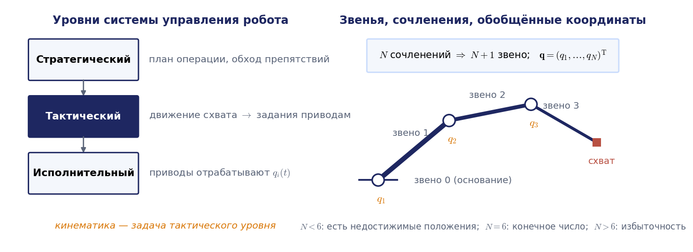
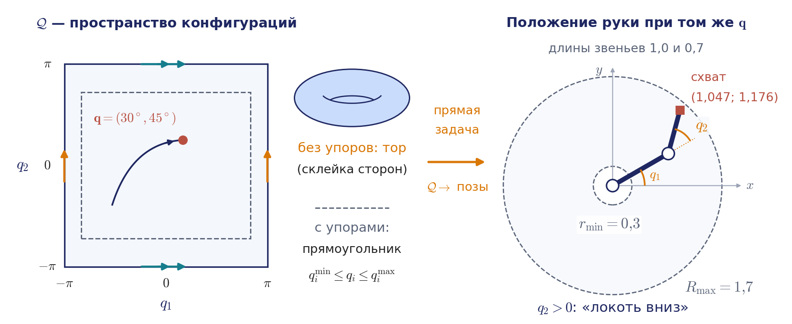
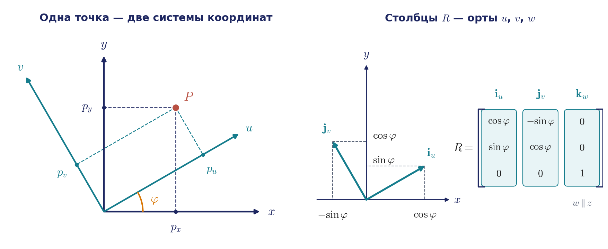
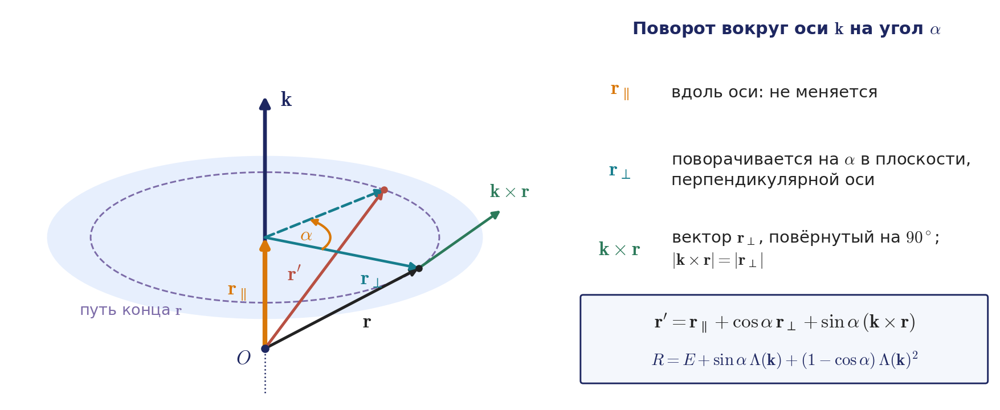
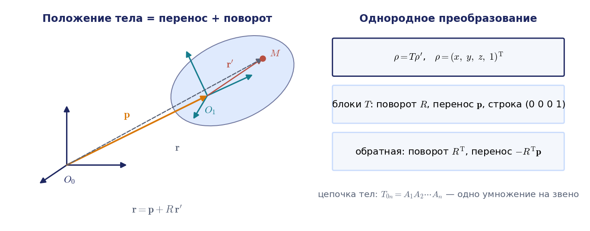
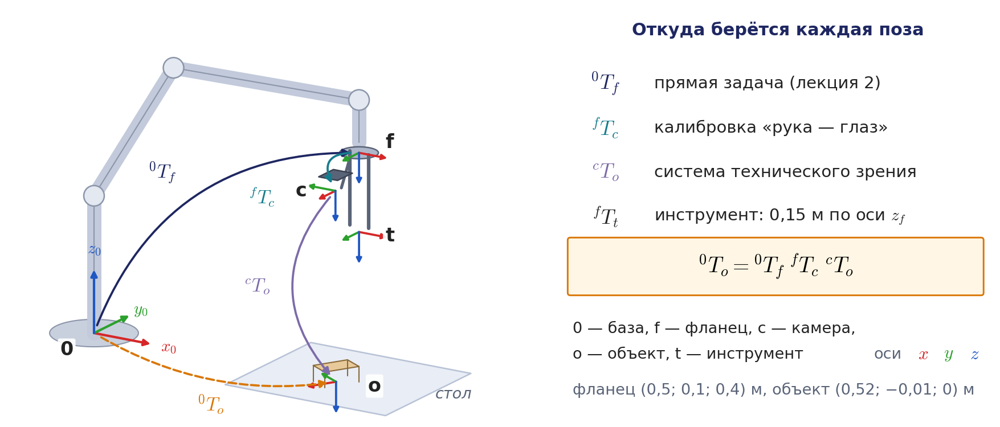
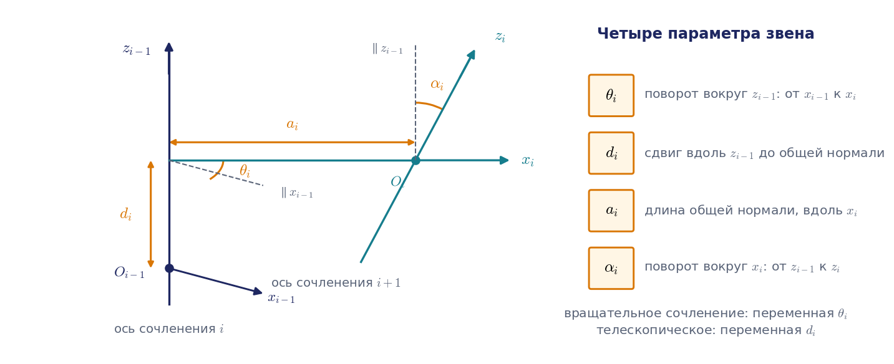
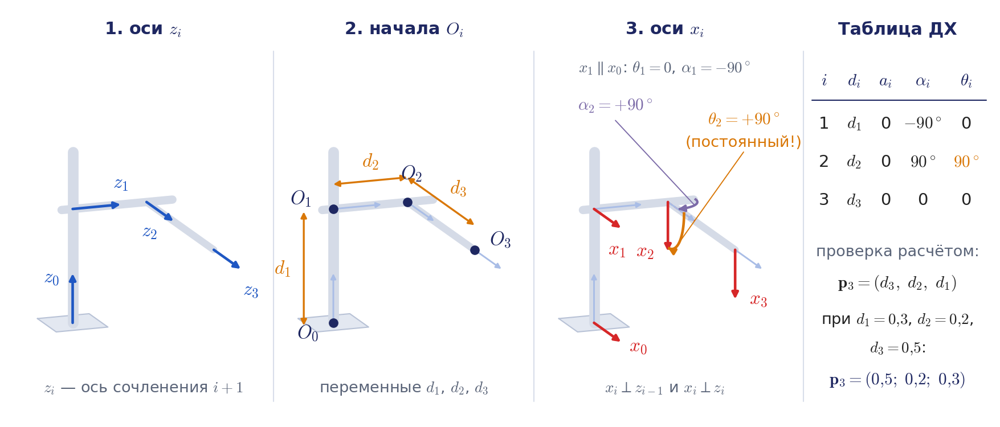
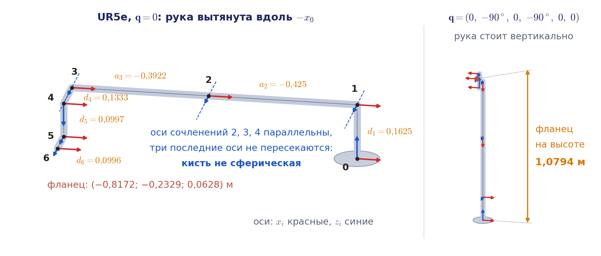

# Лекция 1. Манипулятор как объект управления. Преобразования координат и системы координат Денавита — Хартенберга

Курс «Управление роботами» начинается с кинематики манипуляторов. Прежде чем управлять роботом, нужно уметь ответить на два вопроса: где находится схват, если известны углы и смещения во всех сочленениях, и какие углы и смещения нужны, чтобы схват оказался в заданном месте. Эта лекция готовит аппарат для ответа. Мы договоримся о терминах, научимся описывать положение твёрдого тела одной матрицей, разберём способы записи ориентации, которыми пользуются учебники и промышленные контроллеры, и построим системы координат звеньев по алгоритму Денавита — Хартенберга. Прямая и обратная задачи о положении — предмет лекции 2, задачи о скорости — лекции 3.

Предшественников внутри курса у этой лекции нет. Она опирается на пять фактов из математики и механики, которые сегодня превратятся в инструменты описания робота. Скалярное произведение двух единичных векторов равно косинусу угла между ними. Три взаимно перпендикулярных единичных вектора, для которых $`\mathbf{i}\times\mathbf{j}=\mathbf{k}`$, образуют правую тройку. Произведение матриц в общем случае некоммутативно: $`AB\ne BA`$. Векторное произведение перпендикулярно обоим сомножителям и обращается в нуль для параллельных векторов. Свободное твёрдое тело имеет шесть степеней свободы: три поступательные и три вращательные.

Начнём с задачи, ради которой всё это нужно. Робот берёт со стола деталь, которую нашла камера, закреплённая на его фланце. Камера сообщает, где деталь находится относительно камеры. Контроллер робота знает, где фланец находится относительно основания. Положение камеры на фланце измерено один раз при наладке. Какие системы координат здесь участвуют и как одним вычислением получить положение детали относительно основания робота? К концу раздела 1.3 у нас будет короткий и точный ответ (пример 1.4).

Основной источник: Зенкевич С. Л., Ющенко А. С. «Основы управления манипуляционными роботами» (МГТУ им. Н. Э. Баумана, 2004), введение и глава 1. Современное изложение тех же тем — главы 2–4 книги К. Линча и Ф. Парка «Modern Robotics» и главы 2 и 7 книги П. Корке «Robotics, Vision and Control». Все обозначения курса сведены в файл «00_Паспорт/Обозначения.md».

## 1.1. Манипуляционный робот и его система управления

**Манипулятор** — механизм из звеньев, последовательно соединённых сочленениями так, что первое звено (основание, стойка) неподвижно, а последнее несёт рабочий орган: схват, сварочные клещи, горелку, окрасочный пистолет. **Манипуляционный робот** — манипулятор вместе с приводами, датчиками и системой управления, которую можно быстро перепрограммировать на новую работу.

Система управления робота устроена иерархически (рис. 1.1). На **исполнительном уровне** работают приводы сочленений: каждый привод отрабатывает заданное значение своей координаты. **Тактический уровень** превращает желаемое движение схвата в задания приводам; именно здесь решаются задачи кинематики. **Стратегический уровень** планирует операцию: последовательность действий и траекторию в обход препятствий. В современной программной системе эти уровни легко узнать. Планировщик движений (в экосистеме ROS 2 — пакет MoveIt 2) строит путь без столкновений и с помощью своих решателей кинематики переводит его в траекторию сочленений. Контроллеры траекторий из набора ros2_control интерполируют эту траекторию с тактом контроллера и выдают уставки приводам; кинематику они не решают. Сервоконтуры приводов отрабатывают уставки. Весь наш раздел курса относится к среднему, тактическому уровню. Подробное описание уровней и деление движений на глобальные, региональные и локальные по учебнику вынесены в приложение 1.А. Для дальнейшего важно одно следствие: у большинства промышленных роботов конструкция разделена на «руку», которая доставляет схват в нужную точку, и «кисть», которая его ориентирует. На лекции 2 мы увидим, как это разделение упрощает обратную задачу.



### Звенья, сочленения, степени подвижности

Два соседних звена образуют **кинематическую пару**. Почти все манипуляторы построены на парах, которые оставляют звену относительно предыдущего ровно одну степень свободы (в английской литературе — lower pair, 1-DOF joint). Это либо вращение вокруг оси (**вращательное сочленение**, В), либо перемещение вдоль оси (**телескопическое**, или поступательное, сочленение, П). Причина инженерная: одной степенью свободы управляет один привод. В учебнике такие пары называют парами пятого класса; классификация пар напомнена в приложении 1.А.

Величина, описывающая относительное положение звеньев в сочленении, — угол поворота или линейное смещение — называется **обобщённой координатой** $`q_i`$. Манипулятор с $`N`$ сочленениями имеет $`N`$ **степеней подвижности** и $`N + 1`$ звено, потому что неподвижное основание считается нулевым звеном. Вектор

```math
\mathbf{q} = (q_1, q_2, \dots, q_N)^{\mathrm T}
```

полностью задаёт **конфигурацию** манипулятора — положение всех его звеньев.

По первым трём сочленениям манипуляторы делят на типы, которые различаются формой рабочей зоны. Декартов робот (ППП) обслуживает прямоугольный параллелепипед. Цилиндрический робот (ВПП: поворот колонны, подъём каретки, выдвижение руки) обслуживает полый цилиндр. Сферический робот (ВВП) обслуживает шаровой слой. Ангулярный, или антропоморфный, робот (ВВВ, как PUMA) обслуживает область, близкую к шару. Отдельно выделяют схему SCARA: две вращательные пары с параллельными вертикальными осями и вертикальная поступательная пара. Формы рабочих зон мы подробно разберём на лекции 2.

### Пространство конфигураций

Множество всех допустимых конфигураций называется **пространством конфигураций** и обозначается $`\mathcal{Q}`$. Его полезно представлять себе как отдельное «пространство», в котором вся рука изображается одной точкой $`\mathbf{q}`$ (рис. 1.2). У плоского двухзвенника без упоров каждый угол определён с точностью до $`2\pi`$: углы $`q_1`$ и $`q_1+2\pi`$ дают одну и ту же руку. Поэтому $`\mathcal{Q}`$ — это квадрат $`[-\pi,\pi]\times[-\pi,\pi]`$, у которого склеены противоположные стороны, то есть поверхность тора. У реального робота ход каждого сочленения ограничен упорами, и $`\mathcal{Q}`$ становится прямоугольником, а при $`N`$ сочленениях — $`N`$-мерным параллелепипедом $`q_i^{\min}\le q_i\le q_i^{\max}`$.



Кинематика в целом — это отображение из $`\mathcal{Q}`$ в множество положений схвата. Прямая задача о положении (лекция 2) вычисляет это отображение, обратная — ищет прообраз заданного положения, а рабочая зона — образ всего $`\mathcal{Q}`$. Скорость конфигурации $`\dot{\mathbf{q}}`$ — это скорость точки в $`\mathcal{Q}`$, и на лекции 3 мы найдём, как она пересчитывается в скорость схвата. Траектории на лекции 4 будут кривыми в $`\mathcal{Q}`$.

### Шесть чисел положения схвата и N обобщённых координат

Положение схвата как твёрдого тела описывается шестью числами: тремя углами ориентации $`\boldsymbol{\Theta}`$ и тремя координатами $`\mathbf{p}`$ его характерной точки,

```math
\mathbf{s} = (\boldsymbol{\Theta};\mathbf{p}),\qquad \boldsymbol{\Theta}=(\Theta_1,\Theta_2,\Theta_3)^{\mathrm T},\qquad \mathbf{p}=(x,y,z)^{\mathrm T}.
```

Порядок блоков «сначала ориентация, затем положение» выбран так же, как у скорости тела в лекции 3. Конкретный выбор трёх углов $`\boldsymbol{\Theta}`$ мы обсудим в разделе 1.2: таких способов несколько.

С другой стороны, то же положение схвата определяется $`N`$ обобщёнными координатами. Отсюда сразу следуют три случая. Если $`N < 6`$, существуют положения схвата, которые нельзя обеспечить никаким выбором $`\mathbf{q}`$. Если $`N = 6`$, заданному положению схвата в общем случае, то есть вне особых положений, отвечает конечное число конфигураций: у PUMA их не больше восьми, у произвольного манипулятора с шестью вращательными сочленениями — не больше шестнадцати. В особых положениях решений может быть бесконечно много; например, у PUMA при $`q_5 = 0`$ можно одновременно повернуть четвёртое и шестое сочленения на равные углы в противоположные стороны, и схват не сдвинется (лекции 2–3). Если $`N > 6`$, манипулятор **избыточен**: конфигураций, как правило, бесконечно много, и рука может двигаться при неподвижном схвате. Так устроены рука человека и семизвенные коботы.

Раз одному положению схвата отвечает несколько конфигураций, одной шестёрки $`\mathbf{s}`$ промышленному контроллеру мало. Вместе с позой он хранит номер ветви решения обратной задачи: у ABB это данные конфигурации `robconf` (номера четвертей углов сочленений 1, 4, 6 и признак `cfx`), у KUKA — числа Status и Turn, у FANUC — строка конфигурации в каждой точке. Откуда берутся ветви, станет ясно на лекции 2.

Есть тонкость, которая определяет весь дальнейший аппарат. Шестёрка $`\mathbf{s}`$ — **не вектор** линейного пространства: координаты точки складываются, а углы поворота — нет. Результат двух последовательных поворотов не равен «сумме углов» и зависит от порядка поворотов. Поэтому для описания положения нужен инструмент, в котором композиция движений выражается корректной алгебраической операцией. Этот инструмент — матрицы. Что получается, если всё-таки «усреднить» две позы поэлементно, показывает анимация на рис. 1.11 в разделе 1.3.

## 1.2. Матрица поворота

Свяжем с неподвижным пространством систему координат $`Oxyz`$, а с телом — систему $`Ouvw`$ с тем же началом. Одну и ту же точку $`P`$ можно описать координатами в любой из двух систем (рис. 1.3):

```math
\mathbf{p}_{xyz} = (p_x, p_y, p_z)^{\mathrm T},\qquad \mathbf{p}_{uvw} = (p_u, p_v, p_w)^{\mathrm T}.
```



Радиус-вектор точки — один и тот же геометрический объект, разложенный по разным базисам: $`\mathbf{p} = p_u \mathbf{i}_u + p_v \mathbf{j}_v + p_w \mathbf{k}_w`$. Чтобы получить $`p_x`$, умножим это равенство скалярно на орт $`\mathbf{i}_x`$, и аналогично для $`p_y`$, $`p_z`$. Получаем линейную связь

```math
\mathbf{p}_{xyz} = R\,\mathbf{p}_{uvw},\qquad
R = \begin{pmatrix}
\mathbf{i}_x\cdot\mathbf{i}_u & \mathbf{i}_x\cdot\mathbf{j}_v & \mathbf{i}_x\cdot\mathbf{k}_w \\
\mathbf{j}_y\cdot\mathbf{i}_u & \mathbf{j}_y\cdot\mathbf{j}_v & \mathbf{j}_y\cdot\mathbf{k}_w \\
\mathbf{k}_z\cdot\mathbf{i}_u & \mathbf{k}_z\cdot\mathbf{j}_v & \mathbf{k}_z\cdot\mathbf{k}_w
\end{pmatrix}.
```

Матрица $`R`$ называется **матрицей поворота**. Каждый её элемент — скалярное произведение единичных векторов, то есть косинус угла между осью неподвижной и осью подвижной системы; поэтому в литературе её называют также матрицей направляющих косинусов. Её полезно читать по столбцам: первый столбец — координаты орта $`\mathbf{i}_u`$ в неподвижной системе, второй — орта $`\mathbf{j}_v`$, третий — орта $`\mathbf{k}_w`$. Иначе говоря, **столбцы матрицы поворота — это орты подвижной системы, записанные в неподвижной**. Этим свойством мы будем пользоваться постоянно: из матрицы положения звена сразу читается, куда смотрят его оси. В пространстве это хорошо видно на рис. 1.4: каждый столбец движется вместе со «своей» осью тела, а произведение $`R\,\mathbf{p}_{uvw}`$ складывается из столбцов, взятых с коэффициентами $`p_u`$, $`p_v`$, $`p_w`$.


Анимация целиком: [l01_rotation_columns.mp4](../06_Анимации/l01_rotation_columns.mp4), 48 с.

### Свойства

Орты подвижной системы взаимно перпендикулярны и имеют единичную длину, поэтому столбцы $`R`$ ортонормированы:

```math
R^{\mathrm T} R = R R^{\mathrm T} = E,\qquad R^{-1} = R^{\mathrm T},\qquad \det R = +1.
```

Обратное преобразование получается транспонированием — обращать матрицу численно не нужно. Знак определителя $`+1`$ означает, что правая тройка остаётся правой. У матрицы девять элементов, а условий ортонормированности шесть (три условия единичной длины столбцов и три условия их попарной перпендикулярности), поэтому независимых параметров три — столько же, сколько вращательных степеней свободы у твёрдого тела.

### Три смысла одной матрицы

Одна и та же матрица $`R`$ используется в трёх ролях, и полезно с самого начала их различать.

- **Ориентация тела.** Столбцы $`R`$ — оси тела, записанные в неподвижной системе. В этом смысле матрица описывает, как тело расположено.
- **Пересчёт координат.** Формула $`\mathbf{p}_{xyz} = R\,\mathbf{p}_{uvw}`$ переводит координаты одной и той же точки из подвижной системы в неподвижную. Точка при этом не движется, меняется только система, в которой её описывают.
- **Оператор поворота.** Формула $`\mathbf{a}' = R\,\mathbf{a}`$, в которой оба вектора заданы в одной и той же системе, поворачивает вектор $`\mathbf{a}`$ в новое положение $`\mathbf{a}'`$. Если применить её к трём ортам неподвижной системы, получатся три столбца $`R`$, то есть оси повёрнутого тела.

Чтобы не путаться, систему, в которой записаны столбцы, указывают индексом. Матрицу ориентации системы $`B`$ относительно системы $`A`$ будем записывать как $`{}^{A}R_{B}`$; тогда $`\mathbf{p}_{A} = {}^{A}R_{B}\,\mathbf{p}_{B}`$, и индексы «сокращаются», как дроби: $`{}^{A}R_{C} = {}^{A}R_{B}\,{}^{B}R_{C}`$.

### Элементарные повороты

Поворот подвижной системы вокруг одной из координатных осей на угол $`\varphi`$ описывается матрицей **элементарного поворота**:

```math
R_{x,\varphi} = \begin{pmatrix} 1 & 0 & 0 \\ 0 & \cos\varphi & -\sin\varphi \\ 0 & \sin\varphi & \cos\varphi \end{pmatrix},\quad
R_{y,\varphi} = \begin{pmatrix} \cos\varphi & 0 & \sin\varphi \\ 0 & 1 & 0 \\ -\sin\varphi & 0 & \cos\varphi \end{pmatrix},\quad
R_{z,\varphi} = \begin{pmatrix} \cos\varphi & -\sin\varphi & 0 \\ \sin\varphi & \cos\varphi & 0 \\ 0 & 0 & 1 \end{pmatrix}.
```

Запоминать их удобно так: строка и столбец оси вращения содержат единицу и нули, в оставшемся блоке 2×2 стоит плоский поворот, а знак минус находится над диагональю у $`R_x`$ и $`R_z`$ и под диагональю у $`R_y`$ (циклическая перестановка осей). Там, где индекс неудобен, будем писать то же самое как $`R_x(\varphi)`$, $`R_y(\varphi)`$, $`R_z(\varphi)`$.

### Сложные повороты и порядок умножения

Последовательность поворотов описывается произведением матриц, и здесь действует правило, в котором ошибаются чаще всего (рис. 1.5 после примера 1.1).

- Если очередной поворот выполняется вокруг оси **подвижной** (уже повёрнутой) системы, его матрица умножается **справа**.
- Если очередной поворот выполняется вокруг оси **неподвижной** системы, его матрица умножается **слева**.

Это правило не нужно заучивать: оно выводится в три строки из двух смыслов матрицы. Пусть первый поворот перевёл неподвижную систему $`0`$ в систему $`1`$, так что $`{}^{0}R_{1}=R_1`$. Второй поворот выполняется вокруг оси системы $`1`$; естественно записать его в осях этой системы, то есть задать матрицу $`{}^{1}R_{2}=R_2`$. Тогда по правилу сокращения индексов (пересчёт координат сначала из системы $`2`$ в систему $`1`$, затем из $`1`$ в $`0`$)

```math
{}^{0}R_{2} = {}^{0}R_{1}\,{}^{1}R_{2} = R_1 R_2 .
```

Если же второй поворот выполняется вокруг неподвижной оси, он действует как оператор на уже повёрнутое тело: каждый столбец $`R_1`$ (каждая ось тела) поворачивается матрицей $`R_2`$, заданной в неподвижных осях. Поэтому новая матрица равна $`R_2 R_1`$. Отсюда же следует полезное тождество: **повороты вокруг подвижных осей в прямом порядке дают то же, что повороты вокруг неподвижных осей в обратном порядке**. Например, «вокруг $`z`$, затем вокруг новой оси $`x`$» и «вокруг неподвижной $`x`$, затем вокруг неподвижной $`z`$» дают одну и ту же матрицу $`R_{z,\varphi}R_{x,\psi}`$.

Поскольку умножение матриц некоммутативно, результат зависит от порядка поворотов: $`R_{x,90^\circ} R_{z,90^\circ} \ne R_{z,90^\circ} R_{x,90^\circ}`$. В этом легко убедиться, повернув книгу на столе в одном и в другом порядке. Именно поэтому три угла ориентации нельзя складывать как компоненты вектора.

#### Пример 1.1. Два поворота в разном порядке

Повернём систему сначала вокруг оси $`z`$ на $`90^\circ`$, затем вокруг **новой** оси $`u`$ (бывшей $`x`$) на $`90^\circ`$. Оба поворота заданы в подвижных осях, поэтому матрицы перемножаются слева направо:

```math
R = R_{z,90^\circ} R_{x,90^\circ} =
\begin{pmatrix} 0 & -1 & 0 \\ 1 & 0 & 0 \\ 0 & 0 & 1 \end{pmatrix}
\begin{pmatrix} 1 & 0 & 0 \\ 0 & 0 & -1 \\ 0 & 1 & 0 \end{pmatrix} =
\begin{pmatrix} 0 & 0 & 1 \\ 1 & 0 & 0 \\ 0 & 1 & 0 \end{pmatrix}.
```

Читаем по столбцам: ось $`u`$ теперь направлена вдоль $`y`$, ось $`v`$ — вдоль $`z`$, ось $`w`$ — вдоль $`x`$. Если бы второй поворот выполнялся вокруг неподвижной оси $`x`$, следовало бы вычислить $`R_{x,90^\circ} R_{z,90^\circ}`$, и результат был бы другим: $`u`$ вдоль $`z`$, $`v`$ вдоль $`-x`$, $`w`$ вдоль $`-y`$. Заметим ещё одно: два поворота на $`90^\circ`$ в сумме не дают поворота на $`180^\circ`$. Ниже, в примере 1.2, мы увидим, что каждая из двух итоговых ориентаций получается одним поворотом на $`120^\circ`$, но вокруг разных осей. Оба порядка поворотов показаны на рис. 1.5 на книге: левая книга поворачивается во второй раз вокруг своей оси $`u`$, правая — вокруг неподвижной оси $`x`$.

![Рис. 1.5. Анимация к примеру 1.1: две книги сначала поворачиваются на 90° вокруг z, затем левая — на 90° вокруг своей новой оси u, а правая — на 90° вокруг неподвижной оси x, и книги ложатся по-разному. Под каждой книгой матрица читается по столбцам: слева ось u направлена вдоль y, v — вдоль z, w — вдоль x, справа u — вдоль z, v — вдоль −x, w — вдоль −y. Затем проверяется тождество «подвижные оси в прямом порядке равны неподвижным в обратном», а в конце ролика каждая из двух поз получается одним поворотом на 120°, но вокруг разных осей](../06_Анимации/l01_rotation_order_fixed_vs_moving.gif)

Анимация целиком: [l01_rotation_order_fixed_vs_moving.mp4](../06_Анимации/l01_rotation_order_fixed_vs_moving.mp4), 60 с.

### Углы Эйлера

Раз независимых параметров три, ориентацию можно задать тремя углами. Классическая система **углов Эйлера** (ZYZ): поворот на угол $`\varphi`$ вокруг оси $`z`$, затем на угол $`\theta`$ вокруг новой оси $`y`$, затем на угол $`\psi`$ вокруг новой оси $`z`$. Все повороты — в подвижных осях, поэтому

```math
R(\varphi, \theta, \psi) = R_{z,\varphi}\, R_{y,\theta}\, R_{z,\psi}.
```

У любой тройки углов есть особые ориентации, в которых оси первого и третьего поворотов совпадают и углы определяются неоднозначно. Для углов Эйлера ZYZ это $`\sin\theta = 0`$, и таких ориентаций две. При $`\theta = 0`$ оба поворота выполняются вокруг одной оси $`z`$, $`R = R_{z,\varphi+\psi}`$, и различима только сумма $`\varphi + \psi`$. При $`\theta = \pi`$ матрица $`R_{y,\pi}=\mathrm{diag}(-1,1,-1)`$ меняет знак поворота вокруг $`z`$, $`R = R_{z,\varphi-\psi}R_{y,\pi}`$, и различима только разность $`\varphi - \psi`$. Например, тройки $`(30^\circ, 180^\circ, 50^\circ)`$ и $`(70^\circ, 180^\circ, 90^\circ)`$ дают одну и ту же матрицу, а тройка $`(70^\circ, 180^\circ, 10^\circ)`$ с той же суммой — другую. Есть и вторая, более мягкая неоднозначность: вне особых ориентаций тройки $`(\varphi,\theta,\psi)`$ и $`(\varphi+\pi,-\theta,\psi+\pi)`$ дают одну и ту же матрицу, поэтому при решении обратной задачи угол $`\theta`$ принято брать в пределах $`[0,\pi]`$.

Особая ориентация вредна не только в самой точке. Пусть тело поворачивается равномерно со скоростью $`10^\circ`$ в секунду так, что его ось $`w`$ проходит в $`2^\circ`$ от оси $`z`$. Тело движется плавно, а угол $`\varphi`$ за четыре секунды проворачивается на $`169^\circ`$, причём в середине движения со скоростью около $`287^\circ`$ в секунду (рис. 1.6). Привод, который отрабатывал бы угол $`\varphi`$, должен был бы вращаться почти в 29 раз быстрее самого тела. Если ось проходит не в $`2^\circ`$, а в $`5^\circ`$ от оси $`z`$, пик скорости снижается до $`115^\circ`$ в секунду: чем ближе путь к особой ориентации, тем резче скачок.


Анимация целиком: [l01_euler_gimbal_singularity.mp4](../06_Анимации/l01_euler_gimbal_singularity.mp4), 79,5 с.

Это не недостаток именно углов Эйлера. Можно доказать, что никакие три числа не описывают все ориентации непрерывно и однозначно: у любой тройки углов найдутся особые ориентации. Поэтому в программах ориентацию хранят матрицей или кватернионом (ниже), а углы используют для ввода и вывода человеком.

У углов ZYZ есть и прямой механический смысл. Сферическая кисть PUMA — это три вращательных сочленения, оси которых пересекаются в одной точке; её матрица поворота относительно предплечья равна $`R_{z,q_4}R_{y,q_5}R_{z,q_6}`$, то есть углы кисти — это в точности углы Эйлера. Особая ориентация $`\theta = 0`$ соответствует положению $`q_5 = 0`$, в котором оси четвёртого и шестого сочленений совпадают и различима только сумма $`q_4+q_6`$. Это особое положение кисти, и контроллеры обрабатывают его специально (у ABB для движения рядом с ним есть инструкция `SingArea`). Подробно — на лекциях 3–4.

### Углы крена, тангажа и рыскания

В навигации, авиации и в большинстве промышленных контроллеров пользуются другой тройкой: **рыскание** $`\psi`$ (поворот вокруг оси $`z`$), **тангаж** $`\theta`$ (вокруг новой оси $`y`$) и **крен** $`\varphi`$ (вокруг новой оси $`x`$). Повороты выполняются в подвижных осях, поэтому

```math
R(\varphi,\theta,\psi) = R_{z,\psi}\,R_{y,\theta}\,R_{x,\varphi}.
```

По тождеству из предыдущего подраздела та же матрица получается, если повернуть тело вокруг **неподвижных** осей $`x`$, $`y`$, $`z`$ в обратном порядке: сначала крен, потом тангаж, потом рыскание. Отсюда два названия одной тройки: «углы ZYX в подвижных осях» и «углы XYZ в неподвижных осях»; по номерам осей её называют также углами 3-2-1. Особые ориентации здесь — тангаж $`\theta = \pm 90^\circ`$, когда ось крена совпадает с осью рыскания. При $`\theta = +90^\circ`$ различима только разность $`\psi - \varphi`$, при $`\theta = -90^\circ`$ — только сумма $`\psi + \varphi`$. Например, $`R_{z}(0{,}3)R_{y}(\pi/2)R_{x}(0{,}7) = R_{z}(0{,}5)R_{y}(\pi/2)R_{x}(0{,}9)`$: углы в радианах разные, а матрица одна. Это явление называют складыванием рамок (gimbal lock): в карданном подвесе гироскопа при тангаже $`90^\circ`$ две рамки ложатся в одну плоскость. Вне особых ориентаций тройки $`(\varphi,\theta,\psi)`$ и $`(\varphi+\pi,\pi-\theta,\psi+\pi)`$ дают одну матрицу, поэтому тангаж берут в пределах $`[-90^\circ, 90^\circ]`$.

**Две тройки углов в курсе.** Обратите внимание: буквы $`\varphi`$ и $`\psi`$ в двух тройках меняют смысл. В углах Эйлера ZYZ $`\varphi`$ — первый поворот вокруг $`z`$, а $`\psi`$ — последний, тоже вокруг $`z`$. В углах 3-2-1 $`\psi`$ — рыскание (первый поворот вокруг $`z`$), а $`\varphi`$ — крен (последний поворот, вокруг $`x`$). Средний угол $`\theta`$ в обеих тройках — поворот вокруг новой оси $`y`$. В лекциях 1–3 углы Эйлера служат для описания кисти манипулятора, в лекциях 5 и 7 углы 3-2-1 — для платформы и летательного аппарата; в каждом месте курса тройка называется явно. В библиотеке курса `kinlib` метод `Frame.euler_zyz` возвращает углы Эйлера $`(\varphi,\theta,\psi)`$, а метод `Frame.rpy_zyx` — углы 3-2-1 в порядке $`(\psi,\theta,\varphi)`$, рысканием вперёд; старое имя `euler_3` оставлено как синоним `rpy_zyx` и, несмотря на название, углов Эйлера ZYZ не возвращает.

**Примечание о расхождении с книгой.** В учебнике углы крена, тангажа и рыскания названы словами, без формулы, и указана одна особая ориентация углов Эйлера. В курсе обе тройки записаны формулами, а для углов ZYZ указаны обе особые ориентации, $`\theta = 0`$ и $`\theta=\pi`$.

### Ось и угол поворота. Формула Родрига. Кватернион

Углы удобны человеку, но у них есть особые ориентации. Существует описание ориентации, у которого прозрачный геометрический смысл и почти нет особенностей. Оно опирается на **теорему Эйлера о повороте**: любое изменение ориентации твёрдого тела с неподвижной точкой можно получить одним поворотом вокруг некоторой оси, проходящей через эту точку. Ось задаётся единичным вектором $`\mathbf{k}`$ (два независимых параметра), поворот — углом $`\alpha`$ (третий параметр). Итого снова три параметра, как и должно быть. Буква $`\alpha`$ здесь — угол поворота вокруг оси; параметр Денавита — Хартенберга $`\alpha_i`$ из раздела 1.5 всегда пишется с индексом.

Для записи формул нужна **кососимметрическая матрица** вектора. Векторное произведение $`\mathbf{k}\times\mathbf{r}`$ линейно по $`\mathbf{r}`$, поэтому его можно записать как умножение на матрицу:

```math
\mathbf{k}\times\mathbf{r} = \Lambda(\mathbf{k})\,\mathbf{r},\qquad
\Lambda(\mathbf{k}) = \begin{pmatrix} 0 & -k_3 & k_2 \\ k_3 & 0 & -k_1 \\ -k_2 & k_1 & 0 \end{pmatrix},\qquad \Lambda^{\mathrm T} = -\Lambda .
```

Той же матрицей мы будем пользоваться на лекции 3, где через неё выражается угловая скорость. Поворот вокруг оси $`\mathbf{k}`$ на угол $`\alpha`$ задаётся **формулой Родрига**

```math
R = \mathrm{Rot}(\mathbf{k},\alpha) = E + \sin\alpha\,\Lambda(\mathbf{k}) + (1-\cos\alpha)\,\Lambda(\mathbf{k})^2 .
```

Её смысл прост. Разложим поворачиваемый вектор на составляющую вдоль оси и составляющую, перпендикулярную оси. Первая при повороте не меняется, вторая поворачивается в своей плоскости на угол $`\alpha`$ (рис. 1.7). Слагаемое с $`\sin\alpha`$ отвечает за сдвиг конца вектора поперёк, слагаемое с $`1-\cos\alpha`$ — за укорочение перпендикулярной составляющей. Вывод в три строки дан в приложении 1.Б. Там же показано, что формула Родрига — это сумма ряда для матричной экспоненты, $`R=\exp\bigl(\alpha\Lambda(\mathbf{k})\bigr)`$; эта запись понадобится на лекциях 2–4.



Обратная задача — найти ось и угол по известной матрице — решается так же коротко. След матрицы Родрига равен $`1+2\cos\alpha`$, а её кососимметрическая часть равна $`\sin\alpha\,\Lambda(\mathbf{k})`$. Поэтому

```math
\alpha = \arccos\frac{\mathrm{tr}\,R - 1}{2},\qquad \Lambda(\mathbf{k}) = \frac{R - R^{\mathrm T}}{2\sin\alpha},\qquad 0<\alpha<\pi .
```

Есть два особых случая. При $`\alpha=0`$ поворота нет, $`R=E`$, и ось не определена — это естественно. При $`\alpha=\pi`$ знаменатель обращается в нуль, но ось находится из равенства $`R+E=2\mathbf{k}\mathbf{k}^{\mathrm T}`$: любой ненулевой столбец матрицы $`R+E`$, делённый на свою длину, даёт $`\mathbf{k}`$ (с точностью до знака, который при повороте на $`180^\circ`$ не важен).

Ось и угол удобно объединить в один вектор $`\alpha\mathbf{k}`$, который называют **вектором поворота**: его направление — ось, его длина — угол в радианах. Переход от матрицы к вектору поворота — это матричный логарифм, обратный к экспоненте, с последующей выборкой трёх чисел из кососимметрической матрицы: $`\alpha\mathbf{k}=\log(R)^{\vee}`$, где знак $`{}^{\vee}`$ обозначает переход $`\Lambda(\mathbf{a})\mapsto\mathbf{a}`$. Вектором поворота задаёт ориентацию инструмента контроллер Universal Robots: поза на пульте и в языке URScript — это шестёрка `p[x, y, z, rx, ry, rz]`, где $`(r_x,r_y,r_z)`$ — вектор поворота в радианах. Он же служит точной мерой ошибки ориентации в итерационных методах лекций 2 и 4.

Последнее важное представление — **единичный кватернион**. Это четвёрка чисел

```math
\mathbf{e} = (e_0;\,e_1, e_2, e_3),\qquad e_0 = \cos\frac{\alpha}{2},\qquad (e_1,e_2,e_3)^{\mathrm T} = \mathbf{k}\sin\frac{\alpha}{2},\qquad e_0^2+e_1^2+e_2^2+e_3^2 = 1 .
```

Кватернион построен из оси и половины угла, и у этого есть три следствия. Во-первых, особых ориентаций нет: при любой ориентации четыре числа определены и гладко меняются при плавном движении тела. Во-вторых, $`\mathbf{e}`$ и $`-\mathbf{e}`$ задают одну и ту же ориентацию: замена $`\alpha`$ на $`\alpha+2\pi`$ меняет знак всех четырёх чисел, а поворот остаётся прежним. Это свойство называют двойным покрытием; его нужно помнить, когда сравнивают два кватерниона или интерполируют между ними. В-третьих, последовательные повороты описываются произведением кватернионов в том же порядке, в каком перемножаются матрицы. Для кватернионов $`\mathbf{a}=(a_0;\mathbf{a}_v)`$ и $`\mathbf{b}=(b_0;\mathbf{b}_v)`$ с векторными частями $`\mathbf{a}_v`$, $`\mathbf{b}_v`$ произведение равно

```math
\mathbf{a}\otimes\mathbf{b} = \bigl(a_0b_0 - \mathbf{a}_v\cdot\mathbf{b}_v;\ a_0\mathbf{b}_v + b_0\mathbf{a}_v + \mathbf{a}_v\times\mathbf{b}_v\bigr).
```

Четыре числа вместо девяти, одно условие нормировки вместо шести и отсутствие особых ориентаций — поэтому кватернион стал стандартным способом хранить ориентацию в программах: в системе ROS, в контроллерах ABB, в полётных контроллерах. Подробно кинематику кватерниона мы разберём на лекции 7.

Разницу между вектором поворота и кватернионом хорошо видно, если поворачивать тело вокруг одной оси всё дальше (рис. 1.8). Вектор поворота $`\alpha\mathbf{k}`$ растёт вдоль оси, пока его длина не достигнет $`\pi`$; при переходе через $`180^\circ`$ он скачком перескакивает из точки $`\pi\mathbf{k}`$ в противоположную точку $`-\pi\mathbf{k}`$ шара $`|\alpha\mathbf{k}|\le\pi`$, хотя тело движется плавно. Кватернион меняется гладко на всём пути, но после полного оборота на $`360^\circ`$ он равен $`(-1;\,0,0,0)`$, а не исходному $`(1;\,0,0,0)`$: тело вернулось в прежнюю ориентацию, а кватернион сменил знак. Это и есть двойное покрытие.


Анимация целиком: [l01_axis_angle_quaternion.mp4](../06_Анимации/l01_axis_angle_quaternion.mp4), 76 с.

#### Пример 1.2. Ось, угол и кватернион по матрице

Найдём ось и угол для матрицы из примера 1.1, $`R=R_{z,90^\circ}R_{x,90^\circ}`$. Её след равен нулю, поэтому $`\cos\alpha = -1/2`$ и $`\alpha = 120^\circ`$. Ось находим по кососимметрической части $`(R-R^{\mathrm T})/2 = \sin 120^\circ\,\Lambda(\mathbf{k})`$:

```math
\Lambda(\mathbf{k}) = \frac{R-R^{\mathrm T}}{2\sin 120^\circ} = \frac{1}{\sqrt3}\begin{pmatrix} 0 & -1 & 1 \\ 1 & 0 & -1 \\ -1 & 1 & 0 \end{pmatrix},\qquad
\mathbf{k} = \frac{1}{\sqrt3}(1,1,1)^{\mathrm T}.
```

Итак, два поворота на $`90^\circ`$ вокруг $`z`$ и новой $`x`$ — это один поворот на $`120^\circ`$ вокруг диагонали куба. Геометрически это понятно: такой поворот циклически переставляет оси, $`x\to y\to z\to x`$, что мы и прочитали по столбцам в примере 1.1. Вектор поворота равен $`\alpha\mathbf{k}=(1{,}2092;\ 1{,}2092;\ 1{,}2092)`$ рад, кватернион — $`\mathbf{e}=(\cos 60^\circ;\ \mathbf{k}\sin 60^\circ)=(0{,}5;\ 0{,}5;\ 0{,}5;\ 0{,}5)`$. Проверим правило композиции. Поворот на $`90^\circ`$ вокруг $`z`$ даёт кватернион $`(\cos 45^\circ;\ 0,0,\sin 45^\circ)`$, поворот на $`90^\circ`$ вокруг $`x`$ — кватернион $`(\cos 45^\circ;\ \sin 45^\circ,0,0)`$. По формуле произведения скалярная часть равна $`\tfrac12 - 0 = 0{,}5`$, а векторная — $`\tfrac12(1,0,0)+\tfrac12(0,0,1)+\tfrac12(0,1,0)=(0{,}5;\ 0{,}5;\ 0{,}5)`$, то есть тот же кватернион. Для второй ориентации примера 1.1, $`R_{x,90^\circ}R_{z,90^\circ}`$, тот же расчёт даёт угол $`120^\circ`$ и ось $`(1,-1,1)^{\mathrm T}/\sqrt3`$.

### Сравнение способов описать ориентацию

Сведём способы описания ориентации в одну таблицу. Она понадобится на протяжении всего курса.

| Способ | Сколько чисел | Особые ориентации и неоднозначности | Где применяют |
|---|---|---|---|
| матрица поворота $`R`$ | 9, шесть условий ортонормированности | нет | внутри программ, во всех выкладках курса |
| углы Эйлера ZYZ $`(\varphi,\theta,\psi)`$ | 3 | $`\sin\theta=0`$, то есть $`\theta=0`$ и $`\theta=\pi`$; две тройки на одну матрицу | сферическая кисть, учебник |
| углы 3-2-1 (рыскание, тангаж, крен) | 3 | тангаж $`\pm90^\circ`$; две тройки на одну матрицу | ввод человеком; контроллеры KUKA и FANUC; авиация |
| ось и угол $`(\mathbf{k},\alpha)`$, вектор поворота $`\alpha\mathbf{k}`$ | 4 или 3 | при $`\alpha=0`$ ось не определена; при $`\alpha=\pi`$ векторы $`\pm\pi\mathbf{k}`$ дают одну ориентацию | контроллеры Universal Robots; ошибка ориентации (лекции 2–4) |
| единичный кватернион $`\mathbf{e}`$ | 4, одно условие нормировки | особых ориентаций нет; $`\mathbf{e}`$ и $`-\mathbf{e}`$ — одна ориентация | ROS, контроллеры ABB, полётные контроллеры (лекция 7) |

### Где это в реальной системе: одна ориентация — шесть записей

Каждый производитель роботов выбрал свой способ записи ориентации, и при переносе программы или при обмене данными с системой зрения их приходится пересчитывать. Пересчёт всегда идёт через матрицу поворота, по формулам этого раздела. Возьмём одну ориентацию, $`R = R_{z,30^\circ}R_{y,20^\circ}R_{x,10^\circ}`$, и запишем её так, как её показали бы разные системы.

| Система | Как записана ориентация | Числа для нашей ориентации |
|---|---|---|
| KUKA | углы A, B, C: поворот на A вокруг $`z`$, на B вокруг новой $`y`$, на C вокруг новой $`x`$ | A = 30°, B = 20°, C = 10° |
| FANUC | углы W, P, R: повороты вокруг неподвижных осей $`x`$, затем $`y`$, затем $`z`$ | W = 10°, P = 20°, R = 30° |
| Universal Robots | вектор поворота $`(r_x, r_y, r_z)`$, рад | (0,0775; 0,3849; 0,4865), угол 35,82° |
| ABB | кватернион $`q_1,\dots,q_4`$, скалярная часть первой | (0,9515; 0,0381; 0,1893; 0,2393) |
| ROS, scipy | кватернион $`(x, y, z, w)`$, скалярная часть последней | (0,0381; 0,1893; 0,2393; 0,9515) |
| учебник | углы Эйлера ZYZ $`(\varphi,\theta,\psi)`$ | (2,73°; 22,27°; 25,51°) |

Запись KUKA и запись FANUC содержат одни и те же три числа в разном порядке — это ровно тождество «подвижные оси в прямом порядке равны неподвижным в обратном». Углы Эйлера ZYZ, удобные для описания сферической кисти, в промышленных интерфейсах почти не встречаются. Самая частая практическая ошибка — перепутать порядок компонент кватерниона: у ABB скалярная часть стоит первой, в ROS и в библиотеке scipy — последней. Названия переменных и форматы конкретных контроллеров меняются от версии к версии, поэтому при работе с роботом их сверяют по документации производителя; смысл же у всех записей один — это шесть чисел, за которыми стоит одна однородная матрица.

## 1.3. Однородные координаты и однородные преобразования

Матрица поворота описывает только ориентацию. В общем случае начало подвижной системы смещено на вектор $`\mathbf{p}`$, и координаты точки пересчитываются так (рис. 1.9):

```math
\mathbf{r} = \mathbf{p} + R\,\mathbf{r}'.
```



Это преобразование не является линейным — в нём есть слагаемое $`\mathbf{p}`$, — и композиция нескольких таких преобразований записывается громоздко. Выход — перейти к **однородным координатам**: к трём координатам точки приписывается четвёртая, равная единице,

```math
\boldsymbol{\rho} = (x, y, z, 1)^{\mathrm T}.
```

Тогда перенос и поворот объединяются в одну матрицу 4×4 — **матрицу однородного преобразования**:

```math
\boldsymbol{\rho} = T \boldsymbol{\rho}',\qquad
T = \begin{pmatrix} R & \mathbf{p} \\ 0\ 0\ 0 & 1 \end{pmatrix}.
```

Левый верхний блок 3×3 — матрица поворота, правый столбец — положение начала подвижной системы, нижняя строка постоянна. Частные случаи — чистый перенос и чистый поворот:

```math
\mathrm{Trans}(\mathbf{p}) = \begin{pmatrix} E & \mathbf{p} \\ 0\ 0\ 0 & 1 \end{pmatrix},\qquad
\mathrm{Rot}(z, \varphi) = \begin{pmatrix} R_{z,\varphi} & \mathbf{0} \\ 0\ 0\ 0 & 1 \end{pmatrix}.
```

Сдвиг вдоль одной оси будем записывать как $`\mathrm{Trans}(z, d)`$ или $`\mathrm{Trans}(x, a)`$.

Представление избыточно: в матрице 16 элементов, а независимых параметров шесть. Но этот недостаток, по замечанию авторов учебника, полностью окупается двумя преимуществами. Во-первых, перенос и поворот больше не нужно рассматривать раздельно. Во-вторых, композиция движений становится произведением матриц, и для исследования кинематики открывается весь аппарат матричной алгебры.

### Точка и направление

Четвёртая координата различает два вида геометрических объектов. Точка записывается с единицей, $`(x,y,z,1)^{\mathrm T}`$, и при умножении на $`T`$ поворачивается и переносится. Направление — например, ось инструмента, нормаль к поверхности, скорость — записывается с нулём, $`(x,y,z,0)^{\mathrm T}`$. Ноль в четвёртой координате «выключает» столбец $`\mathbf{p}`$, и направление только поворачивается: перенос тела не меняет направления его осей. Путать эти два случая — частая практическая ошибка; в библиотеках для пересчёта точек и векторов поэтому заведены разные функции.

### Три смысла однородной матрицы и запись позы

У однородной матрицы те же три смысла, что у матрицы поворота. Она описывает **позу** тела (положение и ориентацию его системы координат), **пересчитывает координаты** точки из системы тела в другую систему и служит **оператором движения**, который переносит и поворачивает тело. Чтобы не путаться в длинных цепочках, систему, относительно которой задана поза, пишут слева сверху, а систему, чья это поза, — справа снизу:

```math
{}^{A}T_{B} = \begin{pmatrix} {}^{A}R_{B} & {}^{A}\mathbf{p}_{B} \\ 0\ 0\ 0 & 1 \end{pmatrix},\qquad
\boldsymbol{\rho}_{A} = {}^{A}T_{B}\,\boldsymbol{\rho}_{B}.
```

Читается это так: «поза системы $`B`$ в системе $`A`$». Столбцы $`{}^{A}R_{B}`$ — оси системы $`B`$ в осях $`A`$, вектор $`{}^{A}\mathbf{p}_{B}`$ — начало системы $`B`$ в осях $`A`$. Главное удобство такой записи — правило сокращения индексов:

```math
{}^{A}T_{C} = {}^{A}T_{B}\,{}^{B}T_{C},\qquad \bigl({}^{A}T_{B}\bigr)^{-1} = {}^{B}T_{A}.
```

Внутренние индексы произведения должны совпадать; если не совпадают, формула записана с ошибкой. Если поза задана относительно базовой системы $`0`$, верхний индекс обычно опускают: $`T_i = {}^{0}T_i`$. Так же записывают позы Дж. Крейг и К. Линч с Ф. Парком (у последних индексы стоят справа, $`T_{ab}`$); в библиотеке tf2 системы ROS вызов `lookupTransform(target, source)` возвращает именно $`{}^{\mathrm{target}}T_{\mathrm{source}}`$ — позу системы `source` в системе `target`.

**Примечание о расхождении с книгой.** В учебнике однородные матрицы пишутся без указания систем. В курсе в цепочках из нескольких тел используется запись $`{}^{A}T_{B}`$, а для звеньев манипулятора — сокращённая запись $`T_i`$, как в учебнике.

### Обратное преобразование

Обращать матрицу 4×4 численно не нужно. Из $`\mathbf{r} = \mathbf{p} + R\mathbf{r}'`$ следует $`\mathbf{r}' = R^{\mathrm T}\mathbf{r} - R^{\mathrm T}\mathbf{p}`$, поэтому

```math
T^{-1} = \begin{pmatrix} R^{\mathrm T} & -R^{\mathrm T}\mathbf{p} \\ 0\ 0\ 0 & 1 \end{pmatrix}.
```

Смысл второго столбца: $`-R^{\mathrm T}\mathbf{p}`$ — это начало «старой» системы, записанное в осях «новой». Если $`{}^{A}T_{B}`$ — поза камеры в базе, то $`T^{-1}={}^{B}T_{A}`$ — поза базы, какой её видит камера.

### Композиция

Правило порядка то же, что для поворотов, и выводится так же: преобразование, заданное в подвижной системе, умножается справа, в неподвижной — слева. Если есть цепочка тел и $`A_i = {}^{i-1}T_{i}`$ — матрица перехода от системы $`i`$-го тела к системе $`(i-1)`$-го, то по правилу сокращения индексов поза $`n`$-й системы в нулевой есть произведение

```math
T_n = {}^{0}T_{n} = A_1 A_2 \cdots A_n .
```

Координаты точки, заданные в системе $`n`$-го тела, пересчитываются в неподвижную систему одним умножением: $`\boldsymbol{\rho}_0 = T_n\boldsymbol{\rho}_n`$. Манипулятор — именно такая цепочка.

#### Пример 1.3. Пересчёт координат точки

Система $`O_2uvw`$ расположена относительно $`O_1xyz`$ так: начало $`O_2`$ имеет координаты $`(0, 10, 5)`$, ось $`u`$ параллельна $`x`$, ось $`v`$ параллельна $`z`$, ось $`w`$ направлена против $`y`$. Точка $`M`$ задана в системе $`O_2uvw`$ координатами $`(0, 0, -10)`$. Найти её координаты в системе $`O_1xyz`$.

Столбцы матрицы поворота — орты $`u, v, w`$ в осях $`x, y, z`$: $`(1, 0, 0)^{\mathrm T}`$, $`(0, 0, 1)^{\mathrm T}`$, $`(0, -1, 0)^{\mathrm T}`$. Поэтому

```math
{}^{1}T_{2} = \begin{pmatrix} 1 & 0 & 0 & 0 \\ 0 & 0 & -1 & 10 \\ 0 & 1 & 0 & 5 \\ 0 & 0 & 0 & 1 \end{pmatrix},\qquad
{}^{1}T_{2} \begin{pmatrix} 0 \\ 0 \\ -10 \\ 1 \end{pmatrix} = \begin{pmatrix} 0 \\ 20 \\ 5 \\ 1 \end{pmatrix}.
```

Точка $`M`$ имеет координаты $`(0, 20, 5)`$. Проверка «глазами»: от $`O_2`$ нужно пройти 10 единиц против оси $`w`$, то есть вдоль $`y`$; получаем $`y = 10 + 10 = 20`$ при неизменных $`x`$ и $`z`$. Если ту же тройку $`(0,0,-10)`$ понимать как направление, четвёртая координата равна нулю, и результат — $`(0, 10, 0, 0)^{\mathrm T}`$: направление повернулось, но не сдвинулось. Обратная матрица по формуле этого раздела

```math
{}^{2}T_{1} = \begin{pmatrix} 1 & 0 & 0 & 0 \\ 0 & 0 & 1 & -5 \\ 0 & -1 & 0 & 10 \\ 0 & 0 & 0 & 1 \end{pmatrix}
```

показывает, что начало $`O_1`$ в осях $`u, v, w`$ находится в точке $`(0, -5, 10)`$.

#### Пример 1.4. Цепочка «база — фланец — камера — объект»

Вернёмся к задаче из введения. В ней четыре системы координат: базовая система робота $`0`$, система фланца $`f`$ (фланцем называют посадочную поверхность последнего звена, к которой крепят инструмент), система камеры $`c`$ и система объекта $`o`$ (рис. 1.10). Три позы известны из трёх разных источников. Позу фланца в базе $`{}^{0}T_{f}`$ вычисляет контроллер по углам сочленений — это прямая задача о положении, предмет лекции 2. Позу камеры на фланце $`{}^{f}T_{c}`$ измеряют один раз при наладке; эту процедуру называют калибровкой «рука — глаз». Позу объекта в системе камеры $`{}^{c}T_{o}`$ сообщает система технического зрения. Правило сокращения индексов сразу даёт ответ:

```math
{}^{0}T_{o} = {}^{0}T_{f}\;{}^{f}T_{c}\;{}^{c}T_{o}.
```



Возьмём числа (длины в метрах). Фланец находится в точке $`(0{,}5;\ 0{,}1;\ 0{,}4)`$ и смотрит вниз: $`{}^{0}R_{f}=R_{x,180^\circ}=\mathrm{diag}(1,-1,-1)`$. Камера сдвинута относительно фланца на $`(0;\ 0{,}08;\ 0{,}05)`$ в осях фланца и повёрнута вокруг его оси $`z`$ на $`90^\circ`$. Объект виден в точке $`(0{,}03;\ -0{,}02;\ 0{,}35)`$ системы камеры и повёрнут вокруг её оптической оси на $`30^\circ`$:

```math
{}^{0}T_{f} = \begin{pmatrix} 1 & 0 & 0 & 0{,}5 \\ 0 & -1 & 0 & 0{,}1 \\ 0 & 0 & -1 & 0{,}4 \\ 0 & 0 & 0 & 1 \end{pmatrix},\quad
{}^{f}T_{c} = \begin{pmatrix} 0 & -1 & 0 & 0 \\ 1 & 0 & 0 & 0{,}08 \\ 0 & 0 & 1 & 0{,}05 \\ 0 & 0 & 0 & 1 \end{pmatrix},\quad
{}^{c}T_{o} = \begin{pmatrix} 0{,}866 & -0{,}5 & 0 & 0{,}03 \\ 0{,}5 & 0{,}866 & 0 & -0{,}02 \\ 0 & 0 & 1 & 0{,}35 \\ 0 & 0 & 0 & 1 \end{pmatrix}.
```

Перемножая, получаем позу камеры в базе и позу объекта в базе:

```math
{}^{0}T_{c} = \begin{pmatrix} 0 & -1 & 0 & 0{,}5 \\ -1 & 0 & 0 & 0{,}02 \\ 0 & 0 & -1 & 0{,}35 \\ 0 & 0 & 0 & 1 \end{pmatrix},\qquad
{}^{0}T_{o} = \begin{pmatrix} -0{,}5 & -0{,}866 & 0 & 0{,}52 \\ -0{,}866 & 0{,}5 & 0 & -0{,}01 \\ 0 & 0 & -1 & 0 \\ 0 & 0 & 0 & 1 \end{pmatrix}.
```

Проверим «глазами». Камера висит на высоте $`0{,}35`$ м и смотрит вниз (третий столбец $`{}^{0}R_{c}`$ равен $`(0,0,-1)^{\mathrm T}`$); объект виден на расстоянии $`0{,}35`$ м вдоль оптической оси, значит, он лежит на столе, $`z=0`$. Ось $`x_c`$ камеры направлена вдоль $`-y_0`$, ось $`y_c`$ — вдоль $`-x_0`$, поэтому смещение $`(0{,}03;\ -0{,}02)`$ в осях камеры даёт в базе $`\Delta x = +0{,}02`$, $`\Delta y = -0{,}03`$, и объект оказывается в точке $`(0{,}52;\ -0{,}01;\ 0)`$.

Цепочку легко продолжить. Пусть к фланцу прикреплён схват, точка захвата которого вынесена на $`0{,}15`$ м вдоль оси фланца: $`{}^{f}T_{t}=\mathrm{Trans}(0, 0, 0{,}15)`$. Чтобы система инструмента $`t`$ совпала с системой объекта, фланец нужно привести в позу $`{}^{0}T_{f}^{\ast} = {}^{0}T_{o}\bigl({}^{f}T_{t}\bigr)^{-1}`$; в нашем примере её положение — $`(0{,}52;\ -0{,}01;\ 0{,}15)`$, то есть фланец на 15 см выше объекта. Найти углы сочленений, при которых фланец окажется в этой позе, — это обратная задача лекции 2. Если камера не на роботе, а неподвижно висит над столом, меняется только одно звено цепочки: $`{}^{0}T_{o}={}^{0}T_{c}\,{}^{c}T_{o}`$ с постоянной $`{}^{0}T_{c}`$, а позу базы в системе камеры даёт обратная матрица $`{}^{c}T_{0}=\bigl({}^{0}T_{c}\bigr)^{-1}`$, вычисленная по формуле этого раздела. Смена инструмента меняет только $`{}^{f}T_{t}`$, а перенос заготовки на другой стол — только позу стола.

### Где это в реальной системе: системы инструмента, рабочего объекта и дерево tf2

Пример 1.4 объясняет, почему в каждом промышленном контроллере есть отдельные системы координат инструмента и рабочего объекта. У KUKA это системы `$TOOL` и `$BASE`, у ABB — данные `tooldata` и `wobjdata`, у FANUC — системы инструмента и пользователя, у Universal Robots — точка TCP (tool center point, характерная точка инструмента) и системы-ориентиры в установке робота. Программа задаёт точки относительно системы объекта, а контроллер в каждом такте вычисляет цепочку «база — объект — точка — инструмент — фланец» и решает обратную задачу. Поэтому после замены инструмента достаточно заново измерить одну матрицу, а программу переписывать не нужно.

В системе ROS 2 та же идея доведена до общего механизма. Каждая система координат — узел дерева, каждая стрелка дерева — однородная матрица от родителя к потомку, и библиотека tf2 по запросу перемножает матрицы вдоль пути между двумя узлами. Для манипулятора Universal Robots дерево начинается с системы `base_link` и через звенья руки доходит до системы фланца `tool0`; к ней пользователь прикрепляет систему камеры (например, `camera_link`) и систему инструмента. Постоянные стрелки дерева берутся из описания робота, переменные — из углов сочленений, которые публикует драйвер. Это ровно произведение $`A_1A_2\cdots A_N`$ из этой лекции, только записанное программой.

### Почему положение — не вектор

Теперь можно точно сказать, что означала фраза из раздела 1.1 о том, что шестёрка $`\mathbf{s}`$ — не вектор. Все матрицы поворота образуют множество $`SO(3)=\{R:\ R^{\mathrm T}R=E,\ \det R=1\}`$, а все однородные матрицы с блоком поворота из $`SO(3)`$ — множество $`SE(3)`$. Оба множества замкнуты относительно умножения, содержат единичную матрицу, вместе с каждой матрицей содержат обратную, умножение в них ассоциативно, но некоммутативно. Такие множества в алгебре называют **группами**, и обозначения $`SO(3)`$ (группа поворотов) и $`SE(3)`$ (группа движений) приняты во всей современной литературе.

Но складывать элементы этих групп нельзя: сумма и среднее двух матриц поворота, как правило, уже не матрица поворота. Например, среднее единичной матрицы и матрицы поворота на $`180^\circ`$ вокруг оси $`z`$ равно $`\mathrm{diag}(0,0,1)`$: её определитель равен нулю, и «тело» сплющилось в отрезок. Со средними углами не лучше: среднее арифметическое курсов $`170^\circ`$ и $`-170^\circ`$ равно $`0^\circ`$, хотя посередине между ними лежит курс $`180^\circ`$. Поэтому позы интерполируют не поэлементно, а вдоль поворота вокруг оси (лекция 4).

Ось и угол существуют и у общего движения тела. **Теорема Шаля** утверждает, что любое перемещение твёрдого тела можно получить винтовым движением: поворотом вокруг некоторой оси с одновременным сдвигом вдоль неё. Например, преобразование $`{}^{1}T_{2}`$ из примера 1.3 — это поворот на $`90^\circ`$ вокруг прямой, параллельной оси $`x`$ и проходящей через точку $`(0;\ 2{,}5;\ 7{,}5)`$, без сдвига вдоль оси: эта точка — неподвижная точка движения, потому что $`(E-R)(0;\ 2{,}5;\ 7{,}5)^{\mathrm T}=(0;\ 10;\ 5)^{\mathrm T}=\mathbf{p}`$. На винтовом описании построена формула произведения экспонент — второй, современный способ записать кинематику манипулятора, который мы введём на лекции 2. Скорость тела на лекции 3 тоже окажется «винтом» — вектором из угловой и линейной скорости.

Теорема Шаля подсказывает и правильный способ пройти от одной позы к другой. Рисунок 1.11 сравнивает два пути от позы $`E`$ к позе $`A`$. Поэлементная смесь $`M(\lambda)=(1-\lambda)E+\lambda A`$ — не поза: при $`\lambda=0{,}5`$ определитель её блока поворота равен $`0{,}455`$, и брусок сжимается до 45 % своего объёма. Винтовое движение $`T(\lambda)=\exp\bigl(\lambda\log A\bigr)`$ поворачивает тело вокруг одной оси со сдвигом вдоль неё, и определитель остаётся равным единице на всём пути. Во второй части ролика так же сравниваются два пути ориентации: один поворот вокруг оси $`\mathbf{k}`$ (его называют сферической линейной интерполяцией, SLERP) и линейная интерполяция углов 3-2-1. Второй путь длиннее, и в середине его ориентация отличается от первого почти на $`20^\circ`$.


Анимация целиком: [l01_se3_not_vector.mp4](../06_Анимации/l01_se3_not_vector.mp4), 64 с.

## 1.4. Положение и ориентация звеньев манипулятора

Свяжем с каждым звеном манипулятора свою систему координат $`O_i x_i y_i z_i`$, $`i = 0, 1, \dots, N`$; нулевое звено неподвижно, поэтому система $`O_0 x_0 y_0 z_0`$ — абсолютная (базовая). Тогда положение и ориентация $`i`$-го звена задаются однородной матрицей

```math
T_i = {}^{0}T_{i} = \begin{pmatrix} R_i & \mathbf{p}_i \\ 0\ 0\ 0 & 1 \end{pmatrix},\qquad i = 0, 1, \dots, N,\qquad T_0 = E.
```

Вектор $`\mathbf{p}_i`$ — положение начала системы звена, столбцы $`R_i`$ — орты $`\mathbf{x}_i`$, $`\mathbf{y}_i`$, $`\mathbf{z}_i`$ его осей в абсолютной системе. Матрица $`T_N`$ описывает схват. Если $`A_i = {}^{i-1}T_{i}`$ — матрица перехода от системы $`i`$-го звена к системе $`(i-1)`$-го, то

```math
T_i = A_1 A_2 \cdots A_i = T_{i-1} A_i .
```

Каждая матрица $`A_i`$ зависит от одной обобщённой координаты $`q_i`$. Насколько простыми получатся матрицы $`A_i`$, зависит от того, как выбраны системы координат звеньев. Произвольный выбор дал бы по шесть параметров на звено. Существует способ, при котором параметров всего четыре.

## 1.5. Системы координат Денавита — Хартенберга

Способ предложен Ж. Денавитом и Р. Хартенбергом в 1955 году и стал стандартом описания кинематики манипуляторов. Идея: у звена, соединённого с предыдущим сочленением с одной степенью свободы, геометрия — это взаимное расположение двух осей сочленений на его концах. Две прямые в пространстве характеризуются расстоянием между ними (длиной общей нормали) и углом скрещивания. Если «привязать» оси систем координат к осям сочленений и общим нормалям, останется четыре числа на звено (рис. 1.12).



### Алгоритм построения

Для манипулятора с $`N`$ степенями подвижности:

1. Построить абсолютную систему $`O_0 x_0 y_0 z_0`$, направив ось $`z_0`$ вдоль оси первого сочленения. Начало $`O_0`$ на этой оси и направление $`x_0`$ (перпендикулярно $`z_0`$) выбирают произвольно, обычно $`O_0`$ — на опорной плоскости основания. При сравнении двух таблиц одного робота $`O_0`$ и $`x_0`$ нужно согласовать.
2. Для каждого $`i = 1, \dots, N`$ выполнить шаги 3–6.
3. Ось $`z_i`$ направить вдоль оси $`(i+1)`$-го сочленения. Для схвата ($`i = N`$) ось $`z_N`$ выбрать в направлении $`z_{N-1}`$. Ось телескопического сочленения задаёт только направление движения, поэтому её можно провести через любую удобную точку.
4. Начало $`O_i`$ поместить в точку пересечения осей $`z_{i-1}`$ и $`z_i`$, а если они не пересекаются — в точку пересечения оси $`z_i`$ с общей нормалью к осям $`z_{i-1}`$ и $`z_i`$.
5. Ось $`x_i`$ направить по общей нормали к осям $`z_{i-1}`$ и $`z_i`$. Если оси скрещиваются или пересекаются, $`\mathbf{x}_i`$ параллелен $`\pm(\mathbf{z}_{i-1}\times\mathbf{z}_i)`$. Если оси параллельны, общих нормалей бесконечно много: выбирают одну из них, и $`x_i`$ направляют вдоль неё от $`z_{i-1}`$ к $`z_i`$. Если оси совпадают, $`x_i`$ выбирают произвольно перпендикулярно $`z_i`$ — обычно вдоль звена или так, чтобы $`\theta_i = 0`$.
6. Ось $`y_i`$ достроить до правой тройки.
7. Для каждого $`i = 1, \dots, N`$ найти четыре параметра (шаги 8–11).
8. $`d_i`$ — расстояние от начала $`(i-1)`$-й системы до точки пересечения осей $`z_{i-1}`$ и $`x_i`$, измеренное вдоль $`z_{i-1}`$. Для телескопического сочленения $`d_i`$ — обобщённая координата: $`q_i = d_i`$.
9. $`a_i`$ — расстояние от точки пересечения осей $`z_{i-1}`$ и $`x_i`$ до начала $`i`$-й системы, измеренное вдоль $`x_i`$.
10. $`\theta_i`$ — угол поворота оси $`x_{i-1}`$ вокруг оси $`z_{i-1}`$ до совпадения с направлением $`x_i`$. Для вращательного сочленения $`\theta_i`$ — обобщённая координата: $`q_i = \theta_i`$.
11. $`\alpha_i`$ — угол поворота оси $`z_{i-1}`$ вокруг оси $`x_i`$ до совпадения с $`z_i`$.

Алгоритм рекуррентен: системы строятся от основания к схвату, каждая следующая опирается на предыдущую. Знаки углов $`\theta_i`$ и $`\alpha_i`$ определяются правилом правого винта вокруг оси поворота, а не «по картинке».

На рис. 1.13 алгоритм выполнен по шагам для схемы SCARA из разобранного примера домашнего задания 1. У этой схемы оси всех трёх сочленений вертикальны и параллельны, поэтому общих нормалей бесконечно много; например, нормаль между осями $`z_1`$ и $`z_2`$ выбирают на высоте руки, чтобы $`d_2=0`$. Ось $`z_1`$ смотрит вверх, а ось $`z_2`$ направлена вниз, по ходу пиноли, поэтому совместить их может только поворот вокруг $`x_2`$ на $`\alpha_2=180^\circ`$.


Анимация целиком: [l01_dh_algorithm_scara.mp4](../06_Анимации/l01_dh_algorithm_scara.mp4), 85 с.

### Почему хватает четырёх чисел

Свободному телу нужно шесть параметров. Противоречия нет: два «потерянных» параметра — плата за специальный выбор систем. Ось $`x_i`$ по построению перпендикулярна оси $`z_{i-1}`$ и пересекает её; эти два геометрических условия и отнимают два параметра из шести. Важно, что условия наложены на **способ построения систем**, а не на конструкцию манипулятора: алгоритм применим к любой разомкнутой цепи.

### Матрица перехода

Совместить $`(i-1)`$-ю систему с $`i`$-й можно четырьмя элементарными движениями: поворот вокруг $`z_{i-1}`$ на $`\theta_i`$, сдвиг вдоль $`z_{i-1}`$ на $`d_i`$, сдвиг вдоль $`x_i`$ на $`a_i`$, поворот вокруг $`x_i`$ на $`\alpha_i`$. Все движения заданы в подвижных осях, поэтому матрицы перемножаются слева направо:

```math
\begin{aligned}
A_i &= \mathrm{Rot}(z, \theta_i)\,\mathrm{Trans}(z, d_i)\,\mathrm{Trans}(x, a_i)\,\mathrm{Rot}(x, \alpha_i) \\
&= \begin{pmatrix}
\cos\theta_i & -\cos\alpha_i \sin\theta_i & \sin\alpha_i \sin\theta_i & a_i \cos\theta_i \\
\sin\theta_i & \cos\alpha_i \cos\theta_i & -\sin\alpha_i \cos\theta_i & a_i \sin\theta_i \\
0 & \sin\alpha_i & \cos\alpha_i & d_i \\
0 & 0 & 0 & 1
\end{pmatrix}.
\end{aligned}
```

Матрица зависит от одной обобщённой координаты: $`q_i = \theta_i`$ для вращательного сочленения (тогда $`d_i`$ постоянно) и $`q_i = d_i`$ для телескопического (тогда постоянен $`\theta_i`$). Остальные три параметра — постоянные размеры звена. В лекциях 1–3 у вращательных сочленений используются сокращения $`c_i = \cos\theta_i = \cos q_i`$, $`s_i = \sin\theta_i`$. Последний столбец $`A_i`$ легко проверить: при $`a_1 = 1`$ м, $`d_1 = 0`$ и $`\theta_1 = 30^\circ`$ начало системы 1 находится в точке $`(0{,}866;\ 0{,}5;\ 0)`$, то есть на конце звена длиной 1 м, повёрнутого на $`30^\circ`$. Внутри каждой пары множителей порядок можно менять: поворот вокруг $`z`$ и сдвиг вдоль $`z`$ перестановочны, как и сдвиг вдоль $`x`$ с поворотом вокруг $`x`$. Переставлять же множители из разных пар нельзя. Это формула (2.8) учебника; подробно мы работаем с ней на лекции 2.

Четыре движения по очереди показаны на рис. 1.14; параметры звена в ролике такие: $`d_i=0{,}3`$ м, $`a_i=0{,}5`$ м, $`\theta_i=35^\circ`$, $`\alpha_i=-90^\circ`$. После каждого движения рядом выписано текущее произведение множителей, и после четвёртого, когда поворот вокруг $`x_i`$ доходит до $`\alpha_i=-90^\circ`$, оно совпадает с матрицей $`A_i`$, вычисленной по формуле: первые три строки равны $`(0{,}819;\ 0;\ -0{,}574;\ 0{,}410)`$, $`(0{,}574;\ 0;\ 0{,}819;\ 0{,}287)`$ и $`(0;\ -1;\ 0;\ 0{,}3)`$. Поворот и сдвиг вдоль одной оси образуют винт, поэтому внутри пары множители переставляются, а если сдвиг вдоль $`x`$ выполнить раньше поворота вокруг $`z`$, начало системы в этом примере уходит мимо точки $`O_i`$ на $`0{,}30`$ м.

![Рис. 1.14. Анимация: четыре элементарных движения Rot(z, θᵢ), Trans(z, dᵢ), Trans(x, aᵢ), Rot(x, αᵢ) в подвижных осях переводят систему i − 1 в систему i; после каждого движения показано текущее произведение множителей. Пары «поворот и сдвиг вдоль одной оси» — винты, их множители переставляются, а Trans(x) раньше Rot(z) уводит начало на 0,30 м мимо Oᵢ. В конце меняется переменная θᵢ, и вместе с ней поворачивается всё, что дальше по цепи. Стоп-кадр в печатной версии снят во время четвёртого движения, когда поворот на αᵢ ещё не дошёл до −90°](../06_Анимации/l01_dh_four_motions.gif)

Анимация целиком: [l01_dh_four_motions.mp4](../06_Анимации/l01_dh_four_motions.mp4), 70 с.

**Примечание о расхождении с книгой.** В учебнике угол поворота вокруг $`z_{i-1}`$ обозначен $`q_i`$, той же буквой, что и обобщённая координата. Для телескопического сочленения это приводит к ошибке при буквальной подстановке: у звена 2 манипулятора М20П (приложение 1.В, $`\theta_2 = 0`$, $`d_2 = 0{,}5`$, $`a_2 = 0{,}2`$, $`\alpha_2 = 90^\circ`$) верная первая строка матрицы $`A_2`$ равна $`(1;\ 0;\ 0;\ 0{,}2)`$, а подстановка $`0{,}5`$ вместо угла даёт $`(0{,}8776;\ 0;\ 0{,}4794;\ 0{,}1755)`$. В курсе угол всегда обозначается $`\theta_i`$, а связь с обобщённой координатой выписывается явно.

### Неоднозначности и практические советы

Таблица параметров определяется не единственным образом, и это нормально.

- Если оси $`z_{i-1}`$ и $`z_i`$ **параллельны**, общих нормалей бесконечно много. Нормаль выбирают так, чтобы обнулить $`d_i`$ или упростить следующее звено.
- Если оси **пересекаются**, $`a_i = 0`$, а направление $`x_i`$ определено с точностью до знака ($`\mathbf{z}_{i-1} \times \mathbf{z}_i`$ или обратное).
- Направление оси $`z_i`$ вдоль оси сочленения можно выбрать двумя способами; от выбора зависит знак обобщённой координаты.
- Нулевая конфигурация (все $`q_i = 0`$) может не совпасть с «паспортной» позой робота. Тогда в таблицу вводят постоянные смещения $`\theta_i`$ (у телескопического сочленения — $`d_i`$).

Если у двух таблиц одного робота одинаковы базовая система $`O_0x_0y_0z_0`$ и система схвата (начало $`O_N`$ и направления осей, а не только характерная точка), а конфигурация физически одна и та же (с учётом знаков и смещений углов), то и поза схвата $`T_N`$ в абсолютной системе получается одной и той же. Если совпадает только характерная точка, совпадёт положение $`\mathbf{p}_N`$, а оси схвата могут отличаться постоянным поворотом вокруг $`z_N`$: так получается у второй таблицы примера 1.6, где для совпадения осей нужен ещё постоянный угол $`\theta_3 = 180^\circ`$ (демонстрация 10). Похожий случай показан в конце ролика на рис. 1.13 (с 68-й секунды): у SCARA таблица с осью $`z_2`$ вверх ($`\alpha_2 = 0`$, переменная $`d_3' = -d_3`$) ведёт характерную точку схвата по той же траектории, расхождение положения равно нулю. Но здесь оси $`z_3`$ и $`z_3'`$ противоположны, то есть системы схвата отличаются поворотом на $`180^\circ`$ вокруг $`x_3`$, а не вокруг $`z_N`$, и постоянным углом $`\theta_3`$ это не исправить. Сравнение поз схвата — главный способ проверить таблицу: подставить две-три конфигурации, в которых положение схвата очевидно по схеме, и сравнить. Если базовые системы разные, например ось $`x_0`$ у одного студента повёрнута относительно другого на угол $`\beta`$, все матрицы $`T_i`$ одной таблицы равны матрицам другой, умноженным слева на постоянный поворот вокруг $`z_0`$ на $`\beta`$ или $`-\beta`$.

Встречается и **модифицированная** форма параметров (по Крейгу), в которой система $`i`$ привязана к оси $`i`$-го, а не $`(i+1)`$-го сочленения, и порядок элементарных движений другой: $`\mathrm{Rot}(x,\alpha_{i-1})\mathrm{Trans}(x,a_{i-1})\mathrm{Rot}(z,\theta_i)\mathrm{Trans}(z,d_i)`$. Обе формы равноправны, но смешивать их в одной таблице нельзя; в курсе используется классическая форма, как в учебнике. Если в чужой таблице встречаются индексы $`a_{i-1}`$ и $`\alpha_{i-1}`$, это почти наверняка модифицированная форма.

#### Пример 1.5. Плоский двухзвенник

Два вращательных сочленения с параллельными осями, длины звеньев $`a_1`$, $`a_2`$. Оси $`z_0`$, $`z_1`$, $`z_2`$ перпендикулярны плоскости движения, начала $`O_1`$ и $`O_2`$ — на оси второго сочленения и в характерной точке схвата, оси $`x_1`$, $`x_2`$ направлены вдоль звеньев.

| Звено | $`d_i`$ | $`a_i`$ | $`\alpha_i`$ | $`\theta_i`$ | Переменная |
|---|---|---|---|---|---|
| 1 | 0 | $`a_1`$ | 0 | $`q_1`$ | $`q_1`$ |
| 2 | 0 | $`a_2`$ | 0 | $`q_2`$ | $`q_2`$ |

Пример полезен как «микроскоп», но учиться построению в нём почти нечему: все $`\alpha_i`$ и $`d_i`$ равны нулю. Следующий пример — пространственный.

#### Пример 1.6. Декартов робот по шагам

Разберём декартов манипулятор ППП (рис. 1.15). Первое сочленение поднимает каретку по вертикали на $`d_1`$, второе перемещает ползун вбок на $`d_2`$, третье выдвигает руку вперёд на $`d_3`$. Все три сочленения телескопические, а оси попарно перпендикулярны. Именно у таких схем чаще всего забывают постоянный угол $`\theta_i = \pm 90^\circ`$.



Базовую систему выберем так: $`O_0`$ на полу под колонной, ось $`z_0`$ вверх вдоль оси подъёма, ось $`x_0`$ вперёд, в сторону выдвижения руки, ось $`y_0`$ — влево. Дальше идём по шагам алгоритма.

- **Звено 1.** Ось $`z_1`$ направлена вдоль второго сочленения, то есть вдоль $`y_0`$. Ось телескопического сочленения можно провести через любую точку, поэтому проведём её через точку на оси $`z_0`$ на уровне каретки. Оси $`z_0`$ и $`z_1`$ пересекаются, начало $`O_1`$ — в точке пересечения, $`a_1 = 0`$. Ось $`x_1`$ параллельна $`\pm(\mathbf{z}_0\times\mathbf{z}_1) = \pm(-1, 0, 0)`$; выберем $`x_1`$ вдоль $`x_0`$, тогда $`\theta_1 = 0`$. Поворот вокруг $`x_1`$, переводящий $`z_0`$ в $`z_1`$, равен $`\alpha_1 = -90^\circ`$: поворот вокруг $`x`$ на $`-90^\circ`$ переводит орт $`(0,0,1)`$ в $`(0,1,0)`$. Расстояние от $`O_0`$ до $`O_1`$ вдоль $`z_0`$ — переменная $`d_1`$.
- **Звено 2.** Ось $`z_2`$ направлена вдоль третьего сочленения, то есть вдоль $`x_0`$. Проведём её через ось $`z_1`$ на уровне ползуна; начало $`O_2`$ — в точке пересечения, $`a_2 = 0`$, переменная $`d_2`$ — расстояние от $`O_1`$ до $`O_2`$ вдоль $`z_1`$. Ось $`x_2`$ параллельна $`\pm(\mathbf{z}_1\times\mathbf{z}_2) = \pm(0,0,-1)`$; выберем $`x_2`$ вниз. Теперь главное: ось $`x_1`$ смотрит вперёд, а ось $`x_2`$ — вниз, и, чтобы совместить их, нужен поворот вокруг $`z_1`$ на $`\theta_2 = +90^\circ`$. Это постоянный угол: второе сочленение телескопическое, и при его движении $`\theta_2`$ не меняется. Поворот вокруг $`x_2`$ (вниз), переводящий $`z_1`$ в $`z_2`$, равен $`\alpha_2 = +90^\circ`$.
- **Звено 3.** Схват продолжает ось руки: $`z_3`$ вдоль $`z_2`$, начало $`O_3`$ — в характерной точке схвата на расстоянии $`d_3`$ от $`O_2`$, ось $`x_3`$ вдоль $`x_2`$, поэтому $`\theta_3 = 0`$, $`\alpha_3 = 0`$.

| Звено | $`d_i`$ | $`a_i`$ | $`\alpha_i`$ | $`\theta_i`$ | Переменная |
|---|---|---|---|---|---|
| 1 | $`d_1`$ | 0 | $`-90^\circ`$ | 0 | $`d_1`$ |
| 2 | $`d_2`$ | 0 | $`90^\circ`$ | $`90^\circ`$ | $`d_2`$ |
| 3 | $`d_3`$ | 0 | 0 | 0 | $`d_3`$ |

Проверим таблицу по очевидной позе. Перемножив три матрицы, получим положение схвата $`\mathbf{p}_3 = (d_3,\ d_2,\ d_1)^{\mathrm T}`$ при любых $`d_1`$, $`d_2`$, $`d_3`$: рука выдвинута вперёд на $`d_3`$, ползун сдвинут влево на $`d_2`$, каретка поднята на $`d_1`$. Именно этого и следует ждать от декартова робота. Столбцы $`R_3`$ — оси схвата: $`\mathbf{x}_3 = (0,0,-1)^{\mathrm T}`$, $`\mathbf{y}_3 = (0,1,0)^{\mathrm T}`$, $`\mathbf{z}_3 = (1,0,0)^{\mathrm T}`$, то есть ось $`z_3`$ смотрит вперёд вдоль руки. Например, при $`d_1=0{,}3`$, $`d_2=0{,}2`$, $`d_3=0{,}5`$ м начала систем находятся в точках $`O_1 = (0;\ 0;\ 0{,}3)`$, $`O_2 = (0;\ 0{,}2;\ 0{,}3)`$, $`O_3 = (0{,}5;\ 0{,}2;\ 0{,}3)`$.

Теперь сделаем типичную ошибку и забудем постоянный угол, положив $`\theta_2 = 0`$. Тогда та же подстановка даёт $`\mathbf{p}_3 = (0,\ d_2,\ d_1 + d_3)^{\mathrm T}`$: рука «выдвигается» вверх, а не вперёд. Проверка по одной позе сразу ловит ошибку, хотя все формулы, выведенные по ошибочной таблице, внутренне согласованы. Если выбрать ось $`x_2`$ не вниз, а вверх, получится другая, но тоже верная таблица с $`\theta_2 = -90^\circ`$ и $`\alpha_2 = -90^\circ`$. Положение схвата при этом то же самое, $`(d_3, d_2, d_1)`$, а оси схвата другие: $`\mathbf{x}_3 = (0,0,1)^{\mathrm T}`$ смотрит вверх, $`\mathbf{y}_3 = (0,-1,0)^{\mathrm T}`$ — вправо. Чтобы совпала и система схвата, в третью строку такой таблицы добавляют постоянный угол $`\theta_3 = 180^\circ`$.

#### Пример 1.7. PUMA-600: что видно по таблице

Шесть вращательных сочленений, поэтому $`\theta_i = q_i`$ для всех звеньев. Характерные особенности схемы видны уже по таблице. Оси второго и третьего сочленений параллельны ($`\alpha_2 = 0`$). Оси трёх последних сочленений, то есть $`z_3`$, $`z_4`$ и $`z_5`$, пересекаются в одной точке — центре кисти; в таблице это выражено условиями $`a_4 = a_5 = 0`$ и $`d_5 = 0`$. Равенство $`a_6 = 0`$ означает другое: характерная точка схвата лежит на оси шестого сочленения.

| Звено | $`d_i`$ | $`a_i`$ | $`\alpha_i`$ | $`\theta_i`$ |
|---|---|---|---|---|
| 1 | 0 | 0 | $`-90^\circ`$ | $`q_1`$ |
| 2 | $`d_2`$ | $`a_2`$ | 0 | $`q_2`$ |
| 3 | 0 | $`a_3`$ | $`90^\circ`$ | $`q_3`$ |
| 4 | $`d_4`$ | 0 | $`-90^\circ`$ | $`q_4`$ |
| 5 | 0 | 0 | $`90^\circ`$ | $`q_5`$ |
| 6 | $`d_6`$ | 0 | 0 | $`q_6`$ |

Обе особенности — не случайность, а результат проектирования «под кинематику»: именно они делают обратную задачу аналитически разрешимой (лекция 2) и позволяют обратить матрицу Якоби в замкнутом виде (лекция 3). Поворот кисти относительно предплечья по этой таблице равен $`R_{z,q_4}R_{y,q_5}R_{z,q_6}`$ — это углы Эйлера ZYZ из раздела 1.2. Ещё одна таблица учебника, для цилиндрического манипулятора М20П, приведена в приложении 1.В.

### ДХ в современной практике: паспорт робота, URDF, калибровка

Где таблицы Денавита — Хартенберга живут сегодня? Прежде всего — в паспортах роботов. Universal Robots публикует для своих моделей номинальные таблицы в классической форме. Для UR5e, который станет сквозным примером курса, таблица такова (длины в метрах).

| Звено | $`d_i`$ | $`a_i`$ | $`\alpha_i`$ | $`\theta_i`$ |
|---|---|---|---|---|
| 1 | 0,1625 | 0 | $`90^\circ`$ | $`q_1`$ |
| 2 | 0 | −0,425 | 0 | $`q_2`$ |
| 3 | 0 | −0,3922 | 0 | $`q_3`$ |
| 4 | 0,1333 | 0 | $`90^\circ`$ | $`q_4`$ |
| 5 | 0,0997 | 0 | $`-90^\circ`$ | $`q_5`$ |
| 6 | 0,0996 | 0 | 0 | $`q_6`$ |

#### Пример 1.8. Нулевая поза UR5e

По таблице сразу видна архитектура, отличная от PUMA. Оси второго, третьего и четвёртого сочленений параллельны ($`\alpha_2 = \alpha_3 = 0`$), а $`d_5 \ne 0`$, поэтому три последние оси в одной точке не пересекаются: сферической кисти у UR5e нет. Отрицательные $`a_2`$ и $`a_3`$ означают, что оси $`x_2`$ и $`x_3`$ направлены от следующего сочленения к предыдущему — это та же свобода выбора знака оси $`x_i`$, что и в разделе о неоднозначностях. Подставив $`\mathbf{q} = \mathbf{0}`$, получаем положение фланца

```math
\mathbf{p}_6(\mathbf{0}) = \bigl(a_2 + a_3;\ -(d_4 + d_6);\ d_1 - d_5\bigr)^{\mathrm T} = (-0{,}8172;\ -0{,}2329;\ 0{,}0628)^{\mathrm T}.
```

В нулевой конфигурации рука UR5e вытянута горизонтально вдоль оси $`-x_0`$ (рис. 1.16). Вторая очевидная поза — $`\mathbf{q} = (0, -90^\circ, 0, -90^\circ, 0, 0)`$: рука стоит вертикально, и фланец находится на высоте $`d_1 - a_2 - a_3 + d_5 = 1{,}0794`$ м. Совпадение этих двух чисел с расчётом по программе — простейшая проверка любой реализации прямой задачи.



Нулевая конфигурация таблицы не обязана совпадать с нулём, который показывает пульт робота или симулятор. В сцене симулятора и в описании робота у каждого сочленения свой нуль и своё положительное направление. Связь записывается в виде $`q_i^{\mathrm{ctrl}} = \pm q_i + q_i^{0}`$, где знак и смещение $`q_i^{0}`$ находят по двум-трём известным позам. Этим переходом «паспорт — таблица — нуль контроллера» придётся пользоваться в домашнем задании 2.

Во втором месте, где сегодня описывают кинематику, — в формате URDF (Unified Robot Description Format) системы ROS, а также в форматах симуляторов, — параметров Денавита — Хартенберга нет. Для каждого сочленения там задаются постоянное преобразование `<origin xyz="..." rpy="...">` от системы предыдущего звена к системе сочленения (сдвиг и три угла крена, тангажа и рыскания вокруг неподвижных осей) и ось движения `<axis>` в этой системе. Никаких ограничений на выбор систем нет. По URDF строят модель робота MoveIt 2, драйверы и симуляторы. Связь с этой лекцией прямая. Матрицу $`A_i`$ можно прочитать как «движение $`\mathrm{Rot}(z,\theta_i)`$, затем постоянное преобразование $`C_i = \mathrm{Trans}(z,d_i)\mathrm{Trans}(x,a_i)\mathrm{Rot}(x,\alpha_i)`$», так что прямая задача по ДХ — это чередование движений вокруг осей и постоянных преобразований, как и в URDF. Если строить URDF прямо по таблице, постоянная часть $`C_i`$ становится полем `origin` следующего сочленения, а осью движения всегда служит $`z`$. Например, для первой строки таблицы UR5e ($`d_1 = 0{,}1625`$, $`a_1 = 0`$, $`\alpha_1 = 90^\circ`$) получаем `xyz="0 0 0.1625"`, `rpy="1.5708 0 0"`. Аппарат лекции — однородные матрицы и их произведение — один и тот же; ДХ — лишь соглашение о том, как выбирать системы, чтобы на звено хватило четырёх чисел.

Третье место — **калибровка**. Номинальная таблица описывает чертёж, а у каждого экземпляра робота длины и углы немного отличаются из-за допусков изготовления и сборки. Universal Robots калибрует каждый робот на заводе и хранит поправки в контроллере; пакет `ur_calibration` драйвера Universal_Robots_ROS2_Driver извлекает их и записывает в файл, по которому строится URDF. Документация пакета предупреждает, что без этой поправки положение инструмента может отличаться от расчётного на сантиметры. Точность робота нормируется стандартом ISO 9283. Он различает **повторяемость позы** — насколько тесно робот попадает в одну и ту же точку при многократном повторении одной команды — и **точность позы** — насколько среднее достигнутое положение отличается от заданного. Повторяемость современных роботов очень высока: у UR5e по паспорту она составляет $`\pm0{,}03`$ мм. Точность без калибровки заметно хуже, потому что зависит от того, насколько реальная кинематика отличается от номинальной таблицы. Отсюда практический смысл совета «таблица не единственна, проверяйте её по положению схвата»: проверка по известным позам — первый шаг любой калибровки.

У классической формы есть и известный недостаток именно для калибровки. Если соседние оси почти параллельны, общая нормаль проходит очень далеко, и малый перекос оси вызывает большой скачок параметра $`d_i`$. Задача оценки параметров становится плохо обусловленной, поэтому при калибровке для таких пар используют модификацию С. Хаяти (дополнительный малый угол поворота вокруг оси $`y`$) или описание через произведение экспонент, у которого этой особенности нет (лекция 2).

## 1.6. Связь с демонстрациями и домашним заданием

Демонстрации к лекции собраны в ноутбуке «Демо_Занятие_01_преобразования.ipynb» из папки «03_Примеры_Jupyter». Все вычисления в нём выполняются библиотекой курса `kinlib`: класс `Frame` реализует однородную матрицу, её обращение по формуле этой лекции, построение матрицы звена по параметрам Денавита — Хартенберга (методы `from_dh` и `from_dh_modified`) и переходы между способами записи ориентации (`euler_zyz`, `rpy_zyx`, вектор поворота `r_3`, кватернион `q_4` в порядке scipy $`(x,y,z,w)`$). Функция `make_ur5e()` строит модель UR5e по таблице производителя, `make_puma()` — модель PUMA 560 с параметрами пакета Robotics Toolbox for Python, а `make_puma('book')` — модель с расстановкой осей таблицы примера 1.7 и числовыми размерами PUMA 560. Номера демонстраций идут в порядке материала лекции. На занятии вживую показываются демонстрации 3, 4, 6, 8 и 9, остальные (1, 2, 5, 7 и 10) — для самостоятельной работы.

1. Матрица поворота по столбцам: столбцы как оси тела, проверка $`R^{\mathrm T}R=E`$ и $`\det R=1`$, пересчёт координат точки (раздел 1.2).
2. Порядок поворотов: подвижные и неподвижные оси, тождество «подвижные в прямом порядке равны неподвижным в обратном», один поворот на $`120^\circ`$ вместо двух на $`90^\circ`$ (пример 1.1).
3. Углы Эйлера ZYZ и углы 3-2-1: обе особые ориентации ZYZ ($`\theta=0`$ и $`\theta=\pi`$), тангаж $`\pm90^\circ`$, проход рядом с особой ориентацией с графиком углов (рис. 1.6) и ползунки для трёх углов.
4. Ось, угол и кватернион: формула Родрига и обратная к ней, сравнение с матричной экспонентой, пример 1.2, двойное покрытие; одна ориентация — шесть записей (углы KUKA, углы FANUC, вектор поворота UR, кватернион в порядке ABB и в порядке ROS и scipy, углы Эйлера ZYZ) с проверкой обратного перехода к матрице.
5. Однородная матрица и её обращение (пример 1.3): точка и направление, «среднее» двух поз, которое не является позой.
6. Цепочка «база — фланец — камера — объект» (пример 1.4): поза объекта в базе, поза фланца для захвата, неподвижная камера.
7. Матрица звена по параметрам Денавита — Хартенберга: переменная $`\theta_i`$ у вращательного и $`d_i`$ у телескопического сочленения, перестановочность множителей внутри пар.
8. Декартов робот по шагам (пример 1.6): таблица, проверка $`\mathbf{p}_3=(d_3,d_2,d_1)`$ и ошибка «забыт $`\theta_2=90^\circ`$».
9. UR5e по таблице производителя (пример 1.8): системы координат звеньев, две очевидные позы, сверка прямой задачи `kinlib` с пакетом Robotics Toolbox for Python.
10. Две таблицы — один робот: таблицы с разным выбором осей при общих базе и системе схвата дают одну и ту же полную позу схвата, при общей только точке схвата — то же положение, но, возможно, другие оси; а таблица классической формы, подставленная в формулу модифицированной, сдвигает схват на сотни миллиметров — на величину порядка размеров робота.

Первый пункт домашнего задания 1 — построение систем координат и таблицы параметров для своей схемы — опирается целиком на раздел 1.5; порядок действий и типовые ошибки разобраны в методике к заданию. Скрипт самопроверки `dz1_check.py` сначала проверяет таблицу по трём позам, в которых положение схвата очевидно из схемы (проверка 0: расстояние схвата от оси $`z_0`$, его высота и направление отсчёта $`q_1`$; азимут нуля не проверяется), а затем сверяет выведенные вами формулы с вашей таблицей. Проверки формул ошибку в таблице не ловят: самосогласованная, но ошибочная таблица, как в примере 1.6 с забытым углом, их проходит. Поэтому проверка по известным позам обязательна, а для своей схемы её полезно дополнить ещё одной-двумя позами. Переход от паспорта робота к таблице и к нулям сочленений в симуляторе понадобится в домашнем задании 2.

```python
from kinlib import Frame, make_ur5e
import numpy as np
A1 = Frame.from_dh((0.0, 1.0, 0.0, np.radians(30)))   # (d, a, alpha, theta)
A2 = Frame.from_dh((0.0, 0.7, 0.0, np.radians(45)))
print(A1 * A2)          # поза схвата двухзвенника
print((A1 * A2).inv)    # обратное преобразование без численного обращения
T = A1 * A2
print(T.r_3, T.q_4)     # вектор поворота и кватернион (x, y, z, w)
ur = make_ur5e()
print(ur.forward(np.zeros(6)))   # нулевая поза UR5e: фланец в (-0.8172, -0.2329, 0.0628)
```

**Анимации к лекции.** В папке `06_Анимации` лежат семь роликов к этой лекции (MP4 для показа на занятии, в конспекте вставлены их фрагменты):

- `l01_rotation_columns` (рис. 1.4) — столбцы матрицы поворота движутся вместе с осями тела, а $`R\,\mathbf p`$ складывается из столбцов;
- `l01_rotation_order_fixed_vs_moving` (рис. 1.5) — две книги из примера 1.1: второй поворот вокруг подвижной оси и вокруг неподвижной даёт разные позы;
- `l01_euler_gimbal_singularity` (рис. 1.6) — карданный подвес углов ZYZ, две особые ориентации и скачок угла $`\varphi`$ рядом с ними;
- `l01_axis_angle_quaternion` (рис. 1.8) — скачок вектора поворота при $`180^\circ`$ и двойное покрытие кватерниона после $`360^\circ`$;
- `l01_se3_not_vector` (рис. 1.11) — поэлементное среднее поз сжимает тело, а винт и SLERP сохраняют его жёстким;
- `l01_dh_algorithm_scara` (рис. 1.13) — алгоритм Денавита — Хартенберга по шагам на SCARA и две таблицы одного робота;
- `l01_dh_four_motions` (рис. 1.14) — четыре элементарных движения матрицы звена $`A_i`$ и перестановочность множителей внутри пар.

## Выводы

1. Манипулятор — разомкнутая цепь из $`N + 1`$ звена с сочленениями, каждое из которых оставляет одну степень свободы; конфигурация задаётся вектором обобщённых координат $`\mathbf{q}`$, точкой пространства конфигураций $`\mathcal{Q}`$.
2. Положение схвата описывается шестью числами $`\mathbf{s}=(\boldsymbol{\Theta};\mathbf{p})`$, но эта шестёрка не вектор: повороты некоммутативны, а позы образуют группу $`SE(3)`$, в которой нельзя складывать и усреднять.
3. Матрица поворота имеет три смысла — ориентация, пересчёт координат, оператор; её столбцы — орты подвижной системы в неподвижной, $`R^{-1} = R^{\mathrm T}`$, независимых параметров три.
4. Повороты вокруг подвижных осей умножаются справа, вокруг неподвижных — слева; правило выводится из двух смыслов матрицы, а подвижные оси в прямом порядке дают то же, что неподвижные в обратном.
5. У любой тройки углов есть особые ориентации: у углов Эйлера ZYZ это $`\theta=0`$ и $`\theta=\pi`$, у углов 3-2-1 — тангаж $`\pm90^\circ`$; ось и угол, вектор поворота и кватернион их почти или полностью лишены, поэтому в программах ориентацию хранят матрицей или кватернионом.
6. Однородная матрица 4×4 объединяет поворот и перенос; запись $`{}^{A}T_{B}`$ с правилом сокращения индексов превращает любую цепочку «база — фланец — инструмент — камера — объект» в одно произведение, а обратная матрица выписывается без вычислений.
7. Алгоритм Денавита — Хартенберга привязывает системы звеньев к осям сочленений и общим нормалям и оставляет четыре параметра на звено: $`d_i`$, $`a_i`$, $`\theta_i`$, $`\alpha_i`$; один из них ($`\theta_i`$ или $`d_i`$) — обобщённая координата $`q_i`$.
8. Таблица параметров не единственна; при общей базовой системе и общей системе схвата (точка и направления осей) поза схвата от выбора не зависит, а при общей лишь точке совпадает только положение схвата; поэтому таблицу проверяют по известным позам — так же, как паспортную таблицу робота сверяют с контроллером, URDF и результатами калибровки.

## Контрольные вопросы

1. Сколько звеньев у манипулятора с $`N`$ степенями подвижности? Нарисуйте схему трёхзвенного манипулятора, работающего в декартовой системе координат.
2. Что такое пространство конфигураций? Почему у плоского двухзвенника без упоров это тор, а у реального робота — прямоугольник?
3. Почему шестёрка $`\mathbf{s}`$ не является вектором? Приведите пример, в котором «среднее» двух ориентаций не является ориентацией.
4. Что стоит в столбцах матрицы поворота? Назовите три смысла матрицы поворота. Докажите, что $`R^{-1} = R^{\mathrm T}`$.
5. Выведите правило порядка умножения матриц при поворотах вокруг подвижных и неподвижных осей. Почему углы KUKA A, B, C и углы FANUC W, P, R одной позы — одни и те же числа в разном порядке?
6. Что такое углы Эйлера ZYZ и углы 3-2-1? При каких ориентациях каждая тройка определяется неоднозначно и что именно остаётся различимым?
7. Запишите формулу Родрига. Как найти ось и угол по матрице поворота и что происходит при $`\alpha = 0`$ и $`\alpha = \pi`$? Почему кватернионы $`\mathbf{e}`$ и $`-\mathbf{e}`$ задают одну ориентацию?
8. В чём преимущества и недостатки однородных преобразований? Выведите формулу обратной однородной матрицы. Чем отличается действие матрицы $`T`$ на точку и на направление?
9. Перечислите шаги алгоритма Денавита — Хартенберга. Как выбирают ось $`x_i`$ при пересекающихся, параллельных и совпадающих осях $`z_{i-1}`$ и $`z_i`$? При каких условиях две разные таблицы одного робота дают одну и ту же позу схвата?
10. Объясните, почему положение звена относительно предыдущего задаётся четырьмя числами, а не шестью. Какой из параметров переменный у вращательного сочленения, а какой — у телескопического? Составьте таблицу параметров для манипулятора SCARA и сравните её с разобранным примером решения домашнего задания 1.
11. Как по таблице параметров PUMA увидеть, что оси трёх последних сочленений пересекаются в одной точке, и чем таблица UR5e отличается в этом отношении? Чем модифицированные параметры Денавита — Хартенберга отличаются от классических?
12. Кейс. Контроллер KUKA показывает позу инструмента: $`X = 400`$ мм, $`Y = 100`$ мм, $`Z = 600`$ мм, $`A = 90^\circ`$, $`B = 0^\circ`$, $`C = 180^\circ`$. Запишите однородную матрицу этой позы и прочитайте по её столбцам, куда смотрит ось инструмента. При каком значении B углы этой тройки становятся неоднозначными и почему?
13. Кейс. Камера неподвижно висит над столом: $`{}^{0}T_{c}`$ имеет блок поворота $`R_{x,180^\circ}`$ и столбец переноса $`(0{,}6;\ 0;\ 1{,}2)`$ м. Камера видит объект в точке $`(0{,}03;\ -0{,}02;\ 0{,}35)`$ м своей системы. Найдите положение объекта в базовой системе и матрицу $`{}^{c}T_{0}`$. Какие матрицы цепочки изменятся, если сменить инструмент робота, и какие — если передвинуть камеру? (Ответ для самопроверки: объект в точке $`(0{,}63;\ 0{,}02;\ 0{,}85)`$ м.)
14. Кейс. Студент составил для декартова робота из примера 1.6 таблицу с $`\theta_2 = 0`$, вывел по ней прямую задачу, и проверки формул в скрипте самопроверки не нашли ошибок. Какая проверка обнаружит ошибку и что она покажет?

## Литература

1. Зенкевич С. Л., Ющенко А. С. Основы управления манипуляционными роботами. — М.: Изд-во МГТУ им. Н. Э. Баумана, 2004. Введение, глава 1.
2. Lynch K. M., Park F. C. Modern Robotics: Mechanics, Planning, and Control. — Cambridge University Press, 2017. Главы 2–4 и приложение о параметрах Денавита — Хартенберга. Авторы выложили свободную электронную версию книги и видеолекции к ней.
3. Corke P. Robotics, Vision and Control: Fundamental Algorithms in Python. 3rd ed. — Springer, 2023. Главы 2 и 7; примеры на Python с пакетами spatialmath и Robotics Toolbox for Python.
4. Крейг Дж. Введение в робототехнику: механика и управление. — М.; Ижевск: Институт компьютерных исследований, 2013. Главы 2–3.
5. Siciliano B., Sciavicco L., Villani L., Oriolo G. Robotics: Modelling, Planning and Control. — Springer, 2009. Chapter 2.
6. Spong M. W., Hutchinson S., Vidyasagar M. Robot Modeling and Control. — Wiley, 2006. Chapters 2–3.
7. Фу К., Гонсалес Р., Ли К. Робототехника. — М.: Мир, 1989. Глава 2.
8. Denavit J., Hartenberg R. S. A kinematic notation for lower-pair mechanisms based on matrices // Journal of Applied Mechanics. 1955. Vol. 22.
9. Hayati S. A. Robot arm geometric link parameter estimation // Proceedings of the 22nd IEEE Conference on Decision and Control. 1983.
10. ISO 9283:1998. Manipulating industrial robots — Performance criteria and related test methods.
11. Tedrake R. Robotic Manipulation: Perception, Planning, and Control. Конспект курса MIT 6.4210, электронная версия (manipulation.csail.mit.edu). Главы о позах и системах координат.
12. Universal Robots. DH Parameters for calculations of kinematics and dynamics. Статья базы знаний на сайте universal-robots.com; документация драйвера Universal_Robots_ROS2_Driver, пакет ur_calibration.

## Приложение 1.А. Иерархия системы управления и масштабы движений

В этом приложении сохранено изложение учебника, которое на занятии сокращено до одного абзаца раздела 1.1.

Система управления манипуляционного робота иерархична. **Исполнительный уровень** — это приводы сочленений с их сервоконтурами: каждый привод получает заданное значение своей обобщённой координаты (или скорости, или момента) и отрабатывает его, пользуясь датчиком положения в сочленении. **Тактический уровень** получает от верхнего уровня желаемое движение схвата — траекторию в пространстве или последовательность поз — и превращает его в согласованные задания всем приводам. Здесь решаются прямая и обратная задачи кинематики, задачи о скорости и строятся законы движения во времени; это содержание лекций 2–4. **Стратегический уровень** планирует операцию в целом: разбивает задание на действия, выбирает последовательность захватов и перемещений, строит путь в обход препятствий, пользуясь моделью рабочей сцены и данными систем очувствления.

Движения робота учебник делит на три масштаба. **Глобальные** движения — перемещения робота в целом, например по цеху на тележке или по рельсовому пути; их размер превосходит размер самого манипулятора. **Региональные** движения — переносы объекта внутри рабочей зоны; их обеспечивают первые три степени подвижности, «рука». **Локальные** движения — изменение ориентации объекта и тонкие перемещения в малой окрестности; их обеспечивают степени подвижности кисти. Это деление отражает конструкцию: большинство промышленных манипуляторов действительно состоит из руки, которая доставляет кисть в нужную точку, и кисти, которая ориентирует схват. На лекции 2 мы увидим, что такая конструкция позволяет разделить обратную задачу на две задачи меньшей размерности.

Кинематической парой называют подвижное соединение двух звеньев. Свободное тело имеет шесть степеней свободы; пара отнимает часть из них, и её **класс** равен числу отнятых степеней свободы. Пара пятого класса оставляет одну степень свободы: вращательная пара — поворот вокруг оси, поступательная — сдвиг вдоль оси. Встречаются и пары более низких классов: например, сферический шарнир (пара третьего класса) оставляет три вращения и используется в параллельных механизмах (лекция 5). В последовательных манипуляторах сложные пары почти всегда заменяют комбинацией пар пятого класса, потому что каждой степенью свободы должен управлять отдельный привод.

## Приложение 1.Б. Вывод формулы Родрига и обратных формул

Пусть вектор $`\mathbf{r}`$ поворачивается вокруг единичной оси $`\mathbf{k}`$ на угол $`\alpha`$. Разложим его на составляющую вдоль оси и перпендикулярную составляющую:

```math
\mathbf{r}_{\parallel} = \mathbf{k}\,(\mathbf{k}\cdot\mathbf{r}),\qquad \mathbf{r}_{\perp} = \mathbf{r} - \mathbf{r}_{\parallel}.
```

Вектор $`\mathbf{k}\times\mathbf{r}=\mathbf{k}\times\mathbf{r}_{\perp}`$ имеет ту же длину, что и $`\mathbf{r}_{\perp}`$, и повёрнут относительно него на $`90^\circ`$ в плоскости, перпендикулярной оси. Поэтому при повороте составляющая вдоль оси сохраняется, а перпендикулярная составляющая поворачивается в своей плоскости как вектор на плоскости:

```math
\mathbf{r}' = \mathbf{r}_{\parallel} + \cos\alpha\,\mathbf{r}_{\perp} + \sin\alpha\,(\mathbf{k}\times\mathbf{r}).
```

Остаётся выразить всё через кососимметрическую матрицу. По формуле двойного векторного произведения $`\mathbf{k}\times(\mathbf{k}\times\mathbf{r}) = \mathbf{k}(\mathbf{k}\cdot\mathbf{r}) - \mathbf{r} = -\mathbf{r}_{\perp}`$, то есть $`\Lambda(\mathbf{k})^2\mathbf{r} = -\mathbf{r}_{\perp}`$. Подставляя $`\mathbf{r}_{\perp} = -\Lambda^2\mathbf{r}`$ и $`\mathbf{r}_{\parallel} = \mathbf{r} + \Lambda^2\mathbf{r}`$, получаем

```math
\mathbf{r}' = \bigl(E + \sin\alpha\,\Lambda(\mathbf{k}) + (1-\cos\alpha)\,\Lambda(\mathbf{k})^2\bigr)\,\mathbf{r},
```

что и есть формула Родрига.

Связь с экспонентой. Для единичного $`\mathbf{k}`$ выполняется $`\Lambda^3 = -\Lambda`$: это следует из того же равенства $`\Lambda^2\mathbf{r}=-\mathbf{r}_{\perp}`$, применённого к вектору $`\Lambda\mathbf{r}`$, который сам перпендикулярен оси. Поэтому в ряду $`\exp(\alpha\Lambda) = E + \alpha\Lambda + \frac{\alpha^2}{2!}\Lambda^2 + \frac{\alpha^3}{3!}\Lambda^3 + \dots`$ все нечётные степени сводятся к $`\pm\Lambda`$, а все чётные — к $`\pm\Lambda^2`$:

```math
\exp(\alpha\Lambda) = E + \Bigl(\alpha - \frac{\alpha^3}{3!} + \dots\Bigr)\Lambda + \Bigl(\frac{\alpha^2}{2!} - \frac{\alpha^4}{4!} + \dots\Bigr)\Lambda^2 = E + \sin\alpha\,\Lambda + (1-\cos\alpha)\,\Lambda^2 .
```

Обратные формулы. Матрица $`\Lambda`$ имеет нулевой след, а $`\Lambda^2 = \mathbf{k}\mathbf{k}^{\mathrm T} - E`$ имеет след $`1 - 3 = -2`$. Поэтому $`\mathrm{tr}\,R = 3 - 2(1-\cos\alpha) = 1 + 2\cos\alpha`$, откуда $`\alpha = \arccos\bigl((\mathrm{tr}\,R - 1)/2\bigr)`$. Матрицы $`E`$ и $`\Lambda^2`$ симметричны, а $`\Lambda`$ кососимметрична, поэтому $`R - R^{\mathrm T} = 2\sin\alpha\,\Lambda(\mathbf{k})`$, и при $`0<\alpha<\pi`$ ось находится делением на $`2\sin\alpha`$. При $`\alpha=\pi`$ из формулы Родрига остаётся $`R = E + 2\Lambda^2 = 2\mathbf{k}\mathbf{k}^{\mathrm T} - E`$, то есть $`R + E = 2\mathbf{k}\mathbf{k}^{\mathrm T}`$; любой ненулевой столбец этой матрицы направлен вдоль $`\mathbf{k}`$.

Связь с кватернионом. Подставив в формулу Родрига $`\sin\alpha = 2\sin\frac{\alpha}{2}\cos\frac{\alpha}{2}`$ и $`1-\cos\alpha = 2\sin^2\frac{\alpha}{2}`$, получаем запись матрицы поворота через $`e_0=\cos\frac{\alpha}{2}`$ и векторную часть $`\mathbf{e}_v=\mathbf{k}\sin\frac{\alpha}{2}`$:

```math
R = E + 2e_0\,\Lambda(\mathbf{e}_v) + 2\,\Lambda(\mathbf{e}_v)^2 .
```

Формула не содержит тригонометрических функций и не меняется при замене $`\mathbf{e}`$ на $`-\mathbf{e}`$, что ещё раз показывает двойное покрытие.

## Приложение 1.В. Таблица учебника для манипулятора М20П

Манипулятор М20П работает в цилиндрической системе координат. Колонна поворачивается вокруг вертикали ($`q_1 = \theta_1`$), каретка перемещается по колонне ($`q_2 = d_2`$), рука выдвигается горизонтально ($`q_3 = d_3`$); ось руки смещена от оси колонны на $`a_2`$. Ось $`z_0`$ вертикальна. Ось $`z_1`$ — направление движения каретки; она тоже вертикальна и совпадает с $`z_0`$, поэтому $`\alpha_1 = 0`$, а ось $`x_1`$ выбрана так, чтобы $`\theta_1`$ отсчитывался от $`x_0`$. Ось $`z_2`$ — направление выдвижения руки; она горизонтальна, поэтому нужен поворот вокруг $`x_2`$ на $`\alpha_2 = 90^\circ`$. Порядок поступательных сочленений у М20П иной, чем у схемы 1 домашнего задания 1, где сначала выполняется горизонтальный ход, а затем вертикальный, поэтому эта таблица на схему задания напрямую не переносится.

| Звено | $`d_i`$ | $`a_i`$ | $`\alpha_i`$ | $`\theta_i`$ | Переменная |
|---|---|---|---|---|---|
| 1 | 0 | 0 | 0 | $`q_1`$ | $`q_1 = \theta_1`$ |
| 2 | $`d_2`$ | $`a_2`$ | $`90^\circ`$ | 0 | $`q_2 = d_2`$ |
| 3 | $`d_3`$ | 0 | 0 | 0 | $`q_3 = d_3`$ |

У звеньев 2 и 3 постоянный угол $`\theta_i`$ равен нулю, а переменная — смещение $`d_i`$; именно поэтому в матрице $`A_i`$ угол нужно обозначать $`\theta_i`$, а не $`q_i`$ (примечание в разделе 1.5). Прямая задача для этой таблицы решена на лекции 2 (пример 2.2).
