# Лекция 2. Прямая и обратная задачи кинематики о положении

На первой лекции был построен аппарат, которым описывается положение твёрдого тела в пространстве. Положение звена манипулятора задаётся шестёркой чисел $`\mathbf{s}=(\boldsymbol{\Theta};\mathbf{p})`$: тремя углами ориентации $`\boldsymbol{\Theta}`$ связанной со звеном системы координат и тремя координатами $`\mathbf{p}`$ её начала. Эта шестёрка не является вектором линейного пространства, потому что углы поворота нельзя складывать покомпонентно. Поэтому вместо неё используется однородная матрица размера $`4\times 4`$

```math
T=\begin{pmatrix} R & \mathbf{p}\\ 0\;0\;0 & 1\end{pmatrix},
```

в которой $`R`$ есть матрица поворота $`3\times 3`$, а $`\mathbf{p}`$ есть вектор положения начала связанной системы. Такое представление избыточно (из шестнадцати элементов независимы только шесть, а из девяти элементов ортогональной матрицы $`R`$ независимы три), зато перенос и поворот описываются одной операцией умножения, и для исследования кинематики становится доступен весь аппарат теории матриц. Кроме того, мы договорились о счёте звеньев: манипулятор с $`N`$ степенями подвижности имеет $`N+1`$ звено, нулевое звено есть неподвижное основание, с ним связана абсолютная (базовая) система координат $`O_0x_0y_0z_0`$. Системы координат звеньев строятся по алгоритму Денавита — Хартенберга (далее ДХ), который каждому звену ставит в соответствие четыре параметра $`\theta_i, d_i, a_i, \alpha_i`$. Один из них является обобщённой координатой: $`q_i=\theta_i`$ во вращательном сочленении и $`q_i=d_i`$ в поступательном.

В этой лекции построенный аппарат применяется к двум главным задачам кинематики о положении. Чтобы было видно, зачем они нужны, начнём с производственного вопроса. Сварочный робот должен провести горелку вдоль шва, держа её под углом $`45^\circ`$ к листу. Технолог задаёт три вопроса. Где окажется горелка при заданных углах в сочленениях? Дотянется ли робот до каждой точки шва и сможет ли он держать там горелку под нужным углом? Какие углы нужно задать приводам, чтобы горелка шла по шву? Первый вопрос есть **прямая задача кинематики о положении** (ПЗК): по обобщённым координатам найти положение схвата. Её решение позволяет описать **рабочее пространство** манипулятора и оценить его количественно, в том числе с точки зрения возможной ориентации схвата (**коэффициент сервиса**); это ответ на второй вопрос. Третий вопрос есть **обратная задача кинематики о положении** (ОЗК): какими должны быть обобщённые координаты, чтобы схват занял заданное положение с заданной ориентацией. Именно эту задачу контроллер робота решает при каждом движении по прямой или по дуге, и она существенно сложнее прямой.

Изложение следует главе 2 учебника С. Л. Зенкевича и А. С. Ющенко (с. 67–114) и дополнено современными постановками из книги К. Линча и Ф. Парка «Modern Robotics». Номера формул вида (2.8) и номера примеров соответствуют учебнику. Примеры 2.3, 2.6 и 2.7 учебника отдельно не разбираются (пример 2.3 упомянут в разделе 2.1, пример 2.7 — в приложении 2.Б), поэтому их номера пропущены; примеры, которых в учебнике нет, обозначены буквой: 2.4а, 2.10а, 2.11а. Длины звеньев плоских механизмов обозначаются $`l_i`$; в таблице ДХ им соответствуют параметры $`a_i`$.

## 2.1. Прямая позиционная задача

### Постановка задачи и её решение в матричной форме

**Прямая позиционная задача** формулируется так: по заданному вектору обобщённых координат $`\mathbf{q}=(q_1,q_2,\dots,q_N)^{\mathrm{T}}`$ найти положение и ориентацию схвата $`\mathbf{s}=\mathbf{f}(\mathbf{q})`$. Искать ответ удобно не в виде шестёрки чисел, а сразу в виде однородной матрицы $`T_N`$, задающей систему координат схвата относительно базовой системы.

Пусть $`A_i`$ есть однородная матрица перехода от системы координат $`i`$-го звена к системе $`(i-1)`$-го звена. Координаты произвольной точки, заданные в системе $`N`$-го звена, последовательно пересчитываются в систему звена $`N-1`$, затем $`N-2`$ и так далее до основания (рис. 2.1). Поэтому решением задачи является произведение, формула (2.1):

```math
T_N=A_1A_2\cdots A_N .
```

Если ввести частичные произведения $`T_i=A_1A_2\cdots A_i`$, формула (2.2), то получается рекуррентное соотношение (2.3):

```math
T_i=T_{i-1}A_i,\qquad i=1,2,\dots,N,\qquad T_0=E .
```

Рекуррентная форма ценна не только компактностью. Матрица $`T_i`$ задаёт положение и ориентацию $`i`$-го звена в базовой системе, так что попутно с положением схвата мы получаем положения всех промежуточных звеньев. Они нужны, например, при проверке столкновений руки с препятствиями и при расчёте скоростей звеньев на следующей лекции.

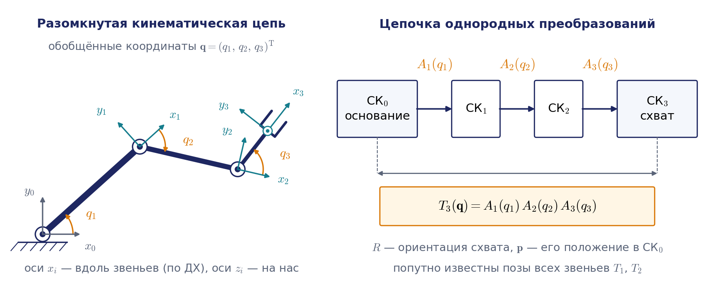

### Матрица перехода в представлении Денавита — Хартенберга

Вид матриц $`A_i`$ зависит от того, как выбраны системы координат звеньев. Если они построены по алгоритму ДХ, то систему $`(i-1)`$-го звена можно совместить с системой $`i`$-го звена четырьмя элементарными движениями:

1. Поворот вокруг оси $`z_{i-1}`$ на угол $`\theta_i`$, после которого ось $`x_{i-1}`$ становится параллельной оси $`x_i`$.
2. Сдвиг вдоль оси $`z_{i-1}`$ на величину $`d_i`$, после которого оси $`x`$ обеих систем лежат на одной прямой.
3. Сдвиг вдоль оси $`x`$ (уже повёрнутой, то есть совпадающей по направлению с $`x_i`$) на величину $`a_i`$, после которого совпадают начала координат.
4. Поворот вокруг оси $`x_i`$ на угол $`\alpha_i`$, после которого ось $`z_{i-1}`$ совмещается с $`z_i`$, и системы совпадают полностью.

Каждое следующее движение выполняется относительно текущих (уже перемещённых) осей, поэтому соответствующие матрицы перемножаются слева направо в порядке выполнения движений:

```math
A_i=\mathrm{Rot}(z,\theta_i)\,\mathrm{Trans}(z,d_i)\,\mathrm{Trans}(x,a_i)\,\mathrm{Rot}(x,\alpha_i).
```

Элементарные матрицы, формулы (2.4)–(2.7), имеют вид

```math
\mathrm{Rot}(z,\theta_i)=\begin{pmatrix} c_i & -s_i & 0 & 0\\ s_i & c_i & 0 & 0\\ 0&0&1&0\\ 0&0&0&1\end{pmatrix},\qquad
\mathrm{Trans}(z,d_i)=\begin{pmatrix} 1&0&0&0\\ 0&1&0&0\\ 0&0&1&d_i\\ 0&0&0&1\end{pmatrix},
```

```math
\mathrm{Trans}(x,a_i)=\begin{pmatrix} 1&0&0&a_i\\ 0&1&0&0\\ 0&0&1&0\\ 0&0&0&1\end{pmatrix},\qquad
\mathrm{Rot}(x,\alpha_i)=\begin{pmatrix} 1&0&0&0\\ 0&c_{\alpha_i}&-s_{\alpha_i}&0\\ 0&s_{\alpha_i}&c_{\alpha_i}&0\\ 0&0&0&1\end{pmatrix}.
```

Здесь и далее используются сокращения $`c_i=\cos\theta_i`$, $`s_i=\sin\theta_i`$, $`c_{\alpha_i}=\cos\alpha_i`$, $`s_{\alpha_i}=\sin\alpha_i`$; у вращательных сочленений $`\theta_i=q_i`$, поэтому $`c_i=\cos q_i`$, $`c_{ij}=\cos(q_i+q_j)`$, $`s_{ij}=\sin(q_i+q_j)`$. Два средних сомножителя дают просто перенос на вектор $`(a_i,0,d_i)^{\mathrm{T}}`$; перемножив всё, получаем основную формулу (2.8):

```math
A_i(d_i,a_i,\theta_i,\alpha_i)=\begin{pmatrix}
c_i & -c_{\alpha_i}s_i & s_{\alpha_i}s_i & a_ic_i\\
s_i & c_{\alpha_i}c_i & -s_{\alpha_i}c_i & a_is_i\\
0 & s_{\alpha_i} & c_{\alpha_i} & d_i\\
0&0&0&1\end{pmatrix}.
```

Полезно научиться читать эту матрицу по столбцам: первые три столбца есть орты осей $`x_i`$, $`y_i`$, $`z_i`$, записанные в системе $`(i-1)`$-го звена, а четвёртый столбец есть положение начала $`O_i`$ в той же системе. Ось $`x_i`$ направлена вдоль общего перпендикуляра к осям $`z_{i-1}`$ и $`z_i`$, то есть, как правило, вдоль самого звена.

Обратная матрица описывает переход от $`(i-1)`$-й системы к $`i`$-й. Для любой однородной матрицы обратная находится без численного обращения: поворотная часть транспонируется, а вектор переноса заменяется на $`-R^{\mathrm{T}}\mathbf{p}`$. Применяя это правило к (2.8), получаем формулу (2.9):

```math
A_i^{-1}=\begin{pmatrix}
c_i & s_i & 0 & -a_i\\
-c_{\alpha_i}s_i & c_{\alpha_i}c_i & s_{\alpha_i} & -d_is_{\alpha_i}\\
s_{\alpha_i}s_i & -s_{\alpha_i}c_i & c_{\alpha_i} & -d_ic_{\alpha_i}\\
0&0&0&1\end{pmatrix}.
```

Например, первый элемент последнего столбца равен $`-(c_i\cdot a_ic_i+s_i\cdot a_is_i)=-a_i`$. Обратная матрица понадобится в разделе 2.5 при решении обратной задачи. Итак, соотношение (2.3) вместе с формулой (2.8) полностью решает прямую позиционную задачу для любого манипулятора с разомкнутой кинематической цепью.

#### Пример 2.1. Плоский двухзвенный манипулятор

Рассмотрим манипулятор с двумя вращательными сочленениями, оси которых параллельны (рис. 2.2, левая часть). Для такой схемы $`\alpha_i=0`$ и $`d_i=0`$, длины звеньев равны $`a_1`$ и $`a_2`$, и матрица (2.8) вырождается в поворот вокруг оси $`z`$ с переносом на длину звена:

```math
A_i=\begin{pmatrix} c_i&-s_i&0&a_ic_i\\ s_i&c_i&0&a_is_i\\ 0&0&1&0\\ 0&0&0&1\end{pmatrix},\qquad i=1,2 .
```

Перемножим матрицы. Левый верхний элемент произведения равен $`c_1c_2-s_1s_2=c_{12}`$, элемент первой строки и четвёртого столбца равен $`c_1\cdot a_2c_2-s_1\cdot a_2s_2+a_1c_1=a_1c_1+a_2c_{12}`$; остальные элементы вычисляются так же. В результате

```math
T_2=A_1A_2=\begin{pmatrix} c_{12}&-s_{12}&0&a_1c_1+a_2c_{12}\\ s_{12}&c_{12}&0&a_1s_1+a_2s_{12}\\ 0&0&1&0\\ 0&0&0&1\end{pmatrix}.
```

Последний столбец даёт координаты центра схвата, а первые два столбца дают орты осей связанной со схватом системы:

```math
x=a_1c_1+a_2c_{12},\qquad y=a_1s_1+a_2s_{12},\qquad \varphi=q_1+q_2 ,
```

где $`\varphi`$ есть угол ориентации схвата. Результат очевиден и из геометрии, но важно, что он получен формальной процедурой, которая точно так же работает для сколь угодно сложной схемы. Для плоских механизмов не обязательно использовать матрицы $`4\times 4`$: достаточно однородных матриц $`3\times 3`$ с блоком поворота $`2\times 2`$ и столбцом $`(p_x,p_y)^{\mathrm{T}}`$, что заметно сокращает объём вычислений. Во всех рисунках курса ось $`x_0`$ направлена вправо, а ось $`y_0`$ вверх; в учебнике на рисунке к этому примеру ось $`x_0`$ направлена вверх, а $`y_0`$ вправо. На формулы это не влияет, но влияет на слова «вверх» и «вниз», которыми называют ветви решения обратной задачи (раздел 2.6).

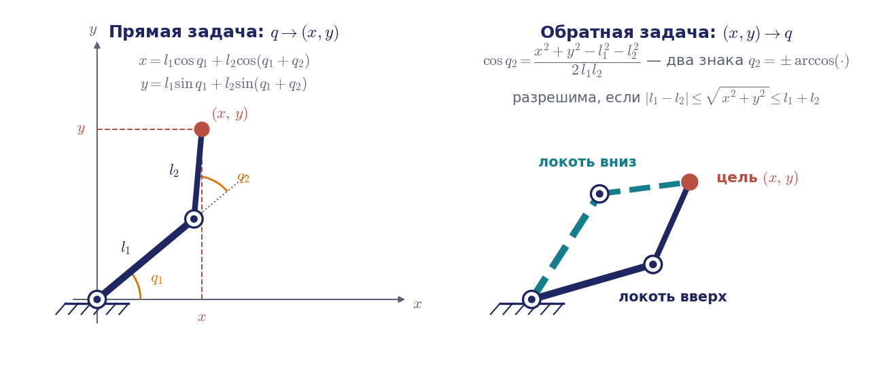

#### Пример 2.2. Манипулятор М20П

Манипулятор М20П работает в цилиндрической системе координат: колонна поворачивается на угол $`q_1=\theta_1`$, каретка поднимается на высоту $`q_2=d_2`$, рука выдвигается на длину $`q_3=d_3`$. Две из трёх обобщённых координат линейные, а углы $`\theta_2=\theta_3=0`$ постоянны. Матрицы $`A_1`$, $`A_2`$, $`A_3`$ выписаны в приложении 2.А; их рекуррентное перемножение даёт

```math
T_3=\begin{pmatrix} c_1&0&s_1&s_1d_3+c_1a_2\\ s_1&0&-c_1&-c_1d_3+s_1a_2\\ 0&1&0&d_2\\ 0&0&0&1\end{pmatrix}.
```

Введём наглядные обозначения $`d_2=z`$, $`d_3=r`$, $`q_1=q`$, $`a_2=a`$. Тогда положение схвата

```math
p_x=r\sin q+a\cos q,\qquad p_y=-r\cos q+a\sin q,\qquad p_z=z ,
```

а его ориентация задаётся ортами $`\mathbf{x}_3=(\cos q,\sin q,0)^{\mathrm{T}}`$, $`\mathbf{y}_3=(0,0,1)^{\mathrm{T}}`$, $`\mathbf{z}_3=(\sin q,-\cos q,0)^{\mathrm{T}}`$. По существу это цилиндрические координаты с поправкой на боковое смещение $`a`$.

Полученный ответ обязательно следует проверить в конфигурации, где результат понятен заранее. При $`q=180^\circ`$ формулы дают $`\mathbf{p}=(-a,\,r,\,z)^{\mathrm{T}}`$ и $`\mathbf{x}_3=(-1,0,0)^{\mathrm{T}}`$: каретка развернулась назад, что согласуется с геометрией. Если такая проверка не проходит, ошибка находится либо в таблице параметров ДХ, либо в порядке умножения матриц. Этим приёмом стоит пользоваться при отладке любой кинематической модели. К манипулятору М20П мы вернёмся в разделе 2.6, когда будем решать для него обратную задачу с ограничением хода.

### Векторная рекуррентная форма

Для шестистепенного манипулятора символьное перемножение шести матриц приводит к очень громоздким выражениям. В примере 2.3 учебника элементы матрицы $`T_6`$ для манипулятора PUMA занимают целую страницу, и каждый из них содержит до десятка тригонометрических произведений. Вычислять положение схвата по таким формулам неудобно, да и незачем: существует более экономная запись того же рекуррентного соотношения (2.3).

Запишем матрицу положения $`i`$-го звена по столбцам:

```math
T_i=\begin{pmatrix}\mathbf{x}_i&\mathbf{y}_i&\mathbf{z}_i&\mathbf{p}_i\\ 0&0&0&1\end{pmatrix},
```

где $`\mathbf{x}_i,\mathbf{y}_i,\mathbf{z}_i`$ есть орты осей $`i`$-й системы, а $`\mathbf{p}_i`$ есть положение её начала в базовой системе. Умножение матрицы на столбец есть линейная комбинация её столбцов с коэффициентами из этого столбца. Поэтому из $`T_i=T_{i-1}A_i`$ и формулы (2.8) сразу следуют общие правила пересчёта:

```math
\begin{aligned}
\mathbf{x}_i&=c_i\,\mathbf{x}_{i-1}+s_i\,\mathbf{y}_{i-1},\\
\mathbf{y}_i&=c_{\alpha_i}\bigl(-s_i\,\mathbf{x}_{i-1}+c_i\,\mathbf{y}_{i-1}\bigr)+s_{\alpha_i}\mathbf{z}_{i-1},\\
\mathbf{z}_i&=s_{\alpha_i}\bigl(s_i\,\mathbf{x}_{i-1}-c_i\,\mathbf{y}_{i-1}\bigr)+c_{\alpha_i}\mathbf{z}_{i-1},\\
\mathbf{p}_i&=\mathbf{p}_{i-1}+a_i\,\mathbf{x}_i+d_i\,\mathbf{z}_{i-1}.
\end{aligned}
```

Последняя строка имеет прозрачный геометрический смысл: чтобы попасть из $`O_{i-1}`$ в $`O_i`$, нужно пройти $`d_i`$ вдоль старой оси $`z_{i-1}`$ и $`a_i`$ вдоль новой оси $`x_i`$.

#### Пример 2.4. Векторная рекурсия для манипулятора PUMA

Параметры ДХ манипулятора PUMA приведены в таблице; все шесть сочленений вращательные, поэтому $`\theta_i=q_i`$.

| Сочленение | $`\alpha_i`$ | $`a_i`$ | $`d_i`$ |
|---|---|---|---|
| 1 | $`-90^\circ`$ | $`0`$ | $`0`$ |
| 2 | $`0`$ | $`a_2`$ | $`d_2`$ |
| 3 | $`90^\circ`$ | $`a_3`$ | $`0`$ |
| 4 | $`-90^\circ`$ | $`0`$ | $`d_4`$ |
| 5 | $`90^\circ`$ | $`0`$ | $`0`$ |
| 6 | $`0`$ | $`0`$ | $`d_6`$ |

Так как все углы $`\alpha_i`$ равны $`0`$ или $`\pm 90^\circ`$, общие правила упрощаются, и решение прямой задачи записывается десятком строк. Для основания $`\mathbf{x}_0=(1,0,0)^{\mathrm{T}}`$, $`\mathbf{y}_0=(0,1,0)^{\mathrm{T}}`$, $`\mathbf{z}_0=(0,0,1)^{\mathrm{T}}`$, $`\mathbf{p}_0=0`$, а далее

```math
\begin{aligned}
&\mathbf{x}_1=c_1\mathbf{x}_0+s_1\mathbf{y}_0, &&\mathbf{y}_1=-\mathbf{z}_0, &&\mathbf{z}_1=-s_1\mathbf{x}_0+c_1\mathbf{y}_0, &&\mathbf{p}_1=0;\\
&\mathbf{x}_2=c_2\mathbf{x}_1+s_2\mathbf{y}_1, &&\mathbf{y}_2=-s_2\mathbf{x}_1+c_2\mathbf{y}_1, &&\mathbf{z}_2=\mathbf{z}_1, &&\mathbf{p}_2=a_2\mathbf{x}_2+d_2\mathbf{z}_1+\mathbf{p}_1;\\
&\mathbf{x}_3=c_3\mathbf{x}_2+s_3\mathbf{y}_2, &&\mathbf{y}_3=\mathbf{z}_2, &&\mathbf{z}_3=s_3\mathbf{x}_2-c_3\mathbf{y}_2, &&\mathbf{p}_3=a_3\mathbf{x}_3+\mathbf{p}_2;\\
&\mathbf{x}_4=c_4\mathbf{x}_3+s_4\mathbf{y}_3, &&\mathbf{y}_4=-\mathbf{z}_3, &&\mathbf{z}_4=-s_4\mathbf{x}_3+c_4\mathbf{y}_3, &&\mathbf{p}_4=\mathbf{p}_3+d_4\mathbf{z}_3;\\
&\mathbf{x}_5=c_5\mathbf{x}_4+s_5\mathbf{y}_4, &&\mathbf{y}_5=\mathbf{z}_4, &&\mathbf{z}_5=s_5\mathbf{x}_4-c_5\mathbf{y}_4, &&\mathbf{p}_5=\mathbf{p}_4;\\
&\mathbf{x}_6=c_6\mathbf{x}_5+s_6\mathbf{y}_5, &&\mathbf{y}_6=-s_6\mathbf{x}_5+c_6\mathbf{y}_5, &&\mathbf{z}_6=\mathbf{z}_5, &&\mathbf{p}_6=\mathbf{p}_5+d_6\mathbf{z}_5 .
\end{aligned}
```

Из этой цепочки легко получить любую нужную величину в явном виде. Например, раскрывая $`\mathbf{p}_4`$, находим положение точки $`O_4`$ (она ещё понадобится в разделе 2.6), а прибавляя $`d_6\mathbf{z}_6`$, получаем положение схвата:

```math
\begin{aligned}
p_x&=c_1\bigl(d_6(c_{23}c_4s_5+s_{23}c_5)+d_4s_{23}+a_3c_{23}+a_2c_2\bigr)-s_1(d_6s_4s_5+d_2),\\
p_y&=s_1\bigl(d_6(c_{23}c_4s_5+s_{23}c_5)+d_4s_{23}+a_3c_{23}+a_2c_2\bigr)+c_1(d_6s_4s_5+d_2),\\
p_z&=d_6(c_{23}c_5-s_{23}c_4s_5)+d_4c_{23}-a_3s_{23}-a_2s_2 .
\end{aligned}
```

*Примечание о расхождении с книгой.* В примере 2.3 учебника (с. 73) в выражении для $`p_y`$ последняя скобка напечатана как $`(d_6s_4s_5+d_4)`$, а в выражении для $`p_z`$ стоят члены $`+d_6s_{23}c_4s_5`$ и $`+a_3c_{23}`$. Это опечатки: приведённые выше формулы следуют из векторной рекурсии и согласуются с формулами (2.31) и (2.44) самого учебника.

Векторная рекурсия удобна в вычислительном отношении, легко программируется циклом, и именно она используется далее и в обратной задаче, и в задаче о скоростях.

### Формула произведения экспонент

Представление ДХ требует привязать к каждому звену систему координат по строгим правилам, и уже на примере PUMA видно, что это кропотливая работа. Существует второй, равноправный язык прямой задачи, в котором промежуточные системы координат вообще не нужны. Он основан на теореме Шаля: любое перемещение твёрдого тела есть винтовое движение, то есть поворот вокруг некоторой оси с одновременным сдвигом вдоль неё. Вращательное сочленение есть частный случай винта без сдвига, поступательное есть чистый сдвиг. Этим языком написана книга Линча и Парка, а винты и группы движений лежат в основе современных программных библиотек кинематики и динамики.

Поставим манипулятор в **нулевую (домашнюю) конфигурацию** $`\mathbf{q}=\mathbf{0}`$ и запишем в базовой системе три вещи. Во-первых, позу схвата в этой конфигурации $`T_N(\mathbf{0})`$ (у Линча и Парка она обозначена $`M`$). Во-вторых, для каждого вращательного сочленения орт его оси $`\mathbf{k}_i`$ и любую точку $`\mathbf{c}_i`$ на этой оси. Пара этих векторов задаёт **винтовую ось** сочленения

```math
\boldsymbol{\mathcal S}_i=\begin{pmatrix}\mathbf{k}_i\\ \mathbf{c}_i\times\mathbf{k}_i\end{pmatrix};
```

для поступательного сочленения с направлением хода $`\mathbf{k}_i`$ винтовая ось равна $`(\mathbf{0};\mathbf{k}_i)`$. Порядок блоков (сначала угловая часть, затем линейная) тот же, что у скорости тела $`(\boldsymbol{\omega};\mathbf{v})`$ в лекции 3, и это не случайно: $`\boldsymbol{\mathcal S}_i`$ есть скорость, с которой двигалось бы тело при единичной скорости $`i`$-го сочленения. Нужно лишь помнить, к какой точке приведена линейная часть: $`\mathbf{c}_i\times\mathbf{k}_i`$ есть скорость той точки тела, которая совпадает с началом базовой системы. В лекции 3 линейная скорость приводится к началу системы схвата, поэтому столбцы матрицы Якоби получаются из $`\boldsymbol{\mathcal S}_i`$ переносом точки приведения. Например, у двухзвенника из примера 2.4а (он разобран ниже) при $`\mathbf{q}=\mathbf{0}`$ винтовая ось второго сочленения $`(0,0,1;\,0,-a_1,0)`$, а соответствующий столбец матрицы Якоби $`(0,0,1;\,0,a_2,0)`$.

Поворот на угол $`q_i`$ вокруг оси, проходящей через точку $`\mathbf{c}_i`$, записывается однородной матрицей

```math
e^{[\boldsymbol{\mathcal S}_i]q_i}=\begin{pmatrix} R_i & (E-R_i)\,\mathbf{c}_i\\ 0\;0\;0&1\end{pmatrix},\qquad R_i=E+\sin q_i\,\Lambda(\mathbf{k}_i)+(1-\cos q_i)\,\Lambda(\mathbf{k}_i)^2 ,
```

где $`\Lambda(\mathbf{k})`$ есть кососимметрическая матрица вектора, $`\Lambda(\mathbf{k})\mathbf{b}=\mathbf{k}\times\mathbf{b}`$, а выражение для $`R_i`$ есть формула Родрига поворота вокруг оси $`\mathbf{k}_i`$ (лекция 1). Столбец переноса понятен без выкладок: точка $`\mathbf{c}_i`$ лежит на оси и потому неподвижна, $`R_i\mathbf{c}_i+(E-R_i)\mathbf{c}_i=\mathbf{c}_i`$. Обозначение экспоненты оправдано тем, что эта матрица действительно есть матричная экспонента от $`4\times4`$-матрицы $`[\boldsymbol{\mathcal S}_i]q_i`$ с блоками $`\Lambda(\mathbf{k}_i)q_i`$ и $`(\mathbf{c}_i\times\mathbf{k}_i)q_i`$.

Теперь вообразим, что сочленения поворачиваются по очереди, начиная с последнего. Поворот $`N`$-го сочленения переносит схват из позы $`T_N(\mathbf{0})`$ в позу $`e^{[\boldsymbol{\mathcal S}_N]q_N}T_N(\mathbf{0})`$, не затрагивая остальных звеньев, и оси сочленений $`1,\dots,N-1`$ остаются на прежних местах. Затем поворачивается сочленение $`N-1`$ вокруг своей ещё не сдвинутой оси, и так далее до первого. В итоге получается **формула произведения экспонент** (по-английски product of exponentials, PoE):

```math
T_N(\mathbf{q})=e^{[\boldsymbol{\mathcal S}_1]q_1}\,e^{[\boldsymbol{\mathcal S}_2]q_2}\cdots e^{[\boldsymbol{\mathcal S}_N]q_N}\,T_N(\mathbf{0}).
```

Существует и вторая, «телесная» форма $`T_N(\mathbf{q})=T_N(\mathbf{0})\,e^{[\boldsymbol{\mathcal B}_1]q_1}\cdots e^{[\boldsymbol{\mathcal B}_N]q_N}`$, в которой винтовые оси $`\boldsymbol{\mathcal B}_i`$ записаны в системе схвата при $`\mathbf{q}=\mathbf{0}`$; обе формы дают одну и ту же матрицу.

#### Пример 2.4а. Произведение экспонент для двухзвенника и для UR5e

Для двухзвенника примера 2.1 в нулевой конфигурации рука вытянута вдоль $`x_0`$, обе оси направлены вдоль $`z_0`$: $`\mathbf{k}_1=\mathbf{k}_2=(0,0,1)^{\mathrm T}`$, $`\mathbf{c}_1=\mathbf{0}`$, $`\mathbf{c}_2=(a_1,0,0)^{\mathrm T}`$, так что $`\boldsymbol{\mathcal S}_1=(0,0,1;\,0,0,0)`$, $`\boldsymbol{\mathcal S}_2=(0,0,1;\,0,-a_1,0)`$, а $`T_2(\mathbf{0})`$ есть перенос на $`(a_1+a_2,0,0)^{\mathrm T}`$. При $`a_1=1`$, $`a_2=0{,}7`$, $`q_1=30^\circ`$, $`q_2=45^\circ`$ второй множитель есть поворот на $`45^\circ`$ с переносом $`(E-R_2)\mathbf{c}_2=(0{,}2929;\,-0{,}7071;\,0)^{\mathrm T}`$, и произведение даёт $`\mathbf{p}=(1{,}0472;\,1{,}1761)^{\mathrm T}`$, ровно то же, что формулы примера 2.1: $`a_1c_1+a_2c_{12}=0{,}8660+0{,}1812`$, $`a_1s_1+a_2s_{12}=0{,}5000+0{,}6761`$.

Более показателен коллаборативный робот UR5e, который будет сквозным примером курса. Производитель публикует его таблицу ДХ: $`d_1=0{,}1625`$, $`a_2=-0{,}425`$, $`a_3=-0{,}3922`$, $`d_4=0{,}1333`$, $`d_5=0{,}0997`$, $`d_6=0{,}0996`$ м, $`\alpha=(90^\circ,0,0,90^\circ,-90^\circ,0)`$, остальные параметры нулевые. В нулевой конфигурации рука вытянута вдоль $`-x_0`$, и винтовые оси читаются прямо с рисунка (рис. 2.3) или из CAD-модели:

| Сочленение | орт оси $`\mathbf{k}_i`$ | точка на оси $`\mathbf{c}_i`$, м |
|---|---|---|
| 1 | $`(0,0,1)`$ | $`(0;\;0;\;0)`$ |
| 2 | $`(0,-1,0)`$ | $`(0;\;0;\;0{,}1625)`$ |
| 3 | $`(0,-1,0)`$ | $`(-0{,}425;\;0;\;0{,}1625)`$ |
| 4 | $`(0,-1,0)`$ | $`(-0{,}8172;\;0;\;0{,}1625)`$ |
| 5 | $`(0,0,-1)`$ | $`(-0{,}8172;\;-0{,}1333;\;0{,}1625)`$ |
| 6 | $`(0,-1,0)`$ | $`(-0{,}8172;\;-0{,}1333;\;0{,}0628)`$ |

Поза схвата в нуле: положение $`(-0{,}8172;\,-0{,}2329;\,0{,}0628)`$ м, орты $`\mathbf{x}=(1,0,0)`$, $`\mathbf{y}=(0,0,1)`$, $`\mathbf{z}=(0,-1,0)`$. Расчёт по формуле произведения экспонент на двухстах случайных конфигурациях совпал с расчётом по таблице ДХ с точностью $`10^{-15}`$. Из таблицы видна и главная конструктивная особенность UR5e: оси 2, 3 и 4 параллельны. Она определит способ решения обратной задачи в разделе 2.6.

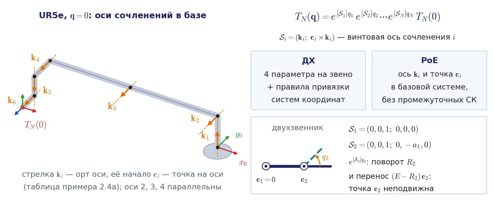

Сравним два языка.

| Свойство | Денавит — Хартенберг | Произведение экспонент |
|---|---|---|
| Данные на сочленение | 4 числа, но по строгим правилам привязки систем | 6 чисел (ось и точка), без промежуточных систем |
| Откуда берутся | из кинематической схемы после построения систем | прямо из CAD-модели или описания URDF в домашней позе |
| Почти параллельные оси | общий перпендикуляр уходит далеко, параметры плохо обусловлены | никаких трудностей |
| Связь со скоростями | столбцы якобиана через орты $`\mathbf{z}_{i-1}`$ (лекция 3) | столбцы пространственного якобиана суть преобразованные винты $`\boldsymbol{\mathcal S}_i`$ |
| Где используется | учебники, паспорта роботов, ДЗ1 | Modern Robotics; язык винтов и группы движений лежит в основе библиотек Pinocchio и Drake |

В курсе основным языком остаётся ДХ, потому что на нём построены учебник, первое домашнее задание и рубежный контроль. Произведение экспонент полезно держать в голове как проверку и как короткий путь от модели в CAD к кинематике.

### Число степеней подвижности и шесть степеней свободы схвата

Положение схвата полностью определяется вектором $`\mathbf{q}`$ из $`N`$ чисел. С другой стороны, схват как свободное твёрдое тело описывается шестью параметрами. Сопоставление этих двух чисел даёт три принципиально разных случая:

- при $`N<6`$ существуют положения схвата, которые нельзя обеспечить никаким выбором $`\mathbf{q}`$;
- при $`N=6`$ заданному положению схвата соответствует, как правило (вне особых положений), конечное число конфигураций манипулятора;
- при $`N>6`$ (манипулятор с избыточностью) заданному положению схвата может соответствовать бесконечное множество конфигураций.

Например, учебный манипулятор SCORBOT имеет пять степеней подвижности и потому не может поставить схват в произвольную точку с произвольной ориентацией, каким бы способом (аналитическим или численным) мы ни решали задачу. К этому различию мы вернёмся и при обсуждении избыточности, и при подсчёте числа решений обратной задачи.

## 2.2. Рабочее пространство манипулятора

### Определение

Обобщённые координаты не могут принимать произвольные значения. Они ограничены конструкцией (упоры, длина хода) или пределами, назначенными из соображений безопасности, условие (2.10):

```math
q_i^{\min}\le q_i\le q_i^{\max},\qquad i=1,\dots,N .
```

Совокупность этих неравенств выделяет в **пространстве конфигураций** $`\mathcal{Q}`$ (пространстве обобщённых координат) область $`S_q`$, имеющую форму $`N`$-мерного параллелепипеда. Заметим, что параллелепипедом она становится только благодаря упорам: для вращательного сочленения без упоров углы $`q_i`$ и $`q_i+2\pi`$ задают одно и то же положение, и пространство конфигураций двухзвенника без ограничений есть тор, а не квадрат. Если же диапазон сочленения больше $`2\pi`$ (у UR5e каждое сочленение поворачивается в пределах $`\pm 360^\circ`$), то одному положению звена соответствуют два значения угла, и об этом придётся помнить при выборе решения обратной задачи.

Свяжем со схватом **характерную точку**, например точку посередине между губками, и обозначим через $`\mathbf{r}`$ её радиус-вектор в неподвижной системе координат, ось $`z_0`$ которой направлена вдоль оси первого сочленения. Решение прямой задачи даёт зависимость (2.11):

```math
\mathbf{r}=\mathbf{r}(q_1,q_2,\dots,q_N).
```

Образ области $`S_q`$ при этом отображении, то есть множество $`S_r`$ всех точек, в которых может оказаться характерная точка схвата, называется **рабочим пространством манипулятора**. В литературе и в паспортах роботов то же понятие называют рабочей зоной или зоной достижимости (по-английски reachable workspace). Важно понимать, что рабочее пространство вовсе не является сферой с радиусом, равным длине руки: это образ параллелепипеда ограничений при нелинейном отображении, и его форма может быть довольно причудливой.

### Конфигурация рабочего пространства

Форма области $`S_r`$ определяется кинематической схемой (рис. 2.4). Схемы обозначают буквами по порядку пар от основания: В — вращательная пара, П — поступательная. У манипулятора с тремя поступательными парами (ППП, декартова система координат) рабочее пространство есть параллелепипед с гранями, параллельными осям. У цилиндрической схемы ВПП (колонна поворачивается, каретка поднимается, рука выдвигается, как у М20П) это часть полого цилиндра. У сферической схемы ВВП (два поворота и выдвижение) это часть шарового слоя. У ангулярного (антропоморфного) манипулятора ВВВ с тремя вращательными парами зона имеет более сложную форму, близкую к тороидальной.

Во всех случаях рабочее пространство обладает симметрией: у декартовой схемы это симметрия сдвига вдоль оси поступательной пары, у остальных схем это симметрия поворота вокруг оси первого сочленения, которая обычно вертикальна. Поэтому пространственную зону достаточно охарактеризовать одним её сечением, которое называют **плоской рабочей зоной**. Именно её приводят в паспорте робота, и по ней технолог решает, как расположить робот относительно станка или конвейера.

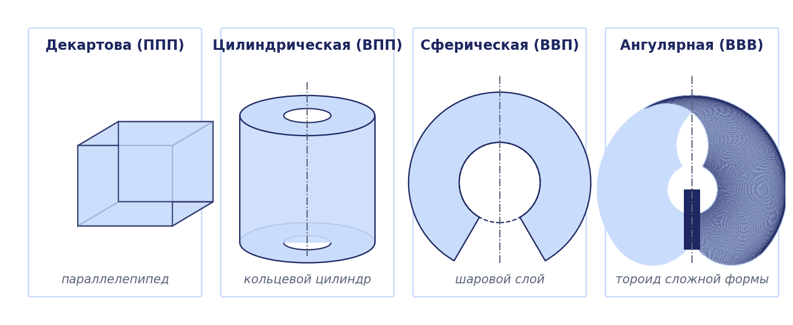

### Граница рабочей зоны

В общем случае для построения границы нужно решать прямую задачу, но часто границу удаётся найти из простых геометрических соображений. Полезно понимать, откуда вообще берётся граница. Точка $`\mathbf{r}`$ может оказаться на границе области $`S_r`$ только в двух случаях: либо какая-то обобщённая координата стоит на своём пределе (точка $`\mathbf{q}`$ лежит на границе $`S_q`$), либо манипулятор находится в особой конфигурации, в которой малые изменения координат не позволяют сдвинуть схват в некотором направлении (например, рука полностью вытянута). Это необходимое, но не достаточное условие: граница лежит в образе границы $`S_q`$ и особых конфигураций, но не всякая такая точка является граничной. Например, у двухзвенника с равными звеньями полностью сложенная рука есть особая конфигурация, а схват при этом находится в центре зоны.

#### Пример 2.5. Граница рабочей зоны плоского двухзвенника

Пусть звенья имеют длины $`l_1`$ и $`l_2`$, а углы ограничены симметрично: $`\lvert q_1\rvert\le q_1^{\max}`$, $`\lvert q_2\rvert\le q_2^{\max}`$. Положение характерной точки $`C`$ даётся формулами примера 2.1:

```math
x_C=l_1c_1+l_2c_{12},\qquad y_C=l_1s_1+l_2s_{12}.
```

Если бы ограничений не было, точка $`C`$ заполняла бы кольцо между окружностями радиусов $`\lvert l_1-l_2\rvert`$ и $`l_1+l_2`$ (рис. 2.5, а); его площадь равна $`\pi\bigl[(l_1+l_2)^2-(l_1-l_2)^2\bigr]=4\pi l_1l_2`$. При наличии ограничений граница составляется из дуг окружностей:

- участок $`\Gamma_1`$ есть дуга радиуса $`l_1+l_2`$ с центром в основании; её описывает точка $`C`$ при вытянутой руке ($`q_2=0`$), когда $`q_1`$ пробегает весь диапазон от $`-q_1^{\max}`$ до $`q_1^{\max}`$;
- участок $`\Gamma_2`$ есть дуга радиуса $`l_2`$ с центром в конце первого звена; она получается, когда первое звено стоит на упоре ($`q_1=\pm q_1^{\max}`$), а второе поворачивается;
- участок $`\Gamma_3`$ есть дуга радиуса $`r_{\min}=\sqrt{l_1^2+l_2^2+2l_1l_2\cos q_2^{\max}}`$ с центром в основании; её описывает точка $`C`$, когда на упоре стоит второе звено ($`q_2=\pm q_2^{\max}`$), а поворачивается первое.

Радиус дуги $`\Gamma_3`$ находится по теореме косинусов: при неподвижном угле в локте треугольник «основание — локоть — точка $`C`$» жёсткий, и $`\lvert OC\rvert^2=l_1^2+l_2^2+2l_1l_2\cos q_2`$ от $`q_1`$ не зависит. Например, при $`l_1=1`$, $`l_2=0{,}7`$ и $`q_2^{\max}=120^\circ`$ получаем $`\lvert OC\rvert=0{,}889`$ при любом $`q_1`$. Участок $`\Gamma_1`$ соответствует особой конфигурации, участки $`\Gamma_2`$ и $`\Gamma_3`$ соответствуют предельным значениям координат, что иллюстрирует общее правило. Если диапазон $`q_1^{\max}`$ достаточно велик и внешняя граница замкнута, внутренней границей зоны служит вся окружность радиуса $`r_{\min}`$.

Вид границы зависит от соотношения $`q_1^{\max}`$ и $`q_2^{\max}`$; в учебнике разобраны характерные случаи ($`q_1^{\max}=80^\circ`$, $`q_2^{\max}=120^\circ`$; $`q_1^{\max}=30^\circ`$, $`q_2^{\max}=150^\circ`$; $`q_1^{\max}=q_2^{\max}=160^\circ`$). При несимметричных ограничениях зона теряет симметрию; на рис. 2.5, б она построена для $`l_1=1`$, $`l_2=0{,}7`$, $`-60^\circ\le q_1\le 120^\circ`$, $`\lvert q_2\rvert\le 140^\circ`$, и радиус внутренней дуги равен $`r_{\min}=0{,}646`$.

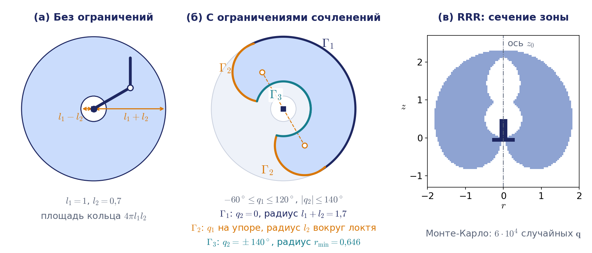

Откуда берутся именно эти дуги, хорошо видно, если проследить, как прямоугольник ограничений $`S_q`$ отображается на плоскость (рис. 2.6). Отображение складывает прямоугольник по линии $`q_2=0`$, на которой $`\det J=l_1l_2\sin q_2`$ обращается в нуль, и две его половины ложатся на плоскость двумя слоями: верхняя половина даёт конфигурации «локоть вниз», нижняя — «локоть вверх». Там, где слои перекрываются, у обратной задачи два решения; при $`l_1=1`$, $`l_2=0{,}7`$ и ограничениях рис. 2.5, б каждый слой имеет площадь $`3{,}88`$ м², перекрытие $`2{,}56`$ м², а вся зона $`3{,}88+3{,}88-2{,}56=5{,}21`$ м² из $`8{,}80`$ м² кольца без упоров. Анимация показывает и то, что не всякий образ ребра $`S_q`$ становится границей: часть образов рёбер оказывается внутри другого слоя.


Анимация целиком: [l02_ws_qspace_to_rspace.mp4](../06_Анимации/l02_ws_qspace_to_rspace.mp4), 74 с.

### Неоднозначность отображения и степень избыточности

Отображение $`S_q\to S_r`$ однозначно, но не взаимно однозначно: одной точке рабочей зоны могут соответствовать разные конфигурации манипулятора. Простейший пример даёт тот же двухзвенник, который достигает одной точки двумя способами, локтем вверх и локтем вниз (рис. 2.2, правая часть); вместе два положения образуют ромб.

Если схема не имеет избыточности, то есть число обобщённых координат не превышает числа степеней свободы схвата, то таких конфигураций, как правило, конечное число. Объяснить это можно так: закрепим схват неподвижно; тогда у механизма не останется ни одной степени подвижности, и он превратится в ферму, которая может находиться лишь в отдельных изолированных положениях.

У манипулятора с избыточными степенями подвижности дело обстоит иначе: его звенья могут двигаться при неподвижном схвате (такое движение называют самодвижением). Это свойство позволяет обходить препятствия и работать во внутренних объёмах, например заводить инструмент в полость через узкое отверстие. Мерой служит **степень избыточности** (в учебнике — **маневренность**): разность между числом степеней подвижности манипулятора и числом степеней свободы схвата, то есть число степеней подвижности, остающихся у механизма после закрепления схвата; для пространственного манипулятора она равна $`N-6`$. Наглядный пример есть у каждого: рука человека от плеча до запястья имеет семь степеней подвижности, и если положить кисть на стол и не двигать её, локоть всё ещё можно поднимать и опускать. Так же устроены семистепенные коллаборативные роботы KUKA LBR iiwa и Franka: при неподвижном фланце у них может вращаться «локоть» вокруг линии плечо — запястье.

### Численные показатели рабочего пространства

Первой числовой характеристикой служит **объём рабочего пространства**, формула (2.12):

```math
V=\iiint\limits_{S_r}dx\,dy\,dz .
```

Сам по себе объём мало говорит о качестве конструкции, потому что у большого робота зона заведомо больше. Поэтому объём соотносят с **обобщённой полной длиной** механизма $`L=\sum\lvert a_i\rvert+\sum\lvert d_i\rvert`$ (параметры ДХ берутся по модулю, потому что их знак зависит лишь от выбора направлений осей). При умножении всех длин на $`k`$ объём растёт как $`k^3`$, поэтому **показатель Ли — Янга** $`V_L=V/L^3`$, формула (2.13), зависит только от схемы, а не от масштаба. Его наибольшее значение $`4\pi/3\approx4{,}19`$ получил бы гипотетический манипулятор, зона которого есть полный шар радиуса $`L`$ без полостей. Например, у PUMA-600 показатель равен примерно $`1{,}38`$, то есть робот использует около трети идеального объёма (расчёт и второй класс показателей, пределы досягаемости, — в приложении 2.Б). Такие показатели полезны при сравнении схем на этапе проектирования; при выборе готового робота важнее паспортная досягаемость и, как мы увидим в разделе 2.3, сервис.

### Численное построение рабочего пространства

Аналитически построить границу и вычислить объём удаётся только для простых схем. Универсальный способ состоит в том, чтобы решить прямую задачу для большого числа точек области $`S_q`$. Значения обобщённых координат выбирают в узлах равномерной $`N`$-мерной решётки внутри параллелепипеда (2.10) и на его границах либо случайным образом (метод Монте-Карло); полученные точки $`\mathbf{r}^{(j)}`$ образуют облако, заполняющее $`S_r`$. На рис. 2.5, в так построено сечение рабочей зоны ангулярного трёхзвенника по шестидесяти тысячам случайных конфигураций.

Для оценки объёма пространство разбивают на кубические ячейки с шагом $`\delta`$ и подсчитывают число $`M`$ ячеек, в которые попала хотя бы одна точка облака. Тогда

```math
V\approx M\delta^3 ,
```

а для плоской зоны аналогично $`S\approx M\delta^2`$. Оценка тем точнее, чем равномернее точки заполняют область; специальные способы равномерного заполнения называются методами $`\varepsilon`$-сети. Реальная зона робота меньше математической: её дополнительно ограничивают пол, основание и самопересечения звеньев, и в численном расчёте эти точки нужно отбрасывать.

Паспортная схема рабочей зоны строится так же. Обычно в паспорте показан вид сбоку, то есть плоская рабочая зона, а в качестве характерной точки взят центр запястья или фланец без инструмента. Паспортная досягаемость приблизительно равна радиусу дуги $`\Gamma_1`$ из примера 2.5: это расстояние до характерной точки при вытянутой руке, то есть в особой конфигурации. Например, у UR5e досягаемость равна 850 мм, и в вытянутой нулевой конфигурации фланец действительно удалён от начала базовой системы на 0,852 м. Но это ориентир, а не строгая граница: развернув звенья кисти наружу, фланец UR5e можно отвести дальше, примерно на 0,97 м от плеча (демонстрация 4). В паспорте указывают и повторяемость позиционирования по стандарту ISO 9283 (у UR5e $`\pm 0{,}03`$ мм). Повторяемость показывает, насколько точно робот возвращается в однажды обученную точку, и не равна абсолютной точности, с которой он приходит в точку, рассчитанную по номинальной модели; к этому различию мы вернёмся в разделе 2.9.

## 2.3. Ориентация схвата в рабочем пространстве. Коэффициент сервиса

### Манипулятивность и зона обслуживания

До сих пор речь шла только о том, куда можно привести характерную точку. Но манипулятор должен ещё и правильно сориентировать объект или инструмент: сварочная горелка, окрасочный пистолет или схват должны подойти к точке под нужным углом. Способность манипулятора сориентировать схват нужным образом в данной точке называется в учебнике **манипулятивностью**. В лекции 3 тем же словом будут названы две другие величины, связанные со скоростями, поэтому здесь речь идёт о манипулятивности в смысле ориентации.

Чтобы измерить её, зафиксируем характерную точку в положении $`\mathbf{r}`$ и будем описывать ориентацию схвата направлением его продольной оси. Совокупность всех направлений, допустимых при данной конструкции и данных ограничениях, образует в точке $`\mathbf{r}`$ телесный угол $`\psi_r`$, который называется **зоной обслуживания** в этой точке. В общем случае, формула (2.14),

```math
\psi_r=\psi_r(q_1,q_2,\dots,q_N),
```

но у многих роботов переносные и ориентирующие движения разделены. Например, у PUMA ориентацию обеспечивают три последних сочленения, не участвующие в переносе запястья, и $`\psi_r=\psi_r(q_4,q_5,q_6)`$.

### Коэффициент сервиса и сервис манипулятора

Наибольшее возможное значение телесного угла равно $`4\pi`$ (полная сфера направлений). **Коэффициентом сервиса** в точке $`\mathbf{r}`$ называется отношение, формула (2.15),

```math
\Omega_r=\frac{\psi_r}{4\pi},\qquad 0\le\Omega_r\le 1 .
```

Значение $`\Omega_r=0`$ означает, что ось схвата может иметь в данной точке единственное направление, значение $`\Omega_r=1`$ означает, что доступны все направления (рис. 2.7, слева). Область, где $`\Omega_r=1`$, называют зоной полного сервиса; в англоязычной литературе ей соответствует термин dexterous workspace. Усреднение коэффициента сервиса по всему рабочему пространству даёт одно число, характеризующее конструкцию в целом, **сервис манипулятора**, формула (2.17):

```math
\Omega=\frac{1}{V}\int\limits_{S_r}\Omega_r\,dx\,dy\,dz .
```

Часто технологу важно не любое направление, а одно конкретное. Для этого вводят **манипулятивность в направлении** $`\mathbf{n}`$, формула (2.16):

```math
\Omega_{\mathbf n}=\frac{V_{\mathbf n}}{V},
```

где $`V_{\mathbf n}`$ есть объём той части рабочего пространства, в которой возможна ориентация схвата вдоль единичного вектора $`\mathbf{n}`$.

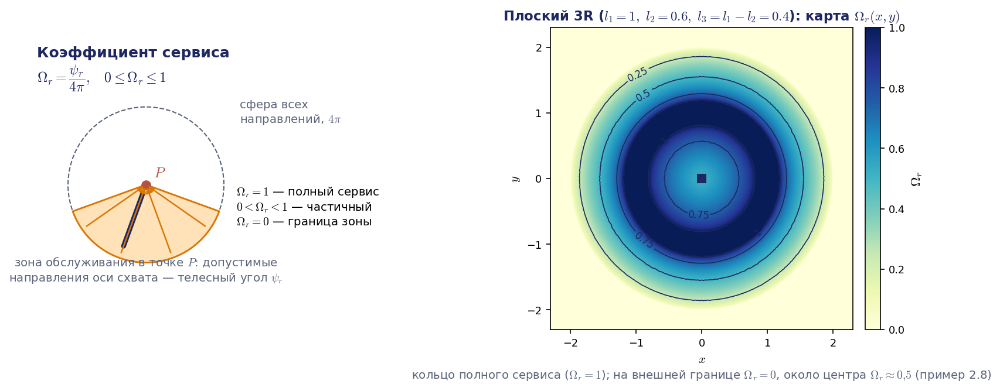

#### Пример 2.8. Зоны обслуживания плоского трёхзвенного манипулятора

Для плоского механизма роль телесного угла играет плоский угол, а роль полного угла $`4\pi`$ играет $`2\pi`$, поэтому здесь коэффициент сервиса равен доле окружности направлений: угол доступного сектора, делённый на $`2\pi`$. Рассмотрим трёхзвенник с длинами $`l_1\ge l_2`$ и $`l_3`$ без ограничений на углы. Его рабочее пространство есть круг радиуса $`l_1+l_2+l_3`$ (если $`l_3< l_1-l_2`$, то с круглым отверстием радиуса $`l_1-l_2-l_3`$ в центре).

Ключевая идея расчёта такова. Конец второго звена, то есть начало $`O_2`$ второй системы координат, может находиться только в кольце $`l_1-l_2\le\lvert OO_2\rvert\le l_1+l_2`$. Если характерная точка схвата закреплена в положении $`\mathbf{r}`$, то точка $`O_2`$ лежит на окружности радиуса $`l_3`$ с центром в $`\mathbf{r}`$, причём каждой точке этой окружности соответствует своё направление последнего звена. Значит, зона обслуживания есть та часть окружности, которая попадает в кольцо. Эта картина показана в движении на рис. 2.8: точка $`\mathbf{r}`$ проходит по радиусу от центра до внешней границы, а доля окружности внутри кольца сразу даёт график $`\Omega_r(r)`$.


Анимация целиком: [l02_service_circle_annulus.mp4](../06_Анимации/l02_service_circle_annulus.mp4), 68 с.

Если окружность целиком лежит в кольце, доступны все направления: угол сектора равен $`2\pi`$ и $`\Omega_r=1`$. Окружность не должна выходить ни за внешнюю границу кольца, ни за внутреннюю. Ближайшая к началу координат точка окружности удалена от него на $`\lvert r-l_3\rvert`$, а самая далёкая на $`r+l_3`$, где $`r=\lvert\mathbf{r}\rvert`$, поэтому условие полного сервиса имеет вид

```math
r+l_3\le l_1+l_2,\qquad \lvert r-l_3\rvert\ge l_1-l_2 .
```

При $`r\ge l_3`$ модуль раскрывается без смены знака, и получается кольцо

```math
l_1-l_2+l_3\le r\le l_1+l_2-l_3 .
```

Если $`l_3\le l_1-l_2`$ (в учебнике $`l_3=l_1-l_2`$), этим кольцом **зона полного сервиса** и исчерпывается (при $`l_3=l_1-l_2`$ к нему формально добавляется лишь изолированная точка $`r=0`$, в которой окружность совпадает с внутренней границей кольца). Если же $`l_3>l_1-l_2`$, второе неравенство выполняется ещё и при $`r\le l_3-(l_1-l_2)`$: окружность, охватывающая начало координат, проходит вокруг недоступного малого круга, не задевая его. Тогда к зоне полного сервиса добавляется центральный круг такого радиуса. Например, при $`l_1=l_2`$ малого круга нет вовсе, и полный сервис достигается во всём круге $`r\le l_1+l_2-l_3`$; для трёхзвенника с длинами $`3`$; $`3`$; $`1`$ это круг радиуса $`5`$, а не кольцо $`1\le r\le5`$.

Пусть теперь окружность частично выходит за внешнюю границу кольца, то есть $`l_1+l_2-l_3< r\le l_1+l_2+l_3`$. Тогда допустимые направления образуют сектор, симметричный относительно направления на основание. Половину угла этого сектора $`\psi_r`$ находим из треугольника со сторонами $`r`$, $`l_3`$ и $`l_1+l_2`$ по теореме косинусов; угол всего сектора равен $`2\psi_r`$, поэтому

```math
\psi_r=\arccos\frac{l_3^2+r^2-(l_1+l_2)^2}{2\,r\,l_3},\qquad \Omega_r=\frac{2\psi_r}{2\pi}=\frac{\psi_r}{\pi}.
```

На внешней границе $`r=l_1+l_2+l_3`$ дробь равна единице и $`\Omega_r=0`$: рука вытянута, и последнее звено может быть направлено только вдоль остальных. На окружности $`r=l_1+l_2`$ косинус равен $`l_3/(2(l_1+l_2))`$, то есть мал, и $`\Omega_r`$ близок к $`0{,}5`$ (для длин $`1`$; $`0{,}6`$; $`0{,}4`$ получается $`0{,}46`$). Во внутренней зоне $`\lvert l_3-(l_1-l_2)\rvert< r< l_1-l_2+l_3`$ окружность частично заходит внутрь малого круга радиуса $`l_1-l_2`$, недоступного для точки $`O_2`$; запрещённым оказывается сектор направлений с половинным углом

```math
\psi'_r=\arccos\frac{l_3^2+r^2-(l_1-l_2)^2}{2\,r\,l_3},\qquad \Omega_r=1-\frac{\psi'_r}{\pi}.
```

Вне указанного промежутка формула неприменима: при $`r\le l_3-(l_1-l_2)`$ дробь под арккосинусом больше единицы, потому что окружность охватывает малый круг целиком и это центральный круг полного сервиса. Если звено $`l_3`$ длиннее звена $`l_2`$, точка может попасть в обе зоны сразу, и тогда из доступного сектора $`2\psi_r`$ вырезается запрещённый сектор $`2\psi'_r`$ с той же осью симметрии: $`\Omega_r=(\psi_r-\psi'_r)/\pi`$. Например, для длин $`1`$; $`0{,}5`$; $`0{,}8`$ при $`r=0{,}9`$ получается $`\Omega_r=0{,}50`$, что совпадает с численным расчётом.

Линии равных значений $`\Omega_r`$ при отсутствии ограничений являются концентрическими окружностями. Карта на рис. 2.7 построена численно для $`l_1=1`$, $`l_2=0{,}6`$, $`l_3=0{,}4`$: зона полного сервиса занимает кольцо $`0{,}8\le r\le 1{,}2`$, при $`r=0{,}6`$ коэффициент равен $`0{,}77`$, при $`r=1{,}4`$ он равен $`0{,}63`$, а к внешней границе $`r=2`$ падает до нуля.

*Примечание о расхождении с книгой.* В учебнике принято $`l_3=l_1-l_2`$, зона полного сервиса задана условиями $`l_3+r< l_1+l_2`$ и $`r>l_3`$, а во второй формуле под арккосинусом напечатано $`(l_1-l_3)^2`$. Второе условие следует читать как $`r\ge l_1-l_2+l_3`$ (при $`l_3=l_1-l_2`$ это $`r\ge 2l_3`$), а в формуле должно стоять $`(l_1-l_2)^2`$. Например, для $`l_1=3`$, $`l_2=2`$, $`l_3=1`$ в точке $`r=1{,}5`$ книжное условие обещает $`\Omega_r=1`$, а на самом деле $`\Omega_r=1-\arccos(0{,}75)/\pi\approx0{,}77`$. Кроме того, в учебнике сказано, что в центре круга $`\Omega_r=0`$. Это утверждение точно для внутренней границы $`r=l_1-l_2-l_3`$, которая существует при $`l_3< l_1-l_2`$: на ней рука сложена и направление схвата единственно. В частном случае $`l_3=l_1-l_2`$ внутренняя граница стягивается в точку $`r=0`$, а в её окрестности, как показывают и приведённая формула, и карта на рис. 2.7, коэффициент сервиса близок к $`0{,}5`$.

Сервис манипулятора вычисляется усреднением. В полярных координатах формула (2.17) принимает вид (2.18), а при отсутствии ограничений, когда $`\Omega_r`$ не зависит от полярного угла, вид (2.19):

```math
\Omega=\frac{2\pi}{V}\int\limits_0^{r_m}r\,\Omega_r(r)\,dr,\qquad r_m=l_1+l_2+l_3 .
```

Оценим теперь манипулятивность в направлении. Пусть схват должен быть направлен вдоль заданного вектора $`\mathbf{n}`$. Тогда точка $`O_2`$ получается из характерной точки сдвигом на $`l_3`$ против $`\mathbf{n}`$, и условие принадлежности $`O_2`$ кольцу означает, что характерная точка лежит в том же кольце, сдвинутом на $`l_3`$ вдоль $`\mathbf{n}`$. Площадь кольца при сдвиге не меняется и равна $`4\pi l_1l_2`$, а сдвинутое кольцо целиком лежит в рабочей зоне. Если $`l_3\ge l_1-l_2`$, зона есть сплошной круг площади $`V=\pi(l_1+l_2+l_3)^2`$, и

```math
\Omega_{\mathbf n}=\frac{V_{\mathbf n}}{V}=\frac{4\pi l_1l_2}{\pi(l_1+l_2+l_3)^2}=\frac{4l_1l_2}{(l_1+l_2+l_3)^2}.
```

Без ограничений эта величина не зависит от направления. Отсюда следует неожиданно простой ответ и для сервиса. Коэффициент сервиса в точке есть среднее по направлениям от индикатора «направление $`\mathbf{n}`$ доступно в точке $`\mathbf{r}`$», а сервис есть среднее этого индикатора по точкам. Порядок двух усреднений можно поменять (теорема Фубини), и тогда

```math
\Omega=\frac{1}{2\pi}\int\limits_0^{2\pi}\Omega_{\mathbf n}\,d\beta ,
```

где $`\beta`$ есть полярный угол вектора $`\mathbf{n}`$: сервис равен манипулятивности в направлении, усреднённой по всем направлениям. Без ограничений $`\Omega=\Omega_{\mathbf n}=4l_1l_2/(l_1+l_2+l_3)^2`$. Для трёхзвенника с длинами $`3`$, $`2`$, $`1`$ из учебника это ровно $`2/3\approx0{,}67`$; для карты на рис. 2.7 это $`0{,}60`$. При $`l_3< l_1-l_2`$ в зоне есть отверстие, и та же выкладка даёт $`\Omega=l_2/(l_2+l_3)`$. Численное усреднение формулы (2.19) подтверждает все три значения до четвёртого знака.

*Примечание о расхождении с книгой.* Для трёхзвенника с длинами $`3`$, $`2`$, $`1`$ авторы учебника приводят $`\Omega=0{,}48`$. Точное значение равно $`2/3`$, так что книжное число следует считать грубой графической оценкой.

Ограничения на углы в сочленениях меняют картину. Для другого трёхзвенника из учебника, $`l_1=l_2=3`$, $`l_3=1`$, без ограничений $`\Omega=36/49\approx0{,}73`$. Если ограничить все три угла пределами $`\lvert q_i\rvert\le2`$ рад, линии уровня перестают быть окружностями, появляется область максимума, где $`\Omega_r`$ достигает примерно $`0{,}7`$–$`0{,}8`$, а сервис падает примерно до $`0{,}4`$ (наш расчёт на сетке даёт $`0{,}396`$). Направления тоже становятся неравноправными: наименьшая манипулятивность в направлении, около $`0{,}29`$ (в учебнике $`0{,}27`$), получается для $`\mathbf{n}`$ вдоль оси $`x_0`$, а наибольшая, около $`0{,}43`$ (в учебнике $`0{,}45`$), достигается не в одном направлении, а на широком плато: для всех направлений с полярным углом $`\lvert\beta\rvert`$ от $`105^\circ`$ до $`180^\circ`$, в том числе для $`3\pi/4`$. Тождество «сервис равен средней манипулятивности в направлении» при этом сохраняется. Дальнейшее ужесточение ограничений снижает сервис ещё больше.

### Практическое применение и карты достижимости

Зоны обслуживания служат инструментом компоновки роботизированной ячейки. В учебнике приведён пример окрасочного робота РБ-211, установленного на главном конвейере автомобильного завода. Длины его звеньев равны 940, 1630 и 600 мм, углы в сочленениях ограничены диапазонами $`40\ldots130^\circ`$, $`50\ldots140^\circ`$ и $`-180\ldots0^\circ`$. Для этого робота заранее рассчитали секторы зон обслуживания во всех точках рабочего пространства и по полученной карте выбрали положение подвешенного кузова так, чтобы робот мог полностью прокрасить его поддон. Без такого расчёта тот же результат пришлось бы искать пробами на действующей линии.

Современная форма того же расчёта называется **картой достижимости** (reachability map, или capability map; Zacharias, Borst, Hirzinger, 2007). Пространство вокруг робота делят на кубические ячейки, в каждой ячейке задают набор направлений оси схвата, равномерно расставленных по сфере, и для каждой пары «точка — направление» решают обратную задачу. Доля успешных решений в ячейке есть дискретный аналог коэффициента сервиса $`\Omega_r`$. Обратную задачу здесь решают вместо прямой потому, что так направления получаются равномерными, а заодно учитываются пределы сочленений и столкновения. Обращённая карта отвечает на вопрос технолога «куда поставить основание робота, чтобы он дотягивался до детали с нужной ориентацией» (Vahrenkamp, Asfour, Dillmann, 2013); это ровно задача о РБ-211, только решаемая автоматически, например при размещении мобильного манипулятора возле стола.

Вывод из этого раздела можно сформулировать так: картинка рабочей зоны в паспорте робота содержит лишь половину информации. Достижимость точки ещё не означает, что в ней можно выполнить операцию; вторая половина досягаемости есть сервис, и его нужно рассчитывать так же, как объём зоны.

## 2.4. Обратная позиционная задача: постановка и число решений

**Обратная позиционная задача** формулируется зеркально прямой: при заданном положении и ориентации схвата $`\mathbf{s}=\mathbf{s}^{\ast}`$ (или при заданной матрице $`T_N=T_N^{\ast}`$) найти вектор обобщённых координат $`\mathbf{q}^{\ast}`$. Звёздочкой в курсе всегда обозначается заданное значение. Если записать решение прямой задачи в виде $`\mathbf{s}=\mathbf{f}_s(\mathbf{q})`$, формула (2.20), или $`T_N=\mathbf{f}_T(\mathbf{q})`$, формула (2.21), то формально

```math
\mathbf{q}^{\ast}=\mathbf{f}_s^{-1}(\mathbf{s}^{\ast}),\qquad \mathbf{q}^{\ast}=\mathbf{f}_T^{-1}(T_N^{\ast}).
```

За этой краткой записью стоит нелинейная система шести тригонометрических уравнений с $`N`$ неизвестными. Такая система может не иметь решений (цель лежит вне рабочего пространства или требуемая ориентация недостижима), может иметь единственное решение, несколько решений или бесконечно много решений. Это прямо связано с тремя случаями из раздела 2.1: при $`N<6`$ уравнений больше, чем неизвестных, и система, вообще говоря, несовместна; при $`N=6`$ решений, как правило, конечное число; при $`N>6`$ их бесконечно много.

Важность задачи объясняется тем, как задаётся движение робота. Программное движение удобно описывать траекторией схвата $`\mathbf{s}(t)`$: прямая линия шва, дуга, подход к детали по нормали. Управлять же приходится приводами сочленений, которым нужны функции $`\mathbf{q}(t)`$. На промышленных контроллерах это различие видно в самих командах движения. При движении в осях (PTP, point-to-point) обратная задача решается один раз, для конечной точки, а далее интерполируются углы $`\mathbf{q}`$; схват идёт по некоторой кривой, а не по прямой. При прямолинейном движении (LIN) или движении по дуге (CIRC) обратная задача решается в каждом такте интерполятора, в режиме реального времени (on-line), для точки, близкой к предыдущей. Желательно поэтому иметь решение в явном виде, но общего метода, дающего явное решение для произвольной схемы, не существует, а численные методы могут расходиться.

### Когда решение можно записать явно: критерий Пипера

Какие схемы допускают решение в замкнутой форме? Достаточное условие для шестистепенного манипулятора с вращательными сочленениями дал Д. Пипер (1968). **Если у манипулятора 6R три соседние оси пересекаются в одной точке или три соседние оси параллельны, обратная задача решается в замкнутой форме.** Первый случай — сферическое запястье, у которого оси 4, 5, 6 пересекаются в центре запястья; так устроены PUMA и большинство промышленных роботов, например серий KUKA KR и ABB IRB. Тогда задача распадается на две задачи третьего порядка: положение центра запястья даёт $`q_1,q_2,q_3`$, ориентация даёт $`q_4,q_5,q_6`$ (раздел 2.6). Второй случай — три параллельные оси; так устроены коллаборативные роботы Universal Robots, у которых параллельны оси 2, 3 и 4. Тогда задача сводится к плоскому трёхзвеннику (пример 2.11а). Параллельные оси можно считать пересекающимися в бесконечно удалённой точке, поэтому это два случая одного критерия.

Сколько решений может быть? У манипулятора со сферическим запястьем вида PUMA их не больше восьми. У общего манипулятора 6R без особой структуры решений тоже конечное число, но до шестнадцати: исключение неизвестных приводит к многочлену шестнадцатой степени от тангенса половинного угла одного из сочленений (Raghavan, Roth, 1993). На практике такие схемы решают численно. У избыточного манипулятора с $`N=7`$ решения образуют однопараметрическое семейство: у робота KUKA LBR iiwa или Franka это и есть угол «локтя» вокруг линии плечо — запястье, о котором шла речь в разделе 2.2. Чтобы выбрать одно решение, к шести условиям добавляют седьмое, например задают этот угол явно, или пользуются численным методом с дополнительным критерием (лекция 3). Наконец, если диапазон сочленения больше $`2\pi`$, каждое решение размножается на значения $`q_i\pm2\pi`$, и контроллер выбирает то, что ближе к текущей конфигурации.

В учебнике рассмотрены три подхода: метод обратных преобразований, тригонометрический подход и итерационный (численный) метод. Первые два дают решение в замкнутой форме. Их сильная сторона состоит в том, что они выдают сразу все решения и требуют ничтожного времени счёта; слабая сторона в том, что они применимы лишь к схемам с особой структурой. Численные методы универсальны, но находят одно решение, зависящее от начального приближения, и требуют контроля сходимости (рис. 2.9). Выбор метода определяется кинематической схемой и опытом инженера.

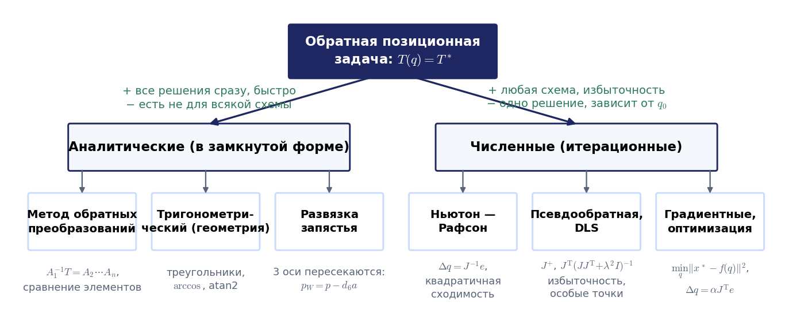

## 2.5. Метод обратных преобразований и функция atan2

### Идея метода

Исходное соотношение (2.22) есть решение прямой задачи $`T_N=A_1A_2\cdots A_N`$, в котором матрица $`T_N`$ теперь известна, а каждая матрица $`A_i=A_i(q_i)`$ зависит от одной неизвестной. Матрицы $`A_i`$ невырождены, поэтому равенство можно умножить слева на $`A_1^{-1}`$, формула (2.23):

```math
A_1^{-1}(q_1)\,T_N=A_2A_3\cdots A_N .
```

Слева стоит выражение, содержащее единственную неизвестную $`q_1`$, справа стоит произведение, которое от $`q_1`$ не зависит. Если среди элементов правой части найдётся постоянный (например, нуль) или удастся составить комбинацию элементов, не зависящую от остальных неизвестных, то приравнивание соответствующих элементов даёт уравнение для $`q_1`$. После этого процедура повторяется для $`q_2`$ и так далее. Можно действовать и с другого конца цепи: умножить (2.22) справа на $`A_N^{-1}`$ и найти $`q_N`$. Матрицы $`A_i^{-1}`$ берутся в готовом виде из формулы (2.9).

#### Пример 2.9. Определение углов Эйлера по матрице ориентации

Рассмотрим трёхстепенной карданный подвес, ориентация которого задаётся углами Эйлера $`\varphi,\theta,\psi`$, формула (2.24):

```math
T_3=R_{z,\varphi}R_{y,\theta}R_{z,\psi}.
```

Задана матрица $`T_3=(\mathbf{x}\;\mathbf{y}\;\mathbf{z})`$ с элементами $`x_x,x_y,\dots,z_z`$; требуется найти три угла. Умножим равенство слева на $`R_{z,\varphi}^{-1}=R_{z,\varphi}^{\mathrm{T}}`$. Слева получится матрица, содержащая только $`\varphi`$, справа получится произведение $`R_{y,\theta}R_{z,\psi}`$, формула (2.25), которая целиком выписана в приложении 2.В. Элемент второй строки и третьего столбца правой матрицы равен нулю, а слева на этом месте стоит $`-z_xs_\varphi+z_yc_\varphi`$; отсюда формула (2.26):

```math
\varphi=\mathrm{atan2}(z_y,\,z_x).
```

Остальные элементы второй строки и третьего столбца дают синусы и косинусы двух других углов, то есть формулы (2.28) и (2.29):

```math
\psi=\mathrm{atan2}(-x_xs_\varphi+x_yc_\varphi,\;-y_xs_\varphi+y_yc_\varphi),\qquad
\theta=\mathrm{atan2}(z_xc_\varphi+z_ys_\varphi,\;z_z).
```

Сделаем два замечания. Во-первых, уравнение для $`\varphi`$ имеет второй корень $`\varphi+\pi`$; ему соответствует второй набор углов $`(\varphi+\pi,\,-\theta,\,\psi+\pi)`$, дающий ту же ориентацию, потому что $`R_{z,\pi}R_{y,-\theta}R_{z,\pi}=R_{y,\theta}`$. Значит, при $`\sin\theta\ne0`$ у задачи два решения, а формула (2.26) выбирает тот из двух наборов, в котором $`\sin\theta\ge 0`$. Во-вторых, при $`\sin\theta=0`$, то есть при $`\theta=0`$ и при $`\theta=\pi`$, имеем $`z_x=z_y=0`$, и формула (2.26) теряет смысл: оси первого и третьего поворотов совпали, и матрица определяет только сумму $`\varphi+\psi`$ (при $`\theta=0`$) или разность $`\varphi-\psi`$ (при $`\theta=\pi`$). Это простейший пример вырожденной конфигурации с бесконечным числом решений. Та же задача возникает на любом пульте робота, где ориентация инструмента показывается тремя углами: перевод матрицы в углы есть пример 2.9 с тем же вырождением.

### Функция atan2

В формулах обратной задачи почти каждый угол находится по паре чисел, пропорциональных его синусу и косинусу. Использовать для этого обычный арктангенс отношения нельзя: $`\mathrm{arctg}(a/b)`$ принимает значения только в интервале $`(-\pi/2,\pi/2)`$, и при делении теряется информация о знаках числителя и знаменателя по отдельности, то есть о квадранте, в котором лежит угол. Функция двух аргументов $`\mathrm{atan2}(a,b)`$, формула (2.27), эту информацию сохраняет: она возвращает угол из промежутка $`(-\pi,\pi]`$, синус которого пропорционален $`a`$, а косинус пропорционален $`b`$ с одним и тем же положительным множителем (кусочное определение через арктангенс приведено в приложении 2.В). Первый аргумент играет роль синуса, второй играет роль косинуса; такой же порядок аргументов принят в языках программирования: `atan2(y, x)`. При $`a=b=0`$ угол не определён, и это не программная неприятность, а признак вырожденной конфигурации, как в примере 2.9 при $`\sin\theta=0`$.

Полезно запомнить правило подсчёта решений. Если удалось найти и синус, и косинус угла, то угол определяется однозначно. Если уравнение даёт только косинус, возникают два решения $`\pm\arccos(\cdot)`$; если только синус, то решения $`\arcsin(\cdot)`$ и $`\pi-\arcsin(\cdot)`$. Замена $`\mathrm{atan2}`$ на арктангенс является одной из самых частых ошибок в программах обратной кинематики: при переходе угла через $`90^\circ`$ рука внезапно перескакивает в зеркальную конфигурацию, а схват уходит в точку, симметричную цели относительно основания. Как это выглядит на двухзвеннике, показывает вторая часть анимации на рис. 2.10.

### Уравнение a sin α + b cos α = c

В обратной задаче постоянно встречается одно и то же уравнение

```math
a\sin\alpha+b\cos\alpha=c
```

с известными $`a`$, $`b`$, $`c`$. Его удобно решать раз и навсегда. Запишем $`a=\rho\sin\gamma`$, $`b=\rho\cos\gamma`$, где $`\rho=\sqrt{a^2+b^2}`$ и $`\gamma=\mathrm{atan2}(a,b)`$. Тогда левая часть равна $`\rho\cos(\alpha-\gamma)`$, и уравнение принимает вид $`\cos(\alpha-\gamma)=c/\rho`$. При $`a^2+b^2< c^2`$ решений нет, а при $`a^2+b^2\ge c^2`$ их два:

```math
\alpha=\mathrm{atan2}(a,b)\pm\mathrm{atan2}\,\Bigl(\sqrt{a^2+b^2-c^2},\;c\Bigr).
```

Второе слагаемое есть просто $`\arccos(c/\rho)`$, записанный через atan2, чтобы формула работала при любых знаках. При $`a^2+b^2=c^2`$ два решения сливаются; это граница достижимости. В учебнике то же уравнение решается подстановкой тангенса половинного угла $`t=\mathrm{tg}(\alpha/2)`$, формула (2.33), которая сводит его к квадратному. Подстановка алгебраически верна, но плохо ведёт себя в программе: если старший коэффициент квадратного уравнения обращается в нуль, один корень уходит в $`\alpha=\pm\pi`$, а второй получается в виде $`0/0`$. Формула через atan2 этого недостатка не имеет. Подстановку половинного угла всё же полезно знать как приём. В лекции 5 ею решается то же самое уравнение для дельта-робота (формула через atan2 даёт там тот же ответ), а для общего манипулятора 6R именно она сводит систему уравнений к многочлену от тангенса половинного угла (Raghavan, Roth, раздел 2.4).

## 2.6. Тригонометрический подход

Тригонометрический подход не является единым алгоритмом. Это набор приёмов, с помощью которых уравнения прямой задачи преобразуются к виду, допускающему последовательное нахождение неизвестных: возведение в квадрат и сложение для исключения угла, составление линейных комбинаций уравнений, решение уравнения $`a\sin\alpha+b\cos\alpha=c`$, использование геометрических особенностей схемы.

#### Пример 2.10. Обратная задача для плоского двухзвенника

У двухзвенника две обобщённые координаты, поэтому нельзя требовать выполнения шести условий; естественно задать только декартовы координаты схвата. Получаем систему (2.55):

```math
a_1\cos q_1+a_2\cos(q_1+q_2)=x,\qquad a_1\sin q_1+a_2\sin(q_1+q_2)=y .
```

Следуя учебнику, примем $`a_1=a_2=a`$ и перейдём к полярным координатам цели $`x=r\cos\beta`$, $`y=r\sin\beta`$. Возведём оба уравнения в квадрат и сложим. В левой части получится $`2a^2+2a^2(c_1c_{12}+s_1s_{12})=2a^2(1+c_2)`$, в правой получится $`r^2`$. Угол $`q_1`$ исключён, и мы приходим к формулам (2.56), (2.57):

```math
c_2=\frac{r^2}{2a^2}-1,\qquad q_2=\pm\arccos\Bigl(\frac{r^2}{2a^2}-1\Bigr).
```

Отсюда сразу видны два факта. Во-первых, условие разрешимости $`\lvert c_2\rvert\le 1`$ даёт $`0\le r\le 2a`$: цель должна лежать в круге досягаемости. Во-вторых, решений два, и они отличаются знаком угла в локте. Чтобы найти $`q_1`$, умножим первое уравнение на $`c_1`$, второе на $`s_1`$ и сложим: $`a(1+c_2)=r\cos(q_1-\beta)`$. Подставив сюда $`1+c_2=r^2/(2a^2)`$, получим

```math
\cos(q_1-\beta)=\frac{r}{2a},\qquad q_1=\beta\pm\arccos\frac{r}{2a}.
```

Возведение в квадрат порождает посторонние корни, поэтому из четырёх комбинаций знаков нужно отобрать верные подстановкой в исходную систему. Проверка даёт два решения, формулы (2.58) и (2.59):

```math
\Bigl(\beta+\arccos\frac{r}{2a},\; -\arccos\Bigl(\frac{r^2}{2a^2}-1\Bigr)\Bigr),\qquad
\Bigl(\beta-\arccos\frac{r}{2a},\; +\arccos\Bigl(\frac{r^2}{2a^2}-1\Bigr)\Bigr).
```

Геометрический смысл формул прост: при равных звеньях треугольник «основание — локоть — схват» равнобедренный, и первое звено отклонено от направления на цель на угол $`\arccos(r/2a)`$ в ту или другую сторону. В осях курса ($`x_0`$ вправо, $`y_0`$ вверх) решение (2.58) с $`q_2<0`$ поднимает локоть над прямой «основание — цель», это конфигурация **«локоть вверх»**; решение (2.59) с $`q_2>0`$ опускает локоть под эту прямую, это **«локоть вниз»** (рис. 2.2). Правило проверено на десяти тысячах случайных целей без единого исключения, и в курсе ветви двухзвенника всюду называются по знаку $`q_2`$ именно так.

*Примечание о расхождении с книгой.* В учебнике решение (2.58) названо конфигурацией «локтем вниз», а (2.59) — «локтем вверх», то есть названия обратные. Если изображать механизм в осях рисунка учебника к примеру 2.1 ($`x_0`$ вверх, $`y_0`$ вправо), такая замена осей есть зеркальное отражение, и «верх» и «низ» ветвей меняются местами.

Для звеньев разной длины те же действия приводят к формулам, которые удобно использовать в программах:

```math
c_2=\frac{x^2+y^2-a_1^2-a_2^2}{2a_1a_2},\qquad q_2=\pm\arccos c_2,\qquad
q_1=\mathrm{atan2}(y,x)-\mathrm{atan2}(a_2s_2,\;a_1+a_2c_2).
```

Во второй формуле $`q_1`$ вычисляется уже для выбранного знака $`q_2`$, поэтому посторонних корней не возникает. Например, при $`a_1=1`$, $`a_2=0{,}7`$ и цели $`(1{,}1;\,0{,}8)`$, направление на которую составляет $`36{,}0^\circ`$, получаем ветвь «локоть вниз» $`(6{,}2^\circ;\,75{,}1^\circ)`$ и ветвь «локоть вверх» $`(65{,}9^\circ;\,-75{,}1^\circ)`$.

В полном ролике к рис. 2.10 (ссылка под рисунком) цель сначала движется по рабочей зоне, и видно, что каждая ветвь есть непрерывная «рука»: углы ветви меняются плавно, пока цель внутри кольца досягаемости, а на внешней границе $`\Gamma_1`$, где $`q_2=0`$ и $`\det J=0`$, две ветви сливаются в одну вытянутую конфигурацию. Сам рисунок показывает фрагмент второй части ролика. В ней цель обходит окружность радиуса $`1{,}2`$ м, рука идёт в конфигурации «локоть вниз», и вместо $`\mathrm{atan2}(y,x)`$ взят $`\mathrm{arctg}(y/x)`$: при переходе направления на цель через $`90^\circ`$ угол $`q_1`$ скачком меняется на $`180^\circ`$ (с $`53{,}3^\circ`$ на $`-124{,}7^\circ`$), и схват уходит в точку $`-\mathbf{r}`$, симметричную цели.


Анимация целиком: [l02_ik2r_branches_atan2.mp4](../06_Анимации/l02_ik2r_branches_atan2.mp4), 70 с.

#### Пример 2.10а. Обратная задача для цилиндрического манипулятора с ограничением хода

Во всех примерах до сих пор сочленения были вращательными. Посмотрим, что меняет поступательная пара, на примере М20П из раздела 2.1. Дано положение схвата $`(p_x,p_y,p_z)`$; ориентация у трёхзвенника однозначно связана с положением, поэтому задавать её не нужно. Третье уравнение сразу даёт высоту каретки $`z=p_z`$. Первые два, возведённые в квадрат и сложенные, исключают угол: $`p_x^2+p_y^2=r^2+a^2`$, откуда

```math
r=\pm\sqrt{p_x^2+p_y^2-a^2}.
```

При известном $`r`$ уравнения линейны относительно $`\sin q`$ и $`\cos q`$; умножая их на $`r`$ и $`a`$ и складывая, получаем $`(r^2+a^2)\sin q=rp_x+ap_y`$, $`(r^2+a^2)\cos q=ap_x-rp_y`$, то есть

```math
q=\mathrm{atan2}(rp_x+ap_y,\;ap_x-rp_y).
```

Формально решений два: рука может дотянуться до цели «лицом», с $`r>0`$, и «спиной», с $`r < 0`$, развернувшись на другой угол $`q`$ (рис. 2.11). Теперь вступают в силу ограничения хода $`d_3^{\min}\le r\le d_3^{\max}`$, причём $`d_3^{\min}\ge0`$, так что ветвь $`r<0`$ отбрасывается физически. Решение существует, только если

```math
(d_3^{\min})^2+a^2\le p_x^2+p_y^2\le(d_3^{\max})^2+a^2,\qquad d_2^{\min}\le p_z\le d_2^{\max},
```

и угол $`q`$ лежит в своём диапазоне. Это и есть полый цилиндр из раздела 2.2 с радиусами $`\sqrt{a^2+(d_3^{\min})^2}`$ и $`\sqrt{a^2+(d_3^{\max})^2}`$: неравенства, задающие образ области $`S_q`$, одновременно служат условием разрешимости обратной задачи. Пусть $`a=0{,}1`$ м и $`0{,}3\le d_3\le0{,}8`$ м. Цель $`(0{,}5;\,0{,}4;\,0{,}6)`$ м достижима единственным образом: $`r=0{,}6325`$ м, $`q=119{,}7^\circ`$ (вторая ветвь $`r=-0{,}6325`$ м, $`q=-42{,}4^\circ`$ запрещена). Цель $`(0{,}2;\,0{,}15)`$ лежит на расстоянии $`0{,}25`$ м от оси, внутри полости радиуса $`0{,}316`$ м, и недостижима, хотя формула даёт $`r=0{,}229`$ м: такой ход меньше минимального. Цель $`(0{,}7;\,0{,}6)`$ на расстоянии $`0{,}922`$ м лежит снаружи цилиндра радиуса $`0{,}806`$ м. Именно так в первом домашнем задании доказывается недостижимость точки для схем с телескопическими звеньями: не подбором углов, а проверкой неравенств.

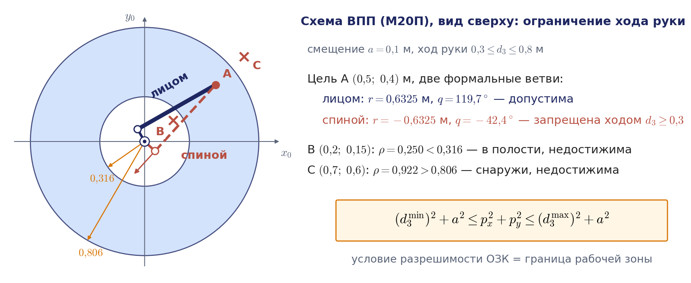

### Манипулятор PUMA: развязка по положению и ориентации

Для шестистепенного манипулятора пришлось бы, казалось бы, решать систему шести уравнений с шестью неизвестными. Однако у схемы PUMA есть важная особенность: оси трёх последних сочленений (орты $`\mathbf{z}_3,\mathbf{z}_4,\mathbf{z}_5`$) пересекаются в одной точке, в **центре запястья** $`O_4=O_5`$. Это результат сознательного проектирования; такое запястье называют сферическим, и это первый случай критерия Пипера.

Из векторной рекурсии примера 2.4 следует $`\mathbf{p}_6=\mathbf{p}_4+d_6\mathbf{z}_6`$. Поэтому положение центра запястья вычисляется непосредственно по заданной матрице $`T_6^{\ast}`$, формула (2.30):

```math
\mathbf{p}=\mathbf{p}_4=\mathbf{p}_6-d_6\mathbf{z}_6=(p_x,p_y,p_z)^{\mathrm{T}}.
```

С другой стороны, три последних сочленения поворачивают кисть вокруг центра запястья, не сдвигая его, так что $`\mathbf{p}_4`$ зависит только от $`q_1,q_2,q_3`$. Последний столбец матрицы $`T_4=A_1A_2A_3A_4`$ даёт систему (2.31):

```math
\begin{aligned}
p_x&=c_1(a_2c_2+a_3c_{23}+d_4s_{23})-d_2s_1,\\
p_y&=s_1(a_2c_2+a_3c_{23}+d_4s_{23})+d_2c_1,\\
p_z&=-a_2s_2-a_3s_{23}+d_4c_{23}.
\end{aligned}
```

Таким образом, система шестого порядка распалась на две подсистемы третьего порядка: сначала по положению запястья находятся $`q_1,q_2,q_3`$, затем по ориентации схвата находятся $`q_4,q_5,q_6`$ (рис. 2.12).

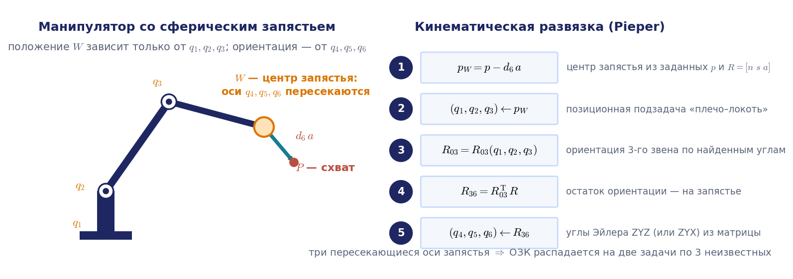

### Манипулятор PUMA: углы положения

**Угол $`q_1`$.** Умножим первое уравнение (2.31) на $`-s_1`$, второе на $`c_1`$ и сложим. Общая скобка сокращается, и остаётся уравнение (2.32):

```math
-p_xs_1+p_yc_1=d_2 .
```

Его геометрический смысл: проекция вектора $`\mathbf{p}`$ на ось $`\mathbf{z}_1`$ равна боковому смещению плеча $`d_2`$. Это уравнение $`a\sin\alpha+b\cos\alpha=c`$ с $`a=-p_x`$, $`b=p_y`$, $`c=d_2`$, и по правилу раздела 2.5 получаем формулу (2.34) в форме, пригодной для программы:

```math
q_1=\mathrm{atan2}(-p_x,\;p_y)\pm\mathrm{atan2}\,\Bigl(\sqrt{p_x^2+p_y^2-d_2^2},\;d_2\Bigr).
```

Для достижимых положений запястья $`p_x^2+p_y^2\ge d_2^2`$, так что корень вещественный. Два знака соответствуют двум положениям плеча, по разные стороны от цели. Они различаются на угол $`2\arccos(d_2/\rho)=\pi-2\arcsin(d_2/\rho)`$, где $`\rho=\sqrt{p_x^2+p_y^2}`$; ровно на $`180^\circ`$ — только при $`d_2=0`$. Например, при $`p_x=0{,}5`$, $`p_y=0{,}3`$, $`d_2=0{,}15`$ разность равна $`150{,}2^\circ`$.

**Угол $`q_2`$.** Обозначим $`k_1=p_xc_1+p_ys_1`$ (теперь это известное число). Умножив первое уравнение (2.31) на $`c_1`$, второе на $`s_1`$ и сложив, получим вместе с третьим уравнением систему (2.36):

```math
k_1-a_2c_2=a_3c_{23}+d_4s_{23},\qquad p_z+a_2s_2=-a_3s_{23}+d_4c_{23}.
```

Возведём оба равенства в квадрат и сложим. Правая часть даст $`a_3^2+d_4^2`$, сумма углов $`q_2+q_3`$ исключится, и после приведения подобных получится уравнение (2.37):

```math
-p_zs_2+k_1c_2=k_2,\qquad k_2=\frac{k_1^2+p_z^2+a_2^2-a_3^2-d_4^2}{2a_2}.
```

Оно имеет ту же структуру, что и (2.32), поэтому решение записывается по тому же правилу, формула (2.38):

```math
q_2=\mathrm{atan2}(-p_z,\;k_1)\pm\mathrm{atan2}\,\Bigl(\sqrt{p_z^2+k_1^2-k_2^2},\;k_2\Bigr).
```

Два знака соответствуют двум положениям локтя.

**Угол $`q_3`$.** При известных $`q_1`$ и $`q_2`$ система (2.36) линейна относительно $`s_{23}`$ и $`c_{23}`$, формула (2.39):

```math
d_4s_{23}+a_3c_{23}=k_3,\qquad -a_3s_{23}+d_4c_{23}=k_4,\qquad k_3=k_1-a_2c_2,\quad k_4=p_z+a_2s_2 .
```

Решая её, получаем формулы (2.40), (2.41) и (2.43):

```math
s_{23}=\frac{d_4k_3-a_3k_4}{d_4^2+a_3^2},\qquad c_{23}=\frac{d_4k_4+a_3k_3}{d_4^2+a_3^2},\qquad q_3=\mathrm{atan2}(s_{23},c_{23})-q_2 .
```

Найдены и синус, и косинус, поэтому $`q_3`$ определяется однозначно. Знаки в (2.34) и (2.38) выбираются независимо, так что одному положению центра запястья соответствуют четыре тройки $`(q_1,q_2,q_3)`$.

*Примечание о расхождении с книгой.* В учебнике формулы (2.34) и (2.38) записаны через тангенс половинного угла: $`q_1=2\mathrm{arctg}\,\bigl((-p_x\pm\sqrt{p_x^2+p_y^2-d_2^2})/(p_y+d_2)\bigr)`$ с оговоркой $`-\pi< q_1< \pi`$, и аналогично для $`q_2`$. При $`p_y+d_2=0`$ знаменатель обращается в нуль: допустимое решение $`q_1=\pi`$ исключено оговоркой, а второе получается неверным. Это не опечатка, а неудачная для программы форма; выше приведена эквивалентная форма через atan2. Вспомогательные числа учебника $`Q`$, $`A`$, $`B`$, $`C`$ обозначены здесь $`k_1,\dots,k_4`$, потому что буквы $`A_i`$, $`Q_i`$, $`C_i`$ заняты в курсе другими величинами.

### Манипулятор PUMA: углы ориентации

Теперь известны орты первых трёх звеньев, и остаётся подобрать $`q_4,q_5,q_6`$ так, чтобы схват принял заданную ориентацию. Из векторной рекурсии ось схвата выражается через орты третьего звена: $`\mathbf{z}_6=c_4s_5\,\mathbf{x}_3+s_4s_5\,\mathbf{z}_1+c_5\,\mathbf{z}_3`$. Умножая это равенство скалярно на $`\mathbf{z}_1`$ и на $`\mathbf{x}_3`$, получаем $`s_4s_5`$ и $`c_4s_5`$. Если бы был известен знак $`s_5`$, угол $`q_4`$ определялся бы однозначно; знак неизвестен, поэтому возможны оба варианта, формула (2.47):

```math
q_4=\mathrm{atan2}\,\bigl(\varepsilon_4\,\mathbf{z}_1^{\mathrm T}\mathbf{z}_6,\;\varepsilon_4\,\mathbf{x}_3^{\mathrm T}\mathbf{z}_6\bigr),\qquad \varepsilon_4=\pm 1 .
```

Два значения $`q_4`$ отличаются на $`\pi`$; это два положения запястья, прямое и перевёрнутое. После выбора $`q_4`$ орты четвёртого звена известны, и оставшиеся углы находятся однозначно, формулы (2.50), (2.51) и (2.54):

```math
q_5=\mathrm{atan2}\,\bigl(\mathbf{z}_6^{\mathrm{T}}\mathbf{x}_4,\;-\mathbf{z}_6^{\mathrm{T}}\mathbf{y}_4\bigr),\qquad
q_6=\mathrm{atan2}\,\bigl(\mathbf{x}_6^{\mathrm{T}}\mathbf{y}_5,\;\mathbf{y}_6^{\mathrm{T}}\mathbf{y}_5\bigr).
```

Здесь $`\mathbf{x}_4,\mathbf{y}_4,\mathbf{y}_5`$ вычисляются рекурсией по уже найденным углам, а $`\mathbf{x}_6,\mathbf{y}_6,\mathbf{z}_6`$ берутся из заданной матрицы. Покоординатная запись этих формул и их вывод, формулы (2.44)–(2.54), приведены в приложении 2.Г. Если $`s_5=0`$, обе проекции в (2.47) равны нулю, оси четвёртого и шестого сочленений совпадают, и определена только сумма $`q_4+q_6`$. Это полная аналогия с вырождением углов Эйлера в примере 2.9.

### Восемь решений и вырожденные конфигурации

Знаки выбираются независимо в трёх местах: при вычислении $`q_1`$ (два положения плеча), $`q_2`$ (два положения локтя) и $`q_4`$ (запястье прямое или перевёрнутое). Следовательно, каждому положению схвата из области достижимости соответствуют до $`2\cdot 2\cdot 2=8`$ конфигураций манипулятора (рис. 2.13). Проверим это расчётом для PUMA с размерами $`a_2=0{,}4318`$, $`a_3=0{,}0203`$, $`d_2=0{,}15005`$, $`d_4=0{,}4318`$ м и инструментом $`d_6=0{,}1`$ м. Возьмём конфигурацию $`\mathbf{q}=(30^\circ,-40^\circ,20^\circ,40^\circ,60^\circ,30^\circ)`$, найдём по ней позу схвата и решим обратную задачу по формулам этого раздела (в первом столбце знаки, выбранные для плеча, локтя и запястья):

| Ветвь | $`q_1`$ | $`q_2`$ | $`q_3`$ | $`q_4`$ | $`q_5`$ | $`q_6`$ |
|---|---|---|---|---|---|---|
| $`+,+,+`$ | $`30{,}0`$ | $`-40{,}0`$ | $`20{,}0`$ | $`40{,}0`$ | $`60{,}0`$ | $`30{,}0`$ |
| $`+,+,-`$ | $`30{,}0`$ | $`-40{,}0`$ | $`20{,}0`$ | $`-140{,}0`$ | $`-60{,}0`$ | $`-150{,}0`$ |
| $`+,-,+`$ | $`30{,}0`$ | $`-107{,}4`$ | $`154{,}6`$ | $`110{,}2`$ | $`36{,}4`$ | $`-61{,}8`$ |
| $`+,-,-`$ | $`30{,}0`$ | $`-107{,}4`$ | $`154{,}6`$ | $`-69{,}8`$ | $`-36{,}4`$ | $`118{,}2`$ |
| $`-,+,+`$ | $`-76{,}8`$ | $`-72{,}6`$ | $`20{,}0`$ | $`60{,}9`$ | $`18{,}1`$ | $`116{,}6`$ |
| $`-,+,-`$ | $`-76{,}8`$ | $`-72{,}6`$ | $`20{,}0`$ | $`-119{,}1`$ | $`-18{,}1`$ | $`-63{,}4`$ |
| $`-,-,+`$ | $`-76{,}8`$ | $`-140{,}0`$ | $`154{,}6`$ | $`161{,}6`$ | $`59{,}6`$ | $`5{,}8`$ |
| $`-,-,-`$ | $`-76{,}8`$ | $`-140{,}0`$ | $`154{,}6`$ | $`-18{,}4`$ | $`-59{,}6`$ | $`-174{,}2`$ |

Все восемь наборов (углы в градусах) воспроизводят исходную матрицу с точностью $`10^{-15}`$. Видны все свойства ветвей: в перевёрнутой конфигурации запястья углы $`q_4`$ и $`q_6`$ отличаются на $`180^\circ`$, а $`q_5`$ меняет знак; два положения плеча различаются на $`106{,}8^\circ`$, а не на $`180^\circ`$, из-за смещения $`d_2`$. Часть этих решений на реальном роботе может оказаться за пределами сочленений, и тогда их отбрасывают.

Кроме того, существуют конфигурации, в которых решений бесконечно много: таково вырождение запястья $`s_5=0`$, о котором уже сказано. Во второй части анимации на рис. 2.14 схват проходит через такую конфигурацию при фиксированном признаке $`\varepsilon_4`$: в момент $`q_5=0`$ оси 4 и 6 совпадают, схват стоит, а углы $`q_4`$ и $`q_6`$ проворачиваются на $`180^\circ`$ в разные стороны при неизменной сумме $`q_4+q_6`$. Это и есть переворот запястья, который контроллер вынужден выполнить, если не разрешено менять статус конфигурации.

Контроллер промышленного робота хранит выбранную ветвь решения как признак (статус) конфигурации и не меняет его в процессе движения. Для манипуляторов, у которых обратная задача распадается на квадратные уравнения, в частности для PUMA и других 6R со сферическим запястьем, непрерывный переход с одной ветви на другую при движении схвата возможен только через вырожденную конфигурацию; такие схемы называют некаспидальными, и у них статус конфигурации однозначно задаёт ветвь. Существуют и каспидальные манипуляторы, которые меняют решение обратной задачи, не проходя особенность; это показано уже для некоторых трёхзвенных схем, и вопрос о том, какие именно серийные роботы каспидальны, остаётся предметом исследований (обзор: Wenger, Chablat, 2022). Вырожденные конфигурации подробно изучаются на следующей лекции с помощью матрицы Якоби. Пример PUMA показывает также, что, в отличие от прямой задачи, решение обратной задачи целиком определяется особенностями конкретной схемы и требует аккуратных, хотя и элементарных выкладок.

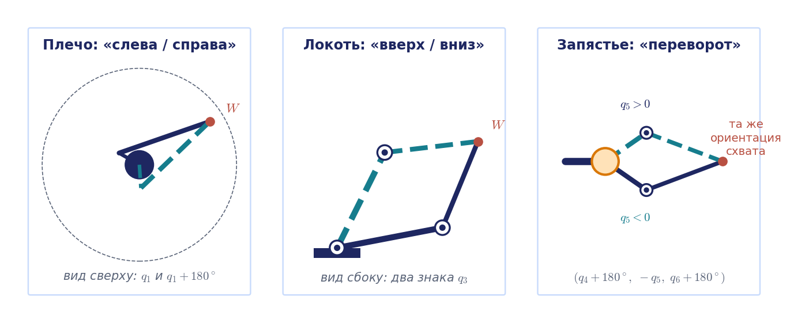


Анимация целиком: [l02_puma_8_solutions_wrist_flip.mp4](../06_Анимации/l02_puma_8_solutions_wrist_flip.mp4), 88 с.

#### Пример 2.11а. Обратная задача для коллаборативного робота UR5e

У робота UR5e запястье несферическое: оси 4, 5, 6 не пересекаются, поэтому развязки PUMA нет. Зато оси 2, 3, 4 параллельны, и это второй случай критерия Пипера. Таблица ДХ приведена в примере 2.4а; поскольку все сочленения вращательные, $`\theta_i=q_i`$. Схема решения такова: по заданной позе $`T_6^{\ast}`$ найти угол основания, затем два угла кисти, а оставшиеся три угла получить из плоской задачи (рис. 2.15).

**Угол $`q_1`$.** Обозначим через $`\mathbf{p}_5=\mathbf{p}_6-d_6\mathbf{z}_6`$ положение начала пятой системы; оно вычисляется по заданной матрице. Оси 2, 3, 4 параллельны орту $`\mathbf{z}_1=(s_1,-c_1,0)^{\mathrm T}`$, и вдоль этого направления от оси основания до точки $`O_5`$ есть только одно смещение $`d_4`$: все остальные смещения ($`d_1`$ вдоль $`\mathbf{z}_0`$, $`a_2`$ и $`a_3`$ вдоль звеньев, $`d_5`$ вдоль $`\mathbf{z}_4`$) перпендикулярны $`\mathbf{z}_1`$. Поэтому $`\mathbf{z}_1^{\mathrm T}\mathbf{p}_5=d_4`$, то есть

```math
p_{5x}s_1-p_{5y}c_1=d_4 ,\qquad
q_1=\mathrm{atan2}(p_{5x},\;-p_{5y})\pm\mathrm{atan2}\,\Bigl(\sqrt{p_{5x}^2+p_{5y}^2-d_4^2},\;d_4\Bigr).
```

Это уже знакомое уравнение $`a\sin\alpha+b\cos\alpha=c`$, и оно даёт два положения плеча. Решения нет, если точка $`O_5`$ находится ближе $`d_4=0{,}133`$ м к оси основания: внутри этого вертикального цилиндра робот работать не может, а на его поверхности две ветви плеча сливаются (особая конфигурация).

**Углы $`q_5`$ и $`q_6`$.** Выразим орт $`\mathbf{z}_1`$ в системе схвата. Перемножая элементарные повороты сочленений 4, 5, 6, получаем, что его координаты в осях $`\mathbf{x}_6,\mathbf{y}_6,\mathbf{z}_6`$ равны $`(s_5c_6,\;-s_5s_6,\;c_5)`$. Значит,

```math
c_5=\mathbf{z}_6^{\mathrm T}\mathbf{z}_1,\qquad q_5=\pm\arccos\bigl(\mathbf{z}_6^{\mathrm T}\mathbf{z}_1\bigr),\qquad
q_6=\mathrm{atan2}\,\Bigl(-\frac{\mathbf{y}_6^{\mathrm T}\mathbf{z}_1}{s_5},\;\frac{\mathbf{x}_6^{\mathrm T}\mathbf{z}_1}{s_5}\Bigr).
```

Два знака $`q_5`$ дают два положения кисти; деление на $`s_5`$ учитывает его знак. При $`s_5=0`$ ось шестого сочленения параллельна осям 2–4, угол $`q_6`$ не определяется отдельно, и это особая конфигурация кисти.

**Углы $`q_2`$, $`q_3`$, $`q_4`$.** Теперь известны матрицы $`A_1`$, $`A_5`$, $`A_6`$, и произведение $`{}^{1}T_4=A_1^{-1}\,T_6^{\ast}\,(A_5A_6)^{-1}`$ равно $`A_2A_3A_4`$. Его последний столбец содержит координаты точки $`O_4`$ в первой системе: $`x=a_2c_2+a_3c_{23}`$, $`y=a_2s_2+a_3s_{23}`$, а первый столбец равен $`(c_{234},s_{234},0)^{\mathrm T}`$. Это в точности плоский трёхзвенник с ориентацией, и, как в примере 2.10,

```math
\begin{aligned}
&c_3=\frac{x^2+y^2-a_2^2-a_3^2}{2a_2a_3},\qquad q_3=\pm\arccos c_3,\\
&q_2=\mathrm{atan2}(y,x)-\mathrm{atan2}(a_3s_3,\;a_2+a_3c_3),\qquad q_4=q_{234}-q_2-q_3 ,
\end{aligned}
```

где $`q_{234}`$ находится как atan2 от второго и первого элементов первого столбца $`{}^{1}T_4`$. Итого $`2\cdot2\cdot2=8`$ решений, как у PUMA, но по другому случаю критерия Пипера: плечо, кисть, локоть.

Проверим расчётом. Для конфигурации $`\mathbf{q}=(20^\circ,-70^\circ,80^\circ,-100^\circ,-60^\circ,30^\circ)`$ схват находится в точке $`(-0{,}531;\,-0{,}388;\,0{,}408)`$ м, а точка $`O_5`$ удалена от оси основания на $`0{,}645`$ м, что больше $`d_4`$. Формулы дают восемь решений (углы в градусах; в первом столбце знаки, выбранные для плеча, кисти и локтя):

| Ветвь | $`q_1`$ | $`q_2`$ | $`q_3`$ | $`q_4`$ | $`q_5`$ | $`q_6`$ |
|---|---|---|---|---|---|---|
| $`+,+,+`$ | $`20{,}0`$ | $`-34{,}8`$ | $`21{,}7`$ | $`103{,}1`$ | $`60{,}0`$ | $`-150{,}0`$ |
| $`+,+,-`$ | $`20{,}0`$ | $`-13{,}9`$ | $`-21{,}7`$ | $`125{,}7`$ | $`60{,}0`$ | $`-150{,}0`$ |
| $`+,-,+`$ | $`20{,}0`$ | $`-70{,}0`$ | $`80{,}0`$ | $`-100{,}0`$ | $`-60{,}0`$ | $`30{,}0`$ |
| $`+,-,-`$ | $`20{,}0`$ | $`6{,}1`$ | $`-80{,}0`$ | $`-16{,}1`$ | $`-60{,}0`$ | $`30{,}0`$ |
| $`-,+,+`$ | $`-136{,}2`$ | $`171{,}0`$ | $`82{,}0`$ | $`-149{,}9`$ | $`117{,}2`$ | $`57{,}0`$ |
| $`-,+,-`$ | $`-136{,}2`$ | $`-111{,}0`$ | $`-82{,}0`$ | $`-63{,}9`$ | $`117{,}2`$ | $`57{,}0`$ |
| $`-,-,+`$ | $`-136{,}2`$ | $`-161{,}5`$ | $`15{,}4`$ | $`69{,}2`$ | $`-117{,}2`$ | $`-123{,}0`$ |
| $`-,-,-`$ | $`-136{,}2`$ | $`-146{,}7`$ | $`-15{,}4`$ | $`85{,}2`$ | $`-117{,}2`$ | $`-123{,}0`$ |

Исходная конфигурация стоит в третьей строке, и все восемь наборов воспроизводят позу с точностью $`10^{-15}`$. На двух тысячах случайных поз формулы всякий раз находили исходную конфигурацию, а все восемь вещественных решений существовали примерно в трёх случаях из четырёх; в остальных части ветвей мешает условие $`\lvert c_3\rvert\le1`$. Этот приём «снять запястье, затем решить плоскую задачу» подробно разобран в техническом отчёте Хокинса (Hawkins, 2013) и лежит в основе аналитических решателей для роботов UR. Он же пригодится во втором домашнем задании, где модель робота берётся у производителя.

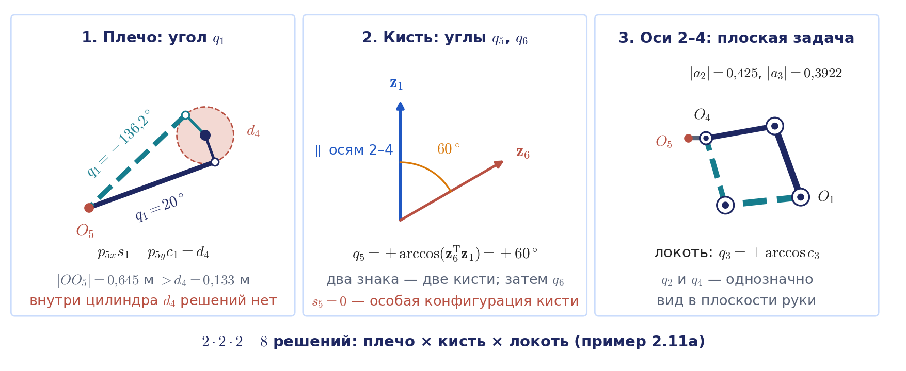

Ещё одна схема того же типа, пятистепенный учебный манипулятор SCORBOT-ERIII (пример 2.11 учебника), разобран в приложении 2.Д. У него тоже параллельны оси 2, 3, 4, а пятью сочленениями нельзя обеспечить произвольную ориентацию: заданная ось схвата должна лежать в вертикальной плоскости руки, иначе решения нет. Так проявляется случай $`N<6`$. При выполнении этого условия решений до четырёх: два положения плеча и два положения локтя.

## 2.7. Численные методы решения обратной задачи

### Метод Ньютона

Решение в замкнутой форме существует не для всякой кинематической схемы. В общем случае обратную задачу рассматривают как задачу поиска корня векторного уравнения (2.86):

```math
\mathbf{f}(\mathbf{q})=\mathbf{s}^{\ast}.
```

Основным инструментом служит метод Ньютона, или метод касательных. Напомним его идею для скалярного уравнения $`\varphi(x)=0`$. В точке текущего приближения $`x_i`$ функцию заменяют её линейным приближением, то есть касательной к графику, и за следующее приближение принимают точку пересечения касательной с осью абсцисс, формула (2.88):

```math
x_{i+1}=x_i-\frac{\varphi(x_i)}{\varphi'(x_i)} .
```

Для векторного уравнения поступаем так же. Пусть $`\mathbf{q}_i`$ есть текущее приближение. Линеаризуем функцию в его окрестности:

```math
\mathbf{f}(\mathbf{q}_i+\Delta\mathbf{q})\approx\mathbf{f}(\mathbf{q}_i)+\frac{\partial\mathbf{f}}{\partial\mathbf{q}}(\mathbf{q}_i)\,\Delta\mathbf{q},
```

где роль производной играет матрица частных производных $`\partial\mathbf{f}/\partial\mathbf{q}`$, **матрица Якоби** отображения $`\mathbf{f}`$. Потребуем, чтобы линейное приближение совпало с целью. Если число уравнений равно $`N`$ и матрица Якоби невырождена, получаем итерационную схему (2.89):

```math
\mathbf{q}_{i+1}=\mathbf{q}_i+\Bigl(\frac{\partial\mathbf{f}}{\partial\mathbf{q}}(\mathbf{q}_i)\Bigr)^{-1}\bigl(\mathbf{s}^{\ast}-\mathbf{f}(\mathbf{q}_i)\bigr),\qquad i=0,1,2,\dots
```

Разность в скобках называется **невязкой**: это отклонение текущего положения схвата от цели. Алгоритм состоит из повторения четырёх действий (рис. 2.16, слева): решить прямую задачу для текущего $`\mathbf{q}_i`$, вычислить невязку, сравнить её с допуском и, если допуск не достигнут, сделать шаг (2.89). Главная вычислительная нагрузка приходится на построение матрицы Якоби и решение линейной системы на каждом шаге (саму обратную матрицу на практике не вычисляют).

В таком виде схема прямо применима, когда $`\mathbf{f}`$ содержит только координаты: для плоского трёхзвенника с вектором $`(x,y,\varphi)`$, где угол плоского поворота законно вычитать (разность приводят к промежутку $`(-\pi,\pi]`$), или для задачи только о положении схвата. Если же $`\mathbf{s}`$ содержит три угла ориентации в пространстве, то $`\partial\mathbf{f}/\partial\mathbf{q}`$ есть так называемый аналитический якобиан $`J_A`$ (лекция 3), и схема (2.89) тоже верна, но ломается вблизи вырождения выбранной системы углов, например при $`\sin\theta=0`$ для углов ZYZ. Поэтому на практике невязку ориентации измеряют иначе.

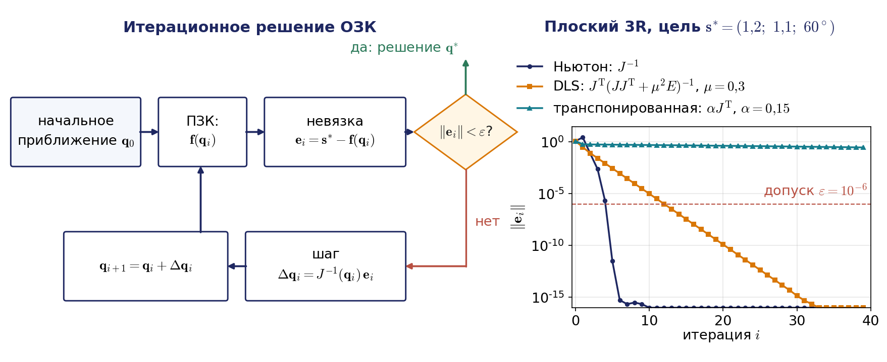

### Как измерить ошибку ориентации

Пусть текущая ориентация схвата есть $`R`$, а заданная есть $`R^{\ast}`$. Поворот, переводящий одну в другую, есть $`R^{\ast}R^{\mathrm T}`$. Его удобно описать **вектором поворота**: орт оси, умноженный на угол поворота (лекция 1). Это и есть ошибка ориентации:

```math
\mathbf{e}=\begin{pmatrix}\delta\boldsymbol{\varphi}\\ \Delta\mathbf{p}\end{pmatrix},\qquad
\delta\boldsymbol{\varphi}=\log\bigl(R^{\ast}R^{\mathrm T}\bigr)^{\vee},\qquad \Delta\mathbf{p}=\mathbf{p}^{\ast}-\mathbf{p},
```

где $`\log(\cdot)^{\vee}`$ означает переход от матрицы поворота к её вектору поворота; оба вектора записаны в базовой системе. В отличие от разности углов Эйлера, эта величина не скачет при переходе угла через $`\pm\pi`$ и не вырождается ни при какой ориентации. Иногда пользуются малоугловой формулой $`\delta\boldsymbol{\varphi}\approx\frac{1}{2}(\mathbf{x}\times\mathbf{x}^{\ast}+\mathbf{y}\times\mathbf{y}^{\ast}+\mathbf{z}\times\mathbf{z}^{\ast})`$, но она верна лишь в первом порядке: её длина равна синусу угла рассогласования, а не самому углу. При ошибке $`10^\circ`$ формулы почти совпадают ($`0{,}174`$ против $`0{,}175`$ рад), при $`90^\circ`$ малоугловая даёт $`1{,}00`$ вместо $`1{,}57`$, при $`150^\circ`$ даёт $`0{,}50`$ вместо $`2{,}62`$, а при $`180^\circ`$ обращается в нуль, то есть «не видит» перевёрнутый схват.

Ошибка $`\mathbf{e}`$ — это настоящий вектор, но не разность двух значений какой-либо функции $`\mathbf{f}(\mathbf{q})`$. Поэтому в шаге Ньютона вместо $`\partial\mathbf{f}/\partial\mathbf{q}`$ берут **геометрическую матрицу Якоби** $`J(\mathbf{q})`$ из лекции 3, которая связывает скорости сочленений со скоростью схвата $`\boldsymbol{\mathcal V}=(\boldsymbol{\omega};\mathbf{v})`$:

```math
\mathbf{q}_{i+1}=\mathbf{q}_i+J^{-1}(\mathbf{q}_i)\,\mathbf{e}(\mathbf{q}_i).
```

Вблизи решения этот процесс тоже сходится квадратично. Важно, чтобы порядок блоков невязки совпадал с порядком строк матрицы Якоби: в курсе это $`(\boldsymbol{\omega};\mathbf{v})`$, а многие библиотеки, в том числе учебная kinlib, Robotics Toolbox и MoveIt, хранят строки в порядке $`(\mathbf{v};\boldsymbol{\omega})`$ (таблица соглашений будет в лекции 3). Смешивать два подхода нельзя. Если взять геометрическую матрицу Якоби, а невязку ориентации посчитать как разность углов, процесс расходится: в нашем опыте с UR5e из пяти начальных приближений вблизи цели такая смесь не сошлась ни разу. Невязка не приблизилась к нулю: по ходу итераций она колебалась от $`0{,}3`$ до $`4{,}4`$, а в конце опыта оставалась от $`0{,}7`$ до $`3{,}7`$. Правильная схема в четырёх случаях из пяти дошла до $`10^{-15}`$ за пять-шесть итераций (рис. 2.17); в оставшемся случае начальное приближение оказалось вне области сходимости, и не сошлась и она.

Наконец, критерий остановки задают раздельно: $`\lVert\Delta\mathbf{p}\rVert< \varepsilon_p`$ в метрах и $`\lVert\delta\boldsymbol{\varphi}\rVert< \varepsilon_\omega`$ в радианах. Складывать метры с радианами в одну норму можно лишь для оценки, а не для решения о точности.


### Сходимость

Достоинство метода Ньютона состоит в скорости. Для скалярного уравнения справедлива следующая теорема, которую полезно знать словами: если вблизи корня производная не обращается в нуль, а функция достаточно гладкая (ограничена вторая производная), то из любой достаточно близкой начальной точки итерации сходятся, и ошибка на каждом шаге приблизительно возводится в квадрат: $`10^{-2}\to10^{-4}\to10^{-8}`$. Точная формулировка с постоянными, определяющими радиус области сходимости, приведена в приложении 2.Е.

Квадратичная сходимость означает, что число верных знаков удваивается на каждой итерации. На рис. 2.16 справа показан численный эксперимент для плоского трёхзвенника с длинами $`1`$; $`0{,}8`$; $`0{,}5`$ из начального приближения $`(10^\circ,20^\circ,-10^\circ)`$ к цели $`(1{,}2;\,1{,}1;\,60^\circ)`$. Схема Ньютона уменьшает невязку до $`3\cdot10^{-12}`$ за пять итераций: $`1{,}2\to2{,}8\to7{,}9\cdot10^{-2}\to2{,}4\cdot10^{-3}\to2{,}2\cdot10^{-6}\to3{,}2\cdot10^{-12}`$. Обратите внимание на первый шаг: невязка сначала выросла, и рука ушла к ветви $`(77{,}7^\circ;\,-100{,}5^\circ;\,82{,}8^\circ)`$, а не к ближней ветви $`(-7{,}6^\circ;\,100{,}5^\circ;\,-33{,}0^\circ)`$, к которой спокойно приходит демпфированная схема (о ней ниже). «Быстро» не значит «к нужному решению».

### Трудности метода и цепочка близких целей

Теорема гарантирует сходимость только из окрестности корня. При произвольном начальном приближении возможны три неприятности, хорошо видные уже в скалярном случае: в очередной точке производная обращается в нуль (в векторном случае вырождена матрица Якоби) и следующего приближения нет; касательные уводят последовательность от корня; касательные перебрасывают точку между двумя положениями, и процесс зацикливается. К этому нужно добавить, что при недостижимой цели корня нет вовсе, а при достижимой цели метод находит только одно из решений, то, в область притяжения которого попало начальное приближение. Карта областей притяжения для двухзвенника примера 2.10 показана в первой части анимации на рис. 2.18: каждое начальное приближение на торе $`(q_1,q_2)`$ окрашено цветом той ветви, к которой из него сходится метод Ньютона. Вдали от особых линий $`q_2=0`$ и $`q_2=\pm\pi`$, где вырождена матрица Якоби, области крупные, а возле них цвета перемешаны, и два соседних старта приходят к разным ветвям.

Рецепт «выбрать начальное приближение вблизи корня» в режиме on-line выглядит бесполезным, ведь корень как раз неизвестен. Однако существует простой приём, который этот рецепт реализует. Пусть манипулятор находится в конфигурации $`\mathbf{q}_0`$. Построим конечную последовательность промежуточных целей $`\mathbf{s}^0,\mathbf{s}^1,\dots,\mathbf{s}^m`$ так, чтобы $`\mathbf{s}^0=\mathbf{f}(\mathbf{q}_0)`$, $`\mathbf{s}^m=\mathbf{s}^{\ast}`$, а соседние цели были близки. Будем решать обратную задачу последовательно для каждой цели, принимая за начальное приближение решение, найденное для предыдущей. Тогда каждый раз мы стартуем вблизи корня, в области квадратичной сходимости, и схема Ньютона с полным шагом сходится за одну-две итерации. Выигрыш цепочки состоит не в суммарном числе итераций, а в том, что решение непрерывно продолжает исходную конфигурацию и остаётся на её ветви. Во второй части анимации на рис. 2.18 это видно на плоском трёхзвеннике из опыта рис. 2.16: цепочка из двадцати промежуточных целей тратит 41 итерацию и приводит руку на ближнюю ветвь $`(-7{,}6^\circ;\,100{,}5^\circ;\,-33{,}0^\circ)`$, а один «прыжок» к той же цели занимает всего 4 итерации, но заканчивается на дальней ветви $`(77{,}7^\circ;\,-100{,}5^\circ;\,82{,}8^\circ)`$.


Анимация целиком: [l02_ik_basins_target_chain.mp4](../06_Анимации/l02_ik_basins_target_chain.mp4), 90 с.

Проверим это на UR5e. Робот стоит в конфигурации $`(0^\circ,-90^\circ,90^\circ,-90^\circ,-90^\circ,0^\circ)`$, цель задана позой, соответствующей $`(150^\circ,-60^\circ,100^\circ,-130^\circ,-90^\circ,30^\circ)`$. Цепочка из тридцати промежуточных поз (положение по прямой, ориентация по кратчайшему повороту) при допуске $`10^{-4}`$ решается за две итерации на шаг (на трёх шагах за три, всего 63 итерации), невязка на шаге убывает как $`7{,}9\cdot10^{-2}\to1{,}5\cdot10^{-3}\to2{,}9\cdot10^{-6}`$, и робот приходит ровно в $`(150^\circ,-60^\circ,100^\circ,-130^\circ,-90^\circ,30^\circ)`$. Один «прыжок» к той же цели из исходной конфигурации требует одиннадцати итераций и приводит в $`(150^\circ;\,34{,}5^\circ;\,-100^\circ;\,-24{,}5^\circ;\,-90^\circ;\,30^\circ)`$: поза та же, но локоть на другой ветви, и робот при таком движении провернул бы звенья, а в найденной позе его локоть оказался бы ниже основания, то есть врезался бы в стол, на котором робот установлен (рис. 2.19).

Цепочка помогает, только пока промежуточные цели достижимы. В другом нашем опыте прямолинейный путь проводил точку $`O_5`$ через цилиндр радиуса $`d_4`$ у оси основания, внутри которого обратная задача UR5e решения не имеет (пример 2.11а). Семь промежуточных поз оказались внутри цилиндра; на них решатель исчерпывал лимит итераций (до шестидесяти на шаге), не достигал допуска, и цепочка закончилась на другой ветви локтя: $`(170^\circ;\,-22{,}7^\circ;\,-60^\circ;\,-7{,}3^\circ;\,-100^\circ;\,20^\circ)`$ вместо $`(170^\circ;\,-80^\circ;\,60^\circ;\,-70^\circ;\,-100^\circ;\,20^\circ)`$. Сгущение цепочки здесь не помогает: нужно менять сам путь, например перейти к движению в осях (раздел 2.9). Если же путь проходит вблизи особой конфигурации, но цели ещё достижимы, цепочку сгущают или обходят особенность (лекция 3).

Важно, что две итерации на шаг цепочки получаются только при полном шаге Ньютона. Если умножить шаг на коэффициент $`0< \alpha<1`$, линеаризация даёт $`\mathbf{e}_{i+1}\approx(1-\alpha)\mathbf{e}_i`$, то есть сходимость становится линейной: при $`\alpha=0{,}5`$ невязка всего лишь делится пополам на каждой итерации ($`7{,}9\cdot10^{-2}\to4{,}0\cdot10^{-2}\to2{,}0\cdot10^{-2}\to\dots`$), и на каждом шаге той же цепочки нужно десять итераций вместо двух, всего 300 вместо 63. Практичная схема такова: начинать с $`\alpha=1`$ и уменьшать шаг вдвое лишь тогда, когда невязка не убывает (поиск шага с возвратом); так сохраняется квадратичная сходимость вблизи корня и повышается устойчивость вдали от него. Решатель учебной библиотеки курса устроен именно так.


При управлении по траектории цель и так меняется малыми шагами от такта к такту, и решение предыдущего такта служит естественным начальным приближением для следующего. Цепочка близких целей и есть интерполятор прямолинейного движения LIN: поэтому итерационное решение обратной задачи непосредственно превращается в алгоритм позиционного управления, который будет построен в лекции 4.

### Псевдообратная матрица, демпфирование и ОЗК как оптимизация

Если $`N\ne6`$ или матрица Якоби близка к вырожденной, обратную матрицу в шаге Ньютона заменяют псевдообратной $`J^{+}`$. Её вид зависит от случая. Если $`N<6`$ и столбцы $`J`$ независимы (так у пятистепенного SCORBOT), $`J^{+}=(J^{\mathrm T}J)^{-1}J^{\mathrm T}`$, и шаг минимизирует остаток невязки, который всё равно не обращается в нуль. Если $`N>6`$ и строки $`J`$ независимы (избыточный манипулятор), $`J^{+}=J^{\mathrm T}(JJ^{\mathrm T})^{-1}`$, и шаг среди всех подходящих выбирает наименьший по норме. В общем случае $`J^{+}`$ строится через сингулярное разложение (лекция 3). Демпфированный вариант $`J^{\mathrm{T}}(JJ^{\mathrm{T}}+\mu^2E)^{-1}`$ с коэффициентом демпфирования $`\mu`$ определён всегда (по-английски damped least squares, DLS). Демпфирование даёт конечный шаг даже в особой точке, но сходимость становится линейной (рис. 2.16). Ещё более дешёвая схема с транспонированной матрицей $`J^{\mathrm{T}}`$ вообще не требует решения линейных систем, но сходится медленно. Важно понимать, что вырожденность матрицы Якоби в текущей точке итераций есть свойство этой точки, а не цели: она не означает, что цель недостижима, и правильной реакцией является переход к демпфированной схеме и уменьшение шага по цели.

Все эти схемы удобно понимать как способы решить одну задачу оптимизации:

```math
\min_{\mathbf{q}}\ \frac{1}{2}\,\mathbf{e}(\mathbf{q})^{\mathrm T}D_e\,\mathbf{e}(\mathbf{q}),\qquad q_i^{\min}\le q_i\le q_i^{\max},
```

то есть найти конфигурацию в пределах сочленений, при которой взвешенная невязка наименьшая; здесь $`D_e`$ есть диагональная матрица весов ориентации и положения. Шаг Гаусса — Ньютона для этой задачи без ограничений совпадает с шагом через $`J^{+}`$. Метод Левенберга — Марквардта делает шаг $`\Delta\mathbf{q}=(J^{\mathrm T}D_eJ+\mu_k^2E)^{-1}J^{\mathrm T}D_e\mathbf{e}`$, то есть шаг DLS, но с коэффициентом $`\mu_k`$, который подбирается на каждой итерации по величине невязки; так решатель ведёт себя устойчиво и при недостижимой цели, приходя к ближайшей достижимой позе (Sugihara, 2011). Пределы сочленений учитывают проекцией на допустимый параллелепипед или решением на каждом шаге задачи квадратичного программирования; такая постановка дифференциальной обратной задачи подробно разобрана в конспекте Tedrake (глава «Basic Pick and Place»), а в курсе мы вернёмся к ней в разделе 4.9 лекции 4. Чтобы найти разные ветви, решатель запускают из нескольких случайных начальных приближений. Именно так устроены современные численные решатели, о которых пойдёт речь в разделе 2.9.

## 2.8. Область достижимости с учётом ориентации

Последний пример связывает обратную задачу с понятием рабочего пространства: множество целей, для которых обратная задача разрешима, и есть область достижимости манипулятора, только теперь с учётом ориентации схвата.

#### Пример 2.12. Область достижимости плоского трёхзвенного манипулятора

В плоскости твёрдое тело имеет три степени свободы, и у трёхзвенника три обобщённые координаты, поэтому можно задавать и положение схвата $`(x_3,y_3)`$, и его ориентацию $`\varphi_3`$. Прямая задача, решённая с помощью однородных матриц $`3\times 3`$, даёт систему (2.91)–(2.93):

```math
\begin{aligned}
l_1c_1+l_2c_{12}+l_3c_{123}&=x_3,\\
l_1s_1+l_2s_{12}+l_3s_{123}&=y_3,\\
q_1+q_2+q_3&=\varphi_3 .
\end{aligned}
```

Применим тот же приём, что и для PUMA: в силу третьего уравнения направление последнего звена известно, поэтому его можно «снять» и найти координаты точки $`O_2`$ (конца второго звена), формулы (2.94), (2.95):

```math
x_2=x_3-l_3\cos\varphi_3,\qquad y_2=y_3-l_3\sin\varphi_3 .
```

*Примечание о расхождении с книгой.* В формуле (2.95) учебника напечатано $`y_3+l_3s_\varphi`$; правильный знак минус, что подтверждается формулой (2.99) того же учебника.

Оставшаяся задача $`l_1c_1+l_2c_{12}=x_2`$, $`l_1s_1+l_2s_{12}=y_2`$ есть обратная задача для двухзвенника. Возводя уравнения в квадрат и складывая, получаем формулу (2.96):

```math
c_2=\frac{x_2^2+y_2^2-l_1^2-l_2^2}{2l_1l_2}.
```

Умножая первое уравнение на $`c_1`$, второе на $`s_1`$ и складывая, получаем $`x_2c_1+y_2s_1=l_1+l_2c_2`$, откуда следует формула (2.97):

```math
\cos(q_1-\beta)=\frac{l_1+l_2c_2}{\sqrt{x_2^2+y_2^2}},\qquad \beta=\mathrm{atan2}(y_2,x_2),
```

и, наконец, формула (2.98): $`q_3=\varphi_3-q_1-q_2`$. Как и у двухзвенника, решений два, и знаки $`q_2`$ и $`q_1-\beta`$ должны быть согласованы (они противоположны). Это ядро первого домашнего задания: трёхзвенник любой схемы решается тем же приёмом «снять последнее звено».

Решение существует тогда и только тогда, когда $`\lvert c_2\rvert\le 1`$. Раскрывая это неравенство, получаем условие (2.99):

```math
(l_1-l_2)^2\le(x_3-l_3\cos\varphi_3)^2+(y_3-l_3\sin\varphi_3)^2\le(l_1+l_2)^2 .
```

*Примечание о расхождении с книгой.* В учебнике правая часть неравенства (2.99) напечатана как $`(l_3+l_3)^2`$, а центр кольца указан как $`(l_1c_\alpha,\,l_3s_\alpha)`$; должно быть $`(l_1+l_2)^2`$ и $`(l_3c_\alpha,\,l_3s_\alpha)`$.

Неравенства (2.99) задают область достижимости в трёхмерном пространстве параметров $`(x_3,y_3,\varphi_3)`$. Её сечение плоскостью $`\varphi_3=\alpha`$ есть кольцо с радиусами $`\lvert l_1-l_2\rvert`$ и $`l_1+l_2`$, центр которого смещён от начала координат на $`l_3`$ в направлении $`\alpha`$. Это то самое сдвинутое кольцо, которое встретилось при вычислении манипулятивности в направлении в примере 2.8. Когда угол $`\varphi_3`$ пробегает значения от $`0`$ до $`2\pi`$, центр кольца движется по винтовой линии, и вся область достижимости имеет вид изогнутой по винту трубы. Проекция этой трубы на плоскость $`(x_3,y_3)`$ даёт обычную рабочую зону; доля вертикали над точкой $`(x_3,y_3)`$, лежащая внутри трубы, равна коэффициенту сервиса в этой точке; площадь горизонтального сечения, делённая на площадь зоны, есть манипулятивность в направлении. Тождество $`\Omega=\Omega_{\mathbf n}`$ из примера 2.8 оказывается просто двумя способами подсчитать объём этой трубы. Так все понятия лекции оказываются связанными между собой.

### Сопоставление методов и связь с управлением

Итоги обсуждения методов решения обратной задачи собраны в таблице.

| Схема | Особенность | Метод | Число решений |
|---|---|---|---|
| Плоский двухзвенник | два уравнения, две неизвестные | тригонометрический (теорема косинусов) | 2: локоть вверх или вниз |
| Карданный подвес (ориентация) | произведение трёх поворотов | обратные преобразования и atan2 | 2 набора углов при $`\sin\theta\ne0`$; бесконечно много при $`\sin\theta=0`$ |
| М20П (ВПП) с ограничением хода | поступательные пары | исключение угла, затем atan2 | 1 внутри полого цилиндра, 0 вне его |
| PUMA | сферическое запястье (Пипер, случай 1) | развязка: положение, затем ориентация | до 8 |
| UR5e | оси 2–4 параллельны (Пипер, случай 2) | плечо, кисть, затем плоский трёхзвенник | до 8 |
| SCORBOT, $`N=5`$ | оси 2–4 параллельны | тригонометрический при условии на ось схвата | 0, 2 или 4 (при $`q_1`$ в полуплоскости 0 или 2) |
| Плоский трёхзвенник с ориентацией | $`N=3`$ равно числу степеней свободы | снять последнее звено и решить двухзвенник | 2 внутри области (2.99) |
| Общий 6R без особой структуры | замкнутой формы в элементарных функциях нет | численно (Ньютон, Левенберг — Марквардт) | до 16; численно — одно, зависящее от начального приближения |
| Избыточный, $`N=7`$ (KUKA LBR iiwa, Franka) | самодвижение | численно с дополнительным критерием или с заданным углом локтя | бесконечно много |

Практическое правило таково: сначала следует искать структурную особенность схемы (параллельные или пересекающиеся оси), которая почти всегда даёт развязку и тем самым все ветви решения сразу, а к численному методу обращаться тогда, когда такой особенности нет. Встречаются и гибридные решения, в которых аналитическое решение для номинальных параметров служит начальным приближением, а затем одна-две итерации Ньютона уточняют его по откалиброванной модели с реальными размерами звеньев.

В этой лекции матрица Якоби появилась как производная решения прямой задачи. На следующей лекции она станет основным объектом: с её помощью связываются скорости в сочленениях и скорость схвата, $`\boldsymbol{\mathcal V}=J(\mathbf{q})\dot{\mathbf{q}}`$, исследуются вырожденные конфигурации и оценивается мобильность манипулятора.

## 2.9. Где это в реальной системе

**Статус конфигурации на контроллерах.** Ветви решения, которые мы перечисляли у PUMA и UR5e, на промышленных контроллерах хранятся вместе с каждой обученной точкой, потому что одной декартовой позы мало. В языке KUKA KRL к координатам точки $`X, Y, Z`$ и углам $`A, B, C`$ добавляются два целых числа, Status и Turn: первое кодирует ветвь (плечо, локоть, запястье), второе — знаки углов сочленений, то есть выбор между $`q_i`$ и $`q_i\pm2\pi`$. В языке ABB RAPID точка типа robtarget содержит запись confdata с полями cf1, cf4, cf6 (в какой четверти оборота находятся оси 1, 4 и 6) и полем cfx, смысл которого зависит от модели. Инструкции ConfL и ConfJ включают или выключают контроль конфигурации в движении: при выключенном контроле робот не останавливается, если конфигурация в конечной точке отличается от записанной, и сам выбирает решение, близкое к текущему. У FANUC к позиции прилагается строка конфигурации из трёх буквенных признаков (переворот запястья, положение локтя, положение плеча) и номеров оборотов. У Universal Robots функция URScript `get_inverse_kin(x, qnear)` возвращает то из решений, которое ближе всего к заданной конфигурации `qnear` (или к текущей). Отсюда частая ошибка: точка обучена в одной конфигурации, а прямолинейное движение к ней начинается из другой; ветвь по дороге сменить нельзя, и контроллер останавливается с ошибкой.

**Движение в осях и по прямой.** Команды движения у всех производителей делятся одинаково: KUKA PTP, LIN, CIRC; ABB MoveJ, MoveL, MoveC; UR movej и movel. При движении в осях обратная задача решается один раз, интерполируются углы, и робот спокойно проходит через вырожденную конфигурацию (рис. 2.20). При движении по прямой обратная задача решается в каждом такте интерполятора около предыдущего решения, как в нашей цепочке целей; ветвь сохраняется, а вблизи особой конфигурации скорости сочленений неограниченно растут, и контроллер останавливает движение (лекция 3). Поэтому переход между ветвями программируют движением в осях.

**Решатели в программном обеспечении.** В системе планирования движений MoveIt 2 решатель обратной задачи подключается как сменный модуль, который выбирается в файле конфигурации. По умолчанию используется KDL — метод Ньютона с псевдообратной матрицей, который плохо справляется с пределами сочленений. Решатель TRAC-IK (Beeson, Ames, 2015) параллельно запускает метод Ньютона со случайными перезапусками и метод последовательного квадратичного программирования и берёт первое найденное решение. Решатель pick_ik сочетает градиентный спуск с эволюционным глобальным поиском. IKFast (Diankov, 2010) по описанию робота автоматически выводит и генерирует программу аналитического решения — это тригонометрический подход раздела 2.6, выполненный компьютером. Библиотека cuRobo (NVIDIA, 2023) решает обратную задачу на графическом процессоре сразу из многих начальных приближений и с учётом столкновений, тысячи запросов в секунду. Во всех случаях из найденных решений выбирают то, что лежит в пределах сочленений, ближе к текущей конфигурации и без столкновений.

**Описание робота: URDF и калибровка.** В системе ROS модель робота задаётся файлом URDF, где каждое сочленение описано постоянным преобразованием от предыдущего звена (смещение и три угла) и осью вращения. Это не таблица ДХ, а запись, близкая к произведению экспонент: $`T_i(q_i)`$ есть произведение постоянной матрицы на поворот вокруг оси сочленения на угол $`q_i`$. Библиотеки KDL и Pinocchio строят по такому описанию прямую задачу и матрицу Якоби. Номинальная модель отличается от реального робота на доли миллиметра и больше: это и есть различие между повторяемостью и абсолютной точностью из раздела 2.2. Universal Robots хранит в контроллере каждого робота поправки заводской калибровки к номинальной таблице ДХ, а ROS-драйвер UR умеет их извлечь. При почти параллельных осях параметры ДХ плохо обусловлены, поэтому для калибровки используют модификацию Хаяти (Hayati, Mirmirani, 1985) или произведение экспонент.

**Ориентация на пульте.** Одна и та же поза на пультах разных роботов записывается по-разному: у KUKA тремя углами $`A, B, C`$ — поворотами вокруг осей $`z`$, $`y`$, $`x`$; у ABB кватернионом; у UR вектором поворота $`(r_x, r_y, r_z)`$, то есть осью, умноженной на угол. Перевод матрицы в углы есть задача примера 2.9 с тем же вырождением (у тройки $`A, B, C`$ — при $`B=\pm90^\circ`$); кватернион и вектор поворота выбраны в том числе для того, чтобы этого вырождения избежать.

Для второго домашнего задания отсюда следует порядок работы: взять описание робота у производителя (таблицу ДХ или URDF), проверить прямую задачу в двух-трёх понятных конфигурациях, решить обратную задачу с правильной невязкой ориентации, а затем показать, что найденная ветвь сохраняется вдоль всей траектории, и найти вторую ветвь.

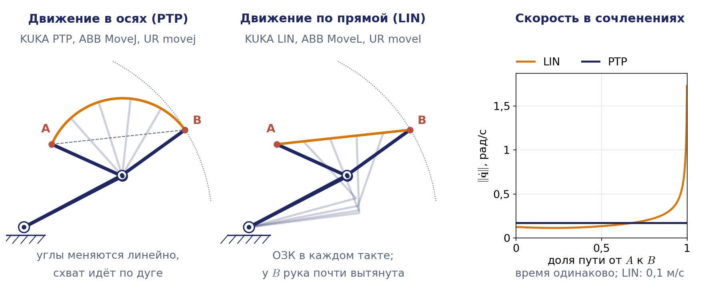

## Связь с демонстрациями

Материал лекции сопровождается ноутбуком `Демо_Занятие_02_положение.ipynb` из папки `03_Примеры_Jupyter`. Ноутбук уже выполнен, так что все графики видны без запуска; для самостоятельных экспериментов ячейки следует запускать сверху вниз. На занятии вживую показываются демонстрации 3, 6, 9, 10 и 11; остальные предназначены для самостоятельного разбора. Демонстрации перечислены в порядке тем лекции:

1. Матрицы ДХ и прямая задача для двухзвенника: произведение $`A_1A_2`$ совпадает с явными формулами примера 2.1.
2. Прямая задача для UR5e тремя способами: по таблице ДХ, по формуле произведения экспонент с винтовыми осями примера 2.4а и сверка с эталонным пакетом Robotics Toolbox; проверка в понятной конфигурации.
3. Рабочая зона двухзвенника при трёх вариантах ограничений с подписанными участками границы $`\Gamma_1`$, $`\Gamma_2`$, $`\Gamma_3`$ и оценка площади $`S\approx M\delta^2`$.
4. Рабочее пространство UR5e методом Монте-Карло с отсечением точек ниже основания: облако точек, сечение, показатель $`V_L`$ и сравнение наибольшего радиуса с паспортной досягаемостью 850 мм.
5. Коэффициент сервиса плоского трёхзвенника: карта $`\Omega_r`$, кольцо полного сервиса, проверка тождества $`\Omega=\Omega_{\mathbf n}=4l_1l_2/(l_1+l_2+l_3)^2`$ и случай ограничений $`\lvert q_i\rvert\le2`$ рад.
6. Обратная задача для двухзвенника: две ветви с подписями по знаку $`q_2`$, проверка прямой задачей, недостижимая цель и скачок решения при замене atan2 на арктангенс.
7. Обратная задача для цилиндрической схемы с ограничением хода: ветви «лицом» и «спиной», достижимые и недостижимые цели (к первому домашнему заданию).
8. Восемь решений обратной задачи PUMA по формулам раздела 2.6: таблица углов, проверка прямой задачей, рисунок восьми конфигураций и отметка решений вне пределов сочленений.
9. Аналитическое решение обратной задачи UR5e (пример 2.11а): восемь решений и сравнение с численным решателем из разных начальных приближений.
10. Численная обратная задача для UR5e: полный шаг Ньютона против шага $`\alpha=0{,}5`$, демпфированной и транспонированной схем; расходимость смеси геометрической матрицы Якоби с разностью углов.
11. Цепочка близких целей: две итерации на шаг, сохранение ветви, смена ветви при «прыжке»; во втором опыте прямолинейный путь проводит точку $`O_5`$ через цилиндр радиуса $`d_4`$, семь промежуточных целей недостижимы, и цепочка заканчивается на другой ветви локтя.
12. Интерактивная модель: ползунки $`q_1,\dots,q_6`$ и положение схвата UR5e, а также обратная задача плоского трёхзвенника с ползунками $`x_3`$, $`y_3`$, $`\varphi_3`$, обеими ветвями и кольцом (2.99).

**Анимации к лекции.** В папке `06_Анимации` лежат пять роликов к этой лекции (MP4 для показа на занятии, в конспекте вставлены их фрагменты):

- `l02_ws_qspace_to_rspace` (рис. 2.6) — прямоугольник ограничений складывается по линии $`q_2=0`$ в два слоя рабочей зоны двухзвенника;
- `l02_service_circle_annulus` (рис. 2.8) — коэффициент сервиса трёхзвенника как доля окружности конца второго звена внутри кольца;
- `l02_ik2r_branches_atan2` (рис. 2.10) — две ветви обратной задачи двухзвенника и скачок решения при замене atan2 на арктангенс;
- `l02_puma_8_solutions_wrist_flip` (рис. 2.14) — восемь решений PUMA с общим центром запястья и переворот запястья при $`q_5=0`$;
- `l02_ik_basins_target_chain` (рис. 2.18) — области притяжения метода Ньютона и цепочка близких целей против одного «прыжка».

## Выводы

1. Прямая позиционная задача для любой разомкнутой цепи решается произведением матриц Денавита — Хартенберга $`T_N=A_1A_2\cdots A_N`$ с матрицей звена (2.8); рекуррентная форма $`T_i=T_{i-1}A_i`$ даёт положения всех звеньев, а векторная рекурсия наиболее удобна для вычислений. Равноправный второй язык — формула произведения экспонент $`T_N(\mathbf{q})=e^{[\boldsymbol{\mathcal S}_1]q_1}\cdots e^{[\boldsymbol{\mathcal S}_N]q_N}T_N(\mathbf{0})`$, которой нужны только оси сочленений в домашней позе.
2. Соотношение числа степеней подвижности $`N`$ и шести степеней свободы схвата определяет характер задачи: при $`N<6`$ есть недостижимые положения, при $`N=6`$ число конфигураций, как правило, конечно (до 8 при сферическом запястье или трёх параллельных осях, до 16 у общего 6R), при $`N>6`$ манипулятор обладает избыточностью степени $`N-6`$ (в учебнике — маневренностью).
3. Рабочее пространство $`S_r`$ есть образ области ограничений $`S_q`$ при отображении $`\mathbf{r}(\mathbf{q})`$. Его граница лежит в образе предельных значений координат и особых конфигураций; у двухзвенника она составлена из дуг радиусов $`l_1+l_2`$, $`l_2`$ и $`r_{\min}`$. Объём зоны оценивают методом Монте-Карло, а показатель Ли — Янга $`V_L=V/L^3`$ с максимумом $`4\pi/3`$ характеризует схему без учёта масштаба.
4. Досягаемость точки не гарантирует возможности выполнить в ней операцию. Ориентационные возможности характеризуются зоной обслуживания $`\psi_r`$, коэффициентом сервиса $`\Omega_r`$ (доля доступных направлений; на плоскости это угол доступного сектора, делённый на $`2\pi`$), сервисом $`\Omega`$ и манипулятивностью в направлении $`\Omega_{\mathbf n}`$; сервис равен манипулятивности в направлении, усреднённой по направлениям. Современная форма этих показателей — карты достижимости для компоновки ячеек.
5. Обратная позиционная задача есть нелинейная система шести уравнений с $`N`$ неизвестными, которая может не иметь решений, иметь одно, несколько или бесконечно много решений; контроллер решает её при каждом движении по прямой, в каждом такте интерполятора.
6. Аналитические методы (обратные преобразования, тригонометрические приёмы, развязка по критерию Пипера) дают все ветви решения: у PUMA и у UR5e их до восьми, и контроллер хранит выбранную ветвь как статус конфигурации. Углы следует вычислять через atan2, а уравнение $`a\sin\alpha+b\cos\alpha=c`$ — по формуле $`\alpha=\mathrm{atan2}(a,b)\pm\mathrm{atan2}(\sqrt{a^2+b^2-c^2},c)`$. Ограничения хода поступательных пар отсекают формальные ветви и задают условие разрешимости неравенствами.
7. Численное решение строится по схеме Ньютона и сходится квадратично из окрестности корня только при полном шаге. Невязку ориентации нужно брать как вектор поворота $`\delta\boldsymbol{\varphi}=\log(R^{\ast}R^{\mathrm T})^{\vee}`$ вместе с геометрической матрицей Якоби в согласованном порядке блоков; смесь геометрической матрицы с разностью углов расходится.
8. Цепочка близких целей удерживает решение на выбранной ветви и превращает итерационную схему в интерполятор прямолинейного движения и основу позиционного управления. Псевдообратная матрица, демпфирование и метод Левенберга — Марквардта суть способы решать обратную задачу как задачу оптимизации; так устроены решатели KDL, TRAC-IK и их современные потомки.

## Контрольные вопросы

1. Как формулируется прямая задача о положении? Что понимают под положением звена и почему шестёрка чисел $`\mathbf{s}=(\boldsymbol{\Theta};\mathbf{p})`$ не является вектором?
2. Какова последовательность четырёх движений, совмещающих системы координат соседних звеньев, построенные по алгоритму Денавита — Хартенберга? Почему матрицы этих движений перемножаются слева направо?
3. Получите выражение (2.9) для матрицы перехода от $`(i-1)`$-й системы координат к $`i`$-й.
4. Сравните вычислительную сложность решения прямой задачи в замкнутой форме и в рекуррентной (векторной) форме на примере манипуляторов М20П и PUMA.
5. Запишите формулу произведения экспонент. Какие данные о сочленении нужны для винтовой оси и чем они удобнее параметров Денавита — Хартенберга? Составьте винтовые оси двухзвенника.
6. Дайте определение рабочего пространства манипулятора. Приведите примеры его конфигурации для известных вам кинематических схем. Из каких участков состоит граница рабочей зоны плоского двухзвенника с ограничениями на углы и каковы их радиусы?
7. Систематизируйте показатели качества манипулятора, связанные с рабочим пространством. Что утверждает теорема Ли — Янга и чему равно максимальное значение показателя $`V_L`$?
8. Что такое степень избыточности (маневренность в учебнике) и как её оценить количественно? Почему манипулятор без избыточности при закреплённом схвате превращается в ферму?
9. Дайте определения зоны обслуживания, коэффициента сервиса и сервиса манипулятора. Для плоского трёхзвенника с длинами $`l_1=3`$, $`l_2=2`$, $`l_3=1`$ без ограничений на углы найдите зону полного сервиса, точки, в которых $`\Omega_r=0`$, и сервис $`\Omega`$.
10. Как формулируется обратная задача о положении? Сколько решений она может иметь и как это связано с числом степеней подвижности? Сформулируйте критерий Пипера.
11. Чем функция atan2 отличается от арктангенса и почему в обратной задаче нужно использовать именно её? Как решить уравнение $`a\sin\alpha+b\cos\alpha=c`$ и когда у него нет решений?
12. Сколько конфигураций манипулятора PUMA возможно при фиксированном положении схвата, принадлежащем области достижимости, и почему? В каких конфигурациях число решений бесконечно? Почему две ветви плеча различаются не на $`180^\circ`$?
13. Как решается обратная задача для робота UR5e, у которого запястье несферическое? Откуда берутся восемь решений и где лежит недостижимый цилиндр?
14. Выведите формулу (2.89) решения обратной задачи методом Ньютона. Почему для пространственной ориентации невязку берут как вектор поворота и что произойдёт, если взять разность углов вместе с геометрической матрицей Якоби? Почему шаг $`\alpha=0{,}5`$ лишает метод квадратичной сходимости?
15. Кейс. Сварочная точка обучена на роботе в одной конфигурации, а программа подходит к ней прямолинейным движением из точки, обученной в другой конфигурации, и контроллер останавливается с ошибкой. Объясните причину на языке ветвей обратной задачи и предложите два способа исправить программу.
16. Кейс. Нужно разместить робот у стола так, чтобы он мог подводить захват к деталям сверху вертикально вниз по всему столу. Какими показателями этой лекции вы воспользуетесь, как их посчитать численно и чем карта достижимости лучше паспортного рисунка рабочей зоны?
17. Кейс. При движении схвата по окружности (как во втором домашнем задании) численный решатель на соседних точках вдруг меняет $`q_4`$ и $`q_6`$ почти на $`180^\circ`$, а $`q_5`$ проходит через нуль. Что произошло, как это обнаружить в данных и как изменить постановку, чтобы ветвь сохранялась?

## Литература

1. Зенкевич С. Л., Ющенко А. С. Основы управления манипуляционными роботами. М.: Изд-во МГТУ им. Н. Э. Баумана, 2004. Глава 2.
2. Lynch K. M., Park F. C. Modern Robotics: Mechanics, Planning, and Control. Cambridge: Cambridge University Press, 2017. Главы 4 (произведение экспонент) и 6 (обратная задача).
3. Corke P. Robotics, Vision and Control: Fundamental Algorithms in Python. 3rd ed. Cham: Springer, 2023. Главы 7–8.
4. Siciliano B., Sciavicco L., Villani L., Oriolo G. Robotics: Modelling, Planning and Control. London: Springer, 2009. Главы 2 и 3.
5. Spong M. W., Hutchinson S., Vidyasagar M. Robot Modeling and Control. Hoboken: Wiley, 2006.
6. Крейг Дж. Введение в робототехнику: механика и управление. М.; Ижевск: Институт компьютерных исследований, 2013.
7. Фу К., Гонсалес Р., Ли К. Робототехника. М.: Мир, 1989.
8. Paul R. P. Robot Manipulators: Mathematics, Programming, and Control. Cambridge, MA: MIT Press, 1981.
9. Pieper D. L. The Kinematics of Manipulators under Computer Control. PhD thesis. Stanford University, 1968.
10. Raghavan M., Roth B. Inverse kinematics of the general 6R manipulator and related linkages // ASME Journal of Mechanical Design. 1993.
11. Lee T. W., Yang D. C. H. On the evaluation of manipulator workspace // ASME Journal of Mechanisms, Transmissions, and Automation in Design. 1983.
12. Wenger P., Chablat D. A review of cuspidal serial and parallel manipulators // ASME Journal of Mechanisms and Robotics. 2022. Препринт arXiv:2210.05204.
13. Hawkins K. P. Analytic Inverse Kinematics for the Universal Robots UR-5/UR-10 Arms. Technical report. Georgia Institute of Technology, 2013.
14. Sugihara T. Solvability-unconcerned inverse kinematics by the Levenberg–Marquardt method // IEEE Transactions on Robotics. 2011. Vol. 27, no. 5.
15. Beeson P., Ames B. TRAC-IK: An open-source library for improved solving of generic inverse kinematics // IEEE-RAS International Conference on Humanoid Robots (Humanoids), 2015.
16. Diankov R. Automated Construction of Robotic Manipulation Programs. PhD thesis. Carnegie Mellon University, 2010.
17. Sundaralingam B. et al. cuRobo: Parallelized Collision-Free Robot Motion Generation // IEEE International Conference on Robotics and Automation (ICRA), 2023. Расширенная версия: arXiv:2310.17274.
18. Zacharias F., Borst C., Hirzinger G. Capturing robot workspace structure: representing robot capabilities // IEEE/RSJ International Conference on Intelligent Robots and Systems (IROS), 2007.
19. Vahrenkamp N., Asfour T., Dillmann R. Robot placement based on reachability inversion // IEEE International Conference on Robotics and Automation (ICRA), 2013.
20. Hayati S., Mirmirani M. Improving the absolute positioning accuracy of robot manipulators // Journal of Robotic Systems. 1985.
21. Tedrake R. Robotic Manipulation: Perception, Planning, and Control. Конспект курса MIT, электронная версия: manipulation.csail.mit.edu.

## Приложение 2.А. Матрицы перехода манипулятора М20П

Для схемы М20П (пример 2.2) первое сочленение вращательное с $`\alpha_1=0`$, второе поступательное с постоянным углом $`\theta_2=0`$, смещением $`a_2`$ и $`\alpha_2=90^\circ`$, третье поступательное. Матрицы перехода имеют вид

```math
A_1=\begin{pmatrix} c_1&-s_1&0&0\\ s_1&c_1&0&0\\ 0&0&1&0\\ 0&0&0&1\end{pmatrix},\quad
A_2=\begin{pmatrix} 1&0&0&a_2\\ 0&0&-1&0\\ 0&1&0&d_2\\ 0&0&0&1\end{pmatrix},\quad
A_3=\begin{pmatrix} 1&0&0&0\\ 0&1&0&0\\ 0&0&1&d_3\\ 0&0&0&1\end{pmatrix}.
```

В матрице $`A_2`$ нет тригонометрических функций обобщённой координаты: переменной является ход $`d_2`$, а постоянный угол $`\alpha_2=90^\circ`$ дал числа $`0`$ и $`\pm 1`$. Перемножая рекуррентно ($`T_1=A_1`$, $`T_2=T_1A_2`$, $`T_3=T_2A_3`$), получаем матрицу $`T_3`$, приведённую в примере 2.2; результат проверен символьным перемножением.

## Приложение 2.Б. Показатель Ли — Янга и пределы досягаемости

Для механизма с вращательными парами вводится обобщённая полная длина

```math
L=\sum_{i=1}^{N}\lvert a_i\rvert+\sum_{i=1}^{N}\lvert d_i\rvert ,
```

где $`a_i`$ и $`d_i`$ есть параметры ДХ. Согласно теореме Ли — Янга отношение (2.13)

```math
V_L=\frac{V}{L^3}
```

для данной кинематической схемы постоянно: оно не меняется при пропорциональном изменении всех размеров и потому характеризует именно схему, а не масштаб. Наибольшее значение показателя достигается для гипотетического манипулятора, рабочее пространство которого есть полный шар радиуса $`L`$ без полостей и вырезов:

```math
V_{L\max}=\frac{4\pi L^3/3}{L^3}=\frac{4\pi}{3}\approx 4{,}19 .
```

С этой константой сравнивают реальные роботы с помощью нормированного показателя $`V_N=V_L/V_{L\max}`$. Для манипулятора PUMA-600 в учебнике приведены обобщённая длина $`L=1{,}295`$ м и объём $`V=3{,}005`$ куб. м, откуда $`V_L=3{,}005/1{,}295^3\approx1{,}38`$ и $`V_N\approx0{,}33`$: робот использует примерно треть идеального объёма. (В учебнике напечатаны значения $`1{,}39`$ и $`0{,}331`$; из приведённых $`L`$ и $`V`$ следуют $`1{,}384`$ и $`0{,}330`$.)

Ещё одна группа показателей называется **пределами досягаемости**. Это либо максимальная длина радиус-вектора характерной точки $`R_{\max}`$, либо максимальные значения координат по каждой оси $`x_{\max}`$, $`y_{\max}`$, $`z_{\max}`$. Они находятся из кинематических уравнений как условные экстремумы. В примере 2.7 учебника для робота Rhino XR-2 показано, что при заданном угле наклона схвата максимальный радиус равен $`R_{\max}=a_2+a_3+b_1`$, где постоянная $`b_1`$ (в учебнике $`\beta_1`$) зависит от угла наклона и размеров кисти. Таким образом, пределы досягаемости зависят от требуемой ориентации схвата; эта мысль развита в разделе 2.3.

## Приложение 2.В. Выкладка примера 2.9 и кусочное определение atan2

Умножив равенство (2.24) слева на $`R_{z,\varphi}^{\mathrm T}`$, получаем формулу (2.25):

```math
\begin{pmatrix}
x_xc_\varphi+x_ys_\varphi & y_xc_\varphi+y_ys_\varphi & z_xc_\varphi+z_ys_\varphi\\
-x_xs_\varphi+x_yc_\varphi & -y_xs_\varphi+y_yc_\varphi & -z_xs_\varphi+z_yc_\varphi\\
x_z&y_z&z_z\end{pmatrix}
=\begin{pmatrix}
c_\theta c_\psi & -c_\theta s_\psi & s_\theta\\
s_\psi & c_\psi & 0\\
-s_\theta c_\psi & s_\theta s_\psi & c_\theta\end{pmatrix}.
```

Приравнивая элемент второй строки и третьего столбца нулю, получаем (2.26); элементы $`(2,1)`$ и $`(2,2)`$ дают $`s_\psi`$ и $`c_\psi`$, то есть (2.28); элементы $`(1,3)`$ и $`(3,3)`$ дают $`s_\theta`$ и $`c_\theta`$, то есть (2.29).

*Примечание о расхождении с книгой.* В учебнике в правой матрице (2.25) элементы первой строки и второго столбца, а также третьей строки и второго столбца напечатаны с ошибками ($`-c_\theta c_\psi`$ и $`c_\theta s_\psi`$); здесь приведены правильные значения, которые получаются прямым перемножением. На дальнейшие формулы опечатки не влияют.

Функция atan2, формула (2.27), через обычный арктангенс определяется так:

```math
\mathrm{atan2}(a,b)=\begin{cases}
\mathrm{arctg}\,\dfrac{a}{b}, & b>0,\\
\mathrm{arctg}\,\dfrac{a}{b}+\pi, & b<0,\ a\ge 0,\\
\mathrm{arctg}\,\dfrac{a}{b}-\pi, & b<0,\ a<0,\\
\pi/2, & b=0,\ a>0,\\
-\pi/2, & b=0,\ a<0,
\end{cases}
\qquad -\pi<\mathrm{atan2}(a,b)\le\pi .
```

При $`a=b=0`$ функция не определена. Общий положительный множитель у обоих аргументов на результат не влияет.

## Приложение 2.Г. Углы ориентации PUMA в координатах

Из векторной рекурсии примера 2.4 ось схвата выражается через орты третьего звена:

```math
\mathbf{z}_6=\mathbf{z}_5=c_4s_5\,\mathbf{x}_3+s_4s_5\,\mathbf{z}_1+c_5\,\mathbf{z}_3 ,
```

где $`\mathbf{x}_3=(c_1c_{23},\,s_1c_{23},\,-s_{23})^{\mathrm{T}}`$, $`\mathbf{z}_1=(-s_1,\,c_1,\,0)^{\mathrm{T}}`$, $`\mathbf{z}_3=(c_1s_{23},\,s_1s_{23},\,c_{23})^{\mathrm{T}}`$ есть три взаимно перпендикулярных единичных вектора. В координатах это система (2.44):

```math
\begin{aligned}
z_{6x}&=c_1(c_{23}c_4s_5+s_{23}c_5)-s_1s_4s_5,\\
z_{6y}&=s_1(c_{23}c_4s_5+s_{23}c_5)+c_1s_4s_5,\\
z_{6z}&=-s_{23}c_4s_5+c_{23}c_5 .
\end{aligned}
```

*Примечание о расхождении с книгой.* В формуле (2.44) учебника во второй строке напечатано $`-c_1s_4s_5`$; правильный знак плюс, как в примере 2.3 того же учебника.

Умножая $`\mathbf{z}_6`$ скалярно на $`\mathbf{z}_1`$ и на $`\mathbf{x}_3`$, получаем формулы (2.45) и (2.46):

```math
-s_1z_{6x}+c_1z_{6y}=s_4s_5,\qquad c_1c_{23}z_{6x}+s_1c_{23}z_{6y}-s_{23}z_{6z}=c_4s_5 ,
```

а с ними формулу (2.47) в координатах:

```math
q_4=\mathrm{atan2}\,\bigl(\varepsilon_4(-s_1z_{6x}+c_1z_{6y}),\;\varepsilon_4(c_1c_{23}z_{6x}+s_1c_{23}z_{6y}-s_{23}z_{6z})\bigr),\qquad \varepsilon_4=\pm 1 .
```

Формулы (2.50), (2.51) и (2.54) основного текста следуют из равенств $`\mathbf{z}_6=s_5\mathbf{x}_4-c_5\mathbf{y}_4`$, $`\mathbf{x}_6=c_6\mathbf{x}_5+s_6\mathbf{y}_5`$ и $`\mathbf{y}_6=-s_6\mathbf{x}_5+c_6\mathbf{y}_5`$: скалярные произведения с $`\mathbf{x}_4`$, $`\mathbf{y}_4`$ дают $`s_5`$ и $`-c_5`$, а с $`\mathbf{y}_5`$ дают $`s_6`$ и $`c_6`$. В учебнике эти же выражения выписаны покоординатно, формулы (2.48), (2.49), (2.52), (2.53). Знак ветви запястья в учебнике обозначен $`W`$; в курсе буква $`W`$ занята, поэтому знак обозначен $`\varepsilon_4`$.

## Приложение 2.Д. Манипулятор SCORBOT-ERIII (пример 2.11 учебника)

Учебный манипулятор SCORBOT имеет пять вращательных степеней подвижности ($`\theta_i=q_i`$). Его параметры ДХ приведены в таблице; длины $`l_i`$ здесь стоят и в столбце $`a_i`$, и в столбце $`d_i`$.

| Сочленение | $`\alpha_i`$ | $`a_i`$ | $`d_i`$ |
|---|---|---|---|
| 1 | $`-\pi/2`$ | $`a_1`$ | $`l_1`$ |
| 2 | $`0`$ | $`l_2`$ | $`0`$ |
| 3 | $`0`$ | $`l_3`$ | $`0`$ |
| 4 | $`-\pi/2`$ | $`0`$ | $`0`$ |
| 5 | $`0`$ | $`0`$ | $`l_5`$ |

Перемножение матриц даёт положение схвата (2.60) и его ось (2.63):

```math
\mathbf{p}_5=\begin{pmatrix} c_1(-l_5s_{234}+l_3c_{23}+l_2c_2+a_1)\\ s_1(-l_5s_{234}+l_3c_{23}+l_2c_2+a_1)\\ l_1-l_2s_2-l_3s_{23}-l_5c_{234}\end{pmatrix},\qquad
\mathbf{z}_5=\begin{pmatrix}-c_1s_{234}\\ -s_1s_{234}\\ -c_{234}\end{pmatrix}.
```

Оси второго, третьего и четвёртого сочленений параллельны, поэтому вся рука лежит в вертикальной плоскости, повёрнутой на угол $`q_1`$, и ось схвата $`\mathbf{z}_5`$ всегда принадлежит этой плоскости. Если заданная ориентация этому условию не удовлетворяет (то есть $`z_{5x}p_{5y}-z_{5y}p_{5x}\ne 0`$), система шести уравнений с пятью неизвестными несовместна, и решения нет.

Когда условие выполнено, решение строится в следующем порядке. Первые две координаты $`\mathbf{p}_5`$ равны $`c_1\rho_5`$ и $`s_1\rho_5`$, где $`\rho_5=-l_5s_{234}+l_3c_{23}+l_2c_2+a_1`$ может иметь любой знак. Поэтому, формула (2.76),

```math
q_1=\mathrm{atan2}(p_{5y},\;p_{5x}),\qquad q_1'=\mathrm{atan2}(-p_{5y},\;-p_{5x}),
```

первое значение соответствует плечу «вперёд» ($`\rho_5>0`$), второе — плечу «назад» ($`\rho_5<0`$), если его допускает диапазон первого сочленения. При $`p_{5x}=p_{5y}=0`$ угол $`q_1`$ произволен. Из компонент $`\mathbf{z}_5`$ находим сумму трёх средних углов, формула (2.77):

```math
q_{234}=\mathrm{atan2}(-z_{5x}c_1-z_{5y}s_1,\;-z_{5z}).
```

Затем «снимаем» последнее звено: вводя известные числа $`a=l_1-l_5c_{234}-p_{5z}`$ и $`b=-a_1+p_{5x}c_1+p_{5y}s_1+l_5s_{234}`$, приходим к системе (2.78)

```math
l_2s_2+l_3s_{23}=a,\qquad l_2c_2+l_3c_{23}=b ,
```

которая совпадает с задачей о плоском двухзвеннике. Поэтому, как в примере 2.10, получаем формулы (2.79) и (2.82):

```math
q_3=\pm\arccos\frac{a^2+b^2-l_2^2-l_3^2}{2l_2l_3},\qquad
q_2=\mathrm{atan2}\,\bigl(a(l_2+l_3c_3)-bl_3s_3,\;al_3s_3+b(l_2+l_3c_3)\bigr),
```

после чего $`q_4=q_{234}-q_2-q_3`$, формула (2.85). Две ветви $`q_1`$ и два знака $`q_3`$ выбираются независимо, поэтому решений до четырёх; на двух тысячах случайных поз четыре решения нашлись в девяти случаях из десяти, а в остальных два. Угол $`q_5`$ при $`s_{234}\ne 0`$ находится из компонент $`x_{5z}=-s_{234}c_5`$ и $`y_{5z}=s_{234}s_5`$ заданной матрицы:

```math
q_5=\mathrm{atan2}\,\Bigl(\frac{y_{5z}}{s_{234}},\;-\frac{x_{5z}}{s_{234}}\Bigr),
```

деление на $`s_{234}`$ учитывает его знак. При $`s_{234}=0`$ (схват направлен вертикально, $`c_{234}=\pm 1`$) обе компоненты обращаются в нуль, и $`q_5`$ находится из компонент $`x_{5x}`$, $`x_{5y}`$:

```math
q_5=c_{234}\bigl(q_1-\mathrm{atan2}(c_{234}x_{5y},\;c_{234}x_{5x})\bigr).
```

Все формулы проверены численно по таблице: найденные решения воспроизводят заданную позу с точностью $`10^{-13}`$, в том числе при вертикальном схвате.

*Примечание о расхождении с книгой.* В учебнике в формуле (2.76) угол находится как $`\mathrm{arctg}(p_{5y}/p_{5x})`$; при $`p_{5x}<0`$ это даёт ошибку на $`\pi`$, и, кроме того, теряется вторая ветвь плеча. В формуле (2.77) вместо $`z_{5y}s_1`$ напечатано $`z_{5x}s_1`$, а второе уравнение системы (2.78) напечатано как $`l_2s_2+l_3c_{23}=b`$; здесь приведены исправленные варианты. В формуле (2.79) учебник оставляет только знак плюс, хотя, как и у двухзвенника, допустимы оба знака (два положения локтя). Формулы (2.83), (2.84) для $`q_5`$ в учебнике не согласуются с его же таблицей параметров; выше приведены выражения, выведенные заново и проверенные численно по таблице. Обратите внимание на знак $`\alpha_4=-\pi/2`$: при $`\alpha_4=+\pi/2`$ в формулах (2.60), (2.63) меняют знак все слагаемые с $`l_5`$ и весь орт $`\mathbf{z}_5`$.

## Приложение 2.Е. Теорема о сходимости метода Ньютона

Пусть $`x^{\ast}`$ есть корень уравнения $`\varphi(x)=0`$, и в его окрестности радиуса $`\varepsilon_0`$ выполнены два условия: $`\lvert 1/\varphi'(x)\rvert\le\gamma_1`$ и $`\lvert\varphi(u_1)-\varphi(u_2)-\varphi'(u_2)(u_1-u_2)\rvert\le\gamma_2\lvert u_1-u_2\rvert^2`$ (второе условие выполнено, если функция имеет ограниченную вторую производную). Обозначим $`\gamma=\gamma_1\gamma_2`$ и $`\varepsilon_1=\min(\varepsilon_0,\gamma^{-1})`$. Тогда при любом начальном приближении, для которого $`\lvert x_0-x^{\ast}\rvert< \varepsilon_1`$, итерации (2.88) сходятся к корню с оценкой погрешности

```math
\lvert x_n-x^{\ast}\rvert\le \gamma^{-1}\bigl(\gamma\,\lvert x_0-x^{\ast}\rvert\bigr)^{2^n}.
```

Доказательство занимает одну строку. Обозначим ошибку $`\epsilon_n=\lvert x_n-x^{\ast}\rvert`$. Из (2.88) и равенства $`\varphi(x^{\ast})=0`$ следует $`x_{n+1}-x^{\ast}=\bigl[\varphi(x^{\ast})-\varphi(x_n)-\varphi'(x_n)(x^{\ast}-x_n)\bigr]/\varphi'(x_n)`$, поэтому $`\epsilon_{n+1}\le\gamma_1\gamma_2\epsilon_n^2`$, то есть $`\gamma\epsilon_{n+1}\le(\gamma\epsilon_n)^2`$, и по индукции $`\gamma\epsilon_n\le(\gamma\epsilon_0)^{2^n}`$. Условие $`\gamma\epsilon_0<1`$ обеспечивает убывание ошибок и то, что итерации не покидают окрестность.

*Примечание о расхождении с книгой.* В учебнике первое условие напечатано для $`\lvert\varphi'(x)\rvert`$, а во втором отсутствует квадрат; кроме того, в тексте теоремы даны ссылки на формулы (2.82), (2.83) вместо (2.87), (2.88). Здесь условия приведены в стандартной форме, при которой указанная оценка действительно имеет место. Постоянные учебника $`a`$, $`a_1`$, $`a_2`$, $`b`$, $`c`$ переименованы, потому что буквы $`a_i`$ и $`b`$ заняты в курсе другими величинами.
