# Лекция 3. Скорости манипулятора и кинематические характеристики

Лекция построена по главе 3 учебника С. Л. Зенкевича и А. С. Ющенко «Основы управления манипуляционными роботами» (§ 3.1–3.4 и 3.6). Номера формул в круглых скобках вида (3.62) — это номера формул учебника; они приводятся, чтобы лекцию было удобно читать параллельно с книгой. Рисунки и примеры лекции имеют собственную нумерацию. В нескольких местах формулы учебника напечатаны с опечатками, а в нескольких курс сознательно излагает материал иначе; такие места отмечены абзацем «Примечание о расхождении с книгой». Обозначения лекции согласованы с файлом «Обозначения.md» паспорта курса. Громоздкие выводы, которые на лекции не воспроизводятся, собраны в приложениях 3.А–3.Г в конце главы.

## Введение: зачем нужна задача о скорости

На прошлой лекции мы решали две задачи о положении: прямую (по обобщённым координатам найти положение и ориентацию схвата) и обратную. Теперь мы поднимаемся на следующий уровень и спрашиваем, как связаны скорости сочленений со скоростью схвата.

Эта связь нужна по меньшей мере в двух ситуациях. Первая — режимы ручного и полуавтоматического управления. Оператор отклоняет рукоятку или нажимает на пульте кнопку «вдоль оси $x$ инструмента», и контроллер должен на каждом такте пересчитать желаемую скорость схвата в скорости сочленений. Оператору удобно думать в терминах «вперёд, вверх, повернуть», а приводам нужны скорости сочленений. Вторая ситуация — кинематическое управление по траектории, которому посвящена лекция 4: программа задаёт движение схвата во времени, а исполняют его приводы сочленений.

Казалось бы, скорость — это всего лишь производная положения, и ничего принципиально нового здесь быть не должно. Однако новое есть. Положение схвата задаётся шестёркой чисел $\mathbf{s}=(\boldsymbol{\Theta};\mathbf{p})$: тремя углами ориентации $\boldsymbol{\Theta}$ и тремя координатами $\mathbf{p}$. Эта шестёрка не является вектором: конечные повороты нельзя складывать покомпонентно, а результат двух поворотов зависит от их порядка. Скорость схвата тоже задаётся шестёркой чисел $\boldsymbol{\mathcal V}=(\boldsymbol{\omega};\mathbf{v})$, но это уже настоящий вектор: первая тройка — компоненты вектора угловой скорости, вторая — компоненты вектора линейной скорости. Угловые скорости, в отличие от конечных поворотов, складываются по обычному правилу сложения векторов. Важно и обратное: вектор $\boldsymbol{\mathcal V}$ не является производной шестёрки $\mathbf{s}$. Линейная часть совпадает, $\mathbf{v}=\dot{\mathbf{p}}$, а угловая скорость $\boldsymbol{\omega}$ не равна производной никакой тройки углов; к этому мы вернёмся в разделе 3.3.

Из этого следует главное упрощение. Сколь бы сложной ни была нелинейная зависимость положения схвата от обобщённых координат, скорость схвата связана со скоростями сочленений соотношением

$$
\boldsymbol{\mathcal V}=J(\mathbf{q})\,\dot{\mathbf{q}},\qquad \boldsymbol{\mathcal V}=\begin{pmatrix}\boldsymbol{\omega}\\ \mathbf{v}\end{pmatrix},
$$

которое при фиксированной конфигурации $\mathbf{q}$ линейно относительно скоростей. Нелинейную задачу о положении мы решали с трудом и не для всякой схемы. Задача о скорости — это система линейных уравнений, и к ней применим весь аппарат линейной алгебры: ранг, определитель, обращение, псевдообращение, сингулярное разложение. Вся сегодняшняя лекция — это, по существу, изучение одной матрицы, **матрицы Якоби** $J(\mathbf{q})$. В первой половине мы научимся её строить, во второй — обращать, а затем с её помощью оценим, какие скорости, силы и ускорения манипулятор способен развить в каждой точке рабочей зоны. Сквозным примером, как и во всём курсе, служит коллаборативный робот UR5e; плоские двух- и трёхзвенники остаются «микроскопом», на котором всё видно в деталях, а PUMA — примером учебника.

## 3.1. Вращение твёрдого тела

### Откуда берётся угловая скорость

Начнём с одного твёрдого тела. Свяжем с ним собственную систему координат $O'x'y'z'$ и рассмотрим произвольную точку $M$ тела (рис. 3.1). Её радиус-вектор $\mathbf{r}$ в неподвижной системе $O_0x_0y_0z_0$ и радиус-вектор $\mathbf{r}'$ в связанной системе связаны соотношением (3.1):

$$
\mathbf{r}=\mathbf{p}+R\,\mathbf{r}',
$$

где $\mathbf{p}$ — радиус-вектор начала связанной системы (полюса), $R$ — матрица поворота связанной системы относительно неподвижной.

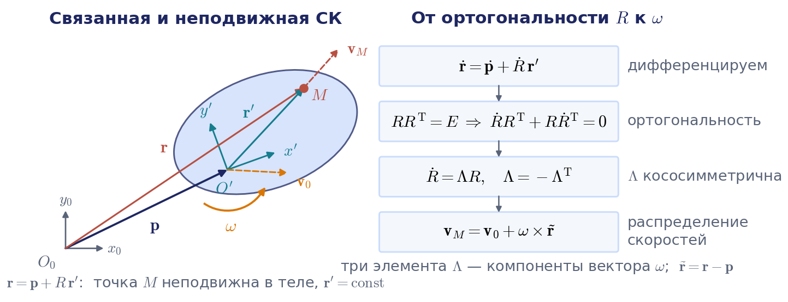

Точка $M$ неподвижна относительно тела, поэтому $\mathbf{r}'$ не зависит от времени. Дифференцируя, получаем формулу (3.2):

$$
\dot{\mathbf{r}}=\dot{\mathbf{p}}+\dot R\,\mathbf{r}'.
$$

Первое слагаемое — скорость полюса $\mathbf{v}_0=\dot{\mathbf{p}}$, второе описывает эффект вращения. Чтобы понять, как устроена матрица $\dot R$, воспользуемся единственным, что мы знаем о матрице поворота, — её ортогональностью: $RR^{\mathrm T}=E$. Продифференцируем это тождество по времени:

$$
\dot RR^{\mathrm T}+R\dot R^{\mathrm T}=0.
$$

Обозначим $\Lambda=\dot RR^{\mathrm T}$. Тогда второе слагаемое равно $\Lambda^{\mathrm T}$, и написанное равенство означает, что $\Lambda=-\Lambda^{\mathrm T}$. Иначе говоря, производная матрицы поворота всегда представима в виде (3.5)

$$
\dot R=\Lambda R,
$$

где $\Lambda$ — **кососимметрическая матрица**. У кососимметрической матрицы размера $3\times3$ на диагонали стоят нули, а из шести внедиагональных элементов независимы только три. Обозначим эти три числа $\omega_x,\omega_y,\omega_z$ и расставим их так, как в формуле (3.11):

$$
\Lambda(\boldsymbol{\omega})=\begin{pmatrix}0&-\omega_z&\omega_y\\ \omega_z&0&-\omega_x\\ -\omega_y&\omega_x&0\end{pmatrix}.
$$

Прямым умножением легко убедиться, что для любого вектора $\mathbf{r}$ выполняется равенство (3.12):

$$
\Lambda(\boldsymbol{\omega})\,\mathbf{r}=\boldsymbol{\omega}\times\mathbf{r}.
$$

Таким образом, вектор $\boldsymbol{\omega}=(\omega_x,\omega_y,\omega_z)^{\mathrm T}$ — это знакомый из механики вектор угловой скорости. Важно, как именно он здесь появился: не из механической интуиции, а из алгебры ортогональных матриц. Вращение описывается матрицей $R$, её производная — кососимметрической матрицей $\Lambda$, а три независимых элемента этой матрицы и есть компоненты угловой скорости. В зарубежной литературе ту же матрицу обозначают $[\boldsymbol{\omega}]$ (Линч и Парк) или $S(\boldsymbol{\omega})$ (Сицилиано и соавторы).

В плоском случае всё ещё проще: кососимметрическая матрица $2\times2$ содержит единственный параметр $\omega$, и скорость точки $(x,y)$ тела, вращающегося вокруг начала координат, равна

$$
\mathbf{v}=\omega\begin{pmatrix}0&-1\\ 1&0\end{pmatrix}\begin{pmatrix}x\\ y\end{pmatrix}=\begin{pmatrix}-\omega y\\ \omega x\end{pmatrix}.
$$

**Примечание о расхождении с книгой.** В учебнике (с. 118) в этом месте напечатано $(-\omega x,\ \omega y)^{\mathrm T}$; это опечатка, правильный результат приведён выше.

### Распределение скоростей

Подставим $\dot R=\Lambda R$ в выражение для скорости точки: $\dot{\mathbf{r}}=\mathbf{v}_0+\Lambda R\mathbf{r}'$. Произведение $R\mathbf{r}'=\mathbf{r}-\mathbf{p}$ — это тот же вектор $\mathbf{r}'$, но заданный проекциями на оси неподвижной системы; обозначим его $\tilde{\mathbf{r}}$. Получаем формулу (3.7):

$$
\mathbf{v}_M=\mathbf{v}_0+\Lambda(\boldsymbol{\omega})\,\tilde{\mathbf{r}}=\mathbf{v}_0+\boldsymbol{\omega}\times\tilde{\mathbf{r}}.
$$

Это соотношение называют **распределением скоростей** в твёрдом теле: зная скорость одной точки (полюса) и угловую скорость, можно найти скорость любой другой точки. Именно его мы будем многократно применять к звеньям манипулятора. Отсюда же видно, что слова «скорость схвата» требуют уточнения: угловая скорость у всех точек тела одна, а линейная зависит от точки, к которой её относят. В курсе, как и в учебнике, линейная скорость схвата — это скорость начала системы координат схвата.

### Свойства матрицы Λ

Перечислим свойства матрицы $\Lambda(\mathbf{a})$, которыми мы будем пользоваться. Для произвольных векторов $\mathbf{a}$, $\mathbf{b}$ и скаляра $\alpha$ справедливо следующее.

1. Линейность: $\Lambda(\mathbf{a}+\mathbf{b})=\Lambda(\mathbf{a})+\Lambda(\mathbf{b})$ и $\Lambda(\alpha\mathbf{a})=\alpha\Lambda(\mathbf{a})$.
2. $\Lambda(\mathbf{a})\mathbf{a}=0$, поскольку векторное произведение вектора на себя равно нулю.
3. $\Lambda(\mathbf{a})\mathbf{b}=\mathbf{a}\times\mathbf{b}$.
4. $\Lambda(R\mathbf{a})=R\,\Lambda(\mathbf{a})\,R^{\mathrm T}$ для любой матрицы поворота $R$.
5. $\mathbf{a}^{\mathrm T}\Lambda(\mathbf{b})\mathbf{a}=0$.
6. $\Lambda(\mathbf{a})\mathbf{b}=\Lambda^{\mathrm T}(\mathbf{b})\mathbf{a}$ — другая запись равенства $\mathbf{a}\times\mathbf{b}=-\mathbf{b}\times\mathbf{a}$.

Самое важное для нас — четвёртое свойство. Оно следует из того, что поворот сохраняет векторное произведение: $R(\mathbf{a}\times\mathbf{b})=(R\mathbf{a})\times(R\mathbf{b})$. Тогда для произвольного вектора $\mathbf{b}$ имеем $\Lambda(R\mathbf{a})\mathbf{b}=(R\mathbf{a})\times(RR^{\mathrm T}\mathbf{b})=R\big(\mathbf{a}\times R^{\mathrm T}\mathbf{b}\big)=R\Lambda(\mathbf{a})R^{\mathrm T}\mathbf{b}$. Смысл свойства прост: если вектор угловой скорости пересчитать в другую систему координат, то соответствующая кососимметрическая матрица преобразуется подобием. Именно это свойство позволит нам переносить ось сочленения, заданную в системе звена, в базовую систему.

### Однородная форма распределения скоростей

Положение тела удобно задавать однородной матрицей $T$, составленной из $R$ и $\mathbf{p}$. По аналогии с $\dot R=\Lambda R$ запишем соотношение (3.14):

$$
\dot T=[\boldsymbol{\mathcal V}_s]\,T,\qquad T=\begin{pmatrix}R&\mathbf{p}\\ 0&1\end{pmatrix}.
$$

Матрица $T$ невырождена, поэтому $[\boldsymbol{\mathcal V}_s]=\dot TT^{-1}$. Перемножив блоки, получаем формулу (3.15):

$$
[\boldsymbol{\mathcal V}_s]=\dot TT^{-1}=\begin{pmatrix}\Lambda(\boldsymbol{\omega})&\mathbf{v}_0-\Lambda(\boldsymbol{\omega})\mathbf{p}\\ 0&0\end{pmatrix}.
$$

Если $\boldsymbol{\rho}=(\mathbf{r}^{\mathrm T},1)^{\mathrm T}$ — однородный вектор точки тела в неподвижной системе, то его производная равна $\dot{\boldsymbol{\rho}}=[\boldsymbol{\mathcal V}_s]\boldsymbol{\rho}$ (3.16). Раскрыв блоки, убеждаемся, что это то же самое распределение скоростей $\mathbf{v}_M=\mathbf{v}_0+\Lambda(\boldsymbol{\omega})(\mathbf{r}-\mathbf{p})$, только записанное для однородных координат. Полезно держать в голове аналогию со скалярным уравнением $\dot x=ax$: роль коэффициента $a$ играет матрица $[\boldsymbol{\mathcal V}_s]$, построенная из угловой скорости и скорости полюса.

У этой матрицы есть имя, которое пригодится при чтении современных книг. В правом столбце стоит вектор $\mathbf{v}_0-\boldsymbol{\omega}\times\mathbf{p}$ — по распределению скоростей это скорость той точки тела, которая в данный момент совпадает с началом неподвижной системы. Шестёрку $\boldsymbol{\mathcal V}_s=(\boldsymbol{\omega};\mathbf{v}_0-\boldsymbol{\omega}\times\mathbf{p})$ Линч и Парк называют **пространственным твистом** тела, а матрицу $[\boldsymbol{\mathcal V}_s]$ — его матричной формой. Если умножать с другой стороны, $T^{-1}\dot T=[\boldsymbol{\mathcal V}_b]$, получится **твист в осях тела**: угловая скорость $R^{\mathrm T}\boldsymbol{\omega}$ и скорость полюса $R^{\mathrm T}\mathbf{v}_0$ в проекциях на связанные оси. Связь двух твистов разобрана в приложении 3.Г; в основном тексте нам хватит самого факта, что «скорость тела» можно записать в разных точках и в разных осях.

## 3.2. Скорости и ускорения звеньев манипулятора

### Правило дифференцирования матриц Денавита — Хартенберга

Перейдём к манипулятору. Положение $k$-го звена в базовой системе задаётся произведением $T_k=A_1A_2\cdots A_k$ матриц Денавита — Хартенберга (ДХ), а однородный вектор точки звена в базовой системе выражается через её постоянный однородный вектор $\boldsymbol{\rho}$ в системе звена: $\mathbf{r}=T_k\boldsymbol{\rho}$. Следовательно, скорость и ускорение точки равны $\dot{\mathbf{r}}=\dot T_k\boldsymbol{\rho}$ и $\ddot{\mathbf{r}}=\ddot T_k\boldsymbol{\rho}$, и вся задача сводится к дифференцированию произведения матриц.

Каждая матрица $A_i$ зависит только от своей обобщённой координаты $q_i$. Здесь есть изящное **правило дифференцирования** (3.22):

$$
\frac{\partial A_i}{\partial q_i}=Q_iA_i,
$$

где $Q_i$ — постоянная матрица, вид которой зависит только от типа сочленения. Для вращательного сочленения это матрица (3.23)

$$
Q_i=\begin{pmatrix}0&-1&0&0\\ 1&0&0&0\\ 0&0&0&0\\ 0&0&0&0\end{pmatrix}=\begin{pmatrix}\Lambda(\mathbf{z}_0)&0\\ 0&0\end{pmatrix},\qquad \mathbf{z}_0=(0,0,1)^{\mathrm T},
$$

а для телескопического (призматического) сочленения — матрица (3.24)

$$
Q_i=\begin{pmatrix}0&0&0&0\\ 0&0&0&0\\ 0&0&0&1\\ 0&0&0&0\end{pmatrix}.
$$

**Примечание о расхождении с книгой.** В учебнике эта матрица обозначена $\theta_i$; курс пишет $Q_i$, как Фу, Гонсалес и Ли, потому что буквой $\theta_i$ уже обозначен угол ДХ. Кроме того, в учебнике (с. 122) подписи под матрицами (3.23) и (3.24) переставлены. Правильное соответствие именно такое, как здесь, и оно подтверждается дальнейшим текстом самой книги: матрица с блоком $\Lambda(\mathbf{z}_0)$ описывает вращение вокруг оси $z$, а единица в позиции (3,4) — сдвиг вдоль этой оси.

Почему правило верно, легко понять из структуры матрицы $A_i$: обобщённая координата входит только в её первые сомножители — поворот вокруг оси $z_{i-1}$ и сдвиг вдоль неё. Производная матрицы поворота вокруг оси $z$ по углу равна этой же матрице, умноженной слева на $\Lambda(\mathbf{z}_0)$ (частный случай соотношения $\dot R=\Lambda R$), а производная матрицы сдвига по величине сдвига содержит единственный ненулевой элемент — единицу в позиции (3,4). Полезно один раз проверить правило прямым дифференцированием матрицы (3.18).

Теперь дифференцирование произведения становится механической операцией: производная произведения есть сумма слагаемых, в каждом из которых один сомножитель заменён своей производной. Для частной производной по $q_i$ получаем матрицу $U_{ki}=\partial T_k/\partial q_i=A_1\cdots A_{i-1}Q_iA_i\cdots A_k$ при $i\le k$ и $U_{ki}=0$ при $i>k$, так что $\dot T_k=\sum_iU_{ki}\dot q_i$. Для вычислений удобнее рекуррентная форма, которая следует из $T_k=T_{k-1}A_k$:

$$
\dot T_k=\dot T_{k-1}A_k+T_{k-1}Q_kA_k\,\dot q_k,\qquad T_0=E.
$$

Конечные формулы (3.25)–(3.28), рекуррентные формулы для вторых производных (3.31)–(3.33) и их применение в динамике вынесены в приложение 3.А. Недостаток матричной записи в том, что линейная и угловая скорости звена «спрятаны» внутри матрицы $\dot T_k$. Извлечём их в явном виде.

### Явные рекуррентные формулы: прямая рекурсия

Запишем матрицы в блочном виде (3.34):

$$
T_k=\begin{pmatrix}R_k&\mathbf{p}_k\\ 0&1\end{pmatrix},\qquad A_k=\begin{pmatrix}O_k&\mathbf{r}_k\\ 0&1\end{pmatrix},
$$

где $O_k$ — матрица поворота $k$-й системы относительно $(k-1)$-й, а $\mathbf{r}_k$ — положение её начала в $(k-1)$-й системе. Рассмотрим вращательное сочленение. Приравнивая блоки в рекуррентной формуле для $\dot T_k$, получаем два соотношения:

$$
\begin{aligned}
\dot R_k&=\dot R_{k-1}O_k+R_{k-1}\Lambda(\mathbf{z}_0)O_k\,\dot q_k,\\
\dot{\mathbf{p}}_k&=\dot{\mathbf{p}}_{k-1}+\dot R_{k-1}\mathbf{r}_k+R_{k-1}\Lambda(\mathbf{z}_0)\mathbf{r}_k\,\dot q_k.
\end{aligned}
$$

**Примечание о расхождении с книгой.** В учебнике в формуле (3.37) множитель $\dot q_k$ в последнем слагаемом пропущен, хотя в дальнейших выкладках он присутствует.

Возьмём первое соотношение. По определению угловой скорости $\dot R_k=\Lambda(\boldsymbol{\omega}_k)R_k$ и $\dot R_{k-1}=\Lambda(\boldsymbol{\omega}_{k-1})R_{k-1}$. Во втором слагаемом вставим между $\Lambda(\mathbf{z}_0)$ и $O_k$ единичную матрицу $R_{k-1}^{\mathrm T}R_{k-1}$ и применим четвёртое свойство: $R_{k-1}\Lambda(\mathbf{z}_0)R_{k-1}^{\mathrm T}=\Lambda(R_{k-1}\mathbf{z}_0)=\Lambda(\mathbf{z}_{k-1})$, где $\mathbf{z}_{k-1}=R_{k-1}\mathbf{z}_0$ — орт оси $k$-го сочленения в базовой системе. Учитывая, что $R_{k-1}O_k=R_k$, получаем

$$
\Lambda(\boldsymbol{\omega}_k)R_k=\big(\Lambda(\boldsymbol{\omega}_{k-1})+\Lambda(\mathbf{z}_{k-1})\dot q_k\big)R_k.
$$

Матрица $R_k$ невырождена, а $\Lambda$ линейна по аргументу, поэтому справедлива формула (3.38):

$$
\boldsymbol{\omega}_k=\boldsymbol{\omega}_{k-1}+\mathbf{z}_{k-1}\dot q_k.
$$

Точно так же преобразуется второе соотношение. Вектор $\mathbf{p}_{k-1,k}=R_{k-1}\mathbf{r}_k$ соединяет начала $(k-1)$-й и $k$-й систем и задан в базовой системе; с его помощью получаем формулу (3.39):

$$
\mathbf{v}_k=\mathbf{v}_{k-1}+\big(\Lambda(\boldsymbol{\omega}_{k-1})+\Lambda(\mathbf{z}_{k-1})\dot q_k\big)\mathbf{p}_{k-1,k}=\mathbf{v}_{k-1}+\boldsymbol{\omega}_k\times\mathbf{p}_{k-1,k}.
$$

Обе формулы имеют прозрачный механический смысл (рис. 3.2). Угловая скорость накапливается вдоль цепи: к угловой скорости предыдущего звена добавляется относительное вращение вокруг оси сочленения. Линейная скорость начала $k$-й системы получается из скорости начала предыдущей системы по распределению скоростей, применённому к $k$-му звену. Те же формулы можно получить средствами теоретической механики, складывая переносное и относительное движения; здесь они выведены чисто алгебраически.

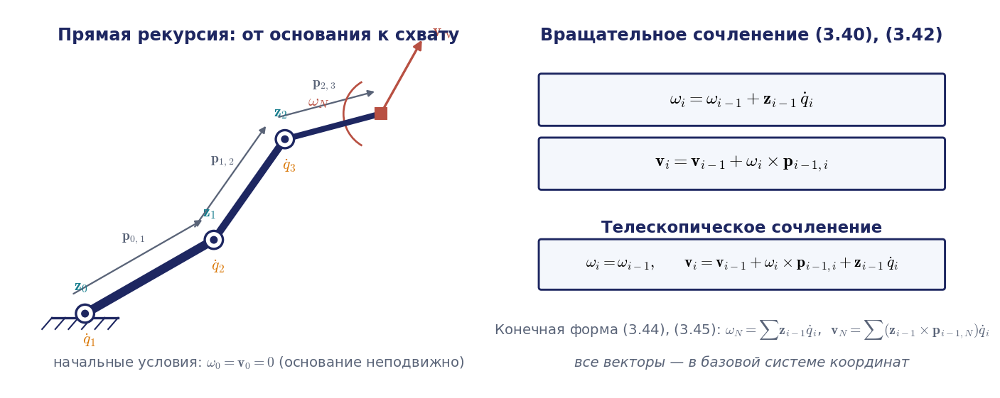

Для телескопического сочленения вывод аналогичен, только используется матрица (3.24). Относительного вращения нет, зато начало $k$-й системы дополнительно движется вдоль оси сочленения. В итоге получаем сводку (3.40), (3.42):

$$
\begin{aligned}
&\boldsymbol{\omega}_i=\boldsymbol{\omega}_{i-1}+\mathbf{z}_{i-1}\dot q_i,&\quad &\mathbf{v}_i=\mathbf{v}_{i-1}+\boldsymbol{\omega}_i\times\mathbf{p}_{i-1,i},\\
&\boldsymbol{\omega}_i=\boldsymbol{\omega}_{i-1},&\quad &\mathbf{v}_i=\mathbf{v}_{i-1}+\boldsymbol{\omega}_i\times\mathbf{p}_{i-1,i}+\mathbf{z}_{i-1}\dot q_i.
\end{aligned}
$$

Первая строка относится к вращательному сочленению, вторая — к телескопическому. Индекс $i$ пробегает значения от 1 до $N$, а при неподвижном основании начальные условия нулевые: $\boldsymbol{\omega}_0=0$, $\mathbf{v}_0=0$. Вычисление идёт от основания к схвату и называется **прямой рекурсией**.

**Примечание о расхождении с книгой.** В учебнике (с. 126) вывод формул (3.38)–(3.39) по недосмотру отнесён к «телескопическим шарнирам», хотя он сделан для вращательных.

### Конечная форма

Если раскрутить рекурсию до основания, получится конечная форма. Для манипулятора с вращательными сочленениями угловая скорость $k$-го звена равна сумме вкладов всех предшествующих сочленений — формула (3.44):

$$
\boldsymbol{\omega}_k=\mathbf{z}_0\dot q_1+\mathbf{z}_1\dot q_2+\dots+\mathbf{z}_{k-1}\dot q_k.
$$

Для линейной скорости подставляем формулу для $\boldsymbol{\omega}_k$ в рекурсию и пользуемся тем, что $\mathbf{p}_{i-1,i}+\mathbf{p}_{i,k}=\mathbf{p}_{i-1,k}$. Слагаемые группируются по скоростям сочленений, и получается формула (3.45):

$$
\mathbf{v}_k=(\mathbf{z}_0\times\mathbf{p}_{0,k})\dot q_1+(\mathbf{z}_1\times\mathbf{p}_{1,k})\dot q_2+\dots+(\mathbf{z}_{k-1}\times\mathbf{p}_{k-1,k})\dot q_k,
$$

где $\mathbf{p}_{i-1,k}$ — вектор из начала $(i-1)$-й системы в начало $k$-й. Все векторы заданы в базовой системе.

Проверим формулу на простом примере. У плоского трёхзвенника оси всех сочленений параллельны оси $z_0$, поэтому по формуле (3.44) угловая скорость третьего звена равна $(\dot q_1+\dot q_2+\dot q_3)\mathbf{z}_0$ — сумме всех скоростей, а не только скорости «своего» сочленения. Слагаемые вида $\boldsymbol{\omega}\times\mathbf{p}$ относятся только к линейной скорости.

### Ускорения

Дифференцируя рекуррентные формулы ещё раз, получаем ускорения. Для вращательного сочленения формулы (3.43) и (3.41) имеют вид

$$
\begin{aligned}
\dot{\boldsymbol{\omega}}_i&=\dot{\boldsymbol{\omega}}_{i-1}+\mathbf{z}_{i-1}\ddot q_i+\boldsymbol{\omega}_{i-1}\times\mathbf{z}_{i-1}\dot q_i,\\
\dot{\mathbf{v}}_i&=\dot{\mathbf{v}}_{i-1}+\dot{\boldsymbol{\omega}}_i\times\mathbf{p}_{i-1,i}+\boldsymbol{\omega}_i\times(\boldsymbol{\omega}_i\times\mathbf{p}_{i-1,i}).
\end{aligned}
$$

Для телескопического сочленения угловое ускорение не меняется, $\dot{\boldsymbol{\omega}}_i=\dot{\boldsymbol{\omega}}_{i-1}$, а в линейном ускорении появляются два дополнительных слагаемых:

$$
\dot{\mathbf{v}}_i=\dot{\mathbf{v}}_{i-1}+\dot{\boldsymbol{\omega}}_i\times\mathbf{p}_{i-1,i}+\boldsymbol{\omega}_i\times(\boldsymbol{\omega}_i\times\mathbf{p}_{i-1,i})+2\boldsymbol{\omega}_i\times\mathbf{z}_{i-1}\dot q_i+\mathbf{z}_{i-1}\ddot q_i.
$$

Все слагаемые узнаваемы из курса теоретической механики: вращательное (тангенциальное) ускорение, центростремительное, а для телескопического сочленения — кориолисово и относительное. Если в этих формулах положить все $\ddot q_i=0$, рекурсия даст ускорение схвата, вызванное одними только скоростями сочленений; именно это слагаемое появится в разделе 3.11 при обсуждении приемистости. Те же рекурсии лежат в основе алгоритма Ньютона — Эйлера в динамике манипуляторов (глава 5 учебника; в раздел «Кинематика» она не входит).

**Примечание о расхождении с книгой.** В учебнике в формуле (3.43) у орта оси напечатан индекс $i$; по смыслу вывода должен стоять индекс $i-1$, как в формуле для угловой скорости.

Во всех выписанных формулах векторы заданы в базовой системе. В учебнике приведены также формулы (3.46)–(3.49) для тех же скоростей в проекциях на оси звеньев: они удобны в динамике, где тензор инерции звена постоянен только в его собственной системе. Эти формулы и их структура разобраны в приложении 3.Б.

## 3.3. Прямая задача о скорости и матрица Якоби

### Постановка задач

Пусть $\mathbf{q}=(q_1,\dots,q_N)^{\mathrm T}$ — вектор обобщённых координат $N$-звенного манипулятора. Положение схвата однозначно определяется обобщёнными координатами: матрица $T_N(\mathbf{q})$ или шестёрка $\mathbf{s}=\mathbf{f}(\mathbf{q})$ — это формула (3.60). Скорость схвата $\boldsymbol{\mathcal V}=(\boldsymbol{\omega};\mathbf{v})$, где $\boldsymbol{\omega}$ — угловая скорость схвата, а $\mathbf{v}$ — скорость начала его системы координат, линейно зависит от скоростей сочленений — основное соотношение лекции (3.61):

$$
\boldsymbol{\mathcal V}=J(\mathbf{q})\,\dot{\mathbf{q}}.
$$

Здесь $\boldsymbol{\mathcal V}$ — шестимерный вектор **обобщённой скорости схвата** (в современной литературе — твист схвата), а $J(\mathbf{q})$ — **матрица Якоби** размера $6\times N$. Точнее, это **геометрическая** матрица Якоби: её строки отвечают угловой и линейной скорости, а не производным каких-либо координат. При $N=6$ матрица квадратная, и её определитель $\det J(\mathbf{q})$ называют **якобианом** (в разговорной речи якобианом часто называют и саму матрицу). Разобьём матрицу на два блока по три строки: $\boldsymbol{\omega}=J_\omega\dot{\mathbf{q}}$ и $\mathbf{v}=J_v\dot{\mathbf{q}}$. Блок линейных скоростей — честная матрица производных, $J_v=\partial\mathbf{p}/\partial\mathbf{q}$, потому что $\mathbf{v}=\dot{\mathbf{p}}$. Блок $J_\omega$ производной никакой функции не является; об этом — ниже, в подразделе о двух якобианах.

**Примечание о расхождении с книгой.** В учебнике соотношения (3.60)–(3.61) записаны как $\mathbf{s}=\mathbf{f}(\mathbf{q})$, $\dot{\mathbf{s}}=J\dot{\mathbf{q}}$ с $J=\partial\mathbf{f}/\partial\mathbf{q}$, причём под $\dot{\mathbf{s}}$ понимается $(\boldsymbol{\omega};\mathbf{v})$. Это верно только для строк линейной скорости. Курс обозначает скорость схвата $\boldsymbol{\mathcal V}$, а запись $\dot{\mathbf{s}}$ оставляет за настоящей производной параметров положения $(\dot{\boldsymbol{\Theta}};\dot{\mathbf{p}})$.

**Прямая задача о скорости**: по заданному вектору $\dot{\mathbf{q}}$ скоростей сочленений найти обобщённую скорость схвата $\boldsymbol{\mathcal V}$. **Обратная задача о скорости**: по заданной обобщённой скорости схвата $\boldsymbol{\mathcal V}$ найти скорости сочленений $\dot{\mathbf{q}}$.

### Столбцы матрицы Якоби

Прямая задача уже фактически решена: конечные формулы (3.44) и (3.45) при $k=N$ дают угловую и линейную скорости схвата как линейные комбинации скоростей сочленений. Запишем матрицу Якоби по столбцам, $J(\mathbf{q})=(\mathbf{j}_1,\mathbf{j}_2,\dots,\mathbf{j}_N)$. Тогда столбец с номером $k$ определяется формулой (3.62):

$$
\mathbf{j}_k=\begin{pmatrix}\mathbf{z}_{k-1}\\ \mathbf{z}_{k-1}\times\mathbf{p}_{k-1,N}\end{pmatrix}
$$

для вращательного сочленения и

$$
\mathbf{j}_k=\begin{pmatrix}\mathbf{0}\\ \mathbf{z}_{k-1}\end{pmatrix}
$$

для телескопического. Соотношение $\boldsymbol{\mathcal V}=J(\mathbf{q})\dot{\mathbf{q}}$ с такой матрицей — формула (3.63) — и есть решение прямой задачи о скорости.

У столбцов простой геометрический смысл (рис. 3.3). Представим, что движется только $k$-е сочленение, а остальные заморожены. Если сочленение вращательное, вся часть цепи, расположенная дальше него, поворачивается вокруг оси $\mathbf{z}_{k-1}$ как единое твёрдое тело. Схват получает угловую скорость $\mathbf{z}_{k-1}\dot q_k$ и линейную скорость $(\mathbf{z}_{k-1}\times\mathbf{p}_{k-1,N})\dot q_k$ — в точности как точка на вращающемся диске: скорость перпендикулярна и оси, и радиус-вектору, а по величине пропорциональна расстоянию до оси. Если сочленение телескопическое, дальняя часть цепи поступательно сдвигается вдоль оси $\mathbf{z}_{k-1}$: ориентация схвата не меняется, а линейная скорость равна $\mathbf{z}_{k-1}\dot q_k$. Таким образом, $k$-й столбец матрицы Якоби — это обобщённая скорость схвата при единичной скорости $k$-го сочленения и неподвижных остальных.

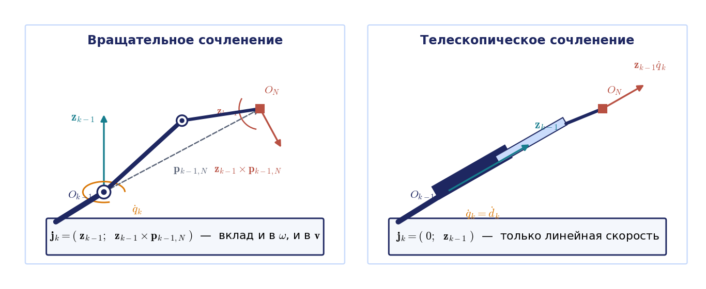

Для вращательных сочленений этот смысл удобно увидеть в движении (рис. 3.4). Пока вращается одно сочленение, схват чертит дугу окружности вокруг его оси, и соответствующий столбец матрицы Якоби направлен по касательной к этой дуге. Телескопическое сочленение в анимации не показано, для него остаётся статичная схема на рис. 3.3.

Анимация целиком: [l03_jacobian_columns.mp4](../06_Анимации/l03_jacobian_columns.mp4), 70 с.

### Алгоритм построения

Самое приятное в формуле (3.62) то, что она не требует символьного дифференцирования. Все входящие в неё векторы — это столбцы матриц $T_i$, которые мы уже умеем вычислять, решая прямую задачу о положении. Алгоритм состоит из четырёх шагов.

1. Решить прямую задачу о положении: вычислить $T_i=A_1\cdots A_i$ для $i=0,1,\dots,N$ (при этом $T_0=E$). Третий столбец матрицы $T_i$ даёт орт $\mathbf{z}_i$, четвёртый — положение $\mathbf{p}_i$ начала $i$-й системы.
2. Для каждого сочленения вычислить вектор от его оси до схвата: $\mathbf{p}_{k-1,N}=\mathbf{p}_N-\mathbf{p}_{k-1}$.
3. Собрать столбцы $\mathbf{j}_k$ в соответствии с типом сочленения.
4. Умножить матрицу на вектор скоростей сочленений: $\boldsymbol{\mathcal V}=J\dot{\mathbf{q}}$.

Алгоритм применим к любой разомкнутой кинематической цепи и программируется одним циклом по звеньям; так он и реализован в модуле курса `kinlib`. Хорошая проверка такой программы — сравнить блок $J_v$ с численным дифференцированием прямой задачи о положении, а блок $J_\omega$ — с угловой скоростью, извлечённой из $\dot RR^{\mathrm T}$: расхождение должно быть на уровне погрешности конечных разностей.

#### Пример 3.1. Матрица Якоби плоского двухзвенника

Рассмотрим плоский двухзвенник с вращательными сочленениями и равными длинами звеньев $a_1=a_2=a$. Из примера 2.1 прошлой лекции известны матрицы положения звеньев; в частности,

$$
T_2=\begin{pmatrix}c_{12}&-s_{12}&0&a(c_1+c_{12})\\ s_{12}&c_{12}&0&a(s_1+s_{12})\\ 0&0&1&0\\ 0&0&0&1\end{pmatrix},
$$

где, как обычно, $c_1=\cos q_1$, $s_{12}=\sin(q_1+q_2)$ и так далее. Обе оси сочленений перпендикулярны плоскости движения, поэтому $\mathbf{z}_0=\mathbf{z}_1=(0,0,1)^{\mathrm T}$. Векторы от осей к схвату равны

$$
\mathbf{p}_{0,2}=\mathbf{p}_2=\begin{pmatrix}a(c_1+c_{12})\\ a(s_1+s_{12})\\ 0\end{pmatrix},\qquad \mathbf{p}_{1,2}=\mathbf{p}_2-\mathbf{p}_1=\begin{pmatrix}ac_{12}\\ as_{12}\\ 0\end{pmatrix}.
$$

Второй вектор — это просто второе звено. Вычисляем векторные произведения $\mathbf{z}_0\times\mathbf{p}_{0,2}$ и $\mathbf{z}_1\times\mathbf{p}_{1,2}$ и собираем матрицу:

$$
J=\begin{pmatrix}0&0\\ 0&0\\ 1&1\\ -a(s_1+s_{12})&-as_{12}\\ a(c_1+c_{12})&ac_{12}\\ 0&0\end{pmatrix}.
$$

Матрица имеет размер $6\times2$. Первые две строки нулевые: угловая скорость направлена только по оси $z$. Третья строка состоит из единиц и говорит, что $\omega_z=\dot q_1+\dot q_2$. Четвёртая и пятая строки образуют блок линейных скоростей $J_v$ размера $2\times2$, с которым мы будем работать до конца лекции.

Проверим результат прямым дифференцированием координат схвата $x=a(c_1+c_{12})$, $y=a(s_1+s_{12})$:

$$
\dot x=-as_1\dot q_1-as_{12}(\dot q_1+\dot q_2),\qquad \dot y=ac_1\dot q_1+ac_{12}(\dot q_1+\dot q_2).
$$

Коэффициенты при $\dot q_1$ и $\dot q_2$ совпадают с элементами блока $J_v$. Для плоского механизма угол ориентации схвата $q_1+q_2$ — единственный, и здесь $\omega_z$ действительно равна его производной; тонкости, о которых пойдёт речь ниже, возникают только в пространстве.

Этот же пример разобран в анимации на рис. 3.4 для $a=1$ м. В конфигурации $\mathbf{q}=(30^\circ;\ 60^\circ)$ вклады двух сочленений по оси $x$ равны $-0{,}75$ и $0{,}80$ м/с и почти гасят друг друга, так что скорость схвата $(0{,}05;\ 0{,}43)$ м/с совпадает с конечной разностью прямой задачи о положении.

**Примечание о расхождении с книгой.** В учебнике (с. 145) выражение для $\dot y$ напечатано с противоположными знаками; это опечатка. В книге этот же пример решён и вторым способом — рекуррентной процедурой для блока $J_v$; она разобрана в приложении 3.В.

### Геометрический и аналитический якобианы

Вернёмся к вопросу, отложенному во введении: почему угловая скорость не является производной углов ориентации. Конечные повороты не коммутируют. Повернём тело на $90^\circ$ сначала вокруг неподвижной оси $x$, затем вокруг $y$, и сравним с обратным порядком. Векторы поворота результатов (ось, умноженная на угол; лекция 1) равны $(1{,}209;\ 1{,}209;\ -1{,}209)$ и $(1{,}209;\ 1{,}209;\ 1{,}209)$ рад — это разные ориентации, хотя «повороты вокруг $x$» и «вокруг $y$» в обоих случаях одинаковы. Значит, интеграл угловой скорости по времени зависит от пути и не может быть тройкой координат ориентации: никакой функции $\boldsymbol{\Theta}(t)$ со свойством $\dot{\boldsymbol{\Theta}}=\boldsymbol{\omega}$ не существует (рис. 3.5).

Связь между угловой скоростью и производными конкретных углов всё же есть, но она нелинейно зависит от самих углов. Для углов Эйлера ZYZ, $R=R_z(\varphi)R_y(\theta)R_z(\psi)$, дифференцирование даёт $\boldsymbol{\omega}=W^{-1}(\boldsymbol{\Theta})\dot{\boldsymbol{\Theta}}$, где $\boldsymbol{\Theta}=(\varphi,\theta,\psi)^{\mathrm T}$ и

$$
W^{-1}(\boldsymbol{\Theta})=\begin{pmatrix}0&-\sin\varphi&\cos\varphi\sin\theta\\ 0&\cos\varphi&\sin\varphi\sin\theta\\ 1&0&\cos\theta\end{pmatrix},\qquad \det W^{-1}=-\sin\theta.
$$

Столбцы этой матрицы — орты осей, вокруг которых выполняются три элементарных поворота, в их текущем положении. Обращение возможно при $\sin\theta\ne0$ и даёт **матрицу скоростей углов** $W(\boldsymbol{\Theta})$:

$$
\dot{\boldsymbol{\Theta}}=W(\boldsymbol{\Theta})\,\boldsymbol{\omega},\qquad W(\boldsymbol{\Theta})=\begin{pmatrix}-\cos\varphi\cot\theta&-\sin\varphi\cot\theta&1\\ -\sin\varphi&\cos\varphi&0\\ \cos\varphi/\sin\theta&\sin\varphi/\sin\theta&0\end{pmatrix}.
$$

Теперь можно продифференцировать шестёрку $\mathbf{s}=\mathbf{f}(\mathbf{q})=(\boldsymbol{\Theta};\mathbf{p})$ честно. Её производная $\dot{\mathbf{s}}=(\dot{\boldsymbol{\Theta}};\dot{\mathbf{p}})$ связана со скоростями сочленений **аналитической матрицей Якоби** $J_A$:

$$
\dot{\mathbf{s}}=J_A(\mathbf{q})\,\dot{\mathbf{q}},\qquad J_A=\frac{\partial\mathbf{f}}{\partial\mathbf{q}}=\begin{pmatrix}W(\boldsymbol{\Theta})&0\\ 0&E\end{pmatrix}J.
$$

Блок линейных скоростей у двух матриц общий, а угловые строки различаются множителем $W$. Проверим это на UR5e в конфигурации $\mathbf{q}=(0{,}3;\ -1{,}2;\ 1{,}4;\ -1{,}0;\ 0{,}8;\ 0{,}4)$ рад, где углы ZYZ схвата равны $(-1{,}893;\ 1{,}030;\ 1{,}349)$ рад. Угловые строки матрицы $\partial\mathbf{f}/\partial\mathbf{q}$, найденной конечными разностями, отличаются от строк $J_\omega$ по модулю до 1,54, линейные строки совпадают, а после умножения $J$ на $\operatorname{diag}(W,E)$ расхождение падает до $4\cdot10^{-7}$, то есть до погрешности конечных разностей.

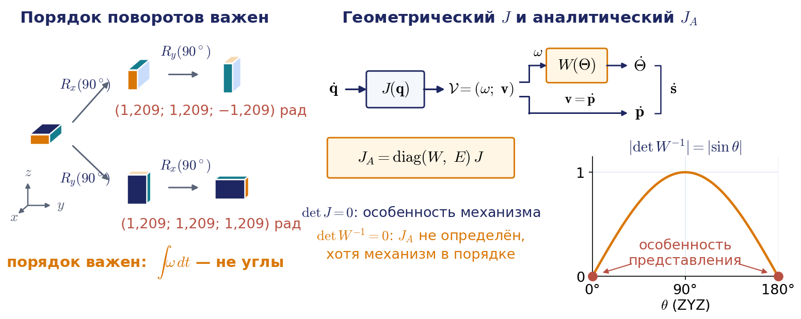

Из формулы видно главное различие двух матриц. Аналитический якобиан не определён там, где вырождается матрица $W^{-1}$, а $W$ не существует: для углов ZYZ при $\theta=0$ и $\theta=\pi$, для углов крена, тангажа и рыскания 3-2-1 — при тангаже $\pm90^\circ$. Это **особенность представления**: робот в такой конфигурации ничем не стеснён, и геометрический якобиан $J$ может быть прекрасно обусловлен, но выбранные три угла перестают описывать ориентацию однозначно. Её устраняет смена параметризации: другие углы, вектор поворота, кватернион. Равенство $\det J=0$ — это **особенность механизма**, и сменой координат её не устранить: робот действительно теряет способность двигать схват в некотором направлении.

Отсюда практическое правило выбора. Аналитический якобиан нужен, когда траектория ориентации задана в углах и нужны именно их производные. Геометрический якобиан нужен почти везде остальное: в управлении по вектору скорости, в статике (раздел 3.10) и в итерационных алгоритмах, где ошибка ориентации вычисляется как вектор поворота (раздел 3.4). Именно поэтому функция `kinlib.pose_error` не вычитает углы, а вычисляет логарифм матрицы поворота. В лекции 7 та же матрица скоростей углов появится для углов 3-2-1 в связанных осях летательного аппарата, $\dot{\boldsymbol{\Theta}}=W(\varphi,\theta)\boldsymbol{\omega}^b$.

### Соглашения: порядок блоков, точка приведения и оси

Матрицу Якоби одного и того же робота разные книги и программы записывают по-разному, и это самая частая причина ошибок при переходе от лекции к программе. Различаются три вещи: порядок блоков (угловая скорость первой или линейная), точка, к которой приведена линейная скорость, и оси, в проекциях на которые записаны оба вектора. Столбцы (3.62) дают скорость начала системы схвата в проекциях на оси базы. Сводка соглашений, проверенных запуском или по исходному коду, приведена в таблице; полная таблица — в разделе 3 файла обозначений курса.

| Источник | Порядок блоков | Точка и оси линейной скорости |
|---|---|---|
| курс, учебник | $(\boldsymbol{\omega};\mathbf{v})$ | начало системы схвата, оси базы |
| `kinlib`: `jacobian`, `jacobian_vw()` | $(\mathbf{v};\boldsymbol{\omega})$ | как в курсе |
| `kinlib`: `jacobian_book()` | $(\boldsymbol{\omega};\mathbf{v})$ | как в курсе |
| Robotics Toolbox for Python: `jacob0` | $(\mathbf{v};\boldsymbol{\omega})$ | как в курсе |
| Robotics Toolbox for Python: `jacobe` | $(\mathbf{v};\boldsymbol{\omega})$ | начало системы схвата, оси схвата |
| Линч и Парк: $J_s$, $J_b$ | $(\boldsymbol{\omega};\mathbf{v})$ | $J_s$ — точка тела в начале базы, оси базы; $J_b$ — начало системы тела, оси тела |
| Сицилиано и соавт., Крейг, Корке | $(\mathbf{v};\boldsymbol{\omega})$ | начало системы схвата, оси базы |
| Pinocchio | $(\mathbf{v};\boldsymbol{\omega})$ | режим `LOCAL_WORLD_ALIGNED` совпадает с (3.62); `LOCAL` — оси тела; `WORLD` — точка тела в начале мира |
| MoveIt 2: `getJacobian` | $(\mathbf{v};\boldsymbol{\omega})$ | оси корневого звена группы, заданная точка конечного звена |
| ROS 2: сообщения `geometry_msgs/Twist` и `TwistStamped` | поля `linear`, затем `angular` | в самом `Twist` системы координат нет, её задаёт соглашение топика; у `TwistStamped` — поле `frame_id` заголовка |

Две формулы позволяют переходить между соглашениями. Первая — пересчёт в оси схвата: $J_b=\operatorname{diag}(R_N^{\mathrm T},R_N^{\mathrm T})\,J$; именно такую матрицу возвращает `jacobe`, и её мы получим ещё раз в разделе 3.4 через матрицу $\Delta_T$. Вторая — перенос точки приведения. Если рабочая точка инструмента (TCP) смещена от начала системы схвата на вектор $\mathbf{r}$, заданный в осях базы, то по распределению скоростей $\mathbf{v}_{\mathrm{TCP}}=\mathbf{v}_N+\boldsymbol{\omega}\times\mathbf{r}$, то есть

$$
J_{\mathrm{TCP}}=\begin{pmatrix}E&0\\ -\Lambda(\mathbf{r})&E\end{pmatrix}J.
$$

Матрица перехода невырождена, поэтому ранг, а с ним и особые конфигурации, при смене TCP не меняются; сингулярные числа (раздел 3.7) меняются. Например, у UR5e в конфигурации, приведённой выше, вылет инструмента 0,1 м вдоль оси $z$ фланца меняет наибольшее сингулярное число полной матрицы с 2,019 на 2,055. Той же формулой с $\mathbf{r}=\mathbf{p}_N$ (точка приведения переносится из начала базы в начало системы схвата) связаны наш якобиан и пространственный якобиан Линча и Парка: $J=\begin{pmatrix}E&0\\ -\Lambda(\mathbf{p}_N)&E\end{pmatrix}J_s$. Практическое правило для ноутбуков и домашних заданий: перед сравнением матриц из разных источников переставить блоки к порядку курса и проверить точку приведения. Для модели UR5e матрица `jacob0` из Robotics Toolbox совпадает с `kinlib.RobotSerial.jacobian` до $2\cdot10^{-16}$.

## 3.4. Дифференциальные преобразования

### Дифференциальное перемещение

Посмотрим на ту же тему с другой стороны — через малые перемещения. Этот взгляд полезен и сам по себе (он используется в алгоритмах управления и при анализе точности), и как ещё один путь к матрице Якоби.

Малое перемещение твёрдого тела складывается из малого переноса и малого поворота. **Дифференциальное перемещение** задаётся шестимерным вектором (3.50), составленным из **вектора дифференциального вращения** $\delta\boldsymbol{\varphi}=(\delta x,\delta y,\delta z)^{\mathrm T}$ и **вектора дифференциального переноса** $d\mathbf{r}=(dx,dy,dz)^{\mathrm T}$. Компоненты первого — бесконечно малые углы поворота вокруг координатных осей, компоненты второго — бесконечно малые смещения вдоль осей.

Почему три малых угла можно считать вектором, хотя конечные углы поворота вектором не являются? Запишем матрицы элементарных поворотов на малые углы, заменив косинусы единицей, а синусы — самими углами. Например, для поворота вокруг оси $z$ блок поворота примет вид

$$
\begin{pmatrix}1&-\delta z&0\\ \delta z&1&0\\ 0&0&1\end{pmatrix}.
$$

Перемножая три такие матрицы и отбрасывая произведения малых величин, получаем один и тот же результат при любом порядке сомножителей — формула (3.55):

$$
\operatorname{Rot}(\delta\boldsymbol{\varphi})=\begin{pmatrix}1&-\delta z&\delta y&0\\ \delta z&1&-\delta x&0\\ -\delta y&\delta x&1&0\\ 0&0&0&1\end{pmatrix}=E+\begin{pmatrix}\Lambda(\delta\boldsymbol{\varphi})&0\\ 0&0\end{pmatrix}.
$$

Некоммутативность поворотов — эффект второго порядка малости, и в первом приближении он исчезает. Поэтому малые повороты складываются как векторы, и именно поэтому вектором является угловая скорость $\boldsymbol{\omega}=\delta\boldsymbol{\varphi}/dt$. Пример с поворотами на $90^\circ$ из раздела 3.3 показывает обратную сторону той же медали: для конечных поворотов порядок важен.

### Матрица дифференциальных преобразований

Пусть положение тела задано матрицей $T$, и тело совершает дифференциальное перемещение: перенос $d\mathbf{r}_T$ и затем поворот $\delta\boldsymbol{\varphi}_T$, причём оба вектора заданы проекциями на оси связанной системы (рис. 3.6). Перемещения в связанной системе соответствуют умножению справа, поэтому новое положение равно $T'=T\operatorname{Trans}(d\mathbf{r}_T)\operatorname{Rot}(\delta\boldsymbol{\varphi}_T)$ — формула (3.53). Приращение матрицы положения $dT=T'-T$ записывается в виде

$$
dT=T\,\Delta_T,\qquad \Delta_T=\begin{pmatrix}\Lambda(\delta\boldsymbol{\varphi}_T)&d\mathbf{r}_T\\ 0&0\end{pmatrix}.
$$

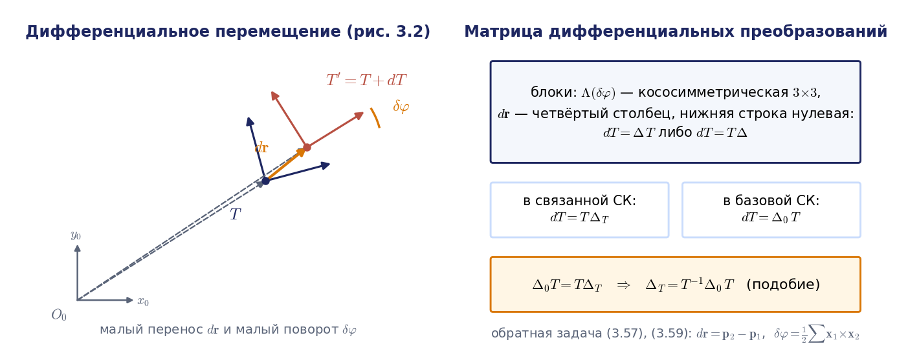

Если то же самое перемещение задать векторами $d\mathbf{r}_0$ и $\delta\boldsymbol{\varphi}_0$ в проекциях на оси неподвижной системы, то умножать нужно слева, и получится

$$
dT=\Delta_0\,T,\qquad \Delta_0=\begin{pmatrix}\Lambda(\delta\boldsymbol{\varphi}_0)&d\mathbf{r}_0-\Lambda(\delta\boldsymbol{\varphi}_0)\mathbf{p}\\ 0&0\end{pmatrix}.
$$

Матрицы $\Delta_T$ и $\Delta_0$ называют **матрицами дифференциальных преобразований**. Поскольку обе записи описывают одно и то же приращение, $\Delta_0T=T\Delta_T$, откуда следует, что две матрицы связаны преобразованием подобия:

$$
\Delta_T=T^{-1}\Delta_0\,T.
$$

**Примечание о расхождении с книгой.** В учебнике (с. 133) матрица $\Delta_0$ по ошибке подписана как $\operatorname{Rot}_0$, а в правом нижнем углу матрицы $dT$ напечатана единица вместо нуля.

Сравните матрицу $\Delta_0$ с матрицей $[\boldsymbol{\mathcal V}_s]$ из раздела 3.1: они совпадают с точностью до множителя $dt$, $\Delta_0=[\boldsymbol{\mathcal V}_s]\,dt$, и точно так же $\Delta_T=[\boldsymbol{\mathcal V}_b]\,dt$. Дифференциальное перемещение — это «твист, умноженный на малое время», и соотношение $dT=\Delta_0T$ есть не что иное, как $\dot T=[\boldsymbol{\mathcal V}_s]T$.

### Обратная задача: перемещение между двумя близкими положениями

Для управления важна обратная задача. Пусть известны два близких положения тела,

$$
T_1=\begin{pmatrix}\mathbf{x}_1&\mathbf{y}_1&\mathbf{z}_1&\mathbf{p}_1\\ 0&0&0&1\end{pmatrix},\qquad T_2=\begin{pmatrix}\mathbf{x}_2&\mathbf{y}_2&\mathbf{z}_2&\mathbf{p}_2\\ 0&0&0&1\end{pmatrix},
$$

например текущее положение схвата и желаемое положение на следующем такте управления. Требуется найти дифференциальное перемещение, переводящее первое во второе. Из равенства $T_2-T_1=\Delta_0T_1$, приравнивая блоки, сразу находим перенос — формула (3.57):

$$
d\mathbf{r}=\mathbf{p}_2-\mathbf{p}_1.
$$

Для поворота получаем $R_2-R_1=\Lambda(\delta\boldsymbol{\varphi})R_1$, или, по столбцам, формулы (3.58): $\mathbf{x}_2=\mathbf{x}_1+\delta\boldsymbol{\varphi}\times\mathbf{x}_1$ и аналогично для двух других ортов. Умножим первое равенство векторно слева на $\mathbf{x}_1$ и раскроем двойное векторное произведение: $\mathbf{x}_1\times\mathbf{x}_2=\delta\boldsymbol{\varphi}-\mathbf{x}_1(\mathbf{x}_1^{\mathrm T}\delta\boldsymbol{\varphi})$. Сложим три таких равенства. Сумма проекций вектора $\delta\boldsymbol{\varphi}$ на три взаимно перпендикулярных орта равна самому вектору, поэтому в правой части остаётся $3\delta\boldsymbol{\varphi}-\delta\boldsymbol{\varphi}=2\delta\boldsymbol{\varphi}$, и мы приходим к формуле (3.59):

$$
\delta\boldsymbol{\varphi}=\frac12\big(\mathbf{x}_1\times\mathbf{x}_2+\mathbf{y}_1\times\mathbf{y}_2+\mathbf{z}_1\times\mathbf{z}_2\big).
$$

Итак, чтобы перевести тело из положения $T_1$ в близкое положение $T_2$, нужно сместить его на вектор $d\mathbf{r}$ и повернуть вокруг оси, проходящей через начало связанной системы и заданной вектором $\delta\boldsymbol{\varphi}$. Оба вектора заданы в базовой системе. Формула (3.59) — стандартный способ вычисления ошибки ориентации **при малых рассогласованиях**, например между соседними тактами управления.

### Ошибка ориентации при конечном повороте

Формула (3.59) выведена линеаризацией, и для больших рассогласований ею пользоваться нельзя. Пусть поворот, переводящий $R_1$ в $R_2$, конечен: $R_2R_1^{\mathrm T}=\operatorname{Rot}(\mathbf{k},\alpha)$ с единичной осью $\mathbf{k}$ и углом $\alpha$. Правая часть (3.59) равна половине вектора, составленного из разностей симметричных элементов матрицы $R_2R_1^{\mathrm T}$, и по формуле Родрига (лекция 1) это ровно $\sin\alpha\,\mathbf{k}$. Направление верное, а модуль — нет: он растёт только до $90^\circ$, а при $180^\circ$ обращается в нуль. Точная ошибка — **вектор поворота**

$$
\alpha\mathbf{k}=\log\big(R_2R_1^{\mathrm T}\big)^{\vee},\qquad \alpha=\arccos\frac{\operatorname{tr}(R_2R_1^{\mathrm T})-1}{2},
$$

где ось при $0<\alpha<\pi$ находится из той же разности симметричных элементов, делённой на $2\sin\alpha$. Другой распространённый вариант — удвоенная векторная часть кватерниона ошибки, $2\sin(\alpha/2)\,\mathbf{k}$. При малом $\alpha$ все три выражения совпадают с точностью до членов порядка $\alpha^3$, а при больших различаются сильно (рис. 3.7):

| Модуль ошибки при угле $\alpha$ | $30^\circ$ | $90^\circ$ | $150^\circ$ | $179^\circ$ |
|---|---|---|---|---|
| (3.59): $\sin\alpha$ | 0,500 | 1,000 | 0,500 | 0,017 |
| кватернион: $2\sin(\alpha/2)$ | 0,518 | 1,414 | 1,932 | 2,000 |
| вектор поворота: $\alpha$, рад | 0,524 | 1,571 | 2,618 | 3,124 |

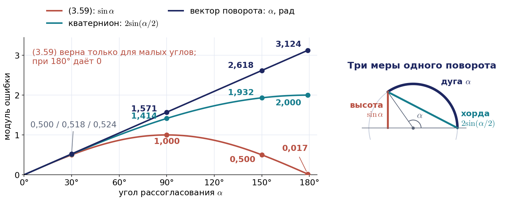

В контуре управления, где командная скорость пропорциональна ошибке (лекция 4), формула (3.59) уменьшает эффективный коэффициент усиления в $\sin\alpha/\alpha$ раз. Вблизи $180^\circ$ это падение очень сильное: при коэффициенте усиления 1 с$^{-1}$ ошибка от $179^\circ$ до $1^\circ$ уменьшается за 9,5 с вместо 5,2 с, а ровно при $180^\circ$ формула даёт нуль, и контур «не видит» рассогласования. Модуль курса работает с точной формулой: `kinlib.pose_error` вычисляет $\log(R^{\ast}R^{\mathrm T})^{\vee}$.

### Получение матрицы Якоби через дифференциальные преобразования

Найдём $k$-й столбец матрицы Якоби новым способом. Пусть $k$-я обобщённая координата получила малое приращение $dq_k$, а остальные не изменились. По правилу дифференцирования изменение матрицы положения схвата $T=A_1\cdots A_N$ равно

$$
d_kT=A_1\cdots A_{k-1}\,Q_k\,dq_k\,A_k\cdots A_N.
$$

Запишем это приращение в виде $d_kT=\Delta_{Q_k}T$ (3.64) и выделим матрицу дифференциальных преобразований, умножив справа на $T^{-1}$. Сомножители $A_k\cdots A_N$ сокращаются со своими обратными, и остаётся формула (3.65):

$$
\Delta_{Q_k}=T_{k-1}\,Q_k\,T_{k-1}^{-1}\,dq_k.
$$

Для вращательного сочленения подставим блочные выражения $T_{k-1}$ и $T_{k-1}^{-1}$ и воспользуемся свойством $R_{k-1}\Lambda(\mathbf{z}_0)R_{k-1}^{\mathrm T}=\Lambda(\mathbf{z}_{k-1})$:

$$
\Delta_{Q_k}=\begin{pmatrix}\Lambda(\mathbf{z}_{k-1})&-\Lambda(\mathbf{z}_{k-1})\mathbf{p}_{k-1}\\ 0&0\end{pmatrix}dq_k.
$$

С другой стороны, по определению матрицы $\Delta_0$ для схвата в левом верхнем блоке стоит $\Lambda(\delta\boldsymbol{\varphi}_N)$, а в правом столбце — $d\mathbf{r}_N-\Lambda(\delta\boldsymbol{\varphi}_N)\mathbf{p}_N$. Приравнивая блоки, читаем ответ:

$$
\delta\boldsymbol{\varphi}_N=\mathbf{z}_{k-1}\,dq_k,\qquad d\mathbf{r}_N=\mathbf{z}_{k-1}\times(\mathbf{p}_N-\mathbf{p}_{k-1})\,dq_k.
$$

Это в точности $k$-й столбец (3.62). Для телескопического сочленения выкладка ещё короче.

Тот же приём даёт матрицу Якоби в системе координат схвата, которая нужна, когда командная скорость задаётся в осях инструмента. Для этого приращение записывают в виде $d_kT=T\Delta_{T_k}$, откуда $\Delta_{T_k}=({}^{k-1}T_N)^{-1}\,Q_k\,{}^{k-1}T_N\,dq_k$ — формула (3.68), где ${}^{k-1}T_N=A_kA_{k+1}\cdots A_N$ — положение схвата в $(k-1)$-й системе. Если обозначить блок поворота и столбец положения матрицы ${}^{k-1}T_N$ через $R$ и $\mathbf{p}$, то для вращательного сочленения получается $\delta\boldsymbol{\varphi}=R^{\mathrm T}\mathbf{z}_0\,dq_k$ и $d\mathbf{r}=R^{\mathrm T}(\mathbf{z}_0\times\mathbf{p})\,dq_k$. Матрицы ${}^{i-1}T_N$ вычисляются рекуррентно от схвата к основанию: ${}^{i-1}T_N=A_i\,{}^{i}T_N$, ${}^{N}T_N=E$. Результат совпадает с формулой пересчёта из раздела 3.3: $J_b=\operatorname{diag}(R_N^{\mathrm T},R_N^{\mathrm T})J$.

Итак, у нас есть три пути к одной и той же матрице: рекурсия скоростей, дифференциальные преобразования и (для блока $J_v$) дифференцирование прямой задачи о положении. Совпадение результатов — удобная проверка и выкладок, и программы. Авторы учебника предлагают ещё и рекуррентный алгоритм вычисления блока $J_v$, экономный при пересчёте сотни раз в секунду; он разобран в приложении 3.В.

### Якобиан и точность позиционирования

Обещанное применение к анализу точности получается из той же линейности. Если обобщённые координаты известны с ошибкой $\delta\mathbf{q}$ (дискретность датчиков, люфты, погрешность установки нуля), то положение схвата ошибается на $\delta\mathbf{p}\approx J_v(\mathbf{q})\,\delta\mathbf{q}$, причём $\lVert\delta\mathbf{p}\rVert\le\sigma_{\max}(J_v)\lVert\delta\mathbf{q}\rVert$, где $\sigma_{\max}$ — наибольшее сингулярное число (раздел 3.7). Для UR5e в конфигурации раздела 3.3 $\sigma_{\max}(J_v)=0{,}864$ м, и ошибка $0{,}01^\circ$ в каждом из шести сочленений даёт оценку сверху 0,37 мм; перебор знаков ошибок даёт наихудшее смещение 0,27 мм. Для сравнения: в паспорте UR5e указана повторяемость $\pm0{,}03$ мм по ISO 9283. Повторяемость характеризует разброс при многократном возврате в одну точку, а абсолютная точность зависит ещё и от того, насколько параметры модели ДХ соответствуют конкретному экземпляру робота; уточнение этих параметров по измерениям называется калибровкой и обсуждается в лекции 5.

## 3.5. Обратная задача о скорости

### Линейная система и число решений

Задана обобщённая скорость схвата $\boldsymbol{\mathcal V}=(\boldsymbol{\omega};\mathbf{v})$, требуется найти скорости сочленений. Соотношение (3.77)

$$
J(\mathbf{q})\,\dot{\mathbf{q}}=\boldsymbol{\mathcal V}
$$

нужно рассматривать как систему шести линейных уравнений с $N$ неизвестными $\dot q_1,\dots,\dot q_N$; конфигурация $\mathbf{q}$ при этом считается известной, так что коэффициенты системы — числа. Вопрос о существовании решения закрывает теорема Кронекера — Капелли: система совместна тогда и только тогда, когда ранг матрицы системы равен рангу расширенной матрицы,

$$
\operatorname{rank}J=\operatorname{rank}(J,\boldsymbol{\mathcal V}).
$$

Словами: заданную скорость схвата можно составить из столбцов матрицы Якоби, то есть из тех скоростей схвата, которые умеют создавать отдельные сочленения. Для робота это означает, что заданное движение схвата физически достижимо в данной конфигурации. Разберём три случая.

Первый случай: $N=6$, матрица Якоби квадратная. Если в данной конфигурации $\det J(\mathbf{q})\ne0$, решение существует для любой командной скорости и единственно — формула (3.79):

$$
\dot{\mathbf{q}}=J^{-1}(\mathbf{q})\,\boldsymbol{\mathcal V}.
$$

Если же $\det J(\mathbf{q})=0$, ранг матрицы меньше шести. Тогда либо решений бесконечно много (когда условие совместности выполнено), либо нет ни одного. Конфигурации $\mathbf{q}^{\ast}$, в которых $\det J(\mathbf{q}^{\ast})=0$, называют **вырожденными** (особыми, сингулярными). Вырожденная конфигурация характеризуется тем, что для одних командных скоростей схвата существует бесконечно много способов их реализовать, а для других не существует ни одного.

Второй случай: $N$ больше шести. Неизвестных больше, чем уравнений, поэтому единственного решения быть не может: решений либо бесконечно много, либо нет. Такие манипуляторы называют **избыточными**; степень избыточности равна $N-6$. Их применяют в загромождённой среде, используя способность принимать разные конфигурации при одном и том же положении схвата; управлять ими сложнее (раздел 3.7).

Третий случай: $N$ меньше шести. Возможна любая из трёх ситуаций: нет решений, одно решение, бесконечно много решений. Манипулятор с малым числом степеней подвижности не может реализовать произвольную шестимерную скорость схвата; такие механизмы используют там, где полная свобода движения схвата не требуется (например, четырёхосные роботы для перекладки деталей).

Практический смысл вырожденных конфигураций не исчерпывается самими особыми точками. В их окрестности матрица Якоби обратима, но плохо обусловлена: как будет показано в разделе 3.7, $\lVert\dot{\mathbf{q}}\rVert\le\lVert\boldsymbol{\mathcal V}\rVert/\sigma_{\min}(J)$, и при $\sigma_{\min}\to0$ малой скорости схвата могут отвечать огромные скорости сочленений. Существенно, что рост касается не всех направлений, а только «потерянного». Робот «дёргается», приводы уходят в насыщение, и заданная траектория схвата не выдерживается.

#### Пример 3.2. Вырожденные конфигурации плоского двухзвенника

Будем рассматривать только линейную скорость схвата двухзвенника из примера 3.1. Матрица системы — блок $J_v$ размера $2\times2$:

$$
\begin{pmatrix}v_x\\ v_y\end{pmatrix}=\begin{pmatrix}-a(s_1+s_{12})&-as_{12}\\ a(c_1+c_{12})&ac_{12}\end{pmatrix}\begin{pmatrix}\dot q_1\\ \dot q_2\end{pmatrix},\qquad \det J_v=a^2s_2.
$$

Определитель обращается в нуль при $q_2=\pi n$, то есть когда «рука» полностью вытянута или полностью сложена (рис. 3.8). Вне этих конфигураций решение единственно:

$$
\begin{pmatrix}\dot q_1\\ \dot q_2\end{pmatrix}=\frac{1}{a^2s_2}\begin{pmatrix}ac_{12}&as_{12}\\ -a(c_1+c_{12})&-a(s_1+s_{12})\end{pmatrix}\begin{pmatrix}v_x\\ v_y\end{pmatrix},
$$

и множитель $1/s_2$ наглядно показывает рост скоростей сочленений при приближении к особой точке.

**Примечание о расхождении с книгой.** В учебнике определитель записан как $s_2$, без множителя $a^2$; на положение особых точек это не влияет.

Посмотрим, как этот рост выглядит численно. Пусть $a=1$ м, и схват идёт вдоль оси $x$ к границе зоны со скоростью 0,1 м/с по ветви $q_2>0$ («локоть вниз» в осях курса). При $x=1{,}0$ м норма скоростей сочленений равна 0,129 рад/с, при $x=1{,}9$ — 0,358, при $x=1{,}99$ — 1,12, при $x=1{,}999$ — 3,54 рад/с. Причина видна из геометрии: расстояние до основания $r=2\cos(q_2/2)$, откуда $\dot q_2=-\dot r/\sin(q_2/2)$. При равномерном движении к границе $2-r\approx q_2^2/4$ убывает линейно по времени, поэтому $\dot q_2$ растёт как $1/\sqrt{t^{\ast}-t}$, и граница достигается за конечное время. Если же в тех же конфигурациях командовать скорость поперёк руки, скорости сочленений остаются малыми: особенность — свойство направления, а не точки. Этот опыт показан в анимации на рис. 3.9.

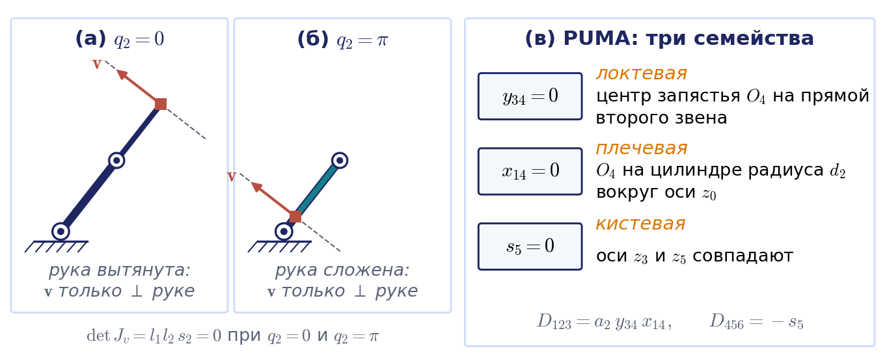

Анимация целиком: [l03_singularity_approach_2r.mp4](../06_Анимации/l03_singularity_approach_2r.mp4), 66 с.

Посмотрим, что происходит в самих особых точках. Для вытянутой руки ($q_2=0$) матрица принимает вид

$$
J_v=\begin{pmatrix}-2as_1&-as_1\\ 2ac_1&ac_1\end{pmatrix}.
$$

Её столбцы пропорциональны, ранг равен единице. Оба столбца направлены вдоль вектора $(-s_1,c_1)^{\mathrm T}$, перпендикулярного руке, и скорость схвата равна $a(2\dot q_1+\dot q_2)(-s_1,c_1)^{\mathrm T}$. Физически это очевидно: когда рука вытянута, ни одно из сочленений не может сдвинуть схват вдоль руки, оба создают скорость только поперёк неё. Конец анимации на рис. 3.4 показывает это наглядно: при выпрямлении руки параллелограмм, построенный на двух столбцах, сплющивается, его площадь $\lvert\det J_v\rvert$ падает до нуля, и столбцы ложатся на одну прямую. Для сложенной руки ($q_2=\pi$) матрица равна

$$
J_v=\begin{pmatrix}0&as_1\\ 0&-ac_1\end{pmatrix}:
$$

первый столбец нулевой (схват находится на оси первого сочленения), а второй снова перпендикулярен руке.

Отсюда следует ответ на вопрос о числе решений в особой точке. Командная скорость реализуема, только если она перпендикулярна руке, то есть удовлетворяет условию

$$
v_xc_1+v_ys_1=0.
$$

Если условие не выполнено, решений нет. Если выполнено, обозначим через $v_\perp=-v_xs_1+v_yc_1$ проекцию командной скорости на направление, перпендикулярное первому звену. Для вытянутой руки получаем одно уравнение $a(2\dot q_1+\dot q_2)=v_\perp$ с двумя неизвестными, и решений бесконечно много:

$$
\dot q_1=t,\qquad \dot q_2=\frac{v_\perp}{a}-2t,
$$

где $t$ — любое действительное число. Для сложенной руки уравнение имеет вид $-a\dot q_2=v_\perp$: скорость $\dot q_2=-v_\perp/a$ определена однозначно, а $\dot q_1$ может быть любой, потому что вращение первого сочленения вообще не двигает схват, лежащий на его оси. На практике из семейства выбирают решение, которое укладывается в ограничения приводов, либо решение с минимальной нормой, о котором речь пойдёт в разделе 3.7.

**Примечание о расхождении с книгой.** В учебнике (с. 148) условие совместности напечатано со знаком минус перед вторым слагаемым; подстановкой вектора $(-s_1,c_1)^{\mathrm T}$ легко проверить, что правильный знак — плюс. Семейство решений записано в книге в виде $\dot q_2=-2t-\lvert\mathbf{v}\rvert/a$; это верно только для вытянутой руки и одного из двух направлений скорости, а случай сложенной руки не разобран.

У шестизвенного манипулятора типа PUMA вырожденных конфигураций три семейства — локтевое, плечевое и кистевое (рис. 3.8); строго мы получим их в примере 3.3. Локтевое семейство лежит на границе рабочей зоны центра запястья, плечевое — на цилиндре радиуса $d_2$ вокруг оси первого сочленения, то есть на внутренней границе этой зоны, а кистевое — внутри зоны. Поэтому на практике именно кистевая особенность доставляет больше всего хлопот: в неё можно попасть посреди обычной траектории. Заметим, что обратное неверно: граница рабочей зоны всегда лежит в образе особых конфигураций, но не всякая особая конфигурация выводит схват на границу.

## 3.6. Манипуляторы с тремя пересекающимися осями

### Идея декомпозиции

Процедура решения системы (3.77) — часть алгоритма управления, и её вычислительная сложность определяет эффективность алгоритма в целом. Идеальный результат — явные формулы вида $\dot q_i=\mathbf{a}_i^{\mathrm T}(\mathbf{q})\boldsymbol{\omega}+\mathbf{b}_i^{\mathrm T}(\mathbf{q})\mathbf{v}$. Авторы учебника честно отмечают: представления обратной матрицы Якоби размера $6\times6$ в замкнутой форме для произвольной кинематической схемы не существует. К счастью, есть широкий класс схем, для которых аналитическое обращение возможно, и приём здесь тот же, что в обратной задаче о положении: три пересекающиеся оси.

Пусть оси $\mathbf{z}_k$, $\mathbf{z}_l$, $\mathbf{z}_m$ трёх вращательных сочленений пересекаются в одной точке $O$ (рис. 3.10). Запишем уравнения для угловой и линейной скоростей схвата — формулы (3.81) и (3.82):

$$
\begin{aligned}
\sum_{i=1}^{N}\mathbf{z}_{i-1}\dot q_i&=\boldsymbol{\omega},\\
\sum_{i=1}^{N}(\mathbf{z}_{i-1}\times\mathbf{p}_{i-1,N})\dot q_i&=\mathbf{v}.
\end{aligned}
$$

Умножим первое уравнение векторно справа на $\mathbf{p}_{k,N}$ и вычтем из второго. Поскольку $\mathbf{p}_{i-1,N}-\mathbf{p}_{k,N}=\mathbf{p}_{i-1,k}$, получаем формулу (3.83):

$$
\sum_{i=1}^{N}(\mathbf{z}_{i-1}\times\mathbf{p}_{i-1,k})\dot q_i=\mathbf{v}-\boldsymbol{\omega}\times\mathbf{p}_{k,N}=\mathbf{v}_k.
$$

Правая часть — это скорость точки схвата (как твёрдого тела), совпадающей с началом $k$-й системы; это та же формула переноса точки приведения, что и в разделе 3.3. Теперь удобно, чтобы начало $O_k$ находилось в точке пересечения осей. По правилам ДХ при пересекающихся осях начало системы и так попадает в точку их пересечения; впрочем, вывод (3.83) годится для любой точки приведения. Тогда векторы $\mathbf{p}_{l,k}$ и $\mathbf{p}_{m,k}$ направлены вдоль осей $\mathbf{z}_l$ и $\mathbf{z}_m$, а $\mathbf{p}_{k,k}=0$, и три векторных произведения обращаются в нуль:

$$
\mathbf{z}_k\times\mathbf{p}_{k,k}=\mathbf{z}_l\times\mathbf{p}_{l,k}=\mathbf{z}_m\times\mathbf{p}_{m,k}=0.
$$

Смысл прост: вращение вокруг оси, проходящей через точку $O$, не сообщает этой точке линейной скорости. Из уравнения (3.83) выпадают три неизвестных, и система становится блочно-треугольной — формула (3.84). При $N=6$ она распадается на две системы третьего порядка: сначала из уравнения для $\mathbf{v}_k$ находятся три скорости «несущих» сочленений, затем из уравнения для угловой скорости — три оставшиеся.

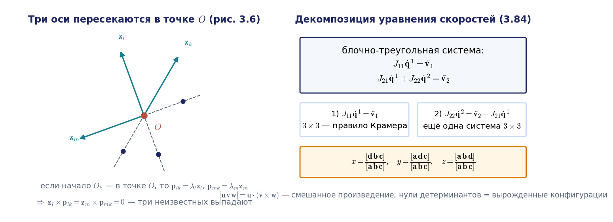

Каждая из двух систем имеет вид $\mathbf{a}x+\mathbf{b}y+\mathbf{c}z=\mathbf{d}$ с известными векторами. Её решение даёт правило Крамера, записанное через смешанные произведения, — формула (3.88):

$$
x=\frac{[\mathbf{d}\,\mathbf{b}\,\mathbf{c}]}{[\mathbf{a}\,\mathbf{b}\,\mathbf{c}]},\qquad y=\frac{[\mathbf{a}\,\mathbf{d}\,\mathbf{c}]}{[\mathbf{a}\,\mathbf{b}\,\mathbf{c}]},\qquad z=\frac{[\mathbf{a}\,\mathbf{b}\,\mathbf{d}]}{[\mathbf{a}\,\mathbf{b}\,\mathbf{c}]},
$$

где $[\mathbf{u}\,\mathbf{v}\,\mathbf{w}]=\mathbf{u}^{\mathrm T}(\mathbf{v}\times\mathbf{w})=\det(\mathbf{u},\mathbf{v},\mathbf{w})$. Знаменатель — определитель подсистемы, и его нули как раз задают вырожденные конфигурации. Аналогичная декомпозиция возможна и тогда, когда механизм содержит три поступательных сочленения: они не влияют на угловую скорость, и первым решается уравнение для $\boldsymbol{\omega}$.

#### Пример 3.3. Обратная задача о скорости для манипулятора PUMA

У манипулятора PUMA все шесть сочленений вращательные, а оси трёх последних пересекаются в центре запястья, где совмещены начала $O_4$ и $O_5$. Применяя описанный приём, получаем для первых трёх скоростей систему (3.91):

$$
(\mathbf{z}_0\times\mathbf{p}_{04})\dot q_1+(\mathbf{z}_1\times\mathbf{p}_{14})\dot q_2+(\mathbf{z}_2\times\mathbf{p}_{24})\dot q_3=\mathbf{v}_4,\qquad \mathbf{v}_4=\mathbf{v}-\boldsymbol{\omega}\times\mathbf{p}_{46}.
$$

Вектор $\mathbf{v}_4$ — это скорость центра запястья, и смысл системы очевиден: скорость центра запястья создают только три первых сочленения.

**Примечание о расхождении с книгой.** В учебнике в правой части (3.91) напечатан вектор $\mathbf{p}_{0,4}$; по выводу там должен стоять вектор $\mathbf{p}_{46}$ от центра запястья к схвату.

Определитель системы вычисляется с помощью разложения вектора к центру запястья по ортам систем звеньев, $\mathbf{p}_{04}=d_2\mathbf{z}_1+a_2\mathbf{x}_2+a_3\mathbf{x}_3+d_4\mathbf{z}_3$ (расстановка осей примера 2.4 лекции 2), и таблицы умножения ортов. После упрощений получается удивительно компактный результат — формула (3.100):

$$
D_{123}=a_2\,y_{34}\,x_{14},\qquad y_{34}=a_3s_3-d_4c_3,\qquad x_{14}=a_2c_2+a_3c_{23}+d_4s_{23}.
$$

Обе величины имеют простой геометрический смысл. Величина $y_{34}$ — проекция на ось $y_2$ вектора $O_2O_4=a_3\mathbf{x}_3+d_4\mathbf{z}_3$, проведённого от оси локтя (начало $O_2$ лежит на оси третьего сочленения) к центру запястья. Величина $x_{14}$ — проекция вектора от основания к центру запястья на ось $x_1$, то есть плечо, на котором поворот $q_1$ двигает центр запястья поперёк плоскости руки. Сама плоскость руки отстоит от оси $z_0$ на плечевое смещение $d_2$, поэтому полное горизонтальное расстояние центра запястья до этой оси равно $\sqrt{x_{14}^2+d_2^2}$; только при $d_2=0$ оно совпадает с $\lvert x_{14}\rvert$. Числители формул Крамера упрощаются так же, и получаются явные выражения (3.101), (3.104), (3.105):

$$
\begin{aligned}
\dot q_1&=\frac{\mathbf{v}_4^{\mathrm T}\mathbf{z}_2}{x_{14}},\\
\dot q_2&=\frac{\mathbf{v}_4^{\mathrm T}\big(d_2(a_3c_{23}+d_4s_{23})\mathbf{z}_1+x_{14}a_3\mathbf{x}_3+x_{14}d_4\mathbf{z}_3\big)}{a_2\,y_{34}\,x_{14}},\\
\dot q_3&=-\frac{\mathbf{v}_4^{\mathrm T}\mathbf{p}_{04}}{a_2\,y_{34}}.
\end{aligned}
$$

Формула для $\dot q_1$ допускает наглядное толкование: орт $\mathbf{z}_2$ перпендикулярен вертикальной плоскости руки, скорость центра запястья поперёк этой плоскости создаёт только первое сочленение, а плечо этого вращения равно $x_{14}$. Все формулы примера проверены в ноутбуке на модели PUMA 560 со случайными конфигурациями и скоростями: совпадение с численным решением системы — до ошибок округления.

**Примечание о расхождении с книгой.** В знаменателе формулы (3.104) в книге напечатано $y_{24}$; в соответствии с выражением для определителя должно быть $y_{34}$. Условие локтевой особенности напечатано в книге как $y_{34}c_3=0$ (формула (3.102)) вместо $y_{34}=0$.

Нули знаменателей задают два семейства вырожденных конфигураций. Условие $y_{34}=0$ означает, что вектор $O_2O_4$ направлен вдоль оси $x_2$, то есть центр запястья лежит на прямой второго звена: рука полностью вытянута или сложена. Это локтевая особенность. Условие $x_{14}=0$, формула (3.103), означает, что центр запястья лежит на вертикали, отстоящей от оси первого сочленения на $d_2$. По всем $q_1$ такие вертикали образуют цилиндр радиуса $d_2$ — внутреннюю границу зоны центра запястья; при $d_2=0$ цилиндр стягивается в ось. Это плечевая особенность: в ней поворот первого сочленения не может сдвинуть центр запястья поперёк плоскости руки.

После того как первые три скорости найдены, оставшаяся часть угловой скорости распределяется по осям запястья — система (3.106):

$$
\mathbf{z}_3\dot q_4+\mathbf{z}_4\dot q_5+\mathbf{z}_5\dot q_6=\boldsymbol{\omega}_{\mathrm w},\qquad \boldsymbol{\omega}_{\mathrm w}=\boldsymbol{\omega}-\mathbf{z}_0\dot q_1-\mathbf{z}_1\dot q_2-\mathbf{z}_2\dot q_3.
$$

Её определитель равен $D_{456}=[\mathbf{z}_3\,\mathbf{z}_4\,\mathbf{z}_5]=-s_5$ — формула (3.107), а решение даётся формулами (3.108)–(3.110):

$$
\dot q_4=-\frac{\boldsymbol{\omega}_{\mathrm w}^{\mathrm T}\mathbf{x}_5}{s_5},\qquad \dot q_5=\boldsymbol{\omega}_{\mathrm w}^{\mathrm T}\mathbf{z}_4,\qquad \dot q_6=\frac{\boldsymbol{\omega}_{\mathrm w}^{\mathrm T}\mathbf{x}_4}{s_5}.
$$

Условие $s_5=0$, формула (3.111), задаёт третье семейство — кистевую особенность: оси $\mathbf{z}_3$ и $\mathbf{z}_5$ совпадают, и скорости $\dot q_4$ и $\dot q_6$ по отдельности не определены. Итог примера: вместо численного обращения матрицы $6\times6$ контроллер на каждом такте вычисляет шесть явных формул, а все особые конфигурации известны заранее как нули трёх простых выражений.

### Если запястье не сферическое: UR5e

Декомпозиция требует, чтобы три оси пересекались в одной точке. У большинства современных коботов это не так. У UR5e оси второго, третьего и четвёртого сочленений параллельны ($\alpha_2=\alpha_3=0$ в таблице ДХ производителя), а оси запястья не пересекаются: смещения $d_4=0{,}1333$ м, $d_5=0{,}0997$ м и $d_6=0{,}0996$ м разносят их в пространстве. Центра запястья нет, и развязать скорость «несущих» сочленений и запястья, как у PUMA, нельзя. Поэтому контроллеры таких роботов и библиотеки общего назначения обращают матрицу Якоби численно — псевдообращением и демпфированием из раздела 3.7.

#### Пример 3.3а. Особые конфигурации UR5e

Особые конфигурации у UR5e тем не менее находятся аналитически. Символьное вычисление определителя по столбцам (3.62) с таблицей ДХ производителя даёт

$$
\det J=-a_2a_3\,s_3\,s_5\,\big(a_2c_2+a_3c_{23}+d_5s_{234}\big),\qquad s_{234}=\sin(q_2+q_3+q_4).
$$

Определитель не зависит от $q_1$ и $q_6$ (вращение всего робота вокруг основания и вращение фланца не меняют его геометрии) и обращается в нуль в трёх случаях. При $s_3=0$ — **локтевая особенность**: второе и третье звенья вытянуты в линию или сложены. При $s_5=0$ — **кистевая особенность**: оси четвёртого и шестого сочленений становятся параллельными, и их вращения создают одинаковые угловые скорости. При $a_2c_2+a_3c_{23}+d_5s_{234}=0$ — **плечевая особенность**: это выражение равно проекции на ось $x_1$ вектора от основания к точке пересечения осей пятого и шестого сочленений, и в нуль оно обращается, когда эта точка попадает в вертикальную плоскость, проходящую через ось первого сочленения параллельно оси второго. Формула проверена численно: в конфигурации раздела 3.3 и та и другая сторона равны 0,0719.

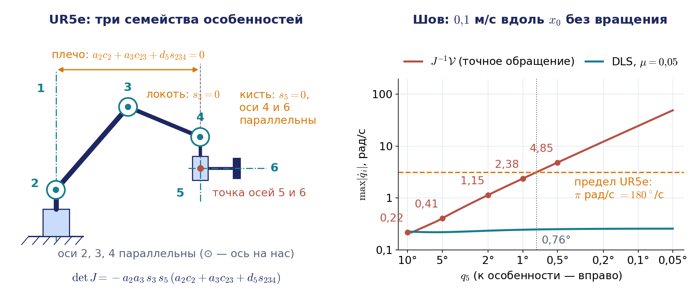

### Кейс: линейный шов через кистевую особенность

Посмотрим, как кистевая особенность проявляется в реальной работе. Робот ведёт сварочную горелку или дозатор герметика по прямому шву с постоянной ориентацией инструмента, и траектория проходит вблизи конфигурации с $q_5=0$. Возьмём UR5e в конфигурации раздела 3.3, но с малым $q_5$, и потребуем скорость 0,1 м/с вдоль оси $x_0$ без вращения. При $q_5=2^\circ$ решение $J^{-1}\boldsymbol{\mathcal V}$ требует $\dot q_4\approx1{,}15$ и $\dot q_6\approx-1{,}00$ рад/с, при $q_5=1^\circ$ — $2{,}38$ и $-1{,}99$, при $q_5=0{,}5^\circ$ — $4{,}85$ и $-3{,}98$ рад/с. Четвёртое и шестое сочленения вращаются навстречу друг другу, а их скорости растут примерно как $1/\sin q_5$. Паспортный предел скорости сочленений UR5e равен $180^\circ$/с, то есть $\pi$ рад/с; при 0,1 м/с он нарушается ближе $0{,}76^\circ$ к особенности, а при 0,5 м/с — уже ближе $3{,}5^\circ$. Контроллер в такой ситуации либо срывает скорость инструмента, либо останавливает движение с сообщением об ошибке. Как ведут себя на таком шве точное обращение, обрезание и масштабирование скоростей и демпфирование, показывает анимация на рис. 3.21 в разделе 3.12.

Что делает технолог. Первое — немного наклонить инструмент относительно шва (на $10$–$15^\circ$, если технология это допускает): ориентация меняется, и траектория уходит от $q_5=0$. Второе — переставить деталь или позиционер, чтобы шов попал в другую часть рабочей зоны. Третье — пройти опасный участок движением в координатах сочленений, где обращать якобиан не нужно, а затем вернуться к линейному движению. Четвёртое — включить режим, в котором контроллеру разрешено немного отклонить ориентацию инструмента при проходе кистевой особенности (такие режимы есть у промышленных контроллеров, например инструкция `SingArea` в языке RAPID контроллеров ABB). Все четыре решения принимаются на этапе планирования, и для этого нужно заранее знать, где лежат особые конфигурации, — именно то, что дают формулы этого раздела. С этим сюжетом связана и задача ДЗ2, где ось инструмента перпендикулярна плоскости обводимой окружности.

## 3.7. Псевдообратная матрица, сингулярное разложение и избыточность

### Метод наименьших квадратов

Аналитическое решение существует не для всех схем, а в особых точках и у избыточных манипуляторов точного решения может не быть или оно не единственно. В таких случаях естественно искать приближённое решение, наилучшее в каком-то разумном смысле. Самый распространённый критерий — метод наименьших квадратов: ищется вектор $\dot{\mathbf{q}}$, минимизирующий квадрат нормы невязки

$$
f(\dot{\mathbf{q}})=\lVert J\dot{\mathbf{q}}-\boldsymbol{\mathcal V}\rVert^2=(J\dot{\mathbf{q}}-\boldsymbol{\mathcal V})^{\mathrm T}(J\dot{\mathbf{q}}-\boldsymbol{\mathcal V}).
$$

Приравнивая нулю градиент этой функции, равный $2J^{\mathrm T}(J\dot{\mathbf{q}}-\boldsymbol{\mathcal V})$, получаем нормальное уравнение (3.114):

$$
J^{\mathrm T}J\,\dot{\mathbf{q}}=J^{\mathrm T}\boldsymbol{\mathcal V}.
$$

Матрица $J^{\mathrm T}J$ имеет размер $N\times N$ и невырождена тогда и только тогда, когда столбцы матрицы Якоби линейно независимы, то есть $\operatorname{rank}J=N$. Это возможно лишь при $N\le6$ — для неизбыточного манипулятора вне особых точек. В этом случае решение единственно и равно $\dot{\mathbf{q}}=J^{+}\boldsymbol{\mathcal V}$, где матрица (3.117)

$$
J^{+}=(J^{\mathrm T}J)^{-1}J^{\mathrm T}
$$

называется **левой псевдообратной** по отношению к $J$. Если существует обычная обратная матрица, то псевдообратная с ней совпадает. У избыточного манипулятора ($N>6$) матрица $J^{\mathrm T}J$ вырождена всегда: её ранг не превосходит ранга $J$, то есть шести. Если при этом независимы строки, $\operatorname{rank}J=6$, система совместна при любой правой части, и из бесконечного множества точных решений естественно выбрать решение наименьшей нормы. Его даёт **правая псевдообратная** матрица

$$
J^{+}=J^{\mathrm T}(JJ^{\mathrm T})^{-1}.
$$

**Примечание о расхождении с книгой.** В учебнике формула (3.117) сформулирована при условии максимальности ранга, формула (3.118). Для «широкой» матрицы избыточного манипулятора этого недостаточно: там нужна правая форма.

Остаётся случай вырожденной квадратной матрицы. Казалось бы, именно для него и придумана псевдообратная матрица, но $\det(J^{\mathrm T}J)=(\det J)^2$, так что $J^{\mathrm T}J$ вырождается одновременно с $J$, и ни одна из двух формул неприменима. Нормальное уравнение имеет бесконечно много решений, и из них нужно выбрать одно. Общий ответ на все случаи сразу даёт сингулярное разложение.

### Сингулярное разложение — общий язык

Любую матрицу $J$ размера $m\times N$ можно представить в виде **сингулярного разложения** (SVD, singular value decomposition)

$$
J=U\Sigma V^{\mathrm T}=\sum_{i=1}^{r}\sigma_i\,\hat{\mathbf{u}}_i\hat{\mathbf{v}}_i^{\mathrm T},
$$

где $U$ и $V$ — ортогональные матрицы размеров $m\times m$ и $N\times N$ со столбцами $\hat{\mathbf{u}}_i$ и $\hat{\mathbf{v}}_i$, а $\Sigma$ — прямоугольная диагональная матрица с неотрицательными числами $\sigma_1\ge\sigma_2\ge\dots\ge\sigma_r>0$ на диагонали; $r=\operatorname{rank}J$. Числа $\sigma_i$ называют **сингулярными числами**; это корни из ненулевых собственных чисел матрицы $J^{\mathrm T}J$. Крышка над буквами отличает единичные векторы $\hat{\mathbf{u}}_i$, $\hat{\mathbf{v}}_i$ от скоростей.

Смысл разложения для робота прямой (рис. 3.12). Столбцы $\hat{\mathbf{v}}_i$ — это ортогональные направления в пространстве скоростей сочленений, столбцы $\hat{\mathbf{u}}_i$ — ортогональные направления в пространстве скоростей схвата, а $\sigma_i$ — коэффициенты передачи: движение сочленений вдоль $\hat{\mathbf{v}}_i$ с единичной нормой даёт движение схвата вдоль $\hat{\mathbf{u}}_i$ со скоростью $\sigma_i$. Наибольшее и наименьшее сингулярные числа обозначим $\sigma_{\max}$ и $\sigma_{\min}$. Последние $N-r$ столбцов матрицы $V$ образуют базис ядра $J$ — движений сочленений, которые не двигают схват; первые $r$ столбцов $U$ — базис образа $J$, то есть всех достижимых скоростей схвата. Особая конфигурация — это конфигурация, где одно из сингулярных чисел обращается в нуль, а близость к ней измеряет $\sigma_{\min}$. Именно через SVD псевдообратную матрицу вычисляют функция `numpy.linalg.pinv` и решатель обратной задачи о скорости `ChainIkSolverVel_pinv` библиотеки KDL.

Через разложение псевдообратная матрица записывается одной формулой для любого случая:

$$
J^{+}=\sum_{i=1}^{r}\frac{1}{\sigma_i}\,\hat{\mathbf{v}}_i\hat{\mathbf{u}}_i^{\mathrm T}.
$$

Решение $\dot{\mathbf{q}}=J^{+}\boldsymbol{\mathcal V}$ раскладывает командную скорость по направлениям $\hat{\mathbf{u}}_i$, делит каждую составляющую на коэффициент передачи и собирает скорости сочленений из направлений $\hat{\mathbf{v}}_i$; составляющие командной скорости вне образа $J$ просто отбрасываются. Такое решение обладает двумя свойствами сразу: оно минимизирует невязку, а среди всех векторов, минимизирующих невязку, имеет наименьшую норму. При $\operatorname{rank}J=N$ формула совпадает с левой псевдообратной, при $\operatorname{rank}J=m<N$ — с правой. Псевдообратная матрица удовлетворяет условиям $JJ^{+}J=J$, $J^{+}JJ^{+}=J^{+}$, а матрицы $JJ^{+}$ и $J^{+}J$ симметричны и идемпотентны, то есть являются проекторами — на образ $J$ и на дополнение к её ядру. Из той же формулы сразу следует оценка, обещанная в разделе 3.5: $\lVert J^{+}\boldsymbol{\mathcal V}\rVert\le\lVert\boldsymbol{\mathcal V}\rVert/\sigma_{\min}$.

Нужно помнить и об особенности, связанной с тем, что матрица Якоби функциональная: её ранг в разных точках пространства конфигураций разный, и псевдообратная матрица разрывна в особой точке. При приближении к особенности слагаемое $\hat{\mathbf{v}}_r\hat{\mathbf{u}}_r^{\mathrm T}/\sigma_r$ неограниченно растёт, а в самой особой точке оно исчезает. Например, у UR5e при $q_5=0{,}5^\circ$ решение $J^{+}\boldsymbol{\mathcal V}$ для скорости 0,1 м/с из кейса раздела 3.6 имеет норму 6,39 рад/с, а при $q_5=0$ — всего 0,35 рад/с, но с невязкой 22,5 % командной скорости.

Важный частный случай — ранг, равный единице. Тогда $J=\sigma_1\hat{\mathbf{u}}_1\hat{\mathbf{v}}_1^{\mathrm T}$ и $J^{+}=\hat{\mathbf{v}}_1\hat{\mathbf{u}}_1^{\mathrm T}/\sigma_1=J^{\mathrm T}/\sigma_1^2$: псевдообратная матрица пропорциональна транспонированной. Пропорциональность $J^{+}\propto J^{\mathrm T}$ имеет место тогда и только тогда, когда все ненулевые сингулярные числа равны; при ранге больше единицы в особых точках её, как правило, нет (у PUMA при $q_5=0$ ранг равен пяти, и никакое кратное $J^{\mathrm T}$ не приближает $J^{+}$). Поэтому метод транспонированного якобиана из лекции 2 обосновывается не этим совпадением, а тем, что $J^{\mathrm T}\mathbf{e}$ — антиградиент функции $\frac12\lVert\mathbf{e}\rVert^2$, и это верно при любом ранге.

**Примечание о расхождении с книгой.** В учебнике псевдообратная матрица строится через скелетное разложение $J=LG$ (в книге $J=LR$; курс заменил букву, потому что $R$ — матрица поворота), где $L$ — матрица $m\times r$, а $G$ — матрица $r\times N$, обе ранга $r$. Формула Мура — Пенроуза (3.120) имеет вид $J^{+}=G^{\mathrm T}(GG^{\mathrm T})^{-1}(L^{\mathrm T}L)^{-1}L^{\mathrm T}$ и даёт ту же матрицу, что и SVD; курс пользуется SVD, потому что оно одновременно даёт ранг, направления, меры близости к особенности и численно устойчиво.

#### Пример 3.4. Псевдообратная матрица двухзвенника в особой точке

Построим псевдообратную матрицу для блока $J_v$ двухзвенника в вытянутой конфигурации $q_2=0$. Столбцы пропорциональны, и разложение пишется сразу:

$$
J_v(q_1,0)=\begin{pmatrix}-2as_1&-as_1\\ 2ac_1&ac_1\end{pmatrix}=a\sqrt5\begin{pmatrix}-s_1\\ c_1\end{pmatrix}\frac{1}{\sqrt5}\begin{pmatrix}2&1\end{pmatrix},
$$

то есть $\sigma_1=a\sqrt5$, $\hat{\mathbf{u}}_1=(-s_1,c_1)^{\mathrm T}$ — перпендикуляр к руке, $\hat{\mathbf{v}}_1=(2,1)^{\mathrm T}/\sqrt5$. По формуле для ранга один

$$
J_v^{+}=\frac{\hat{\mathbf{v}}_1\hat{\mathbf{u}}_1^{\mathrm T}}{a\sqrt5}=\frac{1}{5a^2}\begin{pmatrix}-2as_1&2ac_1\\ -as_1&ac_1\end{pmatrix}=\frac{J_v^{\mathrm T}}{5a^2}.
$$

Для сложенной руки ($q_2=\pi$) $\sigma_1=a$, и те же выкладки дают $J_v^{+}=J_v^{\mathrm T}/a^2$. Равенство $J^{+}=J^{\mathrm T}/\sigma_1^2$ в особых точках ранга один — формула (3.121).

**Примечание о расхождении с книгой.** В учебнике (с. 162) множитель напечатан как $1/5$, без $a^2$; это опечатка, в чём легко убедиться проверкой размерности.

Посмотрим, что даёт полученная матрица. Умножая её на командную скорость, находим $\dot q_1=2v_\perp/(5a)$ и $\dot q_2=v_\perp/(5a)$, где $v_\perp$ — проекция командной скорости на перпендикуляр к руке. Составляющая командной скорости вдоль руки, которую реализовать невозможно, просто отбрасывается — это и есть минимум невязки. А из семейства решений примера 3.2 выбрано то, в котором скорости распределены между сочленениями в пропорции 2:1, по направлению $\hat{\mathbf{v}}_1$, — оно имеет наименьшую норму. В учебнике разобран и более громоздкий пример для первых трёх звеньев манипулятора PUMA-600, где ранг в особой точке равен двум, а вычисления удаётся упростить, выделив в матрице $L$ ортогональный множитель; результат — формула (3.132).

### Демпфирование

Вблизи особых точек даже псевдообратная матрица даёт очень большие скорости, поскольку малые сингулярные числа стоят в знаменателе. На практике применяют **демпфированное псевдообращение** (DLS, damped least squares):

$$
J_\mu^{+}=J^{\mathrm T}(JJ^{\mathrm T}+\mu^2E)^{-1}=\sum_{i}\frac{\sigma_i}{\sigma_i^2+\mu^2}\,\hat{\mathbf{v}}_i\hat{\mathbf{u}}_i^{\mathrm T}
$$

с малым параметром $\mu$. Оно минимизирует сумму $\lVert J\dot{\mathbf{q}}-\boldsymbol{\mathcal V}\rVert^2+\mu^2\lVert\dot{\mathbf{q}}\rVert^2$, то есть жертвует точностью отработки скорости схвата ради ограниченности скоростей сочленений. Вдали от особенности, при $\sigma_i\gg\mu$, множитель $\sigma_i/(\sigma_i^2+\mu^2)$ почти равен $1/\sigma_i$, а вблизи неё он не растёт неограниченно: наибольшее значение $1/(2\mu)$ достигается при $\sigma_i=\mu$. У UR5e из кейса раздела 3.6 при $q_5=1^\circ$ точное решение имеет норму 3,14 рад/с и нулевую невязку, а DLS с $\mu=0{,}05$ — норму 0,34 рад/с, но схват отрабатывает команду с невязкой 21 %. На практике коэффициент $\mu$ делают переменным: нулевым вдали от особенности и растущим по мере уменьшения $\sigma_{\min}$ или меры манипулятивности (такую схему предложили Накамура и Ханафуса в 1986 году). С демпфированием мы уже встречались в численных методах решения обратной задачи о положении (лекция 2), а в лекции 4 оно станет частью закона управления.

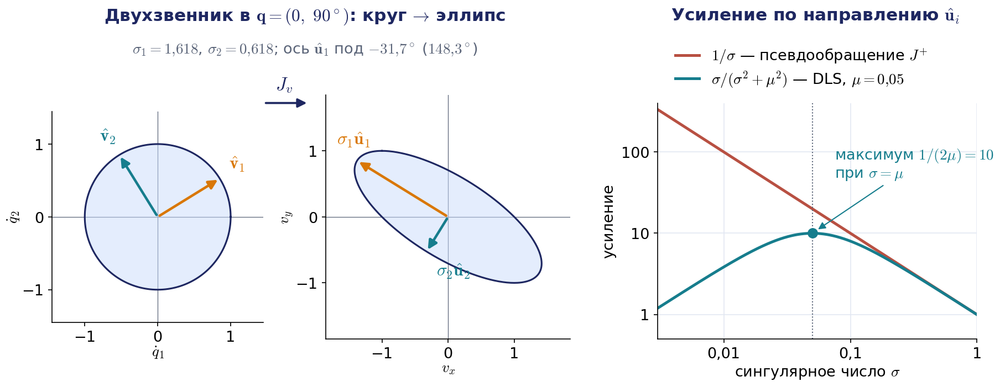

### Избыточные манипуляторы

Для избыточного манипулятора вне особых точек система $J\dot{\mathbf{q}}=\boldsymbol{\mathcal V}$ совместна при любой правой части, но решений бесконечно много. Общее решение имеет вид

$$
\dot{\mathbf{q}}=J^{+}\boldsymbol{\mathcal V}+(E-J^{+}J)\,\boldsymbol{\xi},
$$

где $\boldsymbol{\xi}$ — произвольный вектор. Первое слагаемое — решение с минимальной нормой скоростей. Матрица $E-J^{+}J$ проецирует вектор $\boldsymbol{\xi}$ на ядро матрицы Якоби, поэтому второе слагаемое не меняет скорость схвата: $J(E-J^{+}J)=J-JJ^{+}J=0$. Оно описывает **самодвижение** — движение звеньев при неподвижном схвате (рис. 3.13). Например, у семизвенного манипулятора в обычной конфигурации ранг матрицы Якоби равен шести, ядро одномерно, и самодвижение выглядит как поворот «локтя» вокруг линии, соединяющей плечо и запястье.

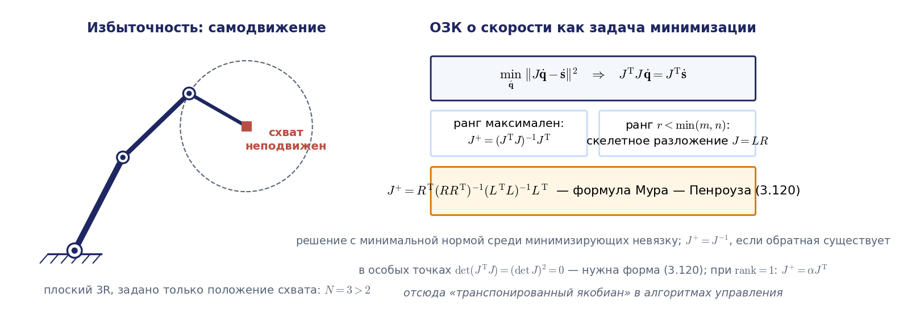

Анимация на рис. 3.14 показывает самодвижение плоского трёхзвенника одновременно в двух пространствах. В пространстве сочленений $(q_1,q_2,q_3)$ все конфигурации с одним и тем же положением схвата образуют кривую, и проекция вектора $\boldsymbol{\xi}$ на ядро матрицы Якоби ведёт конфигурацию вдоль этой кривой. В пространстве задачи в это время «плывёт» локоть, а схват остаётся в точке $\mathbf{p}_0$.

Анимация целиком: [l03_self_motion_redundant_3r.mp4](../06_Анимации/l03_self_motion_redundant_3r.mp4), 78 с.

Вектор $\boldsymbol{\xi}$ используют для решения вторичной задачи: обхода препятствий, ухода от пределов сочленений или от особых конфигураций. Общий рецепт — **проекция градиента** (Льежуа, 1977). Выберем скалярный критерий $g(\mathbf{q})$, который хотим увеличить, и положим $\boldsymbol{\xi}=k\nabla g$ с положительным коэффициентом $k$. Вдоль самодвижения критерий растёт со скоростью $\dot g=\nabla g^{\mathrm T}\dot{\mathbf{q}}=k\,\nabla g^{\mathrm T}(E-J^{+}J)\nabla g\ge0$ при неподвижном схвате, потому что проектор симметричен и идемпотентен. Типичные критерии — удалённость от пределов сочленений

$$
g(\mathbf{q})=-\sum_{i=1}^{N}\Big(\frac{q_i-\bar q_i}{\Delta q_i}\Big)^2,
$$

где $\bar q_i$ — середина диапазона, а $\Delta q_i$ — его полуширина, и мера манипулятивности $w(\mathbf{q})$ из раздела 3.8, которая отводит робота от особых конфигураций.

#### Пример 3.4а. Уход от предела сочленения у плоского трёхзвенника

Плоский трёхзвенник с длинами звеньев $1{,}0$; $0{,}8$; $0{,}6$ м избыточен для задачи позиционирования схвата на плоскости: два уравнения, три неизвестных, ядро одномерно. Пусть пределы сочленений $\lvert q_i\rvert\le120^\circ$, а текущая конфигурация $\mathbf{q}=(30^\circ,20^\circ,100^\circ)$, так что третье сочленение близко к пределу. Градиент критерия удалённости от пределов равен $\nabla g=-2\mathbf{q}/\Delta q^2=(-0{,}239;\ -0{,}159;\ -0{,}796)$, его проекция на ядро при $k=1$ даёт $\dot{\mathbf{q}}=(-0{,}151;\ 0{,}317;\ -0{,}253)$ рад/с. Проверка: $J\dot{\mathbf{q}}=0$ с точностью до ошибок округления, а $\dot g=0{,}187>0$. Если интегрировать это самодвижение 5 с с $k=3$ и добавить коррекцию по положению схвата (о ней ниже), конфигурация переходит в $(7{,}4^\circ;\ 69{,}0^\circ;\ 45{,}9^\circ)$: третье сочленение ушло от предела, а схват остался в точке $(0{,}861;\ 1{,}413)$ м с отклонением $2\cdot10^{-8}$ м. Этот пример показан во второй части анимации на рис. 3.14: точка в пространстве сочленений движется по кривой самодвижения к центру диапазонов, а полоска $q_3$ отходит от предела.

Последнее замечание существенно. Если просто интегрировать формулу общего решения шагами по времени, схват медленно уплывает: ядро матрицы Якоби меняется вместе с конфигурацией, и явный метод Эйлера накапливает ошибку, пропорциональную шагу. В анимации на рис. 3.14 это видно численно: при шаге 0,05 с схват без коррекции уплывает за 3 с на 5 мм (дальше уход почти не растёт), а с коррекцией $K(\mathbf{p}_0-\mathbf{p})$, $K=5$ с$^{-1}$, отклонение не превышает 0,57 мм и гаснет, когда самодвижение заканчивается. Реальные контроллеры поэтому всегда добавляют обратную связь по положению: $\dot{\mathbf{q}}=J^{+}\big(\boldsymbol{\mathcal V}^{\ast}+K\mathbf{e}\big)+(E-J^{+}J)\boldsymbol{\xi}$, где $\mathbf{e}$ — ошибка положения схвата. Такой закон подробно разбирается в лекции 4; там же обратная задача о скорости ставится как задача квадратичного программирования с ограничениями на скорости и положения сочленений, которую решают современные библиотеки. Без ограничений эта задача даёт в точности решение DLS.

### Две задачи с приоритетами

Проекция градиента улучшает критерий «насколько получится». Бывает, однако, что и вторичная задача задана скоростью: например, локоть семизвенного робота должен отходить от препятствия с заданной скоростью $\dot{\mathbf{x}}_2=J_2\dot{\mathbf{q}}$, где $J_2$ — матрица Якоби точки локтя. Тогда вектор $\boldsymbol{\xi}$ выбирают так, чтобы вторичная задача выполнялась как можно точнее, но не мешала главной. Обозначим главную задачу $J_1\dot{\mathbf{q}}=\dot{\mathbf{x}}_1$ (скорость схвата), а проектор на ядро её матрицы — $P_1=E-J_1^{+}J_1$. Подставим общее решение $\dot{\mathbf{q}}=J_1^{+}\dot{\mathbf{x}}_1+P_1\boldsymbol{\xi}$ во вторичную задачу и получим для $\boldsymbol{\xi}$ снова линейную систему $J_2P_1\boldsymbol{\xi}=\dot{\mathbf{x}}_2-J_2J_1^{+}\dot{\mathbf{x}}_1$. Её решение по методу наименьших квадратов даёт формулу Накамуры, Ханафусы и Йошикавы (1987):

$$
\dot{\mathbf{q}}=J_1^{+}\dot{\mathbf{x}}_1+(J_2P_1)^{+}\big(\dot{\mathbf{x}}_2-J_2J_1^{+}\dot{\mathbf{x}}_1\big).
$$

Множитель $P_1$ перед вторым слагаемым опущен, потому что $P_1(J_2P_1)^{+}=(J_2P_1)^{+}$: столбцы матрицы $(J_2P_1)^{+}$ лежат в образе $(J_2P_1)^{\mathrm T}=P_1J_2^{\mathrm T}$, то есть в ядре $J_1$. Поэтому главная задача выполняется точно, а вторичная — настолько, насколько позволяют оставшиеся степени свободы; если их не хватает, невязка вторичной задачи минимальна. У семизвенника ядро $J_1$ одномерно, и из трёх составляющих скорости локтя отрабатывается только проекция на единственное направление самодвижения. Матрица $J_2P_1$ вырождается в конфигурациях, где самодвижение перестаёт влиять на вторичную задачу (такие конфигурации называют алгоритмическими особенностями); при её псевдообращении нужен порог для малых сингулярных чисел или то же демпфирование, что и выше.

## 3.8. Распределение допустимых скоростей в рабочем пространстве

### Постановка вопроса

Перейдём к § 3.6 учебника — кинематическим свойствам манипулятора. Вопрос ставится практический. При планировании операции нужно знать, какие скорости объекта манипулирования достижимы в каждой точке рабочего пространства. Это зависит и от кинематической схемы, и от возможностей приводов. Пусть скорости сочленений ограничены по модулю — условие (3.180):

$$
\lvert\dot q_i\rvert\le C_i,\qquad i=1,\dots,N,
$$

где $C_i=\dot q_i^{\max}$ — предел скорости $i$-го сочленения (краткое имя оставлено из учебника). Эти неравенства задают в пространстве скоростей сочленений прямоугольный параллелепипед $\mathcal{P}$. Линейная скорость объекта в схвате связана со скоростями сочленений соотношением (3.181) $\mathbf{v}_N=J_v(\mathbf{q})\dot{\mathbf{q}}$, которое отображает параллелепипед в некоторую область $\Gamma_v(\mathbf{q})$ трёхмерного пространства скоростей. Совокупность областей $\Gamma_v(\mathbf{q})$ для всех точек рабочей зоны называют **распределением допустимых скоростей**. Авторы предлагают три уровня описания этой области — от грубого к точному: сферу, эллипсоид и многогранник.

### Сфера допустимых скоростей

Квадрат нормы скорости схвата — квадратичная форма относительно скоростей сочленений — формула (3.182):

$$
\lVert\mathbf{v}_N\rVert^2=\dot{\mathbf{q}}^{\mathrm T}J_v^{\mathrm T}J_v\,\dot{\mathbf{q}}.
$$

Матрица $J_v^{\mathrm T}J_v$ симметрическая и неотрицательно определённая; её наибольшее и наименьшее собственные числа — это квадраты наибольшего и наименьшего сингулярных чисел, $\sigma_{\max}^2(\mathbf{q})$ и $\sigma_{\min}^2(\mathbf{q})$, блока $J_v$. По известному свойству квадратичных форм справедливо неравенство (3.183):

$$
\sigma_{\min}^2(\mathbf{q})\lVert\dot{\mathbf{q}}\rVert^2\le\lVert\mathbf{v}_N\rVert^2\le\sigma_{\max}^2(\mathbf{q})\lVert\dot{\mathbf{q}}\rVert^2.
$$

Норма вектора скоростей сочленений не превосходит величины $C=\sqrt{\sum C_i^2}$ — это длина полудиагонали параллелепипеда ограничений. Отсюда получаем оценку сверху (3.184):

$$
\lVert\mathbf{v}_N(\mathbf{q})\rVert\le\sigma_{\max}(\mathbf{q})\,C.
$$

Геометрически это сфера, радиус которой зависит от конфигурации. Оценка сверху справедлива в любой конфигурации, в том числе в особой. Однако в особых точках $\sigma_{\min}=0$, и сфера перестаёт отражать главное: по некоторым направлениям скорость схвата вообще равна нулю. Теряет смысл в особых точках нижняя оценка, а не верхняя.

**Примечание о расхождении с книгой.** В учебнике оценки записаны через наибольшее и наименьшее собственные числа $\lambda^{\ast}$, $\lambda_{\ast}$ матрицы $J_v^{\mathrm T}J_v$; это $\sigma_{\max}^2$ и $\sigma_{\min}^2$. Курс пишет сингулярные числа, потому что буква $\lambda$ закреплена за параметром пути (лекция 4), а сингулярные числа нужны и для эллипсоида, и для псевдообратной матрицы.

#### Пример 3.5. Сферы допустимых скоростей для двухзвенника

Пусть длины звеньев $l_1=l_2=1$ м, а ограничения скоростей $C_1=0{,}1$ рад/с и $C_2=0{,}5$ рад/с, так что $C=\sqrt{0{,}01+0{,}25}\approx0{,}51$ рад/с. Пределы по углам не заданы, поэтому рабочая зона — круг радиуса 2 м. Перемножая блок $J_v$ на его транспонированный, получаем

$$
J_v^{\mathrm T}J_v=\begin{pmatrix}2(1+c_2)&1+c_2\\ 1+c_2&1\end{pmatrix},
$$

и характеристическое уравнение $\sigma^4-(3+2c_2)\sigma^2+1-c_2^2=0$ даёт

$$
\sigma_{\max}^2,\ \sigma_{\min}^2=\frac12\Big(3+2c_2\pm\sqrt{5+12c_2+8c_2^2}\Big).
$$

Сингулярные числа не зависят от $q_1$ — это следствие симметрии: поворот всей руки вокруг основания лишь поворачивает картину скоростей. Поэтому достаточно положить $q_1=0$ и менять $q_2$. Радиусы сфер $\sigma_{\max}C$ приведены в таблице.

| Угол $q_2$ | $\sigma_{\max}^2$, м² | $\sigma_{\max}$, м | Радиус сферы, м/с |
|---|---|---|---|
| $180^\circ$ | 1,00 | 1,00 | 0,51 |
| $135^\circ$ | 1,15 | 1,07 | 0,55 |
| $90^\circ$ | 2,62 | 1,62 | 0,83 |
| $45^\circ$ | 4,30 | 2,07 | 1,06 |
| $0^\circ$ | 5,00 | 2,24 | 1,14 |

Радиус растёт от сложенной руки к вытянутой (рис. 3.15, слева). При $q_2=180^\circ$ и $q_2=0^\circ$ матрица вырождена ($\sigma_{\min}=0$): верхняя оценка здесь по-прежнему верна (у вытянутой руки точный максимум скорости равен 0,70 м/с при радиусе сферы 1,14 м/с), но она скрывает, что вдоль руки схват двигаться не может вовсе.

**Примечание о расхождении с книгой.** В учебнике (с. 184–185 и рис. 3.7 книги) приведены радиусы 0,51; 0,8; 1,33; 2,19; 2,55. Значения 1,33; 2,19; 2,55 получены умножением $C$ на квадрат сингулярного числа, а не на само число, — в формуле для оценки пропущен внешний квадратный корень. Значение 0,8 этим не объясняется (такое умножение дало бы 0,59), по-видимому, это отдельная опечатка. Правильные значения указаны в таблице.

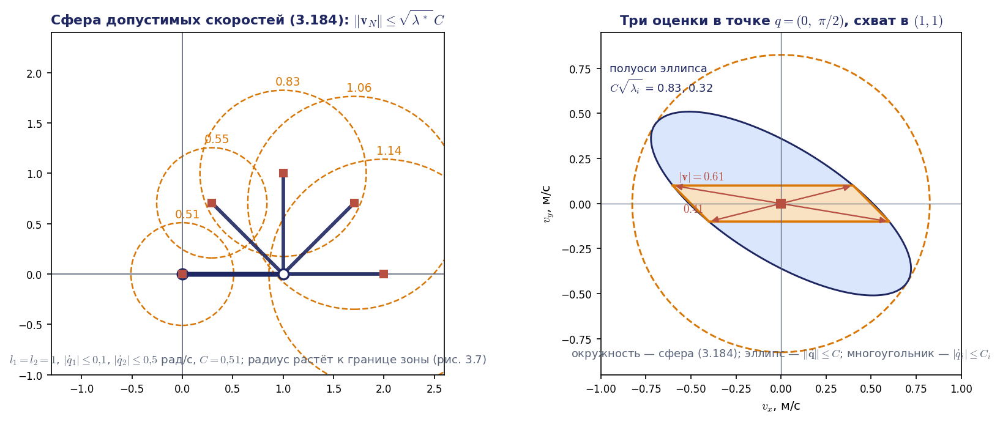

Недостаток оценки очевиден: она даёт величину максимальной скорости, но ничего не говорит о направлении. Вытянутая рука формально «самая быстрая», однако двигаться схват может только перпендикулярно руке. Для планирования траекторий этого мало.

### Эллипсоид допустимых скоростей

Предположим, что ограничена норма вектора скоростей сочленений, $\lVert\dot{\mathbf{q}}\rVert\le C$. Образ шара радиуса $C$ при линейном отображении $J_v$ — **эллипсоид допустимых скоростей**, и сингулярное разложение описывает его сразу: точки шара $C\hat{\mathbf{v}}_i$ переходят в $C\sigma_i\hat{\mathbf{u}}_i$, поэтому оси эллипсоида направлены вдоль векторов $\hat{\mathbf{u}}_i$, а полуоси равны $\sigma_iC$ — формула (3.186). Наибольшая полуось совпадает с радиусом сферы, и эллипсоид вписан в неё. Если матрица $J_v$ квадратная и невырожденная, тот же эллипсоид можно записать неравенством (3.185):

$$
\mathbf{v}_N^{\mathrm T}\,(J_v^{-1})^{\mathrm T}J_v^{-1}\,\mathbf{v}_N\le C^2.
$$

В особой точке одна из полуосей обращается в нуль, и эллипсоид вырождается: для двухзвенника — в отрезок, перпендикулярный руке. Достоинство эллипсоида в том, что он показывает направления, в которых манипулятор движется быстрее и медленнее всего. Но это верно только при ограничении $\lVert\dot{\mathbf{q}}\rVert\le C$, то есть когда пределы всех сочленений одинаковы. При покомпонентных пределах с разными $C_i$ направления правильно показывает **взвешенный эллипсоид** — образ единичного шара при отображении $J_v\operatorname{diag}(C_1,\dots,C_N)$. Он получается, если положить $\dot{\mathbf{q}}=\operatorname{diag}(C_i)\,\mathbf{u}$ с $\lVert\mathbf{u}\rVert\le1$; такие скорости заведомо удовлетворяют всем пределам, поэтому взвешенный эллипсоид вписан в многогранник допустимых скоростей и даёт гарантированную оценку снизу, а увеличенный в $\sqrt N$ раз — описан вокруг него.

### Многогранник допустимых скоростей

Самое точное описание получается прямым анализом отображения $\mathbf{v}_N=J_v\dot{\mathbf{q}}$. Ограничения (3.180) задают параллелепипед, отображение линейно, а образ выпуклого многогранника при линейном отображении — снова выпуклый многогранник, вершины которого находятся среди образов вершин исходного. Поэтому область $\Gamma_v$ — **многогранник допустимых скоростей**, а в плоском случае — многоугольник. Построить его просто: нужно перебрать вершины параллелепипеда, то есть все сочетания знаков $\dot q_i=\pm C_i$, умножить каждую на $J_v$ и взять выпуклую оболочку. В отличие от сферы и невзвешенного эллипсоида, многогранник описывает именно заданные покомпонентные ограничения и потому даёт гарантированные значения; сфера и эллипсоид их завышают, поскольку шар радиуса $C$ описан вокруг параллелепипеда ограничений. Многогранники скоростей и сил — не историческая деталь: их вычисление в реальном времени стало практичным, и сегодня есть открытые библиотеки для этого, например pycapacity (2023).

#### Пример 3.6. Сфера, эллипс и многоугольник в одной точке

Возьмём манипулятор из примера 3.5 в конфигурации $q_1=0$, $q_2=\pi/2$: первое звено направлено вдоль оси $x$, второе — вдоль оси $y$, схват находится в точке $(1;1)$. Матрица Якоби и уравнения для скоростей здесь очень просты:

$$
J_v=\begin{pmatrix}-1&-1\\ 1&0\end{pmatrix},\qquad v_x=-(\dot q_1+\dot q_2),\qquad v_y=\dot q_1.
$$

Второе, самое быстрое, сочленение двигает схват только вдоль оси $x$, а скорость вдоль оси $y$ создаёт только первое, медленное.

**Примечание о расхождении с книгой.** В учебнике эти соотношения записаны с другими знаками, что не влияет на форму области, симметричной относительно начала координат.

Сингулярные числа равны $\sigma_{\max}=(1+\sqrt5)/2\approx1{,}618$ и $\sigma_{\min}=(\sqrt5-1)/2\approx0{,}618$ м. Радиус сферы равен $1{,}618\cdot0{,}51\approx0{,}83$ м/с. Полуоси эллипса равны $0{,}83$ и $0{,}618\cdot0{,}51\approx0{,}32$ м/с, причём большая ось наклонена к оси $x$ примерно на $-32^\circ$.

Многоугольник строим по четырём вершинам прямоугольника ограничений. Сочетаниям $(\dot q_1,\dot q_2)=(\pm0{,}1;\pm0{,}5)$ с одинаковыми знаками отвечают вершины $(\mp0{,}6;\pm0{,}1)$, сочетаниям с разными знаками — вершины $(\pm0{,}4;\pm0{,}1)$. Получается параллелограмм со сторонами 1,0 и 0,28 и вершинами

$$
(\pm0{,}6;\ \mp0{,}1),\qquad (\pm0{,}4;\ \pm0{,}1).
$$

Расстояния от центра до вершин равны $\sqrt{0{,}6^2+0{,}1^2}\approx0{,}61$ и $\sqrt{0{,}4^2+0{,}1^2}\approx0{,}41$ м/с. Таким образом, наибольшая достижимая скорость составляет 0,61 м/с и направлена в вершину $(0{,}6;\ -0{,}1)$, под углом около $-9{,}5^\circ$ к оси $x$, а строго вдоль оси $y$ схват может двигаться не быстрее 0,1 м/с. Все области показаны на рис. 3.15 справа. Сфера завышает максимальную скорость примерно в 1,4 раза, а по сравнению с направлением на ближнюю вершину — вдвое.

**Примечание о расхождении с книгой.** В учебнике многоугольник назван ромбом, хотя это параллелограмм. В тексте книги минимальной названа скорость 0,41 «в направлении оси $Y$», а на рисунке книги подписано значение 0,1; верно второе, а 0,41 — это расстояние до ближней вершины.

Важнее другое: невзвешенный эллипс здесь указывает быстрое направление неверно. Его большая ось наклонена под $-32^\circ$, и движению вдоль неё отвечают скорости сочленений в пропорции $(0{,}85;\ 0{,}53)$, то есть в основном медленного первого сочленения. Многоугольник допускает вдоль этой оси лишь 0,19 м/с, а эллипс обещает 0,83 — в 4,3 раза больше. По разным направлениям отношение «эллипс к многоугольнику» меняется от 1,0 до 5,1. Взвешенный эллипс, образ единичного круга при отображении $J_v\operatorname{diag}(0{,}1;\ 0{,}5)$, имеет полуоси 0,51 и 0,098 м/с и большую ось под $-2{,}3^\circ$ — почти в направлении на дальнюю вершину. Он вписан в параллелограмм, а увеличенный в $\sqrt2$ раз описан вокруг него. Поэтому авторы и заканчивают многогранником: он дороже в вычислениях, особенно для пространственных схем, зато честен.

Анимация на рис. 3.16 показывает все четыре области как образы одного отображения $J_v$: точки круга и прямоугольника на плоскости скоростей сочленений переходят в точки эллипса и параллелограмма на плоскости скоростей схвата, а затем на ту же картинку накладываются сфера и взвешенный эллипс. Луч вдоль большой оси невзвешенного эллипса наглядно показывает его ошибку: эллипс обещает в этом направлении 0,825 м/с, а многоугольник допускает лишь 0,19 м/с. В последней части ролика рука меняет конфигурацию, как в примере 3.5: пределы скоростей сочленений остаются прежними, а фигуры справа растут и поворачиваются, и у сложенной и вытянутой руки сплющиваются в отрезок, перпендикулярный руке.

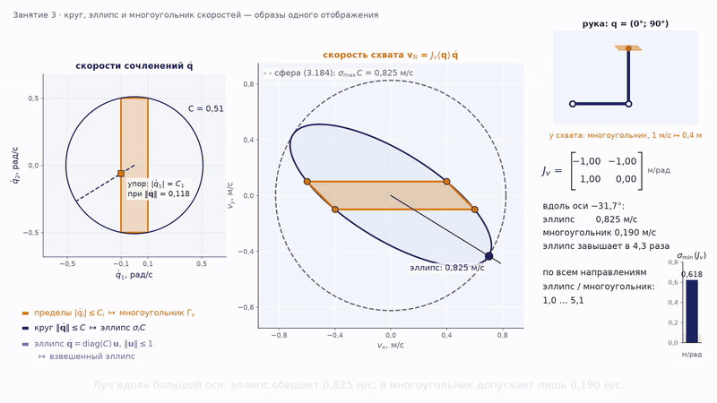

Анимация целиком: [l03_velocity_map_circle_ellipse_polygon.mp4](../06_Анимации/l03_velocity_map_circle_ellipse_polygon.mp4), 89 с.

### Мировые меры качества конфигурации

Сингулярные числа позволяют охарактеризовать конфигурацию одним числом, и в мировой литературе для этого используют три меры. **Мера манипулятивности Йошикавы**

$$
w(\mathbf{q})=\sqrt{\det\big(JJ^{\mathrm T}\big)}=\sigma_1\sigma_2\cdots\sigma_m
$$

пропорциональна объёму эллипсоида скоростей и обращается в нуль в особых точках; у квадратной матрицы $w=\lvert\det J\rvert$. **Число обусловленности** $\kappa(J)=\sigma_{\max}/\sigma_{\min}$ показывает, насколько эллипсоид вытянут, то есть насколько неравноправны направления; оно равно единице в **изотропной** конфигурации, где эллипсоид — шар, и стремится к бесконечности у особенности. Наконец, сама величина $\sigma_{\min}$ показывает наихудший коэффициент передачи. Две первые меры выбирают разные «лучшие» конфигурации (рис. 3.17). У двухзвенника с $l_1=l_2=1$ м мера $w=\lvert\sin q_2\rvert$ максимальна при $q_2=90^\circ$, где $\sigma=(1{,}618;\ 0{,}618)$ и $\kappa=2{,}618$, а наименьшее $\kappa=1{,}618$ достигается при $q_2\approx131{,}8^\circ$. Изотропной конфигурации у этого двухзвенника нет; она появляется при $l_2/l_1=1/\sqrt2$ и $q_2=135^\circ$, где оба сингулярных числа равны $0{,}707l_1$.

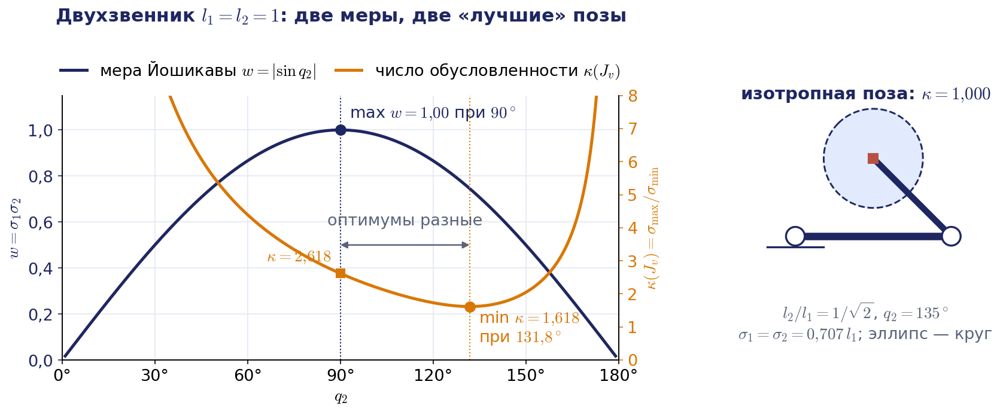

У пространственного манипулятора есть важная тонкость. Строки угловой скорости полной матрицы $6\times N$ безразмерны, строки линейной скорости имеют размерность длины, поэтому $\kappa(J)$, $\sigma_{\min}$ и $w$ полной матрицы зависят от выбора единиц. У UR5e в конфигурации раздела 3.3 $\kappa(J)=10{,}9$, если длины измерены в метрах, и 1872, если в миллиметрах; $\sigma_{\min}$ меняется с 0,186 до 0,461. Сравнивать такие числа между собой бессмысленно. Правильные приёмы — анализировать блоки отдельно (здесь $\kappa(J_v)=3{,}51$) или нормировать линейный блок характерной длиной, например вылетом робота: при делении на 0,85 м получается $\kappa=9{,}6$. Это замечание важно для ДЗ2 и для настройки программ, которые реагируют на близость к особенности по числу обусловленности.

**Примечание о расхождении с книгой.** Слово «манипулятивность» в курсе имеет три разных смысла. В лекции 2 манипулятивностью по направлению $\Omega_{\mathbf n}$ называлась доля зоны, где возможна заданная ориентация; в учебнике и в разделе 3.9 — относительная манипулятивность $k_v$, коэффициент передачи скорости; в мировой литературе (manipulability) — мера Йошикавы $w$. Это разные величины, и при чтении статей их нельзя путать.

## 3.9. Мобильность и относительная манипулятивность

### Мобильность

Учебник характеризует область допустимых скоростей одним числом иначе. **Мобильностью** манипулятора в данной конфигурации называют объём области $\Gamma_v$ — формула (3.187):

$$
\mathcal{M}(\mathbf{q})=\int_{\Gamma_v}d\mathbf{v}.
$$

В плоском случае это площадь многоугольника. Мобильность характеризует способность схвата развивать в данной точке различные по величине и направлению скорости поступательного движения. Приближённо её оценивают объёмом эллипсоида или сферы; в последнем случае получается формула (3.188): $\mathcal{M}\approx\frac43\pi\big(\sigma_{\max}C\big)^3$.

Для двухзвенника мобильность вычисляется точно. Линейное отображение изменяет площадь в $\lvert\det J_v\rvert$ раз, а площадь прямоугольника ограничений равна $4C_1C_2$, поэтому

$$
\mathcal{M}(\mathbf{q})=\lvert\det J_v\rvert\cdot4C_1C_2=l_1l_2\lvert\sin q_2\rvert\cdot4C_1C_2=0{,}2\,\lvert\sin q_2\rvert.
$$

Мобильность зависит только от $q_2$, а значит, только от расстояния схвата до основания. Линии постоянной мобильности — концентрические окружности (рис. 3.18, слева). Максимум, равный 0,2 м²/с², достигается при перпендикулярных звеньях, на окружности радиуса $\sqrt2$ м. На внешней границе рабочей зоны мобильность обращается в нуль, а при сложенной руке (в центре зоны, потому что звенья равны) — тоже. Множитель $\lvert\det J_v\rvert$ здесь совпадает с мерой Йошикавы $w=\sqrt{\det(J_vJ_v^{\mathrm T})}$: для любого механизма мобильность при одинаковых пределах приводов пропорциональна $w$, если область заменить эллипсоидом.

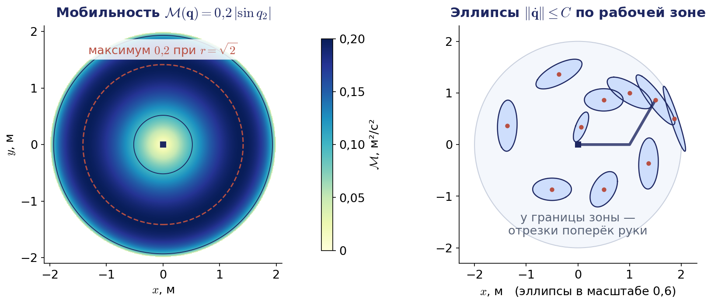

Справа на рис. 3.18 показаны эллипсы допустимых скоростей в разных точках зоны: в средней части они достаточно «полные», а у границ сплющиваются в отрезки, перпендикулярные руке. По таким картам технолог выбирает место в рабочей зоне для операции, требующей быстрых разнонаправленных движений.

### Мобильность по направлению

У интегральной мобильности тот же недостаток, что у сферы: она не говорит, можно ли быстро двигаться в нужном направлении. Поэтому вводят **мобильность по направлению** — наибольшую скорость, достижимую вдоль заданного единичного вектора $\mathbf{n}$. Проведём луч $\mathbf{v}_N=r\mathbf{n}$. Для эллипсоида величина $r$ находится из уравнения (3.189):

$$
r^2\,\mathbf{n}^{\mathrm T}(J_v^{-1})^{\mathrm T}J_v^{-1}\mathbf{n}=C^2,\qquad r=\frac{C}{\lVert J_v^{-1}\mathbf{n}\rVert}.
$$

Для многогранника ищут пересечение луча с его гранью. При квадратной невырожденной матрице это делается в одну строку: движению вдоль $\mathbf{n}$ со скоростью $r$ отвечают скорости сочленений $r\,J_v^{-1}\mathbf{n}$, и наибольшее допустимое $r$ определяется тем сочленением, которое первым выйдет на ограничение:

$$
r=\min_i\frac{C_i}{\lvert(J_v^{-1}\mathbf{n})_i\rvert}.
$$

Проверим на примере 3.6. Для направления вдоль оси $y$ имеем $J_v^{-1}\mathbf{n}=(1,-1)^{\mathrm T}$: оба сочленения должны двигаться с одинаковой по модулю скоростью, и ограничивает первое. Получаем $r=0{,}1$ м/с. Оценка по эллипсу даёт $0{,}51/\sqrt2\approx0{,}36$ м/с — завышение более чем втрое. Для направления вдоль оси $x$ получаем $J_v^{-1}\mathbf{n}=(0,-1)^{\mathrm T}$, работает только второе сочленение, и $r=0{,}5$ м/с. Анализ мобильности по направлению позволяет выбрать область рабочей зоны для операции, в которой скорость должна меняться преимущественно в заданном направлении. Именно эта величина отвечает на вопрос дополнительного пункта ДЗ2: если касательная $\mathbf{n}(s)$ к обводимой окружности известна, то время обхода не меньше интеграла длины дуги, делённой на $r(s)$. Формула выше выведена для квадратной матрицы $J_v$. В ДЗ2 обычно работает шестиосный робот с постоянной ориентацией инструмента, и его блок $J_v$ размера $3\times6$ обратной матрицы не имеет; вместо $J_v^{-1}\mathbf{n}$ берут $J^{-1}(\mathbf{0};\mathbf{n})$ — скорости сочленений, при которых схват движется вдоль $\mathbf{n}$ с единичной скоростью без поворота, так что $r(s)=\min_i C_i/\lvert(J^{-1}(\mathbf{0};\mathbf{n}(s)))_i\rvert$.

### Относительная манипулятивность

Ещё один показатель учебника — **относительная манипулятивность** (3.190):

$$
k_v(\mathbf{q})=\frac{\lVert\mathbf{v}_N\rVert}{\lVert\dot{\mathbf{q}}\rVert}.
$$

Это своего рода коэффициент передачи механизма: какая скорость схвата приходится на единицу нормы скоростей сочленений. Величина зависит от направления вектора $\dot{\mathbf{q}}$, но из неравенства (3.183) следует гарантированная оценка снизу (3.191):

$$
k_v(\mathbf{q})\ge\sigma_{\min}(\mathbf{q}).
$$

Чем больше эта величина, тем шире диапазон скоростей схвата при тех же скоростях приводов. В особых точках $\sigma_{\min}=0$: существует движение сочленений, которое вообще не перемещает схват.

### Угловая скорость

Те же рассуждения переносятся на угловую скорость объекта, $\boldsymbol{\omega}_N=J_\omega(\mathbf{q})\dot{\mathbf{q}}$ — формула (3.192). Направление вектора $\boldsymbol{\omega}_N$ задаёт мгновенную ось вращения объекта. При невырожденной матрице $J_\omega$ образ симметричного параллелепипеда ограничений содержит начало координат внутри, поэтому достижима мгновенная ось любого направления; ограничения задают лишь допустимую величину $\lvert\boldsymbol{\omega}_N\rvert$ по каждому направлению (многогранник угловых скоростей). Норма угловой скорости оценивается через сингулярные числа блока $J_\omega$:

$$
\sigma_{\min}(J_\omega)\,\lVert\dot{\mathbf{q}}\rVert\le\lVert\boldsymbol{\omega}_N\rVert\le\sigma_{\max}(J_\omega)\,\lVert\dot{\mathbf{q}}\rVert.
$$

Такие оценки нужны реже, но бывают важны, например при захвате объекта, имеющего собственное вращение.

**Примечание о расхождении с книгой.** В учебнике в формуле (3.193) нормы вектора $\dot{\mathbf{q}}$ напечатаны в квадрате; по аналогии с (3.183) они должны стоять в первой степени. Утверждение книги о том, что допустимые мгновенные оси образуют конус, верно только при односторонних ограничениях или при вырожденной $J_\omega$.

## 3.10. Двойственность скоростей и сил

Матрица Якоби отвечает не только за скорости, но и за силы. Пусть схват действует на среду обобщённой силой — **силовым винтом** $\mathbf{F}=(\mathbf{m};\mathbf{f})$, где $\mathbf{m}$ — момент, $\mathbf{f}$ — сила, приложенная в начале системы схвата, а блоки записаны в том же порядке, что $(\boldsymbol{\omega};\mathbf{v})$. Чтобы удерживать эту нагрузку в равновесии, приводы должны развивать моменты (у телескопических сочленений — силы) $\boldsymbol{\tau}=(\tau_1,\dots,\tau_N)^{\mathrm T}$. Связь между ними следует из равенства мощностей: мощность приводов равна мощности, передаваемой схватом, $\boldsymbol{\tau}^{\mathrm T}\dot{\mathbf{q}}=\mathbf{m}^{\mathrm T}\boldsymbol{\omega}+\mathbf{f}^{\mathrm T}\mathbf{v}=\mathbf{F}^{\mathrm T}J\dot{\mathbf{q}}$. Это равенство должно выполняться при любых $\dot{\mathbf{q}}$, откуда

$$
\boldsymbol{\tau}=J^{\mathrm T}(\mathbf{q})\,\mathbf{F}.
$$

Формула верна для геометрического якобиана; с аналитическим она была бы неверна, потому что произведение момента на производные углов — не мощность. У Сицилиано и соавторов, где скорость записана как $(\mathbf{v};\boldsymbol{\omega})$, силовой винт соответственно записан как $(\mathbf{f};\mathbf{m})$.

Из этой формулы следует **двойственность скоростей и сил**. Ядро матрицы $J^{\mathrm T}$ ортогонально образу $J$: силы, перпендикулярные всем достижимым скоростям схвата, не требуют моментов в приводах. В особой точке это выглядит наглядно. У вытянутого двухзвенника схват не может двигаться вдоль руки, и именно сила вдоль руки воспринимается конструкцией целиком: $J_v^{\mathrm T}\mathbf{f}=0$, моменты в сочленениях равны нулю. Поэтому человек, держащий тяжёлый груз, выпрямляет руку.

Двойственность распространяется и на эллипсоиды. Ограничение моментов $\lVert\boldsymbol{\tau}\rVert\le1$ задаёт в пространстве сил **эллипсоид сил** $\mathbf{F}^{\mathrm T}JJ^{\mathrm T}\mathbf{F}\le1$. Его оси направлены вдоль тех же векторов $\hat{\mathbf{u}}_i$, что и оси эллипсоида скоростей, а полуоси равны $1/\sigma_i$ — в обратном порядке. У двухзвенника с единичными звеньями при $q_2=90^\circ$ полуоси эллипса скоростей равны 1,618 и 0,618 (на единицу нормы скоростей сочленений), а полуоси эллипса сил — 0,618 и 1,618 (на единицу нормы моментов) вдоль тех же направлений (рис. 3.19). Правило простое: в направлении, где схват движется быстро, он слаб, и наоборот. Как и для скоростей, честное описание покомпонентных пределов моментов даёт многогранник сил. Двойственность понадобится в лекции 4 при управлении силой, в лекции 5 при анализе жёсткости параллельных механизмов и в лекции 7, где матрица смешивания квадрокоптера окажется таким же силовым отображением.

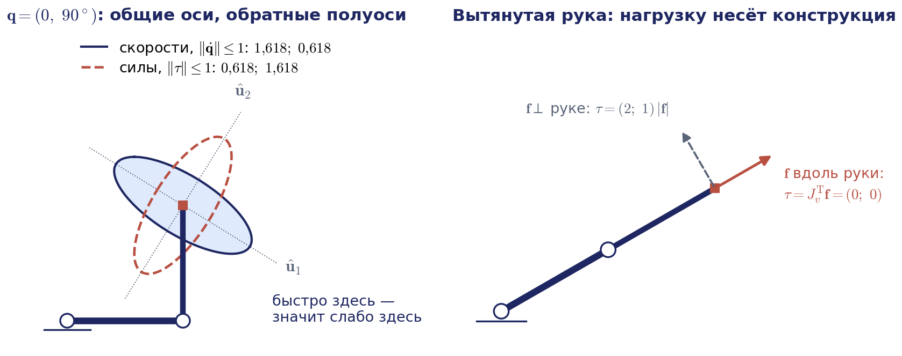

## 3.11. Приемистость

Ещё труднее оценить допустимые ускорения объекта. Продифференцируем соотношение для линейной скорости по времени — формула (3.194):

$$
\dot{\mathbf{v}}_N=J_v(\mathbf{q})\,\ddot{\mathbf{q}}+\dot J_v(\mathbf{q},\dot{\mathbf{q}})\,\dot{\mathbf{q}}.
$$

Появляется второе слагаемое с производной матрицы Якоби: оно квадратично по скоростям и содержит центростремительные и кориолисовы составляющие; это то самое ускорение схвата при $\ddot{\mathbf{q}}=0$, которое даёт рекурсия ускорений из раздела 3.2. Пусть ограничены не только скорости, но и ускорения сочленений, $\lvert\ddot q_i\rvert\le b_i$ — условие (3.195), где $b_i=\ddot q_i^{\max}$ (краткое имя из учебника). Поскольку $\dot J_v\dot{\mathbf{q}}=\sum_{i,k}(\partial J_v/\partial q_k)_{\cdot i}\,\dot q_k\dot q_i$, для каждой компоненты ускорения получается оценка (3.196):

$$
\lvert\dot v_j\rvert\le\sum_i\lvert J_{ji}\rvert\,b_i+\sum_{i,k}\Big\lvert\frac{\partial J_{ji}}{\partial q_k}\Big\rvert\,C_iC_k,
$$

где $J_{ji}$ — элементы блока $J_v$. Найти же наибольшее ускорение и его направление в общем случае существенно сложнее, чем для скорости, потому что область перестаёт быть образом параллелепипеда при одном линейном отображении.

**Примечание о расхождении с книгой.** В учебнике второе слагаемое оценки (3.196) записано как сумма модулей элементов матрицы $\dot J_v$ с множителями $C_i$; такая запись не замкнута, потому что сама $\dot J_v$ зависит от $\dot{\mathbf{q}}$. Приведённая выше форма раскрывает эту зависимость.

Практически важен частный случай — разгон из состояния покоя. При $\dot{\mathbf{q}}=0$ второе слагаемое исчезает, и остаётся формула (3.197):

$$
\dot{\mathbf{v}}_N=J_v(\mathbf{q})\,\ddot{\mathbf{q}}.
$$

Структура та же, что у соотношения для скоростей. Способность манипулятора развивать из состояния покоя ускорение поступательного движения называют **приемистостью**. Для её численной характеристики используют те же показатели, что и для мобильности: объём многогранника допустимых ускорений $\Gamma_a$ (образа параллелепипеда ограничений на $\ddot q_i$), приемистость по направлению и грубую оценку через сингулярные числа,

$$
\sigma_{\min}^2(\mathbf{q})\le\frac{\lVert\dot{\mathbf{v}}_N\rVert^2}{\lVert\ddot{\mathbf{q}}\rVert^2}\le\sigma_{\max}^2(\mathbf{q}).
$$

Авторы учебника сопровождают этот раздел важной оговоркой. Все полученные оценки чисто кинематические, тогда как реальное движение подчиняется уравнениям динамики. Ограничения $b_i$ на ускорения сочленений на самом деле не являются константами: они определяются моментами, которые способны развить двигатели, инерцией звеньев и груза, а потому зависят от конфигурации и от скоростей. Чем больше перемещаемые массы и ускорения и чем слабее приводы, тем менее достоверны кинематические оценки; особенно это относится к ускорениям. Кинематическая приемистость — это верхняя граница, которую уточняют с помощью уравнений динамики (глава 5 учебника). Стоит иметь в виду и то, что в паспортах промышленных роботов обычно указаны максимальные скорости осей, но почти никогда — ускорения, так что приемистость приходится оценивать самостоятельно.

## 3.12. Сводка кинематических характеристик и место задачи о скорости в системе управления

### Кинематические характеристики манипулятора

Соберём в одну таблицу характеристики, введённые на этой и на прошлой лекциях. Первые четыре получены из задачи о положении и отвечают на вопросы, куда дотянется схват и как он там сможет повернуться. Остальные получены из задачи о скорости и отвечают на вопросы, как быстро и в каких направлениях схват может двигаться, с какой силой давить и как быстро разгоняться.

| Характеристика | Определение | Формула или оценка | Что показывает |
|---|---|---|---|
| Рабочее пространство | образ области допустимых $\mathbf{q}$ при отображении $\mathbf{p}=\mathbf{p}(\mathbf{q})$ | объём $V$, граница зоны | куда дотянется схват |
| Показатель Ли — Янга | объём зоны, отнесённый к кубу суммарной длины звеньев | $V_L=V/L^3\le4\pi/3$ | качество схемы независимо от масштаба |
| Коэффициент сервиса | доля направлений, с которых схват может подойти к точке | $\Omega_r=\psi_r/4\pi$, среднее $\Omega=\frac1V\int\Omega_r\,dV$ | как схват сможет повернуться в точке |
| Манипулятивность по направлению | доля зоны, где возможна ориентация вдоль $\mathbf{n}$ | $\Omega_{\mathbf n}=V_{\mathbf n}/V$ | где достижима нужная ориентация |
| Мобильность | объём области допустимых скоростей | $\mathcal{M}=\int_{\Gamma_v}d\mathbf{v}$; сфера: $\frac43\pi(\sigma_{\max}C)^3$ | какие скорости достижимы в точке |
| Относительная манипулятивность | отношение норм скорости схвата и скоростей сочленений | $k_v=\lVert\mathbf{v}_N\rVert/\lVert\dot{\mathbf{q}}\rVert\ge\sigma_{\min}$ | коэффициент передачи скорости |
| Мера Йошикавы, число обусловленности | объём и вытянутость эллипсоида скоростей | $w=\sqrt{\det(JJ^{\mathrm T})}$, $\kappa(J)=\sigma_{\max}/\sigma_{\min}$ | близость к особенности, равноправие направлений |
| Эллипсоид сил | силы, развиваемые при ограниченных моментах | полуоси $1/\sigma_i$ вдоль $\hat{\mathbf{u}}_i$ | в каких направлениях схват силён |
| Приемистость | ускорение, развиваемое из покоя | $\dot{\mathbf{v}}_N=J_v\ddot{\mathbf{q}}$, многогранник $\Gamma_a$ | как быстро схват разгонится |

Все характеристики вычисляются из одной и той же кинематической модели — матриц $T_i(\mathbf{q})$ и $J(\mathbf{q})$. Построив один раз модель по Денавиту — Хартенбергу, можно рассчитать полный «кинематический паспорт» механизма и сравнить разные схемы ещё до изготовления.

### Контур управления по скорости

Посмотрим, где всё сказанное работает в системе управления (рис. 3.20). В полуавтоматическом режиме оператор рукояткой задаёт командную скорость схвата $\boldsymbol{\mathcal V}^{\ast}$. Контроллер на каждом такте считывает с датчиков текущие обобщённые координаты, решает прямую задачу о положении, строит матрицу Якоби, решает обратную задачу о скорости и выдаёт приводам задания $\dot{\mathbf{q}}=J^{-1}(\mathbf{q})\boldsymbol{\mathcal V}^{\ast}$, $\dot{\mathbf{q}}=J^{+}(\mathbf{q})\boldsymbol{\mathcal V}^{\ast}$ или $\dot{\mathbf{q}}=J_\mu^{+}(\mathbf{q})\boldsymbol{\mathcal V}^{\ast}$. В зарубежной литературе эта схема известна как управление по разрешённой скорости (resolved motion rate control) и восходит к работе Уитни 1969 года. В лекции 4 этот же контур будет замкнут по положению: командная скорость формируется как $\boldsymbol{\mathcal V}^{\ast}+K\mathbf{e}$, где $\mathbf{e}=(\delta\boldsymbol{\varphi};\Delta\mathbf{p})$ — ошибка положения схвата, а её угловая часть для больших рассогласований вычисляется через логарифм матрицы поворота (см. раздел 3.4), а не по формуле (3.59). Так получается итерационное решение обратной задачи о положении, работающее в реальном времени.

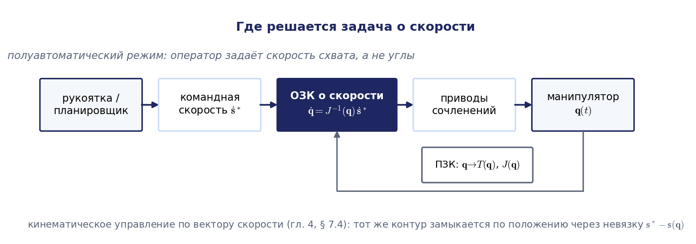

Как этот контур ведёт себя вблизи особенности, показывает анимация на рис. 3.21. Оператор командует UR5e движение инструмента по прямому шву со скоростью 0,1 м/с мимо кистевой особенности, а контроллер на каждом такте решает обратную задачу о скорости одним из четырёх способов.

Анимация целиком: [l03_rmrc_operator_joystick_6r.mp4](../06_Анимации/l03_rmrc_operator_joystick_6r.mp4), 80 с.

Сопоставим два способа обращения матрицы Якоби в таком контуре. Аналитическое обращение требует структурной особенности схемы и пригодно только для шестизвенного манипулятора конкретного типа (например, со сферическим запястьем), зато даёт шесть явных формул, а все особые конфигурации известны заранее как нули определителей подсистем. Численное обращение через SVD универсально: оно применимо к любой схеме, в том числе к UR5e, и к любому числу степеней подвижности, автоматически учитывает избыточность и даёт решение с минимальной невязкой и минимальной нормой; вблизи особых точек его дополняют демпфированием. Платой служит сингулярное разложение на каждом такте, что для матрицы $6\times7$ давно не проблема. В обоих случаях полученные скорости сочленений нужно проверять на соответствие ограничениям приводов.

### Где это в реальной системе

Перечислим, где формулы лекции встречаются в работе с реальными роботами; конкретные имена параметров и вызовов собраны в методических указаниях к лабораторным работам.

- **Перемещение с пульта в декартовых осях.** Режим «двигать инструмент вдоль оси $x$ базы» или «вдоль оси инструмента» — это контур управления по разрешённой скорости: в первом случае командная скорость задана в осях базы и обращается матрица $J$, во втором — в осях инструмента и обращается $J_b=\operatorname{diag}(R_N^{\mathrm T},R_N^{\mathrm T})J$. Ту же работу в ROS 2 выполняет модуль MoveIt Servo: он принимает твист или скорости сочленений с джойстика либо из алгоритма и на каждом такте решает обратную задачу о скорости.
- **Насыщение приводов.** Если хотя бы одна скорость сочленения выходит за предел, правильнее уменьшить весь вектор $\dot{\mathbf{q}}$ в одно и то же число раз: направление движения схвата сохраняется, падает только его скорость. Покомпонентное обрезание искажает траекторию. В кейсе раздела 3.6 при $q_5=0{,}5^\circ$ масштабирование до предела $\pi$ рад/с даёт скорость 0,065 м/с строго вдоль оси $x_0$, а обрезание двух компонент даёт скорость 0,128 м/с под углом $95^\circ$ к заданному направлению и паразитное вращение 0,86 рад/с. Разницу между обрезанием и масштабированием наглядно показывает анимация на рис. 3.21.
- **Поведение у особенности.** Программные системы следят за близостью к особенности по сингулярным числам. Например, MoveIt Servo (версия для ROS 2 Humble) вычисляет число обусловленности матрицы Якоби по её SVD и при движении в сторону особенности линейно снижает скорость, когда $\kappa(J)$ превышает нижний порог (по умолчанию 17), и останавливает движение у верхнего порога (по умолчанию 30). Поскольку ROS измеряет длины в метрах, пороги привязаны к этим единицам и настраиваются под конкретного робота. Промышленные контроллеры при линейном движении у кистевой особенности либо останавливаются с ошибкой, либо, в специальном режиме, допускают отклонение ориентации инструмента (раздел 3.6).
- **Библиотеки.** Решатели обратной задачи о скорости в KDL (`ChainIkSolverVel_pinv` и демпфированный `ChainIkSolverVel_wdls`) строятся на SVD; Robotics Toolbox for Python даёт `jacob0`, `jacobe` и меру Йошикавы; перед использованием любой из них порядок блоков и точку приведения сверяют по таблице раздела 3.3.

## Связь с демонстрациями

Все вычислительные эксперименты к лекции собраны в ноутбуке «Демо_Занятие_03_скорость.ipynb» в папке «03_Примеры_Jupyter». Ноутбук выполнен, поэтому графики видны без запуска; интерактивная ячейка работает только при живом запуске. Демонстрации пронумерованы в порядке показа на занятии.

| № | Демонстрация | Что видно |
|---|---|---|
| 1 | Численная проверка соотношения $\dot R=\Lambda(\boldsymbol{\omega})R$ | матрица $\dot RR^{\mathrm T}$ кососимметрична, из неё читается $\boldsymbol{\omega}$; распределение скоростей точек тела |
| 2 | Прямая задача о скорости двухзвенника | скорость схвата как сумма вкладов столбцов $\mathbf{j}_k\dot q_k$ (пример 3.1) |
| 3 | Матрица Якоби UR5e по столбцам | совпадение с конечными разностями; сверка с Robotics Toolbox (`jacob0`, `jacobe`) и перестановка блоков к порядку курса |
| 4 | Геометрический и аналитический якобианы UR5e | угловые строки $\partial\mathbf{f}/\partial\mathbf{q}$ по углам ZYZ отличаются от $J_\omega$ и совпадают после умножения на $\operatorname{diag}(W,E)$ |
| 5 | Ошибка ориентации при конечном повороте | формула (3.59), кватернион и вектор поворота при углах от $0$ до $180^\circ$ |
| 6 | Двухзвенник у границы зоны | рост $\lVert\dot{\mathbf{q}}\rVert$ и падение $\sigma_{\min}$ при радиальном движении, поперечное движение, DLS (пример 3.2) |
| 7 | Особые конфигурации шестизвенников | PUMA 560: $D_{123}=a_2y_{34}x_{14}$, $D_{456}=-s_5$; UR5e: формула $\det J$, кистевая особенность, $J^{+}$ против DLS при $q_5\to0$ и разрыв $J^{+}$ в особой точке |
| 8 | Избыточный плоский трёхзвенник | решение минимальной нормы, самодвижение, уход от предела сочленения $\boldsymbol{\xi}=k\nabla g$ с коррекцией по положению (пример 3.4а) |
| 9 | Сфера, эллипс, взвешенный эллипс и многоугольник | пример 3.6: вершины 0,61 и 0,41 м/с, скорость вдоль $y$ 0,1 м/с, полуоси взвешенного эллипса 0,51 и 0,098 м/с |
| 10 | Меры качества конфигурации | $w$ и $\kappa(J)$ двухзвенника по $q_2$; $\kappa(J)$ UR5e в метрах и миллиметрах |
| 11 | Мобильность и манипулятивность | карта по рабочей зоне двухзвенника и карта в плоскости $(q_2,q_3)$ шестизвенника |
| 12 | Двойственность скоростей и сил | эллипс сил поверх эллипса скоростей; сила вдоль вытянутой руки |
| 13 | Приемистость и интерактивная модель | многоугольники допустимых ускорений из покоя; эллипсы скоростей и сил двухзвенника при движении ползунков |
| 14 | Ведём инструмент UR5e по прямой | разомкнутый и замкнутый контур, насыщение приводов: обрезание против масштабирования |

**Анимации к лекции.** Пять роликов из папки «06_Анимации» показывают в движении то, что на статичных рисунках приходится представлять мысленно. В конспекте каждый ролик дан фрагментом и ссылкой на полную версию, а на слайдах он проигрывается по щелчку.

- `l03_jacobian_columns` (рис. 3.4, 70 с) — столбцы матрицы Якоби двухзвенника как касательные к дугам схвата и их коллинеарность у вытянутой руки.
- `l03_singularity_approach_2r` (рис. 3.9, 66 с) — рост скоростей сочленений при движении схвата к границе зоны вдоль руки и поперёк неё, демпфирование.
- `l03_self_motion_redundant_3r` (рис. 3.14, 78 с) — самодвижение трёхзвенника в пространстве сочленений и в пространстве задачи, уход от предела по градиенту (пример 3.4а).
- `l03_velocity_map_circle_ellipse_polygon` (рис. 3.16, 89 с) — круг и прямоугольник скоростей сочленений переходят в эллипс и параллелограмм скоростей схвата (пример 3.6).
- `l03_rmrc_operator_joystick_6r` (рис. 3.21, 80 с) — контур управления по скорости UR5e у кистевой особенности: точное обращение, обрезание, масштабирование и DLS.

## Выводы

1. Вращение твёрдого тела описывается кососимметрической матрицей: из ортогональности матрицы поворота следует $\dot R=\Lambda(\boldsymbol{\omega})R$, а три независимых элемента матрицы $\Lambda$ образуют вектор угловой скорости. Скорость любой точки тела даёт распределение скоростей $\mathbf{v}_M=\mathbf{v}_0+\boldsymbol{\omega}\times\tilde{\mathbf{r}}$; поэтому линейную скорость схвата всегда нужно относить к определённой точке.
2. Правило $\partial A_i/\partial q_i=Q_iA_i$ превращает дифференцирование матриц ДХ в алгебраическую операцию, а прямая рекурсия $\boldsymbol{\omega}_i=\boldsymbol{\omega}_{i-1}+\mathbf{z}_{i-1}\dot q_i$, $\mathbf{v}_i=\mathbf{v}_{i-1}+\boldsymbol{\omega}_i\times\mathbf{p}_{i-1,i}$ даёт скорости звеньев от основания к схвату.
3. Скорость схвата $\boldsymbol{\mathcal V}=(\boldsymbol{\omega};\mathbf{v})$ — вектор, но не производная параметров положения. Она равна $J(\mathbf{q})\dot{\mathbf{q}}$ с геометрической матрицей Якоби, столбцы которой берутся из матриц $T_{k-1}$ без символьного дифференцирования. Аналитический якобиан $J_A=\partial\mathbf{f}/\partial\mathbf{q}=\operatorname{diag}(W,E)J$ вырождается вместе с параметризацией углов; это особенность представления, а не механизма.
4. Порядок блоков, точка приведения и оси различаются в учебнике, библиотеках и ROS; переход между ними выполняется перестановкой блоков и формулами $J_b=\operatorname{diag}(R^{\mathrm T},R^{\mathrm T})J$ и $J_{\mathrm{TCP}}=\begin{pmatrix}E&0\\ -\Lambda(\mathbf{r})&E\end{pmatrix}J$.
5. Дифференциальное перемещение — это твист, умноженный на малое время, и второй путь к матрице Якоби. Формула (3.59) для ошибки ориентации даёт $\sin\alpha\,\mathbf{k}$ и пригодна только для малых рассогласований; для конечных служит вектор поворота $\log(R_2R_1^{\mathrm T})^{\vee}$.
6. Обратная задача о скорости — линейная система. При $\det J\ne0$ решение единственно; в вырожденных конфигурациях решений либо бесконечно много, либо нет, а в их окрестности скорости сочленений растут как $1/\sigma_{\min}$ по потерянному направлению. У PUMA три семейства особенностей находятся из декомпозиции по центру запястья, у UR5e — из формулы $\det J=-a_2a_3s_3s_5(a_2c_2+a_3c_{23}+d_5s_{234})$; кистевая особенность лежит внутри зоны и требует внимания при планировании.
7. Сингулярное разложение $J=U\Sigma V^{\mathrm T}$ — общий язык темы: оно даёт псевдообратную матрицу $J^{+}=\sum\hat{\mathbf{v}}_i\hat{\mathbf{u}}_i^{\mathrm T}/\sigma_i$ (левую при $\operatorname{rank}J=N$, правую при $\operatorname{rank}J=m<N$, $J^{\mathrm T}/\sigma_1^2$ при ранге один), демпфирование с ограниченным усилением $1/(2\mu)$, эллипсоиды скоростей и сил, меры $w$ и $\kappa(J)$. У избыточного манипулятора самодвижение $(E-J^{+}J)\boldsymbol{\xi}$ с $\boldsymbol{\xi}=k\nabla g$ решает вторичную задачу, не трогая схват.
8. Та же матрица $J_v$ определяет кинематические возможности: сферу, эллипсоид и многогранник допустимых скоростей, мобильность, относительную манипулятивность, эллипсоид сил ($\boldsymbol{\tau}=J^{\mathrm T}\mathbf{F}$) и приемистость. Гарантированные значения при разных пределах приводов дают только многогранник и вписанный в него взвешенный эллипсоид; полная матрица $6\times N$ требует осторожности с единицами, а кинематические оценки ускорений нужно уточнять с учётом динамики.

## Контрольные вопросы

1. Почему обобщённая скорость схвата $\boldsymbol{\mathcal V}$ является вектором, а шестёрка параметров его положения — нет? Чем геометрическая матрица Якоби отличается от аналитической, как они связаны и где вырождается аналитическая для углов ZYZ?
2. Покажите, что из ортогональности матрицы поворота следует соотношение $\dot R=\Lambda R$ с кососимметрической матрицей $\Lambda$. Докажите свойство $\Lambda(R\mathbf{a})=R\Lambda(\mathbf{a})R^{\mathrm T}$.
3. Выведите правило дифференцирования $\partial A_i/\partial q_i=Q_iA_i$ для вращательного и для телескопического сочленения.
4. Исходя из соотношения $\dot T_k=\dot T_{k-1}A_k+T_{k-1}Q_kA_k\dot q_k$, получите рекуррентные формулы для угловых и линейных скоростей звеньев в случае телескопического сочленения.
5. Сформулируйте прямую задачу о скорости. Как строится $k$-й столбец матрицы Якоби и каков его геометрический смысл? Получите столбец для телескопического сочленения с помощью дифференциальных преобразований.
6. Что такое дифференциальное перемещение и почему $\delta\boldsymbol{\varphi}$ можно считать вектором? Как связаны матрицы $\Delta_T$ и $\Delta_0$? Почему формула (3.59) непригодна для ошибки ориентации $150^\circ$ и что использовать вместо неё?
7. Сформулируйте обратную задачу о скорости и прокомментируйте число её решений в зависимости от числа степеней подвижности и ранга матрицы Якоби. Исследуйте её для однозвенного манипулятора (математического маятника), приняв в качестве командного вектора линейную скорость конца звена.
8. Для плоского двухзвенника изобразите в плоскости $(q_1,q_2)$ множества вырожденных конфигураций, укажите ранг матрицы Якоби на каждом из них и решения в вытянутой и сложенной конфигурациях. Решите ту же задачу для плоского трёхзвенника.
9. Запишите псевдообратную матрицу через сингулярное разложение. Почему формула $(J^{\mathrm T}J)^{-1}J^{\mathrm T}$ неприменима к вырожденной квадратной матрице и к матрице избыточного манипулятора? Как демпфирование меняет коэффициенты $1/\sigma_i$? Получите выражение для решения, минимизирующего взвешенную невязку $(J\dot{\mathbf{q}}-\boldsymbol{\mathcal V})^{\mathrm T}Q(J\dot{\mathbf{q}}-\boldsymbol{\mathcal V})$ с положительно определённой матрицей $Q$.
10. Дайте определения мобильности, мобильности по направлению, относительной манипулятивности и приемистости. Почему оценки по сфере и невзвешенному эллипсоиду завышены по сравнению с многогранником и почему при разных пределах приводов невзвешенный эллипсоид может неверно указать быстрое направление?
11. Постройте многоугольник допустимых скоростей двухзвенника с единичными звеньями в конфигурации $q_1=0$, $q_2=\pi/4$ при ограничениях $C_1=0{,}1$ и $C_2=0{,}5$ рад/с. Найдите мобильность и мобильность вдоль осей $x$ и $y$.
12. Кейс. Робот UR5e ведёт сварочную горелку по прямому шву с постоянной ориентацией, и на середине шва контроллер останавливает движение с ошибкой, хотя та же конечная точка достигается движением в координатах сочленений без проблем. Какая особенность, вероятно, встретилась, почему движение в координатах сочленений её не замечает и что может изменить технолог?
13. Кейс. Студент сравнивает две конфигурации робота по наименьшему сингулярному числу полной матрицы Якоби $6\times6$ и получает разные выводы, вычисляя длины в метрах и в миллиметрах. Объясните причину и предложите корректный способ сравнения. Как это связано с порогами числа обусловленности в программах, которые замедляют робота у особенности?
14. Кейс. Захват двухзвенника должен удерживать груз, вес которого направлен вдоль второго звена, а также быстро двигаться в поперечном направлении. Какие конфигурации выгодны для каждой из двух задач и как это следует из эллипсов скоростей и сил? Что произойдёт, если при выходе одной скорости сочленения за предел обрезать только её, а не уменьшить весь вектор скоростей?

## Литература

1. Зенкевич С. Л., Ющенко А. С. Основы управления манипуляционными роботами. — М.: Изд-во МГТУ им. Н. Э. Баумана, 2004. — Глава 3.
2. Lynch K. M., Park F. C. Modern Robotics: Mechanics, Planning, and Control. — Cambridge: Cambridge University Press, 2017. — Главы 3 и 5.
3. Corke P. Robotics, Vision and Control: Fundamental Algorithms in Python. — 3rd ed. — Cham: Springer, 2023.
4. Siciliano B., Sciavicco L., Villani L., Oriolo G. Robotics: Modelling, Planning and Control. — London: Springer, 2009. — Глава 3.
5. Spong M. W., Hutchinson S., Vidyasagar M. Robot Modeling and Control. — Hoboken: Wiley, 2006.
6. Фу К., Гонсалес Р., Ли К. Робототехника. — М.: Мир, 1989.
7. Крейг Дж. Введение в робототехнику: механика и управление. — М.; Ижевск: Институт компьютерных исследований, 2013.
8. Whitney D. E. Resolved motion rate control of manipulators and human prostheses // IEEE Transactions on Man-Machine Systems. — 1969. — Vol. 10, No. 2.
9. Liégeois A. Automatic supervisory control of the configuration and behavior of multibody mechanisms // IEEE Transactions on Systems, Man, and Cybernetics. — 1977.
10. Yoshikawa T. Manipulability of robotic mechanisms // The International Journal of Robotics Research. — 1985. — Vol. 4, No. 2.
11. Nakamura Y., Hanafusa H. Inverse kinematic solutions with singularity robustness for robot manipulator control // Journal of Dynamic Systems, Measurement, and Control. — 1986. — Vol. 108, No. 3.
12. Skuric A., Padois V., Daney D. Pycapacity: a real-time task-space capacity calculation package for robotics and biomechanics // Journal of Open Source Software. — 2023.
13. Universal Robots. DH Parameters for calculations of kinematics and dynamics [Электронный ресурс]. — URL: https://www.universal-robots.com/articles/ur/application-installation/dh-parameters-for-calculations-of-kinematics-and-dynamics/
14. MoveIt 2 Documentation: Realtime Arm Servoing [Электронный ресурс]. — URL: https://moveit.picknik.ai
15. Nakamura Y., Hanafusa H., Yoshikawa T. Task-priority based redundancy control of robot manipulators // The International Journal of Robotics Research. — 1987. — Vol. 6, No. 2. — P. 3–15.

## Приложение 3.А. Конечная и рекуррентная формы в однородных координатах

Этот материал на лекции не воспроизводится; он нужен для чтения учебника и для динамики.

Дифференцируя произведение $T_k=A_1\cdots A_k$ по правилу (3.22), получаем формулы (3.25)–(3.26):

$$
\dot T_k=\sum_{i=1}^{k}U_{ki}\,\dot q_i,\qquad U_{ki}=A_1\cdots A_{i-1}\,Q_iA_i\,A_{i+1}\cdots A_k\quad (i\le k),
$$

причём $U_{ki}=0$ при $i>k$: сочленения, расположенные дальше звена, на его движение не влияют. Скорость любой точки $k$-го звена равна $\dot{\mathbf{r}}=\big(\sum_iU_{ki}\dot q_i\big)\boldsymbol{\rho}$ — формула (3.27). Дифференцируя второй раз, получают выражение (3.28) для $\ddot T_k$ через матрицы $U_{kij}=\partial U_{ki}/\partial q_j$ с двумя вставками матриц $Q$; на нём основан вывод уравнений Лагранжа второго рода для манипулятора в учебнике.

Формулы (3.25)–(3.28) называют конечными: каждая матрица $U_{ki}$ вычисляется независимо. Для вычислений выгоднее рекуррентная форма. Она получается из соотношения $T_k=T_{k-1}A_k$, $T_0=E$. Дифференцируя его с учётом того, что $\dot A_k=Q_kA_k\dot q_k$, приходим к формулам (3.31)–(3.33):

$$
\begin{aligned}
\dot T_k&=\dot T_{k-1}A_k+B_k\dot q_k,\qquad B_k=T_{k-1}Q_kA_k,\\
\ddot T_k&=\ddot T_{k-1}A_k+B_k\ddot q_k+C_k,\qquad C_k=2\dot T_{k-1}Q_kA_k\dot q_k+T_{k-1}Q_k^2A_k\dot q_k^2.
\end{aligned}
$$

Счёт идёт от основания к схвату, и на каждом шаге используются результаты предыдущего. Буква $C_k$ здесь обозначает матрицу и не связана с пределами скоростей $C_i$ раздела 3.8; обозначение сохранено из учебника.

## Приложение 3.Б. Скорости в системах координат звеньев

В учебнике без вывода приведены соотношения (3.46)–(3.49) для векторов $\tilde{\boldsymbol{\omega}}_i$, $\tilde{\mathbf{v}}_i$, заданных проекциями на оси $i$-го звена. Для вращательного сочленения они имеют вид

$$
\tilde{\boldsymbol{\omega}}_i=O_i^{\mathrm T}\big(\tilde{\boldsymbol{\omega}}_{i-1}+\mathbf{z}_0\dot q_i\big),\qquad \tilde{\mathbf{v}}_i=O_i^{\mathrm T}\tilde{\mathbf{v}}_{i-1}+\tilde{\boldsymbol{\omega}}_i\times\tilde{\mathbf{p}}_{i-1,i},
$$

где $O_i$ — блок поворота матрицы $A_i$, а $\tilde{\mathbf{p}}_{i-1,i}$ — вектор между началами систем в проекциях на оси $i$-й системы. Получить их легко из формул (3.38)–(3.39): достаточно умножить обе части слева на $R_i^{\mathrm T}$ и учесть, что $R_i^{\mathrm T}R_{i-1}=O_i^{\mathrm T}$, а $R_{i-1}^{\mathrm T}\mathbf{z}_{i-1}=\mathbf{z}_0$. Структура формул та же, только на каждом шаге результат пересчитывается в систему очередного звена умножением на $O_i^{\mathrm T}$. Для телескопического сочленения в формуле для $\tilde{\boldsymbol{\omega}}_i$ пропадает слагаемое с $\dot q_i$, а к $\tilde{\mathbf{v}}_i$ добавляется $O_i^{\mathrm T}\mathbf{z}_0\dot q_i$. Авторы учебника подчёркивают (с. 182), что при управлении в реальном времени предпочтительны именно рекуррентные формулы: они требуют меньше вычислений, чем конечные.

**Примечание о расхождении с книгой.** В учебнике блок поворота матрицы $A_i$ в этих формулах обозначен $R_i$; курс пишет $O_i$, потому что $R_i$ — блок поворота матрицы $T_i$.

## Приложение 3.В. Рекуррентный алгоритм вычисления блока линейных скоростей

Разобьём матрицу Якоби на два блока, $\boldsymbol{\omega}=J_\omega\dot{\mathbf{q}}$ и $\mathbf{v}=J_v\dot{\mathbf{q}}$. Блок $J_\omega=(\mathbf{z}_0,\dots,\mathbf{z}_{N-1})$ вычисляется без труда. Столбцы блока $J_v=(\mathbf{a}_0,\dots,\mathbf{a}_{N-1})$, где $\mathbf{a}_k=\mathbf{z}_k\times\mathbf{p}_{k,N}$, сложнее: вектор $\mathbf{p}_{k,N}$ зависит от всех обобщённых координат, и при аналитическом выводе выражения получаются громоздкими. Авторы учебника предлагают обходной путь.

Расширим понятие векторного произведения: произведение вектора $\mathbf{a}$ на матрицу $B=(\mathbf{b}_1,\dots,\mathbf{b}_m)$ определим по столбцам — формула (3.69):

$$
\mathbf{a}\times B=(\mathbf{a}\times\mathbf{b}_1,\ \dots,\ \mathbf{a}\times\mathbf{b}_m)=\Lambda(\mathbf{a})B.
$$

Столбец $\mathbf{a}_k$ можно переписать через вектор $\mathbf{p}^{k}_{kN}$, соединяющий начало $k$-й системы со схватом и заданный в $k$-й системе: $\mathbf{a}_k=R_k(\mathbf{z}_0\times\mathbf{p}^{k}_{kN})$ — формула (3.72). Введём матрицу $\mathcal{W}_k=R_k\Lambda^{\mathrm T}(\mathbf{p}^{k}_{kN})$ размера $3\times3$; тогда $\mathbf{a}_k=\mathcal{W}_k\mathbf{z}_0$, то есть искомый столбец — это третий столбец матрицы $\mathcal{W}_k$. Из очевидного геометрического равенства $\mathbf{p}^{k-1}_{k-1,N}=\mathbf{r}_k+O_k\mathbf{p}^{k}_{kN}$ и четвёртого свойства матрицы $\Lambda$ выводится рекуррентное соотношение (3.75)–(3.76), идущее от схвата к основанию:

$$
\mathcal{W}_{k-1}=\mathcal{W}_kO_k^{\mathrm T}+R_kL_k^{\mathrm T},\qquad L_k=\mathbf{r}_k\times O_k,\qquad k=N,N-1,\dots,1,\qquad \mathcal{W}_N=0.
$$

Действительно, $\mathcal{W}_{k-1}=R_{k-1}\Lambda^{\mathrm T}(\mathbf{r}_k)+R_{k-1}O_k\Lambda^{\mathrm T}(\mathbf{p}^{k}_{kN})O_k^{\mathrm T}$, второе слагаемое равно $\mathcal{W}_kO_k^{\mathrm T}$, а первое — $R_k\big(\Lambda(\mathbf{r}_k)O_k\big)^{\mathrm T}=R_kL_k^{\mathrm T}$.

Алгоритм таков. Сначала вычисляются матрицы $L_i$; они выражаются только через параметры ДХ $i$-го звена и обычно очень просты. Затем выполняется обратная рекурсия для $\mathcal{W}_k$, и из каждой матрицы берётся третий столбец. Вместо векторных произведений с «длинными» векторами на каждом шаге обновляется одна матрица $3\times3$, что экономит вычисления, когда матрицу Якоби нужно пересчитывать сотни раз в секунду.

Вернёмся к примеру 3.1. Для двухзвенника $\mathbf{r}_i=(ac_i,as_i,0)^{\mathrm T}$, и обе матрицы $L_i$ имеют одинаковую структуру:

$$
L_i=\Lambda(\mathbf{r}_i)O_i=\begin{pmatrix}0&0&as_i\\ 0&0&-ac_i\\ 0&a&0\end{pmatrix},\qquad i=1,2.
$$

Первый шаг рекурсии даёт $\mathcal{W}_1=R_2L_2^{\mathrm T}$ с третьим столбцом $(-as_{12},\ ac_{12},\ 0)^{\mathrm T}$, второй шаг — $\mathcal{W}_0=\mathcal{W}_1O_1^{\mathrm T}+R_1L_1^{\mathrm T}$ с третьим столбцом $(-a(s_1+s_{12}),\ a(c_1+c_{12}),\ 0)^{\mathrm T}$. Это те же столбцы блока $J_v$, что были получены первым способом.

**Примечание о расхождении с книгой.** В учебнике матрица рекурсии обозначена $W_k$; курс пишет $\mathcal{W}_k$, потому что буква $W$ закреплена за матрицей скоростей углов. В матрице $L_2$ элемент (3,2) напечатан в книге нулём; это опечатка, которая, впрочем, не влияет на третьи столбцы.

## Приложение 3.Г. Твисты в осях базы и тела

Здесь кратко собраны связи, которые нужны для чтения книги Линча и Парка и документации библиотек. Матричная форма пространственного твиста $[\boldsymbol{\mathcal V}_s]=\dot TT^{-1}$ и твиста в осях тела $[\boldsymbol{\mathcal V}_b]=T^{-1}\dot T$ (раздел 3.1) связаны подобием: $[\boldsymbol{\mathcal V}_s]=T[\boldsymbol{\mathcal V}_b]T^{-1}$. Раскрыв блоки, получаем в порядке $(\boldsymbol{\omega};\mathbf{v})$

$$
\boldsymbol{\mathcal V}_s=\operatorname{Ad}_T\,\boldsymbol{\mathcal V}_b,\qquad \operatorname{Ad}_T=\begin{pmatrix}R&0\\ \Lambda(\mathbf{p})R&R\end{pmatrix}.
$$

Матрицу $\operatorname{Ad}_T$ называют присоединённым представлением позы $T$. Соответственно, пространственный якобиан и якобиан в осях тела связаны как $J_s=\operatorname{Ad}_{T_N}J_b$, а с якобианом курса — формулами раздела 3.3: $J=\begin{pmatrix}E&0\\ -\Lambda(\mathbf{p}_N)&E\end{pmatrix}J_s=\operatorname{diag}(R_N,R_N)\,J_b$. Столбец пространственного якобиана для вращательного сочленения равен $\boldsymbol{\mathcal S}_k=(\mathbf{z}_{k-1};\ -\mathbf{z}_{k-1}\times\mathbf{p}_{k-1})$ — это винтовая ось сочленения в текущей конфигурации; столбец (3.62) получается из неё переносом точки приведения в начало системы схвата. В формуле произведения экспонент (лекция 2) те же винтовые оси, заданные в нулевой конфигурации, служат параметрами модели вместо таблицы ДХ; подробно этот язык изложен в главах 4–5 книги Линча и Парка.
