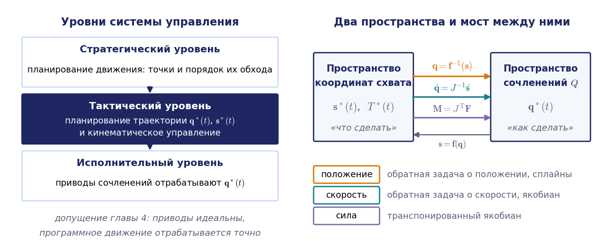
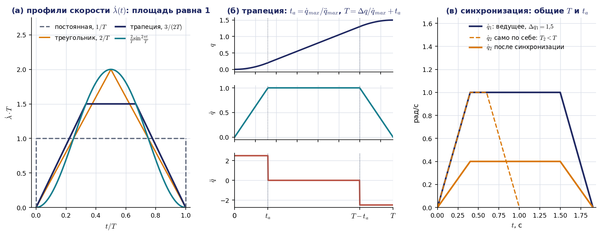
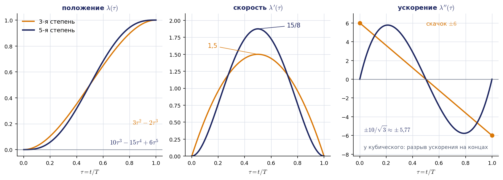
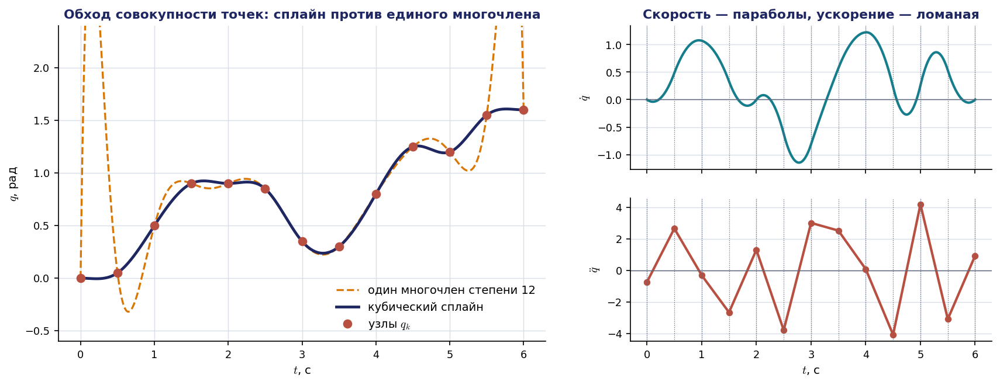
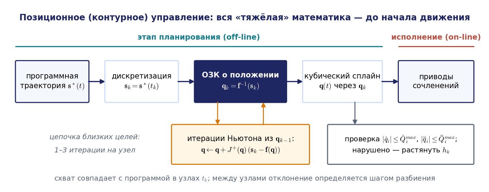
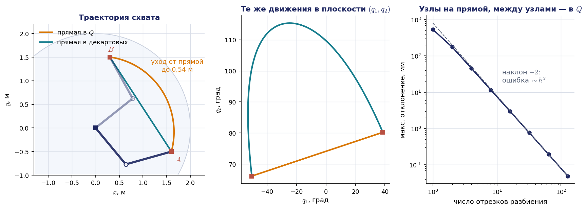
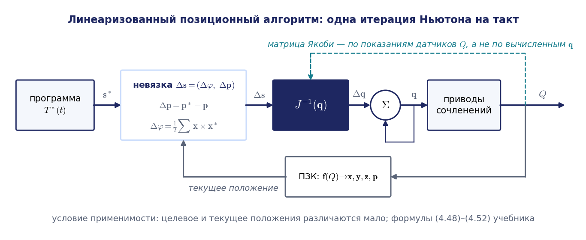
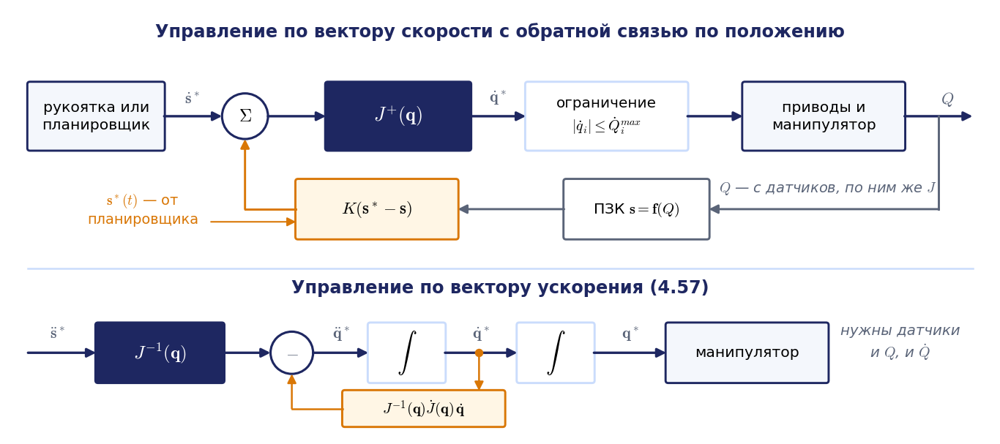
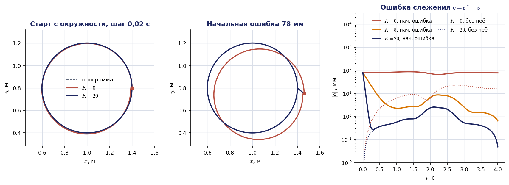
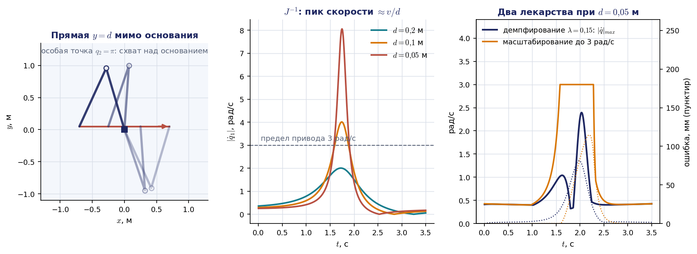

# Лекция 4. Планирование траекторий и кинематическое управление

Лекция построена по главе 4 учебника С. Л. Зенкевича и А. С. Ющенко «Основы управления манипуляционными роботами» (§ 4.1 и 4.2). Номера формул в круглых скобках вида (4.24) — это номера формул учебника; они приводятся, чтобы лекцию было удобно читать параллельно с книгой. Рисунки лекции имеют собственную нумерацию, не совпадающую с нумерацией рисунков книги. В нескольких местах формулы учебника напечатаны с опечатками; в таких случаях приводится исправленная формула, а расхождение оговаривается фразой, начинающейся словами «Примечание о расхождении с книгой». Материал книги дополнен стандартными для практики вещами: расчётом времён трапецеидального профиля, синхронизацией сочленений, оценкой ошибки дискретизации, обратной связью по положению в контуре управления по скорости и приёмами работы вблизи особых точек. Всё это понадобится во втором домашнем задании, где схват должен пройти по окружности.

## Введение: от кинематической модели к управлению

В первых трёх лекциях мы строили кинематическую модель манипулятора. Мы научились описывать положение звеньев однородными матрицами $A_i$ и $T_i$, решать прямую и обратную задачи о положении, а на прошлой лекции связали скорости сочленений со скоростью схвата матрицей Якоби: $\dot{\mathbf{s}}=J(\mathbf{q})\dot{\mathbf{q}}$. До сих пор все эти задачи были статическими: дана конфигурация — найти положение, дано положение — найти конфигурацию. Время в них не участвовало. Сегодня мы впервые заставим модель двигаться.

**Кинематическим управлением** называют управление манипулятором, который описывается только кинематической моделью. Систему приводов при этом считают идеальной: предполагается, что программное движение сочленений отрабатывается совершенно точно. Авторы учебника сразу оговаривают, что это допущение нельзя считать вполне корректным, поскольку заданное и действительное движения всегда различаются из-за неидеальной работы приводов. Чтобы различие не стало чрезмерным, уже на кинематическом уровне приходится помнить о динамике: не требовать от приводов скачков скорости, ограничивать ускорения, следить за гладкостью задающих воздействий. Разбиение системы управления на уровни — это удобный методический приём, а не свойство самого робота.

Глава 4 учебника отвечает на три вопроса. Как переместить схват из одной точки в другую? Как провести его через последовательность точек, заданных в пространстве обобщённых координат или в декартовом пространстве? Как заставить схват двигаться по заданной траектории? На первые два вопроса отвечает планирование траекторий, на третий — алгоритмы управления в пространстве координат схвата. В них соединится всё, что мы изучили раньше: обратная задача о положении из лекции 2, итерационное решение «цепочкой близких целей» оттуда же, матрица Якоби и псевдообратная матрица из лекции 3.

## 4.1. Постановка задачи и место кинематического управления

### Уровни системы управления

Система управления робота организована иерархически (рис. 4.1, слева). На верхнем, стратегическом, уровне решается задача **планирования движения**: определяется, через какие точки и в каком порядке должен пройти схват, чтобы задание было выполнено, и как при этом обойти препятствия. Результат — основные характеристики траектории, но ещё не закон движения во времени. На тактическом уровне решается задача **планирования траектории**: строится программное движение либо звеньев $\mathbf{q}^{\ast}(t)$, либо схвата $\mathbf{s}^{\ast}(t)$ на отрезке времени $[t_0,t_1]$. К этому же уровню относится кинематическое управление. Наконец, исполнительный уровень — это приводы сочленений, отрабатывающие $\mathbf{q}^{\ast}(t)$. Учебник подчёркивает, что в главе 4 речь идёт о планировании именно траекторий, а не движений.

Кинематическое управление обычно реализуется в два этапа. Первый этап — предварительное определение программного движения $\mathbf{q}^{\ast}(t)$, второй — его отработка приводами. Такая двухэтапность характерна для систем **позиционного управления**, в которых задание представляет собой перечень точек позиционирования. Если точки заданы в пространстве обобщённых координат, через них должны пройти сочленения; если в декартовом пространстве — схват. Существуют и методы, не требующие предварительного планирования: в них управляющее воздействие вычисляется на каждом такте по текущему состоянию. Они применяются главным образом в системах **контурного управления**, где важна вся траектория, а не только её конечные точки.

### Два пространства

Преподаватель, читавший этот курс раньше, называл главную трудность темы проблемой двух миров (рис. 4.1, справа). Задание роботу естественно формулировать в пространстве координат схвата: «взять деталь в точке $A$», «провести горелку вдоль шва». Это мир, в котором описано, что нужно сделать; его переменные — вектор $\mathbf{s}$ или матрица $T(t)$. Исполняется же задание в пространстве сочленений $Q=q_1\times q_2\times\dots\times q_N$: приводы понимают только углы и перемещения $q_i$. Мостом между мирами служат три соотношения, которые мы уже знаем. Для положений это обратная задача $\mathbf{q}=\mathbf{f}^{-1}(\mathbf{s})$, для скоростей — $\dot{\mathbf{q}}=J^{-1}(\mathbf{q})\dot{\mathbf{s}}$, для сил — $\mathbf{M}=J^{\mathrm T}(\mathbf{q})\mathbf{F}$. Каждому мосту соответствует свой способ управления, и вся вторая половина лекции — это разбор этих способов.

Начнём с более простой задачи, в которой второй мир вообще не участвует: и задание, и исполнение происходят в пространстве обобщённых координат.

## 4.2. Перевод из точки в точку. Режим разгона — торможения

### Наивное решение и его недостаток

Пусть в пространстве $Q$ заданы две точки $\mathbf{q}^0$ и $\mathbf{q}^1$. В момент $t_0$ манипулятор находится в точке $\mathbf{q}^0$; требуется найти такую функцию $\mathbf{q}(t)$, чтобы в момент $t_1$ он оказался в точке $\mathbf{q}^1$. Это краевые условия (4.1):

$$
\mathbf{q}(t_0)=\mathbf{q}^0,\qquad \mathbf{q}(t_1)=\mathbf{q}^1.
$$

Без дополнительных ограничений решений бесконечно много. Самое простое из них — движение по прямой в пространстве $Q$ с постоянной скоростью, формулы (4.2) и (4.3):

$$
\mathbf{q}(t)=\mathbf{q}^0+\mathbf{v}\,(t-t_0),\qquad \mathbf{v}=\frac{\mathbf{q}^1-\mathbf{q}^0}{t_1-t_0}.
$$

Прежде всего нужно убедиться, что компоненты вектора $\mathbf{v}$ не превышают по модулю максимальных скоростей приводов: $\lvert v_i\rvert\le\dot q_i^{\max}$. Если условие нарушено, остаётся увеличивать время $t_1$. Можно поступить иначе: не задавать $t_1$, а потребовать, чтобы наибольшая скорость равнялась заданному числу $c$; тогда $t_1$ становится неизвестной и находится в ходе решения. Так или иначе, планирование приобретает итерационный характер: построили траекторию, проверили ограничения, поправили время. Эта особенность сохранится во всех методах, которые мы рассмотрим.

Главный недостаток наивного решения в другом. До момента $t_0$ манипулятор покоился, а в момент $t_0$ его скорость должна мгновенно стать равной $\mathbf{v}$. Скорость терпит разрыв, ускорение в этот момент бесконечно, а значит, от приводов требуются бесконечно большие силы и моменты. То же происходит в момент остановки. Реальный привод отработает такой закон с ошибкой, ударом по механике и колебаниями. Поэтому от программного движения требуют гладкости, и мы рассмотрим два способа её обеспечить.

### Специальная параметризация

Перепишем движение по прямой в виде (4.4):

$$
\mathbf{q}(t)=\mathbf{q}^0+\lambda(t)\,(\mathbf{q}^1-\mathbf{q}^0),
$$

где для равномерного движения $\lambda(t)=(t-t_0)/(t_1-t_0)$ — формула (4.5).

Примечание о расхождении с книгой: в формуле (4.4) учебника в промежуточном выражении напечатан множитель $(t_1-t_0)$ вместо $(t-t_0)$; смысл формулы ясен из её правой части, которая приведена здесь.

Идея состоит в том, чтобы оставить путь прежним, то есть отрезок прямой в пространстве $Q$, но изменить закон движения вдоль него. Для этого скалярную функцию $\lambda(t)$ выбирают иначе, потребовав только выполнения условий (4.6):

$$
\lambda(t_0)=0,\qquad \lambda(t_1)=1.
$$

Тогда краевые условия (4.1) выполняются автоматически. Дифференцируя (4.4), получаем соотношение (4.7):

$$
\dot{\mathbf{q}}(t)=\dot\lambda(t)\,(\mathbf{q}^1-\mathbf{q}^0).
$$

Функция $\dot\lambda(t)$ с точностью до постоянного множителя задаёт скорость в каждом сочленении; её называют **профилем скорости**. Интегрируя (4.7) по отрезку $[t_0,t_1]$, получаем единственное условие, которому должен удовлетворять профиль, — условие (4.8):

$$
\int_{t_0}^{t_1}\dot\lambda(t)\,dt=1.
$$

Геометрически это означает, что площадь под графиком профиля скорости равна единице. На рис. 4.2, а показаны четыре профиля из учебника при $t_0=0$, $t_1=T$. Прямоугольный профиль высоты $1/T$ — это наивное решение. Треугольный профиль имеет высоту $2/T$: разгон занимает первую половину времени, торможение — вторую. У трапецеидального профиля с участками разгона и торможения длительностью $T/3$ высота равна $3/(2T)$. У всех трёх профилей есть изломы, и в них ускорение меняется скачком, хотя и остаётся конечным. Четвёртый профиль,

$$
\dot\lambda(t)=\frac{2}{T}\sin^2\frac{\pi t}{T},
$$

свободен и от этого недостатка. Его ускорение $\ddot\lambda=(2\pi/T^2)\sin(2\pi t/T)$ непрерывно и обращается в нуль на концах, а сам закон движения равен $\lambda(t)=t/T-\sin(2\pi t/T)/(2\pi)$. Платой за гладкость служит более высокая пиковая скорость: $2/T$ против $3/(2T)$ у трапеции.

Важное свойство специальной параметризации состоит в том, что все сочленения движутся синхронно: у них общий профиль, они одновременно трогаются и одновременно останавливаются, а изображающая точка в пространстве $Q$ идёт по прямой. Это и называют **режимом разгона — торможения**.

### Трапецеидальный профиль: расчёт времён

В промышленных контроллерах чаще всего применяется трапецеидальный профиль. В книге его параметры назначены произвольно (три равные части); на практике они определяются возможностями привода. Пусть для одного сочленения заданы перемещение $\Delta q=\lvert q^1-q^0\rvert$, максимальная скорость $\dot q_{\max}$ и максимальное ускорение $\ddot q_{\max}$. Движение состоит из трёх фаз: разгон с ускорением $\ddot q_{\max}$ в течение времени $t_a$, движение с постоянной скоростью $\dot q_{\max}$ и торможение (рис. 4.2, б). Время разгона равно $t_a=\dot q_{\max}/\ddot q_{\max}$. За разгон и торможение вместе сочленение проходит путь $\dot q_{\max}t_a$; это площадь двух треугольников. Оставшийся путь проходится с постоянной скоростью. Отсюда полное время:

$$
t_a=\frac{\dot q_{\max}}{\ddot q_{\max}},\qquad T=\frac{\Delta q}{\dot q_{\max}}+t_a .
$$

Формула верна, если участок постоянной скорости существует, то есть если $\Delta q\ge\dot q_{\max}^2/\ddot q_{\max}$. При коротком перемещении привод не успевает набрать максимальную скорость, и профиль вырождается в треугольник:

$$
t_a=\sqrt{\frac{\Delta q}{\ddot q_{\max}}},\qquad T=2t_a,\qquad \dot q_{peak}=\sqrt{\Delta q\,\ddot q_{\max}} .
$$

Сам закон движения на трёх участках получается интегрированием профиля:

$$
q(t)=q^0+\operatorname{sign}(q^1-q^0)\cdot
\begin{cases}
\dfrac{\ddot q_{\max}t^2}{2}, & 0\le t\le t_a,\\[2mm]
\dot q_{\max}\Bigl(t-\dfrac{t_a}{2}\Bigr), & t_a\le t\le T-t_a,\\[2mm]
\Delta q-\dfrac{\ddot q_{\max}(T-t)^2}{2}, & T-t_a\le t\le T.
\end{cases}
$$

В терминах функции $\lambda$ высота трапеции равна $\dot\lambda_{\max}=1/(T-t_a)$; при $t_a=T/3$ получаем книжное значение $3/(2T)$.

#### Пример 4.1. Времена трапецеидального профиля

Пусть $\Delta q=1{,}5$ рад, $\dot q_{\max}=1$ рад/с, $\ddot q_{\max}=2{,}5$ рад/с². Тогда $t_a=1/2{,}5=0{,}4$ с. Проверяем условие существования полки: $\dot q_{\max}^2/\ddot q_{\max}=0{,}4$ рад, что меньше $1{,}5$ рад, значит, профиль трапецеидальный. Полное время $T=1{,}5/1+0{,}4=1{,}9$ с; именно этот случай показан на рис. 4.2, б. Если бы перемещение составляло всего $0{,}3$ рад, профиль стал бы треугольным: $t_a=\sqrt{0{,}3/2{,}5}\approx0{,}35$ с, $T\approx0{,}69$ с, а пиковая скорость $\sqrt{0{,}3\cdot2{,}5}\approx0{,}87$ рад/с не достигла бы предельной.

### Синхронизация сочленений

Если рассчитать трапецию для каждого сочленения отдельно, времена $T_i$ получатся разными: сочленение с малым перемещением закончит движение раньше. Изображающая точка в пространстве $Q$ пойдёт тогда не по прямой, а по ломаной, и траектория схвата станет плохо предсказуемой. Поэтому сочленения синхронизируют. Правило простое. Сначала для каждого сочленения находят собственное время разгона $t_{a,i}=\dot q_i^{\max}/\ddot q_i^{\max}$ и выбирают общее время разгона как наибольшее из них. Затем общее время движения выбирают по самому медленному сочленению, которое называют ведущим:

$$
t_a=\max_i t_{a,i},\qquad T=\max_i\Bigl(\frac{\Delta q_i}{\dot q_i^{\max}}\Bigr)+t_a .
$$

После этого скорость полки и ускорение каждого сочленения пересчитывают под общие времена:

$$
\dot q_i=\frac{\Delta q_i}{T-t_a},\qquad \ddot q_i=\frac{\dot q_i}{t_a}.
$$

Формулы предполагают, что у ведущего сочленения есть участок постоянной скорости, то есть $T\ge2t_a$; в противном случае общий профиль берут треугольным. Легко проверить, что ограничения при этом не нарушаются: $\dot q_i\le\dot q_i^{\max}$ по выбору $T$, а $\ddot q_i\le\dot q_i^{\max}/t_{a,i}=\ddot q_i^{\max}$ по выбору $t_a$. Все сочленения теперь имеют один и тот же профиль $\dot\lambda(t)$ и различаются только масштабом, то есть мы вернулись к формуле (4.7). На рис. 4.2, в второе сочленение с перемещением $0{,}6$ рад само по себе закончило бы движение за $1$ с; после синхронизации с первым (пример 4.1) оно движется $1{,}9$ с со скоростью полки $0{,}6/1{,}5=0{,}4$ рад/с и ускорением $1$ рад/с².

## 4.3. Полиномиальная интерполяция

### Многочлен пятой степени

Второй подход к построению гладкого перехода состоит в том, чтобы искать закон движения в виде многочлена и подчинить его коэффициенты граничным условиям. Будем рассматривать одну обобщённую координату и обозначать её просто $q$. Кроме условий (4.9) на положение, $q(t_0)=q^0$ и $q(t_1)=q^1$, потребуем выполнения условий (4.10) на скорости и ускорения:

$$
\dot q(t_0)=\dot q(t_1)=0,\qquad \ddot q(t_0)=\ddot q(t_1)=0 .
$$

Условий шесть, поэтому многочлен минимальной степени, способный им удовлетворить, имеет шесть коэффициентов, то есть пятую степень (4.11):

$$
q(t)=a_0+a_1t+a_2t^2+a_3t^3+a_4t^4+a_5t^5 .
$$

Положим $t_0=0$, $t_1=T$; тем самым у каждой пары соседних точек позиционирования появляется собственное локальное время. Условия в начале отрезка сразу дают $a_0=q^0$, $a_1=0$, $a_2=0$. Условия в конце приводят к трём уравнениям для оставшихся коэффициентов:

$$
\begin{aligned}
a_3T^3+a_4T^4+a_5T^5&=q^1-q^0,\\
3a_3T^2+4a_4T^3+5a_5T^4&=0,\\
6a_3T+12a_4T^2+20a_5T^3&=0 .
\end{aligned}
$$

Примечание о расхождении с книгой: в системе уравнений, выписанной в учебнике после формулы (4.11), пропущено уравнение для положения в конце отрезка (первое из трёх приведённых выше); без него система из пяти уравнений не определяет шесть коэффициентов.

Обозначим $\Delta=q^1-q^0$ и введём вспомогательные неизвестные $b_3=a_3T^3$, $b_4=a_4T^4$, $b_5=a_5T^5$. Система принимает вид $b_3+b_4+b_5=\Delta$, $3b_3+4b_4+5b_5=0$, $3b_3+6b_4+10b_5=0$. Вычитая второе уравнение из третьего, находим $b_4=-\tfrac52b_5$, затем из второго $b_3=\tfrac53b_5$, и из первого $b_5=6\Delta$. Окончательно

$$
q(t)=q^0+\Delta\,\bigl(10\tau^3-15\tau^4+6\tau^5\bigr),\qquad \tau=\frac{t}{T}.
$$

Заметим, что результат снова имеет вид специальной параметризации с $\lambda(\tau)=10\tau^3-15\tau^4+6\tau^5$. Наибольшая скорость достигается в середине отрезка и равна $\tfrac{15}{8}\,\Delta/T$; наибольшее ускорение достигается при $\tau=\tfrac12\mp\tfrac{1}{2\sqrt3}$ и равно $\tfrac{10}{\sqrt3}\,\Delta/T^2\approx5{,}77\,\Delta/T^2$. Эти два числа позволяют сразу выбрать время движения по ограничениям привода:

$$
T\ge\max\Bigl(\frac{15}{8}\,\frac{\Delta}{\dot q_{\max}},\ \sqrt{\frac{10}{\sqrt3}\,\frac{\Delta}{\ddot q_{\max}}}\Bigr).
$$

### Многочлен третьей степени

Если отказаться от условий на ускорения, останутся четыре условия, и достаточно многочлена третьей степени. Для нулевых граничных скоростей он равен

$$
q(t)=q^0+\Delta\,(3\tau^2-2\tau^3).
$$

Наибольшая скорость здесь меньше, $\tfrac32\,\Delta/T$, но ускорение на концах отрезка не равно нулю: оно равно $\pm6\,\Delta/T^2$, то есть в моменты пуска и остановки меняется скачком (рис. 4.3). Это тот же недостаток, что и у трапеции.

Кубический многочлен полезен в другом качестве: он позволяет задать на концах отрезка произвольные скорости $v_0$ и $v_1$. Коэффициенты в этом случае равны

$$
a_0=q^0,\quad a_1=v_0,\quad a_2=\frac{3\Delta-(2v_0+v_1)T}{T^2},\quad a_3=\frac{-2\Delta+(v_0+v_1)T}{T^3}.
$$

Если на последовательности точек назначить в каждом узле разумную скорость, например среднее арифметическое наклонов соседних отрезков, а при смене знака наклона — нуль, то получится гладкая по скорости траектория, проходящая через все узлы без остановок. Ускорение в узлах при этом разрывно. Следующий раздел покажет, как выбрать узловые скорости так, чтобы непрерывным стало и ускорение.

#### Пример 4.2. Цена гладкости

Возьмём данные примера 4.1: $\Delta=1{,}5$ рад, $\dot q_{\max}=1$ рад/с, $\ddot q_{\max}=2{,}5$ рад/с². Для многочлена пятой степени ограничение по скорости даёт $T\ge\tfrac{15}{8}\cdot1{,}5=2{,}81$ с, ограничение по ускорению даёт $T\ge\sqrt{5{,}77\cdot1{,}5/2{,}5}=1{,}86$ с. Принимаем $T=2{,}81$ с. Трапеция выполняла то же перемещение за $1{,}9$ с. Гладкий закон проигрывает по времени почти в полтора раза, потому что привод лишь на мгновение выходит на предельную скорость. Это типичный компромисс: трапеция оптимальна по быстродействию при ограничениях на скорость и ускорение, многочлен пятой степени щадит механику и не возбуждает упругих колебаний.

### Склейка нескольких многочленов

Можно использовать не один многочлен, а несколько, склеенных так, чтобы траектория имела нужную гладкость. Учебник рассматривает разбиение отрезка на три части. На концах всего отрезка заданы $q$, $\dot q$ и $\ddot q$ — это шесть условий; в двух внутренних точках склейки требуется непрерывность функции и двух её производных — ещё шесть условий. Всего двенадцать уравнений, и сумма степеней трёх многочленов должна удовлетворять соотношению $n_1+n_2+n_3=9$. Подходят, например, тройки $(3,3,3)$ и $(4,1,4)$. Вторая привлекательна тем, что даёт разгон, движение с постоянной скоростью и торможение, то есть сглаженную трапецию. Однако авторы предупреждают, что соответствующая линейная система может оказаться вырожденной, так как на среднем участке $\ddot q$ тождественно равно нулю. Систематическое развитие идеи склейки — кубические сплайны.

## 4.4. Обход совокупности точек. Кубические сплайны

### Постановка задачи

Пусть теперь в пространстве $Q$ задана последовательность точек, которую манипулятор должен обойти, попадая в точку $\mathbf{q}_i$ в момент $t_i$ — условие (4.12):

$$
\mathbf{q}(t_i)=\mathbf{q}_i,\qquad i=0,1,\dots,n .
$$

Скорость прохождения внутренних точек не важна, но на концах траектории скорости и ускорения должны принимать заданные значения; чаще всего требуется, чтобы манипулятор начинал и заканчивал движение в покое. Кроме того, функция $\mathbf{q}(t)$ должна быть непрерывна вместе с первой и второй производными.

Формально задачу решает один интерполяционный многочлен степени $n$ или, с учётом четырёх условий на концах, степени $n+4$. Но число точек при описании сложного контура достигает нескольких сотен. Многочлен такой степени дорого вычислять, а главное, он ведёт себя непредсказуемо: между узлами возникают колебания большой амплитуды, особенно у концов отрезка (рис. 4.4, штриховая линия). Робот, отрабатывающий такую траекторию, будет совершать размашистые движения там, где программист ожидал плавного перехода. Поэтому вместо одного многочлена высокой степени используют много многочленов низкой степени, склеенных в узлах.

### Определение кубического сплайна

Пусть на отрезке $[a,b]$ заданы узлы $a=x_0,x_1,\dots,x_n=b$, расположенные в порядке возрастания и не обязательно равноотстоящие, и числа $q_0,q_1,\dots,q_n$. **Кубическим сплайном** называют функцию $q(x)$, удовлетворяющую трём условиям:

1. $q(x_i)=q_i$ для всех $i$ от $0$ до $n$;
2. функции $q(x)$, $q'(x)$ и $q''(x)$ непрерывны на $[a,b]$;
3. на каждом отрезке $[x_k,x_{k+1}]$ функция $q(x)$ является многочленом степени не выше третьей (4.13).

Подсчитаем число неизвестных и уравнений. На $n$ отрезках имеется $4n$ коэффициентов. Условие 1 даёт $n+1$ уравнение, условие 2 даёт по три уравнения в каждом из $n-1$ внутренних узлов. Всего $4n-2$ уравнения, так что в запасе остаются два свободных условия, которые задают на концах отрезка.

### Вывод системы для вторых производных

Ключевое наблюдение: вторая производная кубического многочлена линейна. Обозначим $h_k=x_{k+1}-x_k$ и $q''_k=q''(x_k)$ — пока неизвестные значения второй производной в узлах. Поскольку $q''$ непрерывна, на отрезке $[x_k,x_{k+1}]$ она однозначно определяется узловыми значениями — формула (4.14):

$$
q''(x)=q''_{k+1}\,\frac{x-x_k}{h_k}-q''_k\,\frac{x-x_{k+1}}{h_k}.
$$

Интегрируя от $x_k$ до $x$, получаем формулу (4.15) для первой производной:

$$
q'(x)=q'_k+\frac{(x-x_k)^2}{2h_k}\,q''_{k+1}-\frac{(x-x_{k+1})^2}{2h_k}\,q''_k+\frac{h_k}{2}\,q''_k ,
$$

а интегрируя ещё раз — формулу (4.16) для самой функции:

$$
q(x)=q_k+(x-x_k)\,q'_k+\frac{(x-x_k)^3}{6h_k}\,q''_{k+1}-\Bigl[\frac{(x-x_{k+1})^3}{6h_k}+\frac{h_k^2}{6}-\frac{(x-x_k)h_k}{2}\Bigr]q''_k .
$$

Здесь $q'_k$ — тоже пока неизвестная величина. Исключим её. Подставив в (4.16) $x=x_{k+1}$ и потребовав $q(x_{k+1})=q_{k+1}$, получаем (4.17):

$$
q_{k+1}=q_k+h_kq'_k+\frac{h_k^2}{6}\,q''_{k+1}+\frac{h_k^2}{3}\,q''_k ,
$$

откуда следует формула (4.18):

$$
q'_k=\frac{q_{k+1}-q_k}{h_k}-\frac{h_k}{6}\,q''_{k+1}-\frac{h_k}{3}\,q''_k .
$$

Примечание о расхождении с книгой: в формулах (4.15)–(4.19) учебника в нескольких местах напечатаны неверные показатели степени (квадраты вместо кубов в (4.16), $h_k^2$ вместо $h_k$ в (4.18) и (4.19)) и неверный знак последнего слагаемого в (4.18); здесь формулы приведены в исправленном виде, и их легко проверить прямым интегрированием (4.14) и по размерности.

Формула (4.18) выражает скорость в левом узле отрезка через узловые значения функции и вторых производных. Точно так же, рассматривая соседний отрезок $[x_{k-1},x_k]$ и вычисляя производную в его правом конце, получаем формулу (4.20):

$$
q'_k=\frac{q_k-q_{k-1}}{h_{k-1}}+\frac{h_{k-1}}{3}\,q''_k+\frac{h_{k-1}}{6}\,q''_{k-1}.
$$

Осталось использовать последнее не учтённое требование — непрерывность первой производной в узле $x_k$. Приравнивая правые части (4.18) и (4.20), получаем

$$
\frac{q_{k+1}-q_k}{h_k}-\frac{q_k-q_{k-1}}{h_{k-1}}=\frac{h_k}{6}\,q''_{k+1}+\frac{h_k+h_{k-1}}{3}\,q''_k+\frac{h_{k-1}}{6}\,q''_{k-1}.
$$

Разделив на $(h_k+h_{k-1})/6$, приходим к основному уравнению (4.21) с обозначениями (4.22) и (4.23):

$$
\alpha_kq''_{k+1}+2q''_k+(1-\alpha_k)\,q''_{k-1}=M_k,\qquad \alpha_k=\frac{h_k}{h_k+h_{k-1}},\qquad M_k=\frac{6}{h_k+h_{k-1}}\Bigl(\frac{q_{k+1}-q_k}{h_k}-\frac{q_k-q_{k-1}}{h_{k-1}}\Bigr).
$$

Правая часть $M_k$ — это ушестерённая разделённая разность второго порядка $6f(x_{k-1},x_k,x_{k+1})$, то есть разностный аналог второй производной, построенный по заданным точкам.

Примечание о расхождении с книгой: в формуле (4.23) учебника индексы шагов сдвинуты на единицу (напечатаны $h_{k+1}$ и $h_k$); при принятом определении $h_k=x_{k+1}-x_k$ правильны индексы $h_k$ и $h_{k-1}$, как здесь.

Уравнения (4.21), записанные для $k=1,\dots,n-1$, образуют систему (4.24) из $n-1$ линейного уравнения относительно $n+1$ неизвестного $q''_0,\dots,q''_n$. Как и ожидалось, двух уравнений не хватает. Если задать вторые производные на концах, $q''_0$ и $q''_n$, останется система (4.25) вида $A\mathbf{x}=\mathbf{b}$ с вектором неизвестных $\mathbf{x}=(q''_1,\dots,q''_{n-1})^{\mathrm T}$ и матрицей

$$
A=\begin{pmatrix}2&\alpha_1&0&\dots&0\\ 1-\alpha_2&2&\alpha_2&\dots&0\\ 0&1-\alpha_3&2&\dots&0\\ \dots&\dots&\dots&\dots&\dots\\ 0&0&\dots&1-\alpha_{n-1}&2\end{pmatrix}.
$$

Матрица трёхдиагональна и имеет диагональное преобладание, так как $\alpha_k+(1-\alpha_k)=1$, что меньше двух; поэтому система всегда однозначно разрешима. Обратите внимание на терминологию: учебник называет такие ленточные матрицы матрицами Якоби. Это общепринятое в линейной алгебре название трёхдиагональных матриц, и оно не имеет никакого отношения к матрице Якоби манипулятора $J(\mathbf{q})$.

Когда вторые производные найдены, сплайн на каждом отрезке вычисляется по формуле, которая получается подстановкой (4.18) в (4.16) и удобна для программирования:

$$
q(x)=\frac{q''_k(x_{k+1}-x)^3+q''_{k+1}(x-x_k)^3}{6h_k}+\Bigl(\frac{q_k}{h_k}-\frac{q''_kh_k}{6}\Bigr)(x_{k+1}-x)+\Bigl(\frac{q_{k+1}}{h_k}-\frac{q''_{k+1}h_k}{6}\Bigr)(x-x_k).
$$

### Краевые условия

В постановке задачи учебник говорит о четырёх заданных векторах на концах — начальных и конечных скоростях и ускорениях.

Примечание о расхождении с книгой: у кубического сплайна, как показывает подсчёт, свободны только два условия, поэтому одновременно задать на концах и скорости, и ускорения нельзя; в дальнейшем изложении сами авторы задают только $\ddot q_0$ и $\ddot q_n$.

Практически важны два варианта. Первый — заданные ускорения на концах, в частности нулевые; такой сплайн называют естественным. Тогда система (4.24) решается непосредственно, но скорости на концах получаются какими придётся и, вообще говоря, ненулевыми. Второй вариант — заданные скорости на концах, $q'_0=a$ и $q'_n=c$; для робота, который начинает и заканчивает движение в покое, он важнее. Два недостающих уравнения дают формулы (4.18) при $k=0$ и (4.20) при $k=n$:

$$
2q''_0+q''_1=\frac{6}{h_0}\Bigl(\frac{q_1-q_0}{h_0}-a\Bigr),\qquad q''_{n-1}+2q''_n=\frac{6}{h_{n-1}}\Bigl(c-\frac{q_n-q_{n-1}}{h_{n-1}}\Bigr).
$$

Система остаётся трёхдиагональной, но её порядок становится равным $n+1$. Именно так построен сплайн на рис. 4.4: скорость на концах равна нулю, а ускорение — нет. Если нужно обнулить на концах и скорость, и ускорение, применяют один из двух приёмов: либо добавляют вблизи концов по одному вспомогательному узлу, значение в котором не задаётся, а подбирается, либо на первом и последнем отрезках используют многочлены четвёртой степени. Эквивалентной альтернативой системе для вторых производных служит система для узловых скоростей $q'_k$ и кубические многочлены Эрмита из предыдущего раздела; она тоже трёхдиагональна.

### Метод прогонки

Трёхдиагональные системы решают специальным рекуррентным методом — **методом прогонки**. Будем искать решение в виде (4.27):

$$
x_k=c_kx_{k+1}+d_k ,
$$

где $x_k=q''_k$, а $c_k$ и $d_k$ — пока неизвестные числа. Запишем уравнение (4.21) с номером $k+1$ и подставим в него $x_k$ из (4.27):

$$
\alpha_{k+1}x_{k+2}+2x_{k+1}+(1-\alpha_{k+1})(c_kx_{k+1}+d_k)=M_{k+1}.
$$

Выразив отсюда $x_{k+1}$ через $x_{k+2}$ и сравнив с (4.27), получаем рекуррентные соотношения (4.29) и (4.30):

$$
c_{k+1}=-\frac{\alpha_{k+1}}{2+(1-\alpha_{k+1})c_k},\qquad d_{k+1}=\frac{M_{k+1}-(1-\alpha_{k+1})d_k}{2+(1-\alpha_{k+1})c_k}.
$$

Начальные значения следуют из (4.27) при $k=0$: равенство $x_0=c_0x_1+d_0$ при заданном $x_0=q''_0$ выполняется, если $c_0=0$ и $d_0=x_0$ — это формулы (4.31) и (4.32).

Примечание о расхождении с книгой: в формулах (4.28)–(4.31) учебника есть опечатки в индексах (напечатано $1-\alpha_k$ вместо $1-\alpha_{k+1}$ и $\alpha_{k-1}$ в числителе (4.29)), а в (4.31) вместо произведения $c_0x_1$ напечатана сумма; здесь приведены исправленные соотношения, совпадающие со стандартным методом прогонки.

Алгоритм состоит из двух проходов. На прямом ходе слева направо вычисляются коэффициенты $c_k$ и $d_k$; этим краевое условие на левом конце как бы перегоняется вправо. На обратном ходе справа налево, начиная с известного $x_n=q''_n$, по формуле (4.27) находятся сами неизвестные. Знаменатели не обращаются в нуль, так как $\lvert c_k\rvert$ не превосходит единицы. Число операций пропорционально $n$, а не $n^3$, как в методе Гаусса общего вида, что существенно при сотнях узлов.

#### Пример 4.3. Сплайн через четыре узла

Пусть узлы равноотстоящие, $x_k=0,1,2,3$ с, значения $q_k=0;\ 1;\ 1{,}5;\ 3$ рад, ускорения на концах нулевые. При равных шагах $\alpha_k=\tfrac12$ и $M_k=3(q_{k+1}-2q_k+q_{k-1})$, откуда $M_1=-1{,}5$ и $M_2=3$. Прямой ход: $c_0=0$, $d_0=0$; затем $c_1=-0{,}5/2=-0{,}25$, $d_1=-1{,}5/2=-0{,}75$; затем знаменатель равен $2+0{,}5\cdot(-0{,}25)=1{,}875$, $c_2=-0{,}2667$, $d_2=(3+0{,}375)/1{,}875=1{,}8$. Обратный ход: $x_3=0$, $x_2=c_2x_3+d_2=1{,}8$, $x_1=-0{,}25\cdot1{,}8-0{,}75=-1{,}2$. Итак, $q''=(0;\ -1{,}2;\ 1{,}8;\ 0)$ рад/с². Проверка первым уравнением системы: $0{,}5\cdot1{,}8+2\cdot(-1{,}2)=-1{,}5$. Начальная скорость по формуле (4.18) равна $q'_0=1-\tfrac16\cdot(-1{,}2)=1{,}2$ рад/с: естественный сплайн не начинается с покоя. Если вместо ускорений задать нулевые скорости на концах, получится система четвёртого порядка с решением $q''=(4{,}4;\ -2{,}8;\ 3{,}8;\ -6{,}4)$ рад/с²; скорости во внутренних узлах равны $0{,}8$ и $1{,}3$ рад/с, наибольшая скорость около $2{,}0$ рад/с достигается на последнем отрезке.

### Планирование траектории с помощью сплайнов

Применительно к роботу аргумент $x$ — это время, а сплайн строится независимо для каждой обобщённой координаты по общей сетке моментов $t_k$. Учебник сопровождает метод тремя замечаниями.

Первое. Метод прогонки требует обратного хода, то есть знания всех узлов заранее. Значит, планирование выполняется в режиме off-line, до начала движения, что, впрочем, вообще свойственно процедурам планирования.

Второе. При циклически повторяемых движениях, когда последовательность точек описывает замкнутый контур и $\mathbf{q}_0=\mathbf{q}_n$, траекторию нужно замкнуть, потребовав $\dot{\mathbf{q}}_0=\dot{\mathbf{q}}_n$ и $\ddot{\mathbf{q}}_0=\ddot{\mathbf{q}}_n$. Система уравнений при этом перестаёт быть строго трёхдиагональной, но сохраняет ту же структуру и решается вариантом прогонки. Это как раз случай окружности из домашнего задания, если её нужно обходить многократно.

Третье. На построенной траектории скорости и ускорения могут превысить допустимые значения $\dot Q_i^{\max}$ и $\ddot Q_i^{\max}$ — ограничения (4.33) и (4.34). Проверить это несложно. Ускорение на каждом отрезке линейно, поэтому его экстремумы достигаются в узлах и равны $q''_k$. Скорость на отрезке квадратична, поэтому кроме узлов нужно проверить внутреннюю точку, где $q''$ обращается в нуль; такая точка существует, если $q''_k$ и $q''_{k+1}$ разного знака, и равна $x_k+h_kq''_k/(q''_k-q''_{k+1})$. Если ограничение нарушено, увеличивают тот временной интервал, где это произошло, и пересчитывают сплайн. Полезно помнить правило масштабирования: если все интервалы растянуть в $c$ раз, скорости уменьшатся в $c$ раз, а ускорения — в $c^2$ раз. Возможна и оптимизационная постановка: выбрать разбиение $\{t_i\}$ так, чтобы время обхода было минимальным при выполнении ограничений.

В заключение параграфа учебник замечает, что сплайны полезны и для сглаживания негладких функций. Например, функцию $\lvert x\rvert$ на отрезке $[-1,1]$ можно заменить параболическим сплайном, равным $x^2/(2\varepsilon)+\varepsilon/2$ при $\lvert x\rvert\le\varepsilon$ и $\lvert x\rvert$ вне этого интервала; погрешность такой замены не превышает $\varepsilon/2$. Тот же приём скругляет углы ломаной траектории.

## 4.5. Управление по положению в пространстве координат схвата

### Идея: обратная задача в узлах и сплайн между ними

Методы предыдущих разделов работают в пространстве обобщённых координат, а задание роботу, как мы говорили, формулируется в координатах схвата. Пусть требуемая траектория схвата описывается уравнением (4.35):

$$
\mathbf{s}=\mathbf{s}^{\ast}(t).
$$

Самый прямой путь — решить обратную задачу о положении в каждый момент времени и получить программную траекторию в пространстве $Q$ (4.36):

$$
\mathbf{q}^{\ast}(t)=\mathbf{f}^{-1}\bigl(\mathbf{s}^{\ast}(t)\bigr).
$$

Авторы называют простоту этого подхода обескураживающей и отмечают его достоинство: при исполнении не нужна матрица Якоби, а значит, не нужно заботиться о вырожденных конфигурациях. Однако решать обратную задачу в темпе движения можно только тогда, когда она решается аналитически, как для манипуляторов с тремя пересекающимися осями. В общем случае поступают иначе. На траектории выбирают узлы $\mathbf{s}_k=\mathbf{s}^{\ast}(t_k)$, $k=1,\dots,K$, в каждом узле решают обратную задачу и получают $\mathbf{q}_k$, а затем через точки $\mathbf{q}_k$ проводят кубический сплайн в пространстве обобщённых координат (рис. 4.5). Это и есть **контурное управление с использованием сплайн-интерполяции**. И решение обратной задачи, и построение сплайна выполняются на этапе планирования, когда время вычислений не критично; на этапе исполнения приводам остаётся отрабатывать готовую гладкую функцию.

### Итерационное решение обратной задачи по цепочке близких целей

Если аналитического решения нет, обратную задачу в узлах решают численно. Здесь пригождается схема из лекции 2: итерации Ньютона

$$
\mathbf{q}\leftarrow\mathbf{q}+J^{+}(\mathbf{q})\bigl(\mathbf{s}_k-\mathbf{f}(\mathbf{q})\bigr),
$$

причём начальным приближением для узла $k$ служит решение для узла $k-1$. Соседние узлы траектории близки, поэтому начальное приближение всегда хорошее, и метод сходится за одну — три итерации. Тем самым снимаются обе главные трудности численного метода, о которых шла речь в лекции 2: неопределённость выбора начального приближения и перескок на другую ветвь решения. Решение непрерывно продолжается вдоль траектории, и манипулятор не меняет конфигурацию «локоть вверх» на «локоть вниз» посреди движения. Вблизи особых точек вместо $J^{+}$ используют демпфированную псевдообратную матрицу; к этому мы вернёмся в разделе 4.9. Такую схему называют **позиционным управлением с итерационным решением обратной задачи о положении**.

### Интерполяция в пространстве сочленений и в декартовом пространстве

Почему нельзя ограничиться двумя узлами — начальным и конечным? Потому что прямая в пространстве $Q$ не является прямой в декартовом пространстве. На рис. 4.6 показан плоский двухзвенник с единичными звеньями, переходящий из точки $A=(1{,}6;\ -0{,}5)$ в точку $B=(0{,}3;\ 1{,}5)$. При линейной интерполяции углов схват описывает дугу и отходит от отрезка $AB$ на $0{,}54$ м — на величину, сравнимую с размерами рабочей зоны. Если на пути есть препятствие или схват должен вести инструмент вдоль шва, это недопустимо. Наоборот, прямая в декартовом пространстве соответствует в плоскости $(q_1,q_2)$ сильно изогнутой кривой.

Сравним два способа интерполяции.

| Свойство | Интерполяция в пространстве $Q$ | Интерполяция в декартовом пространстве |
|---|---|---|
| Путь схвата между узлами | заранее неизвестная кривая | заданная линия: прямая, дуга |
| Обратная задача о положении | только в узлах | в каждой точке или в частых узлах |
| Особые точки | не мешают | путь может пройти через особую точку или выйти из рабочей зоны |
| Ограничения приводов | проверяются непосредственно | проверяются после пересчёта в $\dot{\mathbf{q}}$ |
| Применение | перенос, холостые переходы | сварка, окраска, сборка, резка |

Позиционное управление с узлами на декартовой траектории соединяет достоинства обоих способов: форма пути задаётся в координатах схвата, а гладкость и ограничения обеспечиваются в координатах звеньев.

### Дискретизация и ошибка хорды

Остаётся вопрос, как часто расставлять узлы. Схват совпадает с программной траекторией только в узлах, а между ними отклоняется; учебник ограничивается замечанием, что отклонение зависит от разбиения. Оценим его. Если между узлами углы меняются линейно, то ошибка интерполяции гладкой функции пропорциональна квадрату шага. Правая часть рис. 4.6 подтверждает это расчётом для отрезка $AB$: при одном отрезке разбиения ошибка равна $536$ мм, при восьми — $11{,}6$ мм, при $32$ — $0{,}77$ мм, при $128$ — $0{,}05$ мм; каждое удвоение числа узлов уменьшает ошибку вчетверо. Сплайн вместо ломаной уменьшает ошибку ещё сильнее.

Вторая составляющая ошибки возникает, когда сама программная кривая заменяется ломаной, например окружность — вписанным многоугольником. Это **ошибка хорды**: наибольшее расстояние от дуги до стягивающей её хорды. Для окружности радиуса $R$ и углового шага $\Delta\varphi$ она равна

$$
\delta=R\Bigl(1-\cos\frac{\Delta\varphi}{2}\Bigr)\approx\frac{R\,\Delta\varphi^2}{8}.
$$

Отсюда сразу получается требуемое число узлов. Для окружности радиуса $0{,}4$ м при $36$ узлах ($\Delta\varphi=10^\circ$) ошибка хорды равна $1{,}5$ мм, при $360$ узлах — $0{,}015$ мм. Если задан допуск $\delta$, шаг не должен превышать $\sqrt{8\delta/R}$.

#### Пример 4.4. Окружность схвата для двухзвенника

Пусть схват двухзвенника с единичными звеньями должен за время $T=4$ с обойти окружность радиуса $R=0{,}4$ м с центром в точке $(1{,}0;\ 0{,}8)$ и остановиться. Зададим движение по окружности законом разгона — торможения:

$$
\mathbf{s}^{\ast}(t)=\begin{pmatrix}1{,}0+R\cos\varphi(t)\\ 0{,}8+R\sin\varphi(t)\end{pmatrix},\qquad \varphi(t)=2\pi\lambda(t),\qquad \lambda=10\tau^3-15\tau^4+6\tau^5 .
$$

Наибольшее удаление окружности от основания равно $\sqrt{1{,}0^2+0{,}8^2}+0{,}4\approx1{,}68$ м, наименьшее — $0{,}88$ м, так что вся окружность лежит внутри рабочей зоны $0\le r\le2$ и далеко от обеих особых конфигураций. Наибольшая скорость схвата равна $2\pi R\cdot\tfrac{15}{8}/T\approx1{,}18$ м/с. Далее выбираем, скажем, $72$ узла равномерно по времени, в каждом решаем обратную задачу (аналитически либо итерациями от предыдущего узла, сохраняя ветвь «локоть вверх»), строим для $q_1(t)$ и $q_2(t)$ сплайны с нулевыми скоростями на концах, проверяем наибольшие $\lvert\dot q_i\rvert$ и при необходимости увеличиваем $T$. Обратите внимание: узлы, равномерные по времени, неравномерны по дуге — у концов, где движение медленное, они расположены гуще, и ошибка хорды там меньше.

## 4.6. Формирование программной траектории схвата

До сих пор мы не спрашивали, откуда берётся функция $\mathbf{s}^{\ast}(t)$. Рассмотрим типовую задачу: заданы матрицы положения схвата в начальной и конечной точках (4.37),

$$
T_0=\begin{pmatrix}R_0&\mathbf{p}_0\\ 0&1\end{pmatrix},\qquad T_f=\begin{pmatrix}R_f&\mathbf{p}_f\\ 0&1\end{pmatrix},
$$

и время перемещения $\tau$. Нужно построить непрерывную траекторию $T(t)$, обеспечивающую режим разгона — торможения. Трудность в том, что ориентацию, в отличие от положения, нельзя интерполировать покомпонентно: полусумма двух матриц поворота не является матрицей поворота. Учебник ищет траекторию в виде (4.38):

$$
T(t)=T_0\,A(t),\qquad A(t)=\begin{pmatrix}R(t)&\boldsymbol{\rho}(t)\\ 0&1\end{pmatrix},
$$

где $A$ — матрица относительного перемещения, зависящая от оси $\mathbf{n}$, угла поворота $\delta(t)$ вокруг неё и вектора переноса $\boldsymbol{\rho}(t)$. Из (4.38) следует $A(t)=T_0^{-1}T(t)$. Условия $T(t_0)=T_0$ и $T(t_0+\tau)=T_f$ дают граничные условия для матрицы $A$:

$$
A(t_0)=E,\qquad A(t_0+\tau)=T_0^{-1}T_f ,
$$

то есть

$$
R(t_0)=E,\quad R(t_0+\tau)=R_0^{\mathrm T}R_f,\qquad \boldsymbol{\rho}(t_0)=0,\quad \boldsymbol{\rho}(t_0+\tau)=R_0^{\mathrm T}(\mathbf{p}_f-\mathbf{p}_0).
$$

Примечание о расхождении с книгой: в учебнике формулы (4.39), (4.41) и (4.42) напечатаны как $A=TT_0^{-1}$, $A(t_0+\tau)=T_0T_f^{-1}$ и $R(t_0+\tau)=R_0R_f$, что не согласуется с исходной записью (4.38) и с формулой (4.43) самой книги; при записи $T=T_0A$ правильны приведённые здесь выражения.

Ось и угол полного поворота находятся по матрице $R(t_0+\tau)$ с элементами $r_{ij}$ с помощью формул (4.44) и (4.45), известных из лекции 1:

$$
\cos\delta_f=\frac12\bigl(\operatorname{tr}R-1\bigr),\qquad \mathbf{n}=\frac{1}{2\sin\delta_f}\begin{pmatrix}r_{32}-r_{23}\\ r_{13}-r_{31}\\ r_{21}-r_{12}\end{pmatrix}.
$$

Промежуточная матрица поворота строится по формуле Родрига (4.46):

$$
R(t)=\cos\delta(t)\,E+\bigl(1-\cos\delta(t)\bigr)\,\mathbf{n}\mathbf{n}^{\mathrm T}+\sin\delta(t)\,\Lambda(\mathbf{n}),
$$

где $\Lambda(\mathbf{n})$ — знакомая кососимметрическая матрица. Остаётся выбрать скалярные законы. Естественно взять один и тот же профиль для переноса и поворота:

$$
\delta(t)=\lambda(t)\,\delta_f,\qquad \boldsymbol{\rho}(t)=\lambda(t)\,R_0^{\mathrm T}(\mathbf{p}_f-\mathbf{p}_0),
$$

где $\lambda(t)$ — любая из функций раздела 4.2 или 4.3, меняющаяся от нуля до единицы. Это та же специальная параметризация, перенесённая в пространство координат схвата. Какой получается траектория? Положение схвата равно $\mathbf{p}(t)=\mathbf{p}_0+R_0\boldsymbol{\rho}(t)=\mathbf{p}_0+\lambda(t)(\mathbf{p}_f-\mathbf{p}_0)$, то есть характерная точка движется по отрезку прямой, а схват одновременно равномерно по $\lambda$ поворачивается вокруг оси, неподвижной в пространстве. Это кратчайший поворот между двумя ориентациями. Формулы теряют смысл при $\sin\delta_f=0$: если $\delta_f=0$, поворачиваться не нужно, а при $\delta_f=\pi$ ось находят из диагональных элементов матрицы. В плоской задаче всё сводится к линейной интерполяции одного угла: $\varphi(t)=\varphi_0+\lambda(t)(\varphi_f-\varphi_0)$.

Для других линий поступают так же: задают геометрию пути как функцию натурального параметра, а закон движения вдоль пути — функцией $\lambda(t)$. Для окружности это сделано в примере 4.4. Построенную траекторию $T^{\ast}(t)$ можно отрабатывать либо позиционным методом из раздела 4.5, либо методами, к которым мы переходим.

## 4.7. Линеаризованный позиционный алгоритм управления

Рассмотрим алгоритм управления по положению, в котором обратная задача о положении вообще не решается. Он основан на том, что целевое положение схвата, то есть рассчитанное программное движение, и его текущее положение различаются мало.

Пусть $\mathbf{s}^{\ast}=\mathbf{f}(\mathbf{q})$ — уравнение (4.47), связывающее искомый вектор обобщённых координат с целевым положением. Применим к нему метод Ньютона из лекции 2. Получаем рекуррентные соотношения (4.48)–(4.50):

$$
\Delta\mathbf{q}_{k+1}=J^{-1}(\mathbf{q}_k)\,\Delta\mathbf{s}_k,\qquad \Delta\mathbf{q}_{k+1}=\mathbf{q}_{k+1}-\mathbf{q}_k,\qquad \Delta\mathbf{s}_k=(\Delta\boldsymbol{\varphi}_k,\ \Delta\mathbf{p}_k)=(\boldsymbol{\omega}_k\Delta t,\ \mathbf{v}_k\Delta t).
$$

Вектор $\Delta\mathbf{s}_k$ отражает несовпадение положения схвата на $k$-й итерации с программным. Его можно понимать как малое перемещение, которое ликвидирует рассогласование за время $\Delta t$ поворотом с угловой скоростью $\boldsymbol{\omega}_k$ и переносом со скоростью $\mathbf{v}_k$. Компоненты рассогласования вычисляются по результатам лекции 3 о дифференциальных перемещениях — формулы (4.51) и (4.52):

$$
\Delta\mathbf{p}_k=\mathbf{p}^{\ast}-\mathbf{p}_k,\qquad \Delta\boldsymbol{\varphi}_k=\frac12\bigl(\mathbf{x}_k\times\mathbf{x}^{\ast}+\mathbf{y}_k\times\mathbf{y}^{\ast}+\mathbf{z}_k\times\mathbf{z}^{\ast}\bigr),
$$

где $\mathbf{x}^{\ast},\mathbf{y}^{\ast},\mathbf{z}^{\ast},\mathbf{p}^{\ast}$ — столбцы целевой матрицы положения $T^{\ast}(t)$ (4.53), а $\mathbf{x}_k,\mathbf{y}_k,\mathbf{z}_k,\mathbf{p}_k$ — столбцы текущей. Формула для $\Delta\boldsymbol{\varphi}$ справедлива именно для малых поворотов, когда угол можно считать вектором; это ещё одна причина, по которой алгоритм требует близости текущего и целевого положений.

Теперь сделаем решающий шаг. Если целевое положение меняется от такта к такту мало, итерационный процесс (4.48) практически сходится за одну итерацию. Тогда можно на каждом такте управления выполнять ровно одну итерацию, но уже для нового целевого положения. Решатель обратной задачи превращается в следящую систему: схват следит за программной матрицей $T^{\ast}(t)$ (рис. 4.7). Это та же цепочка близких целей, что и в разделе 4.5, только перенесённая из этапа планирования в реальное время. Отсюда название: **линеаризованный позиционный алгоритм**.

Учебник делает два замечания о реализации. Во-первых, если привод уже замкнут по положению через систему управления робота, как чаще всего и бывает, внешнюю обратную связь по положению целесообразно разомкнуть и не суммировать приращения $\Delta\mathbf{q}$: эти приращения пропорциональны скоростям изменения обобщённых координат, и их можно подавать приводам как задания по скорости. Качество отработки при этом выше. Во-вторых, текущее положение схвата нужно вычислять по показаниям датчиков сочленений $Q$, а не по вычисленным углам $\mathbf{q}$: тогда рассогласование учитывает действительное состояние механизма, включая ошибки приводов. Оба замечания выражают общий принцип обратной связи. По сравнению с позиционным методом раздела 4.5 алгоритм работает в реальном времени и не требует решения обратной задачи, но зато на каждом такте обращает матрицу Якоби и потому чувствителен к вырожденным конфигурациям.

## 4.8. Управление по вектору скорости и по вектору ускорения

### Управление по вектору скорости

Под **управлением по вектору скорости** понимают способ управления, при котором обобщённая скорость схвата (4.54) совпадает с командным вектором (4.55) или близка к нему:

$$
\dot{\mathbf{s}}=\begin{pmatrix}\boldsymbol{\omega}\\ \mathbf{v}\end{pmatrix},\qquad \dot{\mathbf{s}}^{\ast}=\begin{pmatrix}\boldsymbol{\omega}^{\ast}(t)\\ \mathbf{v}^{\ast}(t)\end{pmatrix}.
$$

Особенно часто этот способ применяется при управлении от рукоятки. Рукоятка — многозвенный механизм с потенциометрами в шарнирах, в некотором смысле сам подобный манипулятору; её сигналы интерпретируются как компоненты командной скорости. Оператору не нужно думать о конечных точках — он задаёт направление и темп движения «здесь и сейчас». Полный командный вектор шестимерен, а степеней подвижности у рукоятки обычно меньше, поэтому способ интерпретации сигналов переключают кнопками. Закон управления следует из обратной задачи о скорости — формула (4.56):

$$
\dot{\mathbf{q}}^{\ast}(t)=J^{-1}(\mathbf{q})\,\dot{\mathbf{s}}^{\ast}(t).
$$

Если приводы замкнуты по скорости, вектор $\dot{\mathbf{q}}^{\ast}$ подаётся на них непосредственно; если по положению — его предварительно интегрируют. Строго говоря, матрицу Якоби следовало бы вычислять вдоль программного движения, но эффективнее вычислять её по показаниям датчиков сочленений, учитывая действительное состояние механизма. Если матрица Якоби вырождена или не квадратна, вместо $J^{-1}$ берут псевдообратную матрицу $J^{+}$ из лекции 3. В зарубежной литературе эта схема называется resolved motion rate control.

### Обратная связь по положению

При управлении от рукоятки контур замыкает оператор: он видит схват и поправляет движение. Если же командная скорость берётся из программы, $\dot{\mathbf{s}}^{\ast}(t)=d\mathbf{s}^{\ast}/dt$, то закон (4.56) оказывается разомкнутым по положению схвата. Любая ошибка — неточное начальное положение, конечный шаг интегрирования, неидеальность привода — не исправляется, а накапливается. Учебник этого случая отдельно не рассматривает, но средство очевидно: к командной скорости нужно добавить слагаемое, пропорциональное ошибке положения $\mathbf{e}=\mathbf{s}^{\ast}-\mathbf{s}(\mathbf{q})$:

$$
\dot{\mathbf{q}}=J^{+}(\mathbf{q})\bigl(\dot{\mathbf{s}}^{\ast}+K\mathbf{e}\bigr),
$$

где $K$ — положительно определённая матрица, обычно диагональная или просто число (рис. 4.8, вверху). Для ориентации ошибка вычисляется по формуле (4.52). Посмотрим, как ведёт себя ошибка. Вдали от особых точек $JJ^{+}=E$, поэтому скорость схвата равна $\dot{\mathbf{s}}=J\dot{\mathbf{q}}=\dot{\mathbf{s}}^{\ast}+K\mathbf{e}$. Следовательно,

$$
\dot{\mathbf{e}}=\dot{\mathbf{s}}^{\ast}-\dot{\mathbf{s}}=-K\mathbf{e},\qquad \mathbf{e}(t)=e^{-Kt}\,\mathbf{e}(0).
$$

Ошибка убывает экспоненциально с постоянной времени $1/K$, причём независимо от конфигурации манипулятора: нелинейность кинематики полностью компенсирована матрицей Якоби. Слагаемое $\dot{\mathbf{s}}^{\ast}$ называют прямой связью по скорости, слагаемое $K\mathbf{e}$ — обратной связью по положению.

Теперь видно место линеаризованного алгоритма раздела 4.7 в общей картине. В нём прямой связи нет, а приращение $\Delta\mathbf{q}=J^{-1}\Delta\mathbf{s}$ за такт $\Delta t$ соответствует скорости $J^{-1}\mathbf{e}/\Delta t$, то есть коэффициенту $K=1/\Delta t$: ошибка должна быть устранена за один такт. Без прямой связи схват всегда отстаёт от движущейся цели примерно на $\lVert\dot{\mathbf{s}}^{\ast}\rVert/K$; с прямой связью установившегося отставания нет.

В цифровой реализации с тактом $\Delta t$ и интегрированием по Эйлеру ошибка за такт умножается на $1-K\Delta t$. Поэтому коэффициент нельзя увеличивать беспредельно: при $K\Delta t$, большем единицы, появляются колебания, а при $K\Delta t$, большем двух, контур неустойчив. При такте $0{,}02$ с разумны значения $K$ до $20$–$30$ с$^{-1}$.

#### Пример 4.5. Слежение по окружности с обратной связью и без неё

Возьмём окружность из примера 4.4 и будем численно интегрировать закон управления с тактом $\Delta t=0{,}02$ с (рис. 4.9). Если схват стартует точно с окружности и $K=0$, то из-за конечного шага интегрирования он постепенно уходит с траектории: ошибка достигает $23$ мм и к концу движения остаётся равной $16$ мм. При $K=5$ с$^{-1}$ наибольшая ошибка равна $8{,}6$ мм, при $K=20$ с$^{-1}$ — $2{,}6$ мм, а к моменту остановки она падает до $0{,}05$ мм. Если же в начальный момент схват смещён от окружности на $78$ мм, то без обратной связи он так и описывает смещённую и искажённую кривую, а с обратной связью при $K=20$ с$^{-1}$ выходит на программную окружность примерно за $0{,}2$ с — в согласии с постоянной времени $1/K=0{,}05$ с.

### Управление по вектору ускорения

При **управлении по вектору ускорения** схват должен двигаться так, чтобы его обобщённое ускорение

$$
\ddot{\mathbf{s}}(t)=\begin{pmatrix}\dot{\boldsymbol{\omega}}\\ \dot{\mathbf{v}}\end{pmatrix}=\begin{pmatrix}\boldsymbol{\varepsilon}\\ \mathbf{a}\end{pmatrix}
$$

было близко к командному $\ddot{\mathbf{s}}^{\ast}(t)$. Дифференцируя соотношение $\dot{\mathbf{s}}=J(\mathbf{q})\dot{\mathbf{q}}$, получаем

$$
\ddot{\mathbf{s}}=J(\mathbf{q})\,\ddot{\mathbf{q}}+\dot J(\mathbf{q})\,\dot{\mathbf{q}},
$$

откуда следует закон управления (4.57):

$$
\ddot{\mathbf{q}}=J^{-1}(\mathbf{q})\,\ddot{\mathbf{s}}-J^{-1}(\mathbf{q})\,\dot J(\mathbf{q})\,\dot{\mathbf{q}} .
$$

Второе слагаемое имеет ясный смысл: даже при нулевых ускорениях сочленений схват движется с ускорением, потому что меняется сама матрица Якоби; это центростремительные и кориолисовы составляющие. Их нужно вычесть из команды. Схема (рис. 4.8, внизу) содержит два интегратора и внутреннюю связь через блок $J^{-1}\dot J\dot{\mathbf{q}}$. При введении обратной связи приходится измерять уже не только обобщённые координаты $Q$, но и скорости $\dot Q$, а матрицу $\dot J$ вычислять на каждом такте, что заметно увеличивает объём вычислений. Зачем это нужно? Ускорения сочленений — естественный вход для уравнений динамики: зная $\ddot{\mathbf{q}}^{\ast}$, можно рассчитать требуемые моменты приводов. Поэтому управление по ускорению служит мостом к динамическим методам управления, в которых командное ускорение формируют как $\ddot{\mathbf{s}}^{\ast}+K_d\dot{\mathbf{e}}+K_p\mathbf{e}$.

## 4.9. Поведение у особых точек и ограничение скоростей

### Рост скоростей сочленений

Все алгоритмы, использующие $J^{-1}$, наследуют главную неприятность обратной задачи о скорости. В вырожденной конфигурации матрица Якоби теряет ранг, а вблизи неё умеренная скорость схвата требует огромных скоростей сочленений. Покажем это на двухзвеннике с единичными звеньями. Пусть схват идёт со скоростью $v=0{,}4$ м/с по прямой $y=d$, проходящей на малом расстоянии $d$ от основания (рис. 4.10). В точке над основанием рука сложена, $q_2=\pi$, и это особая конфигурация. Когда схват проходит мимо основания, направление на него поворачивается почти на $180^\circ$, и тем быстрее, чем меньше $d$: угловая скорость направления на точку, движущуюся по прямой, достигает $v/d$. Примерно с такой скоростью должно вращаться первое сочленение. Расчёт подтверждает оценку: при $d=0{,}2$ м пик $\lvert\dot q_1\rvert$ равен $2$ рад/с, при $d=0{,}1$ м — $4$ рад/с, при $d=0{,}05$ м — $8$ рад/с. Привод с предельной скоростью $3$ рад/с во втором и третьем случаях команду не выполнит.

### Демпфирование

Первое средство знакомо по лекциям 2 и 3 — демпфированная псевдообратная матрица:

$$
\dot{\mathbf{q}}=J^{\mathrm T}\bigl(JJ^{\mathrm T}+\lambda^2E\bigr)^{-1}\bigl(\dot{\mathbf{s}}^{\ast}+K\mathbf{e}\bigr).
$$

Если $\sigma_i$ — сингулярные числа матрицы Якоби, то обычное обращение усиливает соответствующие компоненты команды в $1/\sigma_i$ раз, а демпфированное — в $\sigma_i/(\sigma_i^2+\lambda^2)$ раз. Эта величина не превосходит $1/(2\lambda)$ при любом $\sigma_i$, так что скорости сочленений остаются ограниченными. Платой служит неточность: вблизи особой точки схват отрабатывает команду не полностью и отклоняется от программы. В расчёте на рис. 4.10 при $d=0{,}05$ м, $\lambda=0{,}15$ и $K=10$ с$^{-1}$ пик скорости снизился с $8$ до $2{,}4$ рад/с, но схват на время отстал от программы на $81$ мм; после выхода из опасной зоны обратная связь устранила ошибку. Вдали от особых точек демпфирование почти не влияет на решение, поэтому параметр $\lambda$ часто делают переменным: нулевым при большой манипулятивности и растущим по мере приближения к особой точке.

### Ограничение скоростей приводов

Второе средство — проверять полученные скорости на каждом такте. Срезать каждую компоненту по отдельности нельзя: изменится направление вектора $\dot{\mathbf{q}}$, а с ним и направление скорости схвата. Правильно уменьшать все компоненты в одно и то же число раз:

$$
\dot{\mathbf{q}}\leftarrow\frac{\dot{\mathbf{q}}}{k},\qquad k=\max\Bigl(1,\ \max_i\frac{\lvert\dot q_i\rvert}{\dot Q_i^{\max}}\Bigr).
$$

В силу линейности соотношения $\dot{\mathbf{s}}=J\dot{\mathbf{q}}$ схват продолжает двигаться в требуемом направлении, но медленнее. Если программа при этом продолжает идти в прежнем темпе, схват отстаёт от неё: на рис. 4.10 отставание достигает $115$ мм, хотя с линии $y=d$ схват почти не сходит. Лучше замедлять саму программу, то есть уменьшать в $k$ раз скорость изменения параметра $\lambda$ вдоль пути; этот приём называют масштабированием времени. Тогда сохраняется и форма пути, и синхронность, теряется только время. Оба средства — лишь лекарства. Надёжнее всего планировать траекторию так, чтобы она не проходила вблизи особых точек; для этого служат карты мобильности и манипулятивности из лекции 3.

### Застревание в особой точке

В контрольных вопросах учебника есть тонкий вопрос: может ли манипулятор, оказавшийся в вырожденной конфигурации, не выйти из неё? Может. Пусть двухзвенник вытянут вдоль оси $X$, а командная скорость направлена вдоль руки, к основанию. В этой конфигурации $J^{+}=\alpha J^{\mathrm T}$ (лекция 3), а столбцы матрицы Якоби перпендикулярны руке, поэтому $J^{\mathrm T}\dot{\mathbf{s}}^{\ast}=0$ и $\dot{\mathbf{q}}=0$: манипулятор стоит, хотя цель достижима. Демпфирование не помогает, поскольку оно тоже содержит множитель $J^{\mathrm T}$. Выход — вывести манипулятор из особой конфигурации движением в пространстве сочленений, например немного согнуть локоть, и лишь затем вернуться к управлению по скорости.

## 4.10. Управление по вектору силы

Последний способ относится к задачам, где цель — не движение, а взаимодействие: схват должен развивать заданные силы и моменты. Постановка требует аккуратности. Сила в механике возникает только при взаимодействии тел, поэтому предполагают, что к схвату приложена внешняя обобщённая сила $\mathbf{F}=(\boldsymbol{\tau}^{\mathrm T},\mathbf{f}^{\mathrm T})^{\mathrm T}$, составленная из момента и силы, а в сочленениях развиваются такие силы и моменты $\mu_1,\dots,\mu_N$, которые её уравновешивают; манипулятор остаётся в покое. Соответствие между $\mathbf{F}$ и вектором $\mathbf{M}=(\mu_1,\dots,\mu_N)^{\mathrm T}$ даёт принцип виртуальных перемещений: в положении равновесия сумма элементарных работ всех активных сил на любом возможном перемещении равна нулю. Отсюда $\mathbf{M}^{\mathrm T}\delta\mathbf{q}=\mathbf{F}^{\mathrm T}\delta\mathbf{s}$. Поскольку $\delta\mathbf{s}=J(\mathbf{q})\delta\mathbf{q}$, получаем (4.58): $\mathbf{M}^{\mathrm T}\delta\mathbf{q}=\mathbf{F}^{\mathrm T}J(\mathbf{q})\delta\mathbf{q}$. Виртуальное перемещение $\delta\mathbf{q}$ произвольно, следовательно, справедливо соотношение (4.59):

$$
\mathbf{M}=J^{\mathrm T}(\mathbf{q})\,\mathbf{F}.
$$

Важнейшее отличие от управления по скорости: здесь используется транспонированная, а не обратная матрица Якоби. Обращать ничего не нужно, поэтому формула работает в любой конфигурации, включая вырожденные. Зато в вырожденной конфигурации у матрицы $J^{\mathrm T}$ есть ядро: силу, направленную вдоль вытянутой руки, воспринимает сама конструкция, и моменты в сочленениях для этого не нужны.

#### Пример 4.6. Манипулятор удерживает крышку люка

Учебник рассматривает двухзвенник со звеньями длины $l$, открывающий люк того же диаметра: люк шарнирно закреплён в точке $A$ и опирается на подставку $B$. Спрашивается, какие моменты нужно развить в сочленениях, чтобы горизонтально лежащий люк весом $P$ не давил на опору. Половину веса несёт шарнир $A$, поэтому схват должен приложить к краю люка силу $P/2$, направленную вверх. В системе координат учебника ось $X$ направлена вверх, так что $\mathbf{F}=(P/2,\ 0)^{\mathrm T}$; углы в сочленениях равны $q_1=\pi/6$, $q_2=2\pi/3$. Матрица Якоби двухзвенника при этих углах равна

$$
J=l\begin{pmatrix}-(s_1+s_{12})&-s_{12}\\ c_1+c_{12}&c_{12}\end{pmatrix}=l\begin{pmatrix}-1&-1/2\\ 0&-\sqrt3/2\end{pmatrix},
$$

и по формуле (4.59)

$$
\begin{pmatrix}\mu_1\\ \mu_2\end{pmatrix}=l\begin{pmatrix}-1&0\\ -1/2&-\sqrt3/2\end{pmatrix}\begin{pmatrix}P/2\\ 0\end{pmatrix}=\begin{pmatrix}-Pl/2\\ -Pl/4\end{pmatrix}.
$$

Примечание о расхождении с книгой: в учебнике для первого момента напечатано $Pl/2$; прямое перемножение матриц даёт $-Pl/2$. Знак согласуется с механикой: схват находится на расстоянии $l$ от основания по горизонтали, и для создания силы, направленной вверх, первый привод должен развивать момент в сторону уменьшения угла $q_1$, который отсчитывается от вертикали.

Авторы подчёркивают, что полная задача открывания люка — обеспечить заданное движение $\varphi^{\ast}(t)$ и при этом не сломать шарнир — требует методов динамического управления. Формула (4.59) даёт лишь статическую основу для них.

## 4.11. Сводка методов кинематического управления

Соберём рассмотренные способы в одну таблицу; она повторяет итоговую таблицу, которой преподаватель обычно завершает эту тему.

| Метод | Входная команда | Ключевая формула | Когда вычисляется | Особенности |
|---|---|---|---|---|
| Перевод из точки в точку | $\mathbf{q}^0,\mathbf{q}^1$ | $\mathbf{q}=\mathbf{q}^0+\lambda(t)(\mathbf{q}^1-\mathbf{q}^0)$ | заранее | путь схвата не контролируется; сочленения синхронны |
| Обход точек сплайном | $\mathbf{q}_k,t_k$ | система (4.24), прогонка | заранее | непрерывное ускорение; проверка ограничений в узлах |
| Позиционное (контурное) | $\mathbf{s}^{\ast}(t)$ | $\mathbf{q}_k=\mathbf{f}^{-1}(\mathbf{s}_k)$ и сплайн | заранее | не зависит от особых точек при исполнении; ошибка между узлами |
| Линеаризованное позиционное | $T^{\ast}(t)$ | $\Delta\mathbf{q}=J^{-1}\Delta\mathbf{s}$ | на каждом такте | без обратной задачи; нужна близость цели; чувствительно к особым точкам |
| По вектору скорости | $\dot{\mathbf{s}}^{\ast}$ | $\dot{\mathbf{q}}=J^{+}(\dot{\mathbf{s}}^{\ast}+K\mathbf{e})$ | на каждом такте | рукоятка и слежение; демпфирование и ограничение скоростей |
| По вектору ускорения | $\ddot{\mathbf{s}}^{\ast}$ | $\ddot{\mathbf{q}}=J^{-1}(\ddot{\mathbf{s}}^{\ast}-\dot J\dot{\mathbf{q}})$ | на каждом такте | нужны $\dot J$ и датчики скорости; мост к динамике |
| По вектору силы | $\mathbf{F}^{\ast}$ | $\mathbf{M}=J^{\mathrm T}\mathbf{F}$ | на каждом такте | транспонирование вместо обращения; статика |

Напомним исходное допущение: все методы этой лекции считают приводы идеальными и не учитывают масс звеньев, трения и упругости. Для медленных движений этого достаточно. Для быстрых и точных движений влияние динамики становится определяющим, и следующая часть курса, начиная с уравнений кинетостатики в главе 5 учебника, посвящена именно ей. Кинематика определяет, куда робот может двигаться; динамика определяет, как он туда доберётся.

## Связь с демонстрациями

Вычислительные эксперименты к лекции собраны в ноутбуке «Демо_Занятие_04_траектории.ipynb» в папке «03_Примеры_Jupyter». Все демонстрации выполнены для плоского двухзвенника с единичными звеньями, если не оговорено иное; числа в них можно сверить с примерами лекции.

| № | Демонстрация | Что видно |
|---|---|---|
| 1 | Профили разгона — торможения | четыре профиля $\dot\lambda(t)$ единичной площади; трапеция примера 4.1: $t_a=0{,}4$ с, $T=1{,}9$ с; треугольный случай при малом перемещении |
| 2 | Многочлены третьей и пятой степени | графики $q$, $\dot q$, $\ddot q$; пики $1{,}5$ и $15/8$ по скорости, скачок $\pm6$ и максимум $5{,}77$ по ускорению; выбор $T=2{,}81$ с в примере 4.2 |
| 3 | Кубический сплайн через узлы | сборка трёхдиагональной системы и прогонка; пример 4.3: $q''=(0;\ -1{,}2;\ 1{,}8;\ 0)$; сравнение с единым многочленом высокой степени; проверка ограничений и растяжение времени |
| 4 | Синхронизация сочленений | трапеции двух сочленений до и после синхронизации; прямая и ломаная в плоскости $(q_1,q_2)$ |
| 5 | Прямая в декартовом пространстве против прямой в пространстве сочленений | уход схвата от отрезка $AB$ на $0{,}54$ м; ошибка при 1, 8, 32, 128 отрезках разбиения убывает как квадрат шага |
| 6 | Окружность схвата через обратную задачу | пример 4.4: узлы, решение обратной задачи итерациями по цепочке близких целей (число итераций на узел), сплайны $q_1(t)$, $q_2(t)$, ошибка хорды при 36 и 360 узлах |
| 7 | Управление по вектору скорости с обратной связью по положению | пример 4.5: ошибка при $K=0$, $5$, $20$ с$^{-1}$ с начальным смещением и без него; потеря устойчивости при $K\Delta t$, большем двух |
| 8 | Проход рядом с особой точкой и демпфирование | пики $\lvert\dot q_1\rvert$, равные $2$, $4$ и $8$ рад/с при $d=0{,}2$, $0{,}1$ и $0{,}05$ м; демпфирование с $\lambda=0{,}15$: пик $2{,}4$ рад/с ценой временной ошибки |
| 9 | Ограничение скоростей приводов | срезание по компонентам искажает путь; общее масштабирование сохраняет направление; масштабирование времени сохраняет и путь, и отсутствие отставания |
| 10 | Интерактивная модель | ползунки $T$, $K$, $\lambda$ и расстояния $d$; движение схвата по окружности или прямой с графиками $\dot q_i(t)$ и ошибки |

## Выводы

1. Кинематическое управление строит программные движения сочленений в предположении идеальных приводов. Планирование траектории, то есть получение $\mathbf{q}^{\ast}(t)$ или $\mathbf{s}^{\ast}(t)$, относится к тактическому уровню системы управления и отличается от планирования движения на стратегическом уровне.
2. Перевод из точки в точку по прямой в пространстве $Q$ с постоянной скоростью требует бесконечных ускорений. Специальная параметризация $\mathbf{q}=\mathbf{q}^0+\lambda(t)(\mathbf{q}^1-\mathbf{q}^0)$ сохраняет путь и задаёт режим разгона — торможения профилем скорости $\dot\lambda(t)$ единичной площади; все сочленения движутся синхронно.
3. Трапецеидальный профиль рассчитывается по ограничениям привода: $t_a=\dot q_{\max}/\ddot q_{\max}$, $T=\Delta q/\dot q_{\max}+t_a$, а при коротком перемещении вырождается в треугольный. Многочлен пятой степени $10\tau^3-15\tau^4+6\tau^5$ даёт нулевые скорости и ускорения на концах ценой большего времени; кубический многочлен оставляет скачок ускорения.
4. Обход совокупности точек единым многочленом высокой степени приводит к колебаниям между узлами. Кубический сплайн непрерывен вместе с двумя производными; его вторые производные в узлах находятся из трёхдиагональной системы методом прогонки, а два свободных краевых условия задают скорости или ускорения на концах.
5. Прямая в пространстве сочленений не является прямой в декартовом пространстве. Контурное управление по положению берёт узлы на траектории схвата, решает в них обратную задачу (аналитически или итерациями по цепочке близких целей) и соединяет решения сплайном; ошибка между узлами убывает как квадрат шага, ошибка хорды равна $R\Delta\varphi^2/8$.
6. Программная траектория схвата между двумя положениями строится как $T(t)=T_0A(t)$: перенос по прямой и поворот вокруг постоянной оси на угол $\lambda(t)\delta_f$, найденные из матрицы $T_0^{-1}T_f$. Ориентацию нельзя интерполировать покомпонентно.
7. Линеаризованный позиционный алгоритм выполняет одну итерацию Ньютона на такт, $\Delta\mathbf{q}=J^{-1}\Delta\mathbf{s}$, и превращает решатель обратной задачи в следящую систему. Управление по вектору скорости $\dot{\mathbf{q}}=J^{+}(\dot{\mathbf{s}}^{\ast}+K\mathbf{e})$ даёт экспоненциальное убывание ошибки; управление по ускорению дополнительно требует $\dot J$ и измерения скоростей; управление по силе использует $J^{\mathrm T}$ и не требует обращения.
8. Вблизи особых точек скорости сочленений растут обратно пропорционально расстоянию до особенности. Помогают демпфирование, общее масштабирование скоростей и замедление программы, но лучшее решение — планировать траекторию вдали от особых точек и проверять ограничения приводов ещё на этапе планирования.

## Контрольные вопросы

1. Что такое кинематическое управление манипулятором? Что служит моделью манипулятора как объекта управления и какое допущение делается о приводах?
2. Чем планирование траектории отличается от планирования движения? К каким уровням системы управления они относятся?
3. Почему движение из точки в точку с постоянной скоростью неприемлемо? Запишите специальную параметризацию, условия на функцию $\lambda(t)$ и условие на профиль скорости. Нарисуйте блок-схему алгоритма управления, использующего специальную параметризацию.
4. Для сочленения с ограничениями $\dot q_{\max}=2$ рад/с и $\ddot q_{\max}=8$ рад/с² рассчитайте трапецеидальный профиль для перемещений $3$ рад и $0{,}2$ рад. Как синхронизировать несколько сочленений?
5. Выведите коэффициенты многочлена пятой степени при нулевых скоростях и ускорениях на концах. Чему равны наибольшие скорость и ускорение? Чем плох кубический многочлен?
6. Исследуйте систему уравнений для коэффициентов при склейке трёх многочленов со степенями $(4,1,4)$ и $(3,3,3)$. Сколько уравнений и неизвестных в каждом случае?
7. Дайте определение кубического сплайна. Сколько свободных условий остаётся после требований интерполяции и гладкости и как ими распоряжаются?
8. Выведите уравнение $\alpha_kq''_{k+1}+2q''_k+(1-\alpha_k)q''_{k-1}=M_k$ и опишите метод прогонки. Почему планирование сплайном выполняется в режиме off-line? Нарисуйте блок-схему алгоритма управления со сплайн-интерполяцией.
9. Как проверить ограничения на скорости и ускорения для сплайн-траектории и что делать при их нарушении? Как меняются скорости и ускорения при растяжении времени в $c$ раз?
10. Опишите контурное управление с использованием сплайн-интерполяции в координатах звеньев и в координатах схвата. От чего зависит отклонение схвата от программной траектории между узлами? Сколько узлов нужно на окружности радиуса $0{,}3$ м при допустимой ошибке хорды $0{,}1$ мм?
11. Как строится программная траектория схвата между двумя положениями $T_0$ и $T_f$? Какой вид имеет получающаяся траектория? Почему нельзя линейно интерполировать элементы матрицы поворота?
12. Опишите линеаризованный позиционный алгоритм: как вычисляется рассогласование по положению и по ориентации, при каком условии алгоритм работоспособен, как он связан с итерационным решением обратной задачи о положении? Напишите программу моделирования двухзвенника, управляемого этим алгоритмом, с программной траекторией в форме окружности.
13. Запишите законы управления по вектору скорости и по вектору ускорения. Покажите, что при законе $\dot{\mathbf{q}}=J^{+}(\dot{\mathbf{s}}^{\ast}+K\mathbf{e})$ ошибка убывает экспоненциально. Что ограничивает коэффициент $K$ в цифровой системе?
14. Может ли при управлении по вектору скорости манипулятор не выйти из вырожденной конфигурации? Приведите пример и предложите модификацию алгоритма. Как ведут себя скорости сочленений вблизи особой точки и как их ограничивают? Решите задачу, аналогичную примеру 4.6, для плоского манипулятора с двумя телескопическими сочленениями с перпендикулярными осями.

## Литература

1. Зенкевич С. Л., Ющенко А. С. Основы управления манипуляционными роботами. — М.: Изд-во МГТУ им. Н. Э. Баумана, 2004. — Глава 4.
2. Фу К., Гонсалес Р., Ли К. Робототехника. — М.: Мир, 1989.
3. Крейг Дж. Введение в робототехнику: механика и управление. — М.; Ижевск: Институт компьютерных исследований, 2013.
4. Siciliano B., Sciavicco L., Villani L., Oriolo G. Robotics: Modelling, Planning and Control. — London: Springer, 2009.
5. Spong M. W., Hutchinson S., Vidyasagar M. Robot Modeling and Control. — Hoboken: Wiley, 2006.
6. Biagiotti L., Melchiorri C. Trajectory Planning for Automatic Machines and Robots. — Berlin: Springer, 2008.
7. Whitney D. E. Resolved motion rate control of manipulators and human prostheses // IEEE Transactions on Man-Machine Systems. — 1969. — Vol. 10, No. 2.
8. Luh J. Y. S., Walker M. W., Paul R. P. C. Resolved-acceleration control of mechanical manipulators // IEEE Transactions on Automatic Control. — 1980. — Vol. 25, No. 3.
9. Nakamura Y., Hanafusa H. Inverse kinematic solutions with singularity robustness for robot manipulator control // Journal of Dynamic Systems, Measurement, and Control. — 1986. — Vol. 108, No. 3.
10. Завьялов Ю. С., Квасов Б. И., Мирошниченко В. Л. Методы сплайн-функций. — М.: Наука, 1980.
