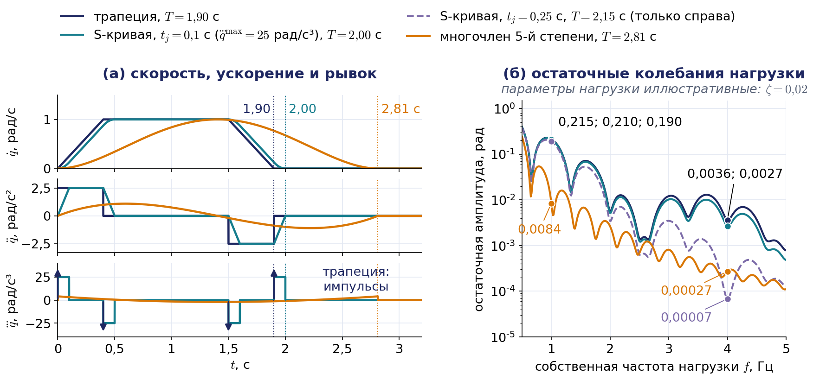
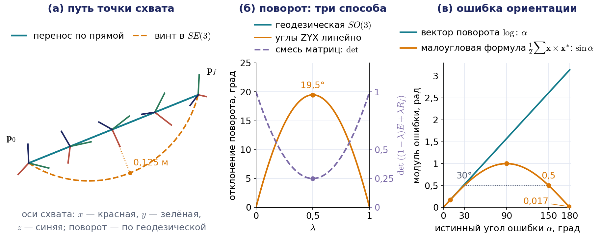
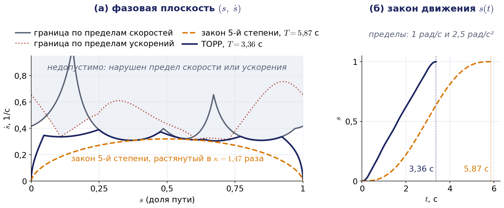

# Лекция 4. Планирование траекторий и кинематическое управление

Лекция построена по главе 4 учебника С. Л. Зенкевича и А. С. Ющенко «Основы управления манипуляционными роботами» (§ 4.1 и 4.2). Номера формул в круглых скобках вида (4.24) — это номера формул учебника; они приводятся, чтобы лекцию было удобно читать параллельно с книгой. Рисунки и примеры лекции имеют собственную нумерацию, не совпадающую с нумерацией книги. В нескольких местах формулы учебника напечатаны с опечатками, а в одном месте наша постановка приводит к другому выводу; в таких случаях приводится исправленный результат, а расхождение оговаривается фразой, начинающейся словами «Примечание о расхождении с книгой». Обозначения взяты из общей таблицы курса (файл «Обозначения.md» в папке «00_Паспорт»), поэтому местами они отличаются от букв учебника; самые заметные отличия названы прямо в тексте. Материал книги дополнен тем, без чего сегодня не обходится ни один курс робототехники ведущих университетов: расчётом времён трапецеидального профиля по пределам привода, синхронизацией сочленений, профилем с ограниченным рывком, оптимальной по времени параметризацией пути, интерполяцией ориентации вдоль геодезической, обоснованием обратной связи по положению функцией Ляпунова и связью каждого метода с тем, как он устроен в контроллерах промышленных роботов и в ROS 2. Всё это понадобится во втором домашнем задании, где схват должен пройти по окружности.

## Введение: от кинематической модели к управлению

В первых трёх лекциях мы строили кинематическую модель манипулятора. Мы научились описывать положение звеньев однородными матрицами $A_i$ и $T_i$, решать прямую и обратную задачи о положении, а на прошлой лекции связали скорости сочленений со скоростью схвата матрицей Якоби: $\boldsymbol{\mathcal V}=J(\mathbf{q})\dot{\mathbf{q}}$, где $\boldsymbol{\mathcal V}=(\boldsymbol{\omega};\mathbf{v})$ — скорость схвата как твёрдого тела, составленная из угловой скорости и линейной скорости начала системы схвата. Напомним соглашение курса: блоки идут в порядке «сначала угловая, потом линейная скорость», как в учебнике и у Линча и Парка, а библиотека kinlib, как Robotics Toolbox и книга Сицилиано, по умолчанию возвращает матрицу Якоби с обратным порядком строк; таблица соглашений библиотек приведена в лекции 3. До сих пор все эти задачи были статическими: дана конфигурация — найти положение, дано положение — найти конфигурацию. Время в них не участвовало. Сегодня мы впервые заставим модель двигаться.

Чтобы разговор с первой минуты был предметным, возьмём сквозной производственный кейс. Робот должен провести сварочную горелку по окружности фланца с заданной скоростью. К движению предъявляются четыре требования. Горелка должна трогаться и останавливаться без удара, иначе механика раскачается и шов получится неровным. Окружность должна быть именно окружностью, а не многоугольником и не кривой, которая «как-нибудь» соединяет заданные точки. Схват должен держать траекторию, даже если приводы отрабатывают команды с ошибкой. Наконец, если окружность проходит рядом с особой конфигурацией, робот не должен ни застрять, ни потребовать от приводов невозможных скоростей. Каждый раздел лекции закрывает одно из этих требований, а в конце лекции мы соберём их в контрольный список. Тот же кейс в упрощённой форме решается во втором домашнем задании.

**Кинематическим управлением** называют управление манипулятором, который описывается только кинематической моделью. Систему приводов при этом считают идеальной: предполагается, что программное движение сочленений отрабатывается совершенно точно. Авторы учебника сразу оговаривают, что это допущение нельзя считать вполне корректным, поскольку заданное и действительное движения всегда различаются из-за неидеальной работы приводов. Чтобы различие не стало чрезмерным, уже на кинематическом уровне приходится помнить о динамике: не требовать от приводов скачков скорости, ограничивать ускорения и рывки, следить за гладкостью задающих воздействий. Разбиение системы управления на уровни — это удобный методический приём, а не свойство самого робота.

Глава 4 учебника отвечает на три вопроса. Как переместить схват из одной точки в другую? Как провести его через последовательность точек, заданных в пространстве обобщённых координат или в декартовом пространстве? Как заставить схват двигаться по заданной траектории? На первые два вопроса отвечает планирование траекторий, на третий — алгоритмы управления в пространстве координат схвата. В них соединится всё, что мы изучили раньше: обратная задача о положении из лекции 2, итерационное решение «цепочкой близких целей» оттуда же, матрица Якоби и псевдообратная матрица из лекции 3.

Несколько слов о буквах. Буквой $T$ в лекции обозначены и длительность движения, и однородная матрица положения; по контексту их всегда легко различить, так же поступают Линч и Парк. Через $\delta\mathbf{q}$ и $\delta\mathbf{s}$ обозначены малые (виртуальные) перемещения, а буква $\delta$ без индекса не используется. Учебник называет трёхдиагональные матрицы, которые появятся в разделе о сплайнах, матрицами Якоби; это термин линейной алгебры, и к матрице Якоби манипулятора $J(\mathbf{q})$ он отношения не имеет.

## 4.1. Постановка задачи и место кинематического управления

### Уровни системы управления

Система управления робота организована иерархически (рис. 4.1, слева). На верхнем, стратегическом, уровне решается задача **планирования движения**: определяется, через какие точки и в каком порядке должен пройти схват, чтобы задание было выполнено, и как при этом обойти препятствия. Результат — геометрия пути, но ещё не закон движения во времени. На тактическом уровне решается задача **планирования траектории**: строится программное движение либо звеньев $\mathbf{q}^{\ast}(t)$, либо схвата $T^{\ast}(t)$ на отрезке времени $[t_0,t_f]$. К этому же уровню относится кинематическое управление. Наконец, исполнительный уровень — это приводы сочленений, отрабатывающие $\mathbf{q}^{\ast}(t)$. Учебник подчёркивает, что в главе 4 речь идёт о планировании именно траекторий, а не движений.

Кинематическое управление обычно реализуется в два этапа. Первый этап — предварительное определение программного движения $\mathbf{q}^{\ast}(t)$, второй — его отработка приводами. Такая двухэтапность характерна для систем **позиционного управления**, в которых задание представляет собой перечень точек позиционирования. Если точки заданы в пространстве обобщённых координат, через них должны пройти сочленения; если в декартовом пространстве — схват. Существуют и методы, не требующие предварительного планирования: в них управляющее воздействие вычисляется на каждом такте по текущему состоянию. Они применяются главным образом в системах **контурного управления**, где важна вся траектория, а не только её конечные точки.

### Современный конвейер движения

Иерархия учебника не устарела, но сегодня у каждого её уровня есть узнаваемый программный аналог, и полезно сразу знать, на каком уровне работает каждый раздел лекции. В типичной системе на основе ROS 2 и MoveIt 2 движение проходит четыре ступени. Сначала планировщик пути ищет бесстолкновительную ломаную в пространстве сочленений; по умолчанию MoveIt 2 использует библиотеку OMPL с алгоритмами семейства RRT, а для массового параллельного планирования на графических процессорах появились пакеты вроде cuRobo. Это уровень планирования движения, и в нашей лекции его нет. Затем полученный путь параметризуется по времени: каждой точке пути назначается момент прохождения так, чтобы не нарушить пределы скорости и ускорения сочленений. В MoveIt 2 по умолчанию для этого служит алгоритм оптимальной по времени параметризации TOTG, после которого траекторию можно дополнительно сгладить генератором Ruckig, ограничивающим рывок. Это ровно задача разделов 4.2–4.4 и 4.6 лекции. Третья ступень — контроллер траектории в ros2_control: он получает узлы траектории и интерполирует между ними многочленами степени 1, 3 или 5, как в разделе 4.3. Последняя ступень — сервопривод каждого сочленения. Методы разделов 4.7–4.9, вычисляющие команду на каждом такте, в этом конвейере соответствуют режиму потокового управления, например пакету MoveIt Servo, о котором речь пойдёт в разделе 4.9.

### Два пространства

Преподаватель, читавший этот курс раньше, называл главную трудность темы проблемой двух миров (рис. 4.1, справа). Задание роботу естественно формулировать в пространстве координат схвата: «взять деталь в точке $A$», «провести горелку вдоль шва». Это мир, в котором описано, что нужно сделать; его переменные — параметры положения $\mathbf{s}$ или матрица $T(t)$. Исполняется же задание в пространстве сочленений $\mathcal{Q}$: приводы понимают только углы и перемещения $q_i$. Мостом между мирами служат три соотношения, которые мы уже знаем. Для положений это обратная задача $\mathbf{q}=\mathbf{f}^{-1}(\mathbf{s})$, для скоростей — $\dot{\mathbf{q}}=J^{-1}(\mathbf{q})\boldsymbol{\mathcal V}$, для сил — $\boldsymbol{\tau}=J^{\mathrm T}(\mathbf{q})\mathbf{F}$. Каждому мосту соответствует свой способ управления, и вся вторая половина лекции — это разбор этих способов.

Начнём с более простой задачи, в которой второй мир вообще не участвует: и задание, и исполнение происходят в пространстве обобщённых координат.

## 4.2. Перевод из точки в точку. Режим разгона — торможения

### Наивное решение и его недостаток

Пусть в пространстве $\mathcal{Q}$ заданы две точки $\mathbf{q}^0$ и $\mathbf{q}^1$. В момент $t_0$ манипулятор находится в точке $\mathbf{q}^0$; требуется найти такую функцию $\mathbf{q}(t)$, чтобы в момент $t_1$ он оказался в точке $\mathbf{q}^1$. Это краевые условия (4.1):

$$
\mathbf{q}(t_0)=\mathbf{q}^0,\qquad \mathbf{q}(t_1)=\mathbf{q}^1.
$$

Без дополнительных ограничений решений бесконечно много. Самое простое из них — движение по прямой в пространстве $\mathcal{Q}$ с постоянной скоростью, формулы (4.2) и (4.3):

$$
\mathbf{q}(t)=\mathbf{q}^0+\dot{\mathbf{q}}\,(t-t_0),\qquad \dot{\mathbf{q}}=\frac{\mathbf{q}^1-\mathbf{q}^0}{t_1-t_0}.
$$

Прежде всего нужно убедиться, что компоненты постоянного вектора $\dot{\mathbf{q}}$ не превышают по модулю предельных скоростей приводов: $\lvert\dot q_i\rvert\le\dot q_i^{\max}$. Если условие нарушено, остаётся увеличивать время $t_1$. Можно поступить иначе: не задавать $t_1$, а потребовать, чтобы наибольшая из скоростей сочленений равнялась пределу привода; тогда $t_1$ становится неизвестной и находится в ходе решения. Так или иначе, планирование приобретает итерационный характер: построили траекторию, проверили ограничения, поправили время. Эта особенность сохранится во всех методах, которые мы рассмотрим.

Главный недостаток наивного решения в другом. До момента $t_0$ манипулятор покоился, а в момент $t_0$ его скорость должна мгновенно стать равной $\dot{\mathbf{q}}$. Скорость терпит разрыв, ускорение в этот момент бесконечно, а значит, от приводов требуются бесконечно большие силы и моменты. То же происходит в момент остановки. Реальный привод отработает такой закон с ошибкой, ударом по механике и колебаниями. Поэтому от программного движения требуют гладкости, и мы рассмотрим два способа её обеспечить.

### Специальная параметризация

Перепишем движение по прямой в виде (4.4):

$$
\mathbf{q}(t)=\mathbf{q}^0+\lambda(t)\,(\mathbf{q}^1-\mathbf{q}^0),
$$

где для равномерного движения $\lambda(t)=(t-t_0)/(t_1-t_0)$ — формула (4.5).

Примечание о расхождении с книгой: в формуле (4.4) учебника в промежуточном выражении напечатан множитель $(t_1-t_0)$ вместо $(t-t_0)$; смысл формулы ясен из её правой части, которая приведена здесь.

Идея состоит в том, чтобы оставить путь прежним, то есть отрезок прямой в пространстве $\mathcal{Q}$, но изменить закон движения вдоль него. Для этого скалярную функцию $\lambda(t)$, которую называют параметром пути, выбирают иначе, потребовав только выполнения условий (4.6):

$$
\lambda(t_0)=0,\qquad \lambda(t_1)=1.
$$

Тогда краевые условия (4.1) выполняются автоматически. Дифференцируя (4.4), получаем соотношение (4.7):

$$
\dot{\mathbf{q}}(t)=\dot\lambda(t)\,(\mathbf{q}^1-\mathbf{q}^0).
$$

Функция $\dot\lambda(t)$ с точностью до постоянного множителя задаёт скорость в каждом сочленении; её называют **профилем скорости**. Интегрируя (4.7) по отрезку $[t_0,t_1]$, получаем единственное условие, которому должен удовлетворять профиль, — условие (4.8):

$$
\int_{t_0}^{t_1}\dot\lambda(t)\,dt=1.
$$

Геометрически это означает, что площадь под графиком профиля скорости равна единице. На рис. 4.2, а показаны четыре профиля из учебника при $t_0=0$, $t_1=T$. Прямоугольный профиль высоты $1/T$ — это наивное решение: скорость в начале и в конце движения меняется скачком, и ускорение там бесконечно. Треугольный профиль имеет высоту $2/T$: разгон занимает первую половину времени, торможение — вторую. У трапецеидального профиля с участками разгона и торможения длительностью $T/3$ высота равна $3/(2T)$. У треугольного и трапецеидального профилей скорость уже непрерывна, но в изломах графика ускорение меняется скачком, хотя и остаётся конечным. Четвёртый профиль,

$$
\dot\lambda(t)=\frac{2}{T}\sin^2\frac{\pi t}{T},
$$

свободен и от этого недостатка. Его ускорение $\ddot\lambda=(2\pi/T^2)\sin(2\pi t/T)$ непрерывно и обращается в нуль на концах, а сам закон движения равен $\lambda(t)=t/T-\sin(2\pi t/T)/(2\pi)$. Платой за гладкость служит более высокая пиковая скорость: $2/T$ против $3/(2T)$ у трапеции.

Важное свойство специальной параметризации состоит в том, что все сочленения движутся синхронно: у них общий профиль, они одновременно трогаются и одновременно останавливаются, а изображающая точка в пространстве $\mathcal{Q}$ идёт по прямой. Это и называют **режимом разгона — торможения**. Сама идея — задать путь отдельно, а закон движения вдоль него отдельно — пройдёт через всю лекцию: мы применим её к сплайнам, к траекториям схвата, к оптимальной по времени параметризации и к замедлению программы у особых точек.

### Трапецеидальный профиль: расчёт времён

Классический профиль, с которого начинались промышленные контроллеры и который до сих пор лежит в основе команды «из точки в точку», — трапеция. В книге её параметры назначены произвольно (три равные части); на практике они определяются возможностями привода. Пусть для одного сочленения заданы перемещение $\Delta q=\lvert q^1-q^0\rvert$, предельная скорость $\dot q^{\max}$ и предельное ускорение $\ddot q^{\max}$. Движение состоит из трёх фаз: разгон с ускорением $\ddot q^{\max}$ в течение времени $t_a$, движение с постоянной скоростью $\dot q^{\max}$ и торможение (рис. 4.2, б). Время разгона равно $t_a=\dot q^{\max}/\ddot q^{\max}$. За разгон и торможение вместе сочленение проходит путь $\dot q^{\max}t_a$; это площадь двух треугольников. Оставшийся путь проходится с постоянной скоростью. Отсюда полное время:

$$
t_a=\frac{\dot q^{\max}}{\ddot q^{\max}},\qquad T=\frac{\Delta q}{\dot q^{\max}}+t_a .
$$

Формула верна, если участок постоянной скорости существует, то есть если $\Delta q\ge(\dot q^{\max})^2/\ddot q^{\max}$. При коротком перемещении привод не успевает набрать предельную скорость, и профиль вырождается в треугольник:

$$
t_a=\sqrt{\frac{\Delta q}{\ddot q^{\max}}},\qquad T=2t_a,\qquad \dot q_{\mathrm{peak}}=\sqrt{\Delta q\,\ddot q^{\max}} .
$$

Сам закон движения на трёх участках получается интегрированием профиля:

$$
q(t)=q^0+\operatorname{sign}(q^1-q^0)\cdot
\begin{cases}
\dfrac{\ddot q^{\max}t^2}{2}, & 0\le t\le t_a,\\[2mm]
\dot q^{\max}\Bigl(t-\dfrac{t_a}{2}\Bigr), & t_a\le t\le T-t_a,\\[2mm]
\Delta q-\dfrac{\ddot q^{\max}(T-t)^2}{2}, & T-t_a\le t\le T.
\end{cases}
$$

В терминах функции $\lambda$ высота трапеции равна $\dot\lambda_{\max}=1/(T-t_a)$; при $t_a=T/3$ получаем книжное значение $3/(2T)$. Трапеция оптимальна по быстродействию: при заданных пределах скорости и ускорения никакой закон движения не переведёт сочленение быстрее, потому что трапеция всё время либо разгоняется с предельным ускорением, либо идёт с предельной скоростью, либо тормозит с предельным замедлением. Современные контроллеры, однако, добавляют к этим двум пределам третий — предел рывка, и пересчитывают профиль в каждом такте из текущего состояния; к этому мы придём в разделе 4.3.

#### Пример 4.1. Времена трапецеидального профиля

Пусть $\Delta q=1{,}5$ рад, $\dot q^{\max}=1$ рад/с, $\ddot q^{\max}=2{,}5$ рад/с². Тогда $t_a=1/2{,}5=0{,}4$ с. Проверяем условие существования полки: $(\dot q^{\max})^2/\ddot q^{\max}=0{,}4$ рад, что меньше $1{,}5$ рад, значит, профиль трапецеидальный. Полное время $T=1{,}5/1+0{,}4=1{,}9$ с; именно этот случай показан на рис. 4.2, б. Если бы перемещение составляло всего $0{,}3$ рад, профиль стал бы треугольным: $t_a=\sqrt{0{,}3/2{,}5}\approx0{,}35$ с, $T\approx0{,}69$ с, а пиковая скорость $\sqrt{0{,}3\cdot2{,}5}\approx0{,}87$ рад/с не достигла бы предельной.

### Синхронизация сочленений

Если рассчитать трапецию для каждого сочленения отдельно, времена $T_i$ получатся разными: сочленение с малым перемещением закончит движение раньше. Изображающая точка в пространстве $\mathcal{Q}$ пойдёт тогда не по прямой, а по ломаной, и траектория схвата станет плохо предсказуемой. Поэтому сочленения синхронизируют. Правило простое. Сначала для каждого сочленения находят собственное время разгона $t_{a,i}=\dot q_i^{\max}/\ddot q_i^{\max}$ и выбирают общее время разгона как наибольшее из них. Затем общее время движения выбирают по самому медленному сочленению, которое называют ведущим:

$$
t_a=\max_i t_{a,i},\qquad T=\max\Bigl(\max_i\frac{\Delta q_i}{\dot q_i^{\max}}+t_a,\ \ 2t_a\Bigr).
$$

После этого скорость полки и ускорение каждого сочленения пересчитывают под общие времена:

$$
\dot q_i=\frac{\Delta q_i}{T-t_a},\qquad \ddot q_i=\frac{\dot q_i}{t_a}.
$$

Проверим, что ограничения выполняются. Если у ведущего сочленения есть участок постоянной скорости, то $T-t_a=\max_i(\Delta q_i/\dot q_i^{\max})$, поэтому $\dot q_i\le\dot q_i^{\max}$ по выбору $T$, а $\ddot q_i=\dot q_i/t_a\le\dot q_i^{\max}/t_a\le\dot q_i^{\max}/t_{a,i}=\ddot q_i^{\max}$ по выбору $t_a$. Если же $\max_i(\Delta q_i/\dot q_i^{\max})<t_a$, то есть первая формула дала бы $T<2t_a$, полагают $T=2t_a$. Профиль становится треугольным, а ограничения по-прежнему выполняются: $\dot q_i=\Delta q_i/t_a<\dot q_i^{\max}$ и $\ddot q_i=\Delta q_i/t_a^2<\dot q_i^{\max}/t_a\le\ddot q_i^{\max}$. Такой профиль допустим, но не обязательно минимален по времени. Все сочленения теперь имеют один и тот же профиль $\dot\lambda(t)$ и различаются только масштабом, то есть мы вернулись к формуле (4.7). На рис. 4.2, в второе сочленение с перемещением $0{,}6$ рад само по себе закончило бы движение за $1$ с; после синхронизации с первым (пример 4.1) оно движется $1{,}9$ с со скоростью полки $0{,}6/1{,}5=0{,}4$ рад/с и ускорением $1$ рад/с².

Треугольный случай легко запрограммировать неправильно, и это поучительно. Пусть два сочленения перемещаются на $0{,}1$ и $1{,}5$ рад при одинаковых пределах скорости $1$ рад/с и пределах ускорения $0{,}5$ и $100$ рад/с². Тогда $t_{a,1}=2$ с, $t_{a,2}=0{,}01$ с, общее $t_a=2$ с, а $\max_i(\Delta q_i/\dot q_i^{\max})=1{,}5$ с меньше $t_a$, поэтому $T=4$ с, и скорости полок равны $0{,}05$ и $0{,}75$ рад/с. Если же в треугольном случае взять время по одним ускорениям, $T=2\max_i\sqrt{\Delta q_i/\ddot q_i^{\max}}\approx0{,}89$ с, то второму сочленению придётся развить $3{,}35$ рад/с при пределе $1$ рад/с, хотя ему самому нужно не меньше $1{,}51$ с. Именно такая ошибка была в ранней версии модуля занятия, поэтому формулы синхронизации всегда стоит проверять на наборах с сильно различающимися пределами.

## 4.3. Полиномиальная интерполяция

### Многочлен пятой степени

Второй подход к построению гладкого перехода состоит в том, чтобы искать закон движения в виде многочлена и подчинить его коэффициенты граничным условиям. Будем рассматривать одну обобщённую координату и обозначать её просто $q$. Кроме условий (4.9) на положение, $q(t_0)=q^0$ и $q(t_1)=q^1$, потребуем выполнения условий (4.10) на скорости и ускорения:

$$
\dot q(t_0)=\dot q(t_1)=0,\qquad \ddot q(t_0)=\ddot q(t_1)=0 .
$$

Условий шесть, поэтому многочлен минимальной степени, способный им удовлетворить, имеет шесть коэффициентов, то есть пятую степень (4.11):

$$
q(t)=a_0+a_1t+a_2t^2+a_3t^3+a_4t^4+a_5t^5 .
$$

Положим $t_0=0$, $t_1=T$; тем самым у каждой пары соседних точек позиционирования появляется собственное локальное время. Условия в начале отрезка сразу дают $a_0=q^0$, $a_1=0$, $a_2=0$. Условия в конце приводят к трём уравнениям для оставшихся коэффициентов:

$$
\begin{aligned}
a_3T^3+a_4T^4+a_5T^5&=q^1-q^0,\\
3a_3T^2+4a_4T^3+5a_5T^4&=0,\\
6a_3T+12a_4T^2+20a_5T^3&=0 .
\end{aligned}
$$

Примечание о расхождении с книгой: в системе уравнений, выписанной в учебнике после формулы (4.11), пропущено уравнение для положения в конце отрезка (первое из трёх приведённых выше); без него система из пяти уравнений не определяет шесть коэффициентов.

Обозначим $\Delta=q^1-q^0$ и введём вспомогательные неизвестные $b_3=a_3T^3$, $b_4=a_4T^4$, $b_5=a_5T^5$. Система принимает вид $b_3+b_4+b_5=\Delta$, $3b_3+4b_4+5b_5=0$, $3b_3+6b_4+10b_5=0$. Вычитая второе уравнение из третьего, находим $b_4=-\tfrac52b_5$, затем из второго $b_3=\tfrac53b_5$, и из первого $b_5=6\Delta$. Окончательно, в безразмерном времени $\bar t=t/T$,

$$
q(t)=q^0+\Delta\,\bigl(10\bar t^3-15\bar t^4+6\bar t^5\bigr),\qquad \bar t=\frac{t}{T}.
$$

Заметим, что результат снова имеет вид специальной параметризации с $\lambda(\bar t)=10\bar t^3-15\bar t^4+6\bar t^5$. Наибольшая скорость достигается в середине отрезка и равна $\tfrac{15}{8}\,\Delta/T$; наибольшее ускорение достигается при $\bar t=\tfrac12\mp\tfrac{1}{2\sqrt3}$ и равно $\tfrac{10}{\sqrt3}\,\Delta/T^2\approx5{,}77\,\Delta/T^2$. Эти два числа позволяют сразу выбрать время движения по ограничениям привода:

$$
T\ge\max\Bigl(\frac{15}{8}\,\frac{\Delta}{\dot q^{\max}},\ \sqrt{\frac{10}{\sqrt3}\,\frac{\Delta}{\ddot q^{\max}}}\Bigr).
$$

### Многочлен третьей степени

Если отказаться от условий на ускорения, останутся четыре условия, и достаточно многочлена третьей степени. Для нулевых граничных скоростей он равен

$$
q(t)=q^0+\Delta\,(3\bar t^2-2\bar t^3).
$$

Наибольшая скорость здесь меньше, $\tfrac32\,\Delta/T$, но ускорение на концах отрезка не равно нулю: оно равно $\pm6\,\Delta/T^2$, то есть в моменты пуска и остановки меняется скачком (рис. 4.3). Это тот же недостаток, что и у трапеции.

Кубический многочлен полезен в другом качестве: он позволяет задать на концах отрезка произвольные скорости $v_0$ и $v_1$. Коэффициенты в этом случае равны

$$
a_0=q^0,\quad a_1=v_0,\quad a_2=\frac{3\Delta-(2v_0+v_1)T}{T^2},\quad a_3=\frac{-2\Delta+(v_0+v_1)T}{T^3}.
$$

Если на последовательности точек назначить в каждом узле разумную скорость, например среднее арифметическое наклонов соседних отрезков, а при смене знака наклона — нуль, то получится гладкая по скорости траектория, проходящая через все узлы без остановок. Ускорение в узлах при этом разрывно. Следующий раздел покажет, как выбрать узловые скорости так, чтобы непрерывным стало и ускорение.

#### Пример 4.2. Цена гладкости

Возьмём данные примера 4.1: $\Delta=1{,}5$ рад, $\dot q^{\max}=1$ рад/с, $\ddot q^{\max}=2{,}5$ рад/с². Для многочлена пятой степени ограничение по скорости даёт $T\ge\tfrac{15}{8}\cdot1{,}5\approx2{,}81$ с, ограничение по ускорению даёт $T\ge\sqrt{5{,}77\cdot1{,}5/2{,}5}\approx1{,}86$ с. Принимаем $T=2{,}81$ с. Трапеция выполняла то же перемещение за $1{,}9$ с. Гладкий закон проигрывает по времени почти в полтора раза, потому что привод лишь на мгновение выходит на предельную скорость.

Что мы получаем взамен? Посадим на звено упругую нагрузку — например, длинный инструмент, у которого первая собственная частота равна $1$ Гц, а относительное демпфирование $\zeta=0{,}02$. В простейшей модели её отклонение $\theta$ от жёсткого движения подчиняется уравнению $\ddot\theta+2\zeta\omega_n\dot\theta+\omega_n^2\theta=-\ddot q(t)$, где $\omega_n=2\pi\cdot1$ рад/с; параметры иллюстративные. Численное интегрирование показывает, что после остановки по трапеции нагрузка продолжает качаться с амплитудой $0{,}215$ рад, а после многочлена пятой степени — с амплитудой $0{,}0084$ рад, примерно в $25$ раз меньше. Для моды с частотой $4$ Гц те же числа равны $0{,}0036$ и $0{,}00027$ рад. Значит, гладкий закон не «отменяет» упругие колебания, а возбуждает их значительно слабее, особенно для собственных частот, высоких по сравнению с $1/T$. При этом гладкость многочлена пятой степени неполная: его третья производная, рывок, на концах отрезка скачком меняется от нуля до $60\Delta/T^3\approx4$ рад/с³. Платить же почти секундой за гладкость не обязательно: в промышленности ту же задачу решают ограничением рывка.

### Ограничение рывка: S-кривая

Третью производную закона движения, $\dddot q$, называют **рывком**. Скачок ускорения означает бесконечный рывок, то есть мгновенное изменение сил в приводе и редукторе; это и раскачивает упругие моды, и изнашивает зубчатые передачи, и увеличивает ошибку слежения сервопривода. Поэтому к пределам скорости и ускорения добавляют предел рывка $\dddot q^{\max}$ и строят профиль из семи участков: ускорение линейно нарастает с наибольшим рывком, держится на пределе $\ddot q^{\max}$, линейно спадает до нуля, затем следует полка скорости и зеркально симметричное торможение. График скорости при этом похож на латинскую букву S, отсюда название **S-кривая** (рис. 4.4).

Время нарастания ускорения равно $t_j=\ddot q^{\max}/\dddot q^{\max}$. Разгон до предельной скорости занимает время $\dot q^{\max}/\ddot q^{\max}+t_j$, и, повторяя рассуждение для трапеции, получаем полное время

$$
t_j=\frac{\ddot q^{\max}}{\dddot q^{\max}},\qquad T=\frac{\Delta q}{\dot q^{\max}}+\frac{\dot q^{\max}}{\ddot q^{\max}}+\frac{\ddot q^{\max}}{\dddot q^{\max}}.
$$

Формула верна, если ускорение успевает выйти на предел, $\dot q^{\max}\ge(\ddot q^{\max})^2/\dddot q^{\max}$, и если скорость успевает выйти на полку, $\Delta q\ge\dot q^{\max}(\dot q^{\max}/\ddot q^{\max}+t_j)$; иначе соответствующие участки исчезают, как у треугольного профиля.

#### Пример 4.3. Время S-кривой для данных примера 4.1

При пределах примера 4.1 и $\dddot q^{\max}=25$ рад/с³ имеем $t_j=2{,}5/25=0{,}1$ с и $T=1{,}5+0{,}4+0{,}1=2{,}0$ с; оба условия применимости выполнены. Остальные строки таблицы получаются так же.

| Закон движения | Время $T$, с |
|---|---|
| трапеция | $1{,}90$ |
| S-кривая, $\dddot q^{\max}=50$ рад/с³ ($t_j=0{,}05$ с) | $1{,}95$ |
| S-кривая, $\dddot q^{\max}=25$ рад/с³ ($t_j=0{,}1$ с) | $2{,}00$ |
| S-кривая, $\dddot q^{\max}=10$ рад/с³ ($t_j=0{,}25$ с) | $2{,}15$ |
| многочлен пятой степени | $2{,}81$ |
| многочлен седьмой степени $35\bar t^4-84\bar t^5+70\bar t^6-20\bar t^7$ (рывок на концах равен нулю) | $3{,}28$ |

### S-кривая как усреднённая трапеция

У S-кривой есть простое и очень полезное описание: её ускорение — это ускорение трапеции, усреднённое скользящим окном некоторой длительности $t_w$. Если окно не длиннее разгона, $t_w\le t_a$, усреднённое ускорение ещё выходит на предел $\ddot q^{\max}$ и нарастает до него ровно за время окна, то есть $t_w=t_j$. Если окно длиннее разгона, пик ускорения снижается до $\ddot q^{\max}t_a/t_w$, а рывок — до $\ddot q^{\max}/t_w$: получается S-кривая с пониженными пределами, у которой ускорение нарастает за время $t_a$. В обоих случаях усреднение удлиняет движение ровно на $t_w$. Для линейной упругой нагрузки такое усреднение умножает амплитуду остаточных колебаний трапеции приблизительно (точно при $\zeta=0$) на множитель $\lvert\sin(\pi ft_w)/(\pi ft_w)\rvert$, где $f$ — собственная частота. Множитель обращается в нуль при $f=k/t_w$, $k=1,2,\dots$, и мал, когда окно сравнимо с периодом колебаний или длиннее его.

Отсюда честный инженерный вывод; его подтверждает расчёт остаточных амплитуд для нагрузки примера 4.2, сведённый в таблицу приложения 4.В. Для моды $4$ Гц S-кривая с $t_j=0{,}25$ с гасит колебания в пятьдесят раз ценой четверти секунды, тогда как многочлен пятой степени гасит их в тринадцать раз ценой девяти десятых секунды. Для низкой моды $1$ Гц короткое нарастание ускорения почти ничего не даёт: нужно окно усреднения порядка периода, то есть около секунды, а это означает пониженные пределы ускорения и рывка. Если же частота известна, быстрее всего работает **формирование входного воздействия** (input shaping): команду складывают с её задержанной копией так, чтобы колебания от двух половин команды гасили друг друга; подробности — в приложении 4.В. Итак, дилемма «трапеция быстрая — многочлен пятой степени щадит механику» ложная: гладкость нужна не вообще, а против конкретных собственных частот, и её добиваются ограничением рывка или формированием команды, а не повышением степени многочлена.

В современных системах S-кривую строят не заранее, а в каждом такте, из текущего состояния, которое может быть каким угодно: робот уже движется, а цель только что сдвинулась. Такие **онлайн-генераторы траекторий** с ограничением скорости, ускорения и рывка, например открытая библиотека Ruckig (Берсхайд и Крёгер, 2021), используются, в частности, в MoveIt 2 как сглаживание после параметризации по времени.

### Почему именно эти многочлены

У многочленов третьей и пятой степени есть вариационный смысл, который объясняет, почему именно они встречаются повсюду. Найдём закон движения, переводящий $q$ из покоя в покой за время $T$ и минимизирующий интеграл $\int_0^T\bigl(q^{(k)}\bigr)^2dt$ от квадрата $k$-й производной. Уравнение Эйлера — Лагранжа для такого функционала имеет вид $q^{(2k)}=0$, то есть решение — многочлен степени $2k-1$, коэффициенты которого определяются $2k$ граничными условиями. При $k=2$ минимизируется интеграл квадрата ускорения, и получается кубический многочлен; при $k=3$ минимизируется интеграл квадрата рывка, и получается многочлен пятой степени. Траектории минимального рывка хорошо описывают движения руки человека (Флэш и Хоган, 1985), поэтому многочлен пятой степени часто называют законом минимального рывка. Тот же принцип объясняет плавность кубического сплайна из следующего раздела: среди всех дважды дифференцируемых функций, проходящих через заданные узлы, естественный кубический сплайн минимизирует $\int(q'')^2dx$ (теорема Холладея).

### Склейка нескольких многочленов

Можно использовать не один многочлен, а несколько, склеенных так, чтобы траектория имела нужную гладкость. Учебник рассматривает разбиение отрезка на три части. На концах всего отрезка заданы $q$, $\dot q$ и $\ddot q$ — это шесть условий; в двух внутренних точках склейки $t_1<t_2$ требуется непрерывность функции и двух её производных — ещё шесть условий. Всего двенадцать уравнений, и сумма степеней трёх многочленов должна удовлетворять соотношению $n_1+n_2+n_3=9$. Подходят, например, тройки $(3,3,3)$ и $(4,1,4)$. Вторая привлекательна тем, что даёт разгон, движение с постоянной скоростью и торможение, то есть сглаженную трапецию. Для обеих троек система двенадцати уравнений однозначно разрешима при любых моментах склейки $0<t_1<t_2<T$; определители выписаны в приложении 4.Б. Средний участок тройки $(4,1,4)$ линеен, поэтому ускорение крайних участков обязано обращаться в нуль в точках склейки: при движении из покоя в покой ускорение разгона — квадратичный «горб», обращающийся в нуль при $t=0$ и $t=t_1$. Скорость полки при этом равна $v=2\Delta/(T-t_1+t_2)$, и назначить её по пределу привода нельзя: её задаёт выбор моментов склейки. Если дополнительно потребовать прохождения заданных точек отрыва и подхода в моменты $t_1$ и $t_2$, условий станет четырнадцать, и понадобится тройка $(4,3,4)$. Систематическое развитие идеи склейки — кубические сплайны.

Примечание о расхождении с книгой: в учебнике сказано, что линейная система для тройки $(4,1,4)$ может оказаться вырожденной, поскольку на среднем участке $\ddot q$ тождественно равно нулю. В принятой постановке (двенадцать условий, перечисленных выше) это не так: определитель не обращается в нуль ни при каких $0<t_1<t_2<T$, а нулевое ускорение на среднем участке лишь накладывает условие $\ddot q=0$ на крайние участки в точках склейки.

### Многочлены в контроллере траектории

Многочлены этого раздела — не учебная абстракция, а то, что работает внутри стандартного контроллера траектории ros2_control (joint_trajectory_controller). Контроллер получает узлы траектории и интерполирует между ними по правилу, которое зависит от того, что задано в узлах. Если заданы только положения, он соединяет их отрезками прямых, и документация прямо не рекомендует этот режим: скорость в узлах разрывна, как у наивного решения раздела 4.2. Если заданы положения и скорости, между узлами строится кубический многочлен с заданными скоростями на концах, как выше. Если заданы ещё и ускорения, используется многочлен пятой степени. Поэтому планировщик, который передаёт контроллеру только положения, фактически требует от приводов скачков скорости в каждом узле.

## 4.4. Обход совокупности точек. Кубические сплайны

### Постановка задачи

Пусть теперь в пространстве $\mathcal{Q}$ задана последовательность точек, которую манипулятор должен обойти, попадая в точку $\mathbf{q}_i$ в момент $t_i$ — условие (4.12):

$$
\mathbf{q}(t_i)=\mathbf{q}_i,\qquad i=0,1,\dots,n .
$$

Скорость прохождения внутренних точек не важна, но на концах траектории скорости и ускорения должны принимать заданные значения; чаще всего требуется, чтобы манипулятор начинал и заканчивал движение в покое. Кроме того, функция $\mathbf{q}(t)$ должна быть непрерывна вместе с первой и второй производными.

Формально задачу решает один интерполяционный многочлен степени $n$ или, с учётом четырёх условий на концах, степени $n+4$. Но число точек при описании сложного контура достигает нескольких сотен. Многочлен такой степени дорого вычислять, а главное, он ведёт себя непредсказуемо: между узлами возникают колебания большой амплитуды, особенно у концов отрезка. Это явление, известное в численном анализе как **явление Рунге**, видно на рис. 4.5: многочлен двенадцатой степени, проходящий через те же тринадцать узлов, что и сплайн, отходит от него у краёв более чем на $3$ рад. Робот, отрабатывающий такую траекторию, будет совершать размашистые движения там, где программист ожидал плавного перехода. Поэтому вместо одного многочлена высокой степени используют много многочленов низкой степени, склеенных в узлах.

### Определение кубического сплайна

Пусть на отрезке $[a,b]$ заданы узлы $a=x_0,x_1,\dots,x_n=b$, расположенные в порядке возрастания и не обязательно равноотстоящие, и числа $q_0,q_1,\dots,q_n$. **Кубическим сплайном** называют функцию $q(x)$, удовлетворяющую трём условиям:

1. $q(x_i)=q_i$ для всех $i$ от $0$ до $n$;
2. функции $q(x)$, $q'(x)$ и $q''(x)$ непрерывны на $[a,b]$;
3. на каждом отрезке $[x_k,x_{k+1}]$ функция $q(x)$ является многочленом степени не выше третьей (4.13).

Подсчитаем число неизвестных и уравнений. На $n$ отрезках имеется $4n$ коэффициентов. Условие 1 даёт $n+1$ уравнение, условие 2 даёт по три уравнения в каждом из $n-1$ внутренних узлов. Всего $4n-2$ уравнения, так что в запасе остаются два свободных условия, которые задают на концах отрезка.

### Система для вторых производных

Ключевое наблюдение: вторая производная кубического многочлена линейна. Обозначим $h_k=x_{k+1}-x_k$ и $q''_k=q''(x_k)$ — пока неизвестные значения второй производной в узлах. Поскольку $q''$ непрерывна, на отрезке $[x_k,x_{k+1}]$ она однозначно определяется узловыми значениями — формула (4.14):

$$
q''(x)=q''_{k+1}\,\frac{x-x_k}{h_k}-q''_k\,\frac{x-x_{k+1}}{h_k}.
$$

Дважды проинтегрировав (4.14) и потребовав, чтобы на каждом отрезке сплайн проходил через оба узла, выразим скорость в узле $x_k$ двумя способами: через правый отрезок $[x_k,x_{k+1}]$ и через левый $[x_{k-1},x_k]$. Приравнивание этих выражений и есть непрерывность первой производной. Подробный вывод с промежуточными формулами (4.15)–(4.20) вынесен в приложение 4.А; результат — основное уравнение (4.21) с обозначениями (4.22) и (4.23):

$$
\alpha_kq''_{k+1}+2q''_k+(1-\alpha_k)\,q''_{k-1}=g_k,\qquad \alpha_k=\frac{h_k}{h_k+h_{k-1}},\qquad g_k=\frac{6}{h_k+h_{k-1}}\Bigl(\frac{q_{k+1}-q_k}{h_k}-\frac{q_k-q_{k-1}}{h_{k-1}}\Bigr).
$$

Правая часть $g_k$ — это ушестерённая разделённая разность второго порядка $6f(x_{k-1},x_k,x_{k+1})$. Сама разделённая разность приближает половину второй производной, поэтому разностным аналогом второй производной, построенным по заданным точкам, служит $g_k/3=2f(x_{k-1},x_k,x_{k+1})$; например, для $q=x^2$ при единичном шаге $g_k=6$, а $q''=2$. Уравнение имеет ясный смысл, если разделить его на три: слева стоит взвешенное среднее вторых производных сплайна в трёх соседних узлах с весами $\alpha_k/3$, $2/3$ и $(1-\alpha_k)/3$, сумма которых равна единице, а справа — разностная вторая производная данных.

Уравнения (4.21), записанные для $k=1,\dots,n-1$, образуют систему (4.24) из $n-1$ линейного уравнения относительно $n+1$ неизвестного $q''_0,\dots,q''_n$. Как и ожидалось, двух уравнений не хватает. Если задать вторые производные на концах, $q''_0$ и $q''_n$, останется система (4.25) вида $A\mathbf{x}=\mathbf{b}$ с вектором неизвестных $\mathbf{x}=(q''_1,\dots,q''_{n-1})^{\mathrm T}$ и матрицей

$$
A=\begin{pmatrix}2&\alpha_1&0&\dots&0\\ 1-\alpha_2&2&\alpha_2&\dots&0\\ 0&1-\alpha_3&2&\dots&0\\ \dots&\dots&\dots&\dots&\dots\\ 0&0&\dots&1-\alpha_{n-1}&2\end{pmatrix}.
$$

Матрица трёхдиагональна и имеет строгое диагональное преобладание: в каждой строке модуль диагонального элемента, равный двум, больше суммы модулей остальных, которая не превосходит $\alpha_k+(1-\alpha_k)=1$. Известная теорема линейной алгебры утверждает, что такая матрица невырождена; значит, решение существует и единственно при любом расположении узлов. Это и есть те ленточные матрицы, которые учебник называет матрицами Якоби.

Когда вторые производные найдены, сплайн на каждом отрезке вычисляется по формуле, которая удобна для программирования:

$$
q(x)=\frac{q''_k(x_{k+1}-x)^3+q''_{k+1}(x-x_k)^3}{6h_k}+\Bigl(\frac{q_k}{h_k}-\frac{q''_kh_k}{6}\Bigr)(x_{k+1}-x)+\Bigl(\frac{q_{k+1}}{h_k}-\frac{q''_{k+1}h_k}{6}\Bigr)(x-x_k).
$$

### Краевые условия

В постановке задачи учебник говорит о четырёх заданных векторах на концах — начальных и конечных скоростях и ускорениях.

Примечание о расхождении с книгой: у кубического сплайна, как показывает подсчёт, свободны только два условия, поэтому одновременно задать на концах и скорости, и ускорения нельзя; в дальнейшем изложении сами авторы задают только $\ddot q_0$ и $\ddot q_n$.

Практически важны два варианта. Первый — заданные ускорения на концах, в частности нулевые; такой сплайн называют естественным. Тогда система (4.24) решается непосредственно, но скорости на концах получаются какими придётся и, вообще говоря, ненулевыми. Второй вариант — заданные скорости на концах, $q'_0=v_0$ и $q'_n=v_n$; для робота, который начинает и заканчивает движение в покое, он важнее. Два недостающих уравнения получаются из выражений для скорости в крайних узлах (формулы (4.18) при $k=0$ и (4.20) при $k=n$ из приложения 4.А):

$$
2q''_0+q''_1=\frac{6}{h_0}\Bigl(\frac{q_1-q_0}{h_0}-v_0\Bigr),\qquad q''_{n-1}+2q''_n=\frac{6}{h_{n-1}}\Bigl(v_n-\frac{q_n-q_{n-1}}{h_{n-1}}\Bigr).
$$

Система остаётся трёхдиагональной, но её порядок становится равным $n+1$. Именно так построен сплайн на рис. 4.5: скорость на концах равна нулю, а ускорение — нет. Если нужно обнулить на концах и скорость, и ускорение, применяют один из двух приёмов: либо добавляют вблизи концов по одному вспомогательному узлу, значение в котором не задаётся, а подбирается, либо на первом и последнем отрезках используют многочлены четвёртой степени. Эквивалентной альтернативой системе для вторых производных служит система для узловых скоростей $q'_k$ и кубические многочлены Эрмита из предыдущего раздела; она тоже трёхдиагональна.

### Метод прогонки

Трёхдиагональные системы решают специальным рекуррентным методом — **методом прогонки** (в зарубежной литературе — алгоритм Томаса). Решение ищут в виде $q''_k=c_kq''_{k+1}+d_k$. Алгоритм состоит из двух проходов. На прямом ходе слева направо по уравнениям (4.21) вычисляются коэффициенты $c_k$ и $d_k$; этим краевое условие на левом конце как бы перегоняется вправо. На обратном ходе справа налево, начиная с известного $q''_n$, находятся сами неизвестные. Благодаря диагональному преобладанию знаменатели не обращаются в нуль, а $\lvert c_k\rvert$ не превосходит единицы, так что ошибки округления не нарастают. Число операций пропорционально $n$, а не $n^3$, как в методе Гаусса общего вида, что существенно при сотнях узлов. Рекуррентные формулы (4.27)–(4.32) и ручной расчёт примера 4.4 приведены в приложении 4.А; в практической работе тот же результат даёт любая библиотека сплайнов, например `scipy.interpolate.CubicSpline` с краевыми условиями `natural` или `clamped`.

#### Пример 4.4. Сплайн через четыре узла

Пусть узлы равноотстоящие, $x_k=0,1,2,3$ с, значения $q_k=0;\ 1;\ 1{,}5;\ 3$ рад. Для естественного сплайна с нулевыми ускорениями на концах при равных шагах $\alpha_k=\tfrac12$ и $g_k=3(q_{k+1}-2q_k+q_{k-1})$, откуда $g_1=-1{,}5$ и $g_2=3$. Прогонка (её шаги выписаны в приложении 4.А) даёт $q''=(0;\ -1{,}2;\ 1{,}8;\ 0)$ рад/с². Проверка первым уравнением системы: $0{,}5\cdot1{,}8+2\cdot(-1{,}2)=-1{,}5$. Начальная скорость равна $q'_0=1{,}2$ рад/с: естественный сплайн не начинается с покоя. Если вместо ускорений задать нулевые скорости на концах, получится система четвёртого порядка с решением $q''=(4{,}4;\ -2{,}8;\ 3{,}8;\ -6{,}4)$ рад/с²; скорости во внутренних узлах равны $0{,}8$ и $1{,}3$ рад/с, а наибольшая скорость около $2{,}0$ рад/с достигается на последнем отрезке, при $t\approx2{,}37$ с. Оба ответа совпадают с `CubicSpline` из SciPy.

### Планирование траектории с помощью сплайнов

Применительно к роботу аргумент $x$ — это время, а сплайн строится независимо для каждой обобщённой координаты по общей сетке моментов $t_k$. Учебник сопровождает метод тремя замечаниями, и каждое стоит дополнить взглядом из сегодняшнего дня.

Первое. Метод прогонки требует обратного хода, то есть знания всех узлов заранее. Значит, сплайн строится в режиме off-line, до начала движения. Это верно для сплайна, но не для планирования вообще: онлайн-генераторы вроде упомянутого Ruckig пересчитывают траекторию из текущего состояния в каждом такте и потому годятся для целей, которые меняются во время движения.

Второе. При циклически повторяемых движениях, когда последовательность точек описывает замкнутый контур и $\mathbf{q}_0=\mathbf{q}_n$, траекторию нужно замкнуть, потребовав $\dot{\mathbf{q}}_0=\dot{\mathbf{q}}_n$ и $\ddot{\mathbf{q}}_0=\ddot{\mathbf{q}}_n$. Такой сплайн называют периодическим. Система уравнений при этом перестаёт быть строго трёхдиагональной (появляются угловые элементы), но решается вариантом прогонки; в SciPy это краевое условие `periodic`. Это как раз случай окружности из домашнего задания, если её нужно обходить многократно без остановок.

Третье. На построенной траектории скорости и ускорения могут превысить допустимые значения $\dot q_i^{\max}$ и $\ddot q_i^{\max}$ — ограничения (4.33) и (4.34). Проверить это несложно. Ускорение на каждом отрезке линейно, поэтому его экстремумы достигаются в узлах и равны $q''_k$. Скорость на отрезке квадратична, поэтому кроме узлов нужно проверить внутреннюю точку, где $q''$ обращается в нуль; такая точка существует, если $q''_k$ и $q''_{k+1}$ разного знака, и равна $x_k+h_kq''_k/(q''_k-q''_{k+1})$. Если ограничение нарушено, увеличивают тот временной интервал, где это произошло, и пересчитывают сплайн. Полезно помнить правило масштабирования: если все интервалы растянуть в $\kappa$ раз, скорости уменьшатся в $\kappa$ раз, а ускорения — в $\kappa^2$ раз, поэтому достаточно взять

$$
\kappa=\max\Bigl(1,\ \max_i\frac{\max\lvert\dot q_i\rvert}{\dot q_i^{\max}},\ \max_i\sqrt{\frac{\max\lvert\ddot q_i\rvert}{\ddot q_i^{\max}}}\Bigr).
$$

Например, у сплайна через тринадцать узлов с рис. 4.5 наибольшие скорость и ускорение равны $1{,}23$ рад/с и $4{,}19$ рад/с²; при пределах $1$ рад/с и $2{,}5$ рад/с² получаем $\kappa=\sqrt{4{,}19/2{,}5}\approx1{,}29$, и после растяжения пики равны $0{,}95$ рад/с и ровно $2{,}5$ рад/с². Равномерное растяжение просто, но расточительно: оно замедляет и те участки, где до пределов далеко. Минимальное время обхода даёт оптимальная по времени параметризация пути, которую мы рассмотрим в разделе 4.6.

В заключение параграфа учебник замечает, что сплайны полезны и для сглаживания негладких функций. Например, функцию $\lvert x\rvert$ на отрезке $[-1,1]$ можно заменить параболическим сплайном, равным $x^2/(2\varepsilon)+\varepsilon/2$ при $\lvert x\rvert\le\varepsilon$ и $\lvert x\rvert$ вне этого интервала; погрешность такой замены не превышает $\varepsilon/2$. Тот же приём скругляет углы ломаной траектории, и именно он стоит за параметром скругления в языках роботов: вместо точного останова в вершине робот срезает угол по гладкой кривой внутри зоны заданного радиуса (см. таблицу в разделе 4.11).

## 4.5. Управление по положению в пространстве координат схвата

### Идея: обратная задача в узлах и сплайн между ними

Методы предыдущих разделов работают в пространстве обобщённых координат, а задание роботу, как мы говорили, формулируется в координатах схвата. Пусть требуемая траектория схвата описывается уравнением (4.35):

$$
\mathbf{s}=\mathbf{s}^{\ast}(t).
$$

Самый прямой путь — решить обратную задачу о положении в каждый момент времени и получить программную траекторию в пространстве $\mathcal{Q}$ (4.36):

$$
\mathbf{q}^{\ast}(t)=\mathbf{f}^{-1}\bigl(\mathbf{s}^{\ast}(t)\bigr).
$$

Авторы называют простоту этого подхода обескураживающей и отмечают его достоинство: при исполнении не нужна матрица Якоби, а значит, не нужно заботиться о вырожденных конфигурациях. Во времена написания учебника решать обратную задачу в темпе движения можно было только тогда, когда она решается аналитически, как для манипуляторов с тремя пересекающимися осями. Поэтому поступали иначе. На траектории выбирают узлы $\mathbf{s}_k=\mathbf{s}^{\ast}(t_k)$, $k=1,\dots,N_{\mathrm k}$, в каждом узле решают обратную задачу и получают $\mathbf{q}_k$, а затем через точки $\mathbf{q}_k$ проводят кубический сплайн в пространстве обобщённых координат (рис. 4.6). Это и есть **контурное управление с использованием сплайн-интерполяции**. И решение обратной задачи, и построение сплайна выполняются на этапе планирования, когда время вычислений не критично; на этапе исполнения приводам остаётся отрабатывать готовую гладкую функцию.

Сегодня критерий выбора сместился. Даже на интерпретируемом языке одна итерация Ньютона для шестизвенника UR5e в нашей библиотеке kinlib занимает на обычном ноутбуке порядка миллисекунды (замер — в демонстрации 8; число зависит от компьютера и его загрузки), а скомпилированные решатели работают на порядки быстрее, так что численная обратная задача укладывается в такт контроллера. Выбор между аналитикой и итерациями определяется теперь не временем, а двумя другими свойствами. Аналитическое решение даёт все ветви сразу, и это нужно, когда требуется выбрать конфигурацию; так работает генератор аналитических решателей IKFast. Итерационное решение от предыдущего узла сохраняет текущую ветвь и не требует вывода формул; так работают решатели KDL и TRAC-IK, которые подключаются к MoveIt 2 как модули. Узлы на траектории схвата по-прежнему нужны: они задают форму пути, а сплайн или контроллер траектории между ними задаёт гладкость.

### Итерационное решение обратной задачи по цепочке близких целей

Если аналитического решения нет, обратную задачу в узлах решают численно. Здесь пригождается схема из лекции 2: итерации Ньютона

$$
\mathbf{q}\leftarrow\mathbf{q}+J^{+}(\mathbf{q})\,\mathbf{e}\bigl(\mathbf{s}_k,\mathbf{q}\bigr),
$$

где $\mathbf{e}$ — невязка между целью и текущим положением схвата. Для плоской задачи это просто разность координат, $\mathbf{e}=\mathbf{s}_k-\mathbf{f}(\mathbf{q})$; для пространственной это вектор $\mathbf{e}=(\delta\boldsymbol{\varphi};\Delta\mathbf{p})$ из ошибки ориентации и ошибки положения, о котором подробно говорится в разделе 4.7. Начальным приближением для узла $k$ служит решение для узла $k-1$. Соседние узлы траектории близки, поэтому начальное приближение всегда хорошее, и метод сходится за одну — три итерации, причём вблизи решения ошибка за шаг примерно возводится в квадрат. Тем самым снимаются обе главные трудности численного метода, о которых шла речь в лекции 2: неопределённость выбора начального приближения и перескок на другую ветвь решения. Решение непрерывно продолжается вдоль траектории, и манипулятор не меняет конфигурацию посреди движения. Вблизи особых точек вместо $J^{+}$ используют демпфированную псевдообратную матрицу; к этому мы вернёмся в разделе 4.9. Такую схему называют **позиционным управлением с итерационным решением обратной задачи о положении**.

### Интерполяция в пространстве сочленений и в декартовом пространстве

Почему нельзя ограничиться двумя узлами — начальным и конечным? Потому что прямая в пространстве $\mathcal{Q}$ не является прямой в декартовом пространстве. На рис. 4.7 показан плоский двухзвенник с единичными звеньями, переходящий из точки $A=(1{,}6;\ -0{,}5)$ в точку $B=(0{,}3;\ 1{,}5)$. При линейной интерполяции углов схват описывает дугу и отходит от отрезка $AB$ на $0{,}54$ м — на величину, сравнимую с размерами рабочей зоны. Если на пути есть препятствие или схват должен вести инструмент вдоль шва, это недопустимо. Наоборот, прямая в декартовом пространстве соответствует в плоскости $(q_1,q_2)$ сильно изогнутой кривой.

Сравним два способа интерполяции.

| Свойство | Интерполяция в пространстве $\mathcal{Q}$ | Интерполяция в декартовом пространстве |
|---|---|---|
| Путь схвата между узлами | заранее неизвестная кривая | заданная линия: прямая, дуга |
| Обратная задача о положении | только в узлах | в каждой точке или в частых узлах |
| Особые точки | не мешают | путь может пройти через особую точку или выйти из рабочей зоны |
| Ограничения приводов | проверяются непосредственно | проверяются после пересчёта в $\dot{\mathbf{q}}$ |
| Применение | перенос, холостые переходы | сварка, окраска, сборка, резка |
| Команда в языках роботов | «из точки в точку» (PTP, MoveJ) | «по прямой» и «по дуге» (LIN, MoveL, CIRC) |

Позиционное управление с узлами на декартовой траектории соединяет достоинства обоих способов: форма пути задаётся в координатах схвата, а гладкость и ограничения обеспечиваются в координатах звеньев.

### Дискретизация и ошибка хорды

Остаётся вопрос, как часто расставлять узлы. Схват совпадает с программной траекторией только в узлах, а между ними отклоняется; учебник ограничивается замечанием, что отклонение зависит от разбиения. Оценим его. Если между узлами углы меняются линейно, то ошибка интерполяции гладкой функции пропорциональна квадрату шага. Правая часть рис. 4.7 подтверждает это расчётом для отрезка $AB$: при одном отрезке разбиения ошибка равна $536$ мм, при восьми — $11{,}6$ мм, при $32$ — $0{,}77$ мм, при $128$ — $0{,}05$ мм; каждое удвоение числа узлов уменьшает ошибку вчетверо. Сплайн вместо ломаной уменьшает ошибку ещё сильнее.

Вторая составляющая ошибки возникает, когда сама программная кривая заменяется ломаной, например окружность — вписанным многоугольником. Это **ошибка хорды**: наибольшее расстояние от дуги до стягивающей её хорды. Для окружности радиуса $\rho$ и углового шага $\Delta\varphi$ она равна

$$
\varepsilon_{\mathrm{ch}}=\rho\Bigl(1-\cos\frac{\Delta\varphi}{2}\Bigr)\approx\frac{\rho\,\Delta\varphi^2}{8}.
$$

Отсюда сразу получается требуемое число узлов. Для окружности радиуса $0{,}4$ м при $36$ узлах ($\Delta\varphi=10^\circ$) ошибка хорды равна $1{,}5$ мм, при $360$ узлах — $0{,}015$ мм. Если задан допуск $\varepsilon_{\mathrm{ch}}$, шаг не должен превышать $\sqrt{8\varepsilon_{\mathrm{ch}}/\rho}$.

#### Пример 4.5. Окружность схвата для двухзвенника

Пусть схват двухзвенника с единичными звеньями должен за время $T=4$ с обойти окружность радиуса $\rho=0{,}4$ м с центром в точке $(1{,}0;\ 0{,}8)$ и остановиться. Зададим движение по окружности законом разгона — торможения:

$$
\mathbf{s}^{\ast}(t)=\begin{pmatrix}1{,}0+\rho\cos\varphi(t)\\ 0{,}8+\rho\sin\varphi(t)\end{pmatrix},\qquad \varphi(t)=2\pi\lambda(t),\qquad \lambda=10\bar t^3-15\bar t^4+6\bar t^5,\quad \bar t=\frac{t}{T}.
$$

Наибольшее удаление окружности от основания равно $\sqrt{1{,}0^2+0{,}8^2}+0{,}4\approx1{,}68$ м, наименьшее — $0{,}88$ м, так что вся окружность лежит внутри рабочей зоны $0\le r\le2$ и далеко от обеих особых конфигураций. Наибольшая скорость схвата равна $2\pi\rho\cdot\tfrac{15}{8}/T\approx1{,}18$ м/с. Далее выбираем, скажем, $72$ отрезка ($73$ узла) равномерно по времени, в каждом узле решаем обратную задачу итерациями от предыдущего узла и сохраняем ветвь $q_2>0$. В осях курса ($x$ вправо, $y$ вверх) это ветвь «локоть вниз»: локоть по всей окружности лежит ниже прямой «основание — схват», а в точке $(1{,}4;\ 0{,}8)$ находится в точке $(0{,}99;\ -0{,}11)$, ниже основания. На каждый узел уходит в среднем $2{,}8$ итерации, и $q_2$ меняется в пределах от $66^\circ$ до $128^\circ$. Через узлы проводим для $q_1(t)$ и $q_2(t)$ сплайны с нулевыми скоростями на концах; их наибольшие скорости равны $1{,}45$ и $1{,}47$ рад/с, а ускорения — около $5{,}4$ рад/с². Если приводы этого не допускают, увеличиваем $T$ по правилу растяжения или, лучше, перепараметризуем путь по времени (пример 4.8). Обратите внимание: узлы, равномерные по времени, неравномерны по дуге. У концов, где движение медленное, шаг по дуге составляет доли миллиметра, а в середине обхода достигает $65$ мм ($9{,}4^\circ$), и худшая ошибка хорды равна $1{,}3$ мм, хотя при равномерном шаге $5^\circ$ она была бы $0{,}38$ мм. Для технологических задач узлы поэтому расставляют равномерно по дуге, а закон движения задают отдельно.

#### Пример 4.6. Та же схема для шестизвенника UR5e

Сквозной пример курса — коллаборативный робот UR5e с таблицей Денавита — Хартенберга производителя (функция `kinlib.make_ur5e()`). Поставим его в типичную рабочую конфигурацию $\mathbf{q}=(0;\ -90^\circ;\ 90^\circ;\ -90^\circ;\ -90^\circ;\ 0)$; схват находится в точке $(-0{,}492;\ -0{,}133;\ 0{,}488)$ м. Пусть схват должен обойти горизонтальную окружность радиуса $0{,}15$ м, проходящую через эту точку, с неизменной ориентацией, и пусть окружность разбита на $72$ дуги. Решая полную обратную задачу (положение и ориентация) итерациями Ньютона по цепочке узлов, получаем ровно две итерации на узел; невязка в каждом узле меньше $10^{-5}$ м, а наибольшее изменение угла какого-либо сочленения между соседними узлами — $3{,}3^\circ$. Если же в каждом узле начинать итерации из нулевой конфигурации, решатель тратит в среднем девять итераций, а иногда до двадцати двух, в одном узле не сходится вовсе, а соседние решения в $26$ местах из $72$ различаются больше чем на $30^\circ$: решатель перескакивает между ветвями, и сплайн через такие узлы заставил бы робота «размахивать» звеньями. Это главная типовая ошибка второго домашнего задания.

## 4.6. Формирование программной траектории схвата

### Перенос по прямой и поворот вокруг постоянной оси

До сих пор мы не спрашивали, откуда берётся программная траектория схвата. Рассмотрим типовую задачу: заданы матрицы положения схвата в начальной и конечной точках (4.37),

$$
T_0^{\ast}=\begin{pmatrix}R_0&\mathbf{p}_0\\ 0&1\end{pmatrix},\qquad T_f^{\ast}=\begin{pmatrix}R_f&\mathbf{p}_f\\ 0&1\end{pmatrix},
$$

и моменты начала и окончания движения $t_0$ и $t_f$. Звёздочка напоминает, что это заданные, программные значения; буквой $T_0$ без звёздочки в курсе обозначена базовая система. Нужно построить непрерывную траекторию $T(t)$, обеспечивающую режим разгона — торможения. Трудность в том, что ориентацию, в отличие от положения, нельзя интерполировать покомпонентно: полусумма двух матриц поворота не является матрицей поворота. Учебник ищет траекторию в виде (4.38):

$$
T(t)=T_0^{\ast}\,A(t),\qquad A(t)=\begin{pmatrix}R_A(t)&\mathbf{p}_A(t)\\ 0&1\end{pmatrix},
$$

где $A$ — матрица относительного перемещения из начального положения, составленная из поворота $R_A(t)$ и переноса $\mathbf{p}_A(t)$, записанных в осях начальной системы схвата. Из (4.38) следует $A(t)=(T_0^{\ast})^{-1}T(t)$. Условия $T(t_0)=T_0^{\ast}$ и $T(t_f)=T_f^{\ast}$ дают граничные условия для матрицы $A$:

$$
A(t_0)=E,\qquad A(t_f)=(T_0^{\ast})^{-1}T_f^{\ast},
$$

то есть

$$
R_A(t_0)=E,\quad R_A(t_f)=R_0^{\mathrm T}R_f,\qquad \mathbf{p}_A(t_0)=0,\quad \mathbf{p}_A(t_f)=R_0^{\mathrm T}(\mathbf{p}_f-\mathbf{p}_0).
$$

Примечание о расхождении с книгой: в учебнике формулы (4.39), (4.41) и (4.42) напечатаны как $A=TT_0^{-1}$, $A(t_0+\tau)=T_0T_f^{-1}$ и $R(t_0+\tau)=R_0R_f$, что не согласуется с исходной записью (4.38) и с формулой (4.43) самой книги; при записи $T=T_0A$ правильны приведённые здесь выражения. Учебник обозначает длительность движения буквой $\tau$, ось поворота — $\mathbf{n}$, угол — $\delta$, а перенос — $\boldsymbol{\rho}$.

Ось $\mathbf{k}$ и угол $\alpha_f$ полного относительного поворота находятся по матрице $R_A(t_f)$ с элементами $r_{ij}$ с помощью формул (4.44) и (4.45), известных из лекции 1:

$$
\cos\alpha_f=\frac12\bigl(\operatorname{tr}R_A(t_f)-1\bigr),\qquad \mathbf{k}=\frac{1}{2\sin\alpha_f}\begin{pmatrix}r_{32}-r_{23}\\ r_{13}-r_{31}\\ r_{21}-r_{12}\end{pmatrix}.
$$

Промежуточная матрица поворота строится по формуле Родрига (4.46):

$$
R_A(t)=\cos\alpha(t)\,E+\bigl(1-\cos\alpha(t)\bigr)\,\mathbf{k}\mathbf{k}^{\mathrm T}+\sin\alpha(t)\,\Lambda(\mathbf{k}),
$$

где $\Lambda(\mathbf{k})$ — знакомая кососимметрическая матрица векторного произведения. Остаётся выбрать скалярные законы. Естественно взять один и тот же профиль для переноса и поворота:

$$
\alpha(t)=\lambda(t)\,\alpha_f,\qquad \mathbf{p}_A(t)=\lambda(t)\,R_0^{\mathrm T}(\mathbf{p}_f-\mathbf{p}_0),\qquad \lambda(t)=\hat\lambda\Bigl(\frac{t-t_0}{t_f-t_0}\Bigr),
$$

где $\hat\lambda$ — любая из функций разделов 4.2 или 4.3, меняющаяся от нуля до единицы на отрезке $[0,1]$. Это та же специальная параметризация, перенесённая в пространство координат схвата. Какой получается траектория? Положение схвата равно $\mathbf{p}(t)=\mathbf{p}_0+R_0\mathbf{p}_A(t)=\mathbf{p}_0+\lambda(t)(\mathbf{p}_f-\mathbf{p}_0)$, то есть характерная точка движется по отрезку прямой, а схват одновременно равномерно по $\lambda$ поворачивается вокруг оси $R_0\mathbf{k}$, неподвижной в пространстве. Формулы теряют смысл при $\sin\alpha_f=0$: если $\alpha_f=0$, поворачиваться не нужно, а при $\alpha_f=\pi$ ось находят из диагональных элементов матрицы. В плоской задаче всё сводится к линейной интерполяции одного угла: $\varphi(t)=\varphi_0+\lambda(t)(\varphi_f-\varphi_0)$.

Если для переноса и поворота заданы отдельные пределы — линейной скорости и ускорения для точки схвата и угловой скорости и ускорения для поворота, — то длительность выбирают как наибольшую из двух длительностей трапеций: для пути $\lVert\mathbf{p}_f-\mathbf{p}_0\rVert$ и для угла $\alpha_f$. Это декартов аналог синхронизации сочленений из раздела 4.2. После этого всё равно нужно проверить скорости сочленений вдоль пути, потому что декартова прямая может пройти рядом с особой конфигурацией.

### Геодезическая на SO(3) и SLERP

Построение учебника имеет компактную запись, которую полезно знать, потому что именно в ней его описывают современные книги и библиотеки. По лекции 1 матрица поворота на угол $\alpha$ вокруг оси $\mathbf{k}$ есть экспонента кососимметрической матрицы, $R=\exp\bigl(\alpha\Lambda(\mathbf{k})\bigr)$, а обратная операция — матричный логарифм, $\log R=\alpha\Lambda(\mathbf{k})$; формулы (4.44)–(4.45) вычисляют именно логарифм, а формула Родрига (4.46) — экспоненту. Поэтому траектория поворота записывается одной строкой:

$$
R(t)=R_0\exp\Bigl(\lambda(t)\,\log\bigl(R_0^{\mathrm T}R_f\bigr)\Bigr).
$$

Это кратчайший путь между двумя ориентациями — **геодезическая** в группе поворотов $SO(3)$, — пройденный с законом $\lambda(t)$. Если ориентации записаны кватернионами (лекция 1, подробно лекция 7), та же кривая называется **SLERP** (spherical linear interpolation, Шумейк, 1985). На практике у SLERP одна ловушка: кватернион и противоположный ему кватернион задают одну ориентацию, поэтому перед интерполяцией выбирают знак, при котором путь короче. Именно так интерполирует поворот команда движения по прямой (LIN) в промышленном планировщике Pilz, входящем в MoveIt 2.

Геодезическую полезно сравнить с двумя другими способами, которые часто программируют по неопытности или по традиции.

#### Пример 4.7. Поворот схвата: три способа интерполяции

Сравнение показано на рис. 4.8. Пусть $R_0=E$, $\mathbf{p}_0=(0{,}5;\ 0;\ 0{,}3)$ м, а конечная ориентация получается поворотом на $120^\circ$ вокруг оси $\mathbf{k}=(1;1;1)/\sqrt3$, то есть $R_f$ переставляет оси по кругу: её столбцы равны $(0;1;0)$, $(0;0;1)$ и $(1;0;0)$; $\mathbf{p}_f=(0{,}3;\ 0{,}4;\ 0{,}5)$ м.

Первый способ — покомпонентная интерполяция матриц, $(1-\lambda)R_0+\lambda R_f$. В середине пути получается матрица $(E+R_f)/2$ с сингулярными числами $(1;\ \cos(\alpha_f/2);\ \cos(\alpha_f/2))$, то есть $(1;\ 0{,}5;\ 0{,}5)$ и определителем $0{,}25$: это не поворот, а сжатие осей вдвое. При $\alpha_f=180^\circ$ полусумма имеет ранг 1, и от тройки осей остаётся одна.

Второй способ — линейная интерполяция углов Эйлера, например углов рыскания, тангажа и крена. Для нашей $R_f$ они равны $(90^\circ;\ 0;\ 90^\circ)$. Промежуточные ориентации отклоняются от геодезической до $19{,}5^\circ$, а суммарный угол, на который поворачивается схват, равен $127^\circ$ вместо кратчайших $120^\circ$. Хуже того, результат зависит от выбранной тройки углов, а при переходе через $\pm180^\circ$ интерполяция углов может повернуть схват «длинным путём».

Третий способ — интерполяция всей однородной матрицы вдоль винта, $T(t)=T_0^{\ast}\exp\bigl(\lambda\log((T_0^{\ast})^{-1}T_f^{\ast})\bigr)$, как в главе 9 книги Линча и Парка. Это тоже геодезическая, но в группе движений $SE(3)$: поворот и перенос связаны, и точка схвата идёт по винтовой линии. В нашем примере она уходит от отрезка, соединяющего $\mathbf{p}_0$ и $\mathbf{p}_f$ (длина $0{,}49$ м), на $0{,}125$ м. Для команды «по прямой» это недопустимо, поэтому промышленные системы используют раздельную интерполяцию учебника: перенос по прямой, поворот по геодезической $SO(3)$.

Построенную траекторию $T^{\ast}(t)$ можно отрабатывать либо позиционным методом из раздела 4.5, либо методами, к которым мы перейдём после того, как выясним, каким выбрать закон движения вдоль пути.

### Закон движения вдоль пути: оптимальная по времени параметризация

Во всех примерах до сих пор закон движения вдоль пути $\lambda(t)$ мы выбирали заранее, а потом растягивали время, пока не выполнятся ограничения приводов. Это надёжно, но медленно: растяжение замедляет всё движение из-за одного «тяжёлого» участка. Поставим вопрос иначе: путь в пространстве сочленений $\mathbf{q}(s)$, $s\in[0,1]$, задан, а закон $s(t)$ нужно выбрать так, чтобы пройти путь за наименьшее время, не нарушив пределов $\lvert\dot q_i\rvert\le\dot q_i^{\max}$ и $\lvert\ddot q_i\rvert\le\ddot q_i^{\max}$. Это **оптимальная по времени параметризация пути** (time-optimal path parameterization, TOPP); параметр $s$ играет ту же роль, что $\lambda$ в разделе 4.2. Обратите внимание на шрифт: светлое $s$ — скалярный параметр пути, а не жирный вектор $\mathbf{s}$ положения схвата.

По правилу дифференцирования сложной функции

$$
\dot{\mathbf{q}}=\mathbf{q}'(s)\,\dot s,\qquad \ddot{\mathbf{q}}=\mathbf{q}'(s)\,\ddot s+\mathbf{q}''(s)\,\dot s^2,
$$

где штрих обозначает производную по $s$. Первое соотношение превращает пределы скоростей в ограничение сверху на скорость движения по пути: $\dot s\le\min_i\dot q_i^{\max}/\lvert q'_i(s)\rvert$. Второе при каждом $s$ и $\dot s$ превращает пределы ускорений в отрезок допустимых значений $\ddot s$. Если $\mathbf{q}''(s)\ne0$, то с ростом $\dot s$ слагаемое $\mathbf{q}''\dot s^2$ сдвигает границы этого отрезка, и при достаточно большом $\dot s$ он становится пустым: ни торможение, ни разгон уже не удерживают все сочленения в пределах ускорений. Это второе ограничение сверху на $\dot s$. Поэтому задачу удобно рисовать на **фазовой плоскости** $(s,\dot s)$ (рис. 4.9). На ней есть кривая предельной скорости — нижняя из двух границ, по пределам скоростей и по пределам ускорений: выше неё движение по пути невозможно. В общей постановке TOPP вместо пределов ускорений сочленений подставляют пределы моментов приводов, выраженные через уравнения динамики, и рассуждение не меняется. Оптимальная кривая $\dot s(s)$ начинается и кончается на оси $\dot s=0$ (покой) и устроена по принципу «газ — тормоз»: на каждом участке она либо разгоняется с наибольшим допустимым $\ddot s$, либо тормозит с наименьшим, либо скользит вдоль кривой предельной скорости. Время прохождения равно $\int_0^1ds/\dot s$, поэтому чем выше идёт кривая, тем быстрее движение.

Численно оптимальную кривую строят двумя проходами по фазовой плоскости: от конца пути назад с наибольшим замедлением и от начала вперёд с наибольшим ускорением. Классические алгоритмы и современный алгоритм TOPP-RA, идея которого использована для рис. 4.9, описаны в приложении 4.В; в MoveIt 2 по умолчанию используется родственный алгоритм TOTG (Кунц и Стилман, 2012).

Связь с предыдущими разделами прямая. Для одного сочленения и прямой в пространстве $\mathcal{Q}$ имеем $q'(s)=\Delta q$ и $q''(s)=0$, поэтому ограничения сводятся к $\dot s\le\dot q^{\max}/\Delta q$ и $\lvert\ddot s\rvert\le\ddot q^{\max}/\Delta q$, а оптимальный закон — разгон с наибольшим ускорением, полка и торможение — есть в точности трапеция раздела 4.2. Масштабирование времени у особой точки, которое мы рассмотрим в разделе 4.9, тоже окажется частным случаем TOPP.

#### Пример 4.8. Окружность за наименьшее время

Вернёмся к окружности примера 4.5 и примем для обоих сочленений пределы примера 4.1: $1$ рад/с и $2{,}5$ рад/с². Закон $\lambda(\bar t)$ пятой степени при $T=4$ с требует до $1{,}47$ рад/с и $5{,}38$ рад/с², поэтому при равномерном растяжении нужно $\kappa\approx1{,}47$ (и по скорости, и по ускорению получается почти одно и то же), и обход займёт $5{,}87$ с. Оптимальная параметризация того же пути, найденная двухпроходным алгоритмом на сетке из тысячи точек, проходит окружность из покоя в покой примерно за $3{,}36$ с, то есть на 43 % быстрее, причём ни одно сочленение не превышает $1$ рад/с и $2{,}5$ рад/с². Примерно на трети пути граница по пределам ускорений лежит ниже границы по пределам скоростей, и на некоторых участках оптимальная кривая идёт именно вдоль неё (рис. 4.9). Скорость схвата вдоль окружности теперь неравномерна: там, где сочленениям легко, схват идёт быстрее, а там, где одно из них упирается в предел, — медленнее. Для второго домашнего задания это означает, что время обхода окружности стоит не подбирать вручную, а получить как результат параметризации.

## 4.7. Линеаризованный позиционный алгоритм управления

### Одна итерация Ньютона на такт

Рассмотрим алгоритм управления по положению, в котором обратная задача о положении вообще не решается. Он основан на том, что целевое положение схвата, то есть рассчитанное программное движение, и его текущее положение различаются мало.

Пусть $T^{\ast}=T(\mathbf{q})$ — уравнение (4.47), связывающее искомый вектор обобщённых координат с целевым положением схвата. Применим к нему метод Ньютона из лекции 2. Получаем рекуррентные соотношения (4.48)–(4.50):

$$
\Delta\mathbf{q}_{k+1}=J^{-1}(\mathbf{q}_k)\,\mathbf{e}_k,\qquad \Delta\mathbf{q}_{k+1}=\mathbf{q}_{k+1}-\mathbf{q}_k,\qquad \mathbf{e}_k=\begin{pmatrix}\delta\boldsymbol{\varphi}_k\\ \Delta\mathbf{p}_k\end{pmatrix}\approx\begin{pmatrix}\boldsymbol{\omega}_k\\ \mathbf{v}_k\end{pmatrix}\Delta t .
$$

Вектор $\mathbf{e}_k$ отражает несовпадение положения схвата на $k$-й итерации с программным. Его можно понимать как малое перемещение, которое ликвидирует рассогласование за время $\Delta t$ поворотом с угловой скоростью $\boldsymbol{\omega}_k$ и переносом со скоростью $\mathbf{v}_k$; порядок блоков тот же, что в скорости $\boldsymbol{\mathcal V}=(\boldsymbol{\omega};\mathbf{v})$. Учебник обозначает этот вектор $\Delta\mathbf{s}_k$. Компоненты рассогласования вычисляются по результатам лекции 3 о дифференциальных перемещениях — формулы (4.51) и (4.52):

$$
\Delta\mathbf{p}_k=\mathbf{p}^{\ast}-\mathbf{p}_k,\qquad \delta\boldsymbol{\varphi}_k\approx\frac12\bigl(\mathbf{x}_k\times\mathbf{x}^{\ast}+\mathbf{y}_k\times\mathbf{y}^{\ast}+\mathbf{z}_k\times\mathbf{z}^{\ast}\bigr),
$$

где $\mathbf{x}^{\ast},\mathbf{y}^{\ast},\mathbf{z}^{\ast},\mathbf{p}^{\ast}$ — столбцы целевой матрицы положения $T^{\ast}(t)$ (4.53), а $\mathbf{x}_k,\mathbf{y}_k,\mathbf{z}_k,\mathbf{p}_k$ — столбцы текущей.

### Ошибка ориентации при конечном повороте

Формула (4.52) для ошибки ориентации справедлива только для малых поворотов, и важно понимать, насколько именно. Если текущая ориентация отличается от целевой поворотом на угол $\alpha$ вокруг оси $\mathbf{k}$, то полусумма векторных произведений в точности равна $\mathbf{k}\sin\alpha$. Направление правильное, а модуль равен синусу угла, а не самому углу:

| Истинный угол ошибки | $\alpha$, рад | $\lVert\frac12\sum\mathbf{x}\times\mathbf{x}^{\ast}\rVert=\sin\alpha$ |
|---|---|---|
| $10^\circ$ | $0{,}175$ | $0{,}174$ |
| $90^\circ$ | $1{,}571$ | $1{,}000$ |
| $150^\circ$ | $2{,}618$ | $0{,}500$ |
| $179^\circ$ | $3{,}124$ | $0{,}017$ |

При малых ошибках разницы нет, но функция немонотонна: ошибка в $150^\circ$ «весит» столько же, сколько ошибка в $30^\circ$, а около $180^\circ$ обратная связь по ориентации почти выключается. Это застревание того же рода, что у особых точек в разделе 4.9. Для больших ошибок вместо (4.52) берут **вектор поворота** — логарифм матрицы ошибки:

$$
\delta\boldsymbol{\varphi}=\alpha\,\mathbf{k}=\log\bigl(R^{\ast}R^{\mathrm T}\bigr)^{\vee},
$$

где знак ${}^{\vee}$ означает переход от кососимметрической матрицы к вектору (лекция 1). Эквивалентный вариант — векторная часть кватерниона ошибки с выбором знака, дающего кратчайший поворот. Именно вектор поворота вычисляет функция `pose_error` библиотеки kinlib. В примерах этой лекции ошибки малы, и обе формулы дают одно и то же; но в программе, которая должна работать при любых начальных условиях, правильнее сразу использовать логарифм.

### Решатель обратной задачи как следящая система

Теперь сделаем решающий шаг. Если целевое положение меняется от такта к такту мало, итерационный процесс (4.48) практически сходится за одну итерацию. Тогда можно на каждом такте управления выполнять ровно одну итерацию, но уже для нового целевого положения. Решатель обратной задачи превращается в следящую систему: схват следит за программной матрицей $T^{\ast}(t)$ (рис. 4.10). Это та же цепочка близких целей, что и в разделе 4.5, только перенесённая из этапа планирования в реальное время. Отсюда название: **линеаризованный позиционный алгоритм**.

Учебник делает два замечания о реализации. Первое касается того, куда подавать вычисленные приращения. На рис. 4.10 приращения $\Delta\mathbf{q}$ накапливаются внутренним сумматором, то есть дискретным интегратором, а обратная связь по положению схвата замыкается внешним контуром через датчики сочленений и прямую задачу о положении. Если приводы замкнуты по скорости, внутренний сумматор не нужен: отношения $\Delta\mathbf{q}/\Delta t$ пропорциональны требуемым скоростям сочленений, и их подают приводам как задания по скорости, а точность обеспечивает внешний контур. Если приводы замкнуты по положению, приращения суммируют и подают сумму как задание по положению. Второе замечание: текущее положение схвата нужно вычислять по показаниям датчиков сочленений $\mathbf{q}_{\mathrm m}$, а не по вычисленным углам $\mathbf{q}$; тогда рассогласование учитывает действительное состояние механизма, включая ошибки приводов. Оба замечания выражают общий принцип обратной связи. По сравнению с позиционным методом раздела 4.5 алгоритм работает в реальном времени и не требует решения обратной задачи, но зато на каждом такте обращает матрицу Якоби и потому чувствителен к вырожденным конфигурациям.

## 4.8. Управление по вектору скорости и по вектору ускорения

### Управление по вектору скорости

Под **управлением по вектору скорости** понимают способ управления, при котором скорость схвата (4.54) совпадает с командным вектором (4.55) или близка к нему:

$$
\boldsymbol{\mathcal V}=\begin{pmatrix}\boldsymbol{\omega}\\ \mathbf{v}\end{pmatrix},\qquad \boldsymbol{\mathcal V}^{\ast}=\begin{pmatrix}\boldsymbol{\omega}^{\ast}(t)\\ \mathbf{v}^{\ast}(t)\end{pmatrix}.
$$

Учебник обозначает скорость схвата $\dot{\mathbf{s}}$; в курсе эта буква оставлена за производной параметров положения, а угловая скорость производной углов не является (лекция 3). Учебник иллюстрирует способ управлением от рукоятки — многозвенного механизма с потенциометрами в шарнирах, сигналы которого интерпретируются как компоненты командной скорости. Сегодня источников командной скорости гораздо больше: перемещение схвата кнопками пульта в системе координат базы или инструмента, шестимерная «космическая» мышь, телеуправление, визуальное сервоуправление по камере, команды скорости схвата в языках роботов (например, `speedl` в URScript) и пакет MoveIt Servo в ROS 2. Во всех случаях оператору или программе не нужно думать о конечных точках — они задают направление и темп движения «здесь и сейчас». Закон управления следует из обратной задачи о скорости — формула (4.56):

$$
\dot{\mathbf{q}}^{\ast}(t)=J^{-1}(\mathbf{q})\,\boldsymbol{\mathcal V}^{\ast}(t).
$$

Если приводы замкнуты по скорости, вектор $\dot{\mathbf{q}}^{\ast}$ подаётся на них непосредственно; если по положению — его предварительно интегрируют. Строго говоря, матрицу Якоби следовало бы вычислять вдоль программного движения, но эффективнее вычислять её по показаниям датчиков сочленений, учитывая действительное состояние механизма. Если матрица Якоби вырождена или не квадратна, вместо $J^{-1}$ берут псевдообратную матрицу $J^{+}$ из лекции 3. В зарубежной литературе эта схема называется управлением по разрешённой скорости, resolved motion rate control (Уитни, 1969).

### Обратная связь по положению: CLIK

При управлении от рукоятки контур замыкает оператор: он видит схват и поправляет движение. Если же командная скорость берётся из программы, $\boldsymbol{\mathcal V}^{\ast}(t)$ — скорость программной траектории $T^{\ast}(t)$, то закон (4.56) оказывается разомкнутым по положению схвата. Любая ошибка — неточное начальное положение, конечный шаг интегрирования, неидеальность привода — не исправляется, а накапливается. Учебник этого случая отдельно не рассматривает, но средство очевидно: к командной скорости нужно добавить слагаемое, пропорциональное ошибке положения схвата $\mathbf{e}=(\delta\boldsymbol{\varphi};\Delta\mathbf{p})$:

$$
\dot{\mathbf{q}}=J^{+}(\mathbf{q})\bigl(\boldsymbol{\mathcal V}^{\ast}+K\mathbf{e}\bigr),
$$

где $K$ — положительно определённая матрица, обычно диагональная или просто число (рис. 4.11, вверху). В литературе эта схема называется **обратной задачей кинематики с замкнутым контуром**, closed-loop inverse kinematics, сокращённо CLIK; под этим названием её подробно разбирает книга Сицилиано и соавторов. Посмотрим, как ведёт себя ошибка. Если матрица Якоби имеет полный ранг по строкам, то $JJ^{+}=E$, поэтому скорость схвата равна $\boldsymbol{\mathcal V}=J\dot{\mathbf{q}}=\boldsymbol{\mathcal V}^{\ast}+K\mathbf{e}$. Для ошибки положения производная в точности равна разности скоростей, $\Delta\dot{\mathbf{p}}=\mathbf{v}^{\ast}-\mathbf{v}$, поэтому

$$
\dot{\mathbf{e}}=\boldsymbol{\mathcal V}^{\ast}-\boldsymbol{\mathcal V}=-K\mathbf{e},\qquad \mathbf{e}(t)=e^{-Kt}\,\mathbf{e}(0).
$$

Ошибка убывает экспоненциально с постоянной времени $1/K$, причём независимо от конфигурации манипулятора: нелинейность кинематики полностью компенсирована матрицей Якоби. Для ошибки ориентации равенство $\delta\dot{\boldsymbol{\varphi}}=\boldsymbol{\omega}^{\ast}-\boldsymbol{\omega}$ выполняется лишь приближённо, при малых ошибках; точный закон учитывает поправочную матрицу, связывающую производную вектора поворота с угловыми скоростями, но для малых ошибок она близка к единичной. Слагаемое $\boldsymbol{\mathcal V}^{\ast}$ называют прямой связью по скорости, слагаемое $K\mathbf{e}$ — обратной связью по положению.

Тот же результат получается на языке, который годится и для нелинейных систем, — через функцию Ляпунова. Возьмём $V=\tfrac12\mathbf{e}^{\mathrm T}\mathbf{e}$, половину квадрата ошибки. Её производная равна $\dot V=\mathbf{e}^{\mathrm T}\dot{\mathbf{e}}=\mathbf{e}^{\mathrm T}(\boldsymbol{\mathcal V}^{\ast}-J\dot{\mathbf{q}})$. При законе CLIK и полном ранге получаем $\dot V=-\mathbf{e}^{\mathrm T}K\mathbf{e}<0$ для любой ненулевой ошибки, то есть ошибка монотонно убывает. Это рассуждение подсказывает и другой закон. Положим для неподвижной цели $\dot{\mathbf{q}}=K_TJ^{\mathrm T}\mathbf{e}$ с числом $K_T>0$. Тогда $\dot V=-K_T\mathbf{e}^{\mathrm T}JJ^{\mathrm T}\mathbf{e}\le0$: обращать матрицу Якоби не нужно вовсе. Это **алгоритм с транспонированной матрицей Якоби**. За простоту приходится платить: в направлении $i$-го сингулярного вектора ошибка убывает со скоростью $K_T\sigma_i^2$, то есть сходимость медленнее и неравномерна по направлениям. Например, в начальной точке окружности примера 4.5 сингулярные числа матрицы Якоби равны $1{,}82$ и $0{,}52$; при $K_T=20$ скорости убывания по двум направлениям равны $66{,}5$ и $5{,}5$ с$^{-1}$. Из смещения на $78$ мм закон CLIK с $K=20$ с$^{-1}$ выводит схват в окрестность $1$ мм за $0{,}22$ с, а алгоритм с транспонированной матрицей с тем же коэффициентом — за $0{,}53$ с. Если ошибка лежит в ядре матрицы $J^{\mathrm T}$, то $\dot V=0$ и алгоритм застревает; именно этот случай разобран в разделе 4.9. У закона с транспонированной матрицей есть наглядный физический смысл: $J^{\mathrm T}(K\mathbf{e})$ — это моменты в сочленениях, которые создала бы пружина жёсткости $K$, натянутая между схватом и целью (раздел 4.10). На этой идее строится управление по импедансу в разделе динамики.

Теперь видно место линеаризованного алгоритма раздела 4.7 в общей картине. В нём прямой связи нет, а приращение $\Delta\mathbf{q}=J^{-1}\mathbf{e}$ за такт $\Delta t$ соответствует скорости $J^{-1}\mathbf{e}/\Delta t$, то есть коэффициенту $K=1/\Delta t$: ошибка должна быть устранена за один такт. Без прямой связи схват всегда отстаёт от движущейся цели примерно на $\lVert\boldsymbol{\mathcal V}^{\ast}\rVert/K$; с прямой связью установившегося отставания нет. Например, при обходе окружности примера 4.5 без прямой связи с $K=20$ с$^{-1}$ отставание в середине обхода достигает $59$ мм, что совпадает с оценкой $1{,}18/20$ м.

### Цифровая реализация и выбор коэффициента

В цифровой реализации с тактом $\Delta t$ и интегрированием по Эйлеру ошибка за такт умножается на $1-K\Delta t$: $\mathbf{e}_{k+1}=(1-K\Delta t)\,\mathbf{e}_k$. Поэтому коэффициент нельзя увеличивать беспредельно: при $K\Delta t<1$ ошибка убывает монотонно, при $1<K\Delta t<2$ — с колебаниями (множитель отрицателен), а при $K\Delta t>2$ контур неустойчив. При такте $0{,}02$ с разумны значения $K$ до $20$–$30$ с$^{-1}$. Реальные контуры работают быстрее: например, контроллер роботов UR серии e обрабатывает команды потокового управления положением с тактом $2$ мс. Формально это разрешает $K<1000$ с$^{-1}$, но на деле предел гораздо ниже. Его задают полоса пропускания внутреннего контура привода, шум датчиков и запаздывание. Запаздывание особенно коварно: если команда применяется на такт позже, чем вычислена, контур устойчив лишь при $K\Delta t<1$, а без колебаний ошибка убывает лишь при $K\Delta t\le1/4$ (вывод — в приложении 4.В). Практическое правило: выбирать $K$ в несколько раз ниже полосы внутреннего контура привода и проверять запас устойчивости с учётом реальной задержки. Аналог коэффициента $K$ есть и в промышленных интерфейсах потокового управления: например, у команды `servoj` в URScript это параметр усиления, а сглаживание задаётся временем упреждения.

#### Пример 4.9. Слежение по окружности с обратной связью и без неё

Возьмём окружность из примера 4.5 и будем численно интегрировать закон управления с тактом $\Delta t=0{,}02$ с (рис. 4.12). Если схват стартует точно с окружности и $K=0$, то из-за конечного шага интегрирования он постепенно уходит с траектории: ошибка достигает $23$ мм и к концу движения остаётся равной $16$ мм. При $K=5$ с$^{-1}$ наибольшая ошибка равна $8{,}6$ мм, при $K=20$ с$^{-1}$ — $2{,}6$ мм, а к моменту остановки она падает до $0{,}05$ мм. Если же в начальный момент схват смещён от окружности на $78$ мм, то без обратной связи он так и описывает смещённую и искажённую кривую (к концу ошибка $77$ мм), а с обратной связью при $K=20$ с$^{-1}$ выходит на программную окружность примерно за $0{,}2$ с (ошибка $0{,}6$ мм) — в согласии с постоянной времени $1/K=0{,}05$ с. При $K=90$ с$^{-1}$ ($K\Delta t=1{,}8$) ошибка ещё убывает, но с колебаниями от такта к такту, а при $K=105$ с$^{-1}$ ($K\Delta t=2{,}1$) за секунду вырастает до метров.

### Управление по вектору ускорения

При **управлении по вектору ускорения** схват должен двигаться так, чтобы его ускорение как твёрдого тела

$$
\dot{\boldsymbol{\mathcal V}}(t)=\begin{pmatrix}\dot{\boldsymbol{\omega}}\\ \dot{\mathbf{v}}\end{pmatrix}
$$

было близко к командному $\dot{\boldsymbol{\mathcal V}}^{\ast}(t)$. Учебник обозначает этот вектор $\ddot{\mathbf{s}}=(\boldsymbol{\varepsilon};\mathbf{a})$. Дифференцируя соотношение $\boldsymbol{\mathcal V}=J(\mathbf{q})\dot{\mathbf{q}}$, получаем

$$
\dot{\boldsymbol{\mathcal V}}=J(\mathbf{q})\,\ddot{\mathbf{q}}+\dot J(\mathbf{q})\,\dot{\mathbf{q}},
$$

откуда следует закон управления (4.57):

$$
\ddot{\mathbf{q}}=J^{-1}(\mathbf{q})\,\dot{\boldsymbol{\mathcal V}}^{\ast}-J^{-1}(\mathbf{q})\,\dot J(\mathbf{q})\,\dot{\mathbf{q}} .
$$

Второе слагаемое имеет ясный смысл: даже при нулевых ускорениях сочленений схват движется с ускорением, потому что меняется сама матрица Якоби; это центростремительные и кориолисовы составляющие. Их нужно вычесть из команды. Схема (рис. 4.11, внизу) содержит два интегратора и внутреннюю связь через блок $J^{-1}\dot J\dot{\mathbf{q}}$. При введении обратной связи приходится измерять уже не только обобщённые координаты $\mathbf{q}_{\mathrm m}$, но и скорости $\dot{\mathbf{q}}_{\mathrm m}$, а производную матрицы Якоби вычислять на каждом такте, что заметно увеличивает объём вычислений. Зачем это нужно? Ускорения сочленений — естественный вход для уравнений динамики: зная $\ddot{\mathbf{q}}^{\ast}$, можно рассчитать требуемые моменты приводов. Поэтому управление по ускорению служит мостом к динамическим методам управления, в которых командное ускорение формируют как $\dot{\boldsymbol{\mathcal V}}^{\ast}+K_v\dot{\mathbf{e}}+K_p\mathbf{e}$ с коэффициентами обратной связи по скорости и по положению (Лух, Уокер и Пол, 1980).

## 4.9. Поведение у особых точек и ограничение скоростей

### Рост скоростей сочленений

Все алгоритмы, использующие $J^{-1}$, наследуют главную неприятность обратной задачи о скорости. В вырожденной конфигурации матрица Якоби теряет ранг, а вблизи неё умеренная скорость схвата требует огромных скоростей сочленений. Покажем это на двухзвеннике с единичными звеньями. Пусть схват идёт со скоростью $v=0{,}4$ м/с по прямой $y=y_0$, проходящей на малом расстоянии $y_0$ от основания (рис. 4.13). В ближайшей к основанию точке схват удалён от него ровно на $y_0$, поэтому рука почти сложена: $q_2=2\arccos(y_0/2)\approx\pi-y_0$, то есть $168{,}5^\circ$, $174{,}3^\circ$ и $177{,}1^\circ$ при $y_0=0{,}2$, $0{,}1$ и $0{,}05$ м. Особая конфигурация $q_2=\pi$ соответствует самому основанию, через которое прямая не проходит, поэтому скорости остаются конечными, но очень большими. Когда схват проходит мимо основания, направление на него поворачивается почти на $180^\circ$, и тем быстрее, чем меньше $y_0$. В ближайшей точке расстояние до основания не меняется, поэтому $\dot q_2=0$, и первое сочленение должно вращаться в точности с угловой скоростью направления на схват, $\lvert\dot q_1\rvert=v/y_0$. Расчёт подтверждает оценку: пик $\lvert\dot q_1\rvert$ равен $2{,}0$ рад/с при $y_0=0{,}2$ м, $4{,}0$ рад/с при $y_0=0{,}1$ м и $8{,}1$ рад/с при $y_0=0{,}05$ м. На языке лекции 3 причина в том, что наименьшее сингулярное число матрицы Якоби в этой точке равно примерно $y_0$, а требуемая скорость схвата направлена как раз вдоль соответствующего, «слабого» направления. Привод с предельной скоростью $3$ рад/с во втором и третьем случаях команду не выполнит.

### Демпфирование

Первое средство знакомо по лекциям 2 и 3 — демпфированная псевдообратная матрица:

$$
\dot{\mathbf{q}}=J^{\mathrm T}\bigl(JJ^{\mathrm T}+\mu^2E\bigr)^{-1}\bigl(\boldsymbol{\mathcal V}^{\ast}+K\mathbf{e}\bigr).
$$

Если $\sigma_i$ — сингулярные числа матрицы Якоби, то обычное обращение усиливает соответствующие компоненты команды в $1/\sigma_i$ раз, а демпфированное — в $\sigma_i/(\sigma_i^2+\mu^2)$ раз. Эта величина не превосходит $1/(2\mu)$ при любом $\sigma_i$, так что скорости сочленений остаются ограниченными. Платой служит неточность: вблизи особой точки схват отрабатывает команду не полностью и отклоняется от программы. В расчёте на рис. 4.13 при $y_0=0{,}05$ м, $\mu=0{,}15$ и $K=10$ с$^{-1}$ пик скорости снизился с $8{,}1$ до $2{,}4$ рад/с, но схват на время отстал от программы на $81$ мм; после выхода из опасной зоны обратная связь устранила ошибку (к концу прохода осталось $1{,}6$ мм). Вдали от особых точек демпфирование почти не влияет на решение, поэтому коэффициент $\mu$ часто делают переменным: нулевым при большой манипулятивности и растущим по мере приближения к особой точке. Инженерная версия той же идеи работает в пакете MoveIt Servo: он следит за числом обусловленности матрицы Якоби, отношением наибольшего сингулярного числа к наименьшему, и при приближении к особой точке сначала плавно уменьшает скорость, а затем останавливает движение; в текущей версии пороги по умолчанию равны $17$ и $30$.

### Ограничение скоростей приводов

Второе средство — проверять полученные скорости на каждом такте. Срезать каждую компоненту по отдельности нельзя: изменится направление вектора $\dot{\mathbf{q}}$, а с ним и направление скорости схвата. Правильно уменьшать все компоненты в одно и то же число раз:

$$
\dot{\mathbf{q}}\leftarrow\frac{\dot{\mathbf{q}}}{\kappa},\qquad \kappa=\max\Bigl(1,\ \max_i\frac{\lvert\dot q_i\rvert}{\dot q_i^{\max}}\Bigr).
$$

В силу линейности соотношения $\boldsymbol{\mathcal V}=J\dot{\mathbf{q}}$ схват продолжает двигаться в требуемом направлении, но медленнее. Сравним три варианта для прохода с $y_0=0{,}05$ м и пределом $3$ рад/с. При срезании по компонентам схват сходит с прямой на $38$ мм. При общем масштабировании он почти не сходит с прямой (меньше $1$ мм), но программа продолжает идти в прежнем темпе, и схват отстаёт от неё на $115$ мм. Лучше замедлять саму программу, то есть уменьшать в $\kappa$ раз скорость изменения параметра пути; этот приём называют **масштабированием времени**. Тогда сохраняется и форма пути, и синхронность: уход с прямой и отставание не превышают десятых долей миллиметра, а проход длится $3{,}79$ с вместо $3{,}5$ с. На пульте промышленного робота тот же приём доступен оператору как коррекция скорости (override): путь не меняется, меняется только темп.

Масштабирование времени — частный случай оптимальной параметризации раздела 4.6. Построим для нашей прямой кривую предельной скорости схвата: в каждой точке это наибольшая скорость вдоль прямой, при которой ни одно сочленение не превышает $3$ рад/с. Её минимум над основанием равен $0{,}15$ м/с, примерно $3y_0$, а если ехать со скоростью $\min(0{,}4;\ v_{\lim})$, проход займёт те же $3{,}79$ с. Иначе говоря, замедление программы у особой точки и есть движение по кривой предельной скорости на фазовой плоскости.

Оба средства — лишь лекарства. Надёжнее всего планировать траекторию так, чтобы она не проходила вблизи особых точек; для этого служат карты мобильности и манипулятивности из лекции 3.

### Ограничения как задача оптимизации

Демпфирование, общий множитель $\kappa$ и вторичные задачи в нуль-пространстве избыточного манипулятора (лекция 3) выглядят разными приёмами, но все они — частные случаи одной постановки: на каждом такте выбрать скорости сочленений, решив небольшую задачу квадратичного программирования. Без ограничений задача $\min\lVert J\dot{\mathbf{q}}-\boldsymbol{\mathcal V}^{\ast}\rVert^2+\mu^2\lVert\dot{\mathbf{q}}\rVert^2$ имеет решение $\dot{\mathbf{q}}=(J^{\mathrm T}J+\mu^2E)^{-1}J^{\mathrm T}\boldsymbol{\mathcal V}^{\ast}=J^{\mathrm T}(JJ^{\mathrm T}+\mu^2E)^{-1}\boldsymbol{\mathcal V}^{\ast}$, то есть совпадает с демпфированной псевдообратной матрицей. Если же потребовать, чтобы схват двигался строго в заданном направлении, но не быстрее команды, получим задачу: найти скорости $\dot{\mathbf{q}}$ и наибольший множитель $\beta$, при которых выполняются условия

$$
J\dot{\mathbf{q}}=\beta\,\boldsymbol{\mathcal V}^{\ast},\qquad 0\le\beta\le1,\qquad \lvert\dot q_i\rvert\le\dot q_i^{\max},\qquad \mathbf{q}^{\min}\le\mathbf{q}+\dot{\mathbf{q}}\,\Delta t\le\mathbf{q}^{\max}.
$$

Для квадратной невырожденной матрицы Якоби и одних только пределов скоростей её решение $\dot{\mathbf{q}}=\beta J^{-1}\boldsymbol{\mathcal V}^{\ast}$ с $\beta=1/\kappa$ — это ровно общее масштабирование, но постановка сразу учитывает и пределы положений, и избыточность, и дополнительные критерии. Так устроены современные библиотеки дифференциальной обратной кинематики; примеры собраны в приложении 4.В.

### Застревание в особой точке

В контрольных вопросах учебника есть тонкий вопрос: может ли манипулятор, оказавшийся в вырожденной конфигурации, не выйти из неё? Может. Пусть двухзвенник вытянут вдоль оси $x$, $\mathbf{q}=(0;\ 0)$, а командная скорость направлена вдоль руки, к основанию: $\boldsymbol{\mathcal V}^{\ast}=(-0{,}2;\ 0)$ м/с. Столбцы матрицы Якоби $(0;\ 2)$ и $(0;\ 1)$ перпендикулярны руке, ранг матрицы равен единице, и в этой конфигурации $J^{+}=J^{\mathrm T}/\sigma_1^2$ с $\sigma_1^2=5$ (лекция 3). Поэтому $J^{\mathrm T}\boldsymbol{\mathcal V}^{\ast}=0$ и $\dot{\mathbf{q}}=0$: манипулятор стоит, хотя цель достижима. Демпфирование не помогает, поскольку оно тоже содержит множитель $J^{\mathrm T}$, и по той же причине застревает алгоритм с транспонированной матрицей Якоби: команда лежит в ядре $J^{\mathrm T}$. Выход — вывести манипулятор из особой конфигурации движением в пространстве сочленений, например немного согнуть локоть, и лишь затем вернуться к управлению по скорости. Уже при изгибе локтя на $0{,}2$ рад та же команда требует $\dot{\mathbf{q}}=(-0{,}99;\ 1{,}99)$ рад/с, и рука начинает складываться.

## 4.10. Управление по вектору силы

Последний способ относится к задачам, где цель — не движение, а взаимодействие: схват должен развивать заданные силы и моменты. Связь сил со статикой манипулятора мы получили в лекции 3; здесь напомним её вывод, аккуратно договорившись о знаках. Сила в механике возникает только при взаимодействии тел, поэтому предполагают, что схват должен приложить к окружающей среде обобщённую силу, или силовой винт, $\mathbf{F}=(\mathbf{m};\mathbf{f})$, составленный из момента и силы в том же порядке, что и скорость $\boldsymbol{\mathcal V}=(\boldsymbol{\omega};\mathbf{v})$. По третьему закону Ньютона среда действует на схват силой $-\mathbf{F}$, а приводы развивают в сочленениях такие моменты и силы $\tau_1,\dots,\tau_N$, которые эту реакцию уравновешивают; манипулятор остаётся в покое. Соответствие между $\mathbf{F}$ и вектором $\boldsymbol{\tau}=(\tau_1,\dots,\tau_N)^{\mathrm T}$ даёт принцип виртуальных перемещений: в положении равновесия сумма элементарных работ всех активных сил на любом возможном перемещении равна нулю, $\boldsymbol{\tau}^{\mathrm T}\delta\mathbf{q}+(-\mathbf{F})^{\mathrm T}\delta\mathbf{s}=0$. Здесь $\delta\mathbf{q}$ — виртуальное перемещение сочленений, а $\delta\mathbf{s}$ — соответствующее ему малое перемещение схвата (малый поворот и малый перенос). Отсюда $\boldsymbol{\tau}^{\mathrm T}\delta\mathbf{q}=\mathbf{F}^{\mathrm T}\delta\mathbf{s}$: работа приводов равна работе схвата над средой. Поскольку $\delta\mathbf{s}=J(\mathbf{q})\delta\mathbf{q}$, получаем (4.58): $\boldsymbol{\tau}^{\mathrm T}\delta\mathbf{q}=\mathbf{F}^{\mathrm T}J(\mathbf{q})\delta\mathbf{q}$. Виртуальное перемещение $\delta\mathbf{q}$ произвольно, следовательно, справедливо соотношение (4.59):

$$
\boldsymbol{\tau}=J^{\mathrm T}(\mathbf{q})\,\mathbf{F}.
$$

Учебник обозначает моменты в сочленениях $\mu_i$, а их вектор — $\mathbf{M}$, и называет $\mathbf{F}$ внешней силой, приложенной к схвату; при таком прочтении в формуле должен был бы стоять знак минус. Соглашение «$\mathbf{F}$ — сила, которую робот прикладывает к среде» принято и у Линча и Парка, и именно оно делает формулу (4.59) верной без знака.

Важнейшее отличие от управления по скорости: здесь используется транспонированная, а не обратная матрица Якоби. Обращать ничего не нужно, поэтому формула работает в любой конфигурации, включая вырожденные. Зато в вырожденной конфигурации у матрицы $J^{\mathrm T}$ есть ядро: силу, направленную вдоль вытянутой руки, воспринимает сама конструкция, и моменты в сочленениях для этого не нужны. Это то же ядро, из-за которого в разделе 4.9 застревало управление по скорости: где схват «быстр», там он «слаб», и наоборот. Количественно эта двойственность выражается эллипсоидом сил с полуосями $1/\sigma_i$, обратными полуосям эллипсоида скоростей (лекция 3). Формула работает и в обратную сторону: по измеренным или оценённым внешним моментам в сочленениях $\boldsymbol{\tau}_{\mathrm{ext}}$ можно оценить силу на схвате, $\hat{\mathbf{F}}=(J^{\mathrm T})^{+}\boldsymbol{\tau}_{\mathrm{ext}}$. Так коллаборативные роботы обнаруживают столкновения и позволяют вести себя рукой; у особой точки оценка становится ненадёжной как раз из-за ядра $J^{\mathrm T}$.

#### Пример 4.10. Манипулятор удерживает крышку люка

Учебник рассматривает двухзвенник со звеньями длины $l$, открывающий люк того же диаметра: люк шарнирно закреплён в точке $A$ и опирается на подставку $B$. Спрашивается, какие моменты нужно развить в сочленениях, чтобы горизонтально лежащий люк весом $P$ не давил на опору. Половину веса несёт шарнир $A$, поэтому схват должен приложить к краю люка силу $P/2$, направленную вверх. В системе координат учебника ось $x$ направлена вверх, так что сила, которую схват прикладывает к люку, равна $\mathbf{f}=(P/2;\ 0)$; углы в сочленениях равны $q_1=\pi/6$, $q_2=2\pi/3$. Матрица Якоби двухзвенника (блок линейной скорости) при этих углах равна

$$
J=l\begin{pmatrix}-(s_1+s_{12})&-s_{12}\\ c_1+c_{12}&c_{12}\end{pmatrix}=l\begin{pmatrix}-1&-1/2\\ 0&-\sqrt3/2\end{pmatrix},
$$

и по формуле (4.59)

$$
\begin{pmatrix}\tau_1\\ \tau_2\end{pmatrix}=l\begin{pmatrix}-1&0\\ -1/2&-\sqrt3/2\end{pmatrix}\begin{pmatrix}P/2\\ 0\end{pmatrix}=\begin{pmatrix}-Pl/2\\ -Pl/4\end{pmatrix}.
$$

В учебнике эти моменты обозначены $\mu_1$, $\mu_2$.

Примечание о расхождении с книгой: в учебнике для первого момента напечатано $Pl/2$; прямое перемножение матриц даёт $-Pl/2$. Знак согласуется с механикой: схват находится на расстоянии $l$ от основания по горизонтали, момент силы, направленной вверх, относительно основания равен $-lP/2$, и первый привод должен развивать момент в сторону уменьшения угла $q_1$, который отсчитывается от вертикали.

Авторы подчёркивают, что полная задача открывания люка — обеспечить заданное движение $\varphi^{\ast}(t)$ и при этом не сломать шарнир — требует методов динамического управления. Формула (4.59) даёт лишь статическую основу для них.

## 4.11. Сводка методов кинематического управления

### Сводная таблица

Соберём рассмотренные способы в одну таблицу; она повторяет итоговую таблицу, которой преподаватель обычно завершает эту тему.

| Метод | Входная команда | Ключевая формула | Когда вычисляется | Особенности |
|---|---|---|---|---|
| Перевод из точки в точку | $\mathbf{q}^0,\mathbf{q}^1$ | $\mathbf{q}=\mathbf{q}^0+\lambda(t)(\mathbf{q}^1-\mathbf{q}^0)$ | заранее | путь схвата не контролируется; сочленения синхронны |
| Обход точек сплайном | $\mathbf{q}_k,t_k$ | трёхдиагональная система для $q''_k$, прогонка | заранее | непрерывное ускорение; проверка ограничений в узлах |
| Параметризация по времени | путь $\mathbf{q}(s)$ | фазовая плоскость $(s,\dot s)$ | заранее | наименьшее время при пределах скорости и ускорения |
| Позиционное (контурное) | $T^{\ast}(t)$ | $\mathbf{q}_k=\mathbf{f}^{-1}(\mathbf{s}_k)$ и сплайн | заранее | не зависит от особых точек при исполнении; ошибка между узлами |
| Линеаризованное позиционное | $T^{\ast}(t)$ | $\Delta\mathbf{q}=J^{-1}\mathbf{e}$ | на каждом такте | без обратной задачи; нужна близость цели; чувствительно к особым точкам |
| По вектору скорости (CLIK) | $\boldsymbol{\mathcal V}^{\ast}$ | $\dot{\mathbf{q}}=J^{+}(\boldsymbol{\mathcal V}^{\ast}+K\mathbf{e})$ | на каждом такте | экспоненциальное убывание ошибки; демпфирование и масштабирование |
| По вектору ускорения | $\dot{\boldsymbol{\mathcal V}}^{\ast}$ | $\ddot{\mathbf{q}}=J^{-1}(\dot{\boldsymbol{\mathcal V}}^{\ast}-\dot J\dot{\mathbf{q}})$ | на каждом такте | нужны $\dot J$ и датчики скорости; мост к динамике |
| По вектору силы | $\mathbf{F}^{\ast}$ | $\boldsymbol{\tau}=J^{\mathrm T}\mathbf{F}$ | на каждом такте | транспонирование вместо обращения; статика |

### Где это в реальной системе: от формул к контроллеру робота

Каждая строка таблицы имеет прямого наследника в языках промышленных роботов и в ROS 2. Названия команд различаются у производителей, но смысл один и тот же, и полезно видеть, что за каждой из них стоит формула этой лекции. Подробности синтаксиса — предмет методических указаний к лабораторным работам; здесь важно соответствие.

| Метод лекции | Команды языков роботов (KUKA, ABB, FANUC, UR) | ROS 2 и MoveIt 2 |
|---|---|---|
| Перевод из точки в точку с синхронизацией по ведущему сочленению (раздел 4.2) | `PTP`, `MoveJ`, `J`, `movej` | команда `PTP` планировщика Pilz: трапеция в пространстве сочленений, ведущим выбирается сочленение с наибольшим временем |
| Прямая схвата с поворотом по геодезической (раздел 4.6) | `LIN`, `MoveL`, `L`, `movel` | команда `LIN`: перенос по прямой и поворот по SLERP, синхронизированные во времени |
| Дуга окружности (второе домашнее задание) | `CIRC`, `MoveC`, `C`, `movec` | команда `CIRC` по центру или промежуточной точке; полную окружность одной командой задать нельзя |
| Скругление угла ломаной (раздел 4.4) | KUKA `C_PTP`, `C_DIS`; зоны ABB `z10` против точного останова `fine`; FANUC `CNT` против `FINE`; радиус скругления в командах UR | радиус скругления `blend_radius` в последовательности команд Pilz |
| Масштабирование времени (раздел 4.9) | коррекция скорости (override) на пульте | коэффициенты масштабирования скорости и ускорения в запросе на планирование |
| Многочлены между узлами (раздел 4.3) | — | joint_trajectory_controller: многочлены степени 1, 3 или 5 |
| Параметризация пути по времени (раздел 4.6) и ограничение рывка (раздел 4.3) | — | TOTG по умолчанию, сглаживание генератором Ruckig |
| Выбор и сохранение ветви обратной задачи (раздел 4.5) | флаги конфигурации: Status и Turn у KUKA, `confdata` у ABB | выбор начального приближения решателя |
| Управление по вектору скорости (раздел 4.8) | перемещение кнопками пульта, `speedl` и `servoj` у UR | MoveIt Servo |

Из таблицы видно и типичное практическое затруднение. Команда движения по прямой, проходящей через кистевую особую конфигурацию, останавливается с ошибкой, а команда «из точки в точку» в ту же конечную точку проходит без труда. Причина в разделах 4.5 и 4.9: при декартовой интерполяции обратная задача решается в каждой точке пути, и у особой точки требуются неограниченные скорости запястья, а при интерполяции в пространстве сочленений обратная задача решается только в конечной точке. Производители дают для этого случая специальные режимы, например разрешают отклонить ориентацию схвата вблизи кистевой особенности.

### Кейс «горелка по фланцу»: контрольный список

Вернёмся к кейсу из введения и пройдём по требованиям.

1. Плавный старт и останов: закон движения вдоль окружности задаётся профилем разгона — торможения, лучше всего с ограниченным рывком (разделы 4.2–4.3), а не ступенчатыми уставками.
2. Форма пути: узлы ставятся на самой окружности, их число выбирается по допуску ошибки хорды, а узлы равномерны по дуге (раздел 4.5).
3. Ветвь и гладкость в сочленениях: обратная задача решается цепочкой от соседнего узла, через решения проводится сплайн, при повторяющемся обходе — периодический (разделы 4.4–4.5).
4. Пределы приводов: время обхода получают параметризацией по времени, а не подбором (раздел 4.6).
5. Точность при неидеальных приводах: на исполнении работает обратная связь по положению схвата с прямой связью по скорости, коэффициент выбирается с запасом по такту и задержке (раздел 4.8).
6. Особые точки: окружность размещают вдали от них; если это невозможно, используют демпфирование и масштабирование времени и проверяют, что команда не лежит в ядре $J^{\mathrm T}$ (раздел 4.9).

### Что дальше

Напомним исходное допущение: все методы этой лекции считают приводы идеальными и не учитывают масс звеньев, трения и упругости. Для медленных движений этого достаточно. Для быстрых и точных движений влияние динамики становится определяющим, и ему посвящён раздел динамики курса, для которого управление по ускорению и по силе — готовые мосты. Кинематика определяет, куда робот может двигаться; динамика определяет, как он туда доберётся. В следующей лекции мы остаёмся в кинематике, но переходим от последовательных цепей к параллельным механизмам, где прямая и обратная задачи меняются ролями, а особые точки бывают двух разных типов.

## Связь с демонстрациями

Вычислительные эксперименты к лекции собраны в ноутбуке «Демо_Занятие_04_траектории.ipynb» в папке «03_Примеры_Jupyter»; вспомогательные функции — в модуле `trajlib.py`, модель UR5e — в `kinlib.py`. Демонстрации 1–5 работают с законами движения одного или двух сочленений, демонстрации 6, 7 и 10–13 — с плоским двухзвенником с единичными звеньями, восьмая — с шестизвенником UR5e, девятая — с поворотом схвата в пространстве; числа в них можно сверить с примерами лекции. Номера даны в порядке показа на занятии.

| № | Демонстрация | Что видно |
|---|---|---|
| 1 | Профили разгона — торможения | четыре профиля $\dot\lambda(t)$ единичной площади, разрыв скорости у прямоугольного профиля; трапеция примера 4.1: $t_a=0{,}4$ с, $T=1{,}9$ с; треугольный случай при перемещении $0{,}3$ рад |
| 2 | Синхронизация сочленений | трапеции двух сочленений до и после синхронизации, прямая и ломаная в плоскости $(q_1,q_2)$; набор из раздела 4.2 с пределами ускорения $0{,}5$ и $100$ рад/с²: верная формула даёт $T=4$ с и $0{,}75$ рад/с, ошибочная — $3{,}35$ рад/с |
| 3 | Многочлены третьей и пятой степени | графики $q$, $\dot q$, $\ddot q$; пики $1{,}5$ и $15/8$ по скорости, скачок $\pm6$ и максимум $5{,}77$ по ускорению; выбор $T=2{,}81$ с в примере 4.2 |
| 4 | S-кривая и остаточные колебания | времена $1{,}90$ / $2{,}00$ / $2{,}15$ / $2{,}81$ / $3{,}28$ с; упругая нагрузка $1$ Гц: остаток $0{,}215$ рад после трапеции и $0{,}0084$ рад после многочлена пятой степени; зависимость остатка от частоты, множитель $\lvert\sin(\pi ft_j)/(\pi ft_j)\rvert$, двухимпульсный формирователь ($2{,}4$ с) |
| 5 | Кубический сплайн и сверка с библиотеками | прогонка примера 4.4: $q''=(0;\ -1{,}2;\ 1{,}8;\ 0)$ и $(4{,}4;\ -2{,}8;\ 3{,}8;\ -6{,}4)$; совпадение с `CubicSpline` и с профилями Robotics Toolbox; явление Рунге у многочлена двенадцатой степени; растяжение времени $\kappa=1{,}29$ |
| 6 | Прямая в декартовом пространстве против прямой в пространстве сочленений | уход схвата от отрезка $AB$ на $0{,}54$ м; ошибка при 1, 8, 32, 128 отрезках разбиения убывает как квадрат шага |
| 7 | Окружность схвата через обратную задачу | пример 4.5: узлы, цепочка близких целей ($2{,}8$ итерации на узел, ветвь $q_2>0$), сплайны $q_1(t)$, $q_2(t)$, ошибка хорды при равномерных по времени и по дуге узлах; периодический сплайн для двух обходов подряд; «сломанная цепочка» со стартом из фиксированной точки и сменами ветви |
| 8 | Окружность для UR5e | пример 4.6: две итерации на узел и шаг не больше $3{,}3^\circ$ при цепочке против перескоков ветвей при старте из нуля; время одной итерации |
| 9 | Интерполяция ориентации | пример 4.7: определитель полусуммы матриц, совпадение геодезической с SLERP, отклонение углов Эйлера на $19{,}5^\circ$, уход винтовой траектории на $0{,}125$ м; модуль малоугловой ошибки $\sin\alpha$ против $\alpha$ |
| 10 | Оптимальная по времени параметризация окружности | пример 4.8: фазовая плоскость, границы по пределам скоростей и ускорений, $5{,}87$ с при равномерном растяжении против $3{,}36$ с (на 43 % быстрее) |
| 11 | Управление по вектору скорости (CLIK) | пример 4.9: ошибка при $K=0$, $5$, $20$ с$^{-1}$ с начальным смещением и без него; колебания при $K\Delta t=1{,}8$ и неустойчивость при $K\Delta t=2{,}1$; влияние запаздывания на такт; отставание $59$ мм без прямой связи; алгоритм с транспонированной матрицей ($0{,}53$ с против $0{,}22$ с) |
| 12 | Проход рядом с особой точкой | пики $\lvert\dot q_1\rvert=v/y_0$ ($2{,}0$, $4{,}0$, $8{,}1$ рад/с); демпфирование с $\mu=0{,}15$; срезание, общее масштабирование и масштабирование времени ($38$ мм, $115$ мм, $3{,}79$ с); кривая предельной скорости с минимумом $0{,}15$ м/с; застревание вытянутой руки и выход сгибом локтя |
| 13 | Интерактивная модель | ползунки $T$, $K$, $\mu$ и расстояния $y_0$; движение схвата по окружности или прямой с графиками $\dot q_i(t)$ и ошибки |

## Выводы

1. Кинематическое управление строит программные движения сочленений в предположении идеальных приводов. Планирование траектории, то есть получение $\mathbf{q}^{\ast}(t)$ или $T^{\ast}(t)$, относится к тактическому уровню системы управления; в современном конвейере ему соответствуют параметризация пути по времени и контроллер траектории, а планирование движения — поиск пути — лежит уровнем выше.
2. Перевод из точки в точку по прямой в пространстве $\mathcal{Q}$ с постоянной скоростью требует бесконечных ускорений. Специальная параметризация $\mathbf{q}=\mathbf{q}^0+\lambda(t)(\mathbf{q}^1-\mathbf{q}^0)$ разделяет путь и закон движения: путь сохраняется, а режим разгона — торможения задаётся профилем скорости $\dot\lambda(t)$ единичной площади; все сочленения движутся синхронно.
3. Трапеция рассчитывается по пределам привода: $t_a=\dot q^{\max}/\ddot q^{\max}$, $T=\Delta q/\dot q^{\max}+t_a$, а при коротком перемещении вырождается в треугольник; при синхронизации общее время не меньше $2t_a$. Многочлен пятой степени $10\bar t^3-15\bar t^4+6\bar t^5$ минимизирует рывок и обнуляет скорость и ускорение на концах, но медленнее трапеции почти в полтора раза.
4. Гладкость нужна против конкретных собственных частот механики. S-кривая с ограниченным рывком удлиняет движение лишь на $t_j$ и подавляет моды с частотами порядка $1/t_j$ и выше; низкие известные частоты гасит формирование входного воздействия.
5. Через много точек проводят не один многочлен высокой степени (явление Рунге), а кубический сплайн; его вторые производные находятся из трёхдиагональной системы с диагональным преобладанием за $O(n)$ операций, два свободных условия задают скорости или ускорения на концах, а при нарушении пределов время растягивают в $\kappa$ раз или параметризуют путь оптимально по времени на фазовой плоскости.
6. Прямая в пространстве сочленений не является прямой схвата. Контурное управление берёт узлы на траектории схвата, решает в них обратную задачу цепочкой близких целей, сохраняя ветвь, и соединяет решения сплайном; ошибка хорды равна $\rho(1-\cos(\Delta\varphi/2))\approx\rho\Delta\varphi^2/8$. Ориентацию интерполируют вдоль геодезической $R_0\exp(\lambda\log(R_0^{\mathrm T}R_f))$, то есть SLERP, а не покомпонентно и не по углам Эйлера.
7. Линеаризованный позиционный алгоритм выполняет одну итерацию Ньютона на такт и равносилен обратной связи с $K=1/\Delta t$ без прямой связи. Закон CLIK $\dot{\mathbf{q}}=J^{+}(\boldsymbol{\mathcal V}^{\ast}+K\mathbf{e})$ даёт экспоненциальное убывание ошибки положения, что подтверждает функция Ляпунова $\tfrac12\mathbf{e}^{\mathrm T}\mathbf{e}$; для ориентации это верно при малых ошибках, а при больших ошибку считают через логарифм. В цифровой системе контур устойчив при $K\Delta t<2$ и не колеблется при $K\Delta t<1$, а запаздывание на такт сужает границу устойчивости до $K\Delta t<1$.
8. Вблизи особых точек скорости сочленений растут как $v/\sigma_{\min}$. Демпфирование платит точностью, общее масштабирование — отставанием, замедление программы — только временем и совпадает с движением по кривой предельной скорости; все эти приёмы обобщает задача квадратичного программирования на каждом такте. Управление по силе использует $\boldsymbol{\tau}=J^{\mathrm T}\mathbf{F}$, где $\mathbf{F}$ — сила, которую схват прикладывает к среде, и не требует обращения матрицы.

## Контрольные вопросы

1. Что такое кинематическое управление манипулятором и какое допущение делается о приводах? Чем планирование траектории отличается от планирования движения, к каким уровням системы управления они относятся и какие программные компоненты им соответствуют в ROS 2?
2. Почему движение из точки в точку с постоянной скоростью неприемлемо? Запишите специальную параметризацию, условия на функцию $\lambda(t)$ и условие на профиль скорости. Нарисуйте блок-схему алгоритма управления, использующего специальную параметризацию.
3. Для сочленения с ограничениями $\dot q^{\max}=2$ рад/с и $\ddot q^{\max}=8$ рад/с² рассчитайте трапецеидальный профиль для перемещений $3$ рад и $0{,}2$ рад. Как синхронизировать несколько сочленений и почему общее время не может быть меньше $2t_a$?
4. Выведите коэффициенты многочлена пятой степени при нулевых скоростях и ускорениях на концах. Чему равны наибольшие скорость и ускорение? Чем плох кубический многочлен? Какой функционал минимизирует каждый из них?
5. Что такое рывок и S-кривая? Выведите время движения по S-кривой и объясните, почему ограничение рывка подавляет одни собственные частоты механики и почти не влияет на другие.
6. Исследуйте систему уравнений для коэффициентов при склейке трёх многочленов со степенями $(4,1,4)$ и $(3,3,3)$. Сколько уравнений и неизвестных в каждом случае, вырождены ли системы? Чем определяется скорость на среднем участке тройки $(4,1,4)$?
7. Дайте определение кубического сплайна. Сколько свободных условий остаётся после требований интерполяции и гладкости и как ими распоряжаются? Почему единый многочлен высокой степени непригоден для обхода многих точек?
8. Выведите уравнение $\alpha_kq''_{k+1}+2q''_k+(1-\alpha_k)q''_{k-1}=g_k$ и опишите метод прогонки. Почему система всегда разрешима? Почему сплайн строится в режиме off-line и чем от него отличаются онлайн-генераторы траекторий?
9. Как проверить ограничения на скорости и ускорения для сплайн-траектории и что делать при их нарушении? Как меняются скорости и ускорения при растяжении времени в $\kappa$ раз? Что даёт оптимальная по времени параметризация пути и как на фазовой плоскости выглядит трапеция?
10. Опишите контурное управление с использованием сплайн-интерполяции. Почему обратную задачу в узлах решают цепочкой близких целей? От чего зависит отклонение схвата от программной траектории между узлами? Сколько узлов нужно на окружности радиуса $0{,}3$ м при допустимой ошибке хорды $0{,}1$ мм?
11. Как строится программная траектория схвата между двумя положениями $T_0^{\ast}$ и $T_f^{\ast}$? Какой вид имеет получающаяся траектория? Почему нельзя линейно интерполировать элементы матрицы поворота или углы Эйлера и чем раздельная интерполяция отличается от винтовой?
12. Опишите линеаризованный позиционный алгоритм: как вычисляется рассогласование по положению и по ориентации, при каком условии алгоритм работоспособен, как он связан с итерационным решением обратной задачи о положении? Почему формула $\tfrac12\sum\mathbf{x}\times\mathbf{x}^{\ast}$ непригодна для больших ошибок ориентации?
13. Запишите законы управления по вектору скорости и по вектору ускорения. Покажите с помощью функции Ляпунова, что при законе $\dot{\mathbf{q}}=J^{+}(\boldsymbol{\mathcal V}^{\ast}+K\mathbf{e})$ ошибка убывает экспоненциально. Чем отличается алгоритм с транспонированной матрицей Якоби?
14. Может ли при управлении по вектору скорости манипулятор не выйти из вырожденной конфигурации? Приведите пример и предложите модификацию алгоритма. Как ведут себя скорости сочленений вблизи особой точки и как их ограничивают? Решите задачу, аналогичную примеру 4.10, для плоского манипулятора с двумя телескопическими сочленениями с перпендикулярными осями.
15. Кейс. Робот, выполняя команду движения по прямой (LIN, MoveL) через кистевую особую конфигурацию, останавливается с ошибкой, а команда «из точки в точку» (PTP, MoveJ) в ту же точку выполняется. Объясните разницу. Почему при коррекции скорости 50 % путь схвата не меняется, а при срезании скоростей по отдельным сочленениям меняется?
16. Кейс. Контур управления по вектору скорости работает с частотой $500$ Гц, интегрирование по Эйлеру. Каков теоретический предел коэффициента $K$? Как он изменится, если команда применяется с запаздыванием на один такт, и почему на реальном роботе $K$ выбирают ещё меньше?
17. Кейс. Программа подаёт в симулятор $72$ точки окружности радиуса $0{,}2$ м ступенчатыми уставками каждые $0{,}08$ с, без закона разгона — торможения. Какова ошибка хорды, сколько точек нужно для допуска $0{,}05$ мм и что нужно изменить в подаче уставок, чтобы робот трогался и останавливался плавно?

## Литература

1. Зенкевич С. Л., Ющенко А. С. Основы управления манипуляционными роботами. — М.: Изд-во МГТУ им. Н. Э. Баумана, 2004. — Глава 4.
2. Lynch K. M., Park F. C. Modern Robotics: Mechanics, Planning, and Control. — Cambridge: Cambridge University Press, 2017. — Главы 6 (численная обратная кинематика) и 9 (генерация траекторий, оптимальная по времени параметризация).
3. Siciliano B., Sciavicco L., Villani L., Oriolo G. Robotics: Modelling, Planning and Control. — London: Springer, 2009. — Главы 3 (CLIK, алгоритм с транспонированной матрицей Якоби) и 4 (планирование траекторий).
4. Corke P. Robotics, Vision and Control: Fundamental Algorithms in Python. — 3rd ed. — Cham: Springer, 2023.
5. Spong M. W., Hutchinson S., Vidyasagar M. Robot Modeling and Control. — Hoboken: Wiley, 2006.
6. Крейг Дж. Введение в робототехнику: механика и управление. — М.; Ижевск: Институт компьютерных исследований, 2013.
7. Фу К., Гонсалес Р., Ли К. Робототехника. — М.: Мир, 1989.
8. Biagiotti L., Melchiorri C. Trajectory Planning for Automatic Machines and Robots. — Berlin: Springer, 2008.
9. Tedrake R. Robotic Manipulation: Perception, Planning, and Control. Course notes for MIT 6.4210. — Электронный ресурс: manipulation.csail.mit.edu.
10. Bobrow J. E., Dubowsky S., Gibson J. S. Time-optimal control of robotic manipulators along specified paths // The International Journal of Robotics Research. — 1985. — Vol. 4, No. 3.
11. Shin K. G., McKay N. D. Minimum-time control of robotic manipulators with geometric path constraints // IEEE Transactions on Automatic Control. — 1985. — Vol. 30, No. 6.
12. Kunz T., Stilman M. Time-optimal trajectory generation for path following with bounded acceleration and velocity // Robotics: Science and Systems VIII. — 2012.
13. Pham H., Pham Q.-C. A new approach to time-optimal path parameterization based on reachability analysis // IEEE Transactions on Robotics. — 2018. — Vol. 34, No. 3.
14. Berscheid L., Kröger T. Jerk-limited real-time trajectory generation with arbitrary target states // Robotics: Science and Systems XVII. — 2021.
15. Flash T., Hogan N. The coordination of arm movements: an experimentally confirmed mathematical model // Journal of Neuroscience. — 1985. — Vol. 5, No. 7.
16. Singer N. C., Seering W. P. Preshaping command inputs to reduce system vibration // Journal of Dynamic Systems, Measurement, and Control. — 1990. — Vol. 112, No. 1.
17. Shoemake K. Animating rotation with quaternion curves // Computer Graphics (Proceedings of SIGGRAPH '85). — 1985. — Vol. 19, No. 3.
18. Whitney D. E. Resolved motion rate control of manipulators and human prostheses // IEEE Transactions on Man-Machine Systems. — 1969. — Vol. 10, No. 2.
19. Luh J. Y. S., Walker M. W., Paul R. P. C. Resolved-acceleration control of mechanical manipulators // IEEE Transactions on Automatic Control. — 1980. — Vol. 25, No. 3.
20. Nakamura Y., Hanafusa H. Inverse kinematic solutions with singularity robustness for robot manipulator control // Journal of Dynamic Systems, Measurement, and Control. — 1986. — Vol. 108, No. 3.
21. Sucan I. A., Moll M., Kavraki L. E. The Open Motion Planning Library // IEEE Robotics and Automation Magazine. — 2012. — Vol. 19, No. 4.
22. Завьялов Ю. С., Квасов Б. И., Мирошниченко В. Л. Методы сплайн-функций. — М.: Наука, 1980.
23. de Boor C. A Practical Guide to Splines. — New York: Springer, 1978.
24. Документация MoveIt 2: планировщик Pilz Industrial Motion Planner, параметризация траекторий по времени, MoveIt Servo. — Электронный ресурс: moveit.picknik.ai.
25. Документация ros2_control: joint_trajectory_controller. — Электронный ресурс: control.ros.org.

## Приложение 4.А. Вывод системы для вторых производных сплайна и метод прогонки

### Интегрирование второй производной

Исходим из формулы (4.14) для второй производной на отрезке $[x_k,x_{k+1}]$. Интегрируя её от $x_k$ до $x$, получаем формулу (4.15) для первой производной:

$$
q'(x)=q'_k+\frac{(x-x_k)^2}{2h_k}\,q''_{k+1}-\frac{(x-x_{k+1})^2}{2h_k}\,q''_k+\frac{h_k}{2}\,q''_k ,
$$

а интегрируя ещё раз — формулу (4.16) для самой функции:

$$
q(x)=q_k+(x-x_k)\,q'_k+\frac{(x-x_k)^3}{6h_k}\,q''_{k+1}-\Bigl[\frac{(x-x_{k+1})^3}{6h_k}+\frac{h_k^2}{6}-\frac{(x-x_k)h_k}{2}\Bigr]q''_k .
$$

Здесь $q'_k$ — тоже пока неизвестная величина. Исключим её. Подставив в (4.16) $x=x_{k+1}$ и потребовав $q(x_{k+1})=q_{k+1}$, получаем (4.17):

$$
q_{k+1}=q_k+h_kq'_k+\frac{h_k^2}{6}\,q''_{k+1}+\frac{h_k^2}{3}\,q''_k ,
$$

откуда следует формула (4.18):

$$
q'_k=\frac{q_{k+1}-q_k}{h_k}-\frac{h_k}{6}\,q''_{k+1}-\frac{h_k}{3}\,q''_k .
$$

Примечание о расхождении с книгой: в формулах (4.15)–(4.19) учебника в нескольких местах напечатаны неверные показатели степени (квадраты вместо кубов в (4.16), $h_k^2$ вместо $h_k$ в (4.18) и (4.19)) и неверный знак последнего слагаемого в (4.18); здесь формулы приведены в исправленном виде, и их легко проверить прямым интегрированием (4.14) и по размерности.

Формула (4.18) выражает скорость в левом узле отрезка через узловые значения функции и вторых производных. Точно так же, рассматривая соседний отрезок $[x_{k-1},x_k]$ и вычисляя производную в его правом конце, получаем формулу (4.20):

$$
q'_k=\frac{q_k-q_{k-1}}{h_{k-1}}+\frac{h_{k-1}}{3}\,q''_k+\frac{h_{k-1}}{6}\,q''_{k-1}.
$$

Осталось использовать последнее не учтённое требование — непрерывность первой производной в узле $x_k$. Приравнивая правые части (4.18) и (4.20), получаем

$$
\frac{q_{k+1}-q_k}{h_k}-\frac{q_k-q_{k-1}}{h_{k-1}}=\frac{h_k}{6}\,q''_{k+1}+\frac{h_k+h_{k-1}}{3}\,q''_k+\frac{h_{k-1}}{6}\,q''_{k-1}.
$$

Разделив на $(h_k+h_{k-1})/6$, приходим к основному уравнению (4.21) раздела 4.4 с коэффициентами $\alpha_k$ (4.22) и правой частью $g_k$ (4.23). Формула для вычисления сплайна на отрезке, приведённая в разделе 4.4, получается подстановкой (4.18) в (4.16). Краевые уравнения для заданных скоростей $v_0$ и $v_n$ — это (4.18) при $k=0$ и (4.20) при $k=n$, в которых $q'_0$ и $q'_n$ заменены на $v_0$ и $v_n$.

Примечание о расхождении с книгой: в формуле (4.23) учебника индексы шагов сдвинуты на единицу (напечатаны $h_{k+1}$ и $h_k$); при принятом определении $h_k=x_{k+1}-x_k$ правильны индексы $h_k$ и $h_{k-1}$. Правая часть, которую учебник обозначает $M_k$, в курсе обозначена $g_k$, потому что буква $M$ занята.

### Рекуррентные соотношения прогонки

Будем искать решение системы (4.21) в виде (4.27):

$$
x_k=c_kx_{k+1}+d_k ,
$$

где $x_k=q''_k$, а $c_k$ и $d_k$ — пока неизвестные числа. Запишем уравнение (4.21) с номером $k+1$ и подставим в него $x_k$ из (4.27):

$$
\alpha_{k+1}x_{k+2}+2x_{k+1}+(1-\alpha_{k+1})(c_kx_{k+1}+d_k)=g_{k+1}.
$$

Выразив отсюда $x_{k+1}$ через $x_{k+2}$ и сравнив с (4.27), получаем рекуррентные соотношения (4.29) и (4.30):

$$
c_{k+1}=-\frac{\alpha_{k+1}}{2+(1-\alpha_{k+1})c_k},\qquad d_{k+1}=\frac{g_{k+1}-(1-\alpha_{k+1})d_k}{2+(1-\alpha_{k+1})c_k}.
$$

Начальные значения следуют из (4.27) при $k=0$: равенство $x_0=c_0x_1+d_0$ при заданном $x_0=q''_0$ выполняется, если $c_0=0$ и $d_0=x_0$ — это формулы (4.31) и (4.32). Из $\lvert c_k\rvert\le1$ и $0\le1-\alpha_{k+1}\le1$ следует, что знаменатель не меньше единицы, а значит, $\lvert c_{k+1}\rvert\le\alpha_{k+1}\le1$; по индукции оценка верна на всех шагах.

Примечание о расхождении с книгой: в формулах (4.28)–(4.31) учебника есть опечатки в индексах (напечатано $1-\alpha_k$ вместо $1-\alpha_{k+1}$ и $\alpha_{k-1}$ в числителе (4.29)), а в (4.31) вместо произведения $c_0x_1$ напечатана сумма; здесь приведены исправленные соотношения, совпадающие со стандартным методом прогонки.

### Ручной расчёт примера 4.4

Узлы $x_k=0,1,2,3$ с, значения $q_k=0;\ 1;\ 1{,}5;\ 3$ рад, ускорения на концах нулевые. При равных шагах $\alpha_k=\tfrac12$ и $g_k=3(q_{k+1}-2q_k+q_{k-1})$, откуда $g_1=-1{,}5$ и $g_2=3$. Прямой ход: $c_0=0$, $d_0=0$; затем $c_1=-0{,}5/2=-0{,}25$, $d_1=-1{,}5/2=-0{,}75$; затем знаменатель равен $2+0{,}5\cdot(-0{,}25)=1{,}875$, $c_2=-0{,}5/1{,}875\approx-0{,}2667$, $d_2=(3+0{,}5\cdot0{,}75)/1{,}875=1{,}8$. Обратный ход: $x_3=0$, $x_2=c_2x_3+d_2=1{,}8$, $x_1=-0{,}25\cdot1{,}8-0{,}75=-1{,}2$. Итак, $q''=(0;\ -1{,}2;\ 1{,}8;\ 0)$ рад/с². Начальная скорость по формуле (4.18) равна $q'_0=1-\tfrac16\cdot(-1{,}2)=1{,}2$ рад/с. Для сплайна с нулевыми скоростями на концах система имеет порядок четыре: первая и последняя строки — краевые уравнения раздела 4.4, средние — уравнения (4.21); её решение $q''=(4{,}4;\ -2{,}8;\ 3{,}8;\ -6{,}4)$ рад/с².

## Приложение 4.Б. Склейка трёх многочленов

Пусть отрезок $[0,T]$ разбит точками $0<t_1<t_2<T$ на три участка, на которых закон движения — многочлены степеней $n_1$, $n_2$, $n_3$. Число неизвестных коэффициентов равно $n_1+n_2+n_3+3$. Условий двенадцать: положение, скорость и ускорение в моменты $0$ и $T$ (шесть условий) и непрерывность положения, скорости и ускорения в точках $t_1$ и $t_2$ (ещё шесть). Отсюда $n_1+n_2+n_3=9$.

Составим систему двенадцати линейных уравнений и вычислим её определитель символьно (это сделано в пакете SymPy). Для тройки $(4,1,4)$ он равен, с точностью до знака, $288\,t_1^4(T-t_2)^4(T-t_1+t_2)$, а для тройки $(3,3,3)$ — $144\,T\,t_1t_2(T-t_1)(T-t_2)(t_2-t_1)$. Оба выражения не обращаются в нуль при $0<t_1<t_2<T$, поэтому обе системы однозначно разрешимы при любых моментах склейки.

Найдём решение для тройки $(4,1,4)$ при движении из покоя в покой. На первом участке условия при $t=0$ оставляют многочлен $q=a_3t^3+a_4t^4$ (с точностью до постоянного $q^0$). Средний участок линеен, поэтому непрерывность ускорения требует $\ddot q(t_1)=0$, откуда $a_3=-2a_4t_1$ и

$$
\ddot q=12a_4\,t\,(t-t_1),\qquad \dot q(t_1)=-2a_4t_1^3=v,\qquad q(t_1)-q^0=-a_4t_1^4=\frac{vt_1}{2}.
$$

Ускорение разгона — квадратичный «горб», обращающийся в нуль на концах участка, а за разгон пройден путь $vt_1/2$, как при линейном росте скорости в среднем. Аналогично за торможение пройден путь $v(T-t_2)/2$. Складывая с путём $v(t_2-t_1)$ на полке, получаем $\Delta=v(T-t_1+t_2)/2$, то есть

$$
v=\frac{2\Delta}{T-t_1+t_2}.
$$

Скорость полки определяется выбором моментов склейки, а не пределом привода. Наибольшее ускорение разгона равно $-3a_4t_1^2=3v/(2t_1)$ и достигается в середине участка, при $t=t_1/2$. Если, кроме двенадцати условий, потребовать прохождения заданных положений в моменты $t_1$ и $t_2$ (точки отрыва от исходной позиции и подхода к целевой, которые часто задают в задачах взятия детали), условий станет четырнадцать, сумма степеней должна быть равна одиннадцати, и стандартный выбор — тройка $(4,3,4)$.

## Приложение 4.В. Дополнительные сведения

В это приложение вынесены сведения, которые дополняют лекцию, но не помещаются в девяносто минут занятия: числа к разделу об S-кривой, устройство алгоритмов оптимальной параметризации, разбор запаздывания в контуре управления по скорости и примеры библиотек дифференциальной обратной кинематики.

### Остаточные колебания упругой нагрузки и формирование входного воздействия

Возьмём нагрузку примера 4.2 с относительным демпфированием $\zeta=0{,}02$ и собственной частотой $1$ или $4$ Гц, а перемещение и пределы привода — из примера 4.1. Численное интегрирование уравнения нагрузки даёт следующие амплитуды остаточных колебаний после остановки, в радианах.

| Закон движения | $T$, с | мода $1$ Гц | мода $4$ Гц |
|---|---|---|---|
| трапеция | $1{,}90$ | $0{,}215$ | $0{,}0036$ |
| S-кривая, $t_j=0{,}1$ с | $2{,}00$ | $0{,}210$ | $0{,}0027$ |
| S-кривая, $t_j=0{,}25$ с | $2{,}15$ | $0{,}190$ | $0{,}00007$ |
| S-кривая с пределами $\ddot q^{\max}=1$ рад/с², $\dddot q^{\max}=2{,}5$ рад/с³ ($t_j=0{,}4$ с; ускорение трапеции, усреднённое окном $1$ с) | $2{,}90$ | $0{,}004$ | $0{,}00006$ |
| многочлен пятой степени | $2{,}81$ | $0{,}0084$ | $0{,}00027$ |
| трапеция с двухимпульсным формирователем для $1$ Гц | $2{,}40$ | $0{,}00005$ | $0{,}0032$ |

Четвёртая строка иллюстрирует случай, когда окно усреднения длиннее разгона. У трапеции примера 4.1 разгон длится $t_a=0{,}4$ с; окно $t_w=1$ с снижает пик ускорения до $2{,}5\cdot0{,}4/1=1$ рад/с², рывок — до $2{,}5/1=2{,}5$ рад/с³, а время нарастания ускорения остаётся равным $t_a$, так что $t_j=1/2{,}5=0{,}4$ с. Время движения растёт ровно на длину окна, с $1{,}9$ до $2{,}9$ с; то же даёт формула для $T$ из раздела 4.3: $1{,}5+1+0{,}4=2{,}9$ с. Для моды $1$ Гц множитель $\sin(\pi ft_w)/(\pi ft_w)$ при $t_w=1$ с обращается в нуль, и малый остаток $0{,}004$ рад вызван только демпфированием. Таблица показывает и то, что при $\zeta\ne0$ множитель приближённый: для S-кривой с $t_j=0{,}25$ с и моды $1$ Гц он равен $0{,}900$, а отношение остатков $0{,}190/0{,}215\approx0{,}886$.

**Формирование входного воздействия** (input shaping, Сингер и Сиринг, 1990) работает иначе: команду трапеции складывают с её копией, задержанной на половину периода затухающих колебаний $\pi/\omega_d$, где $\omega_d=\omega_n\sqrt{1-\zeta^2}$. Веса двух копий равны $1/(1+K)$ и $K/(1+K)$, где $K=\exp\bigl(-\zeta\pi/\sqrt{1-\zeta^2}\bigr)$; для моды $1$ Гц и $\zeta=0{,}02$ это $0{,}516$ и $0{,}484$, задержка $0{,}50$ с. Колебания, вызванные двумя частями команды, гасят друг друга, а время движения растёт всего до $2{,}4$ с. Пределы скорости и ускорения при этом не нарушаются: сумма двух копий одного профиля с весами, дающими в сумме единицу, нигде не превосходит предела. Платой служит чувствительность к частоте: формирователь, настроенный на $1$ Гц, почти не гасит моду $4$ Гц, и остаток на ней равен $0{,}0032$ рад против $0{,}0036$ у трапеции.

### Алгоритмы оптимальной по времени параметризации

Классические алгоритмы интегрируют фазовую плоскость вперёд от начала с наибольшим ускорением и назад от конца с наибольшим замедлением и ищут точки переключения между этими кривыми (Боброу, Дубовски и Гибсон; Шин и Маккей, обе работы 1985 г.). Современный алгоритм TOPP-RA (Фам и Фам, 2018) переходит к переменной $x=\dot s^2$. Поскольку $\dfrac{dx}{ds}=2\ddot s$, а ускорения сочленений $\ddot{\mathbf{q}}=\mathbf{q}'\ddot s+\mathbf{q}''x$ линейны по паре $(\ddot s,x)$, все ограничения становятся линейными. Алгоритм делает два прохода по сетке значений $s$: назад, вычисляя на каждом шаге множество скоростей, из которых ещё можно остановиться к концу пути, и вперёд, выбирая наибольшее допустимое ускорение; на каждом шаге решается маленькая задача линейного программирования. Функция `topp_path` модуля занятия `trajlib.py` реализует эту идею для пределов скоростей и ускорений сочленений, а функция `accel_limit_curve` строит границу по пределам ускорений, показанную на рис. 4.9.

### Запаздывание на такт в контуре управления по скорости

Пусть поправка, вычисленная по ошибке $\mathbf{e}_k$, применяется лишь на следующем такте. Тогда при интегрировании по Эйлеру ошибка подчиняется уравнению $\mathbf{e}_{k+1}=\mathbf{e}_k-K\Delta t\,\mathbf{e}_{k-1}$. Подставив $\mathbf{e}_k=z^k\mathbf{e}_0$, получаем характеристическое уравнение $z^2-z+K\Delta t=0$ с корнями $z=\bigl(1\pm\sqrt{1-4K\Delta t}\bigr)/2$. При $K\Delta t\le1/4$ корни вещественны и лежат между нулём и единицей, и ошибка убывает без колебаний. При $K\Delta t>1/4$ корни комплексно сопряжены, а их модуль равен $\sqrt{K\Delta t}$, потому что произведение корней равно $K\Delta t$. Поэтому контур устойчив лишь при $K\Delta t<1$, и ошибка в нём убывает с колебаниями. Без запаздывания граница устойчивости была $K\Delta t<2$: один такт задержки сужает её вдвое.

### Библиотеки дифференциальной обратной кинематики

Постановку раздела 4.9 с множителем $\beta$ использует функция дифференциальной обратной кинематики `DoDifferentialInverseKinematics` в пакете Drake: её множитель масштаба отвечает нашему $\beta$, и если он становится очень малым, функция сообщает, что застряла. В открытых библиотеках Pink (на основе Pinocchio) и mink (её перенос на MuJoCo) несколько задач с весами и ограничениями собираются в одну задачу квадратичного программирования. Такой слой удобен и тогда, когда желаемую позу или скорость схвата выдаёт обученная нейросетевая политика управления: углы сочленений по этой команде вычисляет задача квадратичного программирования с учётом пределов приводов.
