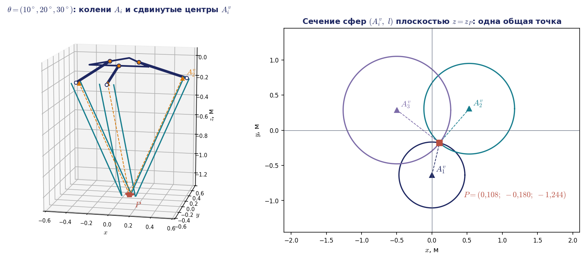
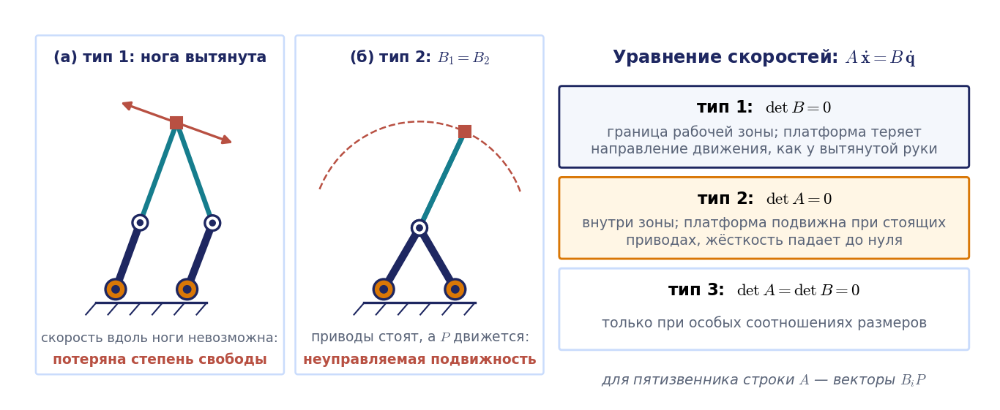

# Лекция 5. Замкнутые кинематические цепи: параллельные манипуляторы

В учебнике С. Л. Зенкевича и А. С. Ющенко параллельные механизмы не рассматриваются, поэтому лекция опирается на дополнительные источники: монографии Ж.-П. Мерле и Л.-В. Цая, методическую работу Р. Уильямса с полным решением задач кинематики дельта-робота и статью К. Госслена и Х. Анхелеса об особых положениях замкнутых цепей. Формулы лекции имеют собственную нумерацию по разделам и приводятся без номеров; все числовые примеры пересчитаны и сходятся с ноутбуком демонстраций.

## Введение: что изменится, если цепь замкнуть

До сих пор мы имели дело с манипуляторами, построенными как **разомкнутая кинематическая цепь**: основание, первое звено, второе и так далее до схвата, причём каждое сочленение несёт собственный привод. Для таких механизмов на лекции 2 мы научились решать прямую и обратную задачи о положении, а на лекции 3 построили матрицу Якоби и исследовали вырожденные конфигурации. Прямая задача оказалась простой — достаточно перемножить матрицы Денавита — Хартенберга, и ответ единствен. Обратная задача была трудной: её удалось решить в явном виде только для схем специального вида, а решений получалось несколько.

Сегодня мы рассмотрим механизмы, в которых выходное звено соединено с основанием не одной, а несколькими кинематическими цепями. Такие цепи образуют замкнутые контуры, и это меняет почти всё. Приводы удаётся разместить на основании, подвижные части становятся лёгкими, а конструкция — жёсткой. Платой служат небольшая рабочая зона и новая математика: у параллельных механизмов простой оказывается обратная задача, а трудной — прямая, и кроме привычных вырожденных конфигураций появляются особые положения нового типа, в которых платформа перестаёт слушаться приводов.

План лекции следующий. Сначала мы дадим определения и научимся подсчитывать число степеней подвижности механизма с замкнутыми контурами. Затем на простейшем примере — плоском пятизвеннике — увидим все характерные явления: пересечение окружностей в прямой задаче, режимы сборки, две матрицы в уравнении скоростей. После этого разберём три механизма, важных для практики. Параллелограммный манипулятор — это привычная «рука», в которой замкнутый контур используется только для передачи движения от привода, вынесенного к основанию. Дельта-робот — самый массовый параллельный робот; для него мы получим аналитические решения обеих задач о положении для двух видов приводов, вращательных и линейных. Платформа Гью — Стюарта имеет шесть степеней подвижности и служит примером механизма, у которого прямая задача решается только численно. Завершит лекцию общий взгляд на уравнение скоростей параллельного механизма и на три типа его особых положений.

## 5.1. Параллельные манипуляторы: определения и свойства

### Определение и первые примеры

**Параллельным манипулятором** называют механизм, в котором выходное звено — **подвижная платформа** — соединено с основанием несколькими независимыми кинематическими цепями. Эти цепи принято называть **ногами**. Каждая нога, как правило, содержит одно приводное сочленение, расположенное на основании или рядом с ним, и несколько пассивных сочленений, которые поворачиваются свободно. Число ног обычно равно числу степеней подвижности платформы.

Устройства с замкнутыми контурами окружают нас в быту. Раздвижной «удлинитель» из перекрещивающихся планок — ножничный механизм — преобразует сближение двух рукояток в большое линейное перемещение конца. Пантограф, которым копируют чертежи с изменением масштаба, построен на шарнирном параллелограмме: точка-копир повторяет траекторию обводящей точки с постоянным коэффициентом. Оба механизма плоские, и оба используют главное свойство замкнутого контура — жёсткую геометрическую связь между движениями его звеньев.

В робототехнике параллельные схемы появились в середине двадцатого века. В 1950-х годах В. Гью построил шестиногую платформу для испытания автомобильных шин, в 1965 году Д. Стюарт предложил похожий механизм для авиационных тренажёров — так возникла **платформа Гью — Стюарта**. В 1985 году Р. Клавель в Лозанне изобрёл **дельта-робот**, который сегодня тысячами работает на упаковочных линиях. Наконец, многие промышленные «руки» большой грузоподъёмности, прежде всего палетайзеры, содержат параллелограммный механизм и потому тоже относятся к механизмам с замкнутыми цепями.

Структуру ноги принято записывать последовательностью букв, обозначающих сочленения от основания к платформе: R — вращательное, P — поступательное (призматическое), U — карданный шарнир с двумя степенями подвижности, S — сферический шарнир с тремя. Запись 3-RUU означает три одинаковые ноги, каждая из которых состоит из вращательного сочленения и двух карданных шарниров; запись 6-UPS — шесть ног «кардан — поступательная пара — сфера». Приводное сочленение в такой записи принято подчёркивать; мы будем оговаривать его словами.

### Чем параллельная схема отличается от последовательной

Сопоставим две схемы (рис. 5.1). В последовательном манипуляторе каждый привод несёт на себе все последующие звенья вместе с их приводами. Поэтому звенья приходится делать массивными, подвижная масса велика, а ускорения ограничены. Упругие деформации и погрешности сочленений складываются вдоль цепи: небольшая ошибка в первом сочленении умножается на всю длину руки.

В параллельном манипуляторе приводы неподвижны, а к платформе идут лёгкие штанги. У дельта-робота штанги вообще работают только на растяжение и сжатие, поэтому их делают из тонких углепластиковых трубок. Малая подвижная масса позволяет развивать очень большие ускорения: дельта-робот выполняет более ста циклов «взять — положить» в минуту. Нагрузка распределяется между несколькими цепями, работающими совместно, поэтому жёсткость и грузоподъёмность, отнесённые к собственной массе, у параллельных механизмов заметно выше; именно поэтому платформа Гью — Стюарта держит на себе кабину авиатренажёра массой в несколько тонн. Погрешности отдельных ног не накапливаются вдоль цепи, а входят в положение платформы примерно с одинаковым весом.

Недостатки тоже существенны. Каждая нога ограничивает движение платформы, поэтому рабочая зона параллельного механизма мала по сравнению с его габаритами и имеет сложную форму. Внутри рабочей зоны могут находиться особые положения, в которых механизм теряет жёсткость. Механизм чувствителен к точности изготовления и требует тщательной калибровки, потому что все ноги должны сходиться к одной платформе.

Для нас важнее всего следующее наблюдение, которое мы будем подтверждать на каждом примере. У последовательного манипулятора прямая задача о положении проста и имеет единственное решение, а обратная сложна и многозначна. У параллельного манипулятора всё наоборот. Если положение платформы задано, то известны положения всех точек крепления ног, и для каждой ноги остаётся найти одну приводную координату из одного уравнения — **обратная задача распадается на независимые задачи по ногам**. Если же заданы приводные координаты, то положение платформы приходится искать из системы нелинейных уравнений, связывающих все ноги сразу, и решений у такой системы, как правило, несколько.

## 5.2. Число степеней подвижности механизма с замкнутыми контурами

### Структурная формула

Для разомкнутой цепи вопрос о числе степеней подвижности не возникал: оно равно числу сочленений. В механизме с замкнутыми контурами сочленений больше, чем степеней подвижности, и часть из них неизбежно пассивна. Сколько приводов нужно поставить, чтобы движение платформы было полностью определено? Ответ даёт структурная формула, которую связывают с именами П. Л. Чебышёва, М. Грюблера и К. Кутцбаха.

Рассуждение простое. Пусть механизм состоит из $N$ звеньев, считая неподвижную стойку. Свободное твёрдое тело имеет $\lambda$ степеней свободы: $\lambda=6$ в пространстве и $\lambda=3$ на плоскости. Значит, $N-1$ подвижных звеньев до соединения имели бы $\lambda(N-1)$ степеней свободы. Сочленение с подвижностью $f_i$ оставляет соединяемым звеньям $f_i$ относительных движений из $\lambda$, то есть накладывает $\lambda-f_i$ связей. Если сочленений $j$, то

$$
W=\lambda(N-1)-\sum_{i=1}^{j}(\lambda-f_i)=\lambda\,(N-1-j)+\sum_{i=1}^{j}f_i .
$$

В отечественной литературе по теории механизмов ту же формулу записывают через число подвижных звеньев $n=N-1$ и числа $p_k$ кинематических пар $k$-го класса, то есть пар, накладывающих $k$ связей. Для пространственных механизмов это формула Сомова — Малышева $W=6n-5p_5-4p_4-3p_3-2p_2-p_1$, для плоских — формула Чебышёва $W=3n-2p_5-p_4$. Вращательная и поступательная пары относятся к пятому классу, карданный шарнир — к четвёртому, сферический — к третьему.

### Примеры подсчёта

Применим формулу к механизмам, показанным на рис. 5.2.

Шарнирный четырёхзвенник: $N=4$, $j=4$, все сочленения вращательные, $\sum f_i=4$. Получаем $W=3(4-1-4)+4=1$: достаточно одного привода. Плоский пятизвенник: $N=5$, $j=5$, $\sum f_i=5$, откуда $W=3(5-1-5)+5=2$ — это простейший параллельный манипулятор с двумя приводами на стойке.

Дельта-робот в упрощённом представлении 3-RUU: звеньев восемь (основание, платформа и по два звена в каждой из трёх ног), сочленений девять — три вращательных и шесть карданных, $\sum f_i=3\cdot1+6\cdot2=15$. Тогда $W=6(8-1-9)+15=3$. Платформа Гью — Стюарта 6-UPS: $N=14$ (основание, платформа и по два звена в шести ногах), $j=18$, $\sum f_i=6\,(2+1+3)=36$, и $W=6(14-1-18)+36=6$ — платформа имеет столько же степеней свободы, сколько свободное твёрдое тело. Если в той же платформе оба шарнира каждой ноги сделать сферическими (схема 6-SPS), формула даст $W=12$. Шесть лишних подвижностей — это вращения ног вокруг собственных осей; на положение платформы они не влияют. Такие подвижности называют местными, и при подсчёте приводов их нужно вычитать.

### Когда формула ошибается

Структурная формула учитывает только число звеньев и сочленений, но ничего не знает о размерах. Возьмём шарнирный параллелограмм и добавим к нему третий кривошип, параллельный двум имеющимся (средняя схема на рис. 5.2). Теперь $N=5$, $j=6$, и формула даёт $W=3(5-1-6)+6=0$, то есть неподвижную ферму. На самом деле механизм движется так же, как и без третьего кривошипа: из-за равенства и параллельности звеньев связь, которую он накладывает, уже содержится в остальных. Такие связи называют **избыточными**, или пассивными. Стоит нарушить равенство длин — и механизм действительно заклинит.

Именно так обстоит дело с настоящим дельта-роботом. В его ногах стоят не одиночные штанги, а пространственные параллелограммы, и если честно пересчитать все звенья и шарниры, получится $N=17$ и $j=21$ вращательное сочленение, откуда $W=6\cdot16-5\cdot21=-9$. Результат абсурден: робот, очевидно, имеет три степени подвижности. Причина та же — формула не знает о параллельности и равенстве звеньев. Если мысленно убрать из каждого параллелограмма одну из двух длинных штанг, движение не изменится, а подсчёт даст $N=14$, $j=15$ и $W=6\cdot13-5\cdot15=3$. Тот же ответ даёт эквивалентная схема 3-RUU. Практический вывод таков: структурная формула — быстрый первый тест, но для механизмов с особой геометрией её результат нужно проверять рассуждением о связях либо рангом матрицы уравнений скоростей, к которой мы придём в конце лекции. Избыточные связи не вредны сами по себе — они повышают жёсткость, — но требуют точного изготовления.

## 5.3. Плоский пятизвенник — простейший параллельный манипулятор

### Схема и прямая задача о положении

Плоский пятизвенник 5R состоит из стойки, двух ведущих звеньев длиной $l_1$ и двух ведомых звеньев длиной $l_2$, соединённых в точке $P$ (рис. 5.3). Приводы стоят в точках $A_1=(-d/2,\,0)$ и $A_2=(d/2,\,0)$; обобщённые координаты $q_1$ и $q_2$ — углы ведущих звеньев, отсчитанные от оси $x$. Выходная точка $P=(x,y)$ имеет две степени свободы. Так устроены некоторые плоттеры, сборочные роботы и учебные «рисующие» механизмы.

Концы ведущих звеньев находятся сразу:

$$
B_1=\begin{pmatrix}-d/2+l_1\cos q_1\\ l_1\sin q_1\end{pmatrix},\qquad B_2=\begin{pmatrix}d/2+l_1\cos q_2\\ l_1\sin q_2\end{pmatrix}.
$$

Точка $P$ удалена от каждой из точек $B_1$ и $B_2$ на расстояние $l_2$, то есть лежит на пересечении двух окружностей. Это и есть прямая задача о положении, и решается она в три строки. Обозначим $\mathbf{e}=B_2-B_1$, $D=\lVert\mathbf{e}\rVert$. Окружности равны, поэтому их общая хорда проходит через середину отрезка $B_1B_2$ перпендикулярно ему, а половина её длины находится по теореме Пифагора:

$$
P^{\pm}=\frac{B_1+B_2}{2}\pm h\,\mathbf{n},\qquad h=\sqrt{l_2^2-\frac{D^2}{4}},\qquad \mathbf{n}=\frac{1}{D}\begin{pmatrix}-e_y\\ e_x\end{pmatrix}.
$$

Если $D$ больше $2l_2$, подкоренное выражение отрицательно: при таких углах приводов механизм собрать нельзя. Если $D$ меньше $2l_2$, решений два, и отличаются они тем, по какую сторону от прямой $B_1B_2$ лежит точка $P$. Эти два решения называют **режимами сборки**. Название точное: перейти из одного режима в другой, не разбирая механизм, можно только через положение, в котором $h=0$ и ведомые звенья вытянуты в одну линию, а такое положение, как мы увидим, является особым. В работе механизм остаётся в том режиме, в котором его собрали, и контроллер просто выбирает соответствующий знак.

#### Пример 5.1. Прямая задача для пятизвенника

Пусть $d=0{,}3$ м, $l_1=0{,}3$ м, $l_2=0{,}45$ м и $q_1=100^\circ$, $q_2=30^\circ$. Тогда $B_1=(-0{,}202;\ 0{,}295)$, $B_2=(0{,}410;\ 0{,}150)$, расстояние между ними $D=0{,}629$ м, и $h=\sqrt{0{,}2025-0{,}0989}=0{,}322$ м. Единичная нормаль $\mathbf{n}=(0{,}231;\ 0{,}973)$, середина отрезка — точка $(0{,}104;\ 0{,}223)$. Получаем два положения: $P^{+}=(0{,}178;\ 0{,}536)$ и $P^{-}=(0{,}029;\ -0{,}090)$ м. Оба показаны на рис. 5.3: рабочий режим — верхний, в нижнем точка $P$ оказалась бы под линией приводов.

### Обратная задача и рабочие режимы

Пусть теперь задана точка $P$. Каждая нога $A_iB_iP$ — это обычный плоский двухзвенник с длинами $l_1$ и $l_2$, основание которого стоит в точке $A_i$, и ноги можно рассматривать по отдельности. Обратная задача для двухзвенника решена на лекции 2. Обозначим $\rho_i$ расстояние от $A_i$ до $P$; по теореме косинусов для треугольника $A_iB_iP$ получаем

$$
q_i=\operatorname{atan2}\bigl(y,\ x-x_{A_i}\bigr)\pm\arccos\frac{\rho_i^2+l_1^2-l_2^2}{2\,l_1\rho_i},\qquad i=1,2 .
$$

Знак выбирается для каждой ноги независимо — излом «влево» или «вправо», — поэтому всего получается четыре решения. Их называют **рабочими режимами**. Обратим внимание на симметрию терминов: режимы сборки — это ветви прямой задачи, рабочие режимы — ветви обратной. Точка достижима, если для обеих ног аргумент арккосинуса по модулю не превосходит единицы, то есть $\lvert l_1-l_2\rvert\le\rho_i\le l_1+l_2$. Рабочая зона — пересечение двух колец с центрами в точках $A_1$ и $A_2$, из которого ещё нужно оставить часть, соответствующую выбранному режиму сборки (правая часть рис. 5.3).

### Уравнение скоростей

У разомкнутой цепи скорости связаны соотношением $\dot{\mathbf{s}}=J(\mathbf{q})\dot{\mathbf{q}}$, и матрицу Якоби мы строили по столбцам. Для замкнутой цепи удобнее исходить из уравнений связей. Для пятизвенника их два: $\lVert P-B_i(q_i)\rVert^2=l_2^2$. Продифференцируем каждое по времени:

$$
(P-B_i)^{\mathrm T}\dot P=(P-B_i)^{\mathrm T}\dot B_i,\qquad \dot B_i=l_1\,\mathbf{e}_i\,\dot q_i,\quad \mathbf{e}_i=\begin{pmatrix}-\sin q_i\\ \cos q_i\end{pmatrix}.
$$

Два таких уравнения образуют матричное соотношение

$$
A\,\dot{\mathbf{x}}=B\,\dot{\mathbf{q}},\qquad A=\begin{pmatrix}(P-B_1)^{\mathrm T}\\ (P-B_2)^{\mathrm T}\end{pmatrix},\qquad B=\begin{pmatrix}l_1(P-B_1)^{\mathrm T}\mathbf{e}_1&0\\ 0&l_1(P-B_2)^{\mathrm T}\mathbf{e}_2\end{pmatrix},
$$

где $\dot{\mathbf{x}}=\dot P$. Геометрический смысл прозрачен. Каждое уравнение — это условие нерастяжимости ведомого звена: проекции скоростей его концов на направление звена равны. Строки матрицы $A$ — векторы ведомых звеньев, диагональные элементы матрицы $B$ равны $l_1l_2\sin\psi_i$, где $\psi_i$ — угол между ведущим и ведомым звеном в ноге. Если обе матрицы обратимы, то $\dot{\mathbf{x}}=J\dot{\mathbf{q}}$ с матрицей Якоби $J=A^{-1}B$. Для конфигурации примера 5.1

$$
A=\begin{pmatrix}0{,}380&0{,}240\\ -0{,}232&0{,}386\end{pmatrix},\quad B=\begin{pmatrix}-0{,}125&0\\ 0&0{,}135\end{pmatrix},\quad J=\begin{pmatrix}-0{,}238&-0{,}160\\ -0{,}143&0{,}254\end{pmatrix}.
$$

Число обусловленности этой матрицы равно $1{,}08$: столбцы почти ортогональны и почти равны по длине, так что в окрестности этой точки механизм одинаково хорошо движется во всех направлениях. Наличие двух матриц вместо одной — принципиальная особенность замкнутых цепей. Вырождаться может каждая из них, и последствия оказываются совершенно разными; к этому мы вернёмся в разделе 5.11.

## 5.4. Параллелограммный манипулятор

### Зачем руке параллелограмм

Рассмотрим манипулятор, который внешне похож на обычную «руку» с колонной, плечом и предплечьем, но содержит шарнирный параллелограмм (рис. 5.4). По такой схеме построены палетайзеры — роботы для укладки мешков и коробок на поддоны грузоподъёмностью в сотни килограммов, — а также многие настольные учебные манипуляторы.

Параллелограмм решает две задачи. Первая — **вынос привода локтя к основанию**. В обычной руке двигатель локтевого сочленения стоит на конце плеча, и плечевой привод вынужден его поднимать. Здесь оба привода руки стоят на оси плеча: один поворачивает плечо, второй — короткий кривошип, а тяга, параллельная плечу, передаёт поворот кривошипа на предплечье. Звенья $O_2E$ (плечо), кривошип, тяга и задний хвостовик предплечья образуют параллелограмм, поэтому предплечье всегда параллельно кривошипу. Подвижная масса уменьшается, а нагрузка на плечевой привод падает.

Вторая задача — **сохранение ориентации фланца**. Палетайзер должен переносить груз, не наклоняя его. Для этого служит вторая цепочка из двух параллелограммов, показанная на рис. 5.4 тонкими линиями. Первая тяга идёт параллельно плечу от неподвижной точки на колонне к треугольному звену, которое свободно посажено на ось локтя; благодаря параллелограмму это звено не поворачивается при любом движении плеча. Вторая тяга идёт параллельно предплечью от треугольного звена к звену фланца и точно так же удерживает от поворота фланец. В результате фланец остаётся горизонтальным без всякого привода, и у робота остаются четыре управляемые оси: поворот колонны, два привода руки и поворот груза вокруг вертикали. Дальше мы рассматриваем первые три.

### Обобщённые координаты и прямая задача

Введём обозначения. Угол $q_1$ — поворот колонны вокруг вертикальной оси. Угол $q_2$ — угол плеча относительно горизонта. Угол $q_3$ — угол кривошипа второго привода, а значит, и предплечья, **относительно горизонта**. Здесь заключено главное отличие от последовательной руки: у неё третья обобщённая координата — относительный угол в локте $\vartheta_3$ между плечом и предплечьем, а у параллелограммного манипулятора привод задаёт абсолютный угол. Связь между ними очевидна:

$$
q_3=q_2+\vartheta_3 .
$$

Длины плеча и предплечья обозначим $l_2$ и $l_3$, высоту оси плеча над основанием — $h$. Фланец горизонтален, поэтому рабочая точка $P$ смещена относительно конца предплечья на постоянный вектор: на $d$ вдоль горизонтали и на $e$ вниз. Вся рука лежит в вертикальной плоскости, повёрнутой на угол $q_1$; введём в этой плоскости вылет $r$ и высоту $z$. Проектируя звенья на горизонталь и вертикаль, получаем

$$
r=l_2\cos q_2+l_3\cos q_3+d,\qquad z=h+l_2\sin q_2+l_3\sin q_3-e,
$$

и затем декартовы координаты рабочей точки:

$$
x=r\cos q_1,\qquad y=r\sin q_1 .
$$

Это и есть решение прямой задачи. Ориентация фланца постоянна, а его поворот вокруг вертикали равен $q_1$ плюс угол четвёртой оси. Заметим, насколько формулы проще, чем у последовательной руки: в них нет суммы углов $q_2+q_3$, каждое звено входит со своим абсолютным углом. Тот же результат даёт и формальный путь: можно записать матрицы Денавита — Хартенберга для эквивалентной последовательной руки с углами $q_1$, $q_2$, $\vartheta_3$ и подставить $\vartheta_3=q_3-q_2$.

### Обратная задача

Пусть задана точка $P=(x,y,z)$. Поворот колонны находится сразу: $q_1=\operatorname{atan2}(y,x)$. Затем переходим в плоскость руки и вычитаем постоянное смещение фланца, то есть находим координаты конца предплечья относительно оси плеча:

$$
r'=\sqrt{x^2+y^2}-d,\qquad z'=z-h+e .
$$

Осталась обратная задача для плоского двухзвенника с длинами $l_2$ и $l_3$, решённая на лекции 2. Относительный угол в локте находится по теореме косинусов:

$$
\cos\vartheta_3=\frac{r'^2+z'^2-l_2^2-l_3^2}{2\,l_2l_3},\qquad \vartheta_3=-\arccos(\cdot).
$$

Знак минус соответствует конфигурации «локоть вверх»; вторая ветвь у параллелограммного манипулятора конструктивно недостижима. Далее

$$
q_2=\operatorname{atan2}(z',r')-\operatorname{atan2}\bigl(l_3\sin\vartheta_3,\ l_2+l_3\cos\vartheta_3\bigr),\qquad q_3=q_2+\vartheta_3 .
$$

Последняя строка — пересчёт из углов звеньев в углы приводов, о котором нельзя забывать при программировании: контроллер робота с параллелограммом получает не относительный угол в локте, а сумму.

#### Пример 5.2. Прямая и обратная задачи для параллелограммного манипулятора

Примем $h=0{,}8$ м, $l_2=1{,}0$ м, $l_3=1{,}2$ м, $d=0{,}2$ м, $e=0{,}25$ м. Пусть $q_1=30^\circ$, $q_2=60^\circ$, $q_3=-20^\circ$ — эта конфигурация изображена на рис. 5.4. Относительный угол в локте равен $\vartheta_3=-80^\circ$. Вылет $r=0{,}5+1{,}2\cdot0{,}9397+0{,}2=1{,}828$ м, высота $z=0{,}8+0{,}866-0{,}410-0{,}25=1{,}006$ м, координаты рабочей точки $x=1{,}583$ м, $y=0{,}914$ м. Обратный расчёт по формулам этого раздела возвращает исходные углы. Для другой точки, $P=(1{,}5;\ 0{,}8;\ 0{,}9)$ м, обратная задача даёт $q_1=28{,}07^\circ$, $q_2=64{,}28^\circ$, $q_3=-27{,}33^\circ$.

### Матрица Якоби и ограничения параллелограмма

Продифференцируем выражения для вылета и высоты:

$$
\begin{pmatrix}\dot r\\ \dot z\end{pmatrix}=\begin{pmatrix}-l_2\sin q_2&-l_3\sin q_3\\ l_2\cos q_2&l_3\cos q_3\end{pmatrix}\begin{pmatrix}\dot q_2\\ \dot q_3\end{pmatrix},\qquad \det J_{rz}=l_2l_3\sin(q_3-q_2).
$$

Столбцы этой матрицы имеют простой смысл: привод плеча перемещает рабочую точку перпендикулярно плечу, привод кривошипа — перпендикулярно предплечью, причём **каждый привод действует так, будто второго звена нет**. У последовательной руки первый столбец содержал бы расстояние от плеча до схвата, и приводы влияли бы друг на друга. Полная скорость рабочей точки получается добавлением поворота колонны: к радиальной скорости $\dot r$ и вертикальной $\dot z$ добавляется окружная составляющая $r\dot q_1$, так что

$$
\dot x=\dot r\cos q_1-r\sin q_1\,\dot q_1,\qquad \dot y=\dot r\sin q_1+r\cos q_1\,\dot q_1 .
$$

Определитель обращается в нуль при $q_3-q_2=0$ или $\pm\pi$, то есть когда предплечье вытянуто вдоль плеча или сложено на него. Для параллелограмма это положение опасно вдвойне: кривошип и тяга ложатся на одну прямую с плечом, параллелограмм вырождается в отрезок и может «перещёлкнуться» в антипараллелограмм, после чего предплечье перестаёт быть параллельным кривошипу. Поэтому угол между плечом и предплечьем конструктивно ограничивают; типичный диапазон — от 25 до 155 градусов. На рис. 5.4 справа показана рассчитанная при таких ограничениях рабочая зона в плоскости $(r,z)$; цветом отмечена величина $\lvert\sin(q_2-q_3)\rvert$, пропорциональная определителю. В большей части зоны она близка к единице: параллелограммный манипулятор работает вдали от вырождения, а его рабочая зона — серповидная область, которая вращением вокруг оси колонны превращается в тело, похожее на часть тора.

## 5.5. Дельта-робот: устройство, виды, геометрия

### Устройство и виды

Дельта-робот состоит из неподвижного основания, которое крепится над рабочей зоной, небольшой подвижной платформы и трёх одинаковых ног, расположенных через 120 градусов. В классической схеме Клавеля каждая нога содержит **рычаг** (плечо) длиной $L$, который поворачивается двигателем вокруг горизонтальной оси, закреплённой на основании, и **пространственный параллелограмм** из двух параллельных штанг длиной $l$ с шарнирами на концах. Три двигателя неподвижны, а движутся только лёгкие рычаги, штанги и платформа.

Параллелограммы нужны для того, чтобы платформа не поворачивалась. Верхняя сторона параллелограмма закреплена на конце рычага и всегда параллельна оси двигателя, то есть сохраняет постоянное горизонтальное направление. Нижняя сторона принадлежит платформе и остаётся параллельной верхней. Одна нога, таким образом, разрешает платформе поворачиваться только вокруг одного горизонтального направления. У двух ног эти направления разные, и поворот становится невозможным вовсе; третья нога добавляет избыточные связи, о которых шла речь в разделе 5.2. В результате платформа движется **поступательно** с тремя степенями свободы, а её ориентация постоянна.

Дельта-роботы различают по двум признакам. По типу приводов выделяют роботы с **вращательными приводами** (структура 3-RUU) — такова исходная схема и большинство упаковочных роботов — и с **линейными приводами** (структура 3-PUU), в которых верхние концы штанг закреплены на каретках, движущихся по параллельным направляющим. Линейную схему с вертикальными направляющими используют в 3D-принтерах; направляющие бывают также наклонными и горизонтальными. По числу степеней подвижности различают трёхстепенные роботы, четырёхстепенные — с дополнительным телескопическим карданным валом, который проходит от основания к платформе и вращает схват вокруг вертикали, — и шестистепенные, у которых на платформе установлена трёхосная кисть. Задачи о положении платформы для всех этих вариантов сводятся к трёхстепенному случаю, которым мы и займёмся.

### Геометрическая модель

При расчёте кинематики параллелограмм заменяют одной штангой длиной $l$, проходящей через его середину; как показано в разделе 5.2, такая замена не меняет движения. Введём систему координат с началом $O$ в центре основания, осью $z$, направленной вверх, и осями $x$, $y$ в плоскости основания (рис. 5.5). Платформа находится под основанием, поэтому её координата $z$ отрицательна.

Ноги нумеруются индексом $i=1,2,3$. Нога $i$ лежит в вертикальной плоскости с азимутом $\varphi_i$; следуя Р. Уильямсу, примем $\varphi_1=-90^\circ$, $\varphi_2=30^\circ$, $\varphi_3=150^\circ$. С каждой ногой свяжем три единичных вектора: радиальный, касательный и вертикальный,

$$
\mathbf{u}_i=\begin{pmatrix}\cos\varphi_i\\ \sin\varphi_i\\ 0\end{pmatrix},\qquad \mathbf{t}_i=\begin{pmatrix}-\sin\varphi_i\\ \cos\varphi_i\\ 0\end{pmatrix},\qquad \mathbf{k}=\begin{pmatrix}0\\0\\1\end{pmatrix}.
$$

Ось двигателя проходит через точку $B_i$ параллельно $\mathbf{t}_i$. Точки $B_i$ лежат в серединах сторон равностороннего треугольника основания со стороной $s_B$, то есть на расстоянии $w_B=\frac{\sqrt3}{6}s_B$ от центра: $\mathbf{B}_i=w_B\mathbf{u}_i$. Шарниры платформы $P_i$ лежат в вершинах её треугольника со стороной $s_P$ на расстоянии $u_P=\frac{\sqrt3}{3}s_P$ от центра платформы $P$; треугольник платформы перевёрнут относительно треугольника основания, так что вектор из центра платформы в шарнир равен $\mathbf{P}_i=u_P\mathbf{u}_i$. Поскольку платформа не поворачивается, эти векторы постоянны в неподвижной системе координат.

Обобщённые координаты $\mathbf{q}=(\theta_1,\theta_2,\theta_3)^{\mathrm T}$ — углы поворота рычагов. Угол $\theta_i$ отсчитывается от горизонтали и считается положительным, когда рычаг опущен вниз. Вектор рычага и положение его конца — «колена» $A_i$ — равны

$$
\mathbf{L}_i=L\,(\cos\theta_i\,\mathbf{u}_i-\sin\theta_i\,\mathbf{k}),\qquad \mathbf{A}_i=\mathbf{B}_i+\mathbf{L}_i .
$$

Обойдём контур ноги двумя путями (рис. 5.5, справа). От центра основания до шарнира платформы можно дойти через центр платформы, $\mathbf{p}+\mathbf{P}_i$, где $\mathbf{p}=(x,y,z)^{\mathrm T}$ — искомое положение платформы, а можно через ногу: $\mathbf{B}_i+\mathbf{L}_i+\mathbf{l}_i$, где $\mathbf{l}_i$ — вектор штанги. Приравнивая, получаем **векторное уравнение контура**, а из него — **условие связи**: длина штанги постоянна,

$$
\mathbf{l}_i=\mathbf{p}+\mathbf{P}_i-\mathbf{B}_i-\mathbf{L}_i(\theta_i),\qquad \lVert\mathbf{l}_i\rVert=l,\qquad i=1,2,3 .
$$

Три скалярных уравнения связывают три координаты платформы с тремя углами приводов. Вся кинематика дельта-робота — это работа с данной системой: если задано $\mathbf{p}$, она распадается на три независимых уравнения относительно $\theta_i$ (обратная задача), если заданы $\theta_i$, получается система трёх уравнений относительно $x,y,z$ (прямая задача).

Заметим, что размеры основания и платформы входят в уравнения только в комбинации $\mathbf{P}_i-\mathbf{B}_i=-(w_B-u_P)\,\mathbf{u}_i$. Обозначим $a=w_B-u_P$. Робот с основанием радиуса $w_B$ и платформой радиуса $u_P$ кинематически эквивалентен роботу с точечной платформой и основанием радиуса $a$.

## 5.6. Обратная задача о положении дельта-робота

### Вывод уравнения для одной ноги

Введём вектор $\mathbf{c}_i=\mathbf{p}+\mathbf{P}_i-\mathbf{B}_i=\mathbf{p}-a\,\mathbf{u}_i$, проведённый от оси двигателя $B_i$ к шарниру платформы $P_i$, и разложим его по осям ноги:

$$
\xi_i=\mathbf{c}_i^{\mathrm T}\mathbf{u}_i=x\cos\varphi_i+y\sin\varphi_i-a,\qquad \eta_i=\mathbf{c}_i^{\mathrm T}\mathbf{t}_i=-x\sin\varphi_i+y\cos\varphi_i,\qquad \zeta_i=z .
$$

Для принятых азимутов $\xi_1=-y-a$, $\eta_1=x$; $\xi_2=\frac12(\sqrt3\,x+y)-a$, $\eta_2=\frac12(-x+\sqrt3\,y)$; $\xi_3=\frac12(-\sqrt3\,x+y)-a$, $\eta_3=-\frac12(x+\sqrt3\,y)$. Рычаг движется в плоскости ноги, его конец имеет в этих осях координаты $(L\cos\theta_i,\ 0,\ -L\sin\theta_i)$, и условие связи принимает вид

$$
(\xi_i-L\cos\theta_i)^2+\eta_i^2+(z+L\sin\theta_i)^2=l^2 .
$$

Геометрически это означает следующее (рис. 5.6). Колено $A_i$ лежит на окружности радиуса $L$ с центром $B_i$ в плоскости ноги и одновременно на сфере радиуса $l$ с центром в шарнире платформы. Сфера пересекает плоскость ноги по окружности радиуса $l'=\sqrt{l^2-\eta_i^2}$ с центром в проекции шарнира $P_i'$. Две окружности в одной плоскости пересекаются в двух точках — это два возможных положения колена.

Раскроем скобки. Слагаемые $L^2\cos^2\theta_i$ и $L^2\sin^2\theta_i$ в сумме дают $L^2$, и остаётся уравнение, линейное относительно косинуса и синуса искомого угла:

$$
E_i\cos\theta_i+F_i\sin\theta_i+G_i=0,
$$

$$
E_i=-2L\,\xi_i,\qquad F_i=2L\,z,\qquad G_i=\xi_i^2+\eta_i^2+z^2+L^2-l^2 .
$$

Для первой ноги отсюда получается $E_1=2L(y+a)$, что совпадает с формулами Р. Уильямса; в его работе коэффициенты выписаны для каждой ноги отдельно, а мы получили их в едином виде.

### Подстановка половинного угла

Уравнения вида $E\cos\theta+F\sin\theta+G=0$ встречаются в кинематике механизмов постоянно; мы уже сталкивались с ними на лекции 2. Стандартный приём — универсальная подстановка $t=\operatorname{tg}(\theta/2)$, при которой

$$
\cos\theta=\frac{1-t^2}{1+t^2},\qquad \sin\theta=\frac{2t}{1+t^2}.
$$

После умножения на $1+t^2$ получается квадратное уравнение

$$
(G_i-E_i)\,t^2+2F_i\,t+(G_i+E_i)=0,
$$

откуда

$$
t_i=\frac{-F_i\pm\sqrt{E_i^2+F_i^2-G_i^2}}{G_i-E_i},\qquad \theta_i=2\operatorname{arctg}t_i .
$$

Тот же результат можно записать без подстановки, через вспомогательный угол: $\theta_i=\operatorname{atan2}(F_i,E_i)\pm\arccos\bigl(-G_i/\sqrt{E_i^2+F_i^2}\bigr)$.

Обсудим решение. Если подкоренное выражение отрицательно, окружности на рис. 5.6 не пересекаются и точка недостижима: штанга «не дотягивается» до окружности рычага. Если оно положительно, решений два — «колено наружу» и «колено внутрь». При принятых направлениях отсчёта и платформе, расположенной под основанием, ветви «колено наружу» соответствует знак минус перед корнем. Три ноги дают $2^3=8$ решений обратной задачи, но рабочим является одно: все колени наружу. Остальные приводят к столкновению рычагов и штанг и используются разве что как упражнение. Если подкоренное выражение равно нулю, два решения сливаются: рычаг и проекция штанги вытянуты в одну линию. Это граница рабочей зоны и одновременно, как мы увидим, особое положение.

#### Пример 5.3. Обратная задача для дельта-робота с вращательными приводами

Возьмём размеры промышленного робота, которые Р. Уильямс снял с чертежа ABB FlexPicker IRB 360: $s_B=0{,}567$ м, $s_P=0{,}076$ м, $L=0{,}524$ м, $l=1{,}244$ м. Тогда $w_B=0{,}1637$ м, $u_P=0{,}0439$ м, $a=0{,}1198$ м.

Пусть сначала платформа находится на оси робота: $\mathbf{p}=(0;\ 0;\ -0{,}9)$ м. Для всех ног $\xi_i=-a=-0{,}1198$, $\eta_i=0$, и коэффициенты одинаковы: $E=0{,}1256$, $F=-0{,}9432$, $G=0{,}0144+0{,}81+0{,}2746-1{,}5475=-0{,}4486$. Подкоренное выражение равно $0{,}7041$, корень из него — $0{,}8391$. Берём знак минус: $t=(0{,}9432-0{,}8391)/(-0{,}4486-0{,}1256)=-0{,}1813$, откуда $\theta=2\operatorname{arctg}(-0{,}1813)=-20{,}5^\circ$. Рычаги подняты над горизонталью на двадцать с половиной градусов. Вторая ветвь даёт $-144{,}3^\circ$ — рычаг закинут внутрь.

Теперь возьмём точку общего положения $\mathbf{p}=(0{,}3;\ 0{,}5;\ -1{,}1)$ м. Коэффициент $F_i=2Lz=-1{,}153$ одинаков для всех ног; остальные величины сведены в таблицу.

| Нога | $\xi_i$, м | $\eta_i$, м | $E_i$ | $G_i$ | $t_i$ | $\theta_i$ |
|---|---|---|---|---|---|---|
| 1 | $-0{,}620$ | $0{,}300$ | $0{,}650$ | $0{,}411$ | $0{,}440$ | $47{,}5^\circ$ |
| 2 | $0{,}390$ | $0{,}283$ | $-0{,}409$ | $0{,}169$ | $-0{,}101$ | $-11{,}6^\circ$ |
| 3 | $-0{,}130$ | $-0{,}583$ | $0{,}136$ | $0{,}294$ | $0{,}189$ | $21{,}4^\circ$ |

Результат $\boldsymbol{\theta}=(47{,}5^\circ;\ -11{,}6^\circ;\ 21{,}4^\circ)$ совпадает с примером из работы Р. Уильямса. Нога 1 этого примера изображена на рис. 5.6 в истинных пропорциях.

## 5.7. Прямая задача о положении дельта-робота

### Сведение к пересечению трёх сфер

Пусть теперь заданы углы $\theta_1,\theta_2,\theta_3$ и требуется найти положение платформы. Колени $\mathbf{A}_i=\mathbf{B}_i+\mathbf{L}_i$ вычисляются сразу. Шарнир платформы $P_i$ удалён от колена $A_i$ на длину штанги $l$, то есть лежит на сфере радиуса $l$ с центром в колене. Но нам нужен не шарнир, а центр платформы, и здесь помогает то, что платформа не поворачивается: центр смещён относительно шарнира на известный постоянный вектор $-\mathbf{P}_i$. Сдвинем на этот вектор и центр сферы. Получим **виртуальные центры**

$$
\mathbf{A}_i^{v}=\mathbf{A}_i-\mathbf{P}_i=(a+L\cos\theta_i)\,\mathbf{u}_i-L\sin\theta_i\,\mathbf{k},
$$

и условие связи примет вид $\lVert\mathbf{p}-\mathbf{A}_i^{v}\rVert=l$. Итак, **центр платформы есть точка пересечения трёх сфер одного радиуса $l$ с центрами $\mathbf{A}_1^{v}$, $\mathbf{A}_2^{v}$, $\mathbf{A}_3^{v}$** (рис. 5.7). Задача, которая для произвольного параллельного механизма требует численных методов, для дельта-робота решается в замкнутом виде — и снова благодаря поступательному движению платформы.

### Алгоритм пересечения трёх сфер

Задача о пересечении трёх сфер известна как трилатерация: так определяют положение по расстояниям до трёх маяков. Решим её в общем виде для сфер с центрами $\mathbf{c}_1,\mathbf{c}_2,\mathbf{c}_3$ и радиусами $r_1,r_2,r_3$. Идея состоит в переходе к удобной системе координат: начало в первом центре, ось $X$ направлена на второй центр, плоскость $XY$ проходит через все три центра. Орты этой системы равны

$$
\begin{aligned}
\mathbf{e}_x&=\frac{\mathbf{c}_2-\mathbf{c}_1}{d},\qquad d=\lVert\mathbf{c}_2-\mathbf{c}_1\rVert,\qquad i=\mathbf{e}_x^{\mathrm T}(\mathbf{c}_3-\mathbf{c}_1),\\
\mathbf{e}_y&=\frac{\mathbf{c}_3-\mathbf{c}_1-i\,\mathbf{e}_x}{j},\qquad j=\lVert\mathbf{c}_3-\mathbf{c}_1-i\,\mathbf{e}_x\rVert,\qquad \mathbf{e}_z=\mathbf{e}_x\times\mathbf{e}_y .
\end{aligned}
$$

В новой системе центры имеют координаты $(0,0,0)$, $(d,0,0)$ и $(i,j,0)$, а уравнения сфер записываются как $X^2+Y^2+Z^2=r_1^2$, $(X-d)^2+Y^2+Z^2=r_2^2$, $(X-i)^2+(Y-j)^2+Z^2=r_3^2$. Вычитая второе уравнение из первого, а затем третье из первого, избавляемся от квадратов неизвестных и последовательно находим

$$
X=\frac{r_1^2-r_2^2+d^2}{2d},\qquad Y=\frac{r_1^2-r_3^2+i^2+j^2-2iX}{2j},\qquad Z=\pm\sqrt{r_1^2-X^2-Y^2},
$$

после чего возвращаемся в исходную систему:

$$
\mathbf{p}=\mathbf{c}_1+X\mathbf{e}_x+Y\mathbf{e}_y+Z\mathbf{e}_z .
$$

У дельта-робота все радиусы равны $l$, и формулы упрощаются: $X=d/2$, $Y=(i^2+j^2-2iX)/(2j)$.

Решений два, и они симметричны относительно плоскости, проходящей через три центра. Для дельта-робота одно из них лежит под основанием, другое — над ним, и выбор очевиден: берём точку с меньшей координатой $z$. Если подкоренное выражение отрицательно, сферы не имеют общей точки: при заданных углах механизм собрать нельзя. Алгоритм вырождается, только когда три центра лежат на одной прямой ($j=0$), чего у дельта-робота не бывает. Отметим, что распространённый координатный вариант исключения неизвестных, приведённый в работе Р. Уильямса, содержит деление на разность высот центров и отказывает, когда все три колена находятся на одной высоте, то есть при равных углах приводов; для этого случая автору пришлось выводить отдельные формулы. Векторная форма, приведённая выше, от такого недостатка свободна.

#### Пример 5.4. Прямая задача и круговая проверка

Для робота из примера 5.3 зададим $\boldsymbol{\theta}=(10^\circ;\ 20^\circ;\ 30^\circ)$. Виртуальные центры: $\mathbf{A}_1^{v}=(0;\ -0{,}636;\ -0{,}091)$, $\mathbf{A}_2^{v}=(0{,}530;\ 0{,}306;\ -0{,}179)$, $\mathbf{A}_3^{v}=(-0{,}497;\ 0{,}287;\ -0{,}262)$ м. Далее $d=1{,}0845$, $i=0{,}5724$, $j=0{,}8942$, откуда $X=0{,}5422$, $Y=0{,}2832$ и $Z=\pm1{,}0832$ м. Два решения в исходной системе координат: $(-0{,}070;\ 0{,}120;\ 0{,}895)$ — над основанием, отбрасываем — и

$$
\mathbf{p}=(0{,}108;\ -0{,}180;\ -1{,}244)^{\mathrm T}.
$$

Правая часть рис. 5.7 иллюстрирует этот результат: на высоте $z=-1{,}244$ м три сферы дают в сечении три окружности разных радиусов, и все они проходят через одну точку. При нулевых углах приводов тот же алгоритм даёт $\mathbf{p}=(0;\ 0;\ -1{,}065)$ м.

Решения двух задач обязательно проверяют друг другом. Подставив найденную точку в обратную задачу, получаем исходные углы $(10^\circ; 20^\circ; 30^\circ)$; подставив углы из примера 5.3 в прямую задачу, возвращаемся в точки $(0;0;-0{,}9)$ и $(0{,}3;0{,}5;-1{,}1)$. Для двух тысяч случайных точек рабочей зоны расхождение не превышает $10^{-12}$ м. Такая **круговая проверка** — обязательный элемент отладки любой кинематической программы.

## 5.8. Дельта-робот с линейными приводами

В линейном дельта-роботе рычагов нет. Верхние концы штанг закреплены на каретках, которые движутся по трём вертикальным направляющим, расположенным на окружности радиуса $R_B$ с азимутами $\varphi_i$. Обобщённая координата $d_i$ — опускание каретки относительно плоскости основания; положительное направление — вниз. Положение верхнего шарнира штанги равно $\mathbf{A}_i=R_B\mathbf{u}_i-d_i\mathbf{k}$. Контур ноги и условие связи остаются прежними, нужно лишь заменить вектор рычага вектором перемещения каретки. С обозначением $a=R_B-u_P$ получаем

$$
\lVert\mathbf{p}-a\,\mathbf{u}_i+d_i\mathbf{k}\rVert^2=l^2\quad\Longrightarrow\quad \rho_i^2+(z+d_i)^2=l^2,
$$

где $\rho_i^2=(x-a\cos\varphi_i)^2+(y-a\sin\varphi_i)^2$ — квадрат горизонтального расстояния от платформы до «приведённой» направляющей.

**Обратная задача** решается одной строкой. Тригонометрии нет вовсе, уравнение квадратное относительно $d_i$:

$$
d_i=-z\pm\sqrt{l^2-\rho_i^2}.
$$

Геометрически это пересечение вертикальной прямой со сферой радиуса $l$. Каретка должна находиться выше платформы, то есть $-d_i$ больше $z$, поэтому выбираем знак минус: $d_i=-z-\sqrt{l^2-\rho_i^2}$. Точка достижима, если $\rho_i$ не превосходит $l$ для всех трёх ног и каретки не выходят за концы направляющих. Отсюда видно и достоинство линейной схемы: сечение рабочей зоны не зависит от высоты, зона представляет собой вертикальную призму, высота которой определяется только длиной направляющих. Поэтому линейные дельта-роботы удобны для 3D-печати высоких изделий.

**Прямая задача** снова сводится к пересечению трёх сфер радиуса $l$ с виртуальными центрами $\mathbf{A}_i^{v}=a\,\mathbf{u}_i-d_i\mathbf{k}$ и решается тем же алгоритмом. Существует и чисто алгебраический путь: вычитая уравнения связей попарно, получают два линейных соотношения, выражают $x$ и $y$ через $z$ и приходят к квадратному уравнению относительно $z$.

#### Пример 5.5. Линейный дельта-робот

Возьмём размеры настольного 3D-принтера из работы Р. Уильямса: направляющие стоят в вершинах треугольника со стороной $0{,}246$ м ($R_B=0{,}1420$ м), сторона платформы $0{,}127$ м ($u_P=0{,}0733$ м), длина штанг $l=0{,}264$ м; тогда $a=0{,}0687$ м. Азимуты направляющих $\varphi_i=210^\circ,\ 330^\circ,\ 90^\circ$. Для точки на оси $\mathbf{p}=(0;0;-0{,}5)$ м все $\rho_i=a$, и $d_i=0{,}5-\sqrt{0{,}264^2-0{,}0687^2}=0{,}5-0{,}2549=0{,}2451$ м. Для точки $\mathbf{p}=(0{,}03;\ 0{,}05;\ -0{,}40)$ м получаем $\mathbf{d}=(0{,}1664;\ 0{,}1516;\ 0{,}1384)$ м. Прямая задача для $\mathbf{d}=(0{,}2;0{,}2;0{,}2)$ даёт $\mathbf{p}=(0;0;-0{,}4549)$ м, для $\mathbf{d}=(0{,}14;0{,}15;0{,}16)$ — точку $\mathbf{p}=(-0{,}0215;\ -0{,}0363;\ -0{,}4012)$ м. Круговая проверка выполняется с машинной точностью.

## 5.9. Скорости, матрица Якоби и рабочая зона дельта-робота

### Уравнение скоростей

Поступим так же, как с пятизвенником: продифференцируем условия связи $\mathbf{l}_i^{\mathrm T}\mathbf{l}_i=l^2$ по времени. Вектор штанги равен $\mathbf{l}_i=\mathbf{p}+\mathbf{P}_i-\mathbf{A}_i$, векторы $\mathbf{P}_i$ постоянны, поэтому

$$
\mathbf{l}_i^{\mathrm T}\dot{\mathbf{p}}=\mathbf{l}_i^{\mathrm T}\dot{\mathbf{A}}_i .
$$

Это снова условие нерастяжимости: проекции скоростей двух концов штанги на её направление равны. Скорость колена направлена по касательной к окружности рычага:

$$
\dot{\mathbf{A}}_i=L\,\mathbf{w}_i\,\dot\theta_i,\qquad \mathbf{w}_i=-\sin\theta_i\,\mathbf{u}_i-\cos\theta_i\,\mathbf{k}.
$$

Собирая три уравнения, получаем

$$
A\,\dot{\mathbf{p}}=B\,\dot{\boldsymbol{\theta}},\qquad A=\begin{pmatrix}\mathbf{l}_1^{\mathrm T}\\ \mathbf{l}_2^{\mathrm T}\\ \mathbf{l}_3^{\mathrm T}\end{pmatrix},\qquad B=\operatorname{diag}(b_1,b_2,b_3),\quad b_i=L\,\mathbf{l}_i^{\mathrm T}\mathbf{w}_i .
$$

Прямая задача о скорости: $\dot{\mathbf{p}}=J\dot{\boldsymbol{\theta}}$, где $J=A^{-1}B$. Обратная задача о скорости: $\dot{\boldsymbol{\theta}}=B^{-1}A\,\dot{\mathbf{p}}$, то есть $\dot\theta_i=\mathbf{l}_i^{\mathrm T}\dot{\mathbf{p}}/b_i$. Обратим внимание: обратная задача о скорости, как и обратная задача о положении, решается по ногам независимо и требует лишь деления на число, тогда как прямая требует обращения матрицы $A$. Для линейного дельта-робота скорость верхнего шарнира равна $-\dot d_i\mathbf{k}$, матрица $A$ та же, а $b_i=-(z+d_i)$.

#### Пример 5.6. Матрица Якоби дельта-робота

Для робота из примера 5.3 в точке $\mathbf{p}=(0;0;-0{,}9)$ м все $b_i=0{,}4196$ м², строки матрицы $A$ равны $(0;\ 0{,}611;\ -1{,}084)$, $(-0{,}529;\ -0{,}305;\ -1{,}084)$ и $(0{,}529;\ -0{,}305;\ -1{,}084)$ м, и

$$
J=\begin{pmatrix}0&-0{,}397&0{,}397\\ 0{,}458&-0{,}229&-0{,}229\\ -0{,}129&-0{,}129&-0{,}129\end{pmatrix}.
$$

Элементы матрицы имеют размерность метр на радиан. Сингулярные числа этой матрицы равны $0{,}561$, $0{,}561$ и $0{,}224$: в горизонтальных направлениях платформа движется в два с половиной раза быстрее, чем по вертикали, при той же норме скоростей приводов. Чтобы платформа двигалась вдоль оси $x$ со скоростью $0{,}5$ м/с, нужны скорости приводов $\dot{\boldsymbol{\theta}}=(0;\ -0{,}63;\ 0{,}63)$ рад/с: первая нога лежит в плоскости $yz$, перпендикулярной движению, и в первом приближении её привод неподвижен. Для вертикального движения вниз с той же скоростью все три привода вращаются одинаково, по $1{,}29$ рад/с. В точке $(0{,}3;\ 0{,}5;\ -1{,}1)$ аналитическая матрица $J$ совпадает с численной производной прямой задачи с точностью $2\cdot10^{-10}$.

### Рабочая зона и показатели качества

Рабочую зону дельта-робота удобно строить с помощью обратной задачи: перебираем точки пространства и для каждой проверяем, что подкоренные выражения неотрицательны, углы приводов лежат в допустимом диапазоне, а штанги не отклоняются от плоскости ноги больше, чем позволяют шарниры (угол отклонения равен $\arcsin(\eta_i/l)$). Возможен и второй путь — перебор углов приводов с решением прямой задачи; он даёт облако точек, но хуже выявляет границу. На рис. 5.8 показаны два сечения зоны робота из примера 5.3 при ограничениях $-45^\circ\le\theta_i\le95^\circ$ и отклонении штанг не более $40^\circ$.

Зона имеет форму «линзы» с почти плоским верхом и выпуклым низом; на оси робота она простирается от $z=-0{,}78$ до $z=-1{,}76$ м. Горизонтальное сечение — шестиугольник со скруглёнными сторонами, вытянутый вдоль направлений ног: вдоль оси $x$ платформа достигает $\pm0{,}80$ м (здесь срабатывает ограничение шарниров штанг), вдоль оси $y$ — $0{,}92$ м. На практике из этой сложной области вырезают цилиндр с конусом внизу и указывают в паспорте робота именно его; у рассматриваемого робота паспортный диаметр зоны — $1{,}6$ м.

Одного объёма зоны недостаточно: важно, насколько хорошо робот движется в её точках. На лекции 3 мы характеризовали это эллипсоидом скоростей и мобильностью. Для параллельных механизмов чаще всего используют **локальный индекс обусловленности** $1/\kappa(J)$, где $\kappa$ — число обусловленности матрицы Якоби, отношение наибольшего сингулярного числа к наименьшему. Индекс равен единице, когда эллипсоид скоростей — шар (такую конфигурацию называют изотропной), и стремится к нулю у особых положений. Усредняя его по рабочей зоне, получают **глобальный индекс обусловленности**, который служит критерием при выборе размеров звеньев. У нашего робота индекс достигает $0{,}43$ в центре зоны на высоте около $-1{,}1$ м и плавно убывает к границам, особенно к нижней, где рычаги и штанги вытягиваются в линию. У матрицы Якоби дельта-робота все элементы имеют одну размерность, поэтому индекс обусловленности определён корректно. Для механизмов, у которых платформа и перемещается, и поворачивается, это не так — результат зависит от выбора единиц длины. Поэтому в современных работах, в частности в статье Лю с соавторами о плоском параллелограммном механизме, предлагаются безразмерные индексы качества передачи движения, основанные на углах давления в шарнирах; оптимальные размеры выбирают по картам таких индексов.

## 5.10. Платформа Гью — Стюарта

### Схема и обратная задача

Платформа Гью — Стюарта в самом распространённом исполнении имеет структуру 6-UPS: шесть ног переменной длины, каждая из которых соединена с основанием карданным шарниром, а с платформой — сферическим; приводом служит линейный актуатор внутри ноги (рис. 5.9). Платформа имеет шесть степеней свободы, и её положение описывается, как и положение схвата на лекции 2, вектором $\mathbf{p}$ и матрицей поворота $R$ либо шестёркой чисел $\mathbf{x}=(x,y,z,\alpha,\beta,\gamma)^{\mathrm T}$, где углы задают ориентацию. Обобщённые координаты — длины ног $\mathbf{q}=(l_1,\ldots,l_6)^{\mathrm T}$.

Пусть $\mathbf{a}_i$ — точки крепления ног на основании, заданные в неподвижной системе, а $\mathbf{b}_i$ — точки крепления на платформе, заданные в системе, связанной с платформой. В неподвижной системе верхний конец ноги имеет радиус-вектор $\mathbf{p}+R\mathbf{b}_i$, и длина ноги равна расстоянию между двумя известными точками:

$$
l_i=\lVert\mathbf{p}+R\,\mathbf{b}_i-\mathbf{a}_i\rVert,\qquad i=1,\ldots,6 .
$$

Это и есть полное решение **обратной задачи о положении** — одна строка, шесть независимых вычислений, единственный ответ. Сравните с обратной задачей для шестизвенного последовательного манипулятора, которой на лекции 2 было посвящено несколько разделов. Именно эта простота делает платформу удобной в управлении: траекторию задают в координатах платформы, а длины ног вычисляют на каждом такте по явной формуле.

### Прямая задача

Прямая задача — по шести длинам найти положение и ориентацию платформы — устроена противоположным образом. Нужно решить систему шести нелинейных уравнений $l_i(\mathbf{x})=l_i^{\ast}$ с шестью неизвестными, и приёма, подобного сдвигу сфер у дельта-робота, здесь нет, потому что платформа поворачивается. В 1990-х годах было установлено, что в общем случае эта задача сводится к алгебраическому уравнению сороковой степени и может иметь до сорока различных решений, то есть сорок режимов сборки при одних и тех же длинах ног; построен и пример, в котором все сорок решений вещественны.

На практике прямую задачу решают численно **методом Ньютона**. Обозначим $\mathbf{l}(\mathbf{x})$ вектор-функцию, вычисляющую длины ног по формуле обратной задачи, и $J_l=\partial\mathbf{l}/\partial\mathbf{x}$ — её матрицу Якоби. Итерации имеют вид

$$
\mathbf{x}_{k+1}=\mathbf{x}_k-J_l^{-1}(\mathbf{x}_k)\,\bigl[\mathbf{l}(\mathbf{x}_k)-\mathbf{l}^{\ast}\bigr].
$$

Это тот же итерационный метод, что и на лекции 2, только роли задач поменялись: там численно решалась обратная задача через прямую, здесь — прямая через обратную. В контроллере начальным приближением служит положение платформы на предыдущем такте, поэтому метод сходится за две-три итерации и остаётся в «своём» режиме сборки. Там, где нужна гарантия, на платформу ставят дополнительные датчики.

#### Пример 5.7. Обратная и прямая задачи для платформы

Пусть шарниры основания лежат на окружности радиуса $0{,}6$ м парами с угловым расстоянием $\pm12^\circ$ от направлений $0^\circ$, $120^\circ$, $240^\circ$, а шарниры платформы — на окружности радиуса $0{,}35$ м парами около направлений $60^\circ$, $180^\circ$, $300^\circ$. В исходном положении — платформа горизонтальна, высота $0{,}70$ м — все ноги имеют длину $0{,}7954$ м. Зададим позу $\mathbf{p}=(0{,}05;\ -0{,}03;\ 0{,}75)$ м с углами крена $5^\circ$, тангажа $-8^\circ$ и рыскания $10^\circ$, матрица поворота $R=R_z(\gamma)R_y(\beta)R_x(\alpha)$. Обратная задача даёт длины $(0{,}812;\ 0{,}892;\ 0{,}880;\ 0{,}853;\ 0{,}764;\ 0{,}871)$ м. Если теперь по этим длинам решать прямую задачу методом Ньютона, стартуя с исходного положения, то поза восстанавливается с машинной точностью за четыре итерации.

### Скорости

Продифференцируем квадрат длины ноги. Обозначим $\mathbf{n}_i$ единичный вектор вдоль ноги. Скорость верхнего шарнира как точки платформы даёт распределение скоростей из лекции 3: $\mathbf{v}+\boldsymbol{\omega}\times R\mathbf{b}_i$. Скорость изменения длины ноги — проекция этой скорости на направление ноги:

$$
\dot l_i=\mathbf{n}_i^{\mathrm T}\bigl(\mathbf{v}+\boldsymbol{\omega}\times R\mathbf{b}_i\bigr)=(R\mathbf{b}_i\times\mathbf{n}_i)^{\mathrm T}\boldsymbol{\omega}+\mathbf{n}_i^{\mathrm T}\mathbf{v}.
$$

В обозначениях лекции 3, где $\dot{\mathbf{s}}=(\boldsymbol{\omega}^{\mathrm T},\mathbf{v}^{\mathrm T})^{\mathrm T}$, получаем $\dot{\mathbf{q}}=J^{-1}\dot{\mathbf{s}}$, причём $i$-я строка матрицы $J^{-1}$ равна $\bigl((R\mathbf{b}_i\times\mathbf{n}_i)^{\mathrm T},\ \mathbf{n}_i^{\mathrm T}\bigr)$. Для параллельного механизма естественным объектом оказывается **обратная матрица Якоби**: она выписывается явно, а сама матрица $J$ получается её обращением. Шесть чисел в строке — это координаты прямой, вдоль которой действует нога (так называемые плюккеровы координаты), поэтому условие вырождения $\det J^{-1}=0$ означает линейную зависимость шести осей ног. Так бывает, например, когда все шесть осей пересекают одну прямую. Те же строки задают и статику: усилия в ногах $\mathbf{f}$ связаны с силой и моментом, приложенными к платформе, транспонированной матрицей, и вблизи вырождения малая внешняя нагрузка вызывает огромные усилия в ногах.

## 5.11. Уравнение скоростей параллельного механизма и три типа особенностей

### Общая форма

Обобщим то, что мы трижды проделали на примерах. Кинематика механизма с замкнутыми контурами задаётся системой уравнений связей $\mathbf{F}(\mathbf{x},\mathbf{q})=0$, где $\mathbf{x}$ — координаты платформы, $\mathbf{q}$ — приводные координаты. Дифференцируя по времени, получаем

$$
A\,\dot{\mathbf{x}}=B\,\dot{\mathbf{q}},\qquad A=\frac{\partial\mathbf{F}}{\partial\mathbf{x}},\qquad B=-\frac{\partial\mathbf{F}}{\partial\mathbf{q}}.
$$

Если каждая нога содержит один привод, матрица $B$ диагональна. У последовательного манипулятора $A$ — единичная матрица, и остаётся знакомое $\dot{\mathbf{x}}=J\dot{\mathbf{q}}$; у платформы Гью — Стюарта, наоборот, единичной оказывается $B$. В общем случае вырождаться могут обе матрицы, и К. Госслен и Х. Анхелес в 1990 году предложили классификацию особых положений замкнутых цепей, которая стала общепринятой (рис. 5.10).

### Особенности первого типа

**Первый тип: $\det B=0$.** Существует ненулевой вектор скоростей приводов, при котором платформа неподвижна, и, соответственно, существует направление, в котором платформа двигаться не может. Это полный аналог вырожденных конфигураций лекции 3. У пятизвенника так происходит, когда ведущее и ведомое звенья одной ноги вытянуты в линию или сложены; у дельта-робота — когда $b_i=0$, то есть проекция штанги на плоскость ноги направлена вдоль рычага; у параллелограммного манипулятора — при $q_3-q_2=0$ или $\pi$. Во всех случаях это те самые положения, в которых сливаются две ветви обратной задачи. Особенности первого типа образуют границу рабочей зоны; механизм в них не теряет жёсткости, и опасны они лишь тем, что скорости приводов вблизи них неограниченно растут.

### Особенности второго типа

**Второй тип: $\det A=0$.** Теперь существует ненулевая скорость платформы при неподвижных приводах. Платформа получает **неуправляемую подвижность**: приводы заторможены, а она может сместиться. Одновременно механизм теряет способность воспринимать нагрузку в этом направлении — его жёсткость падает до нуля, а усилия в приводах, необходимые для уравновешивания конечной внешней силы, стремятся к бесконечности. У последовательных манипуляторов такого явления нет вообще. У пятизвенника особенность второго типа возникает, когда ведомые звенья лежат на одной прямой: строки матрицы $A$ становятся параллельными. На рис. 5.10 показан наглядный частный случай — точки $B_1$ и $B_2$ совпали, и точка $P$ свободно описывает окружность вокруг них при стоящих приводах. В этих же положениях сливаются два режима сборки, то есть ветви прямой задачи. У дельта-робота $\det A=0$, когда три вектора штанг компланарны — например, когда все штанги параллельны друг другу или все лежат в плоскости платформы; у платформы Гью — Стюарта — когда оси ног линейно зависимы.

Особенности второго типа гораздо опаснее первых, потому что находятся **внутри** рабочей зоны и могут разделять её на части. Их нельзя проходить, рядом с ними нельзя работать, и основное требование при проектировании параллельного робота состоит в том, чтобы внутри паспортной рабочей зоны таких положений не было. Для размеров пятизвенника из примера 5.1 и дельта-робота из примера 5.3 это требование выполнено: матрица $A$ вырождается только в положениях, недостижимых при заданных ограничениях на углы приводов. Близость к особенности оценивают величиной $\lvert\det A\rvert$, наименьшим сингулярным числом матрицы $A$ либо индексом обусловленности матрицы $J$.

### Особенности третьего типа

**Третий тип: вырождены обе матрицы одновременно.** Это возможно только при специальных соотношениях размеров — например, у пятизвенника с $l_1=l_2$ и совпадающими осями приводов, когда точка $P$ попадает на ось приводов, а ведомые звенья при этом лежат на одной прямой. Механизм в таком положении допускает движение платформы при стоящих приводах и движение приводов при стоящей платформе. При проектировании таких соотношений размеров избегают.

Сведём результаты лекции в таблицу.

| Механизм | Степени подвижности | Обратная задача | Прямая задача | Особенности |
|---|---|---|---|---|
| Пятизвенник 5R | 2 | два двухзвенника, 4 рабочих режима | пересечение двух окружностей, 2 режима сборки | тип 1 — нога вытянута; тип 2 — ведомые звенья на одной прямой |
| Манипулятор с параллелограммом | 3 и поворот груза | двухзвенник в плоскости руки и пересчёт $q_3=q_2+\vartheta_3$ | явные формулы для $r$, $z$ | $q_3-q_2=0,\pi$ — вырождение параллелограмма |
| Дельта-робот 3-RUU | 3 поступательные | $E\cos\theta+F\sin\theta+G=0$ по ногам, 8 решений | пересечение трёх сфер, 2 решения | тип 1 — рычаг и штанга в линию; тип 2 — штанги компланарны |
| Дельта-робот 3-PUU | 3 поступательные | $d_i=-z-\sqrt{l^2-\rho_i^2}$ | пересечение трёх сфер | тип 1 — штанга горизонтальна; тип 2 — штанги компланарны |
| Платформа 6-UPS | 6 | $l_i=\lVert\mathbf{p}+R\mathbf{b}_i-\mathbf{a}_i\rVert$ | метод Ньютона, до 40 решений | тип 2 — оси ног линейно зависимы |

## Связь с демонстрациями

Вычислительные эксперименты к лекции собраны в ноутбуке «Демо_Занятие_05_параллельные.ipynb» в папке «03_Примеры_Jupyter». Все числа примеров 5.1–5.7 воспроизводятся в нём; геометрические параметры механизмов те же, что в лекции.

| № | Демонстрация | Что видно |
|---|---|---|
| 1 | Подвижность по структурной формуле | функция подсчёта $W$ для четырёхзвенника, пятизвенника, дельта-робота и платформы 6-UPS; случаи $W=0$ и $W=-9$ при избыточных связях |
| 2 | Пятизвенник: прямая задача пересечением окружностей | два режима сборки $P^{+}$ и $P^{-}$ примера 5.1, четыре рабочих режима обратной задачи |
| 3 | Параллелограммный манипулятор: прямая и обратная задачи | числа примера 5.2, анимация движения с горизонтальным фланцем, пересчёт $q_3=q_2+\vartheta_3$ |
| 4 | Рабочая зона параллелограммного манипулятора | сечение в плоскости $(r,z)$ при ограничении угла между плечом и предплечьем, карта $\lvert\sin(q_2-q_3)\rvert$ |
| 5 | Дельта-робот: обратная задача | таблица коэффициентов $E_i$, $F_i$, $G_i$ примера 5.3, обе ветви решения, трёхмерный скелет робота |
| 6 | Дельта-робот: прямая задача пересечением трёх сфер | точка примера 5.4, сечение сфер плоскостью $z=z_P$, круговая проверка с ошибкой менее $10^{-9}$ на случайных точках |
| 7 | Рабочая зона дельта-робота | вертикальное и горизонтальное сечения с учётом ограничений на углы, сравнение с облаком точек прямой задачи |
| 8 | Матрица Якоби дельта-робота и близость к особенностям | сравнение $J=A^{-1}B$ с численной производной, сингулярные числа примера 5.6, изменение $\det A$, $b_i$ и $1/\kappa(J)$ вдоль вертикальной прямой |
| 9 | Платформа Гью — Стюарта | длины ног примера 5.7, сходимость метода Ньютона из разных начальных приближений, второй режим сборки |
| 10 | Интерактивная модель | дельта-робот с ползунками $x$, $y$, $z$: углы приводов, индекс обусловленности, выход из рабочей зоны |

## Выводы

1. Параллельный манипулятор соединяет платформу с основанием несколькими цепями. Приводы неподвижны, подвижные массы малы, жёсткость и точность высоки; платой служат небольшая рабочая зона сложной формы и особые положения внутри неё.
2. Число степеней подвижности механизма с замкнутыми контурами оценивают структурной формулой $W=\lambda(N-1-j)+\sum f_i$. Формула не учитывает размеров звеньев и ошибается при избыточных связях: для дельта-робота с параллелограммами она даёт $-9$ вместо трёх, поэтому её результат нужно проверять.
3. У параллельных механизмов обратная задача о положении проста и решается по ногам независимо, а прямая сложна и многозначна — в противоположность последовательным манипуляторам. Ветви прямой задачи называют режимами сборки, ветви обратной — рабочими режимами.
4. Параллелограммный манипулятор кинематически эквивалентен плоскому двухзвеннику в вертикальной плоскости с поворотом основания. Параллелограмм выносит привод локтя на ось плеча, так что привод задаёт абсолютный угол предплечья $q_3=q_2+\vartheta_3$, а вторая цепочка тяг сохраняет ориентацию фланца. Определитель матрицы Якоби в плоскости руки равен $l_2l_3\sin(q_3-q_2)$.
5. Обратная задача дельта-робота с вращательными приводами для каждой ноги приводится к уравнению $E_i\cos\theta_i+F_i\sin\theta_i+G_i=0$ и решается подстановкой половинного угла; рабочая ветвь — «колени наружу». Для линейных приводов получается квадратное уравнение $d_i=-z-\sqrt{l^2-\rho_i^2}$.
6. Прямая задача дельта-робота решается в замкнутом виде благодаря поступательному движению платформы: сдвиг центров сфер на постоянные векторы $\mathbf{P}_i$ сводит её к пересечению трёх сфер радиуса $l$; из двух решений выбирают нижнее. Обе задачи проверяют друг другом.
7. Для платформы Гью — Стюарта обратная задача записывается одной строкой $l_i=\lVert\mathbf{p}+R\mathbf{b}_i-\mathbf{a}_i\rVert$, а прямая имеет до сорока решений и решается методом Ньютона от предыдущего положения. Явно выписывается обратная матрица Якоби, строки которой — координаты осей ног.
8. Скорости замкнутой цепи связаны уравнением $A\dot{\mathbf{x}}=B\dot{\mathbf{q}}$. При $\det B=0$ платформа теряет степень свободы (граница рабочей зоны), при $\det A=0$ приобретает неуправляемую подвижность и теряет жёсткость. Отсутствие особенностей второго типа в рабочей зоне — главное требование к размерам параллельного робота; качество конфигурации оценивают индексом обусловленности $1/\kappa(J)$.

## Контрольные вопросы

1. Дайте определение параллельного манипулятора. Приведите примеры плоских и пространственных механизмов с замкнутыми кинематическими цепями. Что означают записи 3-RUU, 3-PUU и 6-UPS?
2. Сравните последовательную и параллельную схемы по подвижной массе, жёсткости, точности, размерам рабочей зоны и сложности прямой и обратной задач. Объясните, почему обратная задача параллельного механизма распадается на независимые задачи по ногам.
3. Выведите структурную формулу для числа степеней подвижности. Подсчитайте подвижность шарнирного четырёхзвенника, плоского пятизвенника, дельта-робота 3-RUU и платформ 6-UPS и 6-SPS. Что такое местная подвижность?
4. Что такое избыточные связи? Почему для дельта-робота с полным учётом параллелограммов формула даёт $W=-9$ и как получить правильный результат?
5. Решите прямую задачу о положении для плоского пятизвенника. Что такое режимы сборки и рабочие режимы? Сколько решений имеет обратная задача?
6. Получите уравнение скоростей пятизвенника в форме $A\dot{\mathbf{x}}=B\dot{\mathbf{q}}$ и объясните геометрический смысл строк матрицы $A$ и диагональных элементов матрицы $B$.
7. Зачем в манипуляторе-палетайзере применяют параллелограммный механизм? Как обеспечивается постоянная ориентация фланца? Чем обобщённая координата $q_3$ такого манипулятора отличается от локтевого угла последовательной руки?
8. Решите прямую и обратную задачи о положении для параллелограммного манипулятора. Найдите матрицу Якоби в плоскости руки, её определитель и объясните, почему угол между плечом и предплечьем ограничивают.
9. Опишите устройство дельта-робота и назовите его виды по типу приводов и числу степеней подвижности. Почему платформа дельта-робота движется поступательно?
10. Запишите векторное уравнение контура ноги дельта-робота и условие связи. Приведите его к виду $E\cos\theta+F\sin\theta+G=0$ и решите подстановкой половинного угла. Каков геометрический смысл двух решений и случая отрицательного подкоренного выражения?
11. Покажите, что прямая задача дельта-робота сводится к пересечению трёх сфер. Изложите алгоритм пересечения трёх сфер. Сколько решений он даёт и как выбрать нужное? Что такое круговая проверка?
12. Решите обратную и прямую задачи о положении для дельта-робота с линейными приводами. Чем его рабочая зона отличается от зоны робота с вращательными приводами?
13. Выведите уравнение скоростей дельта-робота. Как построить его рабочую зону и что показывает индекс обусловленности матрицы Якоби?
14. Запишите решение обратной задачи для платформы Гью — Стюарта. Почему прямая задача решается численно, сколько решений она может иметь и как выглядит строка обратной матрицы Якоби? Сформулируйте три типа особых положений параллельных механизмов и приведите примеры каждого типа.

## Литература

1. Merlet J.-P. Parallel Robots. — 2nd ed. — Dordrecht: Springer, 2006.
2. Tsai L.-W. Robot Analysis: The Mechanics of Serial and Parallel Manipulators. — New York: Wiley, 1999.
3. Williams II R. L. The Delta Parallel Robot: Kinematics Solutions. — Internet publication, Ohio University, 2016.
4. Clavel R. Conception d'un robot parallèle rapide à 4 degrés de liberté: Ph.D. thesis. — Lausanne: EPFL, 1991.
5. Gosselin C., Angeles J. Singularity analysis of closed-loop kinematic chains // IEEE Transactions on Robotics and Automation. — 1990. — Vol. 6, No. 3.
6. Stewart D. A platform with six degrees of freedom // Proceedings of the Institution of Mechanical Engineers. — 1965. — Vol. 180, Pt. 1, No. 15.
7. Liu X.-J., Li J., Zhou Y. Kinematic optimal design of a 2-degree-of-freedom 3-parallelogram planar parallel manipulator // Mechanism and Machine Theory. — 2015. — Vol. 87.
8. Dietmaier P. The Stewart — Gough platform of general geometry can have 40 real postures // Advances in Robot Kinematics: Analysis and Control. — Dordrecht: Kluwer, 1998.
9. Siciliano B., Khatib O. (eds.) Springer Handbook of Robotics. — 2nd ed. — Cham: Springer, 2016. — Chapter «Parallel Mechanisms».
10. Зенкевич С. Л., Ющенко А. С. Основы управления манипуляционными роботами. — М.: Изд-во МГТУ им. Н. Э. Баумана, 2004.
11. Артоболевский И. И. Теория механизмов и машин. — М.: Наука, 1988.
