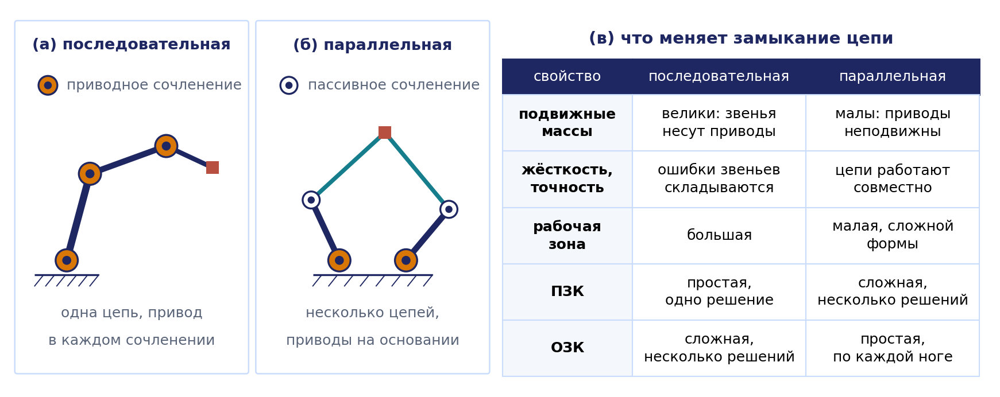
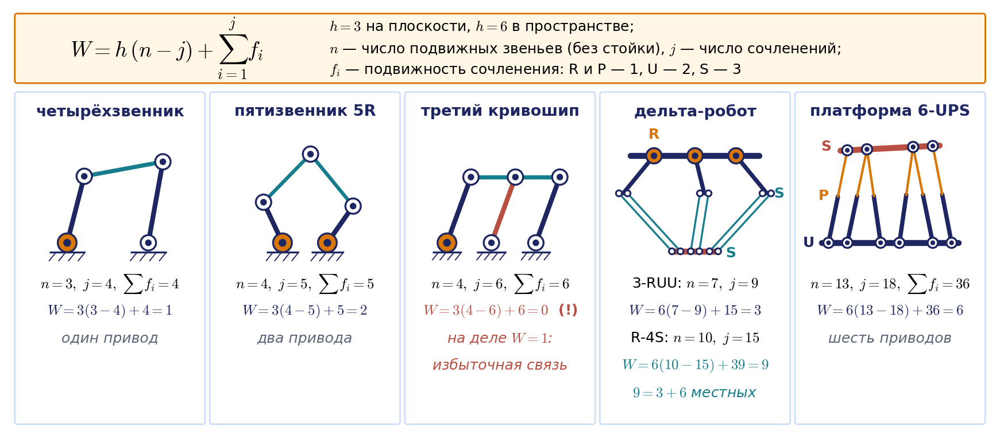
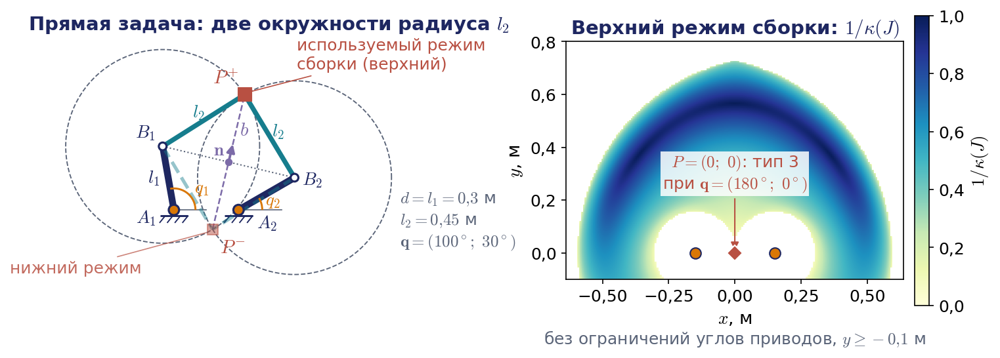
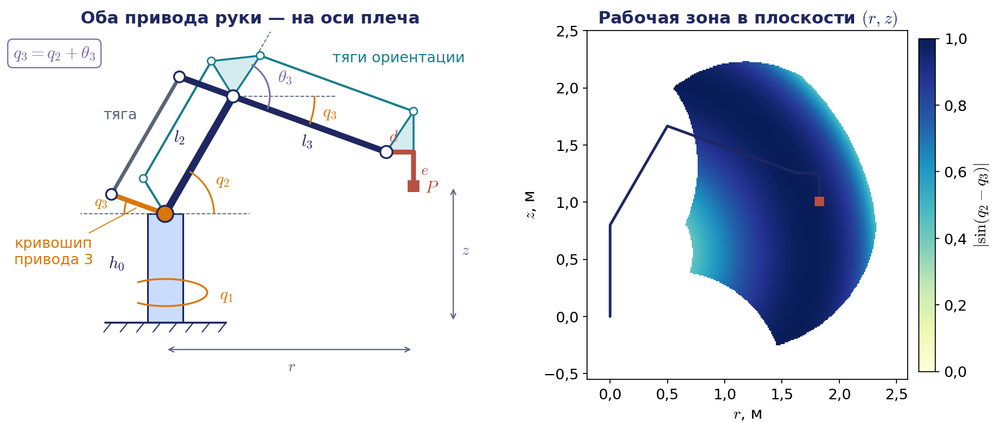
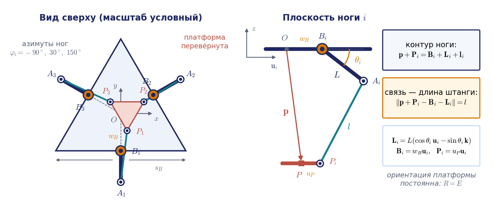
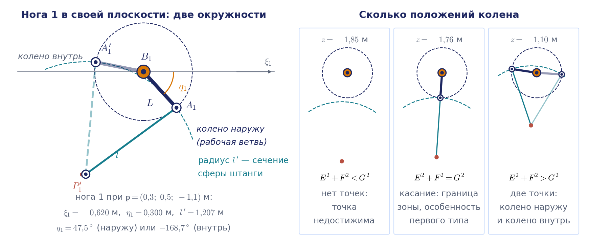
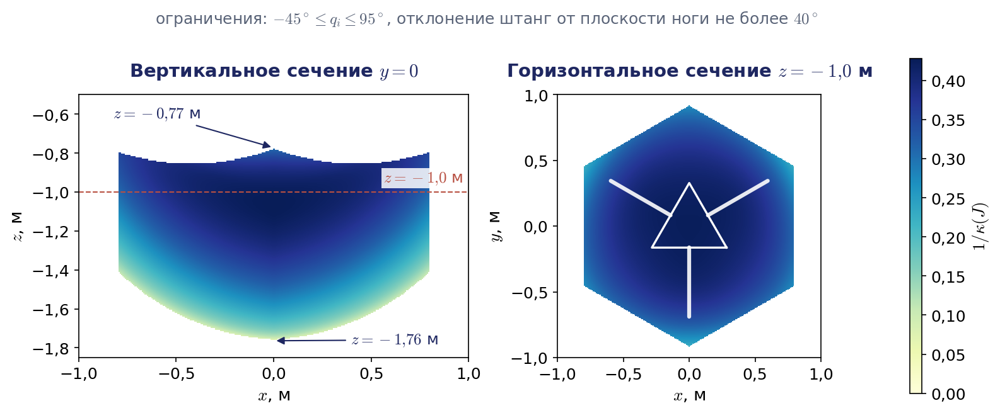
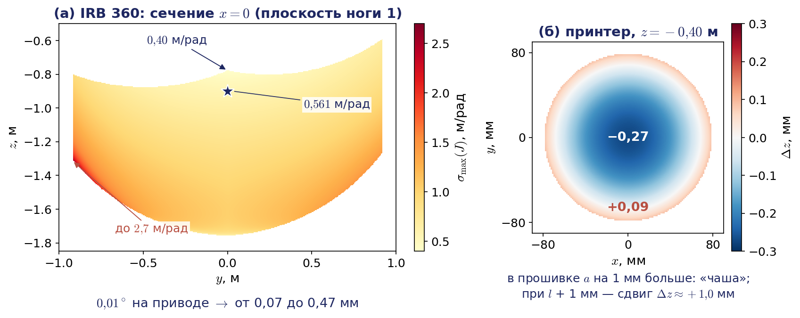
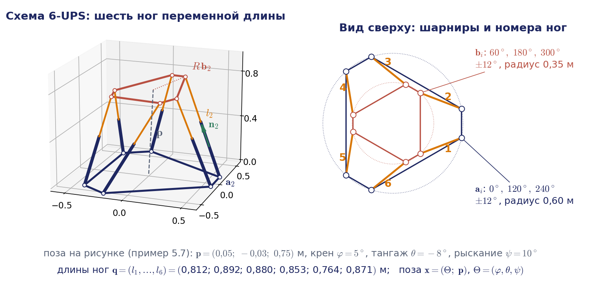

# Лекция 5. Замкнутые кинематические цепи: параллельные манипуляторы

В учебнике С. Л. Зенкевича и А. С. Ющенко параллельные механизмы не рассматриваются, поэтому лекция опирается на дополнительные источники: главу 7 книги К. Линча и Ф. Парка «Modern Robotics», монографии Ж.-П. Мерле и Л.-В. Цая, методическую работу Р. Уильямса с полным решением задач кинематики дельта-робота и статьи К. Госслена и Х. Анхелеса, а также Д. Златанова с соавторами об особых положениях замкнутых цепей. Формулы лекции имеют собственную нумерацию по разделам и приводятся без номеров; все числовые примеры пересчитаны и сходятся с ноутбуком демонстраций. Громоздкие выкладки, которые на занятии не воспроизводятся, вынесены в приложения 5.А–5.Г в конце лекции, а дополнительные темы для самостоятельного чтения — в приложение 5.Д.

## Введение: что изменится, если цепь замкнуть

До сих пор мы имели дело с манипуляторами, построенными как **разомкнутая кинематическая цепь**: основание, первое звено, второе и так далее до схвата, причём каждое сочленение несёт собственный привод. Для таких механизмов на лекции 2 мы научились решать прямую и обратную задачи о положении, а на лекции 3 построили матрицу Якоби, исследовали вырожденные конфигурации и связали силу на схвате с моментами в сочленениях соотношением $`\boldsymbol{\tau}=J^{\mathrm T}\mathbf{F}`$. Прямая задача оказалась простой — достаточно перемножить матрицы Денавита — Хартенберга, и ответ единствен. Обратная задача была трудной: её удалось решить в явном виде только для схем специального вида, а решений получалось несколько.

Сегодня мы рассмотрим механизмы, в которых выходное звено соединено с основанием не одной, а несколькими кинематическими цепями. Такие цепи образуют замкнутые контуры, и это меняет почти всё. Приводы удаётся разместить на основании, подвижные части становятся лёгкими, а конструкция — жёсткой. Платой служат небольшая рабочая зона и новая математика: у параллельных механизмов простой оказывается обратная задача, а трудной — прямая, и кроме привычных вырожденных конфигураций появляются особые положения нового типа, в которых платформа перестаёт слушаться приводов.

План лекции следующий. Сначала мы дадим определения и научимся подсчитывать число степеней подвижности механизма с замкнутыми контурами. Затем на простейшем примере — плоском пятизвеннике — увидим все характерные явления: пересечение окружностей в прямой задаче, режимы сборки, две матрицы в уравнении скоростей и то, что происходит, когда одна из них вырождается. После этого разберём три механизма, важных для практики. Параллелограммный манипулятор — это привычная «рука», в которой замкнутый контур используется только для передачи движения от привода, вынесенного к основанию. Дельта-робот — самый массовый параллельный робот; для него мы получим аналитические решения обеих задач о положении для двух видов приводов, вращательных и линейных, и оценим, как погрешности приводов и геометрии переходят в погрешность положения платформы. Платформа Гью — Стюарта имеет шесть степеней подвижности и служит примером механизма, у которого прямая задача решается только численно; на ней мы разберём статику и жёсткость замкнутой цепи. Завершит лекцию общий взгляд на уравнения связей, на уравнение скоростей параллельного механизма и на типы его особых положений, а также обзор того, как эти модели живут в прошивках, контроллерах и симуляторах.

О буквах. Приводные координаты любого механизма мы, как и раньше, обозначаем $`\mathbf{q}`$: у дельта-робота это углы рычагов $`q_i`$ (у Р. Уильямса они обозначены $`\theta_i`$), у линейного дельта-робота — ходы кареток $`d_i`$, у платформы Гью — Стюарта — длины ног. Буква $`\theta_3`$ в разделе 5.4 означает относительный угол в локте, то есть угол Денавита — Хартенберга эквивалентной последовательной руки. Ориентацию платформы мы задаём углами крена, тангажа и рыскания $`(\varphi,\theta,\psi)`$, как в лекции 1. Число степеней подвижности механизма по традиции теории механизмов обозначается $`W`$ без аргумента; матрица скоростей углов $`W(\boldsymbol{\Theta})`$ из лекции 3 всегда пишется с аргументом, и в одной формуле они не встречаются.

## 5.1. Параллельные манипуляторы: определения и свойства

### Определение и первые примеры

**Параллельным манипулятором** называют механизм, в котором выходное звено — **подвижная платформа** — соединено с основанием несколькими независимыми кинематическими цепями. Эти цепи принято называть **ногами**. Каждая нога, как правило, содержит одно приводное сочленение, расположенное на основании или рядом с ним, и несколько пассивных сочленений, которые поворачиваются свободно. Число ног обычно равно числу степеней подвижности платформы.

Устройства с замкнутыми контурами окружают нас в быту. Раздвижной «удлинитель» из перекрещивающихся планок — ножничный механизм — преобразует сближение двух рукояток в большое линейное перемещение конца. Пантограф, которым копируют чертежи с изменением масштаба, построен на шарнирном параллелограмме: точка-копир повторяет траекторию обводящей точки с постоянным коэффициентом. Оба механизма плоские, и оба используют главное свойство замкнутого контура — жёсткую геометрическую связь между движениями его звеньев.

В робототехнике параллельные схемы появились в середине двадцатого века. В 1950-х годах В. Гью построил шестиногую машину для испытания автомобильных шин, а в 1965 году Д. Стюарт опубликовал статью о платформе с шестью степенями свободы для авиационных тренажёров; за шестиногой платформой закрепилось название **платформа Гью — Стюарта** (подробнее об истории — в приложении 5.Д). В 1985 году Р. Клавель в Лозанне изобрёл **дельта-робот**, который сегодня тысячами работает на упаковочных линиях. Наконец, многие промышленные «руки» большой грузоподъёмности, прежде всего палетайзеры, содержат параллелограммный механизм и потому тоже относятся к механизмам с замкнутыми цепями.

Структуру ноги принято записывать последовательностью букв, обозначающих сочленения от основания к платформе: R — вращательное, P — поступательное (призматическое), U — карданный шарнир с двумя степенями подвижности, S — сферический шарнир с тремя. Запись 3-RUU означает три одинаковые ноги, каждая из которых состоит из вращательного сочленения и двух карданных шарниров; запись 6-UPS — шесть ног «кардан — поступательная пара — сфера». Приводное сочленение в такой записи принято подчёркивать; мы будем оговаривать его словами.

### Чем параллельная схема отличается от последовательной

Сопоставим две схемы (рис. 5.1). В последовательном манипуляторе каждый привод несёт на себе все последующие звенья вместе с их приводами. Поэтому звенья приходится делать массивными, подвижная масса велика, а ускорения ограничены. Упругие деформации и погрешности сочленений складываются вдоль цепи: небольшая ошибка в первом сочленении умножается на всю длину руки.



В параллельном манипуляторе приводы неподвижны, а к платформе идут лёгкие штанги. У дельта-робота штанги работают в основном на растяжение и сжатие, поэтому их делают из тонких углепластиковых трубок. Малая подвижная масса позволяет развивать очень большие ускорения. Производительность дельта-роботов в паспортах указывают временем стандартного цикла «взять — положить»: подъём на 25 мм, перенос на 305 мм, опускание на 25 мм и обратный путь. Например, по паспорту ABB 2022 года робот IRB 360-1/1130 (диаметр рабочей зоны 1130 мм) с грузом 0,1 кг выполняет такой цикл за 0,30 с, то есть около двухсот циклов в минуту, а более крупное исполнение IRB 360-1/1600 с зоной диаметром 1600 мм, размеры которого мы возьмём в примере 5.3, — за 0,35 с. Нагрузка распределяется между несколькими цепями, работающими совместно, поэтому жёсткость и грузоподъёмность, отнесённые к собственной массе, у параллельных механизмов заметно выше; именно поэтому платформа Гью — Стюарта держит на себе кабину авиатренажёра массой в несколько тонн.

Погрешности отдельных ног не накапливаются вдоль цепи, а входят в положение платформы примерно с одинаковым весом. Но это не значит, что они не усиливаются: ошибки приводов умножаются на матрицу Якоби, $`\delta\mathbf{p}\approx J\,\delta\mathbf{q}`$, а её элементы зависят от положения платформы. У дельта-робота, который мы разберём в разделах 5.5–5.9, наибольшее сингулярное число матрицы Якоби меняется по рабочей зоне примерно в шесть с половиной раз, и одна и та же ошибка датчика привода $`0{,}01^\circ`$ даёт от 0,07 мм у верхней границы зоны до 0,47 мм у боковой границы (раздел 5.9).

Недостатки тоже существенны. Каждая нога ограничивает движение платформы, поэтому рабочая зона параллельного механизма мала по сравнению с его габаритами и имеет сложную форму. Внутри рабочей зоны могут находиться особые положения, в которых механизм теряет жёсткость. Механизм чувствителен к точности изготовления и требует тщательной калибровки, потому что все ноги должны сходиться к одной платформе.

Для нас важнее всего следующее наблюдение, которое мы будем подтверждать на каждом примере. У последовательного манипулятора прямая задача о положении проста и имеет единственное решение, а обратная сложна и многозначна: у общей шестизвенной руки до 16 решений, у руки со сферическим запястьем до 8. У параллельного манипулятора всё наоборот. Если положение платформы задано, то известны положения всех точек крепления ног, и для каждой ноги остаётся найти одну приводную координату из одного уравнения — **обратная задача распадается на независимые задачи по ногам**. Если же заданы приводные координаты, то положение платформы приходится искать из системы нелинейных уравнений, связывающих все ноги сразу, и решений у такой системы, как правило, несколько.

## 5.2. Число степеней подвижности механизма с замкнутыми контурами

### Структурная формула

Для разомкнутой цепи вопрос о числе степеней подвижности не возникал: оно равно числу сочленений. В механизме с замкнутыми контурами сочленений больше, чем степеней подвижности, и часть из них неизбежно пассивна. Сколько приводов нужно поставить, чтобы движение платформы было полностью определено? Ответ даёт структурная формула, которую связывают с именами П. Л. Чебышёва, М. Грюблера и К. Кутцбаха.

Рассуждение простое. Пусть механизм состоит из неподвижной стойки и $`n`$ подвижных звеньев. Свободное твёрдое тело имеет $`h`$ степеней свободы: $`h=6`$ в пространстве и $`h=3`$ на плоскости. Значит, до соединения подвижные звенья имели бы $`hn`$ степеней свободы. Сочленение с подвижностью $`f_i`$ оставляет соединяемым звеньям $`f_i`$ относительных движений из $`h`$, то есть накладывает $`h-f_i`$ связей. Если сочленений $`j`$, то

```math
W=h\,n-\sum_{i=1}^{j}(h-f_i)=h\,(n-j)+\sum_{i=1}^{j}f_i .
```

В отечественной литературе по теории механизмов ту же формулу записывают через числа $`p_k`$ кинематических пар $`k`$-го класса, то есть пар, накладывающих $`k`$ связей. Для пространственных механизмов это формула Сомова — Малышева $`W=6n-5p_5-4p_4-3p_3-2p_2-p_1`$, для плоских — формула Чебышёва $`W=3n-2p_5-p_4`$. Вращательная и поступательная пары относятся к пятому классу, карданный шарнир — к четвёртому, сферический — к третьему. У Линча и Парка формула записана через общее число звеньев со стойкой $`N_{\mathrm L}=n+1`$, буквы там другие, а смысл тот же.

### Примеры подсчёта

Применим формулу к механизмам, показанным на рис. 5.2.



Шарнирный четырёхзвенник: $`n=3`$, $`j=4`$, все сочленения вращательные, $`\sum f_i=4`$. Получаем $`W=3(3-4)+4=1`$: достаточно одного привода. Плоский пятизвенник: $`n=4`$, $`j=5`$, $`\sum f_i=5`$, откуда $`W=3(4-5)+5=2`$ — это простейший параллельный манипулятор с двумя приводами на стойке.

Дельта-робот в упрощённом представлении 3-RUU: подвижных звеньев семь (платформа и по два звена в каждой из трёх ног), сочленений девять — три вращательных и шесть карданных, $`\sum f_i=3\cdot1+6\cdot2=15`$. Тогда $`W=6(7-9)+15=3`$. Платформа Гью — Стюарта 6-UPS: $`n=13`$ (платформа и по два звена в шести ногах), $`j=18`$, $`\sum f_i=6\,(2+1+3)=36`$, и $`W=6(13-18)+36=6`$ — платформа имеет столько же степеней свободы, сколько свободное твёрдое тело. Если в той же платформе оба шарнира каждой ноги сделать сферическими (схема 6-SPS), формула даст $`W=12`$. Шесть лишних подвижностей — это вращения ног вокруг собственных осей; на положение платформы они не влияют. Такие подвижности называют **местными**, и при подсчёте приводов их нужно вычитать.

Настоящий дельта-робот устроен сложнее схемы 3-RUU: в каждой ноге стоит не одна штанга, а пространственный параллелограмм из двух штанг. В промышленных дельта-роботах штанги, как правило, крепятся к рычагу и к платформе шаровыми шарнирами, которые стягивают пружины; ногу такого робота записывают как R-4S — привод и четыре сферических шарнира. Тогда подвижных звеньев $`n=1+3\cdot3=10`$ (платформа, а в каждой ноге рычаг и две штанги), сочленений $`j=3+12=15`$, $`\sum f_i=3+12\cdot3=39`$, и $`W=6(10-15)+39=9`$. Девять — это три настоящие степени подвижности платформы и шесть местных вращений штанг вокруг собственных осей. Здесь формула не ошибается: избыточных связей у ноги R-4S нет.

### Когда формула ошибается

Структурная формула учитывает только число звеньев и сочленений, но ничего не знает о размерах. Возьмём шарнирный параллелограмм и добавим к нему третий кривошип, параллельный двум имеющимся (средняя схема на рис. 5.2). Теперь $`n=4`$, $`j=6`$, и формула даёт $`W=3(4-6)+6=0`$, то есть неподвижную ферму. На самом деле механизм движется так же, как и без третьего кривошипа: из-за равенства и параллельности звеньев связь, которую он накладывает, уже содержится в остальных. Такие связи называют **избыточными**, или пассивными. Стоит нарушить равенство длин — и механизм действительно заклинит.

Так же обстоит дело с дельта-роботом, у которого пространственные параллелограммы собраны не на шаровых, а на вращательных шарнирах. Каждый параллелограмм тогда — плоский шарнирный четырёхзвенник, а его верхняя и нижняя стороны дополнительно поворачиваются вокруг собственных осей; на ногу приходится семь вращательных сочленений. Подвижных звеньев $`n=16`$ (платформа и по пять звеньев в ноге: рычаг, две стороны, две штанги), сочленений $`j=21`$, и $`W=6(16-21)+21=-9`$. Результат абсурден: робот, очевидно, имеет три степени подвижности. Причина та же — формула не знает о параллельности и равенстве звеньев: каждый плоский контур из четырёх вращательных шарниров, рассматриваемый как пространственный, даёт три избыточные связи, и ещё три дают ноги между собой. Если мысленно убрать из каждого параллелограмма одну из двух длинных штанг, движение не изменится, а подсчёт даст $`n=13`$, $`j=15`$ и $`W=6(13-15)+15=3`$. Подробный подсчёт для обоих вариантов ноги приведён в приложении 5.А, а повороты платформы, которые запрещает нога каждого варианта, показаны в анимации на рис. 5.7.

Практический вывод таков: структурная формула — быстрый первый тест, но для механизмов с особой геометрией её результат нужно проверять рассуждением о связях либо рангом матрицы уравнений связей. Этот общий метод мы изложим в разделе 5.11; он даёт правильные ответы во всех трёх спорных случаях: одну степень подвижности для параллелограмма с тремя кривошипами, три — для дельта-робота на вращательных шарнирах и $`3+6`$ — для дельта-робота на шаровых. Избыточные связи не вредны сами по себе — они повышают жёсткость, — но требуют точного изготовления.

## 5.3. Плоский пятизвенник — простейший параллельный манипулятор

### Схема и прямая задача о положении

Плоский пятизвенник 5R состоит из стойки, двух ведущих звеньев длиной $`l_1`$ и двух ведомых звеньев длиной $`l_2`$, соединённых в точке $`P`$ (рис. 5.3). Приводы стоят в точках $`A_1=(-d/2,\,0)`$ и $`A_2=(d/2,\,0)`$; обобщённые координаты $`q_1`$ и $`q_2`$ — углы ведущих звеньев, отсчитанные от оси $`x`$. Выходная точка $`P=(x,y)`$ имеет две степени свободы. Так устроены некоторые плоттеры, сборочные роботы и учебные «рисующие» механизмы.

Концы ведущих звеньев находятся сразу:

```math
B_1=\begin{pmatrix}-d/2+l_1\cos q_1\\ l_1\sin q_1\end{pmatrix},\qquad B_2=\begin{pmatrix}d/2+l_1\cos q_2\\ l_1\sin q_2\end{pmatrix}.
```

Точка $`P`$ удалена от каждой из точек $`B_1`$ и $`B_2`$ на расстояние $`l_2`$, то есть лежит на пересечении двух окружностей. Это и есть прямая задача о положении, и решается она в три строки. Обозначим $`\mathbf{e}=B_2-B_1`$, $`D=\lVert\mathbf{e}\rVert`$. Окружности равны, поэтому их общая хорда проходит через середину отрезка $`B_1B_2`$ перпендикулярно ему, а половина её длины $`b`$ находится по теореме Пифагора:

```math
P^{\pm}=\frac{B_1+B_2}{2}\pm b\,\mathbf{n},\qquad b=\sqrt{l_2^2-\frac{D^2}{4}},\qquad \mathbf{n}=\frac{1}{D}\begin{pmatrix}-e_y\\ e_x\end{pmatrix}.
```



Если $`D`$ больше $`2l_2`$, подкоренное выражение отрицательно: при таких углах приводов механизм собрать нельзя. Если $`D`$ меньше $`2l_2`$, решений два, и отличаются они тем, по какую сторону от прямой $`B_1B_2`$ лежит точка $`P`$. Эти два решения называют **режимами сборки**. Название точное: перейти из одного режима в другой, не разбирая механизм, можно только через особое положение, в котором ведомые звенья лежат на одной прямой. Таких положений два вида: либо $`b=0`$ и ведомые звенья вытянуты в одну линию, либо $`B_1=B_2`$ и они наложены друг на друга; при проходе через $`B_1=B_2`$ вектор $`\mathbf{e}`$ меняет направление, и точка $`P`$ оказывается по другую сторону от $`B_1B_2`$. Такие положения, как мы увидим, особые. В работе механизм остаётся в том режиме, в котором его собрали, и контроллер просто выбирает соответствующий знак. Заметим, что правило «сменить режим сборки можно только через особое положение» верно для пятизвенника, но не для всех параллельных механизмов (раздел 5.11).

#### Пример 5.1. Прямая задача для пятизвенника

Пусть $`d=0{,}3`$ м, $`l_1=0{,}3`$ м, $`l_2=0{,}45`$ м и $`q_1=100^\circ`$, $`q_2=30^\circ`$. Тогда $`B_1=(-0{,}202;\ 0{,}295)`$, $`B_2=(0{,}410;\ 0{,}150)`$, расстояние между ними $`D=0{,}629`$ м, и $`b=\sqrt{0{,}2025-0{,}0989}=0{,}322`$ м. Единичная нормаль $`\mathbf{n}=(0{,}231;\ 0{,}973)`$, середина отрезка — точка $`(0{,}104;\ 0{,}223)`$. Получаем два положения: $`P^{+}=(0{,}178;\ 0{,}536)`$ и $`P^{-}=(0{,}029;\ -0{,}090)`$ м. Оба показаны на рис. 5.3: используемый режим сборки — верхний, в нижнем точка $`P`$ оказалась бы под линией приводов.

### Обратная задача и рабочие режимы

Пусть теперь задана точка $`P`$. Каждая нога $`A_iB_iP`$ — это обычный плоский двухзвенник с длинами $`l_1`$ и $`l_2`$, основание которого стоит в точке $`A_i`$, и ноги можно рассматривать по отдельности. Обратная задача для двухзвенника решена на лекции 2. Обозначим $`\rho_i`$ расстояние от $`A_i`$ до $`P`$; по теореме косинусов для треугольника $`A_iB_iP`$ получаем

```math
q_i=\operatorname{atan2}\bigl(y,\ x-x_{A_i}\bigr)+\varepsilon_i\arccos\frac{\rho_i^2+l_1^2-l_2^2}{2\,l_1\rho_i},\qquad \varepsilon_i=\pm1,\qquad i=1,2 .
```

Знак $`\varepsilon_i`$ выбирается для каждой ноги независимо — излом ноги в ту или другую сторону, — поэтому всего получается четыре решения. Их называют **рабочими режимами**. Для точки $`P^{+}`$ примера 5.1 они равны $`(100^\circ;\ 30^\circ)`$ при $`(\varepsilon_1,\varepsilon_2)=(+1,-1)`$ — это исходная конфигурация, — $`(100^\circ;\ 143{,}96^\circ)`$, $`(17{,}01^\circ;\ 30^\circ)`$ и $`(17{,}01^\circ;\ 143{,}96^\circ)`$. Обратим внимание на симметрию терминов: режимы сборки — это ветви прямой задачи, рабочие режимы — ветви обратной. Точка достижима, если для обеих ног аргумент арккосинуса по модулю не превосходит единицы, то есть $`\lvert l_1-l_2\rvert\le\rho_i\le l_1+l_2`$. Рабочая зона — пересечение двух колец с центрами в точках $`A_1`$ и $`A_2`$, из которого ещё нужно оставить часть, соответствующую выбранному режиму сборки (правая часть рис. 5.3).

Связь двух задач хорошо видна в движении (рис. 5.4). Когда поворачивается один привод, окружности радиуса $`l_2`$ едут вслед за точкой $`B_1`$, и обе точки пересечения $`P^{+}`$ и $`P^{-}`$ движутся одновременно, не меняя режима сборки. Когда же задана точка $`P`$, колено каждой ноги лежит на пересечении окружности радиуса $`l_1`$ вокруг $`A_i`$ и окружности радиуса $`l_2`$ вокруг $`P`$, и у каждой ноги есть два излома.


Анимация целиком: [l05_fivebar_fk_assembly_modes.mp4](../06_Анимации/l05_fivebar_fk_assembly_modes.mp4), 48 с. Во второй половине ролика (с 28 с) — обратная задача: четыре рабочих режима для одной точки P.

### Уравнение скоростей

У разомкнутой цепи скорости связаны соотношением $`\boldsymbol{\mathcal V}=J(\mathbf{q})\dot{\mathbf{q}}`$, и матрицу Якоби мы строили по столбцам. Для замкнутой цепи удобнее исходить из уравнений связей. Для пятизвенника их два: $`\lVert P-B_i(q_i)\rVert^2=l_2^2`$. Продифференцируем каждое по времени:

```math
(P-B_i)^{\mathrm T}\dot P=(P-B_i)^{\mathrm T}\dot B_i,\qquad \dot B_i=l_1\,\mathbf{w}_i\,\dot q_i,\quad \mathbf{w}_i=\begin{pmatrix}-\sin q_i\\ \cos q_i\end{pmatrix}.
```

Вектор $`\mathbf{w}_i`$ — орт скорости конца ведущего звена; той же буквой мы обозначим орт скорости колена дельта-робота в разделе 5.9.

Два таких уравнения образуют матричное соотношение

```math
A\,\dot{\mathbf{x}}=B\,\dot{\mathbf{q}},\qquad A=\begin{pmatrix}(P-B_1)^{\mathrm T}\\ (P-B_2)^{\mathrm T}\end{pmatrix},\qquad B=\begin{pmatrix}l_1(P-B_1)^{\mathrm T}\mathbf{w}_1&0\\ 0&l_1(P-B_2)^{\mathrm T}\mathbf{w}_2\end{pmatrix},
```

где $`\dot{\mathbf{x}}=\dot P`$. Геометрический смысл прозрачен. Каждое уравнение — это условие нерастяжимости ведомого звена: проекции скоростей его концов на направление звена равны. Строки матрицы $`A`$ — векторы ведомых звеньев. Диагональные элементы матрицы $`B`$ равны $`b_i=l_1l_2\sin\psi_i`$ (не путать с половиной хорды $`b`$ из прямой задачи: у элементов матрицы всегда есть индекс), где $`\psi_i`$ — ориентированный угол от ведущего звена к ведомому, отсчитываемый против часовой стрелки; поэтому $`b_i`$ может быть и отрицательным. Если обе матрицы обратимы, то $`\dot{\mathbf{x}}=J\dot{\mathbf{q}}`$ с матрицей Якоби $`J=A^{-1}B`$. Для конфигурации примера 5.1 углы равны $`\psi_1=-67{,}70^\circ`$ и $`\psi_2=90{,}96^\circ`$, и

```math
A=\begin{pmatrix}0{,}380&0{,}240\\ -0{,}232&0{,}386\end{pmatrix},\quad B=\begin{pmatrix}-0{,}125&0\\ 0&0{,}135\end{pmatrix},\quad J=\begin{pmatrix}-0{,}238&-0{,}160\\ -0{,}143&0{,}254\end{pmatrix}.
```

Число обусловленности этой матрицы $`\kappa(J)=1{,}08`$: столбцы почти ортогональны и почти равны по длине, так что в окрестности этой точки механизм одинаково хорошо движется во всех направлениях. Наличие двух матриц вместо одной — принципиальная особенность замкнутых цепей. Вырождаться может каждая из них, и последствия оказываются совершенно разными.

### Что будет, если матрица A вырождена

Сначала посмотрим на явление, а классификацию дадим в разделе 5.11. Если вырождена матрица $`B`$, например ведущее и ведомое звенья одной ноги вытянуты в линию, то картина знакома по лекции 3: какое-то направление движения точки $`P`$ недоступно, и это граница рабочей зоны. Вырождение матрицы $`A`$ — новое явление. Оно наступает, когда строки $`A`$ параллельны, то есть точки $`B_1`$, $`P`$ и $`B_2`$ лежат на одной прямой. Тогда существует скорость $`\dot P\ne0`$, при которой $`A\dot P=0`$: приводы стоят, а точка $`P`$ может двигаться перпендикулярно этой прямой.

Проследим за этим на числах. Возьмём рабочий режим $`(\varepsilon_1,\varepsilon_2)=(-1,+1)`$ и будем симметрично сводить ведущие звенья: $`q=(60^\circ+\Delta;\ 120^\circ-\Delta)`$, где $`\Delta`$ — параметр пути (конечное приращение угла). При $`\Delta\to0`$ концы $`B_1`$ и $`B_2`$ сходятся в точку $`(0;\ 0{,}260)`$, а точка $`P`$ приближается к $`(0;\ 0{,}710)`$. Наименьшее сингулярное число матрицы $`A/l_2`$ убывает так: $`0{,}227`$ при $`\Delta=15^\circ`$, $`0{,}134`$ при $`9^\circ`$, $`0{,}043`$ при $`3^\circ`$, $`0{,}014`$ при $`1^\circ`$ и $`0{,}0043`$ при $`0{,}3^\circ`$. Вспомним статику из лекции 3: моменты приводов, уравновешивающие силу $`\mathbf{F}`$ в точке $`P`$, равны $`\boldsymbol{\tau}=J^{\mathrm T}\mathbf{F}`$. Для горизонтальной силы 10 Н, которая действует как раз вдоль «неуправляемого» направления, каждый из двух приводов должен развить $`0{,}93`$ Н·м при $`\Delta=15^\circ`$, $`4{,}3`$ Н·м при $`9^\circ`$, $`21`$ Н·м при $`3^\circ`$, $`70`$ Н·м при $`1^\circ`$ и $`244`$ Н·м при $`0{,}3^\circ`$; вертикальную силу той же величины механизм держит моментами меньше 1 Н·м. При $`\Delta=0`$ точка $`P`$ при стоящих приводах свободно описывает окружность радиуса $`l_2`$ вокруг совпавших точек $`B_1=B_2`$, и никакой момент приводов горизонтальную силу уже не уравновесит. Вывод: у последовательного манипулятора в особом положении движение теряется, а у параллельного здесь, наоборот, появляется лишнее движение, и вместе с ним пропадает жёсткость.

Оба вырождения удобно сравнить на одном механизме (рис. 5.5). Эллипс на анимации — все скорости точки $`P`$ при скоростях приводов, ограниченных по норме. Когда нога вытягивается, вырождается матрица $`B`$: эллипс сплющивается в отрезок на границе рабочей зоны, а моменты, уравновешивающие силу 10 Н, остаются конечными. Когда точки $`B_1`$, $`P`$, $`B_2`$ выстраиваются на одной прямой, вырождается матрица $`A`$: эллипс раздувается в бесконечную полосу внутри зоны, моменты растут без предела, и при стоящих приводах точка $`P`$ качается по дуге.


Анимация целиком: [l05_fivebar_singularities_type1_type2.mp4](../06_Анимации/l05_fivebar_singularities_type1_type2.mp4), 75 с. С 5 по 25 с — особенность первого типа (нога вытянута), с 25 с — второго, в конце (с 68 с) — третьего.

## 5.4. Параллелограммный манипулятор

### Зачем руке параллелограмм

Рассмотрим манипулятор, который внешне похож на обычную «руку» с колонной, плечом и предплечьем, но содержит шарнирный параллелограмм (рис. 5.6). По такой схеме построены палетайзеры — роботы для укладки мешков и коробок на поддоны грузоподъёмностью в сотни килограммов, — а также многие настольные учебные манипуляторы.

Параллелограмм решает две задачи. Первая — **вынос привода локтя к основанию**. В обычной руке двигатель локтевого сочленения стоит на конце плеча, и плечевой привод вынужден его поднимать. Здесь оба привода руки стоят на оси плеча: один поворачивает плечо, второй — короткий кривошип, а тяга, параллельная плечу, передаёт поворот кривошипа на предплечье. Звенья $`O_2E`$ (плечо), кривошип, тяга и задний хвостовик предплечья образуют параллелограмм, поэтому предплечье всегда параллельно кривошипу. Подвижная масса уменьшается, а нагрузка на плечевой привод падает.

Вторая задача — **сохранение ориентации фланца**. Палетайзер должен переносить груз, не наклоняя его. Для этого служит вторая цепочка из двух параллелограммов, показанная на рис. 5.6 тонкими линиями: первая тяга удерживает от поворота треугольное звено на оси локтя, вторая — звено фланца. В результате фланец остаётся горизонтальным без всякого привода, и у робота остаются четыре управляемые оси: поворот колонны, два привода руки и поворот груза вокруг вертикали. Дальше мы рассматриваем первые три.



### Обобщённые координаты и задачи о положении

Угол $`q_1`$ — поворот колонны вокруг вертикальной оси. Угол $`q_2`$ — угол плеча относительно горизонта. Угол $`q_3`$ — угол кривошипа второго привода, а значит, и предплечья, **относительно горизонта**. Здесь заключено главное отличие от последовательной руки: у неё третья обобщённая координата — относительный угол в локте $`\theta_3`$ между плечом и предплечьем, а у параллелограммного манипулятора привод задаёт абсолютный угол:

```math
q_3=q_2+\theta_3 .
```

Примечание о расхождении с книгой. В учебнике Зенкевича — Ющенко все манипуляторы описываются относительными углами сочленений, взятыми из таблицы Денавита — Хартенберга, и обобщённая координата совпадает с углом $`\theta_i`$. У параллелограммного манипулятора это не так: угол Денавита — Хартенберга эквивалентной руки равен $`\theta_3=q_3-q_2`$, а приводная координата — $`q_3`$. Таблицу параметров из учебника можно использовать, но углы контроллера нужно пересчитывать.

Длины плеча и предплечья обозначим $`l_2`$ и $`l_3`$, высоту оси плеча над основанием — $`h_0`$. Фланец горизонтален, поэтому рабочая точка $`P`$ смещена относительно конца предплечья на постоянный вектор: на $`d`$ вдоль горизонтали и на $`e`$ вниз. Вся рука лежит в вертикальной плоскости, повёрнутой на угол $`q_1`$; введём в этой плоскости вылет $`r`$ и высоту $`z`$. Проектируя звенья на горизонталь и вертикаль, получаем решение прямой задачи:

```math
r=l_2\cos q_2+l_3\cos q_3+d,\qquad z=h_0+l_2\sin q_2+l_3\sin q_3-e,
```

```math
x=r\cos q_1,\qquad y=r\sin q_1 .
```

Ориентация фланца постоянна, а его поворот вокруг вертикали равен $`q_1`$ плюс угол четвёртой оси. Формулы проще, чем у последовательной руки: в них нет суммы углов $`q_2+q_3`$, каждое звено входит со своим абсолютным углом. Тот же результат даёт и формальный путь через матрицы Денавита — Хартенберга эквивалентной руки (приложение 5.Б).

Обратная задача сводится к плоскому двухзвеннику лекции 2. Поворот колонны находится сразу: $`q_1=\operatorname{atan2}(y,x)`$. Затем в плоскости руки вычитаем постоянное смещение фланца, $`r'=\sqrt{x^2+y^2}-d`$, $`z'=z-h_0+e`$, и по теореме косинусов находим относительный угол в локте:

```math
\begin{aligned}
\cos\theta_3&=\frac{r'^2+z'^2-l_2^2-l_3^2}{2\,l_2l_3},\qquad \theta_3=-\arccos(\cdot),\\
q_2&=\operatorname{atan2}(z',r')-\operatorname{atan2}\bigl(l_3\sin\theta_3,\ l_2+l_3\cos\theta_3\bigr),\qquad q_3=q_2+\theta_3 .
\end{aligned}
```

Отрицательный $`\theta_3`$ соответствует конфигурации «локоть вверх», как и у двухзвенника лекции 2; вторая ветвь у параллелограммного манипулятора конструктивно недостижима. Последнее равенство — пересчёт из углов звеньев в углы приводов, о котором нельзя забывать при программировании: контроллер робота с параллелограммом получает не относительный угол в локте, а сумму.

#### Пример 5.2. Прямая и обратная задачи для параллелограммного манипулятора

Примем $`h_0=0{,}8`$ м, $`l_2=1{,}0`$ м, $`l_3=1{,}2`$ м, $`d=0{,}2`$ м, $`e=0{,}25`$ м. Пусть $`q_1=30^\circ`$, $`q_2=60^\circ`$, $`q_3=-20^\circ`$ — эта конфигурация изображена на рис. 5.6. Относительный угол в локте равен $`\theta_3=-80^\circ`$. Вылет $`r=0{,}5+1{,}2\cdot0{,}9397+0{,}2=1{,}828`$ м, высота $`z=0{,}8+0{,}866-0{,}410-0{,}25=1{,}006`$ м, координаты рабочей точки $`x=1{,}583`$ м, $`y=0{,}914`$ м. Обратный расчёт по формулам этого раздела возвращает исходные углы; второй пример обратной задачи приведён в приложении 5.Б.

### Матрица Якоби и ограничения параллелограмма

Продифференцируем выражения для вылета и высоты:

```math
\begin{pmatrix}\dot r\\ \dot z\end{pmatrix}=\begin{pmatrix}-l_2\sin q_2&-l_3\sin q_3\\ l_2\cos q_2&l_3\cos q_3\end{pmatrix}\begin{pmatrix}\dot q_2\\ \dot q_3\end{pmatrix},\qquad \det J_{rz}=l_2l_3\sin(q_3-q_2).
```

Столбцы этой матрицы имеют простой смысл: привод плеча перемещает рабочую точку перпендикулярно плечу, привод кривошипа — перпендикулярно предплечью, причём **каждый привод действует так, будто второго звена нет**. У последовательной руки первый столбец содержал бы расстояние от плеча до схвата, и приводы влияли бы друг на друга. Полная скорость рабочей точки получается добавлением поворота колонны: к радиальной скорости $`\dot r`$ и вертикальной $`\dot z`$ добавляется окружная составляющая $`r\dot q_1`$, так что $`\dot x=\dot r\cos q_1-r\sin q_1\,\dot q_1`$, $`\dot y=\dot r\sin q_1+r\cos q_1\,\dot q_1`$.

Определитель обращается в нуль при $`q_3-q_2=0`$ или $`q_3-q_2=\pm\pi`$, то есть когда предплечье вытянуто вдоль плеча или сложено на него; при этом вырождается и сам параллелограмм. Для параллелограмма это положение опасно вдвойне: кривошип и тяга ложатся на одну прямую с плечом, параллелограмм вырождается в отрезок и может «перещёлкнуться» в антипараллелограмм, после чего предплечье перестаёт быть параллельным кривошипу. Поэтому угол между плечом и предплечьем конструктивно ограничивают; в нашей модели это диапазон от 25 до 155 градусов. На рис. 5.6 справа показана рассчитанная при таких ограничениях рабочая зона в плоскости $`(r,z)`$; цветом отмечена величина $`\lvert\sin(q_2-q_3)\rvert`$, пропорциональная определителю. В большей части зоны она близка к единице: параллелограммный манипулятор работает вдали от вырождения, а его рабочая зона — серповидная область, которая вращением вокруг оси колонны превращается в тело, похожее на часть тора.

Та же идея живёт и в серийных шестиосевых роботах. У ряда моделей FANUC (и некоторых других производителей) угол третьей оси отсчитывается не от плеча, а от горизонтали, независимо от положения второй оси, а допустимые углы второй и третьей осей связаны совместным ограничением — это ограничение угла между плечом и предплечьем, как на рис. 5.6. В программе офлайн-программирования RoboDK для таких роботов в параметрах модели задают связь осей 2 и 3 и многоугольник их совместных пределов. Поэтому при переносе таблицы Денавита — Хартенберга с такого робота угол $`\theta_3`$ таблицы приходится получать как разность углов осей, а конкретные знаки пересчёта зависят от модели и проверяются по её документации.

## 5.5. Дельта-робот: устройство, виды, геометрия

### Устройство и виды

Дельта-робот состоит из неподвижного основания, которое крепится над рабочей зоной, небольшой подвижной платформы и трёх одинаковых ног, расположенных через 120 градусов. В классической схеме Клавеля каждая нога содержит **рычаг** (плечо) длиной $`L`$, который поворачивается двигателем вокруг горизонтальной оси, закреплённой на основании, и **пространственный параллелограмм** из двух параллельных штанг длиной $`l`$ с шарнирами на концах. Три двигателя неподвижны, а движутся только лёгкие рычаги, штанги и платформа.

Параллелограммы нужны для того, чтобы платформа не поворачивалась. Разберёмся, как именно это получается у ноги R-4S, где штанги закреплены шаровыми шарнирами (рис. 5.7). Верхняя сторона параллелограмма принадлежит рычагу и всегда параллельна оси двигателя, нижняя принадлежит платформе. Обе штанги ноги остаются параллельными, а их верхние концы движутся с одинаковой скоростью, потому что принадлежат одному рычагу. Поэтому если вычесть друг из друга условия нерастяжимости двух штанг, угол рычага из разности исчезнет, и останется одно чисто вращательное условие $`\boldsymbol{\omega}^{\mathrm T}\boldsymbol{\nu}_i=0`$, где $`\boldsymbol{\omega}`$ — угловая скорость платформы, а $`\boldsymbol{\nu}_i`$ — нормаль к плоскости параллелограмма (вывод — в приложении 5.А). Одна нога запрещает поворот платформы только вокруг $`\boldsymbol{\nu}_i`$, а повороты вокруг оси двигателя и вокруг направления штанг разрешает. Две ноги оставляют поворот вокруг направления $`\boldsymbol{\nu}_1\times\boldsymbol{\nu}_2`$, и запретить его может только третья нога: она необходима, а не избыточна. Пока три нормали $`\boldsymbol{\nu}_1,\boldsymbol{\nu}_2,\boldsymbol{\nu}_3`$ линейно независимы, платформа движется **поступательно** с тремя степенями свободы, а её ориентация постоянна. Если нормали становятся линейно зависимыми, платформа может повернуться при стоящих приводах; это особенность по связям, о которой пойдёт речь в разделе 5.11. Для размеров промышленного робота из примера 5.3 определитель $`\det(\boldsymbol{\nu}_1,\boldsymbol{\nu}_2,\boldsymbol{\nu}_3)`$ в средней части рабочей зоны близок к единице (в четырёх точках, где проверялся и ранг связей, — от 0,90 до 0,98) и убывает к дну: в самой нижней точке оси $`(0;\ 0;\ -1{,}764)`$ м, где рычаги вытянуты в линию со штангами, он равен 0,18. В нуль определитель нигде в зоне не обращается, так что нормали всюду независимы, но у нижней границы механизм заметно ближе к особенности по связям. В варианте с параллелограммами на вращательных шарнирах одна нога разрешает поворот платформы только вокруг оси своего двигателя, и третья нога там действительно избыточна.


Анимация целиком: [l05_delta_leg_4S_rotations.mp4](../06_Анимации/l05_delta_leg_4S_rotations.mp4), 50 с. С 30 с — нога на вращательных шарнирах, с 40 с — график det(ν₁, ν₂, ν₃) вдоль оси.

Дельта-роботы различают по двум признакам. По типу приводов выделяют роботы с **вращательными приводами** (в упрощённой записи 3-RUU) — такова исходная схема и большинство упаковочных роботов — и с **линейными приводами** (3-PUU), в которых верхние концы штанг закреплены на каретках, движущихся по параллельным направляющим. Линейную схему с вертикальными направляющими используют в 3D-принтерах; направляющие бывают также наклонными и горизонтальными. По числу степеней подвижности различают трёхстепенные роботы, четырёхстепенные — с дополнительным телескопическим карданным валом, который проходит от основания к платформе и вращает схват вокруг вертикали, — и шестистепенные, у которых на платформе установлена трёхосная кисть. Существуют и четырёхногие схемы, в которых поворот вокруг вертикали получают из разности движений частей составной платформы без телескопического вала; для них приём «платформа не поворачивается», на котором построен этот раздел, уже не работает. Задачи о положении платформы для трёхногих вариантов сводятся к трёхстепенному случаю, которым мы и займёмся.

### Геометрическая модель

При расчёте кинематики параллелограмм заменяют одной штангой длиной $`l`$, проходящей через его середину; поскольку платформа движется поступательно, такая замена не меняет движения её центра. Введём систему координат с началом $`O`$ в центре основания, осью $`z`$, направленной вверх, и осями $`x`$, $`y`$ в плоскости основания (рис. 5.8). Платформа находится под основанием, поэтому её координата $`z`$ отрицательна.



Ноги нумеруются индексом $`i=1,2,3`$. Нога $`i`$ лежит в вертикальной плоскости с азимутом $`\gamma_i`$; следуя Р. Уильямсу, примем $`\gamma_1=-90^\circ`$, $`\gamma_2=30^\circ`$, $`\gamma_3=150^\circ`$. С каждой ногой свяжем три единичных вектора: радиальный, касательный и вертикальный,

```math
\mathbf{u}_i=\begin{pmatrix}\cos\gamma_i\\ \sin\gamma_i\\ 0\end{pmatrix},\qquad \mathbf{t}_i=\begin{pmatrix}-\sin\gamma_i\\ \cos\gamma_i\\ 0\end{pmatrix},\qquad \mathbf{k}=\begin{pmatrix}0\\0\\1\end{pmatrix}.
```

Ось двигателя проходит через точку $`B_i`$ параллельно $`\mathbf{t}_i`$. Точки $`B_i`$ лежат в серединах сторон равностороннего треугольника основания со стороной $`s_B`$, то есть на расстоянии $`w_B=\frac{\sqrt3}{6}s_B`$ от центра: $`\mathbf{B}_i=w_B\mathbf{u}_i`$. Шарниры платформы $`P_i`$ лежат в вершинах её треугольника со стороной $`s_P`$ на расстоянии $`u_P=\frac{\sqrt3}{3}s_P`$ от центра платформы $`\mathbf{p}`$; треугольник платформы перевёрнут относительно треугольника основания, так что вектор из центра платформы в шарнир равен $`\mathbf{P}_i=u_P\mathbf{u}_i`$. Поскольку платформа не поворачивается, эти векторы постоянны в неподвижной системе координат.

Обобщённые координаты $`\mathbf{q}=(q_1,q_2,q_3)^{\mathrm T}`$ — углы поворота рычагов. Угол $`q_i`$ отсчитывается от горизонтали и считается положительным, когда рычаг опущен вниз. Вектор рычага и положение его конца — «колена» $`A_i`$ — равны

```math
\mathbf{L}_i=L\,(\cos q_i\,\mathbf{u}_i-\sin q_i\,\mathbf{k}),\qquad \mathbf{A}_i=\mathbf{B}_i+\mathbf{L}_i .
```

Обойдём контур ноги двумя путями (рис. 5.8, справа). От центра основания до шарнира платформы можно дойти через центр платформы, $`\mathbf{p}+\mathbf{P}_i`$, где $`\mathbf{p}=(x,y,z)^{\mathrm T}`$ — искомое положение платформы, а можно через ногу: $`\mathbf{B}_i+\mathbf{L}_i+\mathbf{l}_i`$, где $`\mathbf{l}_i`$ — вектор штанги. Приравнивая, получаем **векторное уравнение контура**, а из него — **условие связи**: длина штанги постоянна,

```math
\mathbf{l}_i=\mathbf{p}+\mathbf{P}_i-\mathbf{B}_i-\mathbf{L}_i(q_i),\qquad \lVert\mathbf{l}_i\rVert=l,\qquad i=1,2,3 .
```

Три скалярных уравнения связывают три координаты платформы с тремя углами приводов. Вся кинематика дельта-робота — это работа с данной системой: если задано $`\mathbf{p}`$, она распадается на три независимых уравнения относительно $`q_i`$ (обратная задача), если заданы $`q_i`$, получается система трёх уравнений относительно $`x,y,z`$ (прямая задача).

Заметим, что размеры основания и платформы входят в уравнения только в комбинации $`\mathbf{P}_i-\mathbf{B}_i=-(w_B-u_P)\,\mathbf{u}_i`$. Обозначим $`a=w_B-u_P`$. Робот с основанием радиуса $`w_B`$ и платформой радиуса $`u_P`$ кинематически эквивалентен роботу с точечной платформой и основанием радиуса $`a`$.

## 5.6. Обратная задача о положении дельта-робота

### Вывод уравнения для одной ноги

Введём вектор $`\mathbf{c}_i=\mathbf{p}+\mathbf{P}_i-\mathbf{B}_i=\mathbf{p}-a\,\mathbf{u}_i`$, проведённый от оси двигателя $`B_i`$ к шарниру платформы $`P_i`$, и разложим его по осям ноги:

```math
\xi_i=\mathbf{c}_i^{\mathrm T}\mathbf{u}_i=x\cos\gamma_i+y\sin\gamma_i-a,\qquad \eta_i=\mathbf{c}_i^{\mathrm T}\mathbf{t}_i=-x\sin\gamma_i+y\cos\gamma_i,\qquad \zeta_i=z .
```

Для принятых азимутов $`\xi_1=-y-a`$, $`\eta_1=x`$; $`\xi_2=\frac12(\sqrt3\,x+y)-a`$, $`\eta_2=\frac12(-x+\sqrt3\,y)`$; $`\xi_3=\frac12(-\sqrt3\,x+y)-a`$, $`\eta_3=-\frac12(x+\sqrt3\,y)`$. Рычаг движется в плоскости ноги, его конец имеет в этих осях координаты $`(L\cos q_i,\ 0,\ -L\sin q_i)`$, и условие связи принимает вид

```math
(\xi_i-L\cos q_i)^2+\eta_i^2+(z+L\sin q_i)^2=l^2 .
```

Геометрически это означает следующее (рис. 5.9). Колено $`A_i`$ лежит на окружности радиуса $`L`$ с центром $`B_i`$ в плоскости ноги и одновременно на сфере радиуса $`l`$ с центром в шарнире платформы. Сфера пересекает плоскость ноги по окружности радиуса $`l'=\sqrt{l^2-\eta_i^2}`$ с центром в проекции шарнира $`P_i'`$. Две окружности в одной плоскости пересекаются в двух точках — это два возможных положения колена.



Раскроем скобки. Слагаемые $`L^2\cos^2q_i`$ и $`L^2\sin^2q_i`$ в сумме дают $`L^2`$, и остаётся уравнение, линейное относительно косинуса и синуса искомого угла:

```math
E_i\cos q_i+F_i\sin q_i+G_i=0,
```

```math
E_i=-2L\,\xi_i,\qquad F_i=2L\,z,\qquad G_i=\xi_i^2+\eta_i^2+z^2+L^2-l^2 .
```

Здесь $`F_i`$ — коэффициент уравнения, а не сила. Для первой ноги отсюда получается $`E_1=2L(y+a)`$, что совпадает с формулами Р. Уильямса; в его работе коэффициенты выписаны для каждой ноги отдельно, а мы получили их в едином виде.

### Подстановка половинного угла

Уравнения вида $`E\cos q+F\sin q+G=0`$ встречаются в кинематике механизмов постоянно; мы уже сталкивались с ними на лекции 2. Это уравнение с одной гармоникой, и решить его можно двумя способами. Первый, которым пользуется Р. Уильямс, — универсальная подстановка $`t=\operatorname{tg}(q/2)`$, при которой

```math
\cos q=\frac{1-t^2}{1+t^2},\qquad \sin q=\frac{2t}{1+t^2}.
```

После умножения на $`1+t^2`$ получается квадратное уравнение

```math
(G_i-E_i)\,t^2+2F_i\,t+(G_i+E_i)=0,
```

откуда

```math
t_i=\frac{-F_i\pm\sqrt{E_i^2+F_i^2-G_i^2}}{G_i-E_i},\qquad q_i=2\operatorname{arctg}t_i .
```

У этой формы есть слабое место. Если $`G_i=E_i`$, старший коэффициент квадратного уравнения обращается в нуль: уравнение становится линейным, а второй корень уходит в бесконечность, $`t\to\infty`$, что соответствует углу $`q_i=\pm\pi`$; вблизи этого случая знаменатель мал, и формула теряет точность. Поэтому в программах удобнее второй способ — запись без подстановки, через вспомогательный угол: $`q_i=\operatorname{atan2}(F_i,E_i)\pm\arccos\bigl(-G_i/\sqrt{E_i^2+F_i^2}\bigr)`$. Форму через $`t`$ мы привели потому, что ею пользуется Р. Уильямс, на работу которого опираются наши числовые примеры. Знаки двух форм не совпадают, и это частый источник ошибок в программах: в формуле для $`t_i`$ ветви «колено наружу» соответствует знак минус перед корнем, а в форме через $`\operatorname{atan2}`$ — знак плюс перед арккосинусом.

Обсудим решение. Если подкоренное выражение отрицательно, окружности на рис. 5.9 не пересекаются и точка недостижима: штанга «не дотягивается» до окружности рычага. Если оно положительно, решений два — «колено наружу» и «колено внутрь». Три ноги дают $`2^3=8`$ решений обратной задачи, но рабочим является одно: все колени наружу. Остальные приводят к столкновению рычагов и штанг и используются разве что как упражнение. Если подкоренное выражение равно нулю, два решения сливаются: рычаг и проекция штанги на плоскость ноги вытянуты в одну линию. Это граница рабочей зоны и одновременно, как мы увидим, особое положение.

#### Пример 5.3. Обратная задача для дельта-робота с вращательными приводами

Возьмём размеры промышленного робота, которые Р. Уильямс снял с чертежа ABB FlexPicker IRB 360: $`s_B=0{,}567`$ м, $`s_P=0{,}076`$ м, $`L=0{,}524`$ м, $`l=1{,}244`$ м. Тогда $`w_B=0{,}1637`$ м, $`u_P=0{,}0439`$ м, $`a=0{,}1198`$ м.

Пусть сначала платформа находится на оси робота: $`\mathbf{p}=(0;\ 0;\ -0{,}9)`$ м. Для всех ног $`\xi_i=-a=-0{,}1198`$, $`\eta_i=0`$, и коэффициенты одинаковы: $`E=0{,}1256`$, $`F=-0{,}9432`$, $`G=0{,}0144+0{,}81+0{,}2746-1{,}5475=-0{,}4486`$. Подкоренное выражение равно $`0{,}7041`$, корень из него — $`0{,}8391`$. Берём знак минус: $`t=(0{,}9432-0{,}8391)/(-0{,}4486-0{,}1256)=-0{,}1813`$, откуда $`q=2\operatorname{arctg}(-0{,}1813)=-20{,}5^\circ`$. Рычаги подняты над горизонталью на двадцать с половиной градусов. Вторая ветвь даёт $`-144{,}3^\circ`$ — рычаг закинут внутрь.

Теперь возьмём точку общего положения $`\mathbf{p}=(0{,}3;\ 0{,}5;\ -1{,}1)`$ м. Коэффициент $`F_i=2Lz=-1{,}153`$ одинаков для всех ног; остальные величины сведены в таблицу.

| Нога | $`\xi_i`$, м | $`\eta_i`$, м | $`E_i`$ | $`G_i`$ | $`t_i`$ | $`q_i`$ |
|---|---|---|---|---|---|---|
| 1 | $`-0{,}620`$ | $`0{,}300`$ | $`0{,}650`$ | $`0{,}411`$ | $`0{,}440`$ | $`47{,}5^\circ`$ |
| 2 | $`0{,}390`$ | $`0{,}283`$ | $`-0{,}409`$ | $`0{,}169`$ | $`-0{,}101`$ | $`-11{,}6^\circ`$ |
| 3 | $`-0{,}130`$ | $`-0{,}583`$ | $`0{,}136`$ | $`0{,}294`$ | $`0{,}189`$ | $`21{,}4^\circ`$ |

Результат $`\mathbf{q}=(47{,}5^\circ;\ -11{,}6^\circ;\ 21{,}4^\circ)`$ совпадает с примером из работы Р. Уильямса. Для первой ноги форма через $`\operatorname{atan2}`$ со знаком плюс даёт те же $`47{,}5^\circ`$, а со знаком минус — $`-168{,}7^\circ`$, колено внутрь. Нога 1 этого примера изображена на рис. 5.9 в истинных пропорциях.

## 5.7. Прямая задача о положении дельта-робота

### Зачем нужна прямая задача, если управляют через обратную

Траекторию дельта-робота задают в координатах платформы, и на каждом такте контроллер решает обратную задачу. Прямая задача нужна в других местах. После включения и выхода в исходное положение контроллер знает только углы приводов и должен восстановить положение платформы. По тем же углам он показывает оператору текущие координаты, проверяет выход из рабочей зоны, поддерживает ручное ведение и обучение, а при слежении за конвейером сравнивает фактическое положение схвата с положением предмета на ленте.

### Сведение к пересечению трёх сфер

Пусть заданы углы $`q_1,q_2,q_3`$ и требуется найти положение платформы. Колени $`\mathbf{A}_i=\mathbf{B}_i+\mathbf{L}_i`$ вычисляются сразу. Шарнир платформы $`P_i`$ удалён от колена $`A_i`$ на длину штанги $`l`$, то есть лежит на сфере радиуса $`l`$ с центром в колене. Но нам нужен не шарнир, а центр платформы, и здесь помогает то, что платформа не поворачивается: центр смещён относительно шарнира на известный постоянный вектор $`-\mathbf{P}_i`$. Сдвинем на этот вектор и центр сферы. Получим **виртуальные центры**

```math
\mathbf{A}_i^{v}=\mathbf{A}_i-\mathbf{P}_i=(a+L\cos q_i)\,\mathbf{u}_i-L\sin q_i\,\mathbf{k},
```

и условие связи примет вид $`\lVert\mathbf{p}-\mathbf{A}_i^{v}\rVert=l`$. Итак, **центр платформы есть точка пересечения трёх сфер одного радиуса $`l`$ с центрами $`\mathbf{A}_1^{v}`$, $`\mathbf{A}_2^{v}`$, $`\mathbf{A}_3^{v}`$** (рис. 5.10). Задача, которая для произвольного параллельного механизма требует численных методов, для дельта-робота решается в замкнутом виде — и снова благодаря поступательному движению платформы.


Анимация целиком: [l05_delta_fk_three_spheres.mp4](../06_Анимации/l05_delta_fk_three_spheres.mp4), 50 с. Во второй половине ролика (с 34 с) показаны трилатерация в плоскости центров, второе решение над основанием и круговая проверка на 2000 точках.

### Алгоритм пересечения трёх сфер

Задача о пересечении трёх сфер известна как трилатерация: так определяют положение по расстояниям до трёх маяков. Решим её в общем виде для сфер с центрами $`\mathbf{c}_1,\mathbf{c}_2,\mathbf{c}_3`$ и радиусами $`r_1,r_2,r_3`$. Идея состоит в переходе к удобной системе координат: начало в первом центре, ось $`X`$ направлена на второй центр, плоскость $`XY`$ проходит через все три центра. Орты этой системы равны

```math
\begin{aligned}
\mathbf{e}_x&=\frac{\mathbf{c}_2-\mathbf{c}_1}{d},\qquad d=\lVert\mathbf{c}_2-\mathbf{c}_1\rVert,\qquad i=\mathbf{e}_x^{\mathrm T}(\mathbf{c}_3-\mathbf{c}_1),\\
\mathbf{e}_y&=\frac{\mathbf{c}_3-\mathbf{c}_1-i\,\mathbf{e}_x}{j},\qquad j=\lVert\mathbf{c}_3-\mathbf{c}_1-i\,\mathbf{e}_x\rVert,\qquad \mathbf{e}_z=\mathbf{e}_x\times\mathbf{e}_y .
\end{aligned}
```

Буквы $`d`$, $`i`$, $`j`$ здесь — это не расстояние между приводами, не номер ноги и не число сочленений, а принятые в литературе по трилатерации обозначения: $`d`$ — расстояние между первыми двумя центрами, $`(i,j)`$ — координаты третьего центра в новой системе. В ней центры имеют координаты $`(0,0,0)`$, $`(d,0,0)`$ и $`(i,j,0)`$, а уравнения сфер записываются как $`X^2+Y^2+Z^2=r_1^2`$, $`(X-d)^2+Y^2+Z^2=r_2^2`$, $`(X-i)^2+(Y-j)^2+Z^2=r_3^2`$. Вычитая второе уравнение из первого, а затем третье из первого, избавляемся от квадратов неизвестных и последовательно находим

```math
X=\frac{r_1^2-r_2^2+d^2}{2d},\qquad Y=\frac{r_1^2-r_3^2+i^2+j^2-2iX}{2j},\qquad Z=\pm\sqrt{r_1^2-X^2-Y^2},
```

после чего возвращаемся в исходную систему:

```math
\mathbf{p}=\mathbf{c}_1+X\mathbf{e}_x+Y\mathbf{e}_y+Z\mathbf{e}_z .
```

У дельта-робота все радиусы равны $`l`$, и формулы упрощаются: $`X=d/2`$, $`Y=(i^2+j^2-2iX)/(2j)`$.

Решений два, и они симметричны относительно плоскости, проходящей через три центра. Для дельта-робота одно из них лежит под основанием, другое — над ним, и выбор очевиден: берём точку с меньшей координатой $`z`$. Если подкоренное выражение отрицательно, сферы не имеют общей точки: при заданных углах механизм собрать нельзя. Алгоритм вырождается, только когда три центра лежат на одной прямой ($`j=0`$), чего у дельта-робота не бывает. В отличие от координатного варианта исключения неизвестных, который приводит Р. Уильямс, векторная форма не требует отдельных формул для случая равных углов приводов (приложение 5.В).

#### Пример 5.4. Прямая задача и круговая проверка

Для робота из примера 5.3 зададим $`\mathbf{q}=(10^\circ;\ 20^\circ;\ 30^\circ)`$. Виртуальные центры: $`\mathbf{A}_1^{v}=(0;\ -0{,}636;\ -0{,}091)`$, $`\mathbf{A}_2^{v}=(0{,}530;\ 0{,}306;\ -0{,}179)`$, $`\mathbf{A}_3^{v}=(-0{,}497;\ 0{,}287;\ -0{,}262)`$ м. Далее $`d=1{,}0845`$, $`i=0{,}5724`$, $`j=0{,}8942`$, откуда $`X=0{,}5422`$, $`Y=0{,}2832`$ и $`Z=\pm1{,}0832`$ м. Два решения в исходной системе координат: $`(-0{,}070;\ 0{,}120;\ 0{,}895)`$ — над основанием, отбрасываем — и

```math
\mathbf{p}=(0{,}108;\ -0{,}180;\ -1{,}244)^{\mathrm T}.
```

Анимация на рис. 5.10 иллюстрирует этот результат: на высоте $`z=-1{,}244`$ м три сферы дают в сечении три окружности разных радиусов, 0,468, 0,644 и 0,764 м, и все они проходят через одну точку, а на других высотах под основанием общей точки у окружностей нет. При нулевых углах приводов тот же алгоритм даёт $`\mathbf{p}=(0;\ 0;\ -1{,}064)`$ м.

Решения двух задач обязательно проверяют друг другом. Подставив найденную точку в обратную задачу, получаем исходные углы $`(10^\circ; 20^\circ; 30^\circ)`$; подставив углы из примера 5.3 в прямую задачу, возвращаемся в точки $`(0;0;-0{,}9)`$ и $`(0{,}3;0{,}5;-1{,}1)`$. Для двух тысяч случайных точек рабочей зоны расхождение меньше $`10^{-12}`$ м. Такая **круговая проверка** — обязательный элемент отладки любой кинематической программы.

## 5.8. Дельта-робот с линейными приводами

В линейном дельта-роботе рычагов нет. Верхние концы штанг закреплены на каретках, которые движутся по трём вертикальным направляющим, расположенным на окружности радиуса $`r_B`$ с азимутами $`\gamma_i`$. Приводная координата $`q_i=d_i`$ — опускание каретки относительно плоскости основания; положительное направление — вниз. Положение верхнего шарнира штанги равно $`\mathbf{A}_i=r_B\mathbf{u}_i-d_i\mathbf{k}`$. Контур ноги и условие связи остаются прежними, нужно лишь заменить вектор рычага вектором перемещения каретки. С обозначением $`a=r_B-u_P`$ получаем

```math
\lVert\mathbf{p}-a\,\mathbf{u}_i+d_i\mathbf{k}\rVert^2=l^2\quad\Longrightarrow\quad \rho_i^2+(z+d_i)^2=l^2,
```

где $`\rho_i^2=(x-a\cos\gamma_i)^2+(y-a\sin\gamma_i)^2`$ — квадрат горизонтального расстояния от платформы до «приведённой» направляющей.

**Обратная задача** решается одной строкой. Тригонометрии нет вовсе, уравнение квадратное относительно $`d_i`$:

```math
d_i=-z\pm\sqrt{l^2-\rho_i^2}.
```

Геометрически это пересечение вертикальной прямой со сферой радиуса $`l`$. Каретка должна находиться выше платформы, то есть $`-d_i`$ больше $`z`$, поэтому выбираем знак минус: $`d_i=-z-\sqrt{l^2-\rho_i^2}`$. Точка достижима, если $`\rho_i`$ не превосходит $`l`$ для всех трёх ног и каретки не выходят за концы направляющих. Из условия $`0\le d_i\le d_{\max}`$ получаем границы по высоте для каждой ноги: $`-d_{\max}-\sqrt{l^2-\rho_i^2}\le z\le-\sqrt{l^2-\rho_i^2}`$. Отсюда видно достоинство линейной схемы: в средней по высоте части зоны её горизонтальное сечение не меняется — это пересечение трёх кругов радиуса $`l`$, суженное ограничениями шарниров, — а высота этой части почти равна ходу кареток. Торцы зоны сверху и снизу криволинейны, потому что границы по $`z`$ зависят от $`\rho_i`$. Поэтому линейные дельта-роботы удобны для 3D-печати высоких изделий.

**Прямая задача** снова сводится к пересечению трёх сфер радиуса $`l`$ с виртуальными центрами $`\mathbf{A}_i^{v}=a\,\mathbf{u}_i-d_i\mathbf{k}`$ и решается тем же алгоритмом; алгебраический путь через исключение неизвестных изложен в приложении 5.В.

#### Пример 5.5. Линейный дельта-робот

Возьмём размеры настольного 3D-принтера из работы Р. Уильямса: направляющие стоят в вершинах треугольника со стороной $`0{,}246`$ м ($`r_B=0{,}1420`$ м), сторона платформы $`0{,}127`$ м ($`u_P=0{,}0733`$ м), длина штанг $`l=0{,}264`$ м; тогда $`a=0{,}0687`$ м. Азимуты направляющих $`\gamma_i=210^\circ,\ 330^\circ,\ 90^\circ`$ — те же, что в прошивке Marlin (раздел 5.12). Для точки на оси $`\mathbf{p}=(0;0;-0{,}5)`$ м все $`\rho_i=a`$, и $`d_i=0{,}5-\sqrt{0{,}264^2-0{,}0687^2}=0{,}5-0{,}2549=0{,}2451`$ м. Для точки $`\mathbf{p}=(0{,}03;\ 0{,}05;\ -0{,}40)`$ м получаем $`\mathbf{d}=(0{,}1664;\ 0{,}1516;\ 0{,}1384)`$ м. Прямая задача для $`\mathbf{d}=(0{,}2;0{,}2;0{,}2)`$ даёт $`\mathbf{p}=(0;0;-0{,}4549)`$ м, для $`\mathbf{d}=(0{,}14;0{,}15;0{,}16)`$ — точку $`\mathbf{p}=(-0{,}0215;\ -0{,}0363;\ -0{,}4012)`$ м. Круговая проверка выполняется с машинной точностью.

## 5.9. Скорости, матрица Якоби, рабочая зона и точность дельта-робота

### Уравнение скоростей

Поступим так же, как с пятизвенником: продифференцируем условия связи $`\mathbf{l}_i^{\mathrm T}\mathbf{l}_i=l^2`$ по времени. Вектор штанги равен $`\mathbf{l}_i=\mathbf{p}+\mathbf{P}_i-\mathbf{A}_i`$, векторы $`\mathbf{P}_i`$ постоянны, поэтому

```math
\mathbf{l}_i^{\mathrm T}\dot{\mathbf{p}}=\mathbf{l}_i^{\mathrm T}\dot{\mathbf{A}}_i .
```

Это снова условие нерастяжимости: проекции скоростей двух концов штанги на её направление равны. Скорость колена направлена по касательной к окружности рычага:

```math
\dot{\mathbf{A}}_i=L\,\mathbf{w}_i\,\dot q_i,\qquad \mathbf{w}_i=-\sin q_i\,\mathbf{u}_i-\cos q_i\,\mathbf{k}.
```

Собирая три уравнения, получаем

```math
A\,\dot{\mathbf{p}}=B\,\dot{\mathbf{q}},\qquad A=\begin{pmatrix}\mathbf{l}_1^{\mathrm T}\\ \mathbf{l}_2^{\mathrm T}\\ \mathbf{l}_3^{\mathrm T}\end{pmatrix},\qquad B=\operatorname{diag}(b_1,b_2,b_3),\quad b_i=L\,\mathbf{l}_i^{\mathrm T}\mathbf{w}_i .
```

Прямая задача о скорости: $`\dot{\mathbf{p}}=J\dot{\mathbf{q}}`$, где $`J=A^{-1}B`$. Обратная задача о скорости: $`\dot{\mathbf{q}}=B^{-1}A\,\dot{\mathbf{p}}`$, то есть $`\dot q_i=\mathbf{l}_i^{\mathrm T}\dot{\mathbf{p}}/b_i`$. Обратим внимание: обратная задача о скорости, как и обратная задача о положении, решается по ногам независимо и требует лишь деления на число, тогда как прямая требует обращения матрицы $`A`$. Для линейного дельта-робота скорость верхнего шарнира равна $`-\dot d_i\mathbf{k}`$, матрица $`A`$ та же, а $`b_i=-(z+d_i)`$.

#### Пример 5.6. Матрица Якоби дельта-робота

Для робота из примера 5.3 в точке $`\mathbf{p}=(0;0;-0{,}9)`$ м все $`b_i=0{,}4196`$ м², строки матрицы $`A`$ равны $`(0;\ 0{,}610;\ -1{,}084)`$, $`(-0{,}529;\ -0{,}305;\ -1{,}084)`$ и $`(0{,}529;\ -0{,}305;\ -1{,}084)`$ м, и

```math
J=\begin{pmatrix}0&-0{,}397&0{,}397\\ 0{,}458&-0{,}229&-0{,}229\\ -0{,}129&-0{,}129&-0{,}129\end{pmatrix}.
```

Элементы матрицы имеют размерность метр на радиан. Сингулярные числа этой матрицы — полуоси эллипсоида скоростей — равны $`0{,}561`$, $`0{,}561`$ и $`0{,}223`$: в горизонтальных направлениях платформа движется в два с половиной раза быстрее, чем по вертикали, при той же норме скоростей приводов. Чтобы платформа двигалась вдоль оси $`x`$ со скоростью $`0{,}5`$ м/с, нужны скорости приводов $`\dot{\mathbf{q}}=(0;\ -0{,}63;\ 0{,}63)`$ рад/с: первая нога лежит в плоскости $`yz`$, перпендикулярной движению, и в первом приближении её привод неподвижен. Для вертикального движения вниз с той же скоростью все три привода вращаются одинаково, по $`1{,}29`$ рад/с. Это объясняет форму стандартного цикла «взять — положить» из раздела 5.1: короткие вертикальные участки по 25 мм требуют от приводов больших скоростей на миллиметр пути, чем длинный горизонтальный перенос. Расчёт одного хода цикла на высоте $`-1{,}0`$ м (демонстрация 7) даёт другую меру того же эффекта: наибольшая скорость привода, отнесённая к наибольшей скорости платформы на участке, на вертикальных участках равна 2,30 рад/с на 1 м/с, а на переносе — 1,15 рад/с на 1 м/с, то есть вдвое меньше. Для сравнения с паспортом: в этом расчёте весь ход занимает 0,175 с, половину цикла 0,35 с исполнения IRB 360-1/1600, размеры которого взяты в примере 5.3. В точке $`(0{,}3;\ 0{,}5;\ -1{,}1)`$ аналитическая матрица $`J`$ совпадает с численной производной прямой задачи с точностью $`2\cdot10^{-10}`$. Первая треть анимации на рис. 5.12 показывает столбцы этой матрицы в движении: качается один привод, остальные стоят, и платформа идёт вдоль столбца $`\mathbf{j}_k`$, перпендикулярного штангам двух неподвижных ног; три столбца вместе задают эллипсоид-«блин».

### Рабочая зона и показатели качества

Рабочую зону дельта-робота удобно строить с помощью обратной задачи: перебираем точки пространства и для каждой проверяем, что подкоренные выражения неотрицательны, углы приводов лежат в допустимом диапазоне, а штанги не отклоняются от плоскости ноги больше, чем позволяют шарниры (угол отклонения равен $`\arcsin(\eta_i/l)`$). Возможен и второй путь — перебор углов приводов с решением прямой задачи; он даёт облако точек, но хуже выявляет границу. На рис. 5.11 показаны два сечения зоны робота из примера 5.3 при ограничениях $`-45^\circ\le q_i\le95^\circ`$ и отклонении штанг не более $`40^\circ`$.



Зона имеет форму «линзы» с почти плоским верхом и выпуклым низом; на оси робота она простирается от $`z=-0{,}77`$ м, где рычаги достигают верхнего ограничения $`-45^\circ`$, до $`z=-1{,}76`$ м, где рычаг и штанга вытягиваются в линию: $`z=-\sqrt{(L+l)^2-a^2}=-1{,}764`$ м. Горизонтальное сечение — шестиугольник со скруглёнными сторонами, вытянутый вдоль направлений ног: вдоль оси $`x`$ платформа достигает $`\pm0{,}80`$ м (здесь срабатывает ограничение шарниров штанг), вдоль оси $`y`$ — $`\pm0{,}92`$ м. На практике из этой сложной области вырезают цилиндр с конусом внизу и указывают в паспорте робота именно его; у рассматриваемого робота паспортный диаметр зоны — $`1{,}6`$ м.

Одного объёма зоны недостаточно: важно, насколько хорошо робот движется в её точках. На лекции 3 мы характеризовали это эллипсоидом скоростей и сингулярными числами матрицы Якоби. Для параллельных механизмов чаще всего используют **локальный индекс обусловленности** $`1/\kappa(J)`$, где $`\kappa(J)=\sigma_{\max}/\sigma_{\min}`$ — число обусловленности матрицы Якоби. Индекс равен единице, когда эллипсоид скоростей — шар (такую конфигурацию называют изотропной), и стремится к нулю у особых положений. Усредняя его по рабочей зоне, получают **глобальный индекс обусловленности**, который служит критерием при выборе размеров звеньев.

У нашего робота индекс на оси достигает $`0{,}43`$ на высоте около $`-1{,}1`$ м и плавно убывает к границам, особенно к нижней. Причину стоит понять правильно. На оси робота все $`b_i`$ одинаковы, $`B=b\,E`$, поэтому $`\kappa(J)=\kappa(A)`$ тождественно, и падение индекса от $`0{,}43`$ при $`z=-1{,}1`$ м до $`0{,}11`$ при $`z=-1{,}75`$ м целиком вызвано матрицей $`A`$: штанги становятся почти параллельными, и механизм приближается к особенности второго типа. Наименьшее сингулярное число матрицы $`A/l`$ на оси падает с $`0{,}63`$ при $`z=-1{,}1`$ м до $`0{,}18`$ при $`z=-1{,}75`$ м. Вне оси у дна близки обе особенности сразу: в точке $`(0;\ -0{,}15;\ -1{,}75)`$ м углы приводов равны $`(76{,}5^\circ;\ 94{,}5^\circ;\ 94{,}5^\circ)`$, у второй и третьей ног $`b_i/(Ll)=0{,}046`$ (рычаг почти вдоль штанги — первый тип), наименьшее сингулярное число $`A/l`$ равно $`0{,}078`$, а $`\kappa(B)=6{,}7`$, $`\kappa(A)=22{,}2`$ и $`\kappa(J)=42{,}3`$.

Как меняется эллипсоид скоростей по зоне, показывает анимация на рис. 5.12. При спуске платформы по оси горизонтальные полуоси растут, а вертикальная сначала растёт, но у дна схлопывается; на горизонтальном проходе на высоте $`-1{,}0`$ м индекс падает от $`0{,}42`$ в центре до $`0{,}31`$ у края, где штанги первой ноги отклоняются от её плоскости на предельные $`40^\circ`$. В конце ролика эллипсы нанесены на сечение $`y=0`$ вместе с вписанным паспортным телом: цилиндром диаметром 1,6 м с конусом внизу.


Анимация целиком: [l05_delta_jacobian_ellipsoid.mp4](../06_Анимации/l05_delta_jacobian_ellipsoid.mp4), 62 с.

У матрицы Якоби дельта-робота все элементы имеют одну размерность, поэтому индекс обусловленности определён корректно. Для механизмов, у которых платформа и перемещается, и поворачивается, это не так: результат зависит от выбора единиц длины, на что указал Ж.-П. Мерле. Поэтому для таких механизмов предлагаются безразмерные индексы качества передачи движения и силы, основанные на углах давления в шарнирах; в частности, Лю с соавторами выбирали по картам таких индексов оптимальные размеры плоского параллелограммного механизма.

### Точность и калибровка

Положение платформы зависит не только от углов приводов, но и от геометрических параметров модели: приведённого радиуса $`a`$, длин $`L`$ и $`l`$, смещений нулей датчиков. Соберём их в вектор параметров $`\boldsymbol{\beta}`$ (буква $`\boldsymbol{\xi}`$ уже занята координатами $`\xi_i`$ раздела 5.6) и запишем уравнения связей как $`\boldsymbol{\Phi}(\mathbf{x},\mathbf{q},\boldsymbol{\beta})=0`$. Продифференцируем их по всем аргументам, как в разделе 5.11:

```math
A\,\delta\mathbf{x}-B\,\delta\mathbf{q}+\frac{\partial\boldsymbol{\Phi}}{\partial\boldsymbol{\beta}}\,\delta\boldsymbol{\beta}=0\quad\Longrightarrow\quad \delta\mathbf{x}\approx A^{-1}\Bigl(B\,\delta\mathbf{q}-\frac{\partial\boldsymbol{\Phi}}{\partial\boldsymbol{\beta}}\,\delta\boldsymbol{\beta}\Bigr).
```

Первое слагаемое — передача ошибок датчиков приводов, $`\delta\mathbf{x}\approx J\,\delta\mathbf{q}`$. Наибольшее удлинение вектора ошибок даёт наибольшее сингулярное число $`\sigma_{\max}(J)`$. Для робота из примера 5.3 расчёт по сечению $`x=0`$ рабочей зоны (рис. 5.13, слева) даёт $`\sigma_{\max}(J)=0{,}40`$ м/рад у верхней границы на оси, $`0{,}56`$ м/рад в точке $`(0;0;-0{,}9)`$ м и до $`2{,}7`$ м/рад у боковой границы, около точки $`(0;\ -0{,}92;\ -1{,}3)`$ м, то есть изменение примерно в шесть с половиной раз. Максимум лежит на самой границе зоны, поэтому его ищут на мелкой сетке с уточнением у границы: грубая сетка $`35\times39\times43`$ точек его недооценивает и даёт лишь $`2{,}3`$ м/рад. Ошибка датчика $`0{,}01^\circ`$, то есть $`1{,}75\cdot10^{-4}`$ рад, приводит к ошибке положения до $`\sigma_{\max}\,\delta q`$: от 0,07 мм у верхней границы и около 0,1 мм на высоте $`-0{,}9`$ м до 0,47 мм у края зоны. Для сравнения, паспортная повторяемость IRB 360 — 0,1 мм. Наименьшее сингулярное число у нижней границы падает почти до нуля (на сетке $`35\times39\times43`$ — до $`0{,}017`$ м/рад); это направления, в которых платформа почти не чувствует приводов, а значит, близка к особенности первого типа. В самой нижней точке оси, где все три рычага вытянуты в линию со штангами, к нулю стремится и $`\sigma_{\max}`$: все $`b_i`$ обращаются в нуль одновременно, и вся матрица $`J`$ вырождается. Это не выигрыш в точности, а потеря подвижности, и работать там нельзя.



Второе слагаемое показывает, что ошибки параметров модели не менее опасны. Пусть прошивка линейного дельта-принтера из примера 5.5 считает обратную задачу с радиусом $`a`$, завышенным на 1 мм, а настоящий механизм движется по истинной геометрии. Тогда при печати в плоскости $`z=-0{,}40`$ м сопло в центре стола опускается на 0,27 мм ниже заданного уровня, а на расстоянии 80 мм от центра поднимается на 0,09 мм: поверхность движения сопла превращается в чашу (рис. 5.13, справа), а размеры в плане искажаются до 1,1 мм. Ошибка длины штанги на 1 мм даёт почти постоянный сдвиг по высоте около 1,0 мм и искажение в плане до 0,3 мм. Именно по форме первого слоя печатники и узнают, какой параметр модели неверен.

Задачу, обратную этой, решает **калибровка**: положение платформы измеряют внешним прибором (лазерным трекером, камерой, щупом по плоскости стола) в нескольких десятках поз и подбирают параметры $`\boldsymbol{\beta}`$ методом наименьших квадратов, линеаризуя модель по формуле выше. У параллельного робота обратная задача явная, поэтому удобно минимизировать не ошибки положения, а невязки уравнений связей по ногам. Круговая проверка из раздела 5.7 — частный случай такой сверки, но только для модели, а не для металла. Характеристики точности робота нормирует стандарт ISO 9283: **точность позиционирования** — отклонение среднего достигнутого положения от заданного, и **повторяемость позиционирования** — разброс достигнутых положений вокруг их среднего. В паспортах промышленных роботов обычно приводят повторяемость; точность сильно зависит от калибровки. Сравнение параллельных и последовательных роботов по точности приведено в статье С. Брио и И. Бонева «Are parallel robots more accurate than serial robots?» (2007): параллельная схема сама по себе точность не гарантирует.

## 5.10. Платформа Гью — Стюарта

### Схема и обратная задача

Платформа Гью — Стюарта в самом распространённом исполнении имеет структуру 6-UPS: шесть ног переменной длины, каждая из которых соединена с основанием карданным шарниром, а с платформой — сферическим; приводом служит линейный актуатор внутри ноги (рис. 5.14). Платформа имеет шесть степеней свободы, и её положение описывается, как и положение схвата на лекциях 1 и 2, вектором $`\mathbf{p}`$ и матрицей поворота $`R`$ либо шестёркой чисел $`\mathbf{x}=(\boldsymbol{\Theta};\mathbf{p})`$, где $`\boldsymbol{\Theta}=(\varphi,\theta,\psi)`$ — углы крена, тангажа и рыскания, $`R=R_z(\psi)R_y(\theta)R_x(\varphi)`$. Обобщённые координаты — длины ног $`\mathbf{q}=(l_1,\ldots,l_6)^{\mathrm T}`$.



Пусть $`\mathbf{a}_i`$ — точки крепления ног на основании, заданные в неподвижной системе, а $`\mathbf{b}_i`$ — точки крепления на платформе, заданные в системе, связанной с платформой. В неподвижной системе верхний конец ноги имеет радиус-вектор $`\mathbf{p}+R\mathbf{b}_i`$, и длина ноги равна расстоянию между двумя известными точками:

```math
l_i=\lVert\mathbf{p}+R\,\mathbf{b}_i-\mathbf{a}_i\rVert,\qquad i=1,\ldots,6 .
```

Это и есть полное решение **обратной задачи о положении** — одна строка, шесть независимых вычислений, единственный ответ. Сравните с обратной задачей для шестизвенного последовательного манипулятора, которой на лекции 2 было посвящено несколько разделов. Именно эта простота делает платформу удобной в управлении: траекторию задают в координатах платформы, а длины ног вычисляют на каждом такте по явной формуле. Так же просто меняется и точка, вокруг которой платформа поворачивается: если система платформы перенесена в точку $`\mathbf{c}`$, достаточно заменить $`\mathbf{b}_i`$ на $`\mathbf{b}_i-\mathbf{c}`$ в той же формуле. У последовательной руки для этого пришлось бы перестраивать всю обратную задачу; поэтому прецизионные гексаподы-позиционеры позволяют пользователю задавать центр поворота программно.

### Прямая задача

Прямая задача — по шести длинам найти положение и ориентацию платформы — устроена противоположным образом. Нужно решить систему шести нелинейных уравнений $`l_i(\mathbf{x})=l_i^{\ast}`$ с шестью неизвестными, и приёма, подобного сдвигу сфер у дельта-робота, здесь нет, потому что платформа поворачивается. Уже у плоского аналога — механизма 3-RPR с тремя ногами переменной длины — прямая задача сводится к многочлену шестой степени и имеет до шести вещественных решений. Для пространственной платформы в 1990-х годах было установлено, что в общем случае задача сводится к алгебраическому уравнению сороковой степени и может иметь до сорока различных решений, то есть сорок режимов сборки при одних и тех же длинах ног (М. Хусти дал алгоритм их нахождения); П. Дитмайер построил пример, в котором все сорок решений вещественны.

На практике прямую задачу решают численно **методом Ньютона**. Обозначим $`\mathbf{l}(\mathbf{x})`$ вектор-функцию, вычисляющую длины ног по формуле обратной задачи, и $`J_l=\partial\mathbf{l}/\partial\mathbf{x}`$ — её матрицу частных производных. Итерации имеют вид

```math
\mathbf{x}_{k+1}=\mathbf{x}_k-J_l^{-1}(\mathbf{x}_k)\,\bigl[\mathbf{l}(\mathbf{x}_k)-\mathbf{l}^{\ast}\bigr].
```

Это тот же итерационный метод, что и на лекции 2, только роли задач поменялись: там численно решалась обратная задача через прямую, здесь — прямая через обратную. Матрица $`J_l`$ — это производные по углам $`\boldsymbol{\Theta}`$, а не по угловой скорости, поэтому она отличается от обратной матрицы Якоби, которую мы получим ниже, множителем, зависящим от углов (приложение 5.Г). В контроллере начальным приближением служит положение платформы на предыдущем такте, поэтому метод сходится за две-три итерации и остаётся в «своём» режиме сборки. Из далёкого начального приближения метод может прийти к другой позе с теми же длинами ног; там, где нужна гарантия, на платформу ставят дополнительные датчики.

#### Пример 5.7. Обратная и прямая задачи для платформы

Шарниры основания лежат на окружности радиуса $`0{,}6`$ м, шарниры платформы — на окружности радиуса $`0{,}35`$ м, по два около трёх направлений с угловым расстоянием $`\pm12^\circ`$; в исходной позе платформа горизонтальна, а соответствие шарниров по ногам задано таблицей (углы отсчитываются от оси $`x`$ против часовой стрелки).

| Нога | Угол шарнира $`\mathbf{a}_i`$ на основании | Угол шарнира $`\mathbf{b}_i`$ на платформе |
|---|---|---|
| 1 | $`-12^\circ`$ | $`-48^\circ`$ |
| 2 | $`12^\circ`$ | $`48^\circ`$ |
| 3 | $`108^\circ`$ | $`72^\circ`$ |
| 4 | $`132^\circ`$ | $`168^\circ`$ |
| 5 | $`228^\circ`$ | $`192^\circ`$ |
| 6 | $`252^\circ`$ | $`288^\circ`$ |

Таким образом, шарниры основания сгруппированы около направлений $`0^\circ`$, $`120^\circ`$, $`240^\circ`$, шарниры платформы — около $`60^\circ`$, $`180^\circ`$, $`300^\circ`$, а концы каждой ноги разнесены по углу на $`36^\circ`$. В исходном положении — платформа горизонтальна, высота $`0{,}70`$ м — все ноги имеют длину $`0{,}7954`$ м. Зададим позу $`\mathbf{p}=(0{,}05;\ -0{,}03;\ 0{,}75)`$ м с углами крена $`\varphi=5^\circ`$, тангажа $`\theta=-8^\circ`$ и рыскания $`\psi=10^\circ`$. Обратная задача даёт длины $`(0{,}812;\ 0{,}892;\ 0{,}880;\ 0{,}853;\ 0{,}764;\ 0{,}871)`$ м. Если теперь по этим длинам решать прямую задачу методом Ньютона, стартуя с исходного положения, то наибольшая невязка длин убывает так: $`9{,}6\cdot10^{-2}`$, $`9{,}0\cdot10^{-3}`$, $`5{,}4\cdot10^{-5}`$, $`2{,}3\cdot10^{-9}`$ и $`1{,}1\cdot10^{-16}`$ м — поза восстанавливается с машинной точностью за четыре итерации, а число верных знаков на каждой итерации примерно удваивается.

### Скорости

Продифференцируем квадрат длины ноги. Обозначим $`\mathbf{n}_i`$ единичный вектор вдоль ноги. Скорость верхнего шарнира как точки платформы даёт распределение скоростей из лекции 3: $`\mathbf{v}+\boldsymbol{\omega}\times R\mathbf{b}_i`$. Скорость изменения длины ноги — проекция этой скорости на направление ноги:

```math
\dot l_i=\mathbf{n}_i^{\mathrm T}\bigl(\mathbf{v}+\boldsymbol{\omega}\times R\mathbf{b}_i\bigr)=(R\mathbf{b}_i\times\mathbf{n}_i)^{\mathrm T}\boldsymbol{\omega}+\mathbf{n}_i^{\mathrm T}\mathbf{v}.
```

В обозначениях лекции 3 скорость платформы — это вектор $`\boldsymbol{\mathcal V}=(\boldsymbol{\omega};\mathbf{v})`$, угловая часть первой. Тогда $`\dot{\mathbf{q}}=J^{-1}\boldsymbol{\mathcal V}`$, причём $`i`$-я строка матрицы $`J^{-1}`$ равна $`\bigl((R\mathbf{b}_i\times\mathbf{n}_i)^{\mathrm T},\ \mathbf{n}_i^{\mathrm T}\bigr)`$. Порядок блоков здесь важен: в библиотеках, где линейная скорость стоит первой, блоки строки меняются местами. Для параллельного механизма естественным объектом оказывается **обратная матрица Якоби**: она выписывается явно, а сама матрица $`J`$ получается её обращением.

Шесть чисел в строке имеют геометрический смысл. Вектор $`\mathbf{n}_i`$ задаёт направление оси ноги, а $`R\mathbf{b}_i\times\mathbf{n}_i`$ — момент этой прямой относительно центра платформы; такой набор называют **плюккеровыми координатами** прямой. На языке винтов, который подробно излагают Линч и Парк, строка $`J^{-1}`$ — это силовой винт нулевого шага вдоль ноги, а скорость $`\dot l_i`$ — его взаимное произведение с твистом платформы. Условие вырождения $`\det J^{-1}=0`$ означает линейную зависимость шести осей ног. Так бывает, например, когда все шесть осей пересекают одну прямую.

### Статика и жёсткость

На лекции 3 мы получили для последовательной руки соотношение $`\boldsymbol{\tau}=J^{\mathrm T}\mathbf{F}`$, где $`\mathbf{F}=(\mathbf{m};\mathbf{f})`$ — силовой винт, то есть момент и сила, которые схват прикладывает к среде. Для замкнутой цепи вывод тот же, а результат выглядит иначе. Принцип виртуальных работ требует, чтобы работа приводов на виртуальном перемещении совпадала с работой, совершаемой над средой: $`\boldsymbol{\tau}^{\mathrm T}\delta\mathbf{q}=\mathbf{F}^{\mathrm T}\delta\mathbf{x}`$. Подставив $`\delta\mathbf{x}=A^{-1}B\,\delta\mathbf{q}`$, получаем

```math
\boldsymbol{\tau}=J^{\mathrm T}\mathbf{F}=B^{\mathrm T}A^{-\mathrm T}\mathbf{F}.
```

Для платформы Гью — Стюарта удобнее обратная запись. Каждая нога с шарнирами на концах — двухсиловой стержень: она действует на платформу силой $`\tau_i`$ вдоль своей оси $`\mathbf{n}_i`$, и момент этой силы относительно центра платформы равен $`R\mathbf{b}_i\times\mathbf{n}_i\,\tau_i`$. Усилия ног $`\boldsymbol{\tau}=(\tau_1,\ldots,\tau_6)^{\mathrm T}`$ играют ту же роль, что моменты в сочленениях руки. В равновесии суммарный силовой винт ног и есть тот винт $`\mathbf{F}=(\mathbf{m};\mathbf{f})`$, который платформа передаёт на нагрузку, поэтому

```math
\mathbf{F}=J^{-\mathrm T}\boldsymbol{\tau},\qquad \boldsymbol{\tau}=J^{\mathrm T}\mathbf{F},
```

и второе равенство — это знакомое соотношение лекции 3, записанное для приводов-ног. Столбцы матрицы $`J^{-\mathrm T}`$ — те же строки, что в уравнении скоростей: единичные силовые винты вдоль ног. Скорости и силы описываются одной матрицей; это и есть двойственность, о которой говорилось на лекции 3.

Смысл особенности второго типа в статике теперь виден сразу. Если строки $`J^{-1}`$ линейно зависимы, силовые винты ног не порождают всего шестимерного пространства нагрузок: существует нагрузка, которую нельзя уравновесить никакими усилиями в ногах, а вблизи такого положения усилия неограниченно растут. Посчитаем это для платформы примера 5.7, повёрнутой вокруг вертикали на угол рыскания $`\psi`$ на высоте 0,70 м, при вертикальной нагрузке 1000 Н (рис. 5.15). В исходной позе каждая нога толкает платформу силой 189 Н: шестая часть нагрузки, делённая на косинус наклона ноги. Дальше наибольшее усилие в ноге растёт так.

| Рыскание $`\psi`$ | $`\det J^{-1}`$ | $`\kappa(J^{-1})`$ | Наибольшее усилие в ноге, Н |
|---|---|---|---|
| $`0^\circ`$ | 0,138 | 5,7 | 189 |
| $`30^\circ`$ | 0,102 | 6,7 | 318 |
| $`45^\circ`$ | 0,068 | 8,4 | 423 |
| $`60^\circ`$ | 0,038 | 12,2 | 618 |
| $`80^\circ`$ | 0,0089 | 35,7 | 1743 |
| $`85^\circ`$ | 0,0040 | 71,2 | 3824 |
| $`89^\circ`$ | 0,0007 | 356 | 20 400 |
| $`90^\circ`$ | 0 | $`\infty`$ | $`\infty`$ |

При $`\psi=90^\circ`$ матрица $`J^{-1}`$ вырождена на любой высоте (мы проверили 0,5, 0,7 и 0,9 м); её нуль-вектор $`\boldsymbol{\mathcal V}\propto(0;0;0{,}972;\ 0;0;-0{,}236)`$ означает, что при запертых ногах платформа может провернуться вокруг вертикали, одновременно опускаясь, как гайка на винте. Это положение известно как особенность Фихтера. Практический вывод для паспорта такого тренажёра или позиционера: рыскание ограничивают, например диапазоном $`\lvert\psi\rvert\le45^\circ`$, где при той же нагрузке усилие в ноге не превышает 423 Н.


Анимация целиком: [l05_stewart_yaw_singularity_forces.mp4](../06_Анимации/l05_stewart_yaw_singularity_forces.mp4), 50 с.

Из статики следует и **жёсткость**. Если нога или привод ведёт себя как пружина жёсткости $`k_i`$, то малое смещение платформы $`\delta\mathbf{x}`$ удлиняет ноги на $`\delta\mathbf{q}=J^{-1}\delta\mathbf{x}`$ и вызывает усилия $`\boldsymbol{\tau}=K_q\,\delta\mathbf{q}`$, $`K_q=\operatorname{diag}(k_i)`$. Суммарная реакция на платформу равна $`J^{-\mathrm T}\boldsymbol{\tau}`$, поэтому матрица жёсткости

```math
K=J^{-\mathrm T}K_q\,J^{-1}.
```

Для дельта-робота роль ног играют приводы рычагов с крутильной жёсткостью $`k_q`$, и $`K=k_q\,A^{\mathrm T}B^{-2}A`$. В точке $`(0;0;-0{,}9)`$ м примера 5.6 собственные числа этой матрицы равны $`3{,}18\,k_q`$, $`3{,}18\,k_q`$ и $`20{,}0\,k_q`$ (при $`k_q`$ в Н·м/рад жёсткость получается в Н/м, а числа — это $`1/\sigma_i^2(J)`$ в рад²/м²): по вертикали робот в 6,3 раза жёстче, чем в плане, — тот же «блин» эллипсоида скоростей, только перевёрнутый. Эллипсоид податливости, обратный эллипсоиду жёсткости, вытянут в тех же направлениях, что и эллипсоид скоростей. В особенности второго типа матрица $`K`$ вырождается: в нуль-направлении жёсткость равна нулю. Эта же связь сил и геометрии лежит в основе шестикомпонентных датчиков силы и момента, построенных по схеме Стюарта: по шести усилиям в упругих стержнях вычисляют силовой винт $`J^{-\mathrm T}\boldsymbol{\tau}`$. Тот же аппарат с одной оговоркой применяется и к тросовым параллельным роботам (приложение 5.Д).

## 5.11. Уравнения связей замкнутой цепи и три типа особенностей

### Общий метод: уравнения замыкания контуров

Обобщим то, что мы трижды проделали на примерах, и заодно выполним обещание раздела 5.2 — проверять подвижность рангом. Самый общий путь, которым пользуются Линч и Парк и Сицилиано с соавторами, таков. Мысленно разрежем каждый замкнутый контур в одном шарнире и потребуем, чтобы концы разреза совпадали. Получится система уравнений замыкания $`\mathbf{g}(\mathbf{q}_a,\mathbf{q}_p)=0`$ относительно координат (углов или смещений) всех сочленений — приводных $`\mathbf{q}_a`$, которые совпадают с прежними $`\mathbf{q}`$, и пассивных $`\mathbf{q}_p`$. Дифференцируя её, получаем

```math
H_a\dot{\mathbf{q}}_a+H_p\dot{\mathbf{q}}_p=0,\qquad H_a=\frac{\partial\mathbf{g}}{\partial\mathbf{q}_a},\qquad H_p=\frac{\partial\mathbf{g}}{\partial\mathbf{q}_p},\qquad H=\begin{pmatrix}H_a&H_p\end{pmatrix} .
```

Если матрица $`H_p`$ обратима, пассивные скорости выражаются через приводные, $`\dot{\mathbf{q}}_p=-H_p^{-1}H_a\dot{\mathbf{q}}_a`$, а скорость выходного звена, посчитанная по любой ветви как по разомкнутой цепи, равна $`\boldsymbol{\mathcal V}=(J_a-J_pH_p^{-1}H_a)\,\dot{\mathbf{q}}_a`$, где $`J_a`$, $`J_p`$ — столбцы матрицы Якоби этой ветви, относящиеся к приводным и пассивным сочленениям.

Фактическая подвижность механизма в данной конфигурации равна размерности ядра матрицы $`H`$, то есть числу неизвестных — координат всех сочленений, $`\sum f_i`$ (у сферического шарнира их три, у карданного две), — минус ранг $`H`$. Правило верно в регулярной конфигурации; там, где ранг $`H`$ падает, лежит особенность конфигурационного пространства, о которой речь пойдёт ниже. Ранг надёжно находят через сингулярное разложение лекции 3. Каждый независимый контур пространственного механизма даёт шесть уравнений замыкания, а независимых контуров $`j-n`$, поэтому всего уравнений $`6\,(j-n)`$. Если все они независимы, ядро имеет размерность $`\sum f_i-6\,(j-n)`$, а это и есть структурная формула раздела 5.2; избыточные связи — это ровно те уравнения, которые ранг не увеличивают. Проверим на трёх спорных примерах раздела 5.2. Для параллелограмма с тремя одинаковыми кривошипами два плоских контура дают шесть уравнений на шесть шарнирных углов, но ранг $`H`$ равен пяти, и ядро одномерно: $`W=1`$, хотя формула давала 0. У дельта-робота на вращательных шарнирах 21 шарнирная координата и пять независимых контуров, то есть 30 уравнений, но ранг $`H`$ равен 18: двенадцать уравнений избыточны, и ядро трёхмерно. У дельта-робота с ногами R-4S 39 шарнирных координат и те же 30 уравнений, все они независимы, и ядро девятимерно: три подвижности платформы и шесть местных. Расчёты для всех трёх случаев выполнены в ноутбуке демонстраций; там же для дельта-робота приведена эквивалентная запись связей в скоростях звеньев (приложение 5.А).

Если каждая нога даёт одно скалярное уравнение, связывающее координаты платформы $`\mathbf{x}`$ с одной приводной координатой, пассивные переменные можно исключить заранее. Так мы и поступали: кинематика механизма задаётся системой уравнений связей $`\boldsymbol{\Phi}(\mathbf{x},\mathbf{q})=0`$, где $`\mathbf{x}`$ — координаты платформы, $`\mathbf{q}`$ — приводные координаты. Дифференцируя по времени, получаем

```math
A\,\dot{\mathbf{x}}=B\,\dot{\mathbf{q}},\qquad A=\frac{\partial\boldsymbol{\Phi}}{\partial\mathbf{x}},\qquad B=-\frac{\partial\boldsymbol{\Phi}}{\partial\mathbf{q}}.
```

Если каждая нога содержит один привод, матрица $`B`$ диагональна. У последовательного манипулятора $`A`$ — единичная матрица, и остаётся знакомое $`\dot{\mathbf{x}}=J\dot{\mathbf{q}}`$; у платформы Гью — Стюарта, наоборот, единичной оказывается $`B`$, если записать связи как $`\Phi_i=l_i(\mathbf{x})-q_i`$. Для платформы в качестве $`\dot{\mathbf{x}}`$ удобнее брать скорость $`\boldsymbol{\mathcal V}=(\boldsymbol{\omega};\mathbf{v})`$, а не производные углов: тогда $`A=J^{-1}`$. Если же дифференцировать по углам $`\boldsymbol{\Theta}`$, то $`A=J_l`$ получает множитель, который вырождается при тангаже $`\theta=\pm90^\circ`$, $`\det J_l=\det J^{-1}\cos\theta`$ (приложение 5.Г); это особенность параметризации углами, а не механизма. В общем случае вырождаться могут обе матрицы, и К. Госслен и Х. Анхелес в 1990 году предложили классификацию особых положений замкнутых цепей, которая стала общепринятой (рис. 5.16).


### Особенности первого типа

**Первый тип: $`\det B=0`$.** Существует ненулевой вектор скоростей приводов, при котором платформа неподвижна, и, соответственно, существует направление, в котором платформа двигаться не может. Это полный аналог вырожденных конфигураций лекции 3. У пятизвенника так происходит, когда ведущее и ведомое звенья одной ноги вытянуты в линию или сложены; у дельта-робота — когда $`b_i=0`$, то есть проекция штанги на плоскость ноги направлена вдоль рычага; у параллелограммного манипулятора — при $`q_3-q_2=0`$ или $`\pm\pi`$. Во всех случаях это те самые положения, в которых сливаются две ветви обратной задачи. Особенности первого типа образуют границу рабочей зоны; механизм в них не теряет жёсткости, и опасны они лишь тем, что скорости приводов вблизи них неограниченно растут.

### Особенности второго типа

**Второй тип: $`\det A=0`$.** Теперь существует ненулевая скорость платформы при неподвижных приводах. Платформа получает **неуправляемую подвижность**: приводы заторможены, а она может сместиться. Одновременно механизм теряет способность воспринимать нагрузку в этом направлении — его жёсткость падает до нуля, а усилия в приводах, необходимые для уравновешивания конечной внешней силы, стремятся к бесконечности (раздел 5.3 и таблица раздела 5.10). У последовательных манипуляторов такого явления нет вообще. У пятизвенника особенность второго типа возникает, когда ведомые звенья лежат на одной прямой: строки матрицы $`A`$ становятся параллельными. На рис. 5.16б показан наглядный частный случай — точки $`B_1`$ и $`B_2`$ совпали, и точка $`P`$ свободно описывает окружность вокруг них при стоящих приводах; в движении оба типа особенностей пятизвенника показаны на рис. 5.5. В этих же положениях сливаются два режима сборки, то есть ветви прямой задачи. У дельта-робота $`\det A=0`$, когда три вектора штанг компланарны — например, когда все штанги параллельны одной плоскости; у платформы Гью — Стюарта — когда оси ног линейно зависимы, как в особенности Фихтера.

Особенности второго типа гораздо опаснее первых, потому что находятся **внутри** рабочей зоны и могут разделять её на части. Их нельзя проходить, рядом с ними нельзя работать, и основное требование при проектировании параллельного робота состоит в том, чтобы внутри паспортной рабочей зоны таких положений не было. Для дельта-робота из примера 5.3 это требование выполнено: при ограничениях $`-45^\circ\le q_i\le95^\circ`$ и отклонении штанг не более $`40^\circ`$ матрица $`A`$ внутри рабочей зоны не вырождается, хотя у нижней границы приближается к вырождению (раздел 5.9). У пятизвенника из примера 5.1 ограничения на углы приводов мы не задавали, и рабочая зона на рис. 5.3 ограничена только окном рисунка. Его размеры удовлетворяют равенству $`d+2l_1=2l_2`$ ($`0{,}3+0{,}6=0{,}9`$ м), поэтому в выбранном рабочем режиме $`(+1,-1)`$ с верхней сборкой матрица $`A`$ вырождается в точке $`\mathbf{q}=(180^\circ;\ 0^\circ)`$, $`P=(0;0)`$ на границе зоны. Кроме того, поскольку $`2l_1>d`$, точки $`B_1`$ и $`B_2`$ могут совпасть при $`\mathbf{q}=(60^\circ;\ 120^\circ)`$ или $`(-60^\circ;\ -120^\circ)`$; в этом рабочем режиме соответствующие точки $`P`$ лежат ниже оси приводов. Обе особенности исключает паспортная зона, ограниченная сверху от оси приводов, например условием $`y\ge0{,}1`$ м: там наименьшее сингулярное число $`A/l_2`$ не меньше $`0{,}17`$. Близость к особенности оценивают величиной $`\lvert\det A\rvert`$, наименьшим сингулярным числом матрицы $`A`$ либо индексом обусловленности $`1/\kappa(J)`$.

### Особенности третьего типа и особенности связей

**Третий тип: вырождены обе матрицы одновременно.** Это возможно только при специальных соотношениях размеров — например, у пятизвенника при $`d+2l_1=2l_2`$; таковы как раз размеры примера 5.1, и в положении $`\mathbf{q}=(180^\circ;\ 0^\circ)`$ ведущие звенья вытянуты наружу по оси приводов, ведомые сложены на них, строки $`A`$ равны $`(0{,}45;\ 0)`$ и $`(-0{,}45;\ 0)`$, а оба $`b_i`$ равны нулю. Механизм в таком положении допускает движение платформы при стоящих приводах и движение приводов при стоящей платформе. При проектировании таких соотношений размеров избегают.

Классификация Госслена — Анхелеса видит только то, что попало в матрицы $`A`$ и $`B`$. Д. Златанов, Р. Фентон и Б. Бенхабиб в 1995 году обратили внимание на **особенности связей**: у механизмов пониженной подвижности платформа при заторможенных приводах может получить движение, которого в модели $`A\dot{\mathbf{x}}=B\dot{\mathbf{q}}`$ нет вовсе. Пример — дельта-робот: модель раздела 5.9 описывает только поступательные скорости, а при линейно зависимых нормалях $`\boldsymbol{\nu}_1,\boldsymbol{\nu}_2,\boldsymbol{\nu}_3`$ платформа может повернуться (раздел 5.5). Такие положения обнаруживает только полная матрица связей $`H`$ из начала этого раздела.

У Линча и Парка особенности названы иначе, и при чтении их книги полезна таблица соответствия.

| Наш термин (Госслен — Анхелес) | Признак | Термин «Modern Robotics» | Другие названия |
|---|---|---|---|
| тип 1 | $`\det B=0`$ | end-effector singularity | serial singularity |
| тип 2 | $`\det A=0`$ | actuator singularity | parallel singularity |
| тип 3 и точки ветвления | вырождена матрица $`H`$ всех связей | configuration space singularity | — |
| особенность связей | вырождение, не видное в $`A`$ и $`B`$ | — | constraint singularity |

Последняя оговорка касается смены режима сборки. У пятизвенника знак $`\det A`$ различает режимы сборки, и перейти из одного в другой можно только через особенность второго типа. У плоского механизма 3-RPR и у платформы Гью — Стюарта это не так: существуют траектории, переводящие механизм из одного режима сборки в другой в обход особых положений (этот эффект объяснили П. Макэри и Р. Дэниел в 1999 году). Поэтому выбор режима по знаку определителя, удобный для пятизвенника, не переносится на сложные механизмы.

Сведём результаты лекции в таблицу.

| Механизм | Степени подвижности | Обратная задача | Прямая задача | Особенности |
|---|---|---|---|---|
| Пятизвенник 5R | 2 | два двухзвенника, 4 рабочих режима | пересечение двух окружностей, 2 режима сборки | тип 1 — нога вытянута; тип 2 — $`B_1`$, $`P`$, $`B_2`$ на одной прямой |
| Манипулятор с параллелограммом | 3 и поворот груза | двухзвенник в плоскости руки и пересчёт $`q_3=q_2+\theta_3`$ | явные формулы для $`r`$, $`z`$ | $`q_3-q_2=0`$ или $`\pm\pi`$; при этом вырождается и сам параллелограмм |
| Дельта-робот 3-RUU (R-4S) | 3 поступательные | $`E\cos q+F\sin q+G=0`$ по ногам, 8 решений | пересечение трёх сфер, 2 решения | тип 1 — рычаг и штанга в линию; тип 2 — штанги компланарны; связей — нормали $`\boldsymbol{\nu}_i`$ зависимы |
| Дельта-робот 3-PUU | 3 поступательные | $`d_i=-z-\sqrt{l^2-\rho_i^2}`$ | пересечение трёх сфер | тип 1 — штанга горизонтальна; тип 2 — штанги компланарны |
| Платформа 6-UPS | 6 | $`l_i=\lVert\mathbf{p}+R\mathbf{b}_i-\mathbf{a}_i\rVert`$ | метод Ньютона, до 40 решений | тип 2 — оси ног линейно зависимы |

## 5.12. Где это в реальной системе

**Прошивки дельта-принтеров.** Свободно распространяемые прошивки Marlin и Klipper реализуют ровно ту кинематику, которую мы вывели в разделах 5.7–5.8. В Marlin башни по умолчанию стоят на азимутах $`210^\circ`$, $`330^\circ`$ и $`90^\circ`$, как в примере 5.5, а к каждому углу и радиусу добавляются калибровочные поправки. Обратная задача требует трёх квадратных корней на каждый отрезок движения, и комментарий в исходном коде прямо называет её дорогой. Отрезков много потому, что прямая в координатах $`(x,y,z)`$ не является прямой в координатах кареток $`(d_1,d_2,d_3)`$: линейное перемещение дробится на короткие сегменты, внутри которых каретки движутся линейно, — это та же интерполяция с узлами, что в лекции 4. Прямая задача в Marlin решается трилатерацией с локальной системой координат, построенной на трёх каретках, со ссылкой на статью «Trilateration» в Википедии. Параметры модели — длина штанги, радиус, поправки углов и концевиков башен — это $`l`$, $`r_B`$, $`\gamma_i`$ и нули $`d_i`$ нашей лекции. Автокалибровка (команда G33 в Marlin, DELTA_CALIBRATE в Klipper) по касаниям щупом стола подбирает радиус, поправки углов башен и положения концевиков (G33 — ещё и высоту), то есть делает калибровку раздела 5.9 для части параметров. Длину штанги обе команды не уточняют: её задают заранее, а по документации Klipper начальные значения длин штанг и радиуса должны быть известны с точностью до нескольких миллиметров; длину штанг в Klipper пересчитывает только расширенная калибровка с измерением напечатанного образца. Это согласуется с разделом 5.9: ошибка радиуса даёт «чашу», которую видно по касаниям щупа, а ошибка длины штанги — почти постоянный сдвиг, который убирает обычная настройка высоты.

**Промышленные контроллеры.** Пересчёт $`q_3=q_2+\theta_3`$ из раздела 5.4 встречается не только у палетайзеров: у ряда моделей FANUC угол третьей оси отсчитывается от горизонтали. Производительность дельта-роботов указывают временем цикла 25/305/25 мм (раздел 5.1), а точность — по ISO 9283 (раздел 5.9). Слежение за конвейером в задачах «взять — положить» сводится к тому, что заданная скорость платформы складывается из скорости ленты и относительной скорости схвата, а скорости приводов по-прежнему находятся по ногам, $`\dot q_i=\mathbf{l}_i^{\mathrm T}\dot{\mathbf{p}}/b_i`$.

**Модели замкнутых цепей в программах.** Формат URDF, которым описывают роботов в ROS и MoveIt, допускает только дерево звеньев, поэтому дельта-робот в нём напрямую не описать. Обычно загружают эквивалентную разомкнутую модель — это та самая «вырезанная» штанга раздела 5.2 — и пишут собственный модуль обратной задачи либо замыкают контур средствами симулятора. Формат SDF допускает замкнутые контуры, и прежний симулятор Gazebo Classic, поддержка которого закончилась в 2025 году, их моделировал. В нынешнем Gazebo Sim модель описывают деревом, а контур замыкают во время работы: сочленение между звеньями добавляет плагин (например, DetachableJoint). В MuJoCo контур замыкают ограничениями-равенствами: связь connect совмещает две точки (как сферический шарнир), связь weld — две системы координат. В CoppeliaSim для этого служит пара связанных вспомогательных объектов (dummy), которые в динамическом расчёте стремятся совместиться по положению и ориентации; это тот же симулятор, в котором выполняется ДЗ2. Библиотека Pinocchio начиная с версии 3 поддерживает модели связей замкнутых контуров и решение уравнений динамики со связями (Карпантье, Будхираджа, Мансар, 2021). Численно все эти средства решают уравнения замыкания $`H_a\dot{\mathbf{q}}_a+H_p\dot{\mathbf{q}}_p=0`$ раздела 5.11 или их аналоги для ускорений.

## Связь с демонстрациями

Вычислительные эксперименты к лекции собраны в ноутбуке «Демо_Занятие_05_параллельные.ipynb» в папке «03_Примеры_Jupyter». Все числа примеров 5.1–5.7 воспроизводятся в нём; геометрические параметры механизмов те же, что в лекции. Демонстрации пронумерованы в порядке показа. На занятии они показываются четырьмя короткими эпизодами: демонстрации 2 и 3 вместе (пятизвенник), 5 и 6 вместе (задачи о положении дельта-робота), 7 и 10; демонстрации 1, 4, 8, 9 и 11 предназначены для самостоятельного просмотра.

| № | Демонстрация | Что видно |
|---|---|---|
| 1 | Подвижность: структурная формула и ранг | таблица $`W`$ для четырёхзвенника, пятизвенника, 3-RUU, 6-UPS, 6-SPS и обоих вариантов ноги дельта-робота ($`-9`$ на вращательных шарнирах, $`9=3+6`$ на шаровых); размерность ядра матрицы уравнений замыкания: 1 для параллелограмма с тремя кривошипами (ранг 5 из 6), 3 и $`3+6`$ для двух вариантов дельта-робота (ранги 18 и 30 из 30); та же подвижность из связей в скоростях звеньев; $`\det(\boldsymbol\nu_1,\boldsymbol\nu_2,\boldsymbol\nu_3)`$ по зоне |
| 2 | Пятизвенник: прямая и обратная задачи | два режима сборки $`P^{+}`$ и $`P^{-}`$ примера 5.1, четыре рабочих режима обратной задачи, матрицы $`A`$, $`B`$, $`J`$ |
| 3 | Пятизвенник у особенности второго типа | путь $`\mathbf{q}=(60^\circ+\Delta;\ 120^\circ-\Delta)`$: наименьшее сингулярное число $`A`$, моменты приводов для силы 10 Н от 0,93 до 244 Н·м, смена режима сборки; особенность третьего типа в $`\mathbf{q}=(180^\circ;\ 0^\circ)`$ |
| 4 | Параллелограммный манипулятор | числа примера 5.2, пересчёт $`q_3=q_2+\theta_3`$, сверка с эквивалентной последовательной рукой, рабочая зона в плоскости $`(r,z)`$ с картой $`\lvert\sin(q_2-q_3)\rvert`$ |
| 5 | Дельта-робот: обратная задача | таблица коэффициентов $`E_i`$, $`F_i`$, $`G_i`$ примера 5.3, обе ветви решения и знаки двух форм формулы, скелет робота при неверной ветви одной ноги |
| 6 | Дельта-робот: прямая задача и круговая проверка | точка примера 5.4, сечение сфер плоскостью на высоте платформы, круговая проверка с ошибкой меньше $`10^{-12}`$ м на 2000 случайных точках |
| 7 | Скорости и рабочая зона дельта-робота | сравнение $`J=A^{-1}B`$ с численной производной, сингулярные числа примера 5.6, сечения зоны, изменение $`1/\kappa(J)`$, $`b_i`$ и наименьшего сингулярного числа $`A/l`$ вдоль оси |
| 8 | Точность и калибровка | карта $`\sigma_{\max}(J)`$ по сечению $`x=0`$ зоны робота примера 5.3 (от 0,40 до 2,7 м/рад) и сравнение с грубой сеткой; «чаша» линейного дельта-принтера при ошибке радиуса на 1 мм и сдвиг при ошибке длины штанги |
| 9 | Платформа Гью — Стюарта: задачи о положении | длины ног примера 5.7, сходимость метода Ньютона из разных начальных приближений, второй режим сборки |
| 10 | Платформа: статика и особенность Фихтера | $`\det J^{-1}`$, число обусловленности и наибольшее усилие в ноге при нагрузке 1000 Н в зависимости от рыскания |
| 11 | Интерактивная модель | дельта-робот с ползунками $`x`$, $`y`$, $`z`$: углы приводов, индекс обусловленности, выход из рабочей зоны |

**Анимации к лекции.** В папке `06_Анимации` лежат шесть роликов к этой лекции (MP4 для показа на занятии, в конспекте вставлены их фрагменты):

- `l05_fivebar_fk_assembly_modes` (рис. 5.4) — два режима сборки пятизвенника как пересечение окружностей и четыре рабочих режима обратной задачи;
- `l05_fivebar_singularities_type1_type2` (рис. 5.5) — эллипс скоростей и моменты приводов пятизвенника у особенностей первого и второго типа;
- `l05_delta_leg_4S_rotations` (рис. 5.7) — какие повороты платформы запрещают одна, две и три ноги R-4S и почему у ног на вращательных шарнирах третья нога лишняя;
- `l05_delta_fk_three_spheres` (рис. 5.10) — прямая задача дельта-робота как пересечение трёх сфер с виртуальными центрами, трилатерация и круговая проверка;
- `l05_delta_jacobian_ellipsoid` (рис. 5.12) — столбцы матрицы Якоби дельта-робота, эллипсоид скоростей и его изменение по рабочей зоне;
- `l05_stewart_yaw_singularity_forces` (рис. 5.15) — рост усилий в ногах платформы Гью — Стюарта при повороте по рысканию и особенность Фихтера при $`\psi=90^\circ`$.

## Выводы

1. Параллельный манипулятор соединяет платформу с основанием несколькими цепями. Приводы неподвижны, подвижные массы малы, жёсткость высока, а ошибки ног не накапливаются вдоль цепи; но точность зависит от положения в рабочей зоне и от калибровки геометрических параметров. Платой служат небольшая рабочая зона сложной формы и особые положения внутри неё.
2. Число степеней подвижности механизма с замкнутыми контурами оценивают структурной формулой $`W=h\,(n-j)+\sum f_i`$. Формула не учитывает размеров звеньев и ошибается при избыточных связях: для дельта-робота с параллелограммами на вращательных шарнирах она даёт $`-9`$ вместо трёх, а при шаровых шарнирах — $`9=3+6`$ местных подвижностей. Надёжный ответ даёт ранг матрицы уравнений замыкания контуров.
3. У параллельных механизмов обратная задача о положении проста и решается по ногам независимо, а прямая сложна и многозначна — в противоположность последовательным манипуляторам. Ветви прямой задачи называют режимами сборки, ветви обратной — рабочими режимами.
4. Параллелограммный манипулятор кинематически эквивалентен плоскому двухзвеннику в вертикальной плоскости с поворотом основания. Параллелограмм выносит привод локтя на ось плеча, так что привод задаёт абсолютный угол предплечья $`q_3=q_2+\theta_3`$, а вторая цепочка тяг сохраняет ориентацию фланца. Определитель матрицы Якоби в плоскости руки равен $`l_2l_3\sin(q_3-q_2)`$.
5. Обратная задача дельта-робота с вращательными приводами для каждой ноги приводится к уравнению $`E_i\cos q_i+F_i\sin q_i+G_i=0`$ и решается в явном виде — через atan2 или подстановкой половинного угла; рабочая ветвь — «колени наружу». Для линейных приводов получается квадратное уравнение $`d_i=-z-\sqrt{l^2-\rho_i^2}`$. Платформа не поворачивается потому, что каждая нога R-4S запрещает поворот вокруг нормали к своему параллелограмму, а три нормали независимы.
6. Прямая задача дельта-робота решается в замкнутом виде благодаря поступательному движению платформы: сдвиг центров сфер на постоянные векторы $`\mathbf{P}_i`$ сводит её к пересечению трёх сфер радиуса $`l`$; из двух решений выбирают нижнее. Обе задачи проверяют друг другом.
7. Для платформы Гью — Стюарта обратная задача записывается одной строкой $`l_i=\lVert\mathbf{p}+R\mathbf{b}_i-\mathbf{a}_i\rVert`$, а прямая имеет до сорока решений и решается методом Ньютона от предыдущего положения. Явно выписывается обратная матрица Якоби, строки которой — плюккеровы координаты осей ног; те же строки дают статику $`\mathbf{F}=J^{-\mathrm T}\boldsymbol{\tau}`$ и жёсткость $`K=J^{-\mathrm T}K_qJ^{-1}`$.
8. Скорости замкнутой цепи связаны уравнением $`A\dot{\mathbf{x}}=B\dot{\mathbf{q}}`$. При $`\det B=0`$ платформа теряет степень свободы (граница рабочей зоны), при $`\det A=0`$ приобретает неуправляемую подвижность и теряет жёсткость, а усилия в приводах неограниченно растут. Отсутствие особенностей второго типа в рабочей зоне — главное требование к размерам параллельного робота; качество конфигурации оценивают индексом обусловленности $`1/\kappa(J)`$.

## Контрольные вопросы

1. Дайте определение параллельного манипулятора и приведите примеры механизмов с замкнутыми цепями. Что означают записи 3-RUU, 3-PUU, R-4S и 6-UPS? Сравните последовательную и параллельную схемы по подвижной массе, жёсткости, точности, размерам рабочей зоны и сложности задач о положении; объясните, почему обратная задача параллельного механизма распадается на независимые задачи по ногам.
2. Выведите структурную формулу для числа степеней подвижности и подсчитайте подвижность четырёхзвенника, пятизвенника, дельта-робота 3-RUU и платформ 6-UPS и 6-SPS. Что такое местная подвижность и избыточные связи? Почему для дельта-робота с параллелограммами на вращательных шарнирах формула даёт $`W=-9`$, сколько она даёт для ног R-4S и почему третья нога там необходима?
3. Решите прямую задачу о положении для плоского пятизвенника. Что такое режимы сборки и рабочие режимы? Сколько решений имеет обратная задача?
4. Получите уравнение скоростей пятизвенника в форме $`A\dot{\mathbf{x}}=B\dot{\mathbf{q}}`$ и объясните геометрический смысл строк матрицы $`A`$ и диагональных элементов матрицы $`B`$. Что происходит с моментами приводов, когда матрица $`A`$ приближается к вырождению?
5. Зачем в манипуляторе-палетайзере применяют параллелограммный механизм? Как обеспечивается постоянная ориентация фланца? Чем обобщённая координата $`q_3`$ такого манипулятора отличается от локтевого угла последовательной руки?
6. Решите прямую и обратную задачи о положении для параллелограммного манипулятора. Найдите матрицу Якоби в плоскости руки, её определитель и объясните, почему угол между плечом и предплечьем ограничивают.
7. Опишите устройство и виды дельта-робота и объясните, почему его платформа движется поступательно. Запишите векторное уравнение контура ноги, приведите условие связи к виду $`E\cos q+F\sin q+G=0`$ и решите его. Каков геометрический смысл двух решений и случая отрицательного подкоренного выражения?
8. Покажите, что прямая задача дельта-робота сводится к пересечению трёх сфер, и изложите алгоритм их пересечения. Как выбрать нужное решение, что такое круговая проверка и зачем контроллеру прямая задача? Как решаются обе задачи для дельта-робота с линейными приводами и чем его рабочая зона отличается от зоны робота с вращательными приводами?
9. Выведите уравнение скоростей дельта-робота. Как построить его рабочую зону, что показывает индекс обусловленности матрицы Якоби и почему на оси робота он падает к нижней границе зоны?
10. Запишите решение обратной задачи для платформы Гью — Стюарта. Почему прямая задача решается численно, сколько решений она может иметь и как выглядит строка обратной матрицы Якоби? Как через неё выражаются статика и жёсткость платформы?
11. Сформулируйте три типа особых положений параллельных механизмов по Госслену и Анхелесу и приведите примеры каждого типа. Что такое особенность связей и как общий метод уравнений замыкания контуров позволяет найти фактическую подвижность механизма?
12. Кейс. Дельта-принтер печатает первый слой, который в центре стола придавлен, а по краям не прилипает. Какой параметр кинематической модели, скорее всего, неверен и в какую сторону? Как прошивка может уточнить его автоматически?
13. Кейс. Почему при той же норме скоростей приводов горизонтальная скорость платформы дельта-робота из примера 5.6 в два с половиной раза больше вертикальной, и что это значит для стандартного цикла 25/305/25 мм?
14. Кейс. Требуется смоделировать дельта-робот в ROS и в CoppeliaSim. Почему его нельзя описать в формате URDF напрямую и как замыкают контур в симуляторе? Как перевести угол третьей оси робота FANUC с отсчётом от горизонтали в угол таблицы Денавита — Хартенберга?

## Литература

1. Lynch K. M., Park F. C. Modern Robotics: Mechanics, Planning, and Control. — Cambridge: Cambridge University Press, 2017. — Chapter 7 «Kinematics of Closed Chains».
2. Corke P. Robotics, Vision and Control: Fundamental Algorithms in Python. — 3rd ed. — Cham: Springer, 2023.
3. Merlet J.-P. Parallel Robots. — 2nd ed. — Dordrecht: Springer, 2006.
4. Tsai L.-W. Robot Analysis: The Mechanics of Serial and Parallel Manipulators. — New York: Wiley, 1999.
5. Siciliano B., Sciavicco L., Villani L., Oriolo G. Robotics: Modelling, Planning and Control. — London: Springer, 2009.
6. Williams II R. L. The Delta Parallel Robot: Kinematics Solutions. — Internet publication, Ohio University, 2016.
7. Clavel R. Conception d'un robot parallèle rapide à 4 degrés de liberté: Ph.D. thesis. — Lausanne: EPFL, 1991.
8. Gosselin C., Angeles J. Singularity analysis of closed-loop kinematic chains // IEEE Transactions on Robotics and Automation. — 1990. — Vol. 6, No. 3.
9. Zlatanov D., Fenton R. G., Benhabib B. A unifying framework for classification and interpretation of mechanism singularities // ASME Journal of Mechanical Design. — 1995. — Vol. 117, No. 4.
10. Gough V. E., Whitehall S. G. Universal tyre test machine // Proceedings of the 9th International Technical Congress FISITA. — London, 1962.
11. Stewart D. A platform with six degrees of freedom // Proceedings of the Institution of Mechanical Engineers. — 1965. — Vol. 180, Pt. 1, No. 15.
12. Bonev I. The true origins of parallel robots // ParalleMIC — The Parallel Mechanisms Information Center (online review). — 2003.
13. Fichter E. F. A Stewart platform-based manipulator: general theory and practical construction // The International Journal of Robotics Research. — 1986. — Vol. 5, No. 2.
14. Husty M. L. An algorithm for solving the direct kinematics of general Stewart — Gough platforms // Mechanism and Machine Theory. — 1996. — Vol. 31, No. 4.
15. Dietmaier P. The Stewart — Gough platform of general geometry can have 40 real postures // Advances in Robot Kinematics: Analysis and Control. — Dordrecht: Kluwer, 1998.
16. McAree P. R., Daniel R. W. An explanation of never-special assembly changing motions for 3–3 parallel manipulators // The International Journal of Robotics Research. — 1999. — Vol. 18, No. 6.
17. Merlet J.-P. Jacobian, manipulability, condition number, and accuracy of parallel robots // ASME Journal of Mechanical Design. — 2006. — Vol. 128, No. 1.
18. Briot S., Bonev I. A. Are parallel robots more accurate than serial robots? // Transactions of the Canadian Society for Mechanical Engineering. — 2007. — Vol. 31, No. 4.
19. Liu X.-J., Li J., Zhou Y. Kinematic optimal design of a 2-degree-of-freedom 3-parallelogram planar parallel manipulator // Mechanism and Machine Theory. — 2015. — Vol. 87.
20. Pott A. Cable-Driven Parallel Robots: Theory and Application. — Cham: Springer, 2018.
21. Carpentier J., Budhiraja R., Mansard N. Proximal and sparse resolution of constrained dynamic equations // Robotics: Science and Systems. — 2021.
22. Siciliano B., Khatib O. (eds.) Springer Handbook of Robotics. — 2nd ed. — Cham: Springer, 2016. — Chapter «Parallel Mechanisms».
23. ISO 9283:1998. Manipulating industrial robots — Performance criteria and related test methods.
24. ABB. IRB 360 FlexPicker: data sheet. — 2022.
25. Marlin Firmware: исходный файл Marlin/src/module/delta.cpp (github.com/MarlinFirmware/Marlin); документация Klipper «Delta calibrate» (klipper3d.org).
26. Зенкевич С. Л., Ющенко А. С. Основы управления манипуляционными роботами. — М.: Изд-во МГТУ им. Н. Э. Баумана, 2004.
27. Артоболевский И. И. Теория механизмов и машин. — М.: Наука, 1988.

## Приложение 5.А. Подсчёт подвижности и связи ноги дельта-робота

Подвижность можно найти двумя эквивалентными способами. В разделе 5.11 неизвестные — скорости всех сочленений, их $`\sum f_i`$, а уравнения — замыкание $`j-n`$ независимых контуров, по шесть на контур; подвижность равна $`\sum f_i`$ минус ранг. Во втором способе неизвестные — абсолютные скорости $`(\boldsymbol{\omega};\mathbf{v})`$ всех $`n`$ подвижных звеньев, их $`6n`$, а уравнения выражают совпадение скоростей точек в каждом шарнире: пять уравнений на вращательную пару и три на сферический шарнир, то есть $`6-f`$ на сочленение. Подвижность тогда равна $`6n`$ минус ранг. Оба способа дают одно и то же; ниже приведены числа для обоих, все расчёты — в точке $`\mathbf{p}=(0{,}1;\ 0{,}05;\ -1{,}0)`$ м.

**Нога на шаровых шарнирах (R-4S).** Подвижные звенья: платформа, три рычага и шесть штанг, всего $`n=10`$. Сочленения: три вращательных пары приводов ($`f=1`$) и двенадцать сферических шарниров ($`f=3`$), всего $`j=15`$ и $`\sum f_i=3+36=39`$. Структурная формула даёт $`W=6(10-15)+39=9`$. Уравнения замыкания: $`j-n=5`$ контуров дают 30 уравнений на 39 шарнирных координат, ранг равен 30, ядро девятимерно. Запись в скоростях звеньев: $`3\cdot5+12\cdot3=51`$ уравнение на $`6\cdot10=60`$ неизвестных, все 51 уравнение независимы, и снова $`60-51=9`$.

**Нога на вращательных шарнирах.** В каждой ноге рычаг, верхняя сторона параллелограмма (поворачивается относительно рычага вокруг своей оси, параллельной оси двигателя), две штанги и нижняя сторона (поворачивается относительно платформы вокруг своей оси); четыре шарнира плоского контура имеют оси, перпендикулярные плоскости параллелограмма. Подвижных звеньев $`n=1+3\cdot5=16`$, сочленений $`j=3\cdot7=21`$, все вращательные: $`W=6(16-21)+21=-9`$. Уравнения замыкания: пять контуров дают 30 уравнений на 21 шарнирную координату, ранг равен 18, ядро трёхмерно. Запись в скоростях звеньев: $`21\cdot5=105`$ уравнений на $`6\cdot16=96`$ неизвестных, ранг 93, и $`96-93=3`$. В обеих записях избыточны двенадцать уравнений ($`30-18=105-93=12`$), ровно на столько формула и ошиблась: $`3-(-9)=12`$.

**Почему нога R-4S запрещает только один поворот.** Пусть верхние шарниры штанг ноги $`i`$ находятся в точках $`\mathbf{A}_i\pm c\,\mathbf{t}_i`$, нижние — в точках $`\mathbf{p}+\mathbf{P}_i\pm c\,\mathbf{t}_i`$; при поступательном движении платформы обе штанги имеют один вектор $`\mathbf{l}_i`$. Допустим теперь у платформы произвольную скорость $`(\boldsymbol{\omega};\mathbf{v})`$. Условие нерастяжимости штанги со знаком $`\pm`$:

```math
\mathbf{l}_i^{\mathrm T}\bigl(\mathbf{v}+\boldsymbol{\omega}\times(\mathbf{P}_i\pm c\,\mathbf{t}_i)\bigr)=\mathbf{l}_i^{\mathrm T}L\,\mathbf{w}_i\,\dot q_i .
```

Правые части одинаковы, потому что оба верхних шарнира принадлежат рычагу и движутся со скоростью колена. Вычитая одно уравнение из другого, получаем $`2c\,\mathbf{l}_i^{\mathrm T}(\boldsymbol{\omega}\times\mathbf{t}_i)=0`$, то есть

```math
\boldsymbol{\omega}^{\mathrm T}(\mathbf{t}_i\times\mathbf{l}_i)=0,\qquad \boldsymbol{\nu}_i=\frac{\mathbf{t}_i\times\mathbf{l}_i}{\lVert\mathbf{t}_i\times\mathbf{l}_i\rVert}.
```

Вектор $`\boldsymbol{\nu}_i`$ перпендикулярен и оси двигателя $`\mathbf{t}_i`$, и штанге $`\mathbf{l}_i`$, то есть является нормалью к плоскости параллелограмма. Численная проверка для робота примера 5.3 в четырёх точках зоны даёт одно и то же: одна нога — ранг связей 2 и двумерное множество допустимых угловых скоростей; две ноги — ранг 4 и одномерное; три ноги — ранг 6, повороты исключены, избыточных уравнений нет.

## Приложение 5.Б. Параллелограммный манипулятор через матрицы Денавита — Хартенберга

Эквивалентная последовательная рука имеет три вращательных сочленения: поворот колонны $`q_1`$ вокруг вертикали, плечо с углом $`q_2`$ и локоть с относительным углом $`\theta_3`$. В плоскости руки конец предплечья находится в точке $`\bigl(l_2\cos q_2+l_3\cos(q_2+\theta_3),\ h_0+l_2\sin q_2+l_3\sin(q_2+\theta_3)\bigr)`$, что и даёт формулы раздела 5.4 после подстановки $`\theta_3=q_3-q_2`$ и добавления постоянного смещения фланца $`(d;\ -e)`$. Матрица Якоби эквивалентной руки по углам $`(q_2,\theta_3)`$ связана с матрицей $`J_{rz}`$ по углам приводов $`(q_2,q_3)`$ соотношением $`J_{\mathrm{ser}}=J_{rz}\begin{pmatrix}1&0\\1&1\end{pmatrix}`$, потому что $`\dot q_3=\dot q_2+\dot\theta_3`$; определители обеих матриц совпадают.

Второй пример обратной задачи для размеров примера 5.2: точке $`P=(1{,}5;\ 0{,}8;\ 0{,}9)`$ м соответствуют $`q_1=28{,}07^\circ`$, $`q_2=64{,}28^\circ`$, $`q_3=-27{,}33^\circ`$, то есть относительный угол в локте $`\theta_3=-91{,}61^\circ`$.

## Приложение 5.В. Замечания об алгоритмах прямой задачи дельта-роботов

**Координатное исключение неизвестных.** Распространённый вариант решения прямой задачи, приведённый в работе Р. Уильямса, вычитает уравнения сфер попарно, выражает $`x`$ и $`y`$ линейно через $`z`$ и приходит к квадратному уравнению относительно $`z`$. При этом приходится делить на разность высот центров сфер, и формулы отказывают, когда все три колена находятся на одной высоте, то есть при равных углах приводов; для этого случая автору пришлось выводить отдельные формулы. Векторная форма раздела 5.7 от такого недостатка свободна: она вырождается, только если центры лежат на одной прямой.

**Линейный дельта-робот.** Для линейного дельта-робота тот же алгебраический путь особенно нагляден: виртуальные центры $`a\,\mathbf{u}_i-d_i\mathbf{k}`$ отличаются только высотами, поэтому разности уравнений сфер дают два линейных уравнения относительно $`x`$ и $`y`$ с коэффициентами, зависящими от $`z`$, а подстановка в любое из уравнений сфер даёт квадратное уравнение относительно $`z`$. Из двух корней берут нижний. Числа примера 5.5 этим путём воспроизводятся так же точно, как трилатерацией.

## Приложение 5.Г. Производные по углам и обратная матрица Якоби платформы

При $`R=R_z(\psi)R_y(\theta)R_x(\varphi)`$ угловая скорость платформы в неподвижных осях связана с производными углов матрицей скоростей углов лекции 3: $`\dot{\boldsymbol{\Theta}}=W(\boldsymbol{\Theta})\boldsymbol{\omega}`$, то есть $`\boldsymbol{\omega}=W^{-1}(\boldsymbol{\Theta})\dot{\boldsymbol{\Theta}}`$, причём $`\det W^{-1}=\cos\theta`$. Поэтому скорость платформы и производная вектора $`\mathbf{x}=(\boldsymbol{\Theta};\mathbf{p})`$ связаны блочно-диагональной матрицей,

```math
\boldsymbol{\mathcal V}=\begin{pmatrix}W^{-1}(\boldsymbol{\Theta})&0\\ 0&E\end{pmatrix}\dot{\mathbf{x}},\qquad J_l=\frac{\partial\mathbf{l}}{\partial\mathbf{x}}=J^{-1}\begin{pmatrix}W^{-1}(\boldsymbol{\Theta})&0\\ 0&E\end{pmatrix},\qquad \det J_l=\det J^{-1}\cos\theta .
```

Численная проверка для позы примера 5.7 и для позы с тангажом $`30^\circ`$ подтверждает и матричное равенство (расхождение менее $`10^{-9}`$ при конечных разностях), и отношение определителей $`\cos\theta`$. Отсюда два практических следствия. Во-первых, метод Ньютона с матрицей $`J_l`$ корректен, пока тангаж далёк от $`\pm90^\circ`$; при больших наклонах платформы итерации удобнее вести по малым поворотам: поправку ориентации $`\delta\boldsymbol{\varphi}`$ находят из $`J^{-1}(\delta\boldsymbol{\varphi};\delta\mathbf{p})=-\bigl(\mathbf{l}(\mathbf{x}_k)-\mathbf{l}^{\ast}\bigr)`$ и применяют поворотом $`R\leftarrow\exp(\delta\boldsymbol{\varphi})R`$. Во-вторых, утверждение «$`\det A=0`$ тогда и только тогда, когда оси ног линейно зависимы» верно для $`A=J^{-1}`$, а для матрицы производных по углам — только вне положений $`\theta=\pm90^\circ`$.

## Приложение 5.Д. Дополнительные темы

**Из истории платформы Гью — Стюарта.** В. Гью построил шестиногую машину для испытания автомобильных шин в 1950-х годах и описал её в докладе 1962 года. Статья Д. Стюарта 1965 года была посвящена платформе для авиационных тренажёров, но, как показал историк параллельных механизмов И. Бонев, схема Стюарта отличалась от октаэдрической схемы Гью, а гексапод-тренажёр, близкий к современным, независимо запатентовал К. Каппель (патент США 1967 года). Тем не менее за шестиногой платформой закрепилось двойное имя Гью — Стюарта.

**Тросовые параллельные роботы.** Аппарат раздела 5.10 описывает и роботы, в которых ноги заменены тросами переменной длины: обратная задача снова имеет вид $`l_i=\lVert\mathbf{p}+R\mathbf{b}_i-\mathbf{a}_i\rVert`$, а статика — $`\mathbf{F}=J^{-\mathrm T}\boldsymbol{\tau}`$. Отличие в том, что трос может только тянуть, поэтому натяжения должны быть положительными, $`\tau_i\ge\tau_{\min}>0`$, и тросов обычно ставят больше, чем степеней свободы платформы. Рабочая зона такого робота определяется уже не геометрией, а статикой: это множество поз, в которых нужную нагрузку можно создать допустимыми натяжениями. По такой схеме устроены подвесные камеры над стадионами и система подвеса облучателя радиотелескопа FAST; теорию излагает книга А. Потта.
