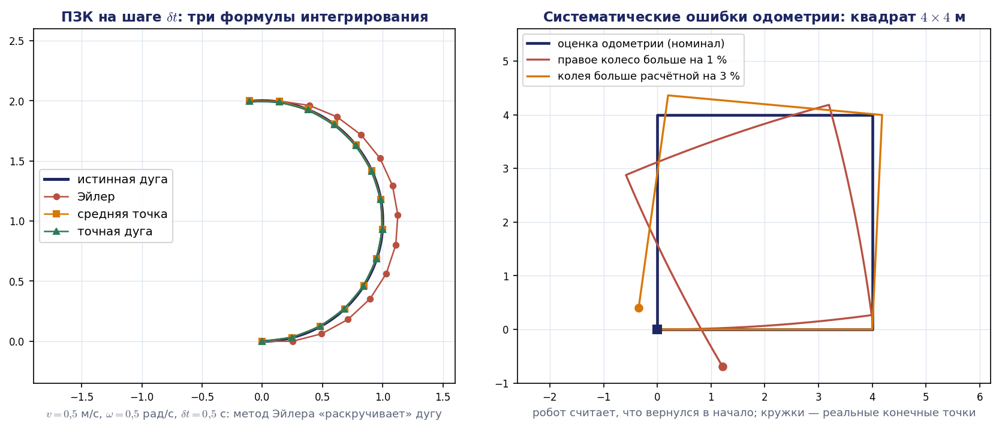
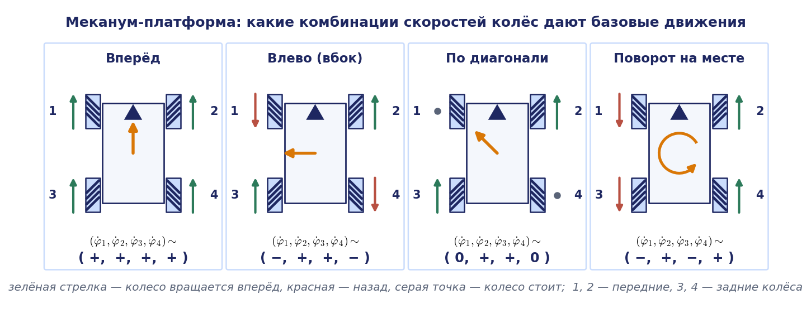
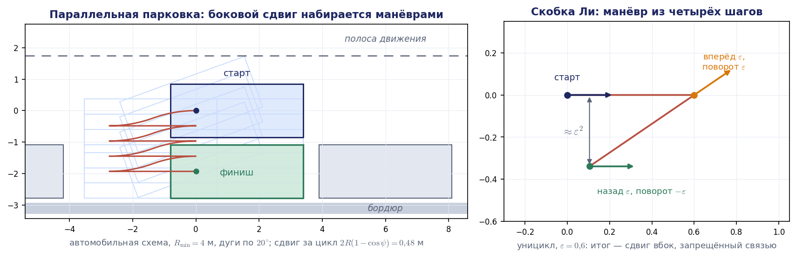

# Лекция 6. Кинематика колёсных мобильных роботов

Лекция опирается на главу 3 книги Р. Сигварта, И. Нурбахша и Д. Скарамуццы «Introduction to Autonomous Mobile Robots» (кинематические связи колёс и манёвренность шасси), на главу 13 книги К. Линча и Ф. Парка «Modern Robotics» (всенаправленные и неголономные платформы, одометрия) и на монографию Ю. Г. Мартыненко «Управление движением мобильных колёсных роботов». Терминология и порядок изложения схем шасси — дифференциальная схема, трицикл, принцип Аккермана, омни- и меканум-колёса — следуют лекции кафедры «Кинематика колёсных роботов». Все рисунки выполнены специально для этого конспекта.

## Введение: от манипулятора к мобильной платформе

До сих пор мы занимались манипуляторами: цепочкой звеньев, один конец которой закреплён на основании. Положение схвата такой цепочки однозначно определяется обобщёнными координатами $\mathbf{q}$, а связь скоростей даёт матрица Якоби: $\dot{\mathbf{s}}=J(\mathbf{q})\dot{\mathbf{q}}$. На третьей лекции мы выяснили, что ранг этой матрицы определяет, какие движения схвата возможны в данной конфигурации, а на прошлой лекции увидели, что у параллельных механизмов естественным образом выводится не прямая, а обратная задача.

Сегодня основание перестаёт быть неподвижным. Мобильный колёсный робот — это твёрдое тело (корпус, шасси), которое катится по плоскости на колёсах. Целевая платформа кафедры — всенаправленный робот команды RoboCup@Work на меканум-колёсах и мобильный манипулятор KUKA youBot, у которого пятизвенная рука установлена на такой же четырёхколёсной меканум-платформе. Чтобы управлять ими, нужно уметь отвечать на те же два вопроса, что и для манипулятора. Первый: с какой скоростью движется корпус, если известны скорости вращения колёс? Второй: с какими скоростями нужно вращать колёса, чтобы корпус двигался с заданной скоростью?

Формально это снова прямая и обратная задачи о скорости, и в них снова появится матрица, играющая роль якобиана. Но есть два принципиальных отличия, ради которых колёсным роботам посвящена отдельная лекция.

Первое отличие состоит в том, что у манипулятора есть прямая задача о положении в конечном виде: подставили углы в сочленениях — получили положение схвата. У колёсного робота такой формулы нет. Если известны только текущие углы поворота колёс, сказать, где находится робот, нельзя: положение зависит от всей истории движения, от того, в каком порядке вращались колёса. Положение приходится получать интегрированием скоростей, и эта процедура называется **одометрией**.

Второе отличие: колесо, которое катится без проскальзывания, не может двигаться вбок. Это ограничение наложено не на положение робота, а на его скорость, и у большинства шасси оно действует всегда, в любой конфигурации. Такие связи называют **неголономными**. Автомобиль не может поехать вбок, но может, как все мы знаем, заехать на парковочное место, расположенное сбоку, за несколько манёвров. Разобраться в том, как это согласуется одно с другим, — одна из целей лекции.

План такой. Сначала мы введём координаты и обозначения, обсудим голономность и выпишем кинематические связи, которые накладывает на шасси колесо каждого типа. Затем разберём классические схемы: дифференциальную схему шасси с мгновенным центром вращения, одометрию, трицикл и принцип Аккермана. Во второй части перейдём к всенаправленным платформам — трёхколёсной на омни-колёсах и четырёхколёсной на меканум-колёсах, — для которой получим полные формулы прямой и обратной задач. В конце введём понятие манёвренности шасси, строго обсудим неголономность на примере параллельной парковки и сведём в одну таблицу параллели с манипулятором.

## 6.1. Положение, скорости и четыре задачи кинематики

### Координаты и системы отсчёта

Будем считать, что робот движется по горизонтальной плоскости. Свяжем с плоскостью неподвижную (инерциальную) систему координат $OX_IY_I$, а с корпусом робота — связанную систему $PX_RY_R$ с началом в характерной точке $P$ шасси. Ось $X_R$ направим вперёд по ходу робота, ось $Y_R$ — влево, так что положительный поворот происходит против часовой стрелки. Положение корпуса полностью задаётся тремя числами

$$
\mathbf{q}=(x,\ y,\ \theta)^{\mathrm T},
$$

где $x,y$ — координаты точки $P$ в неподвижной системе, $\theta$ — угол между осями $X_I$ и $X_R$. Это обобщённые координаты корпуса в том же смысле, в каком углы в сочленениях были обобщёнными координатами манипулятора. В книге Сигварта тот же вектор обозначается $\boldsymbol{\xi}_I$; мы сохраняем обозначение $\mathbf{q}$, принятое в курсе.

Скорость корпуса удобно задавать в связанной системе, потому что именно в ней расположение колёс постоянно:

$$
\mathbf{u}=(v_x,\ v_y,\ \omega)^{\mathrm T},
$$

где $v_x$ — продольная скорость точки $P$, $v_y$ — поперечная (боковая) скорость, $\omega$ — угловая скорость корпуса. Тот же порядок компонент используется в сообщении управления скоростью в системе ROS: продольная, поперечная, угловая. Обратите внимание, что в лекции 3 мы записывали обобщённую скорость схвата в порядке «угловая, затем линейная»; для плоских мобильных роботов общепринят обратный порядок, и мы следуем ему.

Скорости в неподвижной и связанной системах связаны матрицей поворота вокруг вертикальной оси из первой лекции:

$$
\dot{\mathbf{q}}=R_z(\theta)\,\mathbf{u},\qquad \mathbf{u}=R_z^{\mathrm T}(\theta)\,\dot{\mathbf{q}},\qquad R_z(\theta)=\begin{pmatrix}\cos\theta&-\sin\theta&0\\ \sin\theta&\cos\theta&0\\ 0&0&1\end{pmatrix}.
$$

Третья строка означает просто $\dot\theta=\omega$. В книге Сигварта буквой $R(\theta)$ обозначена матрица, переводящая скорость из неподвижной системы в связанную, то есть наша $R_z^{\mathrm T}(\theta)$; при чтении первоисточника об этом нужно помнить. В этой лекции буква $R$ без индекса, как и на слайдах кафедры, будет обозначать радиус поворота.

Углы поворота колёс вокруг собственных осей обозначим $\varphi_i$, угловые скорости колёс — $\dot\varphi_i$, вектор скоростей всех колёс — $\dot{\boldsymbol{\varphi}}$. Радиус колеса обозначим $r$; линейная скорость точки обода равна $r\dot\varphi_i$.

### Четыре задачи

По аналогии с манипулятором сформулируем четыре задачи.

1. **Прямая задача о скорости**: по скоростям колёс $\dot{\boldsymbol{\varphi}}$ найти скорость корпуса $\mathbf{u}$ и, следовательно, $\dot{\mathbf{q}}$.
2. **Обратная задача о скорости**: по желаемой скорости корпуса $\mathbf{u}$ найти скорости колёс $\dot{\boldsymbol{\varphi}}$. Именно эту задачу решает контроллер шасси на каждом такте, получив команду от оператора или от планировщика.
3. **Прямая задача кинематики** мобильного робота (ПЗК): зная параметры управления, например скорости колёс, и время движения, найти положение и ориентацию, которые принял робот. В отличие от манипулятора, это задача интегрирования: $\mathbf{q}(t)=\mathbf{q}(0)+\int_0^tR_z(\theta)\mathbf{u}\,d\tau$.
4. **Обратная задача кинематики** (ОЗК): по желаемому положению и ориентации найти управление, которое переведёт робота туда из текущего положения за ограниченное время. У этой задачи бесконечно много решений, она по существу является задачей планирования траектории и управления, и полностью мы будем заниматься ею в разделе курса, посвящённом навигации. Сегодня нам важно понять, при каких условиях она вообще разрешима.

Первые две задачи — алгебраические и линейные, как и для манипулятора. Всё своеобразие колёсных роботов сосредоточено в третьей и четвёртой.

## 6.2. Голономные и неголономные связи

Напомним определения из теоретической механики. Связь называется **голономной** (геометрической), если она выражается уравнением относительно координат: $h(\mathbf{q},t)=0$. Такая связь ограничивает допустимое пространство состояний, то есть геометрию. Каждая независимая голономная связь уменьшает на единицу число обобщённых координат. Вращательное сочленение манипулятора — типичный пример: оно оставляет двум звеньям одну относительную степень свободы. Другой пример конфигурационного ограничения: у грузовика с прицепом возможны не все углы между тягачом и прицепом.

Связь называется кинематической, если в её уравнение входят скорости: $\mathbf{a}^{\mathrm T}(\mathbf{q})\,\dot{\mathbf{q}}=0$. Иногда такое уравнение можно проинтегрировать и привести к виду $h(\mathbf{q})=\mathrm{const}$; тогда связь на самом деле голономна. Если же проинтегрировать нельзя, связь называется **неголономной**, а механическая система, на которую кроме геометрических связей наложены неинтегрируемые кинематические, — неголономной системой. Неголономная связь ограничивает не состояния, а пространство управления относительно текущего состояния: она запрещает некоторые направления скорости, но не запрещает ни одного положения. Машина не может поехать в сторону, однако оказаться в стороне от исходного места она может.

Классический пример — конёк или нож, стоящий лезвием на плоскости. Его положение задаётся тремя координатами $(x,y,\theta)$, и любые их значения достижимы. Но скорость точки контакта всегда направлена вдоль лезвия, поперечная составляющая равна нулю:

$$
\dot x\sin\theta-\dot y\cos\theta=0.
$$

Колесо, катящееся без бокового скольжения, накладывает в точности такую же связь. То, что она неинтегрируема, мы строго покажем в разделе 6.10, а пока примем на веру.

В робототехнике слово «голономный» применяют и к самому роботу. Робот называют **голономным**, если число управляемых степеней подвижности равно числу его степеней свободы. На плоскости степеней свободы три, поэтому голономный мобильный робот способен в любой момент получить любую скорость $(v_x,v_y,\omega)$: ехать вперёд, вбок и одновременно поворачиваться. Таковы платформы на омни- и меканум-колёсах. Робот с дифференциальной схемой шасси и автомобиль неголономны: степеней свободы у них по-прежнему три, а независимо управляемых компонент скорости только две.

Полезно сразу сопоставить это с манипулятором. Вырожденная конфигурация манипулятора тоже запрещает некоторые направления скорости схвата, но лишь в отдельных конфигурациях и лишь потому, что сами эти конфигурации лежат на границе или на особой поверхности рабочей зоны. У неголономного робота запрет действует всегда, но на множестве достижимых положений никак не сказывается.

## 6.3. Кинематические связи колёс

### Допущения

Чтобы описать шасси, нужно понять, какие ограничения на скорость корпуса накладывает каждое колесо. Примем обычные допущения: колесо — недеформируемый диск, его плоскость вертикальна, контакт с опорной поверхностью точечный, и в точке контакта нет проскальзывания. Последнее допущение распадается на два условия. **Условие качения без проскальзывания**: составляющая скорости центра колеса вдоль плоскости колеса равна $r\dot\varphi$, то есть колесо не буксует и не идёт юзом. **Условие отсутствия бокового скольжения**: составляющая скорости центра колеса вдоль оси колеса равна нулю.

В мобильной робототехнике различают пять типов колёс (рис. 6.1): фиксированное, рулевое (ориентируемое), роликовое, оно же рояльное или кастор, шведское (к нему относятся омни- и меканум-колёса) и сферическое.

### Фиксированное колесо

Положение колеса на шасси зададим тремя параметрами (рис. 6.2). Центр колеса $A$ находится на расстоянии $l$ от точки $P$, а отрезок $PA$ составляет с осью $X_R$ угол $\alpha$. Ориентацию колеса зададим углом $\beta$ между продолжением отрезка $PA$ и осью вращения колеса. Тогда единичный вектор вдоль оси колеса и единичный вектор в плоскости колеса (направление качения) в связанной системе равны

$$
\mathbf{n}=\begin{pmatrix}\cos(\alpha+\beta)\\ \sin(\alpha+\beta)\end{pmatrix},\qquad \mathbf{t}=\begin{pmatrix}\sin(\alpha+\beta)\\ -\cos(\alpha+\beta)\end{pmatrix}.
$$

Скорость точки $A$ найдём по формуле распределения скоростей в твёрдом теле из лекции 3: к скорости полюса $P$ добавляется вклад вращения. В плоском случае вектор $\boldsymbol{\omega}\times\mathbf{r}$ для $\mathbf{r}=(l\cos\alpha,\ l\sin\alpha)^{\mathrm T}$ равен $\omega(-l\sin\alpha,\ l\cos\alpha)^{\mathrm T}$, поэтому

$$
\mathbf{v}_A=\begin{pmatrix}v_x-\omega l\sin\alpha\\ v_y+\omega l\cos\alpha\end{pmatrix}.
$$

Спроецируем эту скорость на направление качения $\mathbf{t}$. Коэффициент при $\omega$ равен $-l\big(\sin\alpha\sin(\alpha+\beta)+\cos\alpha\cos(\alpha+\beta)\big)=-l\cos\beta$, и условие качения принимает вид

$$
\big(\sin(\alpha+\beta),\ -\cos(\alpha+\beta),\ -l\cos\beta\big)\,\mathbf{u}=r\dot\varphi.
$$

Теперь спроецируем на ось колеса $\mathbf{n}$. Коэффициент при $\omega$ равен $l\big(-\sin\alpha\cos(\alpha+\beta)+\cos\alpha\sin(\alpha+\beta)\big)=l\sin\beta$, и условие отсутствия бокового скольжения записывается так:

$$
\big(\cos(\alpha+\beta),\ \sin(\alpha+\beta),\ l\sin\beta\big)\,\mathbf{u}=0.
$$

Чтобы перейти к скоростям в неподвижной системе, достаточно подставить $\mathbf{u}=R_z^{\mathrm T}(\theta)\dot{\mathbf{q}}$.

Смысл двух уравнений разный. Первое содержит $\dot\varphi$ и при свободном, неприводном колесе ничего не запрещает: колесо просто будет вращаться с той скоростью, которая нужна. Для приводного колеса оно связывает скорость двигателя со скоростью корпуса. Второе уравнение не содержит скорости колеса вовсе и представляет собой настоящий запрет: одна линейная комбинация компонент скорости корпуса обязана быть нулём. Каждое фиксированное колесо отнимает у шасси одно направление скорости.

### Рулевое колесо

Рулевое (ориентируемое) колесо отличается от фиксированного только тем, что его можно поворачивать вокруг вертикальной оси, проходящей через центр колеса. Обе связи сохраняют прежний вид, но угол $\beta$ становится функцией времени $\beta(t)$. В каждый момент рулевое колесо запрещает одно направление скорости, однако этим направлением можно управлять. Заметим, что скорость поворота руля $\dot\beta$ в уравнения не входит: на мгновенную скорость корпуса влияет только текущее значение $\beta$.

### Роликовое колесо

Роликовое колесо знакомо всем по офисным креслам и тележкам в магазине. Оно тоже поворачивается вокруг вертикальной оси, но эта ось вынесена из центра колеса на расстояние $d$. Условие качения не меняется, а условие отсутствия бокового скольжения приобретает дополнительное слагаемое:

$$
\big(\cos(\alpha+\beta),\ \sin(\alpha+\beta),\ d+l\sin\beta\big)\,\mathbf{u}+d\,\dot\beta=0.
$$

Угол $\beta$ у роликового колеса свободен, его никто не приводит. Поэтому при любой скорости корпуса $\mathbf{u}$ найдётся такая скорость $\dot\beta$, при которой равенство выполняется: колесо само доворачивается по направлению движения. Вывод: роликовое колесо не накладывает на шасси никаких ограничений. Именно поэтому его ставят в качестве пассивной опоры.

### Шведское колесо

**Шведское колесо** — это колесо, по ободу которого установлены свободно вращающиеся ролики. Угол между осью ролика и плоскостью колеса обозначим $\gamma$. Если $\gamma=0$, оси роликов лежат в плоскости колеса, и мы получаем **омни-колесо** (всенаправленное колесо); если $\gamma=\pm45^{\circ}$ — **меканум-колесо**, оно же колесо Илона по имени шведского изобретателя Бенгта Илона, предложившего его в 1973 году.

Ролик, стоящий на опорной поверхности, свободно вращается вокруг своей оси, поэтому составляющая скорости, перпендикулярная оси ролика, ничем не ограничена. Вдоль оси ролик катиться не может, и в этом направлении проскальзывания быть не должно: проекция скорости центра колеса на ось ролика обязана совпадать с проекцией окружной скорости $r\dot\varphi$. Ось ролика получается из направления качения $\mathbf{t}$ поворотом на угол $\gamma$, и единственная связь шведского колеса имеет вид

$$
\big(\sin(\alpha+\beta+\gamma),\ -\cos(\alpha+\beta+\gamma),\ -l\cos(\beta+\gamma)\big)\,\mathbf{u}=r\dot\varphi\cos\gamma.
$$

Второй связи нет. Существенно, что и эта единственная связь содержит $\dot\varphi$: она не запрещает никакого движения корпуса, а лишь определяет, с какой скоростью при этом будет вращаться колесо. При $\gamma=0$ уравнение совпадает с условием качения обычного колеса, только без запрета бокового скольжения. Полезно посмотреть и на вырожденный случай $\gamma=90^{\circ}$: правая часть обращается в нуль, уравнение превращается в запрет бокового скольжения, а двигатель колеса перестаёт влиять на движение. Такое колесо бесполезно, и его не делают.

### Сферическое колесо

Сферическое колесо (шаровая опора) может катиться в любом направлении и никаких связей на корпус не накладывает. Приводные сферические колёса существуют, но встречаются редко.

### Матричная запись

Соберём связи всех колёс шасси вместе. Условия качения всех приводных колёс образуют систему

$$
J_1(\beta_s)\,R_z^{\mathrm T}(\theta)\,\dot{\mathbf{q}}=J_2\,\dot{\boldsymbol{\varphi}},
$$

где каждая строка матрицы $J_1$ — строка коэффициентов условия качения одного колеса, $J_2$ — диагональная матрица радиусов колёс, а $\beta_s$ — углы рулевых колёс. Условия отсутствия бокового скольжения всех фиксированных и рулевых колёс образуют систему

$$
C_1(\beta_s)\,R_z^{\mathrm T}(\theta)\,\dot{\mathbf{q}}=0,\qquad C_1(\beta_s)=\begin{pmatrix}C_{1f}\\ C_{1s}(\beta_s)\end{pmatrix},
$$

где блок $C_{1f}$ относится к фиксированным колёсам, а $C_{1s}$ — к рулевым. Первая система играет ту же роль, что уравнение скоростей манипулятора: из неё получаются прямая и обратная задачи о скорости. Вторая система описывает, какие скорости корпуса вообще допустимы; к ней мы вернёмся в разделе 6.9.

## 6.4. Дифференциальная схема шасси

### Устройство и связи

**Дифференциальная схема шасси** (дифференциальный привод) — самая распространённая схема небольших мобильных роботов: два приводных фиксированных колеса на общей оси и одна или две пассивные опоры, роликовые или шаровые. Так устроены роботы-пылесосы, TurtleBot, Pioneer и большинство учебных платформ. Управляемые величины — скорости правого и левого колёс $V_r=r\dot\varphi_r$ и $V_l=r\dot\varphi_l$.

Точку $P$ поместим в середину колёсной оси; координаты $(x,y,\theta)$ — это координаты центра колёсной оси и курсовой угол. Расстояние между колёсами (колею) обозначим $l$, так что каждое колесо удалено от точки $P$ на $l/2$. В терминах предыдущего раздела у левого колеса $\alpha=\pi/2$, $\beta=0$, у правого $\alpha=-\pi/2$, $\beta=\pi$. Подставив эти значения, получаем условия качения

$$
v_x+\frac{l}{2}\,\omega=r\dot\varphi_r,\qquad v_x-\frac{l}{2}\,\omega=r\dot\varphi_l
$$

и одно и то же для обоих колёс условие отсутствия бокового скольжения

$$
v_y=0.
$$

Пассивные опоры, как мы выяснили, ограничений не добавляют. Складывая и вычитая условия качения, получаем решение прямой задачи о скорости:

$$
v=v_x=\frac{V_r+V_l}{2},\qquad \omega=\frac{V_r-V_l}{l},\qquad v_y=0.
$$

### Мгновенный центр вращения

Те же формулы удобно получить геометрически, и этот способ даёт наглядную картину движения. Из теоретической механики известно, что любое плоское движение твёрдого тела, кроме поступательного, в каждый момент представляет собой вращение вокруг некоторой точки — **мгновенного центра вращения**, сокращённо МЦВ (в англоязычной литературе ICC, instantaneous center of curvature, или ICR). Скорость любой точки тела перпендикулярна отрезку, соединяющему её с МЦВ. Колесо без бокового скольжения может двигаться только в своей плоскости, значит, МЦВ обязан лежать на оси колеса. У дифференциальной схемы оси обоих колёс совпадают, поэтому МЦВ лежит на общей колёсной оси (рис. 6.3).

Пусть $R$ — расстояние от МЦВ до середины колёсной оси со знаком: положительное, если МЦВ находится слева от робота. Оба колеса вращаются вокруг МЦВ с одной угловой скоростью $\omega$, но по окружностям разных радиусов:

$$
\omega\Big(R+\frac{l}{2}\Big)=V_r,\qquad \omega\Big(R-\frac{l}{2}\Big)=V_l.
$$

Решая эту систему относительно $\omega$ и $R$, получаем

$$
\omega=\frac{V_r-V_l}{l},\qquad R=\frac{l}{2}\cdot\frac{V_r+V_l}{V_r-V_l}.
$$

Линейная скорость середины оси равна $v=\omega R=(V_r+V_l)/2$, что совпадает с результатом, полученным из уравнений связей. Координаты МЦВ в неподвижной системе равны

$$
x_{c}=x-R\sin\theta,\qquad y_{c}=y+R\cos\theta.
$$

Полезно выделить три случая движения.

1. $V_l=V_r$ — прямолинейное движение. Радиус вращения равен бесконечности, угловая скорость нулевая.
2. $V_l=-V_r$ — вращение вокруг центра колёсной оси, разворот на месте. Радиус вращения нулевой.
3. $V_l=0$ или $V_r=0$ — вращение вокруг левого или, соответственно, правого колеса. Радиус вращения равен $l/2$.

Во всех остальных случаях робот движется по дуге окружности радиуса $\lvert R\rvert$. Способность развернуться на месте — главное достоинство дифференциальной схемы: для неё не нужен запас пространства на манёвр.

#### Пример 6.1. Скорость корпуса по скоростям колёс

Пусть радиус колёс $r=0{,}05$ м, колея $l=0{,}30$ м, а измеренные скорости колёс равны $\dot\varphi_r=12$ рад/с и $\dot\varphi_l=8$ рад/с. Тогда $V_r=0{,}6$ м/с, $V_l=0{,}4$ м/с. Линейная скорость корпуса $v=(0{,}6+0{,}4)/2=0{,}5$ м/с, угловая скорость $\omega=(0{,}6-0{,}4)/0{,}30\approx0{,}667$ рад/с. Радиус поворота $R=0{,}15\cdot(1{,}0/0{,}2)=0{,}75$ м; проверка: $\omega R=0{,}5$ м/с. Робот движется по окружности радиуса 75 см, МЦВ находится слева от него.

### Модель в неподвижной системе и матрица, заменяющая якобиан

Перейдём в неподвижную систему координат: $\dot{\mathbf{q}}=R_z(\theta)\mathbf{u}$ при $\mathbf{u}=(v,0,\omega)^{\mathrm T}$. Получаем каноническую кинематическую модель

$$
\dot x=v\cos\theta,\qquad \dot y=v\sin\theta,\qquad \dot\theta=\omega.
$$

Эту модель называют моделью **уницикла** (одноколёсной тележки). Она описывает не только дифференциальную схему, но и, с точностью до выражений для $v$ и $\omega$, трицикл и автомобиль. Исключив $v$ из первых двух уравнений, получаем знакомую неголономную связь $\dot x\sin\theta-\dot y\cos\theta=0$.

Запишем ту же модель в форме, напоминающей уравнение скоростей манипулятора:

$$
\dot{\mathbf{q}}=G(\theta)\,\dot{\boldsymbol{\varphi}},\qquad G(\theta)=R_z(\theta)F,\qquad F=\begin{pmatrix}r/2&r/2\\ 0&0\\ r/l&-r/l\end{pmatrix},\qquad \dot{\boldsymbol{\varphi}}=\begin{pmatrix}\dot\varphi_r\\ \dot\varphi_l\end{pmatrix}.
$$

Матрица $G(\theta)$ размера $3\times2$ — полный аналог матрицы Якоби: она линейно связывает скорости «приводов» со скоростью «выходного звена». Её ранг равен двум при любом $\theta$, поэтому в каждый момент робот может получить лишь двумерное множество скоростей из трёхмерного пространства. Нулевая вторая строка матрицы $F$ — это и есть запрет боковой скорости.

Здесь проходит важная граница. У манипулятора уравнение $\dot{\mathbf{s}}=J\dot{\mathbf{q}}$ получено дифференцированием функции положения $\mathbf{s}=\mathbf{f}(\mathbf{q})$, и потому его всегда можно проинтегрировать обратно. Если бы якобиан манипулятора всюду имел ранг два, схват двигался бы по двумерной поверхности. У колёсного робота функции $\mathbf{q}=\mathbf{f}(\boldsymbol{\varphi})$ не существует, уравнение $\dot{\mathbf{q}}=G(\theta)\dot{\boldsymbol{\varphi}}$ неинтегрируемо, и, несмотря на ранг два, робот достигает любой точки трёхмерного пространства положений.

### Обратная задача о скорости и насыщение скоростей колёс

Обратная задача решается обращением тех же двух условий качения:

$$
\dot\varphi_r=\frac{1}{r}\Big(v+\frac{l}{2}\,\omega\Big),\qquad \dot\varphi_l=\frac{1}{r}\Big(v-\frac{l}{2}\,\omega\Big).
$$

Задать можно только пару $(v,\omega)$; команда с ненулевой боковой скоростью невыполнима.

Скорости колёс ограничены: $\lvert\dot\varphi_{r,l}\rvert\le\dot\varphi_{\max}$. Подставив сюда формулы обратной задачи, получаем область допустимых команд

$$
\lvert v\rvert+\frac{l}{2}\lvert\omega\rvert\le r\dot\varphi_{\max}.
$$

На плоскости $(v,\omega)$ это ромб с вершинами $(\pm r\dot\varphi_{\max},0)$ и $(0,\pm2r\dot\varphi_{\max}/l)$. Он является прямым аналогом многогранника допустимых скоростей схвата из лекции 3: образ прямоугольника ограничений на скорости приводов при линейном отображении. Из формы ромба следует практический вывод: максимальную линейную и максимальную угловую скорости нельзя развить одновременно.

Если команда выходит за пределы ромба, простое ограничение скорости одного колеса исказит траекторию. Правильнее умножить обе скорости на общий коэффициент: тогда отношение $\omega/v$, то есть кривизна траектории $1/R$, сохранится, и робот пройдёт по той же дуге, только медленнее.

#### Пример 6.2. Команда за пределами возможностей приводов

Для робота из примера 6.1 пусть $\dot\varphi_{\max}=20$ рад/с, а задана команда $v=0{,}8$ м/с, $\omega=2{,}0$ рад/с, которой соответствует радиус поворота $R=v/\omega=0{,}4$ м. Обратная задача даёт $\dot\varphi_r=(0{,}8+0{,}3)/0{,}05=22$ рад/с и $\dot\varphi_l=(0{,}8-0{,}3)/0{,}05=10$ рад/с. Правое колесо выходит за ограничение. Если просто срезать его скорость до 20 рад/с, получим $V_r=1{,}0$ м/с, $V_l=0{,}5$ м/с, откуда $v=0{,}75$ м/с, $\omega\approx1{,}67$ рад/с и $R=0{,}45$ м: робот пойдёт по другой дуге. Если же умножить обе скорости на коэффициент $20/22\approx0{,}909$, получим $v\approx0{,}727$ м/с, $\omega\approx1{,}82$ рад/с и прежний радиус $R=0{,}4$ м.

## 6.5. Прямая задача кинематики на шаге и одометрия

### Положение робота в момент $t+\delta t$

Решим теперь прямую задачу кинематики: где окажется робот через малое время $\delta t$, если скорости колёс на этом интервале постоянны? При постоянных $V_r$ и $V_l$ постоянны $\omega$ и $R$, МЦВ неподвижен, и робот просто поворачивается вокруг МЦВ на угол $\omega\,\delta t$. Поворот точки вокруг центра $(x_c,y_c)$ записывается так:

$$
\begin{pmatrix}x'\\ y'\\ \theta'\end{pmatrix}=\begin{pmatrix}\cos\omega\delta t&-\sin\omega\delta t&0\\ \sin\omega\delta t&\cos\omega\delta t&0\\ 0&0&1\end{pmatrix}\begin{pmatrix}x-x_c\\ y-y_c\\ \theta\end{pmatrix}+\begin{pmatrix}x_c\\ y_c\\ \omega\delta t\end{pmatrix}.
$$

Подставим координаты МЦВ: $x-x_c=R\sin\theta$, $y-y_c=-R\cos\theta$. Раскрыв произведение и воспользовавшись формулами синуса и косинуса суммы, получаем явные выражения

$$
\begin{aligned}
x'&=x+R\big(\sin(\theta+\omega\delta t)-\sin\theta\big),\\
y'&=y-R\big(\cos(\theta+\omega\delta t)-\cos\theta\big),\\
\theta'&=\theta+\omega\,\delta t,
\end{aligned}
\qquad R=\frac{v}{\omega}.
$$

Это точное решение для движения по дуге окружности. При $\omega\to0$ нужно перейти к пределу; получается прямолинейное движение $x'=x+v\,\delta t\cos\theta$, $y'=y+v\,\delta t\sin\theta$. В программе случай малого $\lvert\omega\rvert$ обрабатывают отдельной ветвью, чтобы не делить на нуль.

### Одометрия

**Одометрия** — это оценка положения робота путём последовательного применения формул прямой задачи к показаниям датчиков угла поворота колёс (энкодеров). На каждом такте по приращениям углов $\Delta\varphi_r$, $\Delta\varphi_l$ вычисляют пути колёс $\Delta s_r=r\Delta\varphi_r$, $\Delta s_l=r\Delta\varphi_l$, затем путь и поворот корпуса

$$
\Delta s=\frac{\Delta s_r+\Delta s_l}{2},\qquad \Delta\theta=\frac{\Delta s_r-\Delta s_l}{l},
$$

после чего обновляют оценку положения. Для обновления есть три формулы разной точности.

Самая простая — метод Эйлера: считаем, что весь шаг робот ехал с начальным курсом,

$$
x'=x+\Delta s\cos\theta,\qquad y'=y+\Delta s\sin\theta,\qquad \theta'=\theta+\Delta\theta.
$$

Вторая — метод средней точки: берём курс в середине шага,

$$
x'=x+\Delta s\cos\Big(\theta+\frac{\Delta\theta}{2}\Big),\qquad y'=y+\Delta s\sin\Big(\theta+\frac{\Delta\theta}{2}\Big).
$$

Третья — точное интегрирование по дуге, выведенное выше. Его удобно переписать через хорду дуги. Хорда дуги длины $\Delta s$ с центральным углом $\Delta\theta$ направлена под углом $\theta+\Delta\theta/2$ и имеет длину $\Delta s\cdot\sin(\Delta\theta/2)/(\Delta\theta/2)$. Отсюда видно, что метод средней точки правильно определяет направление перемещения и ошибается только в его длине, причём относительная ошибка равна примерно $\Delta\theta^2/24$. Метод Эйлера ошибается уже в направлении, на угол $\Delta\theta/2$, и это гораздо хуже.

#### Пример 6.3. Эйлер против точной дуги

Пусть робот движется с постоянными $v=0{,}5$ м/с и $\omega=0{,}5$ рад/с, то есть по окружности радиуса 1 м, и проходит половину окружности, а шаг интегрирования $\delta t=0{,}5$ с; поворот за шаг составляет $0{,}25$ рад. Расчёт, результаты которого показаны на рис. 6.4 слева, даёт следующее. Метод Эйлера систематически выносит оценку наружу, дуга «раскручивается», и после полуокружности ошибка положения достигает $0{,}25$ м. Метод средней точки при том же шаге ошибается на $0{,}005$ м, что согласуется с оценкой: $0{,}25^2/24\approx0{,}0026$ от перемещения в 2 м. Точная формула даёт нулевую ошибку при любом шаге, пока скорости на шаге действительно постоянны. Вывод: формула средней точки или точная формула стоят тех же вычислительных затрат, что и метод Эйлера, и применять метод Эйлера в одометрии нет причин.

### Накопление ошибки

Одометрия — интегрирующий метод, и любая ошибка в ней накапливается. Особенно опасна ошибка курса: если оценка курса отличается от истинного значения на $\delta\theta$, то после прохождения пути $s$ боковая ошибка положения составит примерно $s\,\delta\theta$ и будет расти без ограничений.

Ошибки делят на случайные и систематические. Случайные вызваны проскальзыванием колёс, неровностями пола, наездом на препятствия. Систематические заложены в самой модели: неравные диаметры колёс, неточно известная колея (точка контакта широкого колеса с полом не определена), конечное разрешение энкодеров. На ровном полу доминируют именно систематические ошибки, и они же хорошо поддаются калибровке.

Оценим их влияние. Если правое колесо на один процент больше левого, то при команде «прямо» робот на самом деле поворачивает с кривизной $0{,}01/l$. При колее $l=0{,}30$ м на отрезке в 4 м он повернётся на $0{,}01\cdot4/0{,}30\approx0{,}13$ рад, то есть почти на 8 градусов, и отклонится вбок примерно на $0{,}27$ м, а одометрия ничего не заметит. На рис. 6.4 справа показан расчёт для квадратного маршрута $4\times4$ м: одометрия считает, что робот вернулся в исходную точку, тогда как при разнице диаметров в один процент реальная конечная точка удалена от старта на $1{,}4$ м, а ошибка курса превышает 30 градусов. Ошибка колеи действует иначе: на прямых участках она не проявляется, зато каждый разворот на месте выполняется с ошибкой. При колее, превышающей расчётную на три процента, каждый поворот на 90 градусов оказывается короче на $2{,}6$ градуса, и конечная точка смещается на полметра. На противоположном влиянии этих двух ошибок при обходе квадрата по часовой стрелке и против неё основан стандартный метод калибровки одометрии UMBmark, предложенный Дж. Боренштейном и Л. Фэном.

Поэтому в реальных системах одометрия никогда не используется одна: её объединяют с измерениями гироскопа, лидара или камеры. Но она остаётся основой оценки положения на коротких интервалах, и от качества её формул и калибровки зависит всё остальное.

## 6.6. Трицикл и принцип Аккермана

### Трицикл

**Трицикл** — трёхколёсная схема с одним рулевым колесом спереди и двумя фиксированными колёсами на задней оси. Так устроены многие складские тележки и погрузчики, причём приводным обычно делают само рулевое колесо. Точку $P$ снова поместим в центр задней оси, расстояние от неё до рулевого колеса обозначим $d$, угол поворота рулевого колеса относительно продольной оси — $\delta$ (на слайдах кафедры этот угол обозначен $\varphi$; мы оставляем букву $\varphi$ за углами вращения колёс).

МЦВ находится сразу. Он должен лежать на оси задних колёс и одновременно на оси рулевого колеса (рис. 6.5, слева). Из прямоугольного треугольника получаем радиус поворота центра задней оси:

$$
R=\frac{d}{\operatorname{tg}\delta}.
$$

Если рулевое колесо приводное и скорость его центра равна $v_s$, то расстояние от МЦВ до рулевого колеса равно $d/\sin\delta$, и

$$
\omega=\frac{v_s\sin\delta}{d},\qquad v=\omega R=v_s\cos\delta.
$$

Если же приводными сделаны задние колёса и задаётся скорость $v$ центра задней оси, то $\omega=v\operatorname{tg}\delta/d$. В обоих случаях движение корпуса описывается той же канонической моделью $\dot x=v\cos\theta$, $\dot y=v\sin\theta$, $\dot\theta=\omega$, и положение в момент $t+\delta t$ вычисляется по формулам раздела 6.5 с подстановкой этих $v$ и $\omega$. Модель с задним приводом

$$
\dot x=v\cos\theta,\qquad \dot y=v\sin\theta,\qquad \dot\theta=\frac{v}{d}\operatorname{tg}\delta
$$

известна также как велосипедная модель автомобиля.

Отметим особенности схемы.

- Угол поворота руля ограничен, $\lvert\delta\rvert\le\delta_{\max}$, поэтому радиус поворота не может быть меньше $R_{\min}=d/\operatorname{tg}\delta_{\max}$. Развернуться на месте нельзя.
- Задние колёса при повороте идут по окружностям радиусов $R-l/2$ и $R+l/2$ и должны вращаться с разными скоростями $V_{l,r}=\omega(R\mp l/2)$. Если они приводные, на задней оси требуется дифференциал, механический или программный, иначе поворот будет сопровождаться проскальзыванием.
- При четырёх колёсах нужен дифференциал для ведущих колёс и схема Аккермана для рулевых.
- Траектория зависит от того, какая ось приводная: при переднем приводе задаётся скорость $v_s$ рулевого колеса, при заднем — скорость $v$ задней оси, и одна и та же пара чисел «скорость, угол руля» даёт разные $v$ и $\omega$.

### Принцип Аккермана

У автомобиля рулевых колёс два. Если повернуть их на одинаковый угол, их оси окажутся параллельными и не пересекутся с осью задних колёс в одной точке. Единого МЦВ не будет, и хотя бы одно колесо обязано скользить вбок, а это означает износ шин и потерю управляемости. **Принцип Аккермана** — принцип рулевой геометрии, разработанный для того, чтобы рулевые колёса могли проходить окружности разного радиуса без бокового скольжения: оси всех четырёх колёс должны пересекаться в одной точке (рис. 6.5, справа).

Пусть $d$ — колёсная база, $l$ — колея, $R$ — радиус поворота центра задней оси. Внутреннее по отношению к повороту колесо находится ближе к МЦВ и должно быть повёрнуто круче наружного:

$$
\operatorname{tg}\delta_i=\frac{d}{R-l/2},\qquad \operatorname{tg}\delta_o=\frac{d}{R+l/2}.
$$

Исключив $R$, получаем условие Аккермана, связывающее два угла:

$$
\operatorname{ctg}\delta_o-\operatorname{ctg}\delta_i=\frac{l}{d}.
$$

В автомобиле это условие приближённо обеспечивается рулевой трапецией, в роботе с независимыми сервоприводами рулевых колёс — программно. Для расчётов автомобиль заменяют эквивалентным трициклом (велосипедной моделью) с углом руля $\delta$, для которого $\operatorname{ctg}\delta=(\operatorname{ctg}\delta_i+\operatorname{ctg}\delta_o)/2$.

#### Пример 6.4. Углы Аккермана

Пусть база $d=2{,}7$ м, колея $l=1{,}6$ м, требуемый радиус поворота $R=6$ м. Тогда $\delta_i=\operatorname{arctg}(2{,}7/5{,}2)\approx27{,}4^{\circ}$, $\delta_o=\operatorname{arctg}(2{,}7/6{,}8)\approx21{,}7^{\circ}$, а угол эквивалентного трицикла $\delta=\operatorname{arctg}(2{,}7/6)\approx24{,}2^{\circ}$. Разница между углами внутреннего и наружного колёс почти шесть градусов, и пренебречь ею нельзя. Проверка: $\operatorname{ctg}21{,}7^{\circ}-\operatorname{ctg}27{,}4^{\circ}\approx2{,}519-1{,}926=0{,}593$, что совпадает с $l/d=0{,}593$. Задние колёса идут по окружностям радиусов $5{,}2$ и $6{,}8$ м, и наружное колесо должно вращаться в $1{,}31$ раза быстрее внутреннего.

## 6.7. Омни-колёса и трёхколёсная всенаправленная платформа

### Идея всенаправленного колеса

Все рассмотренные до сих пор схемы неголономны, потому что в них есть фиксированные или рулевые колёса. Чтобы получить голономную платформу, нужно убрать запрет бокового скольжения, сохранив возможность передавать тяговое усилие. Эту задачу решает **омни-колесо** (всенаправленное колесо): по его ободу установлены свободные ролики, оси которых касательны к ободу. В направлении своей плоскости такое колесо работает как обычное и передаёт тягу, а в поперечном направлении свободно катится на роликах. Одна связь вместо двух, и та лишь определяет скорость колеса.

Ясно, что одно омни-колесо даёт тягу только в одном направлении. Чтобы управлять тремя компонентами скорости корпуса, нужно не менее трёх колёс, причём их направления тяги не должны быть параллельны и их оси не должны пересекаться в одной точке.

### Матрица платформы с тремя колёсами под 120 градусов

Рассмотрим самую распространённую схему: три омни-колеса расположены на окружности радиуса $L$ через 120 градусов, оси колёс направлены по радиусам (рис. 6.6). Колесо с номером $i$ находится под углом $\alpha_i$ к оси $X_R$; примем $\alpha_1=0^{\circ}$, $\alpha_2=120^{\circ}$, $\alpha_3=240^{\circ}$. Направление тяги колеса — касательная к окружности; положительным будем считать направление, при котором колесо вращает платформу против часовой стрелки:

$$
\mathbf{t}_i=\begin{pmatrix}-\sin\alpha_i\\ \cos\alpha_i\end{pmatrix}.
$$

Скорость центра колеса равна $\mathbf{v}_i=(v_x-\omega L\sin\alpha_i,\ v_y+\omega L\cos\alpha_i)^{\mathrm T}$. Единственная связь омни-колеса требует, чтобы проекция этой скорости на направление тяги равнялась $r\dot\varphi_i$:

$$
r\dot\varphi_i=-\sin\alpha_i\,v_x+\cos\alpha_i\,v_y+L\,\omega.
$$

В терминах раздела 6.3 это связь шведского колеса при $\gamma=0$ и $\beta=\pi$. Выписав три строки, получаем решение обратной задачи о скорости:

$$
\dot{\boldsymbol{\varphi}}=H\mathbf{u},\qquad H=\frac{1}{r}\begin{pmatrix}0&1&L\\ -\dfrac{\sqrt3}{2}&-\dfrac12&L\\ \dfrac{\sqrt3}{2}&-\dfrac12&L\end{pmatrix}.
$$

Обратите внимание на направление вывода. У манипулятора естественным образом получалась прямая задача $\dot{\mathbf{s}}=J\dot{\mathbf{q}}$, а обратную приходилось решать обращением матрицы. У колёсной платформы из уравнений связей естественно получается обратная задача: каждая связь даёт одну строку, выражающую скорость одного колеса через скорость корпуса. В этом колёсные платформы похожи на параллельные механизмы из прошлой лекции, и причина та же: несколько «ног» опираются на одно тело.

Определитель матрицы $H$ равен $3\sqrt3\,L/(2r^3)$ и не обращается в нуль. Поэтому прямая задача о скорости решается обращением:

$$
\mathbf{u}=H^{-1}\dot{\boldsymbol{\varphi}},\qquad H^{-1}=r\begin{pmatrix}0&-\dfrac{1}{\sqrt3}&\dfrac{1}{\sqrt3}\\ \dfrac23&-\dfrac13&-\dfrac13\\ \dfrac{1}{3L}&\dfrac{1}{3L}&\dfrac{1}{3L}\end{pmatrix}.
$$

Третья строка имеет прозрачный смысл: угловая скорость платформы пропорциональна сумме скоростей колёс. Матрица $H$ постоянна в связанной системе и невырождена всегда, а не только в отдельных конфигурациях. В этом смысле голономная платформа — аналог манипулятора, у которого якобиан имеет полный ранг во всей рабочей зоне: вырожденных конфигураций у неё нет.

В неподвижной системе обратная задача принимает вид $\dot{\boldsymbol{\varphi}}=HR_z^{\mathrm T}(\theta)\dot{\mathbf{q}}$. Платформа способна, например, ехать по прямой и одновременно вращаться; скорости колёс при этом меняются по гармоническому закону.

#### Пример 6.5. Скорости колёс омни-платформы

Пусть $r=0{,}05$ м, $L=0{,}20$ м, и требуется скорость корпуса $v_x=0{,}2$ м/с, $v_y=0{,}1$ м/с, $\omega=0{,}5$ рад/с. По строкам матрицы $H$ находим: $\dot\varphi_1=(0{,}1+0{,}1)/0{,}05=4{,}00$ рад/с, $\dot\varphi_2=(-0{,}1732-0{,}05+0{,}1)/0{,}05\approx-2{,}46$ рад/с, $\dot\varphi_3=(0{,}1732-0{,}05+0{,}1)/0{,}05\approx4{,}46$ рад/с. Проверим прямой задачей: $v_x=r(\dot\varphi_3-\dot\varphi_2)/\sqrt3=0{,}05\cdot6{,}93/1{,}732=0{,}2$ м/с, $\omega=r(\dot\varphi_1+\dot\varphi_2+\dot\varphi_3)/(3L)=0{,}05\cdot6{,}0/0{,}6=0{,}5$ рад/с. Заметим ещё, что при чистом движении вперёд, $\mathbf{u}=(v,0,0)^{\mathrm T}$, первое колесо не вращается вовсе, и его ролики пассивно катятся по полу, а второе и третье вращаются в противоположные стороны со скоростью $\sqrt3\,v/(2r)$.

## 6.8. Меканум-платформа

### Меканум-колесо

**Меканум-колесо** (колесо Илона, шведское колесо) отличается от омни-колеса тем, что оси роликов повёрнуты относительно плоскости колеса на 45 градусов. Это позволяет расположить все четыре колеса так же, как у обычного автомобиля, параллельно продольной оси, и получить компактную платформу с большой грузоподъёмностью. Именно такую схему имеют платформа youBot и роботы лиги RoboCup@Work.

Меканум-колёса бывают двух видов, зеркальных друг другу, и на платформу ставят по два колеса каждого вида. Правильная установка такова (рис. 6.7): если смотреть на платформу сверху, видимые верхние ролики образуют рисунок в виде буквы X, то есть линии роликов сходятся к центру платформы. Ролики, находящиеся в этот момент внизу и касающиеся пола, повёрнуты зеркально, и их оси образуют ромб, рисунок в виде буквы O. Работают нижние ролики, поэтому в формулы входят именно их направления.

### Связь одного колеса

Введём обозначения. Начало связанной системы поместим в геометрический центр платформы; $l_x$ — половина колёсной базы (полубаза), $l_y$ — половина колеи (полуколея), $r$ — радиус колеса. Колёса пронумеруем так: 1 — переднее левое, 2 — переднее правое, 3 — заднее левое, 4 — заднее правое. Координаты центров колёс равны $(l_x,l_y)$, $(l_x,-l_y)$, $(-l_x,l_y)$, $(-l_x,-l_y)$. Положительным считаем вращение колеса, при котором оно катится вперёд.

Пусть единичный вектор оси нижнего ролика $i$-го колеса составляет с осью $X_R$ угол $\gamma_i$: $\mathbf{a}_i=(\cos\gamma_i,\ \sin\gamma_i)^{\mathrm T}$. При установке «X сверху» получается $\gamma_1=\gamma_4=-45^{\circ}$ и $\gamma_2=\gamma_3=+45^{\circ}$. Рассуждаем так же, как для шведского колеса в разделе 6.3. Ролик свободно вращается вокруг своей оси, поэтому перпендикулярно вектору $\mathbf{a}_i$ точка контакта движется свободно. Вдоль оси ролика проскальзывания нет, значит, проекция скорости центра колеса $\mathbf{v}_i$ на $\mathbf{a}_i$ равна проекции окружной скорости $r\dot\varphi_i\mathbf{e}_x$ на тот же вектор:

$$
\mathbf{v}_i\cdot\mathbf{a}_i=r\dot\varphi_i\,(\mathbf{e}_x\cdot\mathbf{a}_i)\quad\Longrightarrow\quad r\dot\varphi_i=v_{ix}+v_{iy}\operatorname{tg}\gamma_i.
$$

Это частный случай общей связи шведского колеса при $\alpha+\beta=90^{\circ}$. Скорость центра колеса с координатами $(x_i,y_i)$ даётся распределением скоростей: $v_{ix}=v_x-\omega y_i$, $v_{iy}=v_y+\omega x_i$.

### Обратная задача о скорости

Подставим координаты и углы для каждого колеса. Для первого колеса $v_{1x}=v_x-\omega l_y$, $v_{1y}=v_y+\omega l_x$, $\operatorname{tg}\gamma_1=-1$, откуда $r\dot\varphi_1=v_x-v_y-(l_x+l_y)\omega$. Проделав то же для остальных колёс, получаем

$$
\begin{aligned}
r\dot\varphi_1&=v_x-v_y-(l_x+l_y)\,\omega,\\
r\dot\varphi_2&=v_x+v_y+(l_x+l_y)\,\omega,\\
r\dot\varphi_3&=v_x+v_y-(l_x+l_y)\,\omega,\\
r\dot\varphi_4&=v_x-v_y+(l_x+l_y)\,\omega,
\end{aligned}
$$

или в матричной форме

$$
\dot{\boldsymbol{\varphi}}=H\mathbf{u},\qquad H=\frac{1}{r}\begin{pmatrix}1&-1&-(l_x+l_y)\\ 1&1&l_x+l_y\\ 1&1&-(l_x+l_y)\\ 1&-1&l_x+l_y\end{pmatrix}.
$$

Это полное решение обратной задачи о скорости для меканум-платформы. Геометрия входит в него только через сумму $l_x+l_y$. В неподвижной системе $\dot{\boldsymbol{\varphi}}=HR_z^{\mathrm T}(\theta)\dot{\mathbf{q}}$.

Формулы позволяют сразу увидеть, что будет при неправильной установке колёс. Если перепутать левые и правые колёса так, что рисунок X образуют нижние ролики, знаки всех углов $\gamma_i$ изменятся, и в третьем столбце вместо суммы появится разность $l_x-l_y$. У почти квадратной платформы этот столбец близок к нулю: платформа по-прежнему ездит вперёд и вбок, но практически не может поворачиваться, а ранг матрицы падает до двух.

### Базовые движения

Посмотрим, какие комбинации скоростей колёс соответствуют простейшим движениям (рис. 6.8). Достаточно подставить в формулы обратной задачи по одной ненулевой компоненте скорости.

| Движение | Скорость корпуса | $\dot\varphi_1$ | $\dot\varphi_2$ | $\dot\varphi_3$ | $\dot\varphi_4$ |
|---|---|---|---|---|---|
| Вперёд | $(v,0,0)$ | $v/r$ | $v/r$ | $v/r$ | $v/r$ |
| Влево | $(0,v,0)$ | $-v/r$ | $v/r$ | $v/r$ | $-v/r$ |
| Вправо | $(0,-v,0)$ | $v/r$ | $-v/r$ | $-v/r$ | $v/r$ |
| По диагонали вперёд и влево | $(v,v,0)$ | $0$ | $2v/r$ | $2v/r$ | $0$ |
| По диагонали вперёд и вправо | $(v,-v,0)$ | $2v/r$ | $0$ | $0$ | $2v/r$ |
| Поворот на месте против часовой стрелки | $(0,0,\Omega)$ | $-k\Omega$ | $k\Omega$ | $-k\Omega$ | $k\Omega$ |

В последней строке $k=(l_x+l_y)/r$. Словами: при движении вперёд все колёса вращаются одинаково; при движении вбок колёса одной диагонали вращаются вперёд, а другой — назад; при движении по диагонали работают только два колеса одной диагонали, а два других стоят, и платформа катится на их роликах; при повороте на месте колёса левого борта вращаются в одну сторону, правого — в другую, как у гусеничной машины. На слайдах кафедры приведена та же таблица с теми же номерами колёс: поперечному движению там соответствует набор $(\omega,-\omega,-\omega,\omega)$, то есть движение вправо, движению под 45 градусов — набор $(0,\omega,\omega,0)$, вращению на месте — набор $(\omega,-\omega,\omega,-\omega)$, то есть поворот по часовой стрелке.

Механическое объяснение бокового движения таково. Колесо может передать платформе силу только вдоль оси нижнего ролика, потому что поперёк этой оси ролик свободно катится. У первого колеса при вращении вперёд эта сила направлена вперёд и вправо, у второго — вперёд и влево, у третьего — вперёд и влево, у четвёртого — вперёд и вправо. Когда все колёса вращаются вперёд, боковые составляющие попарно уничтожаются и остаётся сила, направленная вперёд. Когда первое и четвёртое колёса вращаются назад, а второе и третье вперёд, уничтожаются продольные составляющие, и все четыре боковые составляющие направлены влево.

### Прямая задача о скорости

Колёс четыре, а компонент скорости корпуса три: матрица $H$ имеет размер $4\times3$, и система $H\mathbf{u}=\dot{\boldsymbol{\varphi}}$ относительно $\mathbf{u}$ переопределена. Это ситуация, зеркальная по отношению к избыточному манипулятору из лекции 3: там неизвестных было больше, чем уравнений, и мы искали решение минимальной нормы; здесь уравнений больше, чем неизвестных, и мы ищем решение с минимальной невязкой. Инструмент тот же — псевдообратная матрица, причём в простейшей её форме для матрицы полного столбцового ранга:

$$
\mathbf{u}=H^{+}\dot{\boldsymbol{\varphi}},\qquad H^{+}=(H^{\mathrm T}H)^{-1}H^{\mathrm T}.
$$

Столбцы матрицы $H$ взаимно ортогональны, поэтому $H^{\mathrm T}H$ — диагональная матрица с элементами $4/r^2$, $4/r^2$ и $4(l_x+l_y)^2/r^2$, и псевдообратная выписывается сразу:

$$
H^{+}=\frac{r}{4}\begin{pmatrix}1&1&1&1\\ -1&1&1&-1\\ -\dfrac{1}{l_x+l_y}&\dfrac{1}{l_x+l_y}&-\dfrac{1}{l_x+l_y}&\dfrac{1}{l_x+l_y}\end{pmatrix}.
$$

В развёрнутом виде прямая задача о скорости выглядит так:

$$
\begin{aligned}
v_x&=\frac{r}{4}\big(\dot\varphi_1+\dot\varphi_2+\dot\varphi_3+\dot\varphi_4\big),\\
v_y&=\frac{r}{4}\big(-\dot\varphi_1+\dot\varphi_2+\dot\varphi_3-\dot\varphi_4\big),\\
\omega&=\frac{r}{4(l_x+l_y)}\big(-\dot\varphi_1+\dot\varphi_2-\dot\varphi_3+\dot\varphi_4\big).
\end{aligned}
$$

Четыре скорости колёс не могут быть произвольными. Вектор $(1,1,-1,-1)^{\mathrm T}$ ортогонален всем столбцам матрицы $H$, поэтому движение без проскальзывания возможно только при выполнении условия совместности

$$
\dot\varphi_1+\dot\varphi_2-\dot\varphi_3-\dot\varphi_4=0.
$$

Если контроллер вычисляет скорости колёс по формулам обратной задачи, условие выполняется автоматически. Если же измеренные скорости его нарушают, значит, какие-то колёса проскальзывают; составляющая вдоль вектора $(1,1,-1,-1)^{\mathrm T}$ не создаёт движения, а только нагружает приводы и изнашивает ролики. Псевдообратная матрица эту составляющую отбрасывает и даёт наилучшую в смысле наименьших квадратов оценку скорости корпуса.

Одометрия меканум-платформы строится так же, как в разделе 6.5: на каждом такте вычисляют $\mathbf{u}=H^{+}\dot{\boldsymbol{\varphi}}$ и интегрируют $\dot{\mathbf{q}}=R_z(\theta)\mathbf{u}$, лучше всего с курсом в середине шага. Нужно иметь в виду, что ролики проскальзывают заметно сильнее обычных колёс, особенно при боковом движении, поэтому одометрия меканум-платформы грубее, чем у дифференциальной схемы, и её обязательно дополняют локализацией по лидару.

#### Пример 6.6. Обратная задача для меканум-платформы

Возьмём параметры, близкие к платформе youBot: $r=0{,}05$ м, $l_x=0{,}235$ м, $l_y=0{,}15$ м, так что $l_x+l_y=0{,}385$ м. Требуется скорость $v_x=0{,}3$ м/с, $v_y=0{,}2$ м/с, $\omega=0{,}5$ рад/с. Вклад вращения равен $(l_x+l_y)\omega=0{,}1925$ м/с. Тогда

$$
\begin{aligned}
\dot\varphi_1&=(0{,}3-0{,}2-0{,}1925)/0{,}05=-1{,}85,\qquad &\dot\varphi_2&=(0{,}3+0{,}2+0{,}1925)/0{,}05=13{,}85,\\
\dot\varphi_3&=(0{,}3+0{,}2-0{,}1925)/0{,}05=6{,}15,\qquad &\dot\varphi_4&=(0{,}3-0{,}2+0{,}1925)/0{,}05=5{,}85
\end{aligned}
$$

радиан в секунду. Условие совместности выполнено: $-1{,}85+13{,}85-6{,}15-5{,}85=0$. Проверка прямой задачей: сумма скоростей равна $24$, откуда $v_x=0{,}0125\cdot24=0{,}3$ м/с; комбинация для $v_y$ равна $16$, откуда $v_y=0{,}2$ м/с; комбинация для $\omega$ равна $15{,}4$, откуда $\omega=0{,}0125\cdot15{,}4/0{,}385=0{,}5$ рад/с. Обратите внимание, как неравномерно распределена нагрузка: второе колесо вращается почти в восемь раз быстрее первого.

#### Пример 6.7. Прямая задача при проскальзывании

Та же платформа получила команду ехать прямо, а энкодеры показали $\dot{\boldsymbol{\varphi}}=(10{,}0;\ 10{,}4;\ 9{,}6;\ 10{,}2)^{\mathrm T}$ рад/с. Условие совместности нарушено: $10{,}0+10{,}4-9{,}6-10{,}2=0{,}6$, следовательно, есть проскальзывание. Оценка по методу наименьших квадратов: $v_x=0{,}0125\cdot40{,}2\approx0{,}503$ м/с, $v_y=0{,}0125\cdot(-0{,}2)=-0{,}0025$ м/с, $\omega=0{,}0125\cdot1{,}0/0{,}385\approx0{,}032$ рад/с. Невязка, то есть часть измерений, не объяснимая никаким движением корпуса, равна $0{,}15\cdot(1,1,-1,-1)^{\mathrm T}$ рад/с.

### Ограничения скорости

Пусть скорость каждого колеса ограничена величиной $\dot\varphi_{\max}$. В четырёх строках обратной задачи встречаются все четыре комбинации знаков при $v_y$ и $\omega$, поэтому наибольшая по модулю из четырёх скоростей колёс равна сумме модулей слагаемых, и область допустимых команд задаётся неравенством

$$
\lvert v_x\rvert+\lvert v_y\rvert+(l_x+l_y)\lvert\omega\rvert\le r\dot\varphi_{\max}.
$$

В пространстве $(v_x,v_y,\omega)$ это октаэдр — трёхмерный родственник ромба дифференциальной схемы. Для платформы из примера 6.6 при $\dot\varphi_{\max}=20$ рад/с получаем: наибольшая скорость вперёд или вбок 1 м/с, наибольшая скорость по диагонали $1/\sqrt2\approx0{,}71$ м/с (работают только два колеса), наибольшая угловая скорость $1/0{,}385\approx2{,}6$ рад/с. Всенаправленная платформа может ехать в любую сторону, но не в любую сторону одинаково быстро. Как и раньше, команду, выходящую за пределы октаэдра, следует масштабировать целиком, а не срезать скорости отдельных колёс.

## 6.9. Манёвренность шасси

### Степень подвижности

Вернёмся к матрице $C_1(\beta_s)$, составленной из условий отсутствия бокового скольжения всех фиксированных и рулевых колёс. Допустимая скорость корпуса обязана удовлетворять системе $C_1(\beta_s)\mathbf{u}=0$, то есть лежать в ядре этой матрицы. Размерность ядра называется **степенью подвижности** шасси:

$$
\delta_m=3-\operatorname{rank}C_1(\beta_s).
$$

Это число компонент скорости корпуса, которыми можно управлять мгновенно, изменяя только скорости колёс. Ранг удобно определять геометрически: каждая строка матрицы $C_1$ требует, чтобы МЦВ лежал на оси соответствующего колеса.

- Если ранг равен нулю (фиксированных и рулевых колёс нет), МЦВ может находиться в любой точке плоскости, $\delta_m=3$. Это омни- и меканум-платформы.
- Если ранг равен единице, МЦВ обязан лежать на одной прямой, $\delta_m=2$. Это дифференциальная схема: две строки матрицы $C_1$ совпадают, потому что оси колёс совпадают.
- Если ранг равен двум, оси пересекаются в одной точке, которая и есть МЦВ, $\delta_m=1$: остаётся только выбрать скорость вращения вокруг него. Это трицикл и автомобиль.
- Если ранг равен трём, общей точки у осей нет, $\delta_m=0$, и шасси без проскальзывания двигаться не может. Так будет, например, у тележки с тремя фиксированными колёсами, оси которых не пересекаются в одной точке.

Сравните с манипулятором: там ранг матрицы Якоби определял размерность множества достижимых скоростей схвата. Здесь ту же роль играет ранг матрицы связей, только считается не то, что разрешено, а то, что запрещено.

### Степень управляемости и манёвренность

Рулевые колёса позволяют менять сами запрещённые направления. **Степень управляемости** $\delta_s$ — это ранг блока $C_{1s}(\beta_s)$, то есть число независимо управляемых рулевых параметров, влияющих на положение МЦВ; она может быть равна нулю, единице или двум. Сумма

$$
\delta_M=\delta_m+\delta_s
$$

называется **степенью манёвренности**. Разница между слагаемыми существенна: изменение скорости колеса сказывается на движении корпуса мгновенно, а поворот рулевого колеса — только после того, как руль будет повёрнут и робот проедет некоторое расстояние.

Г. Кампион, Ж. Бастен и Б. д'Андреа-Новель показали, что все невырожденные колёсные шасси делятся по паре чисел $(\delta_m,\delta_s)$ ровно на пять типов (рис. 6.9).

| Тип $(\delta_m,\delta_s)$ | $\delta_M$ | Пример | Где может находиться МЦВ |
|---|---|---|---|
| $(3,0)$ | 3 | омни- и меканум-платформы | в любой точке плоскости, мгновенно |
| $(2,0)$ | 2 | дифференциальная схема | только на колёсной оси |
| $(2,1)$ | 3 | платформа с одним рулевым колесом и пассивными опорами | на оси рулевого колеса, которую можно поворачивать |
| $(1,1)$ | 2 | трицикл, велосипед, автомобиль | в точке на задней оси, задаваемой рулём |
| $(1,2)$ | 3 | шасси с двумя независимыми рулевыми колёсами | в любой точке, но после поворота обоих рулей |

Автомобиль имеет два рулевых колеса, но они связаны рулевой трапецией и управляются одним параметром, поэтому $\delta_s=1$. Шасси с $\delta_M=3$ способны поместить МЦВ в любую точку плоскости, но только тип $(3,0)$ делает это мгновенно. Голономным является только он: робот голономен тогда и только тогда, когда $\delta_m=3$. У всех остальных типов число мгновенно управляемых компонент скорости меньше трёх, хотя достижимы по-прежнему все три координаты положения.

## 6.10. Неголономность, скобка Ли и параллельная парковка

### Почему связь нельзя проинтегрировать

Пора строго ответить на вопрос, отложенный в разделе 6.2: почему связь

$$
\dot x\sin\theta-\dot y\cos\theta=0
$$

неголономна? Начнём с рассуждения, не требующего формул. Предположим, что связь интегрируема, то есть эквивалентна уравнению $h(x,y,\theta)=\mathrm{const}$. Тогда, начав движение из некоторого положения, робот навсегда остался бы на двумерной поверхности в трёхмерном пространстве положений, и почти все положения были бы для него недостижимы. Но робот с дифференциальной схемой может попасть из любого положения в любое другое тремя простыми движениями: развернуться на месте в направлении цели, проехать по прямой до нужной точки и развернуться до нужного курса. Достижимо всё трёхмерное пространство, значит, функции $h$ не существует.

### Скобка Ли

Более тонкий инструмент нужен для роботов, которые не умеют разворачиваться на месте, и он же объясняет механизм появления «запрещённого» движения. Запишем модель уницикла как комбинацию двух векторных полей:

$$
\dot{\mathbf{q}}=\mathbf{g}_1(\mathbf{q})\,v+\mathbf{g}_2(\mathbf{q})\,\omega,\qquad \mathbf{g}_1=\begin{pmatrix}\cos\theta\\ \sin\theta\\ 0\end{pmatrix},\qquad \mathbf{g}_2=\begin{pmatrix}0\\ 0\\ 1\end{pmatrix}.
$$

Поле $\mathbf{g}_1$ — «ехать вперёд», поле $\mathbf{g}_2$ — «поворачиваться». В каждый момент доступны только направления из плоскости, натянутой на эти два вектора. Выполним, однако, манёвр из четырёх шагов: малое время $\varepsilon$ едем вперёд, время $\varepsilon$ поворачиваемся, время $\varepsilon$ едем назад, время $\varepsilon$ поворачиваемся обратно. Если бы поля были постоянными, мы вернулись бы в исходную точку. Но поле $\mathbf{g}_1$ зависит от $\theta$: назад мы едем уже под другим углом. Разложение в ряд показывает, что итоговое смещение равно

$$
\Delta\mathbf{q}=\varepsilon^2\,[\mathbf{g}_1,\mathbf{g}_2]+O(\varepsilon^3),\qquad [\mathbf{g}_1,\mathbf{g}_2]=\frac{\partial\mathbf{g}_2}{\partial\mathbf{q}}\,\mathbf{g}_1-\frac{\partial\mathbf{g}_1}{\partial\mathbf{q}}\,\mathbf{g}_2.
$$

Вектор $[\mathbf{g}_1,\mathbf{g}_2]$ называется **скобкой Ли** двух векторных полей. В нашем случае поле $\mathbf{g}_2$ постоянно, а поле $\mathbf{g}_1$ зависит только от $\theta$, поэтому

$$
[\mathbf{g}_1,\mathbf{g}_2]=-\frac{\partial\mathbf{g}_1}{\partial\theta}=\begin{pmatrix}\sin\theta\\ -\cos\theta\\ 0\end{pmatrix}.
$$

Это в точности боковое направление, то самое, которое запрещено связью. Три вектора $\mathbf{g}_1$, $\mathbf{g}_2$ и $[\mathbf{g}_1,\mathbf{g}_2]$ линейно независимы при любом $\theta$, их определитель равен единице. По теореме Фробениуса отсюда следует, что связь неинтегрируема, а по теореме Рашевского — Чжоу — что система управляема: из любого положения можно попасть в любое другое.

Проверим на числах. Пусть $\theta=0$ и $\varepsilon=0{,}6$ при единичных скоростях. После проезда вперёд робот находится в точке $(0{,}6;\ 0)$, после поворота его курс равен $0{,}6$ рад, после проезда назад он оказывается в точке $(0{,}6-0{,}6\cos0{,}6;\ -0{,}6\sin0{,}6)\approx(0{,}105;\ -0{,}339)$, после обратного поворота курс снова нулевой. Итог манёвра — боковой сдвиг на $0{,}34$ м при предсказанном значении $\varepsilon^2=0{,}36$ м и небольшое продольное смещение третьего порядка малости (рис. 6.10, справа).

### Параллельная парковка

Автомобиль не умеет поворачиваться на месте, но идея та же: боковое смещение набирается чередованием движений вперёд и назад с разным положением руля. На рис. 6.10 слева показан расчёт для велосипедной модели с минимальным радиусом поворота $R_{\min}=4$ м. Один цикл состоит из трёх движений: задним ходом по дуге с рулём вправо на угол $\psi=20^{\circ}$, задним ходом по дуге с рулём влево на тот же угол и возврата вперёд по прямой. После двух дуг курс возвращается к исходному, автомобиль оказывается смещённым вбок на

$$
\Delta y=2R(1-\cos\psi)\approx R\psi^2
$$

и назад на $2R\sin\psi$; движение вперёд компенсирует продольное смещение. При $R=4$ м и $\psi=20^{\circ}$ боковой сдвиг за цикл равен $0{,}48$ м, а вдоль дороги автомобилю требуется всего $2{,}74$ м свободного места. За четыре цикла набирается $1{,}93$ м, то есть ширина парковочного места.

Обратите внимание на квадратичную зависимость сдвига от угла $\psi$: это отпечаток той же скобки Ли. Движение в запрещённом направлении возможно, но оно «второго порядка»: чтобы сместиться вбок на малую величину, приходится проехать вперёд и назад путь, пропорциональный квадратному корню из неё. Чем теснее место, тем больше циклов требуется.

Отсюда практические следствия. Для неголономного робота недостаточно задать желаемую траекторию корпуса: траектория должна быть допустимой, то есть в каждой точке касаться направления $\mathbf{g}_1$, а для автомобиля ещё и иметь кривизну не больше $1/R_{\min}$. Поэтому планирование движения таких роботов — отдельная задача, в которой используются специальные семейства кривых, например пути Дубинса и Ридса — Шеппа. Усложняется и стабилизация в заданном положении: по теореме Брокетта неголономного робота нельзя привести в точку гладким стационарным законом обратной связи по положению. Голономная платформа избавлена от этих трудностей: любая траектория для неё допустима, а команда скорости вычисляется одной матрицей. Этим и объясняется выбор меканум-шасси для мобильного манипулятора, которому нужно точно подъезжать к столам и стеллажам в тесном цеху.

## 6.11. Параллель с манипулятором

Сведём сопоставление, которое мы проводили на протяжении лекции, в одну таблицу.

| Понятие | Манипулятор | Колёсный робот |
|---|---|---|
| Обобщённые координаты | углы и смещения в сочленениях $\mathbf{q}$ | положение корпуса $\mathbf{q}=(x,y,\theta)^{\mathrm T}$; углы колёс $\boldsymbol{\varphi}$ положения не определяют |
| Прямая задача о положении | алгебраическая: $T(\mathbf{q})$ | интегрирование скоростей, одометрия; результат зависит от истории движения |
| Прямая задача о скорости | $\dot{\mathbf{s}}=J(\mathbf{q})\dot{\mathbf{q}}$ | $\mathbf{u}=F\dot{\boldsymbol{\varphi}}$, где $F=H^{-1}$ или $F=H^{+}$ |
| Обратная задача о скорости | обращение или псевдообращение $J$ | $\dot{\boldsymbol{\varphi}}=H\mathbf{u}$, получается прямо из связей |
| Зависимость матрицы от конфигурации | существенная, есть вырожденные конфигурации | в связанной системе матрица постоянна, вырожденных конфигураций нет |
| Ранг | падает в отдельных конфигурациях | задан схемой шасси: 3 у голономной платформы, 2 у дифференциальной схемы |
| Следствие неполного ранга | потеря направления скорости в особой точке | постоянный запрет боковой скорости, но все положения достижимы |
| Избыток приводов | решений бесконечно много, выбирается решение минимальной нормы | четыре колеса на три степени свободы: условие совместности и оценка по наименьшим квадратам |
| Ограничения приводов | многогранник допустимых скоростей схвата | ромб на плоскости $(v,\omega)$, октаэдр в пространстве $(v_x,v_y,\omega)$ |

Главное в этой таблице — строки о ранге матрицы и о следствиях неполного ранга. Голономная платформа ведёт себя как манипулятор с невырожденным якобианом полного ранга: любая скорость корпуса реализуется, и задача управления сводится к умножению на матрицу. Неголономная платформа несёт принципиальное ограничение на скорости, не имеющее аналога у манипулятора: оно не связано с особой конфигурацией, действует всегда и при этом не уменьшает множество достижимых положений. Для мобильного манипулятора типа youBot обе матрицы объединяются: скорость схвата в неподвижной системе складывается из вклада платформы и вклада руки, и общая матрица Якоби получает три дополнительных столбца, соответствующих скоростям $v_x$, $v_y$, $\omega$ основания. Такая система кинематически избыточна, и к ней применим весь аппарат псевдообращения из лекции 3.

## Связь с демонстрациями

Вычислительные эксперименты к лекции собраны в ноутбуке «Демо_Занятие_06_колёсные.ipynb» в папке «03_Примеры_Jupyter». Каждая демонстрация заканчивается рисунком или числом, которое можно сверить с текстом лекции.

| № | Демонстрация | Что видно |
|---|---|---|
| 1 | МЦВ и три случая движения дифференциальной схемы | положение МЦВ и траектории при разных $V_l$, $V_r$; числа примера 6.1: $v=0{,}5$ м/с, $\omega=0{,}667$ рад/с, $R=0{,}75$ м |
| 2 | ПЗК на шаге и одометрия: метод Эйлера против точной дуги | три формулы интегрирования на полуокружности; ошибки $0{,}25$ м, $0{,}005$ м и нуль из примера 6.3; зависимость ошибки от шага |
| 3 | ОЗК о скорости для дифференциальной схемы и насыщение скоростей колёс | ромб допустимых команд на плоскости $(v,\omega)$; срезание против масштабирования из примера 6.2: радиусы $0{,}45$ и $0{,}40$ м |
| 4 | Трицикл и автомобильная схема | радиус поворота как функция угла руля; углы Аккермана $27{,}4^{\circ}$ и $21{,}7^{\circ}$ из примера 6.4; скорости задних колёс |
| 5 | Трёхколёсная омни-платформа | матрица $H$ и её обращение; скорости колёс примера 6.5; движение по прямой с одновременным вращением |
| 6 | Меканум-платформа | четыре базовых движения и произвольная команда $(v_x,v_y,\omega)$; числа примера 6.6; условие совместности и оценка по наименьшим квадратам из примера 6.7; октаэдр допустимых скоростей |
| 7 | Ранг матрицы связей и манёвренность | матрица $C_1$, её ранг, $\delta_m$, $\delta_s$ и $\delta_M$ для пяти шасси из таблицы раздела 6.9 и для неподвижной тележки с тремя фиксированными колёсами |
| 8 | Параллельная парковка неголономного робота | последовательность манёвров велосипедной модели, сдвиг $0{,}48$ м за цикл; манёвр скобки Ли и сравнение сдвига с $\varepsilon^2$ |
| 9 | Накопление ошибки одометрии при неравных радиусах колёс | квадрат $4\times4$ м в обе стороны при разнице диаметров в один процент и ошибке колеи в три процента; конечные точки, идея теста UMBmark |
| 10 | Интерактивная модель | ползунки $(v_x,v_y,\omega)$ для меканум-платформы или $(V_l,V_r)$ для дифференциальной схемы: скорости колёс, МЦВ и траектория в реальном времени |

## Выводы

1. Положение колёсного робота на плоскости задаётся вектором $\mathbf{q}=(x,y,\theta)^{\mathrm T}$, скорость корпуса в связанной системе — вектором $\mathbf{u}=(v_x,v_y,\omega)^{\mathrm T}$, и они связаны соотношением $\dot{\mathbf{q}}=R_z(\theta)\mathbf{u}$. Как и у манипулятора, есть прямая и обратная задачи о скорости, но прямая задача о положении решается только интегрированием.
2. Колесо накладывает на шасси условие качения без проскальзывания и условие отсутствия бокового скольжения. Подвижность шасси ограничивают только фиксированные и рулевые колёса; роликовые, шведские и сферические колёса ничего не запрещают.
3. У дифференциальной схемы шасси мгновенный центр вращения лежит на колёсной оси: $\omega=(V_r-V_l)/l$, $R=\frac{l}{2}(V_r+V_l)/(V_r-V_l)$, $v=(V_r+V_l)/2$. Три характерных случая — прямолинейное движение, разворот на месте и поворот вокруг одного колеса. Область допустимых команд при ограниченных скоростях колёс — ромб $\lvert v\rvert+\frac{l}{2}\lvert\omega\rvert\le r\dot\varphi_{\max}$; команду за его пределами следует масштабировать, сохраняя кривизну.
4. Положение в момент $t+\delta t$ находится поворотом вокруг МЦВ. В одометрии следует применять точную формулу дуги или формулу средней точки; метод Эйлера даёт ошибку направления первого порядка. Ошибки одометрии накапливаются, среди них на ровном полу доминируют систематические — неравные диаметры колёс и неточная колея.
5. У трицикла $R=d/\operatorname{tg}\delta$, развернуться на месте нельзя, на ведущей оси нужен дифференциал. Принцип Аккермана требует, чтобы оси всех колёс пересекались в одной точке: $\operatorname{ctg}\delta_o-\operatorname{ctg}\delta_i=l/d$.
6. У всенаправленных платформ из связей естественно получается обратная задача $\dot{\boldsymbol{\varphi}}=H\mathbf{u}$ с постоянной матрицей. Для трёх омни-колёс матрица $H$ квадратная и невырожденная. Для меканум-платформы $r\dot\varphi_{1,4}=v_x-v_y\mp(l_x+l_y)\omega$, $r\dot\varphi_{2,3}=v_x+v_y\pm(l_x+l_y)\omega$; прямая задача решается псевдообратной матрицей и сопровождается условием совместности $\dot\varphi_1+\dot\varphi_2-\dot\varphi_3-\dot\varphi_4=0$.
7. Степень подвижности $\delta_m=3-\operatorname{rank}C_1$ показывает, сколькими компонентами скорости можно управлять мгновенно, степень управляемости $\delta_s$ — сколько рулевых параметров влияют на положение МЦВ, манёвренность равна их сумме. Существует пять типов шасси; голономно только шасси типа $(3,0)$.
8. Связь $\dot x\sin\theta-\dot y\cos\theta=0$ неинтегрируема: скобка Ли полей «ехать вперёд» и «поворачиваться» даёт запрещённое боковое направление. Поэтому неголономный робот достигает любого положения, но боковое смещение набирается манёврами и имеет второй порядок малости, как при параллельной парковке. Голономная платформа — аналог манипулятора с якобианом полного ранга; неголономная несёт ограничение на скорости, но не на достижимые положения.

## Контрольные вопросы

1. Какими величинами задаются положение и скорость корпуса колёсного робота на плоскости? Как связаны скорости в неподвижной и связанной системах координат?
2. Сформулируйте прямую и обратную задачи кинематики мобильного робота и прямую и обратную задачи о скорости. Почему прямая задача о положении для колёсного робота не имеет решения в конечном виде?
3. Дайте определения голономной и неголономной связи. Приведите по одному примеру из мобильной робототехники. Какой робот называют голономным?
4. Выведите условие качения без проскальзывания и условие отсутствия бокового скольжения для фиксированного колеса с параметрами $l$, $\alpha$, $\beta$. Убедитесь, что для колёс дифференциальной схемы они дают $v_x\pm\frac{l}{2}\omega=r\dot\varphi$ и $v_y=0$.
5. Почему роликовое, шведское и сферическое колёса не ограничивают подвижность шасси? Что произойдёт со шведским колесом при $\gamma=90^{\circ}$?
6. Что такое мгновенный центр вращения? Выведите формулы для $\omega$ и $R$ дифференциальной схемы шасси и перечислите три характерных случая движения.
7. Получите формулы положения робота в момент $t+\delta t$ при постоянных скоростях колёс. Чем формула средней точки лучше метода Эйлера и насколько она отличается от точной?
8. Робот с колеёй $0{,}4$ м и колёсами радиуса $0{,}06$ м получил команду $v=1{,}0$ м/с, $\omega=3{,}0$ рад/с при ограничении $\dot\varphi_{\max}=25$ рад/с. Выполнима ли команда? Как её следует изменить, чтобы робот прошёл по той же дуге?
9. Назовите источники систематических ошибок одометрии. Оцените боковое отклонение на прямом участке длиной 10 м при колее $0{,}5$ м, если диаметры колёс различаются на полпроцента.
10. Выведите соотношения для трицикла с приводным рулевым колесом и условие Аккермана. Зачем на ведущей оси нужен дифференциал?
11. Постройте матрицу $H$ для платформы с тремя омни-колёсами, расположенными под углами $60^{\circ}$, $180^{\circ}$ и $300^{\circ}$ к оси $X_R$. Найдите скорости колёс при движении строго вперёд.
12. Выведите формулы обратной задачи о скорости для меканум-платформы из условия отсутствия проскальзывания вдоль оси нижнего ролика. Какие комбинации скоростей колёс дают движение вперёд, вбок, по диагонали и поворот на месте? Что изменится, если колёса установлены так, что рисунок X образуют нижние ролики?
13. Почему прямая задача о скорости для меканум-платформы переопределена? Получите псевдообратную матрицу $H^{+}$ и условие совместности скоростей колёс. Найдите скорости колёс, при которых платформа с параметрами примера 6.6 вращается вокруг центра своей задней оси с угловой скоростью $1$ рад/с.
14. Определите $\delta_m$, $\delta_s$ и $\delta_M$ для дифференциальной схемы, трицикла, автомобиля и меканум-платформы. Вычислите скобку Ли для модели уницикла и объясните на примере параллельной парковки, как неголономный робот получает боковое смещение и почему оно пропорционально квадрату малого параметра.

## Литература

1. Siegwart R., Nourbakhsh I. R., Scaramuzza D. Introduction to Autonomous Mobile Robots. — 2nd ed. — Cambridge, MA: MIT Press, 2011. — Глава 3.
2. Lynch K. M., Park F. C. Modern Robotics: Mechanics, Planning, and Control. — Cambridge: Cambridge University Press, 2017. — Глава 13.
3. Мартыненко Ю. Г. Управление движением мобильных колёсных роботов // Фундаментальная и прикладная математика. — 2005. — Т. 11, № 8.
4. Campion G., Bastin G., d'Andréa-Novel B. Structural properties and classification of kinematic and dynamic models of wheeled mobile robots // IEEE Transactions on Robotics and Automation. — 1996. — Vol. 12, No. 1.
5. Borenstein J., Feng L. Measurement and correction of systematic odometry errors in mobile robots // IEEE Transactions on Robotics and Automation. — 1996. — Vol. 12, No. 6.
6. Dudek G., Jenkin M. Computational Principles of Mobile Robotics. — 2nd ed. — Cambridge: Cambridge University Press, 2010.
7. Siciliano B., Sciavicco L., Villani L., Oriolo G. Robotics: Modelling, Planning and Control. — London: Springer, 2009. — Глава 11.
8. Зенкевич С. Л., Ющенко А. С. Основы управления манипуляционными роботами. — М.: Изд-во МГТУ им. Н. Э. Баумана, 2004.
9. Li Y., Dai S., Zheng Y., Tian F., Yan X. Modeling and kinematics simulation of a Mecanum wheel platform in RecurDyn // Journal of Robotics. — 2018.
10. Bischoff R., Huggenberger U., Prassler E. KUKA youBot — a mobile manipulator for research and education // Proceedings of the IEEE International Conference on Robotics and Automation (ICRA). — 2011.
