# Лекция 6. Кинематика колёсных мобильных роботов

Лекция опирается на главу 3 книги Р. Сигварта, И. Нурбахша и Д. Скарамуццы «Introduction to Autonomous Mobile Robots» (кинематические связи колёс и манёвренность шасси), на главу 13 книги К. Линча и Ф. Парка «Modern Robotics» (всенаправленные и неголономные платформы, одометрия, мобильный манипулятор), на главу 11 книги Б. Сицилиано и соавторов «Robotics: Modelling, Planning and Control» (плоские выходы и управление по траектории), на главу 5 книги С. Труна, В. Бургарда и Д. Фокса «Probabilistic Robotics» (неопределённость одометрии) и на монографию Ю. Г. Мартыненко «Управление движением мобильных колёсных роботов». Терминология и порядок изложения схем шасси — дифференциальная схема, трицикл, принцип Аккермана, омни- и меканум-колёса — следуют лекции кафедры «Кинематика колёсных роботов». Все рисунки выполнены специально для этого конспекта.

## Введение: от манипулятора к мобильной платформе

До сих пор мы занимались манипуляторами: цепочкой звеньев, один конец которой закреплён на основании. Положение схвата такой цепочки однозначно определяется обобщёнными координатами $`\mathbf{q}`$, а связь скоростей даёт матрица Якоби. На третьей лекции мы выяснили, что ранг этой матрицы определяет, какие движения схвата возможны в данной конфигурации, и научились решать переопределённые и недоопределённые системы псевдообратной матрицей. На четвёртой лекции мы вели схват по траектории, задавая ему вектор скорости. На прошлой лекции увидели, что у параллельных механизмов естественным образом выводится не прямая, а обратная задача: каждая нога даёт своё уравнение.

Сегодня основание перестаёт быть неподвижным. Мобильный колёсный робот — это твёрдое тело (корпус, шасси), которое катится по плоскости на колёсах. Целевая платформа кафедры — всенаправленный робот команды RoboCup@Work на меканум-колёсах и мобильный манипулятор KUKA youBot, у которого пятизвенная рука установлена на четырёхколёсной меканум-платформе. Сам youBot снят с производства, но его модели есть в симуляторах CoppeliaSim и Webots, и на модели youBot в CoppeliaSim построен итоговый проект онлайн-курса «Modern Robotics» Линча и Парка. Чтобы управлять такими роботами, нужно уметь отвечать на те же два вопроса, что и для манипулятора. Первый: с какой скоростью движется корпус, если известны скорости вращения колёс? Второй: с какими скоростями нужно вращать колёса, чтобы корпус двигался с заданной скоростью?

Формально это снова прямая и обратная задачи о скорости, и в них снова появится матрица, играющая роль якобиана. Но есть два принципиальных отличия, ради которых колёсным роботам посвящена отдельная лекция.

Первое отличие состоит в том, что у манипулятора есть прямая задача о положении в конечном виде: подставили углы в сочленениях — получили положение схвата. У колёсного робота такой формулы нет. Если известны только текущие углы поворота колёс, сказать, где находится робот, нельзя: положение зависит от всей истории движения, от того, в каком порядке вращались колёса. Положение приходится получать интегрированием скоростей, и эта процедура называется **одометрией**. Любое интегрирование накапливает ошибки, поэтому вместе с одометрией нам придётся обсудить и то, насколько ей можно доверять.

Второе отличие: колесо, которое катится без проскальзывания, не может двигаться вбок. Это ограничение наложено не на положение робота, а на его скорость, и у большинства шасси оно действует всегда, в любой конфигурации. Такие связи называют **неголономными**. Автомобиль не может поехать вбок, но может, как все мы знаем, заехать на парковочное место, расположенное сбоку, за несколько манёвров. Разобраться в том, как это согласуется одно с другим, — одна из целей лекции.

План такой. Сначала мы введём координаты и обозначения, обсудим голономность и выпишем кинематические связи, которые накладывает на шасси колесо каждого типа. Затем разберём классические схемы: дифференциальную схему шасси с мгновенным центром вращения, одометрию и её неопределённость, трицикл и принцип Аккермана. Во второй части перейдём к всенаправленным платформам — трёхколёсной на омни-колёсах и четырёхколёсной на меканум-колёсах, — для которых получим полные формулы прямой и обратной задач. Затем введём понятие манёвренности шасси, обсудим, где кончается модель без проскальзывания, строго разберём неголономность на примере параллельной парковки и научимся вести неголономного робота по траектории. В конце объединим платформу с рукой в мобильный манипулятор и посмотрим, где модели лекции работают в программном стеке реального робота.

## 6.1. Положение, скорости и четыре задачи кинематики

### Координаты и системы отсчёта

Будем считать, что робот движется по горизонтальной плоскости. Свяжем с плоскостью неподвижную (инерциальную) систему координат $`OX_IY_I`$, а с корпусом робота — связанную систему $`PX_RY_R`$ с началом в характерной точке $`P`$ шасси. Ось $`X_R`$ направим вперёд по ходу робота, ось $`Y_R`$ — влево, так что положительный поворот происходит против часовой стрелки. Положение корпуса, или его **поза**, полностью задаётся тремя числами

```math
\boldsymbol{\xi}=(x,\ y,\ \theta)^{\mathrm T},
```

где $`x,y`$ — координаты точки $`P`$ в неподвижной системе, $`\theta`$ — курс, то есть угол между осями $`X_I`$ и $`X_R`$. Это обобщённые координаты корпуса в том же смысле, в каком углы в сочленениях были обобщёнными координатами манипулятора. Буква $`\mathbf{q}`$ в курсе закреплена за координатами приводов, поэтому позу корпуса мы обозначаем, как Сигварт, буквой $`\boldsymbol{\xi}`$; у него тот же вектор записан $`\boldsymbol{\xi}_I`$. Это пригодится в конце лекции: у мобильного манипулятора будут одновременно и поза платформы $`\boldsymbol{\xi}`$, и углы руки $`\mathbf{q}`$.

Скорость корпуса удобно задавать в связанной системе, потому что именно в ней расположение колёс постоянно:

```math
\dot{\boldsymbol{\xi}}_R=(v_x,\ v_y,\ \omega)^{\mathrm T},
```

где $`v_x`$ — продольная скорость точки $`P`$, $`v_y`$ — поперечная (боковая) скорость, $`\omega`$ — угловая скорость корпуса. Тот же порядок компонент используется в сообщении управления скоростью в системе ROS (Robot Operating System): сначала линейная скорость, затем угловая. Обратите внимание на два расхождения с другими источниками. В лекции 3 мы записывали скорость тела в порядке «угловая, затем линейная», $`(\boldsymbol{\omega};\mathbf{v})`$; для плоских мобильных роботов в литературе и в программах общепринят обратный порядок, и в этой лекции мы следуем ему. Линч и Парк, напротив, и здесь сохраняют порядок «угловая первой» и пишут $`(\omega,v_x,v_y)`$. При переходе от книги к программе это нужно проверять.

Скорости в неподвижной и связанной системах связаны матрицей поворота вокруг вертикальной оси из первой лекции:

```math
\dot{\boldsymbol{\xi}}=R_z(\theta)\,\dot{\boldsymbol{\xi}}_R,\qquad \dot{\boldsymbol{\xi}}_R=R_z^{\mathrm T}(\theta)\,\dot{\boldsymbol{\xi}},\qquad R_z(\theta)=\begin{pmatrix}\cos\theta&-\sin\theta&0\\ \sin\theta&\cos\theta&0\\ 0&0&1\end{pmatrix}.
```

Третья строка означает просто $`\dot\theta=\omega`$. В книге Сигварта буквой $`R(\theta)`$ обозначена матрица, переводящая скорость из неподвижной системы в связанную, то есть наша $`R_z^{\mathrm T}(\theta)`$; при чтении первоисточника об этом нужно помнить. Буква $`R`$ в курсе всегда означает матрицу поворота, а радиусы поворота мы будем обозначать буквой $`\rho`$.

Углы поворота колёс вокруг собственных осей обозначим $`\varphi_i`$, угловые скорости колёс — $`\dot\varphi_i`$, вектор скоростей всех колёс — $`\dot{\boldsymbol{\varphi}}`$. Радиус колеса обозначим $`r`$; линейная скорость точки обода равна $`r\dot\varphi_i`$.

### Четыре задачи

По аналогии с манипулятором сформулируем четыре задачи.

1. **Прямая задача о скорости**: по скоростям колёс $`\dot{\boldsymbol{\varphi}}`$ найти скорость корпуса $`\dot{\boldsymbol{\xi}}_R`$ и, следовательно, $`\dot{\boldsymbol{\xi}}`$.
2. **Обратная задача о скорости**: по желаемой скорости корпуса $`\dot{\boldsymbol{\xi}}_R`$ найти скорости колёс $`\dot{\boldsymbol{\varphi}}`$. Именно эту задачу решает контроллер шасси на каждом такте, получив команду от оператора или от планировщика.
3. **Прямая задача кинематики** мобильного робота, то есть прямая задача о положении (сокращённо ПЗК): зная параметры управления, например скорости колёс, и время движения, найти позу, которую принял робот. В отличие от манипулятора, это задача интегрирования: $`\boldsymbol{\xi}(t)=\boldsymbol{\xi}(0)+\int_0^tR_z(\theta)\dot{\boldsymbol{\xi}}_R\,d\tau`$.
4. **Обратная задача кинематики**, или обратная задача о положении (ОЗК): по желаемой позе найти управление, которое переведёт робота туда из текущей позы за ограниченное время. У этой задачи бесконечно много решений, она по существу является задачей планирования траектории и управления. Полностью ею занимаются в навигации, но кинематическое ядро — как по заданной кривой получить скорости колёс — мы разберём в разделе 6.10.

Сокращения ПЗК и ОЗК в этой лекции относятся только к задачам о положении; задачи о скорости мы всегда называем полностью. Первые две задачи — алгебраические и линейные, как и для манипулятора. Всё своеобразие колёсных роботов сосредоточено в третьей и четвёртой.

## 6.2. Голономные и неголономные связи

Напомним определения из теоретической механики. Связь называется **голономной** (геометрической), если она выражается уравнением относительно координат: $`h(\boldsymbol{\xi},t)=0`$. Такая связь ограничивает допустимое пространство положений, то есть геометрию. Каждая независимая голономная связь уменьшает на единицу число обобщённых координат. Вращательное сочленение манипулятора — типичный пример: оно оставляет двум звеньям одну относительную степень свободы. Бывают и геометрические ограничения-неравенства, например предельные углы между тягачом и прицепом грузовика. Они не уменьшают числа координат, а лишь вырезают часть пространства конфигураций.

Связь называется кинематической, если в её уравнение входят скорости: $`\mathbf{a}^{\mathrm T}(\boldsymbol{\xi})\,\dot{\boldsymbol{\xi}}=0`$. Иногда такое уравнение можно проинтегрировать и привести к виду $`h(\boldsymbol{\xi})=\mathrm{const}`$; тогда связь на самом деле голономна. Если же проинтегрировать нельзя, связь называется **неголономной**, а механическая система, на которую кроме геометрических связей наложены неинтегрируемые кинематические, — неголономной системой. Неголономная связь ограничивает не положения, а пространство скоростей в каждом положении: она запрещает некоторые направления скорости, но не запрещает ни одного положения. Машина не может поехать в сторону, однако оказаться в стороне от исходного места она может.

Классический пример — конёк или нож, стоящий лезвием на плоскости. Его положение задаётся тремя координатами $`(x,y,\theta)`$, и любые их значения достижимы. Но скорость точки контакта всегда направлена вдоль лезвия, поперечная составляющая равна нулю:

```math
\dot x\sin\theta-\dot y\cos\theta=0.
```

Колесо, катящееся без бокового скольжения, накладывает в точности такую же связь. То, что она неинтегрируема, мы строго покажем в разделе 6.10, а пока примем на веру; наглядно это видно на анимации рис. 6.15.

В робототехнике слово «голономный» применяют и к самому роботу. Робот называют **голономным**, если на скорость его корпуса не наложено неголономных связей, то есть все три компоненты скорости $`(v_x,v_y,\omega)`$ можно задавать мгновенно и независимо; в разделе 6.9 это условие получит строгую форму $`\delta_m=3`$. Таковы платформы на омни- и меканум-колёсах: они способны в любой момент ехать вперёд, вбок и одновременно поворачиваться. Робот с дифференциальной схемой шасси и автомобиль неголономны: боковой скорости у них нет. У дифференциальной схемы две оставшиеся компоненты, $`v`$ и $`\omega`$, задаются мгновенно скоростями колёс. У автомобиля угловая скорость задаётся через поворот руля, поэтому мгновенно управляема только одна компонента — скорость движения вокруг мгновенного центра вращения, положение которого задаёт руль. Подробно эти различия разобраны в разделе 6.9, а как три таких шасси решают одну и ту же задачу — сместиться вбок, — показывает анимация на рис. 6.16.

Слово «голономный» в применении к роботу — профессиональный жаргон, и полезно знать его границу. Если включить в число координат ещё и углы поворота колёс $`\boldsymbol{\varphi}`$, то и у всенаправленной платформы связи окажутся неинтегрируемыми: углы колёс зависят от пути. Например, трёхколёсная омни-платформа из раздела 6.7, проехав 1 м вперёд, повернёт колёса на углы $`(0;\ -0{,}87;\ 0{,}87)/r`$, а придя в ту же позу через «поворот на $`90^{\circ}`$, проезд 1 м вдоль неподвижной оси $`X_I`$, поворот обратно» — на углы $`(-1;\ 0{,}5;\ 0{,}5)/r`$. Поэтому Линч и Парк предпочитают говорить не «голономная», а **всенаправленная** (omnidirectional) платформа. В этой лекции оба слова означают одно: корпус может мгновенно получить любую скорость.

Полезно сразу сопоставить неголономность с особенностями манипулятора. Вырожденная конфигурация манипулятора тоже запрещает некоторые направления скорости схвата, но лишь в отдельных конфигурациях. У неголономного робота запрет действует всегда, но на множестве достижимых положений никак не сказывается.

## 6.3. Кинематические связи колёс

### Допущения

Чтобы описать шасси, нужно понять, какие ограничения на скорость корпуса накладывает каждое колесо. Примем обычные допущения: колесо — недеформируемый диск, его плоскость вертикальна, контакт с опорной поверхностью точечный, и в точке контакта нет проскальзывания. Последнее допущение распадается на два условия. **Условие качения без проскальзывания**: составляющая скорости центра колеса вдоль плоскости колеса равна $`r\dot\varphi`$, то есть колесо не буксует и не идёт юзом. **Условие отсутствия бокового скольжения**: составляющая скорости центра колеса вдоль оси колеса равна нулю. Насколько эти допущения соответствуют действительности, мы обсудим в разделе 6.9.

В мобильной робототехнике различают пять типов колёс (рис. 6.1): фиксированное, рулевое (ориентируемое), роликовое, оно же рояльное или кастор, шведское (к нему относятся омни- и меканум-колёса) и сферическое.

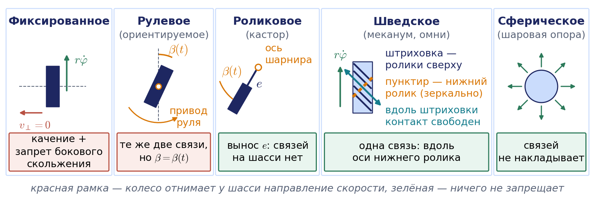

### Фиксированное колесо

Положение колеса на шасси зададим тремя параметрами (рис. 6.2). Центр колеса $`A`$ находится на расстоянии $`l`$ от точки $`P`$, а отрезок $`PA`$ составляет с осью $`X_R`$ угол $`\alpha`$. Ориентацию колеса зададим углом $`\beta`$ между продолжением отрезка $`PA`$ и осью вращения колеса. Тогда единичный вектор вдоль оси колеса и единичный вектор в плоскости колеса (направление качения) в связанной системе равны

```math
\mathbf{n}=\begin{pmatrix}\cos(\alpha+\beta)\\ \sin(\alpha+\beta)\end{pmatrix},\qquad \mathbf{t}=\begin{pmatrix}\sin(\alpha+\beta)\\ -\cos(\alpha+\beta)\end{pmatrix}.
```

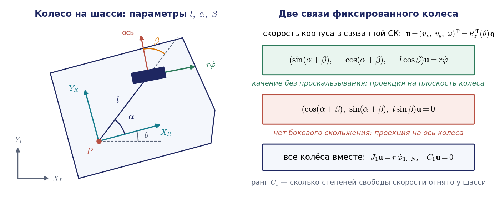

Скорость центра колеса $`A`$ находится по формуле распределения скоростей в твёрдом теле из лекции 3: к скорости полюса $`P`$ добавляется вклад вращения $`\boldsymbol{\omega}\times\overrightarrow{PA}`$. Спроецировав её на направление качения $`\mathbf{t}`$ и на ось колеса $`\mathbf{n}`$ (выкладки приведены в приложении 6.А), получаем две связи фиксированного колеса. Условие качения:

```math
\big(\sin(\alpha+\beta),\ -\cos(\alpha+\beta),\ -l\cos\beta\big)\,\dot{\boldsymbol{\xi}}_R=r\dot\varphi.
```

Условие отсутствия бокового скольжения:

```math
\big(\cos(\alpha+\beta),\ \sin(\alpha+\beta),\ l\sin\beta\big)\,\dot{\boldsymbol{\xi}}_R=0.
```

Чтобы перейти к скоростям в неподвижной системе, достаточно подставить $`\dot{\boldsymbol{\xi}}_R=R_z^{\mathrm T}(\theta)\dot{\boldsymbol{\xi}}`$.

Смысл двух уравнений разный. Первое содержит $`\dot\varphi`$ и при свободном, неприводном колесе ничего не запрещает: колесо просто будет вращаться с той скоростью, которая нужна. Для приводного колеса оно связывает скорость двигателя со скоростью корпуса. Второе уравнение не содержит скорости колеса вовсе и представляет собой настоящий запрет: одна линейная комбинация компонент скорости корпуса обязана быть нулём. Каждое фиксированное колесо отнимает у шасси одно направление скорости.

У второго уравнения есть наглядный геометрический смысл, который понадобится нам много раз. Любое плоское движение корпуса, кроме поступательного, в каждый момент есть вращение вокруг некоторой точки — мгновенного центра вращения. Скорость центра колеса перпендикулярна отрезку, соединяющему его с этим центром. Запрет бокового скольжения требует, чтобы эта скорость лежала в плоскости колеса, а значит, мгновенный центр вращения обязан лежать на оси колеса. Каждая строка запретов — это одна прямая, на которой должен находиться центр вращения.

### Рулевое колесо

Рулевое (ориентируемое) колесо отличается от фиксированного только тем, что его можно поворачивать вокруг вертикальной оси, проходящей через центр колеса. Обе связи сохраняют прежний вид, но угол $`\beta`$ становится функцией времени $`\beta(t)`$. В каждый момент рулевое колесо запрещает одно направление скорости, однако этим направлением можно управлять. Заметим, что скорость поворота руля $`\dot\beta`$ в уравнения не входит: на мгновенную скорость корпуса влияет только текущее значение $`\beta`$.

### Роликовое колесо

Роликовое колесо знакомо всем по офисным креслам и тележкам в магазине. Оно тоже поворачивается вокруг вертикальной оси, но эта ось вынесена из центра колеса на расстояние $`e`$, которое называют выносом. Условие качения не меняется, а условие отсутствия бокового скольжения приобретает дополнительное слагаемое (вывод — в приложении 6.А):

```math
\big(\cos(\alpha+\beta),\ \sin(\alpha+\beta),\ e+l\sin\beta\big)\,\dot{\boldsymbol{\xi}}_R+e\,\dot\beta=0.
```

Угол $`\beta`$ у роликового колеса свободен, его никто не приводит. Поэтому при любой скорости корпуса $`\dot{\boldsymbol{\xi}}_R`$ найдётся такая скорость $`\dot\beta`$, при которой равенство выполняется: колесо само доворачивается по направлению движения. Вывод: роликовое колесо не накладывает на шасси никаких ограничений. Именно поэтому его ставят в качестве пассивной опоры.

### Шведское колесо

**Шведское колесо** — это колесо, по ободу которого установлены свободно вращающиеся ролики. Угол между осью ролика и плоскостью колеса обозначим $`\gamma`$. Если $`\gamma=0`$, оси роликов лежат в плоскости колеса, и мы получаем **омни-колесо** (всенаправленное колесо); если $`\gamma=\pm45^{\circ}`$ — **меканум-колесо**, оно же колесо Илона по имени шведского изобретателя Бенгта Илона, предложившего его в 1973 году.

Ролик, стоящий на опорной поверхности, свободно вращается вокруг своей оси, поэтому составляющая скорости, перпендикулярная оси ролика, ничем не ограничена. Вдоль оси ролик катиться не может, и в этом направлении проскальзывания быть не должно: проекция скорости центра колеса на ось ролика обязана совпадать с проекцией окружной скорости $`r\dot\varphi`$. Ось ролика получается из направления качения $`\mathbf{t}`$ поворотом на угол $`\gamma`$, и единственная связь шведского колеса имеет вид

```math
\big(\sin(\alpha+\beta+\gamma),\ -\cos(\alpha+\beta+\gamma),\ -l\cos(\beta+\gamma)\big)\,\dot{\boldsymbol{\xi}}_R=r\dot\varphi\cos\gamma.
```

Второй связи нет. Существенно, что и эта единственная связь содержит $`\dot\varphi`$: она не запрещает никакого движения корпуса, а лишь определяет, с какой скоростью при этом будет вращаться колесо. При $`\gamma=0`$ уравнение совпадает с условием качения обычного колеса, только без запрета бокового скольжения. Полезно посмотреть и на вырожденный случай $`\gamma=90^{\circ}`$: правая часть обращается в нуль, уравнение превращается в запрет бокового скольжения, а двигатель колеса перестаёт влиять на движение. Такое колесо бесполезно, и его не делают.

Сферическое колесо (шаровая опора) может катиться в любом направлении и никаких связей на корпус не накладывает.

### Матричная запись

Соберём связи всех колёс шасси вместе. Условия качения всех приводных колёс образуют систему

```math
J_1(\beta_s)\,R_z^{\mathrm T}(\theta)\,\dot{\boldsymbol{\xi}}=J_2\,\dot{\boldsymbol{\varphi}},
```

где каждая строка матрицы $`J_1`$ — строка коэффициентов условия качения одного колеса, $`J_2`$ — диагональная матрица радиусов колёс, а $`\beta_s`$ — углы рулевых колёс. Условия отсутствия бокового скольжения всех фиксированных и рулевых колёс образуют систему

```math
C_1(\beta_s)\,R_z^{\mathrm T}(\theta)\,\dot{\boldsymbol{\xi}}=0,\qquad C_1(\beta_s)=\begin{pmatrix}C_{1f}\\ C_{1s}(\beta_s)\end{pmatrix},
```

где блок $`C_{1f}`$ относится к фиксированным колёсам, а $`C_{1s}`$ — к рулевым. Первая система играет ту же роль, что уравнение скоростей манипулятора: из неё получаются прямая и обратная задачи о скорости. Вторая система описывает, какие скорости корпуса вообще допустимы; к ней мы вернёмся в разделе 6.9.

## 6.4. Дифференциальная схема шасси

### Устройство и связи

**Дифференциальная схема шасси** (дифференциальный привод) — самая распространённая схема небольших мобильных роботов: два приводных фиксированных колеса на общей оси и одна или две пассивные опоры, роликовые или шаровые. Так устроены роботы-пылесосы, TurtleBot, Pioneer и большинство учебных платформ. Управляемые величины — скорости правого и левого колёс $`V_r=r\dot\varphi_r`$ и $`V_l=r\dot\varphi_l`$.

Точку $`P`$ поместим в середину колёсной оси; координаты $`(x,y,\theta)`$ — это координаты центра колёсной оси и курс. Расстояние между колёсами (колею) обозначим $`b`$. Каждое колесо удалено от точки $`P`$ на $`l=b/2`$; это то самое расстояние $`l`$ из общей модели раздела 6.3. В терминах предыдущего раздела у левого колеса $`\alpha=\pi/2`$, $`\beta=0`$, у правого $`\alpha=-\pi/2`$, $`\beta=\pi`$. Подставив эти значения, получаем условия качения

```math
v_x+\frac{b}{2}\,\omega=r\dot\varphi_r,\qquad v_x-\frac{b}{2}\,\omega=r\dot\varphi_l
```

и одно и то же для обоих колёс условие отсутствия бокового скольжения

```math
v_y=0.
```

Пассивные опоры, как мы выяснили, ограничений не добавляют. Складывая и вычитая условия качения, получаем решение прямой задачи о скорости:

```math
v=v_x=\frac{V_r+V_l}{2},\qquad \omega=\frac{V_r-V_l}{b},\qquad v_y=0.
```

Если по ошибке подставить колею вместо расстояния до колеса в общую формулу раздела 6.3, угловая скорость получится вдвое меньше истинной. Поэтому у колеи своя буква.

### Мгновенный центр вращения

Те же формулы удобно получить геометрически, и этот способ даёт наглядную картину движения. **Мгновенный центр вращения**, сокращённо МЦВ (в англоязычной литературе ICR, instantaneous center of rotation, или ICC, instantaneous center of curvature), по доказанному в разделе 6.3 обязан лежать на оси каждого колеса без бокового скольжения. У дифференциальной схемы оси обоих колёс совпадают, поэтому МЦВ лежит на общей колёсной оси (рис. 6.3).

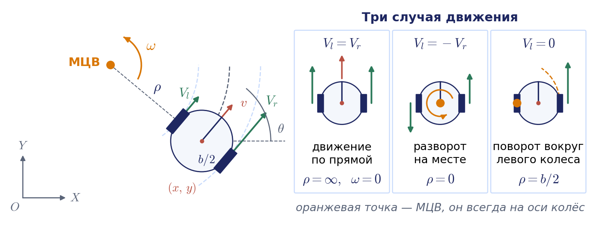

Пусть $`\rho`$ — расстояние от МЦВ до середины колёсной оси со знаком: положительное, если МЦВ находится слева от робота. Оба колеса вращаются вокруг МЦВ с одной угловой скоростью $`\omega`$, но по окружностям разных радиусов:

```math
\omega\Big(\rho+\frac{b}{2}\Big)=V_r,\qquad \omega\Big(\rho-\frac{b}{2}\Big)=V_l.
```

Решая эту систему относительно $`\omega`$ и $`\rho`$, получаем

```math
\omega=\frac{V_r-V_l}{b},\qquad \rho=\frac{b}{2}\cdot\frac{V_r+V_l}{V_r-V_l}.
```

Линейная скорость середины оси равна $`v=\omega\rho=(V_r+V_l)/2`$, что совпадает с результатом, полученным из уравнений связей. Координаты МЦВ в неподвижной системе равны

```math
x_{c}=x-\rho\sin\theta,\qquad y_{c}=y+\rho\cos\theta.
```

Полезно выделить три случая движения.

1. $`V_l=V_r`$ — прямолинейное движение. Радиус поворота равен бесконечности, угловая скорость нулевая.
2. $`V_l=-V_r`$ — вращение вокруг центра колёсной оси, разворот на месте. Радиус поворота нулевой.
3. $`V_l=0`$ или $`V_r=0`$ — вращение вокруг левого или, соответственно, правого колеса. Радиус поворота равен $`b/2`$.

Во всех остальных случаях робот движется по дуге окружности радиуса $`\lvert\rho\rvert`$. На самом деле это не три режима, а одна точка МЦВ, которая непрерывно скользит по колёсной оси при изменении отношения $`V_l/V_r`$ (рис. 6.4). Способность развернуться на месте — главное достоинство дифференциальной схемы: для неё не нужен запас пространства на манёвр.


Анимация целиком: [l06_icr_diffdrive.mp4](../06_Анимации/l06_icr_diffdrive.mp4), 48 с.

#### Пример 6.1. Скорость корпуса по скоростям колёс

Пусть радиус колёс $`r=0{,}05`$ м, колея $`b=0{,}30`$ м, а измеренные скорости колёс равны $`\dot\varphi_r=12`$ рад/с и $`\dot\varphi_l=8`$ рад/с. Тогда $`V_r=0{,}6`$ м/с, $`V_l=0{,}4`$ м/с. Линейная скорость корпуса $`v=(0{,}6+0{,}4)/2=0{,}5`$ м/с, угловая скорость $`\omega=(0{,}6-0{,}4)/0{,}30\approx0{,}667`$ рад/с. Радиус поворота $`\rho=0{,}15\cdot(1{,}0/0{,}2)=0{,}75`$ м; проверка: $`\omega\rho=0{,}5`$ м/с. Робот движется по окружности радиуса 75 см, МЦВ находится слева от него.

### Модель в неподвижной системе и матрица, заменяющая якобиан

Перейдём в неподвижную систему координат: $`\dot{\boldsymbol{\xi}}=R_z(\theta)\dot{\boldsymbol{\xi}}_R`$ при $`\dot{\boldsymbol{\xi}}_R=(v,0,\omega)^{\mathrm T}`$. Получаем каноническую кинематическую модель

```math
\dot x=v\cos\theta,\qquad \dot y=v\sin\theta,\qquad \dot\theta=\omega.
```

Эту модель называют моделью **уницикла** (одноколёсной тележки). Она описывает не только дифференциальную схему, но и, с точностью до выражений для $`v`$ и $`\omega`$, трицикл и автомобиль. Исключив $`v`$ из первых двух уравнений, получаем знакомую неголономную связь $`\dot x\sin\theta-\dot y\cos\theta=0`$.

Запишем ту же модель в форме, напоминающей уравнение скоростей манипулятора:

```math
\dot{\boldsymbol{\xi}}=G(\theta)\,\dot{\boldsymbol{\varphi}},\qquad G(\theta)=R_z(\theta)F,\qquad F=\begin{pmatrix}r/2&r/2\\ 0&0\\ r/b&-r/b\end{pmatrix},\qquad \dot{\boldsymbol{\varphi}}=\begin{pmatrix}\dot\varphi_r\\ \dot\varphi_l\end{pmatrix}.
```

Матрица $`F`$ решает прямую задачу о скорости в связанных осях, $`\dot{\boldsymbol{\xi}}_R=F\dot{\boldsymbol{\varphi}}`$; так её обозначают Линч и Парк, и с силой она ничего общего не имеет. Матрица $`G(\theta)`$ размера $`3\times2`$ — полный аналог матрицы Якоби: она линейно связывает скорости «приводов» со скоростью «выходного звена». Её ранг равен двум при любом $`\theta`$, то есть полон по столбцам, но меньше размерности пространства поз: в каждый момент робот может получить лишь двумерное множество скоростей из трёхмерного пространства. Нулевая вторая строка матрицы $`F`$ — это и есть запрет боковой скорости.

Здесь проходит важная граница. У манипулятора уравнение скоростей получено дифференцированием функции положения $`\mathbf{s}=\mathbf{f}(\mathbf{q})`$, и потому его всегда можно проинтегрировать обратно. Если бы якобиан манипулятора всюду имел ранг два, схват двигался бы по двумерной поверхности. У колёсного робота функции $`\boldsymbol{\xi}=\mathbf{f}(\boldsymbol{\varphi})`$ не существует, уравнение $`\dot{\boldsymbol{\xi}}=G(\theta)\dot{\boldsymbol{\varphi}}`$ неинтегрируемо, и, несмотря на ранг два, робот достигает любой точки трёхмерного пространства поз.

### Обратная задача о скорости и насыщение скоростей колёс

Обратная задача решается обращением тех же двух условий качения:

```math
\dot\varphi_r=\frac{1}{r}\Big(v+\frac{b}{2}\,\omega\Big),\qquad \dot\varphi_l=\frac{1}{r}\Big(v-\frac{b}{2}\,\omega\Big).
```

Задать можно только пару $`(v,\omega)`$; команда с ненулевой боковой скоростью невыполнима.

Скорости колёс ограничены: $`\lvert\dot\varphi_{r,l}\rvert\le\dot\varphi_{\max}`$. Подставив сюда формулы обратной задачи, получаем область допустимых команд

```math
\lvert v\rvert+\frac{b}{2}\lvert\omega\rvert\le r\dot\varphi_{\max}.
```

На плоскости $`(v,\omega)`$ это ромб с вершинами $`(\pm r\dot\varphi_{\max},0)`$ и $`(0,\pm2r\dot\varphi_{\max}/b)`$ (рис. 6.5). Он является прямым аналогом многогранника допустимых скоростей схвата из лекции 3: образ квадрата ограничений на скорости колёс при линейном отображении. Из формы ромба следует практический вывод: максимальную линейную и максимальную угловую скорости нельзя развить одновременно.

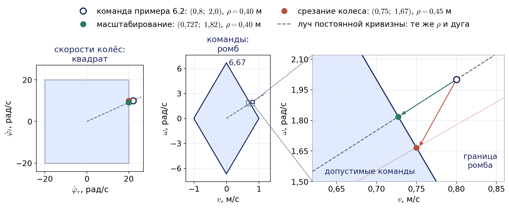

Если команда выходит за пределы ромба, простое ограничение скорости одного колеса исказит траекторию. Правильнее умножить обе скорости на общий коэффициент: тогда отношение $`\omega/v`$, то есть кривизна траектории $`1/\rho`$, сохранится, и робот пройдёт по той же дуге, только медленнее. На рис. 6.5 это видно сразу: масштабирование двигает команду по лучу постоянной кривизны к границе ромба, а срезание уводит её с луча.

#### Пример 6.2. Команда за пределами возможностей приводов

Для робота из примера 6.1 пусть $`\dot\varphi_{\max}=20`$ рад/с, а задана команда $`v=0{,}8`$ м/с, $`\omega=2{,}0`$ рад/с, которой соответствует радиус поворота $`\rho=v/\omega=0{,}4`$ м. Обратная задача даёт $`\dot\varphi_r=(0{,}8+0{,}3)/0{,}05=22`$ рад/с и $`\dot\varphi_l=(0{,}8-0{,}3)/0{,}05=10`$ рад/с. Правое колесо выходит за ограничение. Если просто срезать его скорость до 20 рад/с, получим $`V_r=1{,}0`$ м/с, $`V_l=0{,}5`$ м/с, откуда $`v=0{,}75`$ м/с, $`\omega\approx1{,}67`$ рад/с и $`\rho=0{,}45`$ м: робот пойдёт по другой дуге. Если же умножить обе скорости на коэффициент $`20/22\approx0{,}909`$, получим $`v\approx0{,}727`$ м/с, $`\omega\approx1{,}82`$ рад/с и прежний радиус $`\rho=0{,}4`$ м.

Та же идея «масштабировать, а не срезать» применяется и к ускорениям. Например, сглаживатель скоростей стека навигации Nav2 при включённом параметре масштабирования уменьшает все компоненты команды пропорционально, если хотя бы одна из них выходит за предел ускорения, и тем самым сохраняет направление вектора команды.

## 6.5. Прямая задача кинематики на шаге и одометрия

### Положение робота в момент $`t+\Delta t`$

Решим теперь прямую задачу кинематики: где окажется робот через время $`\Delta t`$, если скорости колёс на этом интервале постоянны? При постоянных $`V_r`$ и $`V_l`$ постоянны $`\omega`$ и $`\rho`$, МЦВ неподвижен, и робот просто поворачивается вокруг МЦВ на угол $`\Delta\theta=\omega\,\Delta t`$. Поворот точки вокруг центра $`(x_c,y_c)`$ записывается так:

```math
\begin{pmatrix}x'\\ y'\\ \theta'\end{pmatrix}=\begin{pmatrix}\cos\omega\Delta t&-\sin\omega\Delta t&0\\ \sin\omega\Delta t&\cos\omega\Delta t&0\\ 0&0&1\end{pmatrix}\begin{pmatrix}x-x_c\\ y-y_c\\ \theta\end{pmatrix}+\begin{pmatrix}x_c\\ y_c\\ \omega\Delta t\end{pmatrix}.
```

Подставим координаты МЦВ: $`x-x_c=\rho\sin\theta`$, $`y-y_c=-\rho\cos\theta`$. Раскрыв произведение и воспользовавшись формулами синуса и косинуса суммы, получаем явные выражения

```math
\begin{aligned}
x'&=x+\rho\big(\sin(\theta+\omega\Delta t)-\sin\theta\big),\\
y'&=y-\rho\big(\cos(\theta+\omega\Delta t)-\cos\theta\big),\\
\theta'&=\theta+\omega\,\Delta t,
\end{aligned}
\qquad \rho=\frac{v}{\omega}.
```

Это точное решение для движения по дуге окружности. При $`\omega\to0`$ нужно перейти к пределу; получается прямолинейное движение $`x'=x+v\,\Delta t\cos\theta`$, $`y'=y+v\,\Delta t\sin\theta`$. В программе случай малого $`\lvert\omega\rvert`$ обрабатывают отдельной ветвью, чтобы не делить на нуль.

### Шаг одометрии как экспонента на плоскости

Формулу точного шага полезно увидеть ещё с одной стороны. Запишем позу корпуса однородной матрицей $`3\times3`$, плоским аналогом матрицы $`T`$ из лекции 1:

```math
T=\begin{pmatrix}R(\theta)&\mathbf{p}\\ \mathbf{0}^{\mathrm T}&1\end{pmatrix},\qquad R(\theta)=\begin{pmatrix}\cos\theta&-\sin\theta\\ \sin\theta&\cos\theta\end{pmatrix},\qquad \mathbf{p}=\begin{pmatrix}x\\ y\end{pmatrix}.
```

Множество таких матриц называют группой движений плоскости $`SE(2)`$. Если скорость корпуса в связанных осях $`(v_x,v_y,\omega)`$ постоянна на шаге, то новая поза получается умножением справа на матричную экспоненту, $`T'=T\exp(\Delta t\,X)`$, где $`X`$ — матрица со строками $`(0,\ -\omega,\ v_x)`$, $`(\omega,\ 0,\ v_y)`$, $`(0,\ 0,\ 0)`$. Экспоненту можно вычислить в конечном виде, и при $`\Delta\theta=\omega\Delta t\ne0`$ получается

```math
\mathbf{p}'=\mathbf{p}+R(\theta)\,\frac{\Delta t}{\Delta\theta}\begin{pmatrix}\sin\Delta\theta&-(1-\cos\Delta\theta)\\ 1-\cos\Delta\theta&\sin\Delta\theta\end{pmatrix}\begin{pmatrix}v_x\\ v_y\end{pmatrix},\qquad \theta'=\theta+\Delta\theta.
```

При $`v_y=0`$ это в точности формулы точного шага, выведенные выше, а при $`\omega\to0`$ матрица в середине стремится к $`\Delta t\,E`$, и получается прямолинейное движение. Новое здесь то, что формула сразу годится и для всенаправленных платформ с $`v_y\ne0`$. В лекции 7 та же идея встретится на группе поворотов пространства $`SO(3)`$: ориентацию летательного аппарата обновляют экспонентой угловой скорости.

### Одометрия

**Одометрия** — это оценка позы робота путём последовательного применения формул прямой задачи к показаниям датчиков угла поворота колёс (энкодеров). На каждом такте по приращениям углов $`\Delta\varphi_r`$, $`\Delta\varphi_l`$ вычисляют пути колёс $`\Delta s_r=r\Delta\varphi_r`$, $`\Delta s_l=r\Delta\varphi_l`$, затем путь и поворот корпуса

```math
\Delta s=\frac{\Delta s_r+\Delta s_l}{2},\qquad \Delta\theta=\frac{\Delta s_r-\Delta s_l}{b},
```

после чего обновляют оценку позы. Для обновления есть три формулы разной точности.

Самая простая — метод Эйлера: считаем, что весь шаг робот ехал с начальным курсом,

```math
x'=x+\Delta s\cos\theta,\qquad y'=y+\Delta s\sin\theta,\qquad \theta'=\theta+\Delta\theta.
```

Вторая — метод средней точки: берём курс в середине шага,

```math
x'=x+\Delta s\cos\Big(\theta+\frac{\Delta\theta}{2}\Big),\qquad y'=y+\Delta s\sin\Big(\theta+\frac{\Delta\theta}{2}\Big).
```

Третья — точное интегрирование по дуге, выведенное выше. Его удобно переписать через хорду дуги. Хорда дуги длины $`\Delta s`$ с центральным углом $`\Delta\theta`$ направлена под углом $`\theta+\Delta\theta/2`$ и имеет длину $`\Delta s\cdot\sin(\Delta\theta/2)/(\Delta\theta/2)`$. Отсюда видно, что метод средней точки правильно определяет направление перемещения и ошибается только в его длине, причём относительная ошибка равна примерно $`\Delta\theta^2/24`$. Метод Эйлера ошибается уже в направлении, на угол $`\Delta\theta/2`$, и это гораздо хуже.


Анимация целиком: [l06_odometry_integrators.mp4](../06_Анимации/l06_odometry_integrators.mp4), 48 с.

#### Пример 6.3. Эйлер против точной дуги

Пусть робот движется с постоянными $`v=0{,}5`$ м/с и $`\omega=0{,}5`$ рад/с, то есть по окружности радиуса 1 м, и проходит около половины окружности — 13 шагов с шагом интегрирования $`\Delta t=0{,}5`$ с; поворот за шаг составляет $`\Delta\theta=0{,}25`$ рад, а за 13 шагов — $`3{,}25`$ рад. Расчёт, результаты которого показаны на рис. 6.6, даёт следующее. Метод Эйлера направляет каждый шаг по курсу начала шага, то есть запаздывает по курсу на $`\Delta\theta/2`$. При постоянных скоростях его ломаная — правильный многоугольник со стороной $`v\Delta t=0{,}25`$ м, вписанный в окружность почти того же радиуса ($`1{,}0026`$ м), но сдвинутую вперёд на половину шага $`v\Delta t/2=0{,}125`$ м. Поэтому ошибка Эйлера не растёт безгранично, а колеблется: после первого шага она равна $`0{,}031`$ м, около полуокружности достигает $`0{,}25`$ м, а после полного оборота (25 шагов) почти исчезает, уменьшаясь до $`0{,}004`$ м. Важно другое: эта ошибка первого порядка по шагу, и при реальном, переменном движении она не компенсируется. Метод средней точки при том же шаге ошибается на $`0{,}005`$ м, что согласуется с оценкой: относительная ошибка $`0{,}25^2/24\approx0{,}0026`$ от перемещения около 2 м. Точная формула даёт нулевую ошибку при любом шаге, пока скорости на шаге действительно постоянны. Вывод: формула средней точки или точная формула стоят тех же вычислительных затрат, что и метод Эйлера, и применять метод Эйлера в одометрии нет причин. Именно так устроена одометрия стандартного контроллера дифференциальной схемы в ROS 2: он интегрирует по точной дуге, а при очень малом повороте за такт переходит к формуле средней точки.

### Накопление систематических ошибок

Одометрия — интегрирующий метод, и любая ошибка в ней накапливается. Особенно опасна ошибка курса. Если оценка курса отличается от истинного значения на постоянную величину $`e_\theta`$, то после прохождения пути $`s`$ боковая ошибка положения составит примерно $`s\,e_\theta`$. Если же курс уходит равномерно с пройденным путём, как бывает при разных диаметрах колёс, то к концу пути ошибка курса равна $`e_\theta`$, а боковое отклонение — примерно $`s\,e_\theta/2`$.

Ошибки делят на случайные и систематические. Случайные вызваны проскальзыванием колёс, неровностями пола, наездом на препятствия. Систематические заложены в самой модели: неравные диаметры колёс, неточно известная колея (точка контакта широкого колеса с полом не определена), конечное разрешение энкодеров. На ровном полу доминируют именно систематические ошибки, и они же хорошо поддаются калибровке.

Оценим их влияние. Если правое колесо на один процент больше левого, то при команде «прямо» робот на самом деле поворачивает с кривизной $`0{,}01/b`$. При колее $`b=0{,}30`$ м на отрезке в 4 м он повернётся на $`0{,}01\cdot4/0{,}30\approx0{,}13`$ рад, то есть почти на 8 градусов, и отклонится вбок примерно на $`0{,}13\cdot4/2\approx0{,}27`$ м, а одометрия ничего не заметит. На рис. 6.7 показан расчёт для квадратного маршрута $`4\times4`$ м, пройденного против часовой стрелки: одометрия считает, что робот вернулся в исходную точку, тогда как при разнице диаметров в один процент реальная конечная точка удалена от старта на $`1{,}4`$ м, а ошибка курса превышает 30 градусов. Ошибка колеи действует иначе: на прямых участках она не проявляется, зато каждый разворот на месте выполняется с ошибкой. При колее, превышающей расчётную на три процента, каждый поворот на 90 градусов оказывается короче на $`2{,}6`$ градуса, и конечная точка смещается на полметра. При обходе квадрата по часовой стрелке и против неё эти две ошибки смещают конечную точку по-разному: ошибка колеи даёт зеркальные точки, ошибка диаметров — нет. На этом основан стандартный метод калибровки одометрии UMBmark (University of Michigan Benchmark), предложенный Дж. Боренштейном и Л. Фэном: по конечным точкам двух обходов раздельно оценивают отношение диаметров колёс и поправку колеи.


Анимация целиком: [l06_odometry_drift_umbmark.mp4](../06_Анимации/l06_odometry_drift_umbmark.mp4), 83 с.

Найденные поправки вводят в контроллер как множители к номинальным параметрам. В стандартном контроллере дифференциальной схемы ROS 2 для этого есть множители радиусов левого и правого колёс и множитель колеи. Ошибке «отношение диаметров» соответствуют первые два, ошибке колеи — третий.

### Неопределённость одометрии

Систематические ошибки можно откалибровать, случайные — нет. Остаётся оценить, насколько велика неопределённость позы, которую даёт одометрия, и как она растёт с пройденным путём. Для этого пути колёс за такт считают случайными величинами: измеренный путь отличается от истинного на независимые ошибки с нулевым средним и дисперсиями, пропорциональными пути колеса,

```math
\Sigma_\Delta=\begin{pmatrix}k_{\mathrm s}\lvert\Delta s_r\rvert&0\\ 0&k_{\mathrm s}\lvert\Delta s_l\rvert\end{pmatrix}.
```

Коэффициент $`k_{\mathrm s}`$ имеет размерность длины; его определяют опытом. Пропорциональность пути объясняется просто: ошибки разных участков пути независимы, а дисперсии независимых ошибок складываются.

Шаг одометрии по формуле средней точки есть функция $`\boldsymbol{\xi}'=\mathbf{f}(\boldsymbol{\xi},\Delta s_r,\Delta s_l)`$. Малые отклонения входов переносятся в малые отклонения выхода линейно, через матрицы частных производных, то есть через якобианы, точно так же, как в лекции 3 малые приращения координат сочленений переносились в малое перемещение схвата:

```math
\delta\boldsymbol{\xi}'\approx F_{\boldsymbol\xi}\,\delta\boldsymbol{\xi}+F_\Delta\,\delta\mathbf{s},\qquad F_{\boldsymbol\xi}=\frac{\partial\mathbf{f}}{\partial\boldsymbol{\xi}}=\begin{pmatrix}1&0&-\Delta s\sin\big(\theta+\frac{\Delta\theta}{2}\big)\\ 0&1&\Delta s\cos\big(\theta+\frac{\Delta\theta}{2}\big)\\ 0&0&1\end{pmatrix},
```

где $`\delta\mathbf{s}=(\delta s_r,\ \delta s_l)^{\mathrm T}`$ — ошибки путей колёс, а $`F_\Delta=\partial\mathbf{f}/\partial(\Delta s_r,\Delta s_l)`$ — матрица $`3\times2`$, выписанная в приложении 6.Б. Если ошибки позы и путей колёс независимы, то ковариационная матрица позы $`\Sigma`$ пересчитывается на каждом такте по правилу

```math
\Sigma'=F_{\boldsymbol\xi}\,\Sigma\,F_{\boldsymbol\xi}^{\mathrm T}+F_\Delta\,\Sigma_\Delta\,F_\Delta^{\mathrm T}.
```

Первое слагаемое переносит уже накопленную неопределённость, второе добавляет новую. Это в точности шаг предсказания расширенного фильтра Калмана, которым в лекции 7 объединяют показания инерциальных датчиков со спутниковой навигацией. Одометрия и даёт фильтру его модель движения.

Главную закономерность можно получить без вычислений на компьютере. При движении по прямой ошибка курса за такт равна $`(\delta s_r-\delta s_l)/b`$, и её дисперсия $`2k_{\mathrm s}\Delta s/b^2`$ накапливается пропорционально пути: $`\sigma_\theta^2=c\,s`$, где $`c=2k_{\mathrm s}/b^2`$. Боковая ошибка есть интеграл от ошибки курса по пройденному пути, и её дисперсия растёт куда быстрее (вывод — в приложении 6.Б):

```math
\sigma_\theta^2=c\,s,\qquad \sigma_y^2=\frac{c\,s^3}{3},\qquad \sigma_x^2=\frac{k_{\mathrm s}\,s}{2}.
```

Продольная ошибка растёт как $`\sqrt{s}`$, а боковая — как $`s^{3/2}`$. Эллипс неопределённости поэтому вытягивается поперёк пути (рис. 6.8; на прямой то же показывает последняя сцена анимации на рис. 6.7).

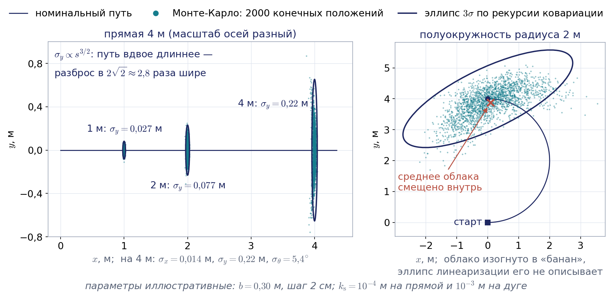

Оценим на числах. Пусть робот примера 6.1 ($`b=0{,}30`$ м) проезжает по прямой 4 м, а $`k_{\mathrm s}=10^{-4}`$ м, то есть на метре пути колеса ошибка составляет около сантиметра (значение иллюстративное). Тогда $`\sigma_x\approx0{,}014`$ м, $`\sigma_\theta\approx5{,}4^{\circ}`$ и $`\sigma_y\approx0{,}22`$ м: боковая ошибка в пятнадцать раз больше продольной. На пути 16 м, вчетверо большем, боковой разброс вырастает в восемь раз, до $`1{,}7`$ м, как и предсказывает закон $`s^{3/2}`$. Проверка этих чисел рекурсией ковариации и методом Монте-Карло, а также изгиб облака точек в «банан», которого линеаризация не видит, разобраны в приложении 6.Б.

Отсюда практический вывод: ошибка курса обходится намного дороже ошибки пути, и именно курс нужно измерять лучше всего. Поэтому в реальных системах угловую скорость берут от гироскопа, а путь — от энкодеров, и объединяют их фильтром Калмана. В ROS 2 эту работу выполняет пакет robot_localization с расширенным и сигма-точечным фильтрами Калмана. Но даже объединённая одометрия дрейфует, поэтому её периодически поправляют абсолютными измерениями: локализацией по лидару и известной карте (например, алгоритмом AMCL, adaptive Monte Carlo localization) или одновременным построением карты и локализацией (SLAM). Для меканум-платформы, ролики которой проскальзывают сильнее обычных колёс, это особенно важно. Одометрия остаётся основой оценки позы на коротких интервалах, и от качества её формул и калибровки зависит всё остальное.

## 6.6. Трицикл и принцип Аккермана

### Трицикл

**Трицикл** — трёхколёсная схема с одним рулевым колесом спереди и двумя фиксированными колёсами на задней оси. Так устроены многие складские тележки и погрузчики, причём приводным обычно делают само рулевое колесо. Точку $`P`$ снова поместим в центр задней оси, расстояние от неё до рулевого колеса (базу) обозначим $`d`$, угол поворота рулевого колеса относительно продольной оси — $`\delta`$ (на слайдах кафедры этот угол обозначен $`\varphi`$; мы оставляем букву $`\varphi`$ за углами вращения колёс).

МЦВ находится сразу. Он должен лежать на оси задних колёс и одновременно на оси рулевого колеса (рис. 6.9, слева). Из прямоугольного треугольника получаем радиус поворота центра задней оси:

```math
\rho=\frac{d}{\mathrm{tg}\,\delta}.
```

Если рулевое колесо приводное и скорость его центра равна $`v_s`$, то расстояние от МЦВ до рулевого колеса равно $`d/\sin\delta`$, и

```math
\omega=\frac{v_s\sin\delta}{d},\qquad v=\omega\rho=v_s\cos\delta.
```

Если же приводными сделаны задние колёса и задаётся скорость $`v`$ центра задней оси, то $`\omega=v\mathrm{tg}\,\delta/d`$. В обоих случаях движение корпуса описывается той же канонической моделью $`\dot x=v\cos\theta`$, $`\dot y=v\sin\theta`$, $`\dot\theta=\omega`$, и положение в момент $`t+\Delta t`$ вычисляется по формулам раздела 6.5 с подстановкой этих $`v`$ и $`\omega`$. Модель с задним приводом

```math
\dot x=v\cos\theta,\qquad \dot y=v\sin\theta,\qquad \dot\theta=\frac{v}{d}\mathrm{tg}\,\delta
```

известна также как велосипедная модель автомобиля.

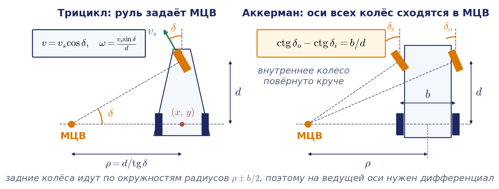

Отметим особенности схемы.

- Угол поворота руля ограничен, $`\lvert\delta\rvert\le\delta_{\max}`$, поэтому радиус поворота не может быть меньше $`\rho_{\min}=d/\mathrm{tg}\,\delta_{\max}`$. Развернуться на месте нельзя.
- Задние колёса при повороте идут по окружностям радиусов $`\rho-b/2`$ и $`\rho+b/2`$, где $`b`$ — колея, и должны вращаться с разными скоростями $`V_{l,r}=\omega(\rho\mp b/2)`$. Если они приводные, на задней оси требуется дифференциал, механический или программный, иначе поворот будет сопровождаться проскальзыванием.
- При четырёх колёсах нужен дифференциал для ведущих колёс и схема Аккермана для рулевых.
- Траектория зависит от того, какая ось приводная: при переднем приводе задаётся скорость $`v_s`$ рулевого колеса, при заднем — скорость $`v`$ задней оси, и одна и та же пара чисел «скорость, угол руля» даёт разные $`v`$ и $`\omega`$.

### Принцип Аккермана

У автомобиля рулевых колёс два. Если повернуть их на одинаковый угол, их оси окажутся параллельными и не пересекутся с осью задних колёс в одной точке. Единого МЦВ не будет, и хотя бы одно колесо обязано скользить вбок, а это означает износ шин и потерю управляемости. **Принцип Аккермана** — принцип рулевой геометрии, разработанный для того, чтобы рулевые колёса могли проходить окружности разного радиуса без бокового скольжения: оси всех четырёх колёс должны пересекаться в одной точке (рис. 6.9, справа).

Пусть $`d`$ — колёсная база, $`b`$ — колея, $`\rho`$ — радиус поворота центра задней оси. Внутреннее по отношению к повороту колесо находится ближе к МЦВ и должно быть повёрнуто круче наружного:

```math
\mathrm{tg}\,\delta_i=\frac{d}{\rho-b/2},\qquad \mathrm{tg}\,\delta_o=\frac{d}{\rho+b/2}.
```

Исключив $`\rho`$, получаем условие Аккермана, связывающее два угла:

```math
\mathrm{ctg}\,\delta_o-\mathrm{ctg}\,\delta_i=\frac{b}{d}.
```

В автомобиле это условие приближённо обеспечивается рулевой трапецией, в роботе с независимыми сервоприводами рулевых колёс — программно. Для расчётов автомобиль заменяют эквивалентным трициклом (велосипедной моделью) с углом руля $`\delta`$, для которого $`\mathrm{ctg}\,\delta=(\mathrm{ctg}\,\delta_i+\mathrm{ctg}\,\delta_o)/2`$. Это следует прямо из двух формул для тангенсов: $`\mathrm{ctg}\,\delta_i=(\rho-b/2)/d`$ и $`\mathrm{ctg}\,\delta_o=(\rho+b/2)/d`$, а их среднее равно $`\rho/d=\mathrm{ctg}\,\delta`$.

#### Пример 6.4. Углы Аккермана

Пусть база $`d=2{,}7`$ м, колея $`b=1{,}6`$ м, требуемый радиус поворота $`\rho=6`$ м. Тогда $`\delta_i=\mathrm{arctg}(2{,}7/5{,}2)\approx27{,}4^{\circ}`$, $`\delta_o=\mathrm{arctg}(2{,}7/6{,}8)\approx21{,}7^{\circ}`$, а угол эквивалентного трицикла $`\delta=\mathrm{arctg}(2{,}7/6)\approx24{,}2^{\circ}`$. Разница между углами внутреннего и наружного колёс почти шесть градусов, и пренебречь ею нельзя. Проверка: $`\mathrm{ctg}21{,}7^{\circ}-\mathrm{ctg}27{,}4^{\circ}\approx2{,}519-1{,}926=0{,}593`$, что совпадает с $`b/d=0{,}593`$. Задние колёса идут по окружностям радиусов $`5{,}2`$ и $`6{,}8`$ м, и наружное колесо должно вращаться в $`1{,}31`$ раза быстрее внутреннего.

Для задач управления автомобилем ту же модель часто записывают не для центра задней оси, а для центра масс. Положение МЦВ от выбора опорной точки не зависит, меняется только вид уравнений; эта форма модели приведена в приложении 6.Д.

## 6.7. Омни-колёса и трёхколёсная всенаправленная платформа

### Идея всенаправленного колеса

Все рассмотренные до сих пор схемы неголономны, потому что в них есть фиксированные или рулевые колёса. Чтобы получить голономную платформу, нужно убрать запрет бокового скольжения, сохранив возможность передавать тяговое усилие. Эту задачу решает **омни-колесо** (всенаправленное колесо): по его ободу установлены свободные ролики, оси которых касательны к ободу. В направлении своей плоскости такое колесо работает как обычное и передаёт тягу, а в поперечном направлении свободно катится на роликах. Одна связь вместо двух, и та лишь определяет скорость колеса.

Ясно, что одно омни-колесо даёт тягу только в одном направлении. Чтобы управлять тремя компонентами скорости корпуса, нужно не менее трёх колёс. При этом их **линии тяги** — прямые, которые проходят через центры колёс вдоль направлений тяги $`\mathbf{t}_i`$, — не должны быть все параллельны и не должны все проходить через одну точку. В первом случае не задаётся поступательное движение поперёк тяги. Во втором не задаётся вращение корпуса вокруг общей точки: такое вращение вообще не требует вращения колёс, потому что скорость каждого центра колеса при нём перпендикулярна линии тяги, и ранг матрицы связей падает до двух. Оси вращения колёс при этом могут пересекаться в одной точке: в схеме $`120^{\circ}`$, которую мы сейчас разберём, они все проходят через центр платформы, а линии тяги образуют треугольник. Параллельными могут быть и две линии тяги из трёх, лишь бы третья их пересекала.

### Матрица платформы с тремя колёсами под 120 градусов

Рассмотрим самую распространённую схему: три омни-колеса расположены на окружности радиуса $`l`$ через 120 градусов, оси колёс направлены по радиусам (рис. 6.10). Радиус $`l`$ — то же расстояние $`\lvert PA\rvert`$ от центра до колеса, что в разделе 6.3. Колесо с номером $`i`$ находится под углом $`\alpha_i`$ к оси $`X_R`$; примем $`\alpha_1=0^{\circ}`$, $`\alpha_2=120^{\circ}`$, $`\alpha_3=240^{\circ}`$. Направление тяги колеса — касательная к окружности; положительным будем считать направление, при котором колесо вращает платформу против часовой стрелки:

```math
\mathbf{t}_i=\begin{pmatrix}-\sin\alpha_i\\ \cos\alpha_i\end{pmatrix}.
```

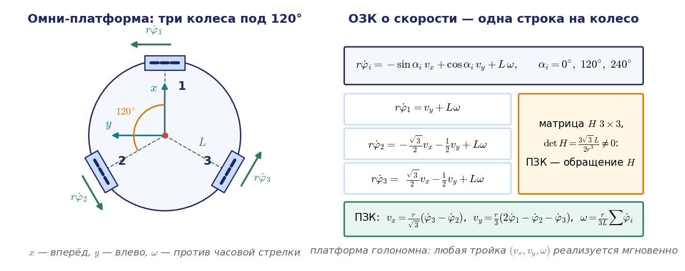

Скорость центра колеса равна $`\mathbf{v}_i=(v_x-\omega l\sin\alpha_i,\ v_y+\omega l\cos\alpha_i)^{\mathrm T}`$. Единственная связь омни-колеса требует, чтобы проекция этой скорости на направление тяги равнялась $`r\dot\varphi_i`$:

```math
r\dot\varphi_i=-\sin\alpha_i\,v_x+\cos\alpha_i\,v_y+l\,\omega.
```

В терминах раздела 6.3 это связь шведского колеса при $`\gamma=0`$ и $`\beta=\pi`$. Выписав три строки, получаем решение обратной задачи о скорости:

```math
\dot{\boldsymbol{\varphi}}=H\dot{\boldsymbol{\xi}}_R,\qquad H=\frac{1}{r}\begin{pmatrix}0&1&l\\ -\dfrac{\sqrt3}{2}&-\dfrac12&l\\ \dfrac{\sqrt3}{2}&-\dfrac12&l\end{pmatrix}.
```

Каждая строка матрицы $`H`$ состоит из направления тяги $`\mathbf{t}_i`$ и момента этого направления относительно точки $`P`$, делённых на $`r`$. Поэтому строка однозначно задаёт линию тяги колеса, и сформулированное выше условие невырожденности читается прямо по матрице. Если бы колёса были повёрнуты так, что тяга шла по радиусам, линии тяги прошли бы через центр, третий столбец обратился бы в нуль, и ранг $`H`$ стал бы равен двум.

Обратите внимание на направление вывода. У манипулятора естественным образом получалась прямая задача о скорости, а обратную приходилось решать обращением матрицы. У колёсной платформы из уравнений связей естественно получается обратная задача: каждая связь даёт одну строку, выражающую скорость одного колеса через скорость корпуса. В этом колёсные платформы похожи на параллельные механизмы из прошлой лекции, и причина та же: несколько «ног» опираются на одно тело.

Определитель матрицы $`H`$ равен $`3\sqrt3\,l/(2r^3)`$ и не обращается в нуль. Поэтому прямая задача о скорости решается обращением:

```math
\dot{\boldsymbol{\xi}}_R=F\dot{\boldsymbol{\varphi}},\qquad F=H^{-1}=r\begin{pmatrix}0&-\dfrac{1}{\sqrt3}&\dfrac{1}{\sqrt3}\\ \dfrac23&-\dfrac13&-\dfrac13\\ \dfrac{1}{3l}&\dfrac{1}{3l}&\dfrac{1}{3l}\end{pmatrix}.
```

Третья строка имеет прозрачный смысл: угловая скорость платформы пропорциональна сумме скоростей колёс. Матрица $`H`$ постоянна в связанной системе и невырождена всегда, а не только в отдельных конфигурациях. В этом смысле голономная платформа — аналог манипулятора, у которого якобиан имеет полный ранг во всей рабочей зоне: вырожденных конфигураций у неё нет.

В неподвижной системе обратная задача принимает вид $`\dot{\boldsymbol{\varphi}}=HR_z^{\mathrm T}(\theta)\dot{\boldsymbol{\xi}}`$. Платформа способна, например, ехать по прямой и одновременно вращаться; скорости колёс при этом меняются по гармоническому закону; эта сцена есть в конце анимации на рис. 6.12.

#### Пример 6.5. Скорости колёс омни-платформы

Пусть $`r=0{,}05`$ м, $`l=0{,}20`$ м, и требуется скорость корпуса $`v_x=0{,}2`$ м/с, $`v_y=0{,}1`$ м/с, $`\omega=0{,}5`$ рад/с. По строкам матрицы $`H`$ находим: $`\dot\varphi_1=(0{,}1+0{,}1)/0{,}05=4{,}00`$ рад/с, $`\dot\varphi_2=(-0{,}1732-0{,}05+0{,}1)/0{,}05\approx-2{,}46`$ рад/с, $`\dot\varphi_3=(0{,}1732-0{,}05+0{,}1)/0{,}05\approx4{,}46`$ рад/с. Проверим прямой задачей: $`v_x=r(\dot\varphi_3-\dot\varphi_2)/\sqrt3=0{,}05\cdot6{,}93/1{,}732=0{,}2`$ м/с, $`\omega=r(\dot\varphi_1+\dot\varphi_2+\dot\varphi_3)/(3l)=0{,}05\cdot6{,}0/0{,}6=0{,}5`$ рад/с. Заметим ещё, что при чистом движении вперёд, $`\dot{\boldsymbol{\xi}}_R=(v,0,0)^{\mathrm T}`$, первое колесо не вращается вовсе, и его ролики пассивно катятся по полу, а второе и третье вращаются в противоположные стороны со скоростью $`\sqrt3\,v/(2r)`$.

## 6.8. Меканум-платформа

### Меканум-колесо

**Меканум-колесо** (колесо Илона, шведское колесо) отличается от омни-колеса тем, что оси роликов повёрнуты относительно плоскости колеса на 45 градусов. Это позволяет расположить все четыре колеса так же, как у обычного автомобиля, параллельно продольной оси, и получить компактную платформу с большой грузоподъёмностью. Именно такую схему имеют платформа youBot и роботы лиги RoboCup@Work.

Меканум-колёса бывают двух видов, зеркальных друг другу, и на платформу ставят по два колеса каждого вида. Правильная установка такова (рис. 6.11): если смотреть на платформу сверху, видимые верхние ролики образуют рисунок в виде буквы X, то есть линии роликов сходятся к центру платформы. Ролики, находящиеся в этот момент внизу и касающиеся пола, повёрнуты зеркально, и их оси образуют ромб, рисунок в виде буквы O. Работают нижние ролики, поэтому в формулы входят именно их направления.

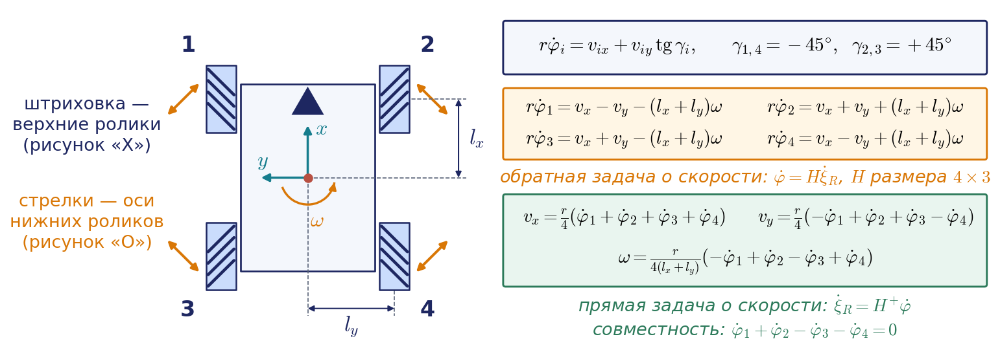

Прежде чем выводить формулы, поймём механику. Колесо может передать платформе силу только вдоль оси нижнего ролика, потому что поперёк этой оси ролик свободно катится. Пронумеруем колёса так: 1 — переднее левое, 2 — переднее правое, 3 — заднее левое, 4 — заднее правое. У первого колеса при вращении вперёд сила направлена вперёд и вправо, у второго — вперёд и влево, у третьего — вперёд и влево, у четвёртого — вперёд и вправо. Когда все колёса вращаются вперёд, боковые составляющие попарно уничтожаются и остаётся сила, направленная вперёд. Когда первое и четвёртое колёса вращаются назад, а второе и третье вперёд, уничтожаются продольные составляющие, и все четыре боковые составляющие направлены влево. Формулы, которые мы сейчас получим, — кинематическая запись той же картины.

### Связь одного колеса

Введём обозначения. Начало связанной системы поместим в геометрический центр платформы; $`l_x`$ — половина колёсной базы (полубаза), $`l_y`$ — половина колеи (полуколея), $`r`$ — радиус колеса. Координаты центров колёс равны $`(l_x,l_y)`$, $`(l_x,-l_y)`$, $`(-l_x,l_y)`$, $`(-l_x,-l_y)`$. Положительным считаем вращение колеса, при котором оно катится вперёд.

Пусть единичный вектор оси нижнего ролика $`i`$-го колеса составляет с осью $`X_R`$ угол $`\gamma_i`$: $`\mathbf{a}_i=(\cos\gamma_i,\ \sin\gamma_i)^{\mathrm T}`$. Так как плоскости всех колёс параллельны оси $`X_R`$, этот угол совпадает с углом $`\gamma`$ между осью ролика и плоскостью колеса из раздела 6.3, только взятым со знаком. При установке «X сверху» получается $`\gamma_1=\gamma_4=-45^{\circ}`$ и $`\gamma_2=\gamma_3=+45^{\circ}`$. Рассуждаем так же, как для шведского колеса в разделе 6.3. Ролик свободно вращается вокруг своей оси, поэтому перпендикулярно вектору $`\mathbf{a}_i`$ точка контакта движется свободно. Вдоль оси ролика проскальзывания нет, значит, проекция скорости центра колеса $`\mathbf{v}_i`$ на $`\mathbf{a}_i`$ равна проекции окружной скорости $`r\dot\varphi_i\mathbf{e}_x`$ на тот же вектор:

```math
\mathbf{v}_i\cdot\mathbf{a}_i=r\dot\varphi_i\,(\mathbf{e}_x\cdot\mathbf{a}_i)\quad\Longrightarrow\quad r\dot\varphi_i=v_{ix}+v_{iy}\mathrm{tg}\,\gamma_i.
```

Скорость центра колеса с координатами $`(x_i,y_i)`$ даётся распределением скоростей: $`v_{ix}=v_x-\omega y_i`$, $`v_{iy}=v_y+\omega x_i`$.

### Обратная задача о скорости

Подставим координаты и углы для каждого колеса. Для первого колеса $`v_{1x}=v_x-\omega l_y`$, $`v_{1y}=v_y+\omega l_x`$, $`\mathrm{tg}\,\gamma_1=-1`$, откуда $`r\dot\varphi_1=v_x-v_y-(l_x+l_y)\omega`$. Проделав то же для остальных колёс, получаем

```math
\begin{aligned}
r\dot\varphi_1&=v_x-v_y-(l_x+l_y)\,\omega,\\
r\dot\varphi_2&=v_x+v_y+(l_x+l_y)\,\omega,\\
r\dot\varphi_3&=v_x+v_y-(l_x+l_y)\,\omega,\\
r\dot\varphi_4&=v_x-v_y+(l_x+l_y)\,\omega,
\end{aligned}
```

или в матричной форме

```math
\dot{\boldsymbol{\varphi}}=H\dot{\boldsymbol{\xi}}_R,\qquad H=\frac{1}{r}\begin{pmatrix}1&-1&-(l_x+l_y)\\ 1&1&l_x+l_y\\ 1&1&-(l_x+l_y)\\ 1&-1&l_x+l_y\end{pmatrix}.
```

Это полное решение обратной задачи о скорости для меканум-платформы. Геометрия входит в него только через сумму $`l_x+l_y`$. В неподвижной системе $`\dot{\boldsymbol{\varphi}}=HR_z^{\mathrm T}(\theta)\dot{\boldsymbol{\xi}}`$.

Формулы позволяют сразу увидеть, что будет при неправильной установке колёс. Если перепутать левые и правые колёса так, что рисунок X образуют нижние ролики, знаки всех углов $`\gamma_i`$ изменятся, и в третьем столбце вместо суммы появится разность $`l_x-l_y`$. Пока $`l_x\ne l_y`$, ранг матрицы остаётся равным трём, и кинематически поворот возможен, причём даже при меньших скоростях колёс. Однако линии сил нижних роликов проходят теперь рядом с центром платформы, поэтому колёса почти не создают момента относительно центра. Прямая задача о скорости для угловой скорости принимает вид $`\omega=r(\dot\varphi_1-\dot\varphi_2+\dot\varphi_3-\dot\varphi_4)/\big(4(l_x-l_y)\big)`$ и плохо обусловлена: малые проскальзывания и ошибки энкодеров дают большую ошибку курса. Платформа по-прежнему ездит вперёд и вбок, но поворотом практически невозможно управлять; обе установки сравниваются в анимации на рис. 6.12. Для размеров youBot из примера 6.6 ниже плечо момента сил роликов относительно центра падает с $`(l_x+l_y)/\sqrt2\approx0{,}27`$ м до $`(l_x-l_y)/\sqrt2\approx0{,}06`$ м, наименьшее сингулярное число $`H`$ — с $`15{,}4`$ до $`3{,}4`$, а случайная ошибка оценки $`\omega`$ по энкодерам возрастает в $`4{,}5`$ раза. У квадратной платформы ($`l_x=l_y`$) третий столбец равен нулю, ранг $`H`$ падает до двух, и вращение вообще не связано со скоростями колёс: платформа может поворачиваться на роликах, а колёса при этом стоят.

### Базовые движения

Посмотрим, какие комбинации скоростей колёс соответствуют простейшим движениям (рис. 6.12). Достаточно подставить в формулы обратной задачи по одной ненулевой компоненте скорости.


Анимация целиком: [l06_mecanum_rollers_forces.mp4](../06_Анимации/l06_mecanum_rollers_forces.mp4), 88 с.

| Движение | Скорость корпуса | $`\dot\varphi_1`$ | $`\dot\varphi_2`$ | $`\dot\varphi_3`$ | $`\dot\varphi_4`$ |
|---|---|---|---|---|---|
| Вперёд | $`(v,0,0)`$ | $`v/r`$ | $`v/r`$ | $`v/r`$ | $`v/r`$ |
| Влево | $`(0,v,0)`$ | $`-v/r`$ | $`v/r`$ | $`v/r`$ | $`-v/r`$ |
| Вправо | $`(0,-v,0)`$ | $`v/r`$ | $`-v/r`$ | $`-v/r`$ | $`v/r`$ |
| По диагонали вперёд и влево | $`(v,v,0)`$ | $`0`$ | $`2v/r`$ | $`2v/r`$ | $`0`$ |
| По диагонали вперёд и вправо | $`(v,-v,0)`$ | $`2v/r`$ | $`0`$ | $`0`$ | $`2v/r`$ |
| Поворот на месте против часовой стрелки | $`(0,0,\omega)`$ | $`-k\omega`$ | $`k\omega`$ | $`-k\omega`$ | $`k\omega`$ |

В последней строке $`k=(l_x+l_y)/r`$. Словами: при движении вперёд все колёса вращаются одинаково; при движении вбок колёса одной диагонали вращаются вперёд, а другой — назад; при движении по диагонали работают только два колеса одной диагонали, а два других стоят, и платформа катится на их роликах; при повороте на месте колёса левого борта вращаются в одну сторону, правого — в другую, как у гусеничной машины. Сверка этой таблицы со слайдами кафедры, где используются другие знаки, приведена в приложении 6.В.

### Прямая задача о скорости

Колёс четыре, а компонент скорости корпуса три: матрица $`H`$ имеет размер $`4\times3`$, и система $`H\dot{\boldsymbol{\xi}}_R=\dot{\boldsymbol{\varphi}}`$ относительно $`\dot{\boldsymbol{\xi}}_R`$ переопределена. Это ситуация, зеркальная по отношению к избыточному манипулятору из лекции 3: там неизвестных было больше, чем уравнений, и мы искали решение минимальной нормы; здесь уравнений больше, чем неизвестных, и мы ищем решение с минимальной невязкой. Инструмент тот же — псевдообратная матрица, причём в её левой форме, пригодной для матрицы полного столбцового ранга:

```math
\dot{\boldsymbol{\xi}}_R=F\dot{\boldsymbol{\varphi}},\qquad F=H^{+}=(H^{\mathrm T}H)^{-1}H^{\mathrm T}.
```

Столбцы матрицы $`H`$ взаимно ортогональны, поэтому $`H^{\mathrm T}H`$ — диагональная матрица с элементами $`4/r^2`$, $`4/r^2`$ и $`4(l_x+l_y)^2/r^2`$, и псевдообратная выписывается сразу:

```math
H^{+}=\frac{r}{4}\begin{pmatrix}1&1&1&1\\ -1&1&1&-1\\ -\dfrac{1}{l_x+l_y}&\dfrac{1}{l_x+l_y}&-\dfrac{1}{l_x+l_y}&\dfrac{1}{l_x+l_y}\end{pmatrix}.
```

В развёрнутом виде прямая задача о скорости выглядит так:

```math
\begin{aligned}
v_x&=\frac{r}{4}\big(\dot\varphi_1+\dot\varphi_2+\dot\varphi_3+\dot\varphi_4\big),\\
v_y&=\frac{r}{4}\big(-\dot\varphi_1+\dot\varphi_2+\dot\varphi_3-\dot\varphi_4\big),\\
\omega&=\frac{r}{4(l_x+l_y)}\big(-\dot\varphi_1+\dot\varphi_2-\dot\varphi_3+\dot\varphi_4\big).
\end{aligned}
```

Четыре скорости колёс не могут быть произвольными. Вектор $`(1,1,-1,-1)^{\mathrm T}`$ ортогонален всем столбцам матрицы $`H`$, поэтому движение без проскальзывания возможно только при выполнении условия совместности

```math
\dot\varphi_1+\dot\varphi_2-\dot\varphi_3-\dot\varphi_4=0.
```

Если контроллер вычисляет скорости колёс по формулам обратной задачи, условие выполняется автоматически. Если же измеренные скорости его нарушают, значит, какие-то колёса проскальзывают; составляющая вдоль вектора $`(1,1,-1,-1)^{\mathrm T}`$ не создаёт движения, а только нагружает приводы и изнашивает ролики. Псевдообратная матрица эту составляющую отбрасывает и даёт наилучшую в смысле наименьших квадратов оценку скорости корпуса.

Одометрия меканум-платформы строится так же, как в разделе 6.5: на каждом такте вычисляют $`\dot{\boldsymbol{\xi}}_R=H^{+}\dot{\boldsymbol{\varphi}}`$ и интегрируют $`\dot{\boldsymbol{\xi}}=R_z(\theta)\dot{\boldsymbol{\xi}}_R`$, лучше всего по формуле экспоненты из раздела 6.5 или с курсом в середине шага. Нужно иметь в виду, что ролики проскальзывают заметно сильнее обычных колёс, особенно при боковом движении, а точка контакта колеса с полом смещается вдоль колеса при перекатывании с ролика на ролик. Поэтому одометрия меканум-платформы грубее, чем у дифференциальной схемы, и её обязательно дополняют локализацией по лидару. Почему симулятор не помогает оценить точность такой одометрии, объяснено в приложении 6.Е.

#### Пример 6.6. Обратная задача для меканум-платформы

Возьмём учебные параметры, близкие к платформе youBot: $`r=0{,}05`$ м, $`l_x=0{,}235`$ м, $`l_y=0{,}15`$ м, так что $`l_x+l_y=0{,}385`$ м. Требуется скорость $`v_x=0{,}3`$ м/с, $`v_y=0{,}2`$ м/с, $`\omega=0{,}5`$ рад/с. Вклад вращения равен $`(l_x+l_y)\omega=0{,}1925`$ м/с. Тогда

```math
\begin{aligned}
\dot\varphi_1&=(0{,}3-0{,}2-0{,}1925)/0{,}05=-1{,}85,\qquad &\dot\varphi_2&=(0{,}3+0{,}2+0{,}1925)/0{,}05=13{,}85,\\
\dot\varphi_3&=(0{,}3+0{,}2-0{,}1925)/0{,}05=6{,}15,\qquad &\dot\varphi_4&=(0{,}3-0{,}2+0{,}1925)/0{,}05=5{,}85
\end{aligned}
```

радиан в секунду. Условие совместности выполнено: $`-1{,}85+13{,}85-6{,}15-5{,}85=0`$. Проверка прямой задачей: сумма скоростей равна $`24`$, откуда $`v_x=0{,}0125\cdot24=0{,}3`$ м/с; комбинация для $`v_y`$ равна $`16`$, откуда $`v_y=0{,}2`$ м/с; комбинация для $`\omega`$ равна $`15{,}4`$, откуда $`\omega=0{,}0125\cdot15{,}4/0{,}385=0{,}5`$ рад/с. Обратите внимание, как неравномерно распределена нагрузка: второе колесо вращается в семь с половиной раз быстрее первого.

#### Пример 6.7. Прямая задача при проскальзывании

Та же платформа получила команду ехать прямо, а энкодеры показали $`\dot{\boldsymbol{\varphi}}=(10{,}0;\ 10{,}4;\ 9{,}6;\ 10{,}2)^{\mathrm T}`$ рад/с. Условие совместности нарушено: $`10{,}0+10{,}4-9{,}6-10{,}2=0{,}6`$ рад/с, следовательно, колёса проскальзывают. Оценка по методу наименьших квадратов: $`v_x=0{,}0125\cdot40{,}2\approx0{,}503`$ м/с, $`v_y=0{,}0125\cdot(-0{,}2)=-0{,}0025`$ м/с, $`\omega=0{,}0125\cdot1{,}0/0{,}385\approx0{,}032`$ рад/с. Невязка, то есть часть измерений, не объяснимая никаким движением корпуса, равна $`0{,}15\cdot(1,1,-1,-1)^{\mathrm T}`$ рад/с. Контроллер может следить за этой величиной как за индикатором проскальзывания.

### Ограничения скорости

Пусть скорость каждого колеса ограничена величиной $`\dot\varphi_{\max}`$. В четырёх строках обратной задачи встречаются все четыре комбинации знаков при $`v_y`$ и $`\omega`$, поэтому наибольшая по модулю из четырёх скоростей колёс равна сумме модулей слагаемых, и область допустимых команд задаётся неравенством

```math
\lvert v_x\rvert+\lvert v_y\rvert+(l_x+l_y)\lvert\omega\rvert\le r\dot\varphi_{\max}.
```

В пространстве $`(v_x,v_y,\omega)`$ это октаэдр — трёхмерный родственник ромба дифференциальной схемы (рис. 6.13). Для платформы из примера 6.6 при $`\dot\varphi_{\max}=20`$ рад/с получаем: наибольшая скорость вперёд или вбок 1 м/с, наибольшая скорость по диагонали $`1/\sqrt2\approx0{,}71`$ м/с (работают только два колеса), наибольшая угловая скорость $`1/0{,}385\approx2{,}6`$ рад/с. Команда примера 6.6 лежит внутри октаэдра с запасом: левая часть неравенства равна $`0{,}69`$ м/с при пределе 1 м/с. Всенаправленная платформа может ехать в любую сторону, но не в любую сторону одинаково быстро. Как и раньше, команду, выходящую за пределы октаэдра, следует масштабировать целиком, а не срезать скорости отдельных колёс.

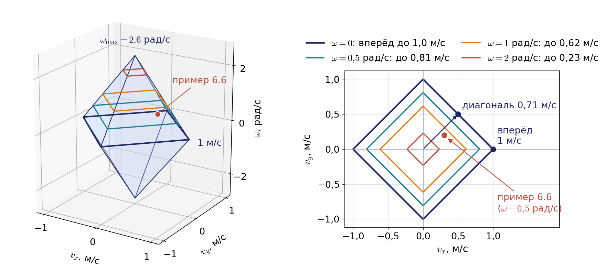

## 6.9. Манёвренность шасси

### Степень подвижности

Вернёмся к матрице $`C_1(\beta_s)`$, составленной из условий отсутствия бокового скольжения всех фиксированных и рулевых колёс. Допустимая скорость корпуса обязана удовлетворять системе $`C_1(\beta_s)\dot{\boldsymbol{\xi}}_R=0`$, то есть лежать в ядре этой матрицы. Размерность ядра называется **степенью подвижности** шасси:

```math
\delta_m=3-\mathrm{rank}\,C_1(\beta_s).
```

Это число компонент скорости корпуса, которыми можно управлять мгновенно, изменяя только скорости колёс. Ранг удобно определять геометрически: как мы выяснили в разделе 6.3, каждая строка матрицы $`C_1`$ требует, чтобы МЦВ лежал на оси соответствующего колеса.

- Если ранг равен нулю (фиксированных и рулевых колёс нет), МЦВ может находиться в любой точке плоскости, $`\delta_m=3`$. Это омни- и меканум-платформы.
- Если ранг равен единице, МЦВ обязан лежать на одной прямой, $`\delta_m=2`$. Это дифференциальная схема: две строки матрицы $`C_1`$ совпадают, потому что оси колёс совпадают.
- Если ранг равен двум, оси пересекаются в одной точке, которая и есть МЦВ, $`\delta_m=1`$: остаётся только выбрать скорость вращения вокруг него. Это трицикл и автомобиль. Если же оси параллельны, но не совпадают, ранг тоже равен двум и $`\delta_m=1`$, а МЦВ уходит в бесконечность: без проскальзывания шасси может ехать только по прямой. Пример — шасси с бортовым поворотом, разобранное ниже.
- Если ранг равен трём, общей точки у осей нет, $`\delta_m=0`$, и шасси без проскальзывания двигаться не может. Так будет, например, у тележки с тремя фиксированными колёсами, оси которых не пересекаются в одной точке.

Сравните с манипулятором: там ранг матрицы Якоби определял размерность множества достижимых скоростей схвата. Здесь ту же роль играет ранг матрицы связей, только считается не то, что разрешено, а то, что запрещено.

### Степень управляемости и манёвренность

Рулевые колёса позволяют менять сами запрещённые направления. **Степень управляемости** $`\delta_s`$ — это ранг блока $`C_{1s}(\beta_s)`$, то есть число независимо управляемых рулевых параметров, влияющих на положение МЦВ; она может быть равна нулю, единице или двум. Сумма

```math
\delta_M=\delta_m+\delta_s
```

называется **степенью манёвренности**. Разница между слагаемыми существенна: изменение скорости колеса сказывается на движении корпуса мгновенно, а поворот рулевого колеса — только после того, как руль будет повёрнут и робот проедет некоторое расстояние.

Г. Кампион, Ж. Бастен и Б. д'Андреа-Новель в 1996 году показали, что все невырожденные колёсные шасси делятся по паре чисел $`(\delta_m,\delta_s)`$ ровно на пять типов (рис. 6.14): $`(3,0)`$, $`(2,0)`$, $`(2,1)`$, $`(1,1)`$ и $`(1,2)`$.


| Тип $`(\delta_m,\delta_s)`$ | $`\delta_M`$ | Пример | Где может находиться МЦВ |
|---|---|---|---|
| $`(3,0)`$ | 3 | омни- и меканум-платформы | в любой точке плоскости, мгновенно |
| $`(2,0)`$ | 2 | дифференциальная схема | только на колёсной оси |
| $`(2,1)`$ | 3 | платформа с одним рулевым колесом и пассивными опорами | на оси рулевого колеса, которую можно поворачивать |
| $`(1,1)`$ | 2 | трицикл, велосипед, автомобиль | в точке на задней оси, задаваемой рулём |
| $`(1,2)`$ | 3 | шасси с двумя независимыми рулевыми колёсами | в любой точке, но после поворота обоих рулей |

Автомобиль имеет два рулевых колеса, но они связаны рулевой трапецией и управляются одним параметром, поэтому $`\delta_s=1`$. Шасси с $`\delta_M=3`$ способны поместить МЦВ в любую точку плоскости, но только тип $`(3,0)`$ делает это мгновенно. Голономным является только он: робот голономен тогда и только тогда, когда $`\delta_m=3`$. У всех остальных типов число мгновенно управляемых компонент скорости меньше трёх, хотя достижимы по-прежнему все три координаты позы.

### Шасси с поворотными приводными модулями

Хорошая иллюстрация разницы между $`\delta_m`$ и $`\delta_s`$ — шасси, у которого каждое колесо установлено в поворотном приводном модуле: один двигатель вращает колесо, другой поворачивает модуль вокруг вертикальной оси. Такое шасси способно реализовать любую скорость корпуса и поэтому кажется голономным, но лишь после поворота модулей, а скорость их поворота ограничена. По классификации это тип $`(1,2)`$ с $`\delta_s=2`$, а не тип $`(3,0)`$. Обратная задача о скорости для него разобрана в приложении 6.Д.

### Где кончается модель без проскальзывания

Вся теория раздела опирается на допущение, что колёса не скользят. Посмотрим, что она говорит о самой массовой схеме полевых и многих складских роботов — четырёхколёсном шасси с бортовым поворотом (skid-steer): колёса каждого борта вращаются с одинаковой скоростью, рулевых колёс нет, поворот выполняется разностью скоростей бортов, как у гусеничной машины. Оси передних и задних колёс параллельны и не совпадают, поэтому строки матрицы $`C_1`$ дают ранг два, и $`\delta_m=1`$: без проскальзывания такое шасси может ехать только по прямой, ведь МЦВ должен лежать одновременно на двух параллельных прямых и уходит в бесконечность. Это вырожденный случай, не входящий в пять типов Кампиона. Тем не менее такие роботы и гусеничные машины прекрасно поворачивают — за счёт управляемого бокового скольжения колёс.

На практике кинематику бортового поворота описывают моделью уницикла с увеличенной эффективной колеёй:

```math
\omega=\frac{V_r-V_l}{\chi\,b},\qquad \chi>1,
```

где коэффициент $`\chi`$ зависит от шин, грунта и нагрузки и определяется опытом, например по повороту на месте, измеренному гироскопом или внешней системой. Для гусениц Х. Л. Мартинес, А. Мандоу и соавторы предложили близкую модель с мгновенными центрами вращения гусениц, вынесенными за их пределы. Пусть, например, при колее $`b=0{,}5`$ м опыт дал $`\chi=1{,}5`$ (значение иллюстративное). Тогда команда разворота на месте с $`\omega=1`$ рад/с, рассчитанная по номинальной модели, даст бортам скорости $`\pm0{,}25`$ м/с, и робот повернётся лишь со скоростью $`0{,}67`$ рад/с. Чтобы получить заданную угловую скорость, нужны скорости $`\pm0{,}375`$ м/с. В контроллере дифференциальной схемы ROS 2 эффективную колею задают тем же множителем колеи, которым поправляют результаты UMBmark. Одометрия такого шасси на поворотах значительно хуже, чем на прямой, поэтому курс почти всегда берут от инерциального измерительного блока (IMU, inertial measurement unit).

У модели без проскальзывания есть и вторая граница — сцепление. Чтобы колёса удерживали машину на дуге радиуса $`\rho`$, центростремительное ускорение не должно превышать того, что способна дать сила трения: $`v^2/\rho\le\mu g`$, то есть $`v\le\sqrt{\mu g\rho}`$. Здесь $`\mu`$ — коэффициент сцепления шины с дорогой; не путайте его с коэффициентом демпфирования $`\mu`$ из лекции 3. Для дуги радиуса 6 м из примера 6.4 и $`\mu=0{,}8`$ получаем $`v\le6{,}9`$ м/с. Выше этой скорости, а на практике и заметно раньше, шины начинают уводить машину с расчётной дуги, и нужна динамическая модель с углами увода шин. Для медленных роботов эта граница далека, но для автомобиля она определяет, где кончается кинематика и начинается динамика.

## 6.10. Неголономность, скобка Ли и параллельная парковка

### Почему связь нельзя проинтегрировать

Пора строго ответить на вопрос, отложенный в разделе 6.2: почему связь

```math
\dot x\sin\theta-\dot y\cos\theta=0
```

неголономна? Начнём с рассуждения, не требующего формул. Предположим, что связь интегрируема, то есть эквивалентна уравнению $`h(x,y,\theta)=\mathrm{const}`$. Тогда, начав движение из некоторой позы, робот навсегда остался бы на двумерной поверхности в трёхмерном пространстве поз, и почти все позы были бы для него недостижимы. Но робот с дифференциальной схемой может попасть из любой позы в любую другую тремя простыми движениями: развернуться на месте в направлении цели, проехать по прямой до нужной точки и развернуться до нужного курса. Достижимо всё трёхмерное пространство, значит, функции $`h`$ не существует.

### Скобка Ли

Более тонкий инструмент нужен для роботов, которые не умеют разворачиваться на месте, и он же объясняет механизм появления «запрещённого» движения. Запишем модель уницикла как комбинацию двух векторных полей:

```math
\dot{\boldsymbol{\xi}}=\mathbf{g}_1(\boldsymbol{\xi})\,v+\mathbf{g}_2(\boldsymbol{\xi})\,\omega,\qquad \mathbf{g}_1=\begin{pmatrix}\cos\theta\\ \sin\theta\\ 0\end{pmatrix},\qquad \mathbf{g}_2=\begin{pmatrix}0\\ 0\\ 1\end{pmatrix}.
```

Поле $`\mathbf{g}_1`$ — «ехать вперёд», поле $`\mathbf{g}_2`$ — «поворачиваться». В каждый момент доступны только направления из плоскости, натянутой на эти два вектора. Выполним, однако, манёвр из четырёх шагов: малое время $`\varepsilon`$ едем вперёд, время $`\varepsilon`$ поворачиваемся, время $`\varepsilon`$ едем назад, время $`\varepsilon`$ поворачиваемся обратно. Если бы поля были постоянными, мы вернулись бы в исходную точку. Но поле $`\mathbf{g}_1`$ зависит от $`\theta`$: назад мы едем уже под другим углом. Разложение в ряд показывает, что итоговое смещение равно

```math
\Delta\boldsymbol{\xi}=\varepsilon^2\,[\mathbf{g}_1,\mathbf{g}_2]+O(\varepsilon^3),\qquad [\mathbf{g}_1,\mathbf{g}_2]=\frac{\partial\mathbf{g}_2}{\partial\boldsymbol{\xi}}\,\mathbf{g}_1-\frac{\partial\mathbf{g}_1}{\partial\boldsymbol{\xi}}\,\mathbf{g}_2.
```

Вектор $`[\mathbf{g}_1,\mathbf{g}_2]`$ называется **скобкой Ли** двух векторных полей. Знак скобки зависит от принятого соглашения о порядке слагаемых; мы пользуемся тем, при котором итог манёвра равен $`+\varepsilon^2[\mathbf{g}_1,\mathbf{g}_2]`$. В нашем случае поле $`\mathbf{g}_2`$ постоянно, а поле $`\mathbf{g}_1`$ зависит только от $`\theta`$, поэтому

```math
[\mathbf{g}_1,\mathbf{g}_2]=-\frac{\partial\mathbf{g}_1}{\partial\theta}=\begin{pmatrix}\sin\theta\\ -\cos\theta\\ 0\end{pmatrix}.
```

Это в точности боковое направление, то самое, которое запрещено связью. Три вектора $`\mathbf{g}_1`$, $`\mathbf{g}_2`$ и $`[\mathbf{g}_1,\mathbf{g}_2]`$ линейно независимы при любом $`\theta`$, их определитель равен единице. Отсюда следуют два вывода, которые дают две классические теоремы. **Теорема Фробениуса**: связь интегрируема тогда и только тогда, когда скобки Ли допустимых полей не выводят из плоскости допустимых скоростей; у нас скобка выводит из неё, значит, связь неинтегрируема. **Теорема Рашевского — Чжоу**: если допустимые поля вместе с их скобками Ли в каждой точке дают все направления пространства, то из любой позы можно попасть в любую другую. Уницикл, а с ним и автомобиль, управляем в этом смысле.

Проверим на числах. Пусть $`\theta=0`$ и $`\varepsilon=0{,}6`$ при единичных скоростях. После проезда вперёд робот находится в точке $`(0{,}6;\ 0)`$, после поворота его курс равен $`0{,}6`$ рад, после проезда назад он оказывается в точке $`(0{,}6-0{,}6\cos0{,}6;\ -0{,}6\sin0{,}6)\approx(0{,}105;\ -0{,}339)`$, после обратного поворота курс снова нулевой. Итог манёвра — боковой сдвиг на $`0{,}34`$ м при предсказанном значении $`\varepsilon^2=0{,}36`$ м и небольшое продольное смещение третьего порядка малости (рис. 6.15).


Анимация целиком: [l06_lie_bracket_config_space.mp4](../06_Анимации/l06_lie_bracket_config_space.mp4), 76 с.

### Параллельная парковка

Автомобиль не умеет поворачиваться на месте, но идея та же: боковое смещение набирается чередованием движений вперёд и назад с разным положением руля. На рис. 6.16 показан расчёт для велосипедной модели с минимальным радиусом поворота $`\rho_{\min}=4`$ м. Один цикл состоит из трёх движений. Сначала автомобиль едет задним ходом по дуге радиуса $`\rho_{\min}`$ с рулём, вывернутым вправо до упора, пока курс не изменится на угол $`\psi=20^{\circ}`$. Затем так же задним ходом, с рулём, вывернутым влево до упора, пока курс не вернётся к исходному. Наконец, он возвращается вперёд по прямой. Здесь $`\psi`$ — центральный угол каждой дуги, то есть изменение курса на ней, а не угол руля: угол руля при базе $`2{,}7`$ м и радиусе 4 м равен $`\mathrm{arctg}(2{,}7/4)\approx34^{\circ}`$. После двух дуг курс возвращается к исходному, автомобиль оказывается смещённым вбок на

```math
\Delta y=2\rho_{\min}(1-\cos\psi)\approx\rho_{\min}\psi^2
```

и назад на $`2\rho_{\min}\sin\psi`$; движение вперёд компенсирует продольное смещение. При $`\rho_{\min}=4`$ м и $`\psi=20^{\circ}`$ боковой сдвиг за цикл равен $`0{,}48`$ м, а откат назад $`2\rho_{\min}\sin\psi\approx2{,}74`$ м. Значит, свободный промежуток вдоль дороги должен быть длиннее автомобиля примерно на $`2{,}7`$ м: для кузова длиной $`4{,}2`$ м, как в анимации на рис. 6.16 (сцена $`\psi=20^{\circ}`$), — около $`6{,}9`$ м. За четыре цикла набирается $`1{,}93`$ м, то есть ширина парковочного места.

Обратите внимание на квадратичную зависимость сдвига от угла $`\psi`$: это отпечаток той же скобки Ли. Движение в запрещённом направлении возможно, но оно «второго порядка»: чтобы сместиться вбок на малую величину, приходится проехать вперёд и назад путь, пропорциональный квадратному корню из неё. Чем теснее место, тем больше циклов требуется. При $`\psi=10^{\circ}`$ откат за цикл уменьшается до $`1{,}39`$ м, но сдвиг за цикл падает вчетверо, до $`0{,}12`$ м, и для тех же $`1{,}93`$ м нужно уже 16 циклов вместо четырёх.

![Рис. 6.16. Анимация: меканум-платформа смещается вбок на 0,5 м одной командой, дифференциальная схема — тремя движениями (разворот, проезд, обратный разворот), а автомобиль с наименьшим радиусом поворота 4 м — циклами параллельной парковки. За цикл с ψ = 20° он сдвигается вбок на 0,48 м и откатывается на 2,74 м, а при ψ = 10° сдвиг за цикл падает вчетверо, до 0,12 м, и для тех же 1,93 м нужно 16 циклов вместо четырёх. На постере — сцена ψ = 10°: откат 1,39 м, поэтому промежутка 4,2 + 1,39 ≈ 5,6 м хватает, но циклов нужно 16](../06_Анимации/l06_sideways_three_chassis_parking.gif)

Анимация целиком: [l06_sideways_three_chassis_parking.mp4](../06_Анимации/l06_sideways_three_chassis_parking.mp4), 74 с.

Описанный манёвр — частный пример кратчайших путей автомобиля. Дж. Ридс и Л. Шепп в 1990 году показали, что кратчайший путь автомобиля, способного ехать вперёд и назад с ограниченной кривизной, состоит из дуг окружностей наименьшего радиуса и отрезков прямых с конечным числом переключений направления движения. Вариант только с движением вперёд — пути Дубинса — разобран в лекции 7 для самолёта.

### Обратная задача на траектории: плоские выходы

Четвёртая задача из раздела 6.1 пока остаётся незамкнутой: как по желаемой траектории получить скорости колёс? Для неголономного робота сначала нужно выяснить, какие траектории вообще допустимы. Ответ дают **плоские выходы**: величины, через которые и их производные выражаются все переменные состояния и все управления. Для уницикла плоские выходы — координаты $`(x,y)`$ точки $`P`$. Действительно, по модели уницикла $`\dot x=v\cos\theta`$, $`\dot y=v\sin\theta`$, и если известна гладкая кривая $`(x(t),y(t))`$, то

```math
v=\pm\sqrt{\dot x^2+\dot y^2},\qquad \theta=\mathrm{atan2}(\dot y,\dot x),\qquad \omega=\dot\theta=\frac{\dot x\ddot y-\dot y\ddot x}{\dot x^2+\dot y^2}=v\,\kappa,
```

где $`\kappa`$ — кривизна траектории (в этой лекции буква $`\kappa`$ означает только кривизну; в лекциях 4 и 7 ею обозначены коэффициент растяжения времени и отношение реактивного момента винта к его тяге). Знак $`v`$ выбирают по направлению движения: при движении назад курс отличается от направления скорости на $`\pi`$. Дальше скорости колёс находятся по формулам обратной задачи о скорости раздела 6.4. Для автомобиля из $`\omega=v\mathrm{tg}\,\delta/d`$ получаем угол руля $`\delta=\mathrm{arctg}(d\,\kappa)`$, и отсюда требование к траектории: $`\lvert\kappa\rvert\le1/\rho_{\min}`$.

Например, пусть в некоторый момент заданная траектория имеет $`\dot x=1`$ м/с, $`\dot y=0`$, $`\ddot x=0`$, $`\ddot y=0{,}2`$ м/с². Тогда $`v=1`$ м/с, $`\theta=0`$, $`\omega=0{,}2`$ рад/с, кривизна $`0{,}2`$ 1/м, радиус 5 м, и автомобилю с базой $`2{,}7`$ м нужен руль $`\delta=\mathrm{arctg}0{,}54\approx28{,}4^{\circ}`$. Это допустимо при $`\rho_{\min}=4`$ м, ведь $`0{,}2<0{,}25`$.

Формулы показывают и особенность: при $`v=0`$ курс не определяется траекторией, и знаменатель в выражении для $`\omega`$ обращается в нуль. Поэтому траектории неголономных роботов проектируют без остановок посреди пути или с явным разворотом на месте в точке остановки. Та же идея плоских выходов в лекции 7 позволит по траектории центра масс квадрокоптера найти его углы и тягу.

### Вынесенная точка и отслеживание траектории

Плоские выходы дают управление без обратной связи. Чтобы робот исправлял отклонения, удобен приём **вынесенной точки**. Возьмём точку $`B`$ на продольной оси на расстоянии $`l_B`$ впереди точки $`P`$:

```math
\mathbf{p}_B=\begin{pmatrix}x\\ y\end{pmatrix}+l_B\begin{pmatrix}\cos\theta\\ \sin\theta\end{pmatrix},\qquad \dot{\mathbf{p}}_B=J_B(\theta)\begin{pmatrix}v\\ \omega\end{pmatrix},\qquad J_B(\theta)=\begin{pmatrix}\cos\theta&-l_B\sin\theta\\ \sin\theta&l_B\cos\theta\end{pmatrix}.
```

Определитель матрицы $`J_B`$ равен $`l_B`$ и при $`l_B\ne0`$ не обращается в нуль. Значит, скорость точки $`B`$ можно задавать в любом направлении, как у голономного робота: неголономность «прячется» в движении самой точки $`P`$. Это позволяет применить управление по вектору скорости с обратной связью по положению из лекции 4:

```math
\begin{pmatrix}v\\ \omega\end{pmatrix}=J_B^{-1}(\theta)\big(\dot{\mathbf{p}}_B^{\ast}+K(\mathbf{p}_B^{\ast}-\mathbf{p}_B)\big),
```

где $`\mathbf{p}_B^{\ast}(t)`$ — заданная траектория точки $`B`$, а $`K`$ — положительно определённая матрица коэффициентов. Ошибка положения $`\mathbf{e}=\mathbf{p}_B^{\ast}-\mathbf{p}_B`$ подчиняется уравнению $`\dot{\mathbf{e}}=-K\mathbf{e}`$ и экспоненциально убывает, как ошибка схвата в лекции 4. Например, при $`l_B=0{,}2`$ м, курсе $`\theta=0`$ и требуемой скорости точки $`\dot{\mathbf{p}}_B=(0{,}3;\ 0{,}1)`$ м/с получаем $`v=0{,}3`$ м/с и $`\omega=0{,}1/0{,}2=0{,}5`$ рад/с. Чем меньше $`l_B`$, тем точнее сама ось колёс повторяет траекторию, но тем большие угловые скорости требуются: при $`l_B\to0`$ матрица $`J_B`$ вырождается (рис. 6.17).

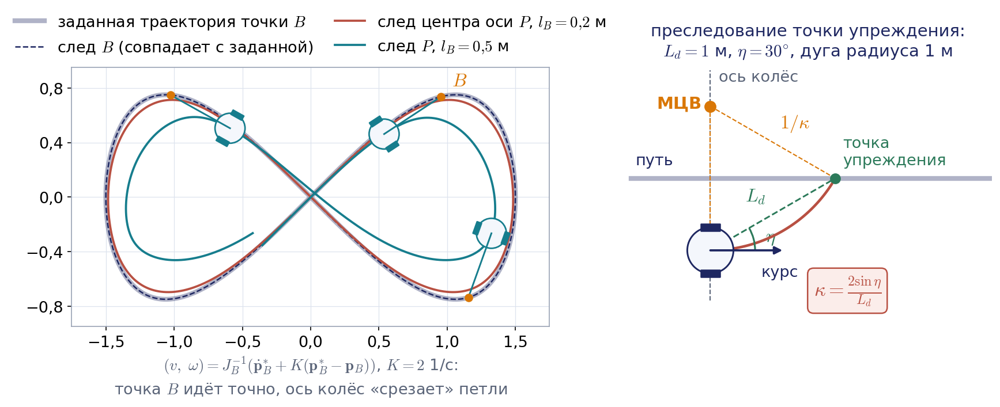

Другой классический способ — **преследование точки упреждения** (pure pursuit), описанный Р. Коултером в Университете Карнеги — Меллона в 1992 году. Это прямое применение МЦВ. На заданном пути выбирают точку на расстоянии $`L_d`$ от робота и проводят через неё дугу окружности, касающуюся текущего курса робота. Если направление на точку составляет с курсом угол $`\eta`$, то из геометрии хорды кривизна этой дуги равна

```math
\kappa=\frac{2\sin\eta}{L_d},
```

и роботу задают $`\omega=v\kappa`$. В литературе этот угол часто обозначают $`\alpha`$, но у нас буква $`\alpha`$ занята углом установки колеса из раздела 6.3. Например, при $`L_d=1`$ м и $`\eta=30^{\circ}`$ кривизна равна 1 1/м: робот поедет по дуге радиуса 1 м, и при $`v=0{,}5`$ м/с угловая скорость равна $`0{,}5`$ рад/с. Большое расстояние упреждения сглаживает движение, но «срезает» повороты; малое — точнее следует пути, но раскачивает робота. В стеке Nav2 используется развитие этого метода — регулируемое преследование (Regulated Pure Pursuit), которое дополнительно снижает скорость на крутых поворотах и вблизи препятствий.

Почему робота ведут именно по траектории, а не прямо «в точку»? Ответ даёт **теорема Брокетта** (1983): для уницикла не существует непрерывного закона обратной связи, зависящего только от состояния и не зависящего явно от времени, который асимптотически приводил бы робота в заданную точку с заданным курсом. Зато задача отслеживания движущейся опорной траектории, как мы только что видели, решается. Поэтому на практике робота ведут по траектории и останавливают в допуске, а точную стабилизацию в позе выполняют нестационарными или разрывными законами либо отдельным манёвром.

### Что неголономность значит для планирования

Соберём практические следствия. Для неголономного робота недостаточно задать желаемую траекторию корпуса: траектория должна быть допустимой, то есть в каждой точке касаться направления $`\mathbf{g}_1`$, а для автомобиля ещё и иметь кривизну не больше $`1/\rho_{\min}`$. Для дифференциальной схемы это ограничение мягкое: развернувшись на месте, она может пройти по ломаной. Автомобиль ломаную пройти не может, поэтому планировщик для него строит пути из дуг и отрезков; в стеке Nav2 эту задачу решает планировщик Hybrid-A* с моделями движения Дубинса (только вперёд) и Ридса — Шеппа (с задним ходом) и параметром наименьшего радиуса поворота. Голономная платформа избавлена от этих трудностей: любая траектория для неё допустима, а команда скорости вычисляется одной матрицей. Этим и объясняется выбор меканум-шасси для мобильного манипулятора, которому нужно точно подъезжать к столам и стеллажам в тесном цеху.

## 6.11. Мобильный манипулятор

### Якобиан платформы и руки

Мобильный манипулятор вроде youBot — это рука на колёсной платформе. Скорость его схвата складывается из двух вкладов: от движения платформы и от движения руки относительно платформы. Рассмотрим плоскую часть задачи. Пусть $`\mathbf{r}_{Pe}`$ — вектор из точки $`P`$ платформы в схват, заданный в связанных осях, а скорость схвата относительно платформы равна $`J_{\mathrm{arm}}(\mathbf{q})\dot{\mathbf{q}}`$, где $`\mathbf{q}`$ — координаты сочленений руки, а $`J_{\mathrm{arm}}`$ — её матрица Якоби из лекции 3. По формуле распределения скоростей в неподвижной системе

```math
\dot{\mathbf{p}}_e=R(\theta)\Big(\begin{pmatrix}v_x\\ v_y\end{pmatrix}+\omega\begin{pmatrix}-r_{Pe,y}\\ r_{Pe,x}\end{pmatrix}+J_{\mathrm{arm}}(\mathbf{q})\dot{\mathbf{q}}\Big).
```

Первые два слагаемых — вклад платформы: поступательная скорость точки $`P`$ и вращение вокруг неё. Объединив все скорости в один вектор, получаем общую матрицу Якоби

```math
\dot{\mathbf{p}}_e=R(\theta)\,J\begin{pmatrix}\dot{\boldsymbol{\xi}}_R\\ \dot{\mathbf{q}}\end{pmatrix},\qquad J=\begin{pmatrix}J_{\mathrm{base}}&J_{\mathrm{arm}}\end{pmatrix},\qquad J_{\mathrm{base}}=\begin{pmatrix}1&0&-r_{Pe,y}\\ 0&1&r_{Pe,x}\end{pmatrix}.
```

Если в качестве управляемых переменных взять не скорость корпуса, а скорости колёс, то подставляется $`\dot{\boldsymbol{\xi}}_R=F\dot{\boldsymbol{\varphi}}`$ с $`F=H^{+}`$ из раздела 6.8, и $`J_e=\begin{pmatrix}J_{\mathrm{base}}F&J_{\mathrm{arm}}\end{pmatrix}`$. Именно в такой форме записывают якобиан мобильного манипулятора Линч и Парк. Для youBot в пространстве с шестимерной скоростью схвата это матрица $`6\times9`$: четыре столбца для колёс и пять для сочленений руки.

### Избыточность и распределение движения

Переменных у мобильного манипулятора почти всегда больше, чем компонент скорости схвата, то есть система избыточна, и к ней применим весь аппарат лекции 3. Простейшее решение — решение минимальной нормы с правой псевдообратной матрицей. Но у платформы и руки разные единицы и разная «цена» движения, поэтому вводят диагональную матрицу весов $`D`$ и минимизируют взвешенную норму $`\mathbf{z}^{\mathrm T}D\mathbf{z}`$, где $`\mathbf{z}`$ — вектор всех скоростей:

```math
\mathbf{z}=J_D^{+}\,\dot{\mathbf{p}}_e,\qquad J_D^{+}=D^{-1}J^{\mathrm T}\big(JD^{-1}J^{\mathrm T}\big)^{-1}.
```

Большой вес на скоростях платформы означает «платформа стоит, работает рука»; большой вес на сочленениях руки — «рука почти неподвижна, подтягивается платформа». К этому решению можно добавить, как в лекции 3, слагаемое из нуль-пространства $`(E-J^{+}J)\mathbf{z}_0`$ с произвольным вектором $`\mathbf{z}_0`$, которое без влияния на схват удерживает руку вдали от особых положений или от границы рабочей зоны; как это выглядит, показывает конец анимации на рис. 6.19.

#### Пример 6.8. Распределение движения между платформой и рукой

Пусть на меканум-платформе из примера 6.6 в точке $`P`$ установлен плоский двухзвенник с длинами звеньев $`a_1=a_2=0{,}3`$ м в конфигурации $`q_1=0`$, $`q_2=90^{\circ}`$, курс платформы $`\theta=0`$. Тогда схват находится в точке $`\mathbf{r}_{Pe}=(0{,}3;\ 0{,}3)`$ м, а матрица $`J`$ размера $`2\times5`$ имеет строки $`(1,\ 0,\ -0{,}3,\ -0{,}3,\ -0{,}3)`$ и $`(0,\ 1,\ 0{,}3,\ 0{,}3,\ 0)`$. Требуется скорость схвата $`(0{,}1;\ 0)`$ м/с.

При равных единичных весах решение минимальной нормы даёт платформе $`v_x\approx0{,}080`$ м/с, $`v_y\approx0{,}012`$ м/с, $`\omega\approx-0{,}020`$ рад/с, а сочленениям руки $`\dot q_1\approx-0{,}020`$ рад/с и $`\dot q_2\approx-0{,}024`$ рад/с: основную работу делает платформа. Если увеличить веса скоростей платформы в сто раз, платформа почти останавливается ($`v_x\approx0{,}009`$ м/с), а рука берёт движение на себя: $`\dot q_2\approx-0{,}275`$ рад/с. Если же в сто раз утяжелить сочленения руки, они почти замирают, а платформа едет со скоростью $`v_x\approx0{,}092`$ м/с, слегка поворачиваясь. Во всех трёх случаях скорость схвата одна и та же, $`(0{,}1;\ 0)`$ м/с (рис. 6.18 и 6.19); скорости колёс в каждом случае дают формулы обратной задачи раздела 6.8. Веса заодно задают и согласование единиц: метры в секунду платформы и радианы в секунду сочленений.

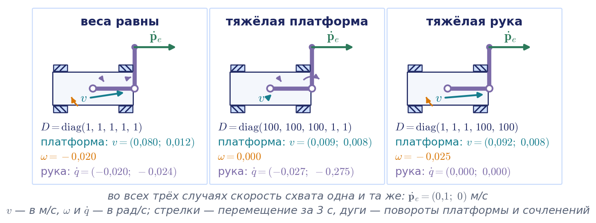


Анимация целиком: [l06_mobile_manipulator_weights.mp4](../06_Анимации/l06_mobile_manipulator_weights.mp4), 66 с.

В программах планирования движения манипуляторов, например в MoveIt 2, подвижную платформу часто описывают как плоское сочленение с тремя координатами $`(x,y,\theta)`$ в модели робота, и тогда платформа и рука планируются как одна избыточная цепь.

### Параллель с манипулятором

Сведём главное из сопоставления, которое мы проводили на протяжении лекции; полная таблица приведена в приложении 6.В.

| Понятие | Манипулятор | Колёсный робот |
|---|---|---|
| Ранг матрицы скоростей | падает в отдельных конфигурациях | задан схемой шасси: 3 у голономной платформы, 2 у дифференциальной схемы |
| Следствие неполного ранга | потеря направления скорости в особой точке | постоянный запрет боковой скорости, но все позы достижимы |
| Избыток приводов | решений бесконечно много, выбирается решение минимальной нормы | четыре колеса на три степени свободы: условие совместности и оценка по наименьшим квадратам |

Голономная платформа ведёт себя как манипулятор с невырожденным якобианом полного ранга: любая скорость корпуса реализуется, и задача управления сводится к умножению на матрицу. Неголономная платформа несёт принципиальное ограничение на скорости, не имеющее аналога у манипулятора: оно не связано с особой конфигурацией, действует всегда и при этом не уменьшает множество достижимых положений.

## 6.12. Где это в реальной системе

Почти каждая формула лекции прямо работает в программном стеке реального мобильного робота. В системе ROS 2 обратную задачу о скорости и одометрию решают контроллеры шасси из пакета ros2_controllers, а планирование и отслеживание траектории — стек навигации Nav2.

| Схема шасси | Разделы лекции | Контроллер ros2_controllers | Модель движения в Nav2 |
|---|---|---|---|
| Дифференциальная | 6.4, 6.5 | diff_drive_controller | контроллер MPPI с моделью DiffDrive |
| Трицикл, велосипед | 6.6 | tricycle_controller, tricycle_steering_controller, bicycle_steering_controller | MPPI с моделью Ackermann; планировщик Hybrid-A* |
| Автомобиль | 6.6 | ackermann_steering_controller | MPPI с моделью Ackermann; Hybrid-A* с моделями Дубинса и Ридса — Шеппа |
| Меканум, омни | 6.7, 6.8 | mecanum_drive_controller, omni_wheel_drive_controller | MPPI с моделью Omni |

Контроллер шасси получает команду скорости корпуса — сообщение с линейной и угловой скоростями в связанных осях (в современных версиях с меткой времени), решает обратную задачу о скорости, отдаёт скорости колёс приводам и по показаниям энкодеров публикует одометрию. Порядок компонент, как мы отмечали в разделе 6.1, тот же, что в $`\dot{\boldsymbol{\xi}}_R`$. Оси связанной системы заданы соглашением REP 103: $`x`$ вперёд, $`y`$ влево, $`z`$ вверх. Контроллер меканум-платформы входит в пакет начиная с дистрибутива Humble, контроллер омни-платформы — начиная с Jazzy.

Одометрия контроллера дифференциальной схемы устроена в точности как в разделе 6.5: на каждом такте он интегрирует перемещение по точной дуге, а если поворот за такт меньше $`10^{-6}`$ рад, переходит к формуле средней точки. У него есть режим разомкнутой одометрии, при котором поза интегрируется не по энкодерам, а по командам. Это удобно в симуляции, но для реального робота бессмысленно: такая одометрия не видит ни проскальзывания, ни отличия реальных колёс от модели. Поправки UMBmark и эффективная колея шасси с бортовым поворотом вводятся множителями радиусов колёс и колеи, а неопределённость одометрии, которую мы оценивали в разделе 6.5, контроллер передаёт потребителям в виде диагонали ковариационной матрицы, заданной параметром.

Системы координат мобильного робота описывает соглашение REP 105. Система odom — это и есть результат одометрии: поза в ней меняется непрерывно, без скачков, но дрейфует. Система map связана с картой: поза в ней не дрейфует, но может меняться скачками, когда локализация по лидару исправляет накопленную ошибку. Преобразование map → odom публикует алгоритм локализации, а odom → base_link — одометрия, сырая или объединённая с гироскопом фильтром Калмана из пакета robot_localization.

## Связь с демонстрациями

Вычислительные эксперименты к лекции собраны в ноутбуке «Демо_Занятие_06_колёсные.ipynb» в папке «03_Примеры_Jupyter». Демонстрации пронумерованы в порядке показа на занятии; каждая заканчивается рисунком или числом, которое можно сверить с текстом лекции. Демонстрации 4 и 9, а также дополнительная часть демонстрации 12 с роботом UR5e на занятии показываются по желанию, если остаётся время; демонстрация 13 предназначена для самостоятельной работы с ноутбуком.

| № | Демонстрация | Что видно |
|---|---|---|
| 1 | МЦВ и три случая движения дифференциальной схемы (раздел 6.4) | положение МЦВ и траектории при разных $`V_l`$, $`V_r`$; числа примера 6.1: $`v=0{,}5`$ м/с, $`\omega=0{,}667`$ рад/с, $`\rho=0{,}75`$ м; сверка порядка входов с моделью дифференциальной схемы из Robotics Toolbox |
| 2 | Обратная задача о скорости и насыщение скоростей колёс (пример 6.2) | ромб допустимых команд на плоскости $`(v,\omega)`$; срезание даёт радиус $`0{,}45`$ м, масштабирование сохраняет $`0{,}40`$ м; ползунки $`(V_l,V_r)`$ с отметкой команды на ромбе |
| 3 | Шаг одометрии: метод Эйлера, средняя точка, точная дуга (пример 6.3) | ошибки $`0{,}25`$ м, $`0{,}005`$ м и нуль на 13 шагах; ошибка Эйлера по шагам колеблется и почти исчезает после полного оборота; наклоны 1 и 2 на графике ошибки от шага; совпадение точной дуги с экспонентой на $`SE(2)`$ |
| 4 | Систематические ошибки и UMBmark (раздел 6.5) | квадрат $`4\times4`$ м в обе стороны при разнице диаметров в один процент и ошибке колеи в три процента; вычисление поправок по двум обходам и повторный обход с поправками |
| 5 | Реалистичная одометрия: неопределённость (раздел 6.5) | облако конечных точек Монте-Карло и эллипс по рекурсии ковариации; $`\sigma_y\approx0{,}22`$ м против $`\sigma_x\approx0{,}014`$ м на 4 м; рост бокового разброса как $`s^{3/2}`$, «банан» на дуге |
| 6 | Трицикл и автомобильная схема (раздел 6.6) | радиус поворота как функция угла руля; углы Аккермана $`27{,}4^{\circ}`$ и $`21{,}7^{\circ}`$ из примера 6.4; опыт «одинаковые углы передних колёс»: ранг $`C_1`$ равен трём, какое колесо скользит |
| 7 | Трёхколёсная омни-платформа (раздел 6.7) | матрица $`H`$ и её обращение; скорости колёс примера 6.5; опыт «тяга по радиусам»: линии тяги проходят через центр, $`\det H=0`$, вращение потеряно |
| 8 | Меканум-платформа (раздел 6.8) | четыре базовых движения; числа примеров 6.6 и 6.7, условие совместности и невязка; октаэдр допустимых скоростей; опыт «колёса переставлены»: ранг 3, сингулярные числа $`(40;\ 40;\ 3{,}4)`$ |
| 9 | Ранг матрицы связей и манёвренность (раздел 6.9) | матрица $`C_1`$, её ранг, $`\delta_m`$, $`\delta_s`$ и $`\delta_M`$ для пяти шасси, для тележки с тремя фиксированными колёсами и для шасси с бортовым поворотом |
| 10 | Скобка Ли и параллельная парковка (раздел 6.10) | манёвр скобки Ли и сравнение сдвига с $`\varepsilon^2`$; циклы парковки, сдвиг $`0{,}48`$ м и откат $`2{,}74`$ м за цикл |
| 11 | Отслеживание траектории вынесенной точкой (раздел 6.10) | уницикл ведёт точку $`B`$ по восьмёрке; влияние $`l_B`$ на точность и угловые скорости |
| 12 | Мобильный манипулятор (пример 6.8) | распределение скорости схвата между платформой и рукой при трёх наборах весов; скорости колёс |
| 13 | Интерактивная модель меканум-платформы | ползунки $`(v_x,v_y,\omega)`$: скорости колёс, МЦВ и траектория в реальном времени |

**Анимации к лекции.** В папке `06_Анимации` лежат семь роликов к этой лекции (MP4 для показа на занятии, в конспекте вставлены их фрагменты):

- `l06_icr_diffdrive` (рис. 6.4) — МЦВ дифференциальной схемы как одна точка, которая скользит по колёсной оси от прямой до разворота на месте;
- `l06_odometry_integrators` (рис. 6.6) — метод Эйлера, средняя точка и точная дуга на окружности примера 6.3 и порядки их ошибок;
- `l06_odometry_drift_umbmark` (рис. 6.7) — накопление систематической ошибки на квадрате 4×4 м, калибровка UMBmark и облако случайных ошибок;
- `l06_mecanum_rollers_forces` (рис. 6.12) — связь меканум-колеса, силы роликов в базовых движениях, примеры 6.6 и 6.7, неправильная установка колёс и омни-платформа;
- `l06_lie_bracket_config_space` (рис. 6.15) — плоскости допустимых скоростей уницикла в пространстве $`(x,y,\theta)`$ и незамкнутая петля, дающая сдвиг вдоль скобки Ли;
- `l06_sideways_three_chassis_parking` (рис. 6.16) — сдвиг вбок у меканум-платформы, дифференциальной схемы и автомобиля, циклы параллельной парковки;
- `l06_mobile_manipulator_weights` (рис. 6.19) — распределение скорости схвата между платформой и рукой весами и слагаемым из нуль-пространства.

## Выводы

1. Поза колёсного робота на плоскости задаётся вектором $`\boldsymbol{\xi}=(x,y,\theta)^{\mathrm T}`$, скорость корпуса в связанной системе — вектором $`\dot{\boldsymbol{\xi}}_R=(v_x,v_y,\omega)^{\mathrm T}`$, и они связаны соотношением $`\dot{\boldsymbol{\xi}}=R_z(\theta)\dot{\boldsymbol{\xi}}_R`$. Как и у манипулятора, есть прямая и обратная задачи о скорости, но прямая задача о положении решается только интегрированием.
2. Колесо накладывает на шасси условие качения без проскальзывания и условие отсутствия бокового скольжения; второе означает, что МЦВ лежит на оси колеса. Подвижность шасси ограничивают только фиксированные и рулевые колёса; роликовые, шведские и сферические колёса ничего не запрещают.
3. У дифференциальной схемы шасси с колеёй $`b`$ мгновенный центр вращения лежит на колёсной оси: $`\omega=(V_r-V_l)/b`$, $`\rho=\frac{b}{2}(V_r+V_l)/(V_r-V_l)`$, $`v=(V_r+V_l)/2`$. Область допустимых команд при ограниченных скоростях колёс — ромб $`\lvert v\rvert+\frac{b}{2}\lvert\omega\rvert\le r\dot\varphi_{\max}`$; команду за его пределами следует масштабировать, сохраняя кривизну.
4. Поза в момент $`t+\Delta t`$ находится поворотом вокруг МЦВ, то есть экспонентой на $`SE(2)`$. В одометрии следует применять точную формулу дуги или формулу средней точки; метод Эйлера даёт ошибку направления первого порядка. Систематические ошибки (диаметры колёс, колея) калибруют методом UMBmark, а случайные ошибки дают неопределённость, боковая составляющая которой растёт как $`s^{3/2}`$; поэтому курс берут от гироскопа и объединяют датчики фильтром Калмана.
5. У трицикла $`\rho=d/\mathrm{tg}\,\delta`$, развернуться на месте нельзя, на ведущей оси нужен дифференциал. Принцип Аккермана требует, чтобы оси всех колёс пересекались в одной точке: $`\mathrm{ctg}\,\delta_o-\mathrm{ctg}\,\delta_i=b/d`$.
6. У всенаправленных платформ из связей естественно получается обратная задача $`\dot{\boldsymbol{\varphi}}=H\dot{\boldsymbol{\xi}}_R`$ с постоянной матрицей. Для трёх омни-колёс матрица $`H`$ невырождена, если линии тяги не проходят через одну точку и не все параллельны. Для меканум-платформы прямая задача решается псевдообратной матрицей и сопровождается условием совместности $`\dot\varphi_1+\dot\varphi_2-\dot\varphi_3-\dot\varphi_4=0`$, нарушение которого выдаёт проскальзывание.
7. Степень подвижности $`\delta_m=3-\mathrm{rank}\,C_1`$ показывает, сколькими компонентами скорости можно управлять мгновенно, степень управляемости $`\delta_s`$ — сколько рулевых параметров влияют на положение МЦВ. Существует пять типов невырожденных шасси; голономно только шасси типа $`(3,0)`$. Шасси с бортовым поворотом выходит за рамки модели без проскальзывания и поворачивает за счёт управляемого скольжения.
8. Связь $`\dot x\sin\theta-\dot y\cos\theta=0`$ неинтегрируема: скобка Ли полей «ехать вперёд» и «поворачиваться» даёт запрещённое боковое направление. Неголономный робот достигает любой позы, но боковое смещение набирается манёврами второго порядка малости, как при параллельной парковке. Вести такого робота удобно по траектории — через плоские выходы, вынесенную точку или преследование точки упреждения, — а не стабилизировать в точке, что запрещает теорема Брокетта.
9. Мобильный манипулятор описывается общей матрицей Якоби платформы и руки; он избыточен, и распределение движения между платформой и рукой задаётся весами взвешенной псевдообратной матрицы.

## Контрольные вопросы

1. Какими величинами задаются поза и скорость корпуса колёсного робота на плоскости? Как связаны скорости в неподвижной и связанной системах координат?
2. Сформулируйте прямую и обратную задачи кинематики мобильного робота и прямую и обратную задачи о скорости. Почему прямая задача о положении для колёсного робота не имеет решения в конечном виде?
3. Дайте определения голономной и неголономной связи. Приведите по одному примеру из мобильной робототехники. Какой робот называют голономным?
4. Выведите условие качения без проскальзывания и условие отсутствия бокового скольжения для фиксированного колеса с параметрами $`l`$, $`\alpha`$, $`\beta`$. Убедитесь, что для колёс дифференциальной схемы с колеёй $`b=2l`$ они дают $`v_x\pm\frac{b}{2}\omega=r\dot\varphi`$ и $`v_y=0`$.
5. Почему роликовое, шведское и сферическое колёса не ограничивают подвижность шасси? Что произойдёт со шведским колесом при $`\gamma=90^{\circ}`$?
6. Что такое мгновенный центр вращения и почему он лежит на оси каждого колеса без бокового скольжения? Выведите формулы для $`\omega`$ и $`\rho`$ дифференциальной схемы шасси и перечислите три характерных случая движения.
7. Получите формулы позы робота в момент $`t+\Delta t`$ при постоянных скоростях колёс. Чем формула средней точки лучше метода Эйлера и насколько она отличается от точной? Почему ошибка Эйлера при движении по окружности не растёт безгранично?
8. Робот с колеёй $`b=0{,}4`$ м и колёсами радиуса $`0{,}06`$ м получил команду $`v=1{,}0`$ м/с, $`\omega=3{,}0`$ рад/с при ограничении $`\dot\varphi_{\max}=25`$ рад/с. Выполнима ли команда? Как её следует изменить, чтобы робот прошёл по той же дуге?
9. Назовите источники систематических ошибок одометрии. Оцените боковое отклонение на прямом участке длиной 10 м при колее $`b=0{,}5`$ м, если диаметры колёс различаются на полпроцента.
10. Как пересчитывается ковариационная матрица позы на шаге одометрии? Почему боковая неопределённость растёт как $`s^{3/2}`$, а продольная — как $`\sqrt{s}`$, и какой практический вывод отсюда следует?
11. Выведите соотношения для трицикла с приводным рулевым колесом и условие Аккермана. Зачем на ведущей оси нужен дифференциал?
12. Постройте матрицу $`H`$ для платформы с тремя омни-колёсами, расположенными под углами $`60^{\circ}`$, $`180^{\circ}`$ и $`300^{\circ}`$ к оси $`X_R`$. Найдите скорости колёс при движении строго вперёд. При каком расположении линий тяги матрица $`H`$ вырождена?
13. Выведите формулы обратной задачи о скорости для меканум-платформы из условия отсутствия проскальзывания вдоль оси нижнего ролика. Какие комбинации скоростей колёс дают движение вперёд, вбок, по диагонали и поворот на месте? Что изменится, если колёса установлены так, что рисунок X образуют нижние ролики?
14. Почему прямая задача о скорости для меканум-платформы переопределена? Получите псевдообратную матрицу $`H^{+}`$ и условие совместности скоростей колёс. Найдите скорости колёс, при которых платформа с параметрами примера 6.6 вращается вокруг центра своей задней оси с угловой скоростью $`1`$ рад/с.
15. Определите $`\delta_m`$, $`\delta_s`$ и $`\delta_M`$ для дифференциальной схемы, трицикла, автомобиля и меканум-платформы. Почему голономна только платформа типа $`(3,0)`$, хотя у типов $`(2,1)`$ и $`(1,2)`$ тоже $`\delta_M=3`$?
16. Вычислите скобку Ли для модели уницикла и объясните на примере параллельной парковки, как неголономный робот получает боковое смещение и почему оно пропорционально квадрату малого параметра.
17. Как по заданной гладкой траектории $`(x(t),y(t))`$ найти скорости $`v`$, $`\omega`$ уницикла и угол руля автомобиля? Зачем вводят вынесенную точку и что утверждает теорема Брокетта?
18. Запишите матрицу Якоби мобильного манипулятора, у которого рука установлена на меканум-платформе. Как с помощью весов взвешенной псевдообратной матрицы заставить работать в основном руку или в основном платформу?
19. Кейс. Робот с дифференциальной схемой едет по прямой ровно и проходит ровно заданное расстояние, но при команде повернуться на месте на $`90^{\circ}`$ по одометрии поворачивается в действительности лишь на $`85^{\circ}`$. Какой параметр модели неверен, в какую сторону его нужно поправить и каким параметром контроллера это делается?
20. Кейс. Четырёхколёсный робот с бортовым поворотом по таблице раздела 6.9 может без проскальзывания ехать только по прямой. Почему он всё же поворачивает, чем расплачивается за это одометрия и как вы откалибруете его модель?
21. Кейс. Почему для автомобильного шасси нельзя использовать планировщик, строящий ломаные пути, а для меканум-платформы можно? Какой планировщик и с какими параметрами вы выберете для каждого из них?

## Литература

1. Siegwart R., Nourbakhsh I. R., Scaramuzza D. Introduction to Autonomous Mobile Robots. — 2nd ed. — Cambridge, MA: MIT Press, 2011. — Главы 3 и 5.
2. Lynch K. M., Park F. C. Modern Robotics: Mechanics, Planning, and Control. — Cambridge: Cambridge University Press, 2017. — Глава 13 (в том числе раздел 13.5 о мобильных манипуляторах).
3. Corke P. Robotics, Vision and Control: Fundamental Algorithms in Python. — 3rd ed. — Cham: Springer, 2023. — Глава о мобильных колёсных роботах.
4. Thrun S., Burgard W., Fox D. Probabilistic Robotics. — Cambridge, MA: MIT Press, 2005. — Глава 5.
5. Siciliano B., Sciavicco L., Villani L., Oriolo G. Robotics: Modelling, Planning and Control. — London: Springer, 2009. — Глава 11.
6. Мартыненко Ю. Г. Управление движением мобильных колёсных роботов // Фундаментальная и прикладная математика. — 2005. — Т. 11, № 8.
7. Campion G., Bastin G., d'Andréa-Novel B. Structural properties and classification of kinematic and dynamic models of wheeled mobile robots // IEEE Transactions on Robotics and Automation. — 1996. — Vol. 12, No. 1.
8. Borenstein J., Feng L. Measurement and correction of systematic odometry errors in mobile robots // IEEE Transactions on Robotics and Automation. — 1996. — Vol. 12, No. 6.
9. Reeds J. A., Shepp L. A. Optimal paths for a car that goes both forwards and backwards // Pacific Journal of Mathematics. — 1990. — Vol. 145, No. 2.
10. Brockett R. W. Asymptotic stability and feedback stabilization // Differential Geometric Control Theory / eds. R. W. Brockett, R. S. Millman, H. J. Sussmann. — Boston: Birkhäuser, 1983.
11. Coulter R. C. Implementation of the Pure Pursuit Path Tracking Algorithm: Technical Report CMU-RI-TR-92-01. — Pittsburgh: Carnegie Mellon University, Robotics Institute, 1992.
12. Macenski S., Singh S., Martín F., Ginés J. Regulated pure pursuit for robot path tracking // Autonomous Robots. — 2023. — Vol. 47.
13. Kong J., Pfeiffer M., Schildbach G., Borrelli F. Kinematic and dynamic vehicle models for autonomous driving control design // IEEE Intelligent Vehicles Symposium (IV). — 2015.
14. Martínez J. L., Mandow A., Morales J., Pedraza S., García-Cerezo A. Approximating kinematics for tracked mobile robots // The International Journal of Robotics Research. — 2005. — Vol. 24, No. 10.
15. Dudek G., Jenkin M. Computational Principles of Mobile Robotics. — 2nd ed. — Cambridge: Cambridge University Press, 2010.
16. Bischoff R., Huggenberger U., Prassler E. KUKA youBot — a mobile manipulator for research and education // Proceedings of the IEEE International Conference on Robotics and Automation (ICRA). — 2011.
17. Документация ros2_controllers (control.ros.org): контроллеры diff_drive_controller, mecanum_drive_controller, omni_wheel_drive_controller, steering_controllers_library; документация стека навигации Nav2 (docs.nav2.org): контроллеры MPPI и Regulated Pure Pursuit, планировщик Smac Hybrid-A*.
18. Зенкевич С. Л., Ющенко А. С. Основы управления манипуляционными роботами. — М.: Изд-во МГТУ им. Н. Э. Баумана, 2004.

## Приложение 6.А. Вывод связей колёс в общем виде

В этом приложении приведены выкладки, результат которых использован в разделе 6.3.

**Фиксированное колесо.** Вектор из точки $`P`$ в центр колеса $`A`$ в связанной системе равен $`\mathbf{r}=(l\cos\alpha,\ l\sin\alpha)^{\mathrm T}`$. В плоском случае вектор $`\boldsymbol{\omega}\times\mathbf{r}`$ равен $`\omega(-l\sin\alpha,\ l\cos\alpha)^{\mathrm T}`$, поэтому

```math
\mathbf{v}_A=\begin{pmatrix}v_x-\omega l\sin\alpha\\ v_y+\omega l\cos\alpha\end{pmatrix}.
```

Спроецируем эту скорость на направление качения $`\mathbf{t}=(\sin(\alpha+\beta),\ -\cos(\alpha+\beta))^{\mathrm T}`$. Коэффициенты при $`v_x`$ и $`v_y`$ равны компонентам $`\mathbf{t}`$, а коэффициент при $`\omega`$ равен

```math
-l\big(\sin\alpha\sin(\alpha+\beta)+\cos\alpha\cos(\alpha+\beta)\big)=-l\cos\beta,
```

что и даёт условие качения $`\big(\sin(\alpha+\beta),\ -\cos(\alpha+\beta),\ -l\cos\beta\big)\dot{\boldsymbol{\xi}}_R=r\dot\varphi`$. Проекция на ось колеса $`\mathbf{n}=(\cos(\alpha+\beta),\ \sin(\alpha+\beta))^{\mathrm T}`$ даёт коэффициент при $`\omega`$

```math
l\big(-\sin\alpha\cos(\alpha+\beta)+\cos\alpha\sin(\alpha+\beta)\big)=l\sin\beta,
```

и условие отсутствия бокового скольжения $`\big(\cos(\alpha+\beta),\ \sin(\alpha+\beta),\ l\sin\beta\big)\dot{\boldsymbol{\xi}}_R=0`$.

**Роликовое колесо.** Пусть теперь $`A`$ — точка, в которой вертикальная ось шарнира роликового колеса пересекает плоскость движения, а центр колеса $`B`$ вынесен из неё в плоскости колеса на расстояние $`e`$: $`\overrightarrow{AB}=e\,\mathbf{t}`$. Вилка колеса вращается относительно неподвижной системы с угловой скоростью $`\omega+\dot\beta`$: вместе с корпусом и относительно него. Поэтому скорость центра колеса равна

```math
\mathbf{v}_B=\mathbf{v}_A+(\omega+\dot\beta)\,\mathbf{e}_z\times e\,\mathbf{t}=\mathbf{v}_A+e\,(\omega+\dot\beta)\,\mathbf{n},
```

так как поворот вектора $`\mathbf{t}`$ на $`90^{\circ}`$ против часовой стрелки даёт $`\mathbf{n}`$. Добавка направлена вдоль оси колеса. Проекция на направление качения поэтому не меняется, и условие качения остаётся прежним. Проекция на ось колеса получает слагаемое $`e(\omega+\dot\beta)`$, и условие отсутствия бокового скольжения принимает вид

```math
\big(\cos(\alpha+\beta),\ \sin(\alpha+\beta),\ e+l\sin\beta\big)\,\dot{\boldsymbol{\xi}}_R+e\,\dot\beta=0.
```

**Шведское колесо.** Ось ролика получается из направления качения $`\mathbf{t}`$ поворотом на угол $`\gamma`$ и равна $`(\sin(\alpha+\beta+\gamma),\ -\cos(\alpha+\beta+\gamma))^{\mathrm T}`$. Проекция окружной скорости $`r\dot\varphi\,\mathbf{t}`$ на неё равна $`r\dot\varphi\cos\gamma`$. Проекция скорости $`\mathbf{v}_A`$ вычисляется так же, как для условия качения фиксированного колеса, с заменой $`\beta`$ на $`\beta+\gamma`$ в коэффициенте при $`\omega`$, что и даёт связь раздела 6.3 с коэффициентом $`-l\cos(\beta+\gamma)`$.

## Приложение 6.Б. Якобианы шага одометрии и рост неопределённости

Шаг одометрии по формуле средней точки записывается как $`\boldsymbol{\xi}'=\mathbf{f}(\boldsymbol{\xi},\Delta s_r,\Delta s_l)`$ с $`\Delta s=(\Delta s_r+\Delta s_l)/2`$, $`\Delta\theta=(\Delta s_r-\Delta s_l)/b`$ и курсом середины шага $`\bar\theta=\theta+\Delta\theta/2`$. Дифференцируя по путям колёс и учитывая, что $`\partial\Delta s/\partial\Delta s_{r,l}=1/2`$, а $`\partial\Delta\theta/\partial\Delta s_{r,l}=\pm1/b`$, получаем

```math
F_\Delta=\begin{pmatrix}\frac12\cos\bar\theta-\frac{\Delta s}{2b}\sin\bar\theta&\frac12\cos\bar\theta+\frac{\Delta s}{2b}\sin\bar\theta\\ \frac12\sin\bar\theta+\frac{\Delta s}{2b}\cos\bar\theta&\frac12\sin\bar\theta-\frac{\Delta s}{2b}\cos\bar\theta\\ \frac1b&-\frac1b\end{pmatrix}.
```

Матрица $`F_{\boldsymbol\xi}`$ приведена в разделе 6.5: от $`x`$ и $`y`$ новая поза зависит тождественно, а от курса — через $`\cos\bar\theta`$ и $`\sin\bar\theta`$.

Оценим рост неопределённости при движении по прямой вдоль оси $`X_I`$, $`\theta=0`$. Ошибка курса после пути $`s`$ есть сумма независимых ошибок тактов $`(\delta s_r-\delta s_l)/b`$ с дисперсией $`2k_{\mathrm s}\Delta s/b^2`$ каждая, поэтому её дисперсия равна $`c\,s`$ с $`c=2k_{\mathrm s}/b^2`$; такой процесс называют случайным блужданием. Боковое отклонение при малых углах равно интегралу ошибки курса по пути, $`y(s)=\int_0^s e_\theta(\sigma)\,d\sigma`$. Корреляция ошибок курса в точках $`\sigma_1`$ и $`\sigma_2`$ равна $`c\min(\sigma_1,\sigma_2)`$, потому что общей у них является только ошибка, накопленная на меньшем из двух путей. Отсюда

```math
\sigma_y^2=\int_0^s\!\!\int_0^s c\min(\sigma_1,\sigma_2)\,d\sigma_1\,d\sigma_2=\frac{c\,s^3}{3}.
```

Продольная ошибка есть просто сумма ошибок пути $`\Delta s`$ с дисперсией $`k_{\mathrm s}\Delta s/2`$ на такт, и $`\sigma_x^2=k_{\mathrm s}s/2`$.

**Численная проверка и «банан».** Для примера раздела 6.5 ($`b=0{,}30`$ м, $`k_{\mathrm s}=10^{-4}`$ м, прямая длиной 4 м) рекурсия ковариации с шагом 2 см, то есть на 200 тактах, даёт те же числа, что и формулы: $`\sigma_x\approx0{,}014`$ м, $`\sigma_\theta\approx5{,}4^{\circ}`$, $`\sigma_y\approx0{,}22`$ м. Моделирование методом Монте-Карло на 2000 прогонах подтверждает их за одним исключением: продольный разброс получается больше линейной оценки, около $`0{,}017`$–$`0{,}018`$ м при разных зёрнах генератора случайных чисел. Причина в том, что в линейных оценках не учтено укорочение продольного перемещения при повороте курса. Пройдя путь $`d\sigma`$ с ошибкой курса $`e_\theta`$, робот продвигается вперёд лишь на $`d\sigma\cos e_\theta\approx d\sigma\,(1-e_\theta^2/2)`$. Средний квадрат ошибки курса после пути $`\sigma`$ равен её дисперсии $`c\,\sigma`$, поэтому за весь путь робот в среднем недоезжает на

```math
\int_0^s\frac{c\,\sigma}{2}\,d\sigma=\frac{c\,s^2}{4}.
```

В примере это $`0{,}009`$ м, а метод Монте-Карло даёт $`0{,}0087`$ м. Эта величина второго порядка малости по ошибке курса, и именно она изгибает облако конечных точек в дугу, «банан» (рис. 6.8). Линеаризация такого изгиба не видит, поэтому на длинных путях и на дугах эллипс перестаёт описывать облако.

## Приложение 6.В. Полная таблица параллелей и сверка со слайдами кафедры

Полное сопоставление понятий кинематики манипулятора и колёсной платформы, которое проводилось на протяжении лекции, сведено в таблицу. Сокращённый её вариант приведён в разделе 6.11, а сводка по всем четырём классам роботов — в лекции 8.

| Понятие | Манипулятор | Колёсный робот |
|---|---|---|
| Обобщённые координаты | углы и смещения в сочленениях $`\mathbf{q}`$ | поза корпуса $`\boldsymbol{\xi}=(x,y,\theta)^{\mathrm T}`$; углы колёс $`\boldsymbol{\varphi}`$ позы не определяют |
| Прямая задача о положении | алгебраическая: $`T(\mathbf{q})`$ | интегрирование скоростей, одометрия; результат зависит от истории движения |
| Прямая задача о скорости | матрица Якоби $`J(\mathbf{q})`$ | $`\dot{\boldsymbol{\xi}}_R=F\dot{\boldsymbol{\varphi}}`$, где $`F=H^{-1}`$ или $`F=H^{+}`$ |
| Обратная задача о скорости | обращение или псевдообращение $`J`$ | $`\dot{\boldsymbol{\varphi}}=H\dot{\boldsymbol{\xi}}_R`$, получается прямо из связей |
| Зависимость матрицы от конфигурации | существенная, есть вырожденные конфигурации | в связанной системе матрица постоянна, вырожденных конфигураций нет |
| Ранг | падает в отдельных конфигурациях | задан схемой шасси: 3 у голономной платформы, 2 у дифференциальной схемы |
| Следствие неполного ранга | потеря направления скорости в особой точке | постоянный запрет боковой скорости, но все позы достижимы |
| Избыток приводов | решений бесконечно много, выбирается решение минимальной нормы | четыре колеса на три степени свободы: условие совместности и оценка по наименьшим квадратам |
| Ограничения приводов | многогранник допустимых скоростей схвата | ромб на плоскости $`(v,\omega)`$, октаэдр в пространстве $`(v_x,v_y,\omega)`$ |
| Перенос малых ошибок | малое перемещение схвата через $`J`$ | ковариация позы через якобианы шага одометрии |

**Сверка со слайдами кафедры.** На слайдах кафедры приведена та же таблица базовых движений меканум-платформы с теми же номерами колёс, но с другими примерами знаков: поперечному движению там соответствует набор $`(\omega,-\omega,-\omega,\omega)`$, то есть движение вправо, движению под 45 градусов — набор $`(0,\omega,\omega,0)`$, вращению на месте — набор $`(\omega,-\omega,\omega,-\omega)`$, то есть поворот по часовой стрелке. Здесь $`\omega`$ означает скорость колеса. Все три набора согласуются с таблицей раздела 6.8.

## Приложение 6.Г. Ответы к численным контрольным вопросам

**Вопрос 8.** Правое колесо должно вращаться со скоростью $`(1+0{,}2\cdot3)/0{,}06\approx26{,}7`$ рад/с, что больше 25 рад/с, левое — $`6{,}7`$ рад/с. Команда невыполнима. Масштабный коэффициент равен $`25/26{,}7=0{,}9375`$, исправленная команда — $`v\approx0{,}94`$ м/с, $`\omega\approx2{,}81`$ рад/с, радиус прежний, $`1/3`$ м.

**Вопрос 9.** Кривизна пути при команде «прямо» равна $`0{,}005/0{,}5=0{,}01`$ 1/м. За 10 м курс уходит на $`0{,}1`$ рад, а боковое отклонение равно $`\kappa s^2/2=0{,}01\cdot100/2=0{,}5`$ м. Оценка $`s\,e_\theta=1`$ м была бы вдвое завышена, потому что курс нарастает постепенно.

**Вопрос 12.** При $`r=0{,}05`$ м и $`l=0{,}2`$ м строки матрицы $`H`$ равны $`(-\sin\alpha_i,\ \cos\alpha_i,\ l)/r`$. При движении вперёд со скоростью 1 м/с скорости колёс равны $`(-17{,}3;\ 0;\ 17{,}3)`$ рад/с, а $`\det H\approx4157`$, как и у схемы с углами $`0^{\circ}`$, $`120^{\circ}`$, $`240^{\circ}`$. Матрица вырождена, если линии тяги проходят через одну точку или все параллельны.

**Вопрос 14.** Центр задней оси находится в точке $`(-l_x;\ 0)`$, поэтому при вращении вокруг него с $`\omega=1`$ рад/с точка $`P`$ имеет скорость $`(0;\ l_x\omega)`$, то есть $`\dot{\boldsymbol{\xi}}_R=(0;\ 0{,}235;\ 1)`$. По формулам обратной задачи $`\dot{\boldsymbol{\varphi}}=(-12{,}4;\ 12{,}4;\ -3{,}0;\ 3{,}0)`$ рад/с; условие совместности выполнено.

## Приложение 6.Д. Ещё две модели шасси

### Велосипедная модель относительно центра масс

В задачах управления автомобилем часто описывают движение не центра задней оси, а центра масс $`C`$, который лежит между осями: на расстоянии $`d_{\mathrm f}`$ от передней и $`d_{\mathrm r}`$ от задней, $`d=d_{\mathrm f}+d_{\mathrm r}`$. МЦВ при этом тот же, на продолжении задней оси, но скорость точки $`C`$ направлена уже не по продольной оси, а под углом $`\beta_{\mathrm c}`$ к ней (это угол скольжения центра масс, не путать с углом установки колеса $`\beta`$). Из прямоугольного треугольника «МЦВ, центр задней оси, $`C`$» получаем

```math
\mathrm{tg}\,\beta_{\mathrm c}=\frac{d_{\mathrm r}\mathrm{tg}\,\delta}{d},\qquad \dot x=v\cos(\theta+\beta_{\mathrm c}),\qquad \dot y=v\sin(\theta+\beta_{\mathrm c}),\qquad \dot\theta=\frac{v\cos\beta_{\mathrm c}\mathrm{tg}\,\delta}{d},
```

где $`v`$ — скорость центра масс. При $`d_{\mathrm r}=0`$ это прежняя модель задней оси. Например, при $`d_{\mathrm f}=1{,}2`$ м, $`d_{\mathrm r}=1{,}5`$ м и $`\delta=10^{\circ}`$ угол $`\beta_{\mathrm c}\approx5{,}6^{\circ}`$, центр задней оси идёт по окружности радиуса $`15{,}31`$ м, а центр масс — радиуса $`15{,}39`$ м, то есть $`\sqrt{15{,}31^2+1{,}5^2}`$. Выбор опорной точки меняет вид уравнений, но не положение МЦВ. Модель остаётся кинематической и верна, пока поперечные ускорения малы и шины не уводят машину с расчётной дуги; эту границу подробно исследовали Дж. Конг, М. Пфайффер, Г. Шильдбах и Ф. Борелли.

### Шасси с поворотными приводными модулями

Такие шасси применяют в складских и промышленных платформах. Если модуль $`i`$ стоит в точке $`(x_i,y_i)`$ связанной системы, то для команды $`(v_x,v_y,\omega)`$ его центр должен иметь скорость $`\mathbf{v}_i=(v_x-\omega y_i,\ v_y+\omega x_i)`$, поэтому модуль поворачивают на угол $`\beta_i=\mathrm{atan2}(v_{iy},v_{ix})`$ и вращают колесо со скоростью $`\dot\varphi_i=\lVert\mathbf{v}_i\rVert/r`$. Например, при модулях в точках $`(\pm0{,}3;\ \pm0{,}25)`$ м и команде $`(0{,}5;\ 0;\ 1{,}0)`$ передний левый модуль должен стоять под углом $`50{,}2^{\circ}`$ и двигаться со скоростью $`0{,}39`$ м/с, а передний правый — под углом $`21{,}8^{\circ}`$ со скоростью $`0{,}81`$ м/с. Если МЦВ попадает в точку модуля, его скорость равна нулю, и угол модуля не определён: это особенность обратной задачи. На практике, если новый угол отличается от прежнего больше чем на $`90^{\circ}`$, модуль поворачивают на угол, отличающийся от нового на $`180^{\circ}`$, и меняют знак скорости колеса. Пока модули согласованно повёрнуты на общий МЦВ, ранг матрицы запретов равен двум, поэтому мгновенно управляема только скорость вращения вокруг этого МЦВ, а положение самого МЦВ задают углы модулей: это тип $`(1,2)`$.

## Приложение 6.Е. Меканум-платформа в симуляторе

В симуляторах ролики меканум-колёс обычно не моделируют поштучно. Вместо этого колесу задают анизотропное трение: вдоль оси нижнего ролика, повёрнутой на $`45^{\circ}`$ к плоскости колеса, трение есть, а поперёк неё нет. Это ровно то условие, из которого в разделе 6.8 выведена связь меканум-колеса: проскальзывание запрещено только вдоль оси ролика. Команду скорости корпуса пересчитывают в скорости колёс по формулам обратной задачи раздела 6.8. В симуляторе Gazebo это делает готовая система MecanumDrive: по базе, колее и радиусу колёс она переводит команду скорости корпуса в скорости суставов колёс и заодно публикует одометрию.

Поэтому симулятор подтверждает кинематику платформы, но почти ничего не говорит о точности её одометрии: перекатывание с ролика на ролик, смещение точки контакта и проскальзывание роликов в такой модели не воспроизводятся. Точность одометрии проверяют на реальной платформе с внешней системой измерения, например системой захвата движения.
