# Лекция 7. Кинематика летающих роботов

Лекция посвящена мультикоптерам и беспилотным аппаратам самолётного типа. Она опирается на главу К. Пауэрс, Д. Меллингера и В. Кумара «Quadrotor Kinematics and Dynamics» из справочника по беспилотным летательным аппаратам, на обзор Р. Махони, В. Кумара и П. Корка о мультироторных аппаратах, на учебник Р. Бирда и Т. Маклейна «Small Unmanned Aircraft» и на третью главу книги К. Линча и Ф. Парка «Modern Robotics». Терминология согласована с отечественной авиационной традицией (ГОСТ 20058-80) и со статьёй Н. М. Гревцова с соавторами о полёте квадрокоптера в городе. Все числовые примеры посчитаны заново и повторяются в ноутбуке с демонстрациями.

## Введение: что нового в воздухе

На шести предыдущих лекциях мы имели дело с роботами, у которых есть опора. Манипулятор закреплён на основании, и положение его схвата однозначно определяется обобщёнными координатами $`\mathbf{q}`$ через матрицы $`A_i`$ и $`T_i`$. Колёсная тележка из лекции 6 опирается на плоскость, её поза задаётся тремя числами $`(x,y,\theta)`$, а условие качения без проскальзывания связывает скорости и делает тележку неголономной. Летающий робот — это свободное твёрдое тело. У него нет ни основания, ни опорной плоскости, поэтому у него шесть степеней свободы: три координаты центра масс и три угла ориентации. Никакая кинематическая цепь эти шесть чисел между собой не связывает.

Тем не менее почти весь математический аппарат, который нам понадобится, уже построен. Ориентация корпуса описывается матрицей поворота и тройкой углов, а поворот вокруг оси — формулой Родрига; это материал лекции 1. Связь угловой скорости с производной матрицы поворота $`\dot R=\Lambda(\boldsymbol{\omega})R`$ и кососимметрическая матрица $`\Lambda(\boldsymbol{\omega})`$ выведены в лекции 3. Там же мы различали геометрический якобиан, дающий скорость тела $`\boldsymbol{\mathcal V}=(\boldsymbol{\omega};\mathbf{v})`$, и аналитический, дающий производные параметров положения. Сегодня к этому добавится матрица $`W(\varphi,\theta)`$, которая пересчитывает показания гироскопа, то есть угловую скорость в связанных осях, в производные углов рыскания, тангажа и крена. Её особенность окажется прямым аналогом вырожденной конфигурации манипулятора, с той разницей, что ломается описание, а не механизм. Квадрокоптер не может полететь вбок, не наклонившись, точно так же, как тележка не может поехать вбок, не повернувшись. Наконец, распределение тяг по моторам — это линейная задача с матрицей, которая переводит силы приводов в силы и моменты на корпусе. Такой же силовой смысл имеет соотношение статики $`\boldsymbol{\tau}=J^{\mathrm T}\mathbf{F}`$ из лекции 3.

План лекции такой. Сначала мы разберёмся, какие бывают летающие роботы и чем они управляются. Затем введём системы координат и углы рыскания, тангажа и крена, выпишем кинематические уравнения свободного тела и обсудим, как их интегрировать на борту. Во второй половине займёмся квадрокоптером: от тяг отдельных винтов к суммарной тяге и моментам, от наклона корпуса к горизонтальному ускорению, от этого — к дифференциальной плоскостности и каскадной структуре управления. После этого рассмотрим самолёт, кинематическая модель которого оказывается родственницей тележки из лекции 6, обсудим, как ориентацию оценивают по датчикам, и закончим тем, как всё это устроено в реальных автопилотах.

Одно замечание о границах темы. Строго говоря, у летающего робота кинематика и динамика разделяются хуже, чем у манипулятора: управляющие воздействия — это силы и моменты, а не скорости. Мы будем честно выписывать уравнения Ньютона там, где без них не обойтись, но основное внимание уделим именно кинематическим соотношениям: преобразованиям координат, связи скоростей и ограничениям на допустимые движения. Громоздкие выкладки и справочные таблицы вынесены в приложения в конце лекции.

### Обозначения этой лекции

Несколько букв в курсе несут разный смысл в разных лекциях, а в этой лекции одна буква встречается в двух разделах. Сведём такие места заранее.

| Буква | Смысл в этой лекции | С чем не путать |
|---|---|---|
| $`\varphi,\theta,\psi`$ | крен, тангаж, рыскание (углы 3-2-1) | углы Эйлера ZYZ лекций 1–2; курс тележки $`\theta`$ в лекции 6 |
| $`W(\varphi,\theta)`$ | пересчёт угловой скорости в связанных осях в производные углов | число степеней подвижности $`W`$ лекции 5 (пишется без аргумента) |
| $`T`$ | суммарная тяга винтов, скаляр | однородная матрица $`T`$ и длительность движения $`T`$ лекции 4 |
| $`M`$, $`\mathbf{u}=M\mathbf{f}`$ | матрица смешивания: тяги винтов в тягу и моменты | — |
| $`Q_i`$, $`\varepsilon_i`$ | реактивный момент и направление вращения $`i`$-го винта | матрица $`Q_i`$ правила дифференцирования лекции 3 |
| $`\alpha`$ | в § 7.4 — угол поворота кватерниона, в § 7.7 — угол атаки | параметр ДХ $`\alpha_i`$ |
| $`\rho`$, $`\rho_{\min}`$ | радиус разворота и наименьший радиус | матрица поворота $`R`$ |
| $`\gamma_a`$ | угол наклона траектории (как у Бирда и Маклейна) | в ГОСТ 20058-80 буквой $`\gamma`$ обозначен крен |
| звёздочка | заданное значение: $`\mathbf{p}^{\ast}`$, $`\theta^{\ast}`$, $`R^{\ast}`$ | — |

## 7.1. Летающие роботы как объект управления

### Классификация по способу создания подъёмной силы

Малые беспилотные авиационные системы принято делить по конструкции на три группы (рис. 7.1). Сокращение БАС — беспилотная авиационная система — обозначает аппарат вместе с наземной станцией и каналами связи; сам аппарат называют беспилотным воздушным судном или беспилотным летательным аппаратом.

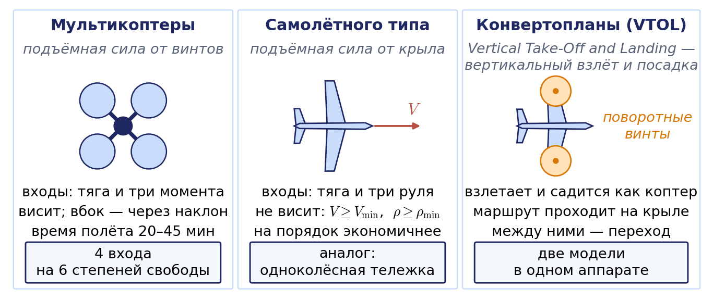

**Мультироторные аппараты**, или мультикоптеры, создают подъёмную силу несколькими винтами с вертикальными осями. Винты имеют фиксированный шаг, и единственное, чем управляет бортовой контроллер, — это частоты вращения моторов. По числу винтов различают трикоптеры, квадрокоптеры, гексакоптеры и октокоптеры. Мультикоптер умеет висеть на месте, взлетать и садиться вертикально и двигаться в любом направлении, не разворачивая корпус. Плата за это — энергетика: вся подъёмная сила создаётся винтами, поэтому время полёта электрического мультикоптера обычно составляет 20–45 минут, что в разы меньше, чем у аппарата самолётного типа той же массы.

**Аппараты самолётного типа** создают подъёмную силу крылом за счёт набегающего потока. Они на порядок экономичнее, но не могут лететь медленнее некоторой минимальной скорости, не могут висеть и разворачиваются только по дуге конечного радиуса. Органы управления — тяга двигателя и отклоняемые поверхности: элероны (управление креном), руль высоты (тангаж) и руль направления (рыскание).

**Конвертопланы** и другие аппараты вертикального взлёта и посадки (по-английски VTOL, Vertical Take-Off and Landing) совмещают оба принципа: взлетают и садятся как мультикоптер, а маршрут проходят на крыле. С точки зрения кинематики это аппарат с двумя разными моделями и переходным режимом между ними.

### Степени свободы и входы управления

Положение свободного твёрдого тела задаётся шестью числами. У квадрокоптера четыре мотора, то есть четыре независимых управляющих входа. Как мы увидим в разделе 7.5, эти четыре входа удобно пересчитать в суммарную тягу $`T`$ и три момента $`\tau_x,\tau_y,\tau_z`$ относительно связанных осей. Система, у которой независимых входов меньше, чем степеней свободы, называется **недоприводной**. Недоприводность — центральное свойство мультикоптера, и мы подробно обсудим его в разделе 7.6. У самолёта входов тоже четыре (тяга и три руля), и он тоже недоприводен, но его ограничения жёстче: вектор скорости почти совпадает с продольной осью, а модуль скорости ограничен снизу.

Сравним это с роботами из предыдущих лекций. У шестизвенного манипулятора шесть приводов на шесть степеней свободы схвата — вне вырожденных конфигураций он может двигать схват в любом направлении. У дифференциальной тележки два привода на три координаты $`(x,y,\theta)`$, и недостающая степень свободы «закрыта» неголономной связью. У квадрокоптера четыре входа на шесть координат, и недостающие две степени свободы закрыты связью другого рода — не на скорость, а на ускорение.

## 7.2. Системы координат и углы ориентации

### Инерциальная и связанная системы

Нам понадобятся две системы координат (рис. 7.2, слева). **Инерциальная система** $`Oxyz`$ связана с землёй: начало — в точке старта, ось $`z`$ направлена вертикально вверх, оси $`x`$ и $`y`$ горизонтальны. Вращением Земли на масштабах полёта малого аппарата пренебрегают, поэтому земную систему считают инерциальной. **Связанная система** $`Cx_by_bz_b`$ жёстко скреплена с корпусом: начало — в центре масс $`C`$, ось $`x_b`$ направлена вперёд, ось $`y_b`$ — влево, ось $`z_b`$ — вверх; у мультикоптера вдоль $`z_b`$ направлена тяга винтов. Это то же соглашение «вперёд — влево — вверх», которым мы пользовались для тележки в лекции 6.

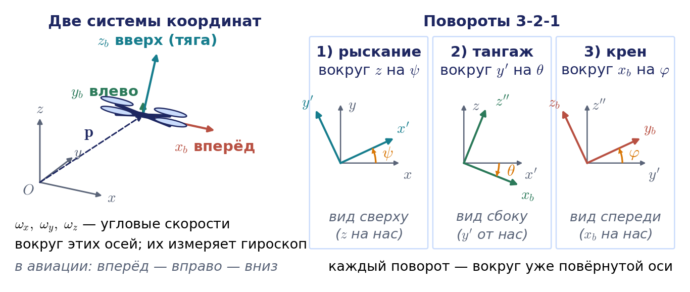

Положение аппарата задаётся вектором $`\mathbf{p}=(x,y,z)^{\mathrm T}`$ центра масс в инерциальной системе и матрицей поворота $`R`$, столбцы которой — орты связанной системы, записанные в инерциальной. Как и в лекции 1, матрица $`R`$ пересчитывает координаты вектора из связанной системы в инерциальную: $`\mathbf{a}=R\,\mathbf{a}^b`$. Верхним индексом $`b`$ будем помечать векторы, заданные проекциями на связанные оси.

### Два соглашения об осях: ROS и автопилот

Соглашение лекции совпадает с принятым в системе ROS (документ REP 103): связанные оси «вперёд — влево — вверх», по-английски FLU (Forward — Left — Up), и земная система «восток — север — вверх», ENU (East — North — Up), если направить ось $`x`$ на восток, а ось $`y`$ на север. В авиации исторически принято другое соглашение: земная система «север — восток — вниз», NED (North — East — Down), и связанная система «вперёд — вправо — вниз», FRD (Forward — Right — Down). Им пользуются учебник Бирда и Маклейна и полётные контроллеры, в том числе PX4. Все четыре системы правые.

Переход между связанными осями — поворот на $`180^{\circ}`$ вокруг продольной оси: вторая и третья координаты меняют знак. Переход между земными системами устроен иначе: оси $`x`$ и $`y`$ меняются местами, а вертикаль меняет знак. Курс в NED отсчитывается от севера по часовой стрелке, а в ENU — от востока против часовой стрелки, поэтому курсы связаны соотношением $`\psi_{\mathrm{NED}}=90^{\circ}-\psi_{\mathrm{ENU}}`$:

```math
\mathbf{p}_{\mathrm{NED}}=\begin{pmatrix}0&1&0\\ 1&0&0\\ 0&0&-1\end{pmatrix}\mathbf{p}_{\mathrm{ENU}},\qquad
\mathbf{a}^{\mathrm{FRD}}=\begin{pmatrix}1&0&0\\ 0&-1&0\\ 0&0&-1\end{pmatrix}\mathbf{a}^{\mathrm{FLU}},\qquad
\psi_{\mathrm{NED}}=\frac{\pi}{2}-\psi_{\mathrm{ENU}}.
```

Определитель первой матрицы равен $`+1`$, это поворот, а не отражение. Крен при таком пересчёте сохраняется, тангаж меняет знак. Вид формул следующих разделов от выбора соглашения не зависит: он определяется только порядком поворотов. Меняется физический смысл знаков, и это главная причина ошибок при стыковке программ.

#### Пример 7.1. Уставка из ROS 2 для автопилота

Программа планирования на бортовом компьютере работает в осях ROS и выдаёт уставку: точка $`(2;\ 1;\ 3)`$ м в системе ENU, курс $`+30^{\circ}`$, то есть нос повёрнут на $`30^{\circ}`$ от востока к северу. Автопилот ждёт уставку в NED. По формулам выше получаем точку $`(1;\ 2;\ -3)`$ м: один метр на север, два на восток и высота 3 м, записанная как $`z=-3`$ м. Курс равен $`90^{\circ}-30^{\circ}=60^{\circ}`$ от севера по часовой стрелке; это то же направление, повёрнутое на $`30^{\circ}`$ от востока к северу. Если пересчёт забыть, аппарат полетит в точку, зеркальную относительно диагонали «север — восток», попытается уйти под землю на 3 м и повернётся носом не туда на $`30^{\circ}`$. Где этот пересчёт выполняется в реальной системе, сказано в разделе 7.9.

### Углы рыскания, тангажа и крена

Ориентацию корпуса задают тремя углами, которые получаются в результате трёх последовательных поворотов (рис. 7.2, справа). Исходно связанная система совпадает с инерциальной.

1. Поворот вокруг оси $`z`$ на **угол рыскания** $`\psi`$. Оси $`x,y`$ переходят в $`x',y'`$. Это курс аппарата: направление, куда смотрит нос, в проекции на горизонтальную плоскость.
2. Поворот вокруг новой оси $`y'`$ на **угол тангажа** $`\theta`$. Продольная ось наклоняется относительно горизонта.
3. Поворот вокруг новой продольной оси $`x_b`$ на **угол крена** $`\varphi`$. Корпус накреняется вокруг направления «вперёд».

Каждый следующий поворот выполняется вокруг текущей, уже повёрнутой оси, поэтому по правилу из лекции 1 матрицы перемножаются слева направо:

```math
R=R_z(\psi)\,R_y(\theta)\,R_x(\varphi).
```

Эту последовательность называют 3-2-1 по номерам осей или «рыскание — тангаж — крен». Та же матрица получается, если выполнить повороты в обратном порядке — крен, тангаж, рыскание — вокруг неподвижных осей. Перемножив элементарные матрицы, получим

```math
R=\begin{pmatrix}
c_\psi c_\theta & c_\psi s_\theta s_\varphi-s_\psi c_\varphi & c_\psi s_\theta c_\varphi+s_\psi s_\varphi\\
s_\psi c_\theta & s_\psi s_\theta s_\varphi+c_\psi c_\varphi & s_\psi s_\theta c_\varphi-c_\psi s_\varphi\\
-s_\theta & c_\theta s_\varphi & c_\theta c_\varphi
\end{pmatrix},
```

где $`c_\psi=\cos\psi`$, $`s_\theta=\sin\theta`$ и так далее. Обратная задача — найти углы по матрице — решается методом, знакомым по лекции 2:

```math
\theta=-\arcsin r_{31},\qquad \psi=\mathrm{atan2}(r_{21},\,r_{11}),\qquad \varphi=\mathrm{atan2}(r_{32},\,r_{33}).
```

Формулы теряют смысл при $`c_\theta=0`$: в этом случае $`r_{11}=r_{21}=r_{32}=r_{33}=0`$, и оба арктангенса не определены. Запомним это место, мы вернёмся к нему в разделе 7.3.

### Знаки в двух соглашениях

Все знаковые различия соглашений удобно собрать в одном месте; к трём последним строкам мы придём в разделах 7.6 и 7.7. В нашей системе ось $`y_b`$ направлена влево, и положительный поворот вокруг неё по правилу правого винта опускает нос. Положительный крен опускает правый борт. Положительное рыскание — поворот влево, против часовой стрелки при взгляде сверху, как и угол курса тележки в лекции 6.

| Что | Наши оси (z вверх, FLU) | Авиационные оси (NED, FRD) |
|---|---|---|
| положительный тангаж | нос вниз | нос вверх |
| положительное рыскание | влево, против часовой стрелки сверху | вправо, по часовой стрелке сверху |
| положительный крен | правый борт вниз | правый борт вниз |
| разгон наклоном при $`\psi=0`$ | $`\ddot x=g\theta`$, $`\ddot y=-g\varphi`$ | $`\ddot x=-g\theta`$, $`\ddot y=g\varphi`$ |
| координированный разворот | $`\dot\psi=-(g/V)\mathrm{tg}\,\varphi`$ | $`\dot\psi=(g/V)\mathrm{tg}\,\varphi`$ |

#### Пример 7.2. Пересчёт скорости из связанной системы в инерциальную

Квадрокоптер имеет ориентацию $`\psi=30^{\circ}`$, $`\theta=10^{\circ}`$, $`\varphi=-20^{\circ}`$. Бортовой датчик измерил скорость в связанных осях: $`\mathbf{v}^b=(5;\ 0;\ -1)^{\mathrm T}`$ м/с, то есть аппарат движется вперёд вдоль своей продольной оси и немного «проседает» вдоль оси тяги. Найдём скорость в инерциальной системе.

Подставляя углы в матрицу $`R`$, получаем

```math
R=\begin{pmatrix}0{,}853&-0{,}521&-0{,}030\\ 0{,}492&0{,}784&0{,}378\\ -0{,}174&-0{,}337&0{,}925\end{pmatrix},\qquad
\dot{\mathbf{p}}=R\,\mathbf{v}^b=\begin{pmatrix}4{,}29\\ 2{,}08\\ -1{,}79\end{pmatrix}.
```

Модуль скорости при повороте сохраняется: $`\sqrt{5^2+1^2}=5{,}10`$ м/с в обеих системах. Вертикальная скорость равна $`-1{,}79`$ м/с: аппарат снижается заметно быстрее, чем на 1 м/с, потому что нос опущен на $`10^{\circ}`$ и продольная составляющая скорости тоже даёт вклад в снижение: $`-5\sin10^{\circ}=-0{,}87`$ м/с.

### Обозначения в литературе

В литературе по летающим роботам встречается по меньшей мере пять систем обозначений: лекции, учебника Бирда и Маклейна, ГОСТ 20058-80, ROS и автопилота PX4. Полная таблица соответствия вынесена в приложение 7.А; здесь отметим три места, где чаще всего ошибаются. Первое: в ГОСТ 20058-80 тангаж обозначается буквой $`\vartheta`$, а крен — буквой $`\gamma`$; буква $`\theta`$ там занята углом наклона траектории, то есть углом между вектором скорости и горизонтом, который мы, как Бирд и Маклейн, обозначаем $`\gamma_a`$. Второе: в главе Пауэрс, Меллингера и Кумара порядок поворотов другой — рыскание, крен, тангаж (последовательность $`Z`$–$`X`$–$`Y`$), поэтому их матрица поворота и матрица связи угловых скоростей отличаются от наших, хотя при малых углах формулы совпадают. Третье: буквы $`p,q,r`$ для компонент угловой скорости мы не используем, потому что $`q`$ в нашем курсе занята обобщёнными координатами.

## 7.3. Кинематические уравнения свободного твёрдого тела

### Поступательная часть

Скорость центра масс удобно измерять и задавать в связанных осях: именно в них работают бортовые датчики, и именно относительно корпуса определены аэродинамические силы. Обозначим $`\mathbf{v}^b=(v_x,v_y,v_z)^{\mathrm T}`$ проекции скорости центра масс на связанные оси. Тогда

```math
\dot{\mathbf{p}}=R(\psi,\theta,\varphi)\,\mathbf{v}^b.
```

Это первое кинематическое уравнение. Оно ничем не отличается от уравнения тележки из лекции 6, где скорость корпуса $`(v_x,v_y)`$ пересчитывалась в неподвижную систему матрицей $`R_z(\theta)`$; просто теперь поворот трёхмерный.

### Вращательная часть: матрица в связанных осях

В лекции 3 из ортогональности матрицы поворота мы получили соотношение $`\dot R=\Lambda(\boldsymbol{\omega})R`$, где $`\boldsymbol{\omega}`$ — вектор угловой скорости, заданный в неподвижной системе. Бортовой гироскоп измеряет угловую скорость в связанных осях, $`\boldsymbol{\omega}^b=R^{\mathrm T}\boldsymbol{\omega}`$. Воспользуемся свойством матрицы $`\Lambda`$ из лекции 3: $`\Lambda(R\mathbf{a})=R\Lambda(\mathbf{a})R^{\mathrm T}`$. Подставляя $`\boldsymbol{\omega}=R\boldsymbol{\omega}^b`$, получаем

```math
\dot R=\Lambda(R\boldsymbol{\omega}^b)\,R=R\,\Lambda(\boldsymbol{\omega}^b)\,R^{\mathrm T}R=R\,\Lambda(\boldsymbol{\omega}^b).
```

Итак, если угловая скорость задана в неподвижной системе, кососимметрическая матрица стоит слева от $`R`$, а если в связанной — справа. Уравнение $`\dot R=R\Lambda(\boldsymbol{\omega}^b)`$ — это второе кинематическое уравнение в самой общей форме: оно линейно по $`R`$, не содержит тригонометрии и не имеет особенностей. Его недостаток — избыточность: девять чисел вместо трёх и шесть условий ортогональности, которые при численном интегрировании постепенно нарушаются.

Оба уравнения складываются в одно уравнение для однородной матрицы $`T`$, составленной из $`R`$ и $`\mathbf{p}`$. Действительно, $`\dot{\mathbf{p}}=R\mathbf{v}^b`$ и $`\dot R=R\Lambda(\boldsymbol{\omega}^b)`$ означают

```math
\dot T=\begin{pmatrix}\dot R&\dot{\mathbf{p}}\\ 0&0\end{pmatrix}=T\,[\boldsymbol{\mathcal V}^b],\qquad
[\boldsymbol{\mathcal V}^b]=\begin{pmatrix}\Lambda(\boldsymbol{\omega}^b)&\mathbf{v}^b\\ 0&0\end{pmatrix},\qquad
\boldsymbol{\mathcal V}^b=\begin{pmatrix}\boldsymbol{\omega}^b\\ \mathbf{v}^b\end{pmatrix}.
```

Это запись кинематики свободного тела на языке книги Линча и Парка: скорость тела $`\boldsymbol{\mathcal V}^b`$ в связанных осях умножает позу $`T`$ справа. Все уравнения ниже — это то же уравнение, записанное в разных параметрах.

### Вращательная часть: матрица W

Получим теперь уравнения для самих углов. Вектор угловой скорости — это сумма трёх угловых скоростей, соответствующих трём элементарным поворотам; угловые скорости, в отличие от конечных поворотов, складываются как векторы. Скорость $`\dot\varphi`$ направлена вдоль оси $`x_b`$, которая уже является связанной. Скорость $`\dot\theta`$ направлена вдоль оси $`y'`$, и чтобы записать её в связанных осях, нужно выполнить оставшийся поворот по крену. Скорость $`\dot\psi`$ направлена вдоль оси $`z`$, и её нужно пропустить через повороты по тангажу и по крену:

```math
\boldsymbol{\omega}^b=\dot\varphi\begin{pmatrix}1\\0\\0\end{pmatrix}+R_x^{\mathrm T}(\varphi)\,\dot\theta\begin{pmatrix}0\\1\\0\end{pmatrix}+R_x^{\mathrm T}(\varphi)R_y^{\mathrm T}(\theta)\,\dot\psi\begin{pmatrix}0\\0\\1\end{pmatrix}.
```

Выполнив умножения, получаем линейную связь

```math
\begin{pmatrix}\omega_x\\ \omega_y\\ \omega_z\end{pmatrix}=
\begin{pmatrix}1&0&-s_\theta\\ 0&c_\varphi&s_\varphi c_\theta\\ 0&-s_\varphi&c_\varphi c_\theta\end{pmatrix}
\begin{pmatrix}\dot\varphi\\ \dot\theta\\ \dot\psi\end{pmatrix}.
```

Определитель этой матрицы равен $`c_\theta`$. При $`c_\theta\ne0`$ её можно обратить, и мы приходим ко второму кинематическому уравнению в углах:

```math
\dot{\boldsymbol{\Theta}}=W(\varphi,\theta)\,\boldsymbol{\omega}^b,\qquad
\boldsymbol{\Theta}=\begin{pmatrix}\varphi\\ \theta\\ \psi\end{pmatrix},\qquad
W(\varphi,\theta)=\begin{pmatrix}1&s_\varphi\mathrm{tg}\,\theta&c_\varphi\mathrm{tg}\,\theta\\ 0&c_\varphi&-s_\varphi\\ 0&s_\varphi/c_\theta&c_\varphi/c_\theta\end{pmatrix}.
```

Обратите внимание на структуру матрицы. Она не зависит от рыскания $`\psi`$: первый поворот выполняется вокруг неподвижной вертикали, и от того, куда смотрит нос, связь скоростей не меняется. При малых углах крена и тангажа $`W\approx E`$, и тогда производные углов просто равны показаниям гироскопа. Именно поэтому в режиме висения многие упрощённые модели отождествляют $`\dot\varphi,\dot\theta,\dot\psi`$ с $`\omega_x,\omega_y,\omega_z`$.

### Связь с аналитическим якобианом

В лекции 3 скорость схвата описывалась геометрически, вектором $`\boldsymbol{\mathcal V}=(\boldsymbol{\omega};\mathbf{v})=J\dot{\mathbf{q}}`$, где угловая скорость $`\boldsymbol{\omega}=J_\omega\dot{\mathbf{q}}`$ задана в базовой системе. Если вместо $`\boldsymbol{\omega}`$ использовать производные выбранных углов ориентации, получается аналитический якобиан $`J_A`$, и угловой блок у него другой. Для углов 3-2-1 и угловой скорости в базовой системе пересчёт следует из $`\boldsymbol{\omega}^b=R^{\mathrm T}\boldsymbol{\omega}`$:

```math
\dot{\boldsymbol{\Theta}}=W(\varphi,\theta)\,\boldsymbol{\omega}^b=W(\varphi,\theta)\,R^{\mathrm T}\boldsymbol{\omega},
```

то есть угловой блок аналитического якобиана руки, ориентация схвата которой описана углами 3-2-1, равен $`W(\varphi,\theta)R^{\mathrm T}J_\omega`$. Для угловой скорости в связанных осях пересчётом служит сама $`W(\varphi,\theta)`$, для угловой скорости в неподвижной системе — произведение $`W(\varphi,\theta)R^{\mathrm T}`$. В лекции 3 той же буквой $`W(\boldsymbol{\Theta})`$ обозначена матрица скоростей углов ZYZ, которая действует на угловую скорость в базовой системе: $`\dot{\boldsymbol{\Theta}}=W(\boldsymbol{\Theta})\boldsymbol{\omega}`$. Здесь же $`W(\varphi,\theta)`$ действует на $`\boldsymbol{\omega}^b`$, поэтому в формуле $`J_A=\mathrm{diag}(W,E)\,J`$ лекции 3 её место занимает произведение $`W(\varphi,\theta)R^{\mathrm T}`$. Матрица скоростей углов всегда пишется с аргументом, и этим она отличается от числа степеней подвижности $`W`$ лекции 5.

Шесть кинематических уравнений свободного тела записываются единым блоком в порядке курса, угловая часть первой:

```math
\begin{pmatrix}\dot{\boldsymbol{\Theta}}\\ \dot{\mathbf{p}}\end{pmatrix}=
\begin{pmatrix}W(\varphi,\theta)&0\\ 0&R(\boldsymbol{\Theta})\end{pmatrix}
\begin{pmatrix}\boldsymbol{\omega}^b\\ \mathbf{v}^b\end{pmatrix}.
```

Слева стоят производные параметров положения $`(\boldsymbol{\Theta};\mathbf{p})`$, справа — настоящий вектор скорости тела $`\boldsymbol{\mathcal V}^b`$, между ними — матрица, зависящая от конфигурации. Это точный аналог перехода от геометрического якобиана к аналитическому, только роль скоростей приводов играет сама скорость тела. Для руки, ориентация схвата которой описана углами 3-2-1, этот переход записывается как $`J_A=\mathrm{diag}\,\bigl(W(\varphi,\theta)R^{\mathrm T},E\bigr)\,J`$; в обозначениях лекции 3, где матрица скоростей углов действует на угловую скорость в базовой системе, — как $`J_A=\mathrm{diag}\,\bigl(W(\boldsymbol{\Theta}),E\bigr)\,J`$. Учтите, что программные библиотеки часто ставят линейную часть первой: сообщение `geometry_msgs/Twist` в ROS содержит сначала поле `linear`, потом `angular`, а `kinlib` и Robotics Toolbox возвращают якобиан в порядке $`[\mathbf{v};\boldsymbol{\omega}]`$ (таблица соглашений в лекции 3).

### Особенность при тангаже 90 градусов

При $`\theta=\pm90^{\circ}`$ определитель прямой матрицы обращается в нуль, а элементы $`W`$ — в бесконечность. Геометрически это означает, что после поворота по тангажу на $`90^{\circ}`$ продольная ось $`x_b`$ становится вертикальной и совпадает с осью первого поворота $`z`$. Повороты по рысканию и по крену происходят вокруг одной и той же прямой и становятся неразличимыми: определена только комбинация $`\psi-\varphi`$ (или $`\psi+\varphi`$ при $`\theta=-90^{\circ}`$). В карданном подвесе это явление называют складыванием рамок; в литературе на английском языке — gimbal lock.

Сравним с вырожденной конфигурацией манипулятора из лекции 3. Там при совпадении осей двух сочленений (например, кистевая особенность PUMA при $`s_5=0`$) матрица Якоби теряла ранг, а вблизи особой точки конечная скорость схвата требовала неограниченных скоростей сочленений. Здесь происходит то же самое: конечная угловая скорость $`\boldsymbol{\omega}^b`$ требует неограниченных $`\dot\varphi`$ и $`\dot\psi`$ (рис. 7.3). Разница в том, что у манипулятора особенность физическая — механизм действительно теряет подвижность, — а у летающего тела она чисто координатная. Аппарат проходит через вертикальное положение носа совершенно спокойно; ломается лишь наше описание. Значит, от особенности можно избавиться сменой параметризации.

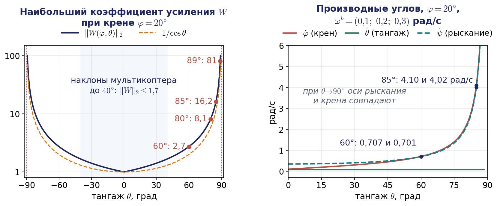

#### Пример 7.3. Насколько опасна окрестность особенности

Пусть гироскоп показывает $`\boldsymbol{\omega}^b=(0{,}1;\ 0{,}2;\ 0{,}3)^{\mathrm T}`$ рад/с, а крен равен $`20^{\circ}`$. При тангаже $`60^{\circ}`$ матрица $`W`$ даёт $`\dot{\boldsymbol{\Theta}}=(0{,}707;\ 0{,}085;\ 0{,}701)^{\mathrm T}`$ рад/с: производные крена и рыскания уже в два-семь раз больше соответствующих компонент угловой скорости. Спектральная норма матрицы $`W`$, то есть наибольший коэффициент усиления, равна 2,7 при тангаже $`60^{\circ}`$, 8,1 при $`80^{\circ}`$, 16,2 при $`85^{\circ}`$ и 81 при $`89^{\circ}`$; при $`85^{\circ}`$ те же показания гироскопа дают $`\dot\varphi=4{,}10`$ и $`\dot\psi=4{,}02`$ рад/с. Во столько же раз усиливается и любая погрешность гироскопа. Для мультикоптера, который летает с наклонами до $`30`$–$`40^{\circ}`$, углы 3-2-1 вполне пригодны: норма $`W`$ при этом не превышает 1,7. Для аппарата, выполняющего перевороты, и для конвертоплана с вертикальным стартом «на хвосте» нужна другая параметризация.

Рис. 7.4 показывает особенность в движении. Корпус в карданном подвесе равномерно поворачивается по тангажу, и с ним ничего особенного не происходит. Зато производные крена и рыскания, вычисленные через матрицу $`W`$, при подходе к $`90^{\circ}`$ растут в шестнадцать раз быстрее, чем модуль угловой скорости, а сами углы крена и рыскания перескакивают на $`180^{\circ}`$. Кватернион того же движения меняется гладко.


Анимация целиком: [l07_gimbal_lock_euler_rates.mp4](../06_Анимации/l07_gimbal_lock_euler_rates.mp4), 60 с. Около 31 с — стоп-кадр в особой точке: поворот внешнего и внутреннего колец на один угол не меняет корпус; с 48 с — сравнение «механизм против описания» (кисть PUMA при $`\sin q_5=0`$ и квадрокоптер при $`\theta=90^{\circ}`$).

## 7.4. Кватернионы и интегрирование ориентации на борту

### Кватернион ориентации

По теореме Эйлера любую ориентацию можно получить одним поворотом на угол $`\alpha`$ вокруг некоторой оси с единичным вектором $`\mathbf{k}`$ (лекция 1). Из этих данных составляют четвёрку чисел

```math
\mathbf{e}=\begin{pmatrix}e_0\\ e_1\\ e_2\\ e_3\end{pmatrix}=\begin{pmatrix}\cos(\alpha/2)\\ \mathbf{k}\sin(\alpha/2)\end{pmatrix},\qquad e_0^2+e_1^2+e_2^2+e_3^2=1,
```

которую называют **единичным кватернионом** или параметрами Родрига — Гамильтона. В литературе кватернион обычно обозначают буквой $`\mathbf{q}`$, и кинематическое уравнение записывают как $`\dot{\mathbf{q}}=\frac12\mathbf{q}\otimes\boldsymbol{\omega}`$; у нас эта буква занята обобщёнными координатами, поэтому мы, следуя Бирду и Маклейну, пишем $`\mathbf{e}`$. Знак $`\otimes`$ обозначает кватернионное умножение, а вектор $`\boldsymbol{\omega}^b`$ дополняется нулевой скалярной частью. В развёрнутой матричной форме

```math
\dot{\mathbf{e}}=\frac12\begin{pmatrix}0&-\omega_x&-\omega_y&-\omega_z\\ \omega_x&0&\omega_z&-\omega_y\\ \omega_y&-\omega_z&0&\omega_x\\ \omega_z&\omega_y&-\omega_x&0\end{pmatrix}\mathbf{e}.
```

Это уравнение линейно по $`\mathbf{e}`$, не содержит тригонометрических функций и не имеет особенностей ни при какой ориентации. Матрица в правой части кососимметрична, и это не случайно: кососимметричность гарантирует, что норма $`\mathbf{e}`$ при точном решении сохраняется — так же, как кососимметричность $`\Lambda`$ гарантировала ортогональность $`R`$. Четыре параметра с одним условием связи — минимальная цена за отсутствие особенностей: доказано, что никакая тройка параметров не может описать все ориентации без особых точек. Матрица поворота выражается через кватернион без синусов и косинусов:

```math
R=\begin{pmatrix}1-2(e_2^2+e_3^2)&2(e_1e_2-e_0e_3)&2(e_1e_3+e_0e_2)\\ 2(e_1e_2+e_0e_3)&1-2(e_1^2+e_3^2)&2(e_2e_3-e_0e_1)\\ 2(e_1e_3-e_0e_2)&2(e_2e_3+e_0e_1)&1-2(e_1^2+e_2^2)\end{pmatrix}.
```

### Двойное покрытие и соглашения о записи

Формула для $`R`$ квадратична по компонентам $`\mathbf{e}`$, поэтому кватернионы $`\mathbf{e}`$ и $`-\mathbf{e}`$ задают одну и ту же ориентацию. Геометрически это очевидно: поворот на угол $`\alpha`$ вокруг оси $`\mathbf{k}`$ — то же самое, что поворот на $`360^{\circ}-\alpha`$ вокруг оси $`-\mathbf{k}`$. Каждой ориентации соответствуют ровно два единичных кватерниона, и это свойство называют двойным покрытием.

Для управления двойное покрытие важно. Если регулятор вычисляет ошибку ориентации в виде кватерниона и не следит за знаком, он может выбрать «длинный» поворот на $`360^{\circ}-\alpha`$ вместо короткого на $`\alpha`$ и раскрутить аппарат почти на полный оборот. Поэтому ошибку берут со знаком, при котором скалярная часть неотрицательна, $`e_0\ge0`$; это соответствует кратчайшему повороту.

#### Пример 7.4. Кватернион поворота по курсу

Поворот на $`90^{\circ}`$ вокруг вертикали $`\mathbf{k}=(0;0;1)`$ даёт $`\mathbf{e}=(\cos45^{\circ};\ 0;\ 0;\ \sin45^{\circ})=(0{,}707;\ 0;\ 0;\ 0{,}707)`$. Подставив эти числа в формулу для $`R`$, получаем $`r_{11}=1-2e_3^2=0`$, $`r_{21}=2e_0e_3=1`$, $`r_{12}=-1`$, $`r_{33}=1`$, то есть $`R=R_z(90^{\circ})`$. Кватернион $`(-0{,}707;\ 0;\ 0;\ -0{,}707)`$ даёт ту же матрицу, но описывает поворот на $`270^{\circ}`$ вокруг оси, направленной вниз.

Порядок компонент — ещё одно соглашение, которое нужно проверять так же тщательно, как оси. У нас, у Бирда и Маклейна, в модуле `aerial.py` и в автопилоте PX4 скалярная часть стоит первой, $`(w,x,y,z)`$. Сообщение `geometry_msgs/Quaternion` в ROS и функция `scipy.spatial.transform.Rotation.as_quat` используют порядок $`(x,y,z,w)`$. Кроме того, существуют два соглашения о знаке кватернионного произведения — Гамильтона, которым пользуемся мы, и принятое в лаборатории реактивного движения NASA (JPL); их различия подробно разобраны в обзоре Сола.

Практическое правило таково: внутри полётного контроллера ориентация хранится и интегрируется в виде кватерниона (или матрицы поворота), а углы рыскания, тангажа и крена вычисляются из него только для вывода оператору и для простых регуляторов режима висения.

### Способы интегрирования

Бортовой вычислитель получает от гироскопа отсчёты $`\boldsymbol{\omega}^b`$ с шагом $`\Delta t`$ и должен вести счисление ориентации. Сравним три способа, применяя во всех трёх простейший метод Эйлера первого порядка, а затем четвёртый, точный на шаге.

1. Углы: $`\boldsymbol{\Theta}_{k+1}=\boldsymbol{\Theta}_k+\Delta t\,W(\boldsymbol{\Theta}_k)\,\boldsymbol{\omega}^b_k`$.
2. Матрица поворота: $`R_{k+1}=R_k\big(E+\Delta t\,\Lambda(\boldsymbol{\omega}^b_k)\big)`$ с последующей ортогонализацией, например заменой матрицы на ближайшую ортогональную.
3. Кватернион: $`\mathbf{e}_{k+1}=\mathbf{e}_k+\frac{\Delta t}2\,\mathbf{e}_k\otimes\boldsymbol{\omega}^b_k`$ с последующей нормировкой $`\mathbf{e}\leftarrow\mathbf{e}/\lVert\mathbf{e}\rVert`$.

Метод Эйлера заменяет вращение на шаге его линейной частью и поэтому портит ортогональность. Но если угловая скорость на шаге постоянна, уравнение $`\dot R=R\Lambda(\boldsymbol{\omega}^b)`$ решается точно: за время $`\Delta t`$ тело поворачивается на угол $`\lVert\boldsymbol{\omega}^b\rVert\Delta t`$ вокруг оси $`\mathbf{k}=\boldsymbol{\omega}^b/\lVert\boldsymbol{\omega}^b\rVert`$. Отсюда четвёртый способ — **экспоненциальное обновление**:

```math
R_{k+1}=R_k\exp\bigl(\Delta t\,\Lambda(\boldsymbol{\omega}^b_k)\bigr),\qquad
\exp\bigl(\alpha\Lambda(\mathbf{k})\bigr)=E+\sin\alpha\,\Lambda(\mathbf{k})+(1-\cos\alpha)\,\Lambda^2(\mathbf{k}),\qquad \alpha=\lVert\boldsymbol{\omega}^b_k\rVert\Delta t.
```

Вторая формула — это формула Родрига из лекции 1. Её кватернионный аналог — умножение на кватернион поворота за шаг:

```math
\mathbf{e}_{k+1}=\mathbf{e}_k\otimes\begin{pmatrix}\cos(\alpha/2)\\ \mathbf{k}\sin(\alpha/2)\end{pmatrix}.
```

Произведение ортогональных матриц ортогонально, а произведение единичных кватернионов — единичный кватернион, поэтому ни ортогонализация, ни нормировка здесь не нужны: условия связи сохраняются точно, с погрешностью округления. Обратная операция — **логарифм** матрицы поворота — возвращает вектор поворота $`\alpha\mathbf{k}=\log(R)^{\vee}`$, где $`\alpha=\arccos\bigl((\mathrm{tr}\,R-1)/2\bigr)`$, а знак $`{}^{\vee}`$ означает переход от кососимметрической матрицы к вектору. Через логарифм определяют ошибку ориентации без особенностей: угол и ось поворота, переводящего текущую ориентацию в заданную. Она понадобится нам в разделах 7.6 и 7.8.

На рис. 7.5 показан результат для манёвра «кувырок» — вращения на месте с непрерывным опусканием носа: угловая скорость $`\boldsymbol{\omega}^b(t)=(0{,}2\sin1{,}3t;\ 0{,}8;\ 0{,}1\cos t)^{\mathrm T}`$ рад/с, шаг $`\Delta t=0{,}01`$ с, длительность 20 с. Корпус непрерывно вращается по тангажу, и угол $`\lvert\theta\rvert`$ пять раз превышает $`70^{\circ}`$; к особенности близко подходит только последний пик: $`89{,}7^{\circ}`$ при $`t=18`$ с. Эталонное решение получено экспоненциальным обновлением с шагом в двадцать раз меньше.

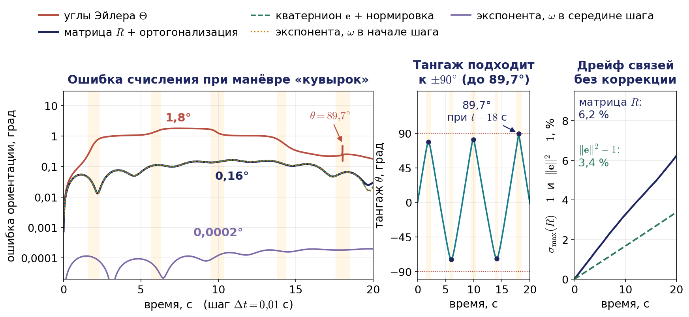

Матрица поворота с ортогонализацией и кватернион с нормировкой дают практически одинаковую ошибку — не более $`0{,}16^{\circ}`$ за всё время. Ошибка углов Эйлера на порядок больше, до $`1{,}8^{\circ}`$, и меняется ступеньками (не только вверх, но и вниз) именно при проходах вблизи $`\pm90^{\circ}`$, где матрица $`W`$ усиливает погрешность метода. Без ортогонализации и нормировки ограничения дрейфуют: за 20 секунд матрица растягивает векторы на 6 %, а квадрат нормы кватерниона $`\lVert\mathbf{e}\rVert^2`$ растёт вдвое медленнее, на 3 %. Ровно настолько растягивает векторы поворот $`\mathbf{v}\mapsto\mathbf{e}\otimes\mathbf{v}\otimes\bar{\mathbf{e}}`$, где вектор $`\mathbf{v}`$ записан как кватернион $`(0;\mathbf{v})`$, а $`\bar{\mathbf{e}}`$ — сопряжённый кватернион. Если же подставить ненормированный кватернион в приведённую выше формулу для $`R`$, растяжение составит около 7 %: эта формула верна только при $`\lVert\mathbf{e}\rVert=1`$. Кватернион исправляется одним делением на норму.

Тот же опыт в движении показан на рис. 7.6: пять корпусов получают один и тот же сигнал гироскопа, и на каждом видно, как именно портится его ориентация. Ошибка углов Эйлера меняется скачками у пиков тангажа, причём часть скачков её уменьшает: ошибка не копится монотонно, а меняется там, где вырождается $`W`$; при последнем пике, $`\theta=89{,}7^{\circ}`$, интегратор за один шаг $`\Delta t`$ меняет углы крена и рыскания на десятки градусов, хотя их разность почти не меняется. Матрица без ортогонализации раздувает корпус: её столбцы растягиваются неравномерно, и вернуть её к повороту можно лишь ортогонализацией, например через сингулярное разложение, тогда как кватерниону хватает одного деления на норму.


Анимация целиком: [l07_attitude_integration_race.mp4](../06_Анимации/l07_attitude_integration_race.mp4), 65 с. Ошибки на корпусах увеличены в 20 раз, растяжение матрицы — в 4 раза; у пика $`\theta=89{,}7^{\circ}`$ (около 18 с времени модели) показ замедлен в 7 раз. В конце ролика добавлены кривые экспоненциального обновления: $`0{,}16^{\circ}`$ при угловой скорости в начале шага и $`0{,}0002^{\circ}`$ — в середине шага.

Экспоненциальное обновление при той же угловой скорости в начале шага даёт ту же ошибку $`0{,}16^{\circ}`$, хотя ортогональность сохраняет точно. Значит, здесь ошибка вызвана уже не методом, а тем, что угловая скорость считается постоянной на шаге и берётся в его начале. Если взять угловую скорость в середине шага, ошибка падает до $`0{,}0002^{\circ}`$. Поэтому многие инерциальные блоки выдают не мгновенную угловую скорость, а приращение угла за такт. Остаётся одна тонкость: если ось вращения на шаге меняется, повороты не коммутируют, и сумма малых поворотов отличается от результирующего. В бесплатформенных инерциальных системах для этого вводят специальную поправку на так называемое коническое движение.

## 7.5. Квадрокоптер: от моторов к тяге и моментам

### Модель винта

Каждый винт создаёт силу тяги вдоль своей оси и реактивный момент вокруг неё. В первом приближении обе величины пропорциональны квадрату частоты вращения $`\varpi_i`$:

```math
f_i=k_F\,\varpi_i^2,\qquad Q_i=k_M\,\varpi_i^2=\kappa f_i,\qquad \kappa=\frac{k_M}{k_F}.
```

Коэффициенты $`k_F`$ и $`k_M`$ определяют на стенде. Отношение $`\kappa`$ имеет размерность длины и показывает, какой реактивный момент сопровождает единицу тяги. Реактивный момент приложен к корпусу и направлен против вращения винта: мотор раскручивает винт в одну сторону, а корпус стремится повернуться в другую. Мотор отрабатывает заданную частоту не мгновенно; в главе Пауэрс, Меллингера и Кумара это описано звеном первого порядка с постоянной времени порядка 0,05 с для аппарата массой полкилограмма. В кинематической модели мы этой задержкой пренебрегаем и считаем тяги $`f_i`$ непосредственными входами.

Для числовых примеров возьмём параметры исследовательского квадрокоптера Hummingbird из той же главы: масса $`m=0{,}5`$ кг, расстояние от центра масс до оси мотора $`L=0{,}175`$ м, $`k_F=6{,}11\cdot10^{-8}`$ Н/(об/мин)$`^2`$, $`k_M=1{,}5\cdot10^{-9}`$ Н·м/(об/мин)$`^2`$. Отсюда $`\kappa=0{,}0245`$ м. В режиме висения каждый винт несёт четверть веса: $`f_h=mg/4=1{,}23`$ Н, что соответствует $`\varpi_h=\sqrt{f_h/k_F}\approx4480`$ об/мин. Наибольшую тягу одного винта примем равной удвоенной тяге висения, $`f_{\max}=2{,}45`$ Н; тот же запас — висение на половине максимальной тяги — закладывается при проектировании и в статье Гревцова с соавторами.

### Схемы «+» и «X»

Четыре винта расположены на концах лучей длины $`L`$. В схеме «+» один из лучей направлен вперёд, в схеме «X» продольная ось проходит посередине между двумя передними лучами (рис. 7.7). В обеих схемах соседние винты вращаются в противоположные стороны, а винты, стоящие на одной диагонали, — в одну сторону. Благодаря этому в режиме висения реактивные моменты взаимно уничтожаются, и корпус не вращается по рысканию.

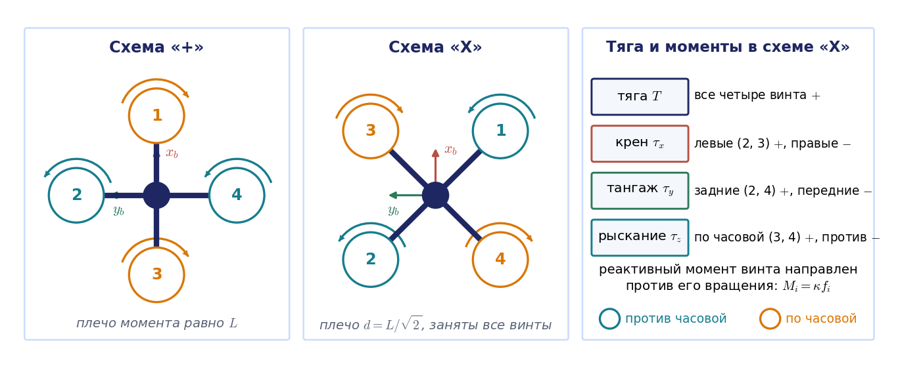

Управление устроено так. Чтобы увеличить суммарную тягу, прибавляют обороты всем четырём винтам. Чтобы создать момент по крену, прибавляют тягу винтам одного борта и на столько же убавляют тягу винтам другого; суммарная тяга при этом не меняется. Момент по тангажу создаётся разностью тяг задних и передних винтов. Момент по рысканию — самый «хитрый»: прибавляют обороты паре винтов, вращающихся в одну сторону, и убавляют другой паре. Тяги при этом перераспределяются по диагоналям, моменты крена и тангажа не возникают, а суммарный реактивный момент становится ненулевым.

### Матрица смешивания

Запишем сказанное формулами. Пусть $`i`$-й винт находится в точке $`\mathbf{r}_i=(x_i,y_i,0)`$ связанной системы, создаёт тягу $`f_i`$ вдоль $`z_b`$ и вращается в направлении $`\varepsilon_i`$: $`\varepsilon_i=+1`$ для вращения против часовой стрелки при взгляде сверху и $`\varepsilon_i=-1`$ для вращения по часовой стрелке. Момент силы тяги относительно центра масс равен $`\mathbf{r}_i\times f_i\mathbf{z}_b=(y_if_i,\ -x_if_i,\ 0)^{\mathrm T}`$, а реактивный момент равен $`-\varepsilon_iQ_i=-\varepsilon_i\kappa f_i`$ вдоль $`z_b`$. Суммируя по всем винтам, получаем

```math
T=\sum_i f_i,\qquad \tau_x=\sum_i y_if_i,\qquad \tau_y=-\sum_i x_if_i,\qquad \tau_z=-\kappa\sum_i\varepsilon_if_i.
```

Для схемы «+» с нумерацией рис. 7.7 (первый винт спереди, второй слева, третий сзади, четвёртый справа; первый и третий вращаются по часовой стрелке) отсюда следует

```math
\begin{pmatrix}T\\ \tau_x\\ \tau_y\\ \tau_z\end{pmatrix}=
\begin{pmatrix}1&1&1&1\\ 0&L&0&-L\\ -L&0&L&0\\ \kappa&-\kappa&\kappa&-\kappa\end{pmatrix}
\begin{pmatrix}f_1\\ f_2\\ f_3\\ f_4\end{pmatrix}.
```

Это в точности матрица из главы Пауэрс, Меллингера и Кумара. Для схемы «X» примем нумерацию, которая используется в полётных контроллерах, в частности в конфигурации Quadrotor X автопилота PX4: первый винт спереди справа, второй сзади слева, третий спереди слева, четвёртый сзади справа; первый и второй вращаются против часовой стрелки, третий и четвёртый — по часовой. Координаты винтов равны $`(\pm d,\pm d)`$, где $`d=L/\sqrt2`$ — плечо. Тогда

```math
\mathbf{u}=M\,\mathbf{f},\qquad
\mathbf{u}=\begin{pmatrix}T\\ \tau_x\\ \tau_y\\ \tau_z\end{pmatrix},\qquad
M=\begin{pmatrix}1&1&1&1\\ -d&d&d&-d\\ -d&d&-d&d\\ -\kappa&-\kappa&\kappa&\kappa\end{pmatrix}.
```

Матрицу $`M`$ называют **матрицей смешивания** (в англоязычной литературе — mixer matrix или control allocation matrix, в документации PX4 — матрица эффективности). Она определяется геометрией — координатами винтов и направлениями их вращения — и переводит силы приводов, тяги винтов, в обобщённую силу на корпусе: тягу и три момента. Поэтому её аналог в теории манипуляторов — не сам якобиан, а транспонированный якобиан из соотношения статики $`\boldsymbol{\tau}=J^{\mathrm T}\mathbf{F}`$. Это видно и напрямую. Если корпус движется со скоростью $`v_z`$ вдоль оси тяги и вращается с угловой скоростью $`\boldsymbol{\omega}^b`$, точка крепления $`i`$-го винта движется вдоль оси винта со скоростью $`v_z+\omega_xy_i-\omega_yx_i`$. Коэффициенты этой формулы — первые три элемента $`i`$-го столбца матрицы $`M`$. Значит, первые три строки $`M^{\mathrm T}`$ образуют якобиан, переводящий скорость корпуса в скорости винтов вдоль их осей, а сама $`M`$ отображает силы обратно, как $`J^{\mathrm T}`$. Четвёртая строка не геометрическая: она описывает реактивные моменты.

Регуляторы вырабатывают требуемые тягу и моменты, а моторам нужны индивидуальные команды. Поэтому на борту решается обратная задача — **распределение управления**: $`\mathbf{f}=M^{-1}\mathbf{u}`$ (рис. 7.8). Для схемы «X» обращение выполняется в уме, потому что строки матрицы $`M`$ взаимно ортогональны: $`MM^{\mathrm T}=D=\mathrm{diag}(4,\ 4d^2,\ 4d^2,\ 4\kappa^2)`$, откуда $`M^{-1}=M^{\mathrm T}D^{-1}`$, то есть

```math
M^{-1}=\frac14\begin{pmatrix}1&-1/d&-1/d&-1/\kappa\\ 1&1/d&1/d&-1/\kappa\\ 1&1/d&-1/d&1/\kappa\\ 1&-1/d&1/d&1/\kappa\end{pmatrix}.
```

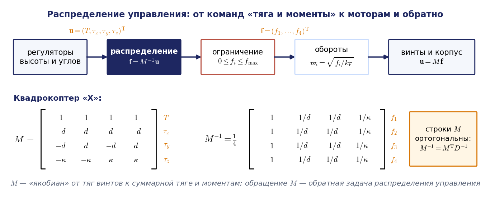

Каждая строка читается естественно: тяга первого винта складывается из четверти суммарной тяги и поправок на каждый из трёх моментов со знаками, соответствующими положению и направлению вращения этого винта.

#### Пример 7.5. Распределение команд по моторам

Пусть аппарат Hummingbird в схеме «X» должен висеть и одновременно создать момент крена $`\tau_x=0{,}05`$ Н·м и момент рыскания $`\tau_z=0{,}01`$ Н·м. Плечо $`d=0{,}175/\sqrt2=0{,}124`$ м. Команда $`\mathbf{u}=(4{,}905;\ 0{,}05;\ 0;\ 0{,}01)^{\mathrm T}`$. Поправка на крен равна $`\tau_x/(4d)=0{,}101`$ Н, поправка на рыскание $`\tau_z/(4\kappa)=0{,}102`$ Н. Получаем

```math
\mathbf{f}=\begin{pmatrix}1{,}226-0{,}101-0{,}102\\ 1{,}226+0{,}101-0{,}102\\ 1{,}226+0{,}101+0{,}102\\ 1{,}226-0{,}101+0{,}102\end{pmatrix}=\begin{pmatrix}1{,}02\\ 1{,}23\\ 1{,}43\\ 1{,}23\end{pmatrix}.
```

Тяги выражены в ньютонах. Сумма тяг по-прежнему равна весу. Заметим, что момент рыскания в пять раз меньше момента крена, а поправки к тягам получились одинаковыми. Канал рыскания у мультикоптера слабый: плечо $`\kappa=2{,}5`$ см в пять раз меньше плеча $`d=12{,}4`$ см.

### Насыщение и приоритеты

Тяги ограничены: $`0\le f_i\le f_{\max}`$. Найдём наибольшие моменты, которые аппарат способен создать в режиме висения, не меняя суммарной тяги. По крену винты одного борта можно разгрузить до нуля, а другого — догрузить до $`2f_h=f_{\max}`$; это даёт $`\tau_x^{\max}=4d f_h=0{,}61`$ Н·м. По рысканию тот же приём даёт лишь $`\tau_z^{\max}=4\kappa f_h=0{,}12`$ Н·м. В общем случае при $`T=mg`$ и $`\tau_y=0`$ условие $`0\le f_i\le2f_h`$ для всех четырёх строк $`M^{-1}`$ сводится к одному неравенству

```math
\frac{\lvert\tau_x\rvert}{4df_h}+\frac{\lvert\tau_z\rvert}{4\kappa f_h}\le1,
```

то есть достижимые пары моментов заполняют ромб с полуосями 0,61 и 0,12 Н·м (рис. 7.9). Здесь уместна аналогия с лекцией 3. Там ограничения на скорости сочленений отображались якобианом в многогранник допустимых скоростей схвата. Здесь ограничения на тяги отображаются матрицей $`M`$ в многогранник достижимых команд $`(T,\tau_x,\tau_y,\tau_z)`$, и задача распределения разрешима, только пока команда лежит внутри него.

#### Пример 7.6. Что делать с недостижимой командой

Пусть регулятор запросил $`\tau_x=0{,}05`$ Н·м и $`\tau_z=0{,}15`$ Н·м, то есть $`\mathbf{u}=(4{,}905;\ 0{,}05;\ 0;\ 0{,}15)^{\mathrm T}`$. Точка лежит вне ромба. Формальное решение $`\mathbf{f}=M^{-1}\mathbf{u}=(-0{,}40;\ -0{,}20;\ 2{,}85;\ 2{,}65)`$ Н содержит отрицательные тяги, которые винт фиксированного шага создать не может, и тяги выше $`f_{\max}`$. Сравним три способа выйти из положения.

1. Покомпонентное обрезание по пределам даёт $`\mathbf{f}=(0;\ 0;\ 2{,}45;\ 2{,}45)`$ Н и $`M\mathbf{f}=(4{,}905;\ 0;\ 0;\ 0{,}12)`$. Момент крена пропал полностью, а рыскание осталось на пределе: обрезание сохранило наименее важный канал и уничтожило самый важный. Тяга здесь уцелела лишь из-за симметрии; при запросе $`(4{,}905;\ 0{,}3;\ 0{,}2;\ 0{,}1)`$ обрезание даёт $`(5{,}707;\ 0{,}201;\ 0{,}101;\ 0{,}080)`$, то есть лишние 16 % тяги и искажение всех моментов.
2. Масштабирование моментной части при сохранённой тяге: все три момента умножаются на одно число, наибольшее, при котором команда ещё достижима. Здесь это 0,753, и реализуются $`\tau_x=0{,}038`$ и $`\tau_z=0{,}113`$ Н·м. Направление вектора моментов сохранено, но крен ослаблен на четверть. Пропорционально уменьшить весь вектор $`\mathbf{u}`$, вместе с тягой, нельзя вовсе: знаки тяг $`M^{-1}\mathbf{u}`$ от множителя не зависят, и отрицательная тяга останется при любом множителе, кроме нуля.
3. Приоритетное распределение: крен и тангаж сохраняются точно, а рыскание урезается до грани ромба. При $`\tau_x=0{,}05`$ Н·м предел рыскания равен $`4\kappa f_h\bigl(1-\tau_x/(4df_h)\bigr)=0{,}1204\,(1-0{,}05/0{,}607)=0{,}1105`$ Н·м, и тяги $`\mathbf{f}=(0;\ 0{,}20;\ 2{,}45;\ 2{,}25)`$ Н лежат в пределах.

Так устроены полётные контроллеры: распределение дополняют правилом приоритетов «сначала крен и тангаж, затем тяга, в последнюю очередь рыскание». Курс подождёт, а потеря крена у земли означает аварию. Задачу распределения с ограничениями в общем виде ставят как задачу оптимизации — найти тяги в пределах, при которых реализованная команда ближе всего к запрошенной с весами каналов; классическая постановка принадлежит Дарему (1993).

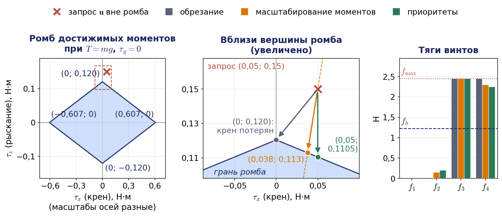

Все этапы этого раздела — распределение команды по моторам, насыщение и отказ мотора — собраны в анимации на рис. 7.10. Масштабирование моментов в ней не показано; его результат виден только на рис. 7.9.


Анимация целиком: [l07_mixer_allocation_polytope.mp4](../06_Анимации/l07_mixer_allocation_polytope.mp4), 88 с. Первые 30 с — пример 7.5 и узоры каналов, затем насыщение (пример 7.6: обрезание, приоритеты и запрос, при котором обрезание искажает все каналы), с 60 с — гексакоптер и отказ мотора.

### Гексакоптеры, октокоптеры и отказ мотора

У аппарата с $`n`$ винтами матрица смешивания имеет размер $`4\times n`$ и строится по тем же формулам. При $`n`$, большем четырёх, система $`\mathbf{u}=M\mathbf{f}`$ недоопределена, и распределение выполняют псевдообратной матрицей $`\mathbf{f}=M^{+}\mathbf{u}`$, $`M^{+}=M^{\mathrm T}(MM^{\mathrm T})^{-1}`$, которая даёт решение с наименьшей суммой квадратов тяг. Это прямой аналог избыточного манипулятора из лекции 3: у гексакоптера есть двумерное ядро матрицы $`M`$ — такие перераспределения тяг, которые не меняют ни суммарной тяги, ни моментов, подобно самодвижению избыточной руки при неподвижном схвате.

Избыточность нужна прежде всего для отказоустойчивости, но ранговый подсчёт здесь обманчив, потому что тяги неотрицательны. Если у квадрокоптера отказывает мотор 1, из $`M`$ вычёркивается столбец, остаётся матрица $`4\times3`$ ранга 3, и независимо управлять четырьмя величинами нельзя. Хуже того, из уравнений крена и тангажа следует $`f_2=(\tau_x+\tau_y)/(2d)`$. При висении без моментов $`f_2=0`$: выключить приходится и мотор напротив отказавшего, а два оставшихся несут по $`mg/2=2{,}45`$ Н, то есть ровно предел. Команда висения лежит на границе многогранника достижимых команд, и моменты с $`\tau_x+\tau_y<0`$ создать уже нельзя. Аппарат спасают в динамике: он отказывается от рыскания и непрерывно вращается под нескомпенсированным реактивным моментом около 0,12 Н·м, а управляют только направлением оси тяги и её величиной (Мюллер, Д'Андреа, 2014).

У гексакоптера после отказа одного мотора остаётся матрица $`4\times5`$ ранга 4, и формально все четыре канала управляемы. Однако при чередующихся направлениях вращения винтов ситуация та же, что у квадрокоптера: мотор напротив отказавшего обязан иметь нулевую тягу при любой мощности моторов, команда висения лежит на границе многогранника, и примерно половину направлений корректирующего момента создать нельзя. Отказоустойчивость дают другие раскладки направлений вращения. Разбор с числами вынесен в приложение 7.В. Общий вывод: отказоустойчивость проверяют не по рангу, а по тому, лежит ли команда висения строго внутри, с запасом, многогранника достижимых команд; это задача линейного программирования.

## 7.6. Недоприводность: от наклона к ускорению

### Уравнения движения

Выпишем уравнения движения квадрокоптера. На аппарат действуют сила тяжести и суммарная тяга, направленная вдоль оси $`z_b`$. Второй закон Ньютона в инерциальной системе:

```math
m\ddot{\mathbf{p}}=-mg\,\mathbf{z}_0+T\,R\,\mathbf{z}_0,\qquad \mathbf{z}_0=(0,0,1)^{\mathrm T}.
```

Вращение описывается уравнением Эйлера в связанных осях, где тензор инерции $`I`$ постоянен:

```math
I\dot{\boldsymbol{\omega}}^b=\boldsymbol{\tau}-\boldsymbol{\omega}^b\times I\boldsymbol{\omega}^b,\qquad \boldsymbol{\tau}=(\tau_x,\tau_y,\tau_z)^{\mathrm T}.
```

Вместе с кинематическими уравнениями $`\dot{\mathbf{p}}=R\mathbf{v}^b`$ и $`\dot R=R\Lambda(\boldsymbol{\omega}^b)`$ это полная модель из главы Пауэрс, Меллингера и Кумара (в ней не учтены сопротивление воздуха и гироскопические моменты винтов, которые для малых скоростей несущественны).

Посмотрим на первое уравнение внимательно. Вектор $`R\mathbf{z}_0`$ — это третий столбец матрицы поворота, то есть орт $`\mathbf{z}_b`$ в инерциальной системе. Значит, ускорение центра масс за вычетом ускорения свободного падения всегда направлено вдоль оси тяги:

```math
\mathbf{a}_T=\ddot{\mathbf{p}}+g\,\mathbf{z}_0=\frac Tm\,\mathbf{z}_b.
```

Вектор $`\mathbf{a}_T`$ назовём вектором тяги на единицу массы. Это и есть связь, делающая аппарат недоприводным. Моторы не могут создать силу в плоскости винтов. Чтобы получить горизонтальное ускорение, нужно повернуть сам вектор тяги, то есть наклонить корпус (рис. 7.11).


### Линеаризация у режима висения

Рассмотрим простейший случай: курс $`\psi=0`$, крена нет, корпус наклонён по тангажу на угол $`\theta`$ (рис. 7.11, б). Третий столбец матрицы $`R`$ равен $`(s_\theta,\ 0,\ c_\theta)^{\mathrm T}`$. Если аппарат удерживает высоту, то $`T c_\theta=mg`$, и горизонтальное ускорение равно

```math
\ddot x=\frac Tm\,s_\theta=g\mathrm{tg}\,\theta\approx g\,\theta.
```

Наклон на $`10^{\circ}`$ даёт ускорение $`1{,}73`$ м/с$`^2`$, наклон на $`30^{\circ}`$ — уже $`5{,}7`$ м/с$`^2`$, причём тяга должна вырасти в $`1/\cos30^{\circ}=1{,}15`$ раза. При удвоенном запасе тяги предельный наклон без потери высоты составляет $`60^{\circ}`$.

В общем случае возьмём третий столбец матрицы $`R`$ из раздела 7.2 и положим углы крена и тангажа малыми, а тягу — близкой к весу. Получим линеаризованную модель

```math
\ddot x=g\,(\theta c_\psi+\varphi s_\psi),\qquad \ddot y=g\,(\theta s_\psi-\varphi c_\psi),\qquad \ddot z=\frac Tm-g.
```

Она совпадает с линеаризованной моделью из главы Пауэрс, Меллингера и Кумара, несмотря на разный порядок поворотов: при малых углах порядок не важен. Смысл формул прозрачен: тангаж разгоняет аппарат вдоль направления носа, крен — поперёк, а рыскание поворачивает эту пару направлений в горизонтальной плоскости. Знак минус перед $`\varphi`$ во втором уравнении — следствие нашего выбора осей (врезка «Знаки в двух соглашениях» в разделе 7.2): положительный крен опускает правый борт, и аппарат уходит вправо, то есть в сторону отрицательных $`y`$.

Разрешив первые два уравнения относительно углов, получим формулы, по которым простейший внешний контур управления вычисляет требуемый наклон по командному ускорению $`\ddot{\mathbf{p}}_{\mathrm{cmd}}`$:

```math
\theta^{\ast}=\frac{\ddot x_{\mathrm{cmd}}\,c_\psi+\ddot y_{\mathrm{cmd}}\,s_\psi}{g},\qquad \varphi^{\ast}=\frac{\ddot x_{\mathrm{cmd}}\,s_\psi-\ddot y_{\mathrm{cmd}}\,c_\psi}{g},\qquad T=m(g+\ddot z_{\mathrm{cmd}}).
```

### Сравнение с неголономной тележкой

В лекции 6 дифференциальная тележка подчинялась связи $`v_y=0`$: скорость центра в связанных осях не может иметь составляющей вдоль оси колёс. Связь наложена на скорости и не интегрируется, поэтому тележка может попасть в любую точку плоскости с любым курсом, но только манёвром — сначала повернуться, потом ехать. Квадрокоптер подчиняется связи на ускорения: вектор $`\mathbf{a}_T=\ddot{\mathbf{p}}+g\mathbf{z}_0`$ параллелен $`\mathbf{z}_b`$. Он может попасть в любую точку пространства с любым курсом, но только манёвром — сначала наклониться, потом разгоняться. В обоих случаях недостающее направление движения «покупается» поворотом корпуса. Различие — в порядке связи: у тележки она первого порядка (кинематическая), у квадрокоптера второго (динамическая). Поэтому тележку можно мгновенно остановить, а квадрокоптер — нельзя: чтобы затормозить, ему нужно наклониться назад и подождать.

Как это выглядит в полёте, показывает рис. 7.12. Квадрокоптер с простейшим каскадом из ноутбука занятия (его устройство разобрано ниже, в пункте о каскадной структуре) получает ступенчатое задание: переместиться на 2 м вдоль оси $`x`$. Сначала он наклоняется вперёд и лишь потом разгоняется. Уже при $`x=0{,}65`$ м, когда пройдена только треть пути, а скорость наибольшая и равна 1,32 м/с, тангаж меняет знак: аппарат наклоняется назад и начинает тормозить. На облёте квадрата со стороной 4 м то же запаздывание проявляется иначе: в каждом углу аппарат не успевает сменить направление ускорения и проносит угол наружу, отклоняясь от стороны квадрата до 0,34 м.


Анимация целиком: [l07_tilt_to_accel_step_vs_cart.mp4](../06_Анимации/l07_tilt_to_accel_step_vs_cart.mp4), 61 с. Первые 10 с — связь наклона и ускорения при удержании высоты, $`\ddot x=g\mathrm{tg}\,\theta`$; ключевой кадр — смена знака тангажа, около 22 с; с 45 с — облёт квадрата. Параметры каскада те же, что в ноутбуке: $`K_p=2`$ с$`^{-2}`$, $`K_v=2{,}5`$ с$`^{-1}`$, наклон не больше $`20^{\circ}`$.

Из шести координат квадрокоптера независимо задавать можно четыре: $`x,y,z`$ и курс $`\psi`$. Крен и тангаж не свободны — они определяются требуемым ускорением. Это наблюдение можно превратить в точное утверждение.

### Дифференциальная плоскостность

Линеаризация годится для спокойного полёта. Для агрессивных манёвров используется более сильное свойство — **дифференциальная плоскостность**, понятие, введённое М. Флиссом и соавторами (1995). Система называется дифференциально плоской, если найдутся выходы, через которые всё состояние и все входы выражаются алгебраически, через сами выходы и конечное число их производных, без интегрирования. Меллингер и Кумар (2011) показали, что квадрокоптер — плоская система с плоскими выходами $`\boldsymbol{\sigma}=(x,y,z,\psi)`$, и построили на этом планирование траекторий. Покажем это для ориентации и тяги. Из уравнения Ньютона

```math
\mathbf{a}_T=\begin{pmatrix}\ddot x\\ \ddot y\\ \ddot z+g\end{pmatrix},\qquad T=m\lVert\mathbf{a}_T\rVert,\qquad \mathbf{z}_b=\frac{\mathbf{a}_T}{\lVert\mathbf{a}_T\rVert}.
```

Курс задаёт горизонтальный вектор $`\mathbf{y}_c=(-s_\psi,\ c_\psi,\ 0)^{\mathrm T}`$ — ось $`y'`$ после первого поворота. Поскольку ось $`x_b`$ перпендикулярна и $`\mathbf{y}_c`$, и $`\mathbf{z}_b`$,

```math
\mathbf{x}_b=\frac{\mathbf{y}_c\times\mathbf{z}_b}{\lVert\mathbf{y}_c\times\mathbf{z}_b\rVert},\qquad \mathbf{y}_b=\mathbf{z}_b\times\mathbf{x}_b,\qquad R=(\mathbf{x}_b\ \ \mathbf{y}_b\ \ \mathbf{z}_b).
```

Построение требует $`\mathbf{a}_T\ne0`$ и $`\mathbf{y}_c\times\mathbf{z}_b\ne0`$. Первое условие нарушается в свободном падении, когда направление тяги не определено; второе — когда ось тяги лежит горизонтально поперёк курса, что соответствует крену $`\pm90^{\circ}`$. В обычном полёте мультикоптера оба условия выполняются.

Дифференцируя дальше, находим угловую скорость. Продифференцируем $`m\ddot{\mathbf{p}}+mg\mathbf{z}_0=T\mathbf{z}_b`$ по времени и учтём, что $`\dot{\mathbf{z}}_b=\omega_y\mathbf{x}_b-\omega_x\mathbf{y}_b`$ (это третий столбец уравнения $`\dot R=R\Lambda(\boldsymbol{\omega}^b)`$). Проекция на $`\mathbf{z}_b`$ даёт скорость изменения тяги $`\dot T=m\,\mathbf{z}_b\cdot\dddot{\mathbf{p}}`$, а проекции на $`\mathbf{x}_b`$ и $`\mathbf{y}_b`$ — две компоненты угловой скорости:

```math
\mathbf{h}_\omega=\frac mT\bigl(\dddot{\mathbf{p}}-(\mathbf{z}_b\cdot\dddot{\mathbf{p}})\,\mathbf{z}_b\bigr),\qquad \omega_x=-\mathbf{h}_\omega\cdot\mathbf{y}_b,\qquad \omega_y=\mathbf{h}_\omega\cdot\mathbf{x}_b.
```

Третья компонента следует из производной курса через третью строку прямой матрицы раздела 7.3: $`\omega_z=-s_\varphi\dot\theta+c_\varphi c_\theta\dot\psi`$. Итак, угловая скорость выражается через третью производную положения, **рывок** $`\dddot{\mathbf{p}}`$. Ещё одно дифференцирование даёт угловое ускорение, а с ним по уравнению Эйлера и моменты $`\boldsymbol{\tau}=I\dot{\boldsymbol{\omega}}^b+\boldsymbol{\omega}^b\times I\boldsymbol{\omega}^b`$ — через четвёртую производную, которую называют снэпом. Подробный вывод дан в приложении 7.Б.

Практический вывод: любую достаточно гладкую кривую $`\boldsymbol{\sigma}(t)`$ квадрокоптер может исполнить, если хватает тяги и моментов; если же у траектории разрывен рывок, требуемая угловая скорость скачет и нужны бесконечные моменты, а если разрывен снэп — моменты, а с ними и тяги винтов, должны меняться скачком (это показано в конце анимации на рис. 7.13). Поэтому траектории квадрокоптера планируют с непрерывными производными до четвёртой включительно. Стандартная постановка — **траектория минимального снэпа**: на каждом участке между точками маршрута положение задаётся многочленом седьмой степени, и коэффициенты выбираются из условия

```math
\int_{t_0}^{t_f}\bigl\lVert\mathbf{p}^{(4)}(t)\bigr\rVert^2\,dt\to\min
```

при ограничениях «прохождение точек маршрута и непрерывность производных в узлах». Функционал квадратичен по коэффициентам, а ограничения линейны, поэтому это задача квадратичного программирования (Меллингер, Кумар, 2011; Рихтер, Брай, Рой). Это прямое продолжение лекции 4: там многочлены пятой степени с нулевыми скоростями и ускорениями на концах берегли приводы манипулятора, здесь многочлены седьмой степени нужны, чтобы моменты на корпусе оставались конечными и гладкими.

#### Пример 7.7. Полёт по окружности

Квадрокоптер должен лететь по горизонтальной окружности радиуса $`\rho=2`$ м с периодом 10 с на высоте 1 м, сохраняя курс $`\psi=0`$. Угловая частота движения равна $`0{,}628`$ рад/с, скорость $`1{,}26`$ м/с, центростремительное ускорение $`0{,}628^2\cdot2=0{,}79`$ м/с$`^2`$. Вектор $`\mathbf{a}_T`$ наклонён к вертикали на угол $`\mathrm{arctg}(0{,}79/9{,}81)=4{,}6^{\circ}`$ в сторону центра окружности, а тяга превышает вес всего на 0,3 %. В проекциях на углы 3-2-1: $`\theta^{\ast}=-0{,}080\cos0{,}628t`$, $`\varphi^{\ast}=0{,}080\sin0{,}628t`$ — корпус совершает коническое «покачивание», оставаясь носом в одну сторону. Модуль рывка равен $`\rho\cdot0{,}628^3=0{,}50`$ м/с$`^3`$, и по формулам плоскостности в момент $`t=1`$ с получаем $`\omega_x=0{,}041`$, $`\omega_y=0{,}030`$ и $`\omega_z=-0{,}0014`$ рад/с; численное дифференцирование матрицы $`R(t)`$ даёт те же числа. Если вместо $`\psi=0`$ направить нос по касательной, вектор тяги не изменится, а углы станут другими: крен постоянен и равен $`-4{,}6^{\circ}`$, тангаж нулевой. Знак минус объясняется так: окружность обходится против часовой стрелки, центр её слева от носа, а положительный крен опускает правый борт. Курс — свободный выход: он вращает корпус вокруг оси тяги, не меняя её (рис. 7.13). Сравните эту задачу с ДЗ2, где схват манипулятора тоже проходит окружность: там по траектории вы решали обратную задачу о положении и скорости, а у квадрокоптера обратная задача идёт по цепочке «ускорение → наклон и тяга → моменты → тяги винтов».

Если ту же окружность облетать быстрее, центростремительное ускорение растёт как квадрат частоты, и вместе с ним растут наклон и тяга. При периоде 5 с наклон равен $`17{,}8^{\circ}`$, при 3 с — уже $`41{,}8^{\circ}`$, а при 2,16 с — $`59{,}9^{\circ}`$, и средняя тяга винта, 2,445 Н, почти равна пределу $`f_{\max}=2{,}45`$ Н. При таких наклонах линейные формулы для $`\theta^{\ast}`$ и $`\varphi^{\ast}`$ дают углы, далёкие от точных.

![Рис. 7.13. Анимация: облёт окружности примера 7.7 с курсом ψ = 0 и с носом по касательной. Ось тяги и тяга в обоих случаях одни и те же, а курс лишь вращает корпус вокруг оси тяги, поэтому крен и тангаж получаются разными. При сокращении периода до 2,16 с наклон доходит до 60° и тяга винтов упирается в предел; в конце ролика показано, что скачок ускорения даёт скачок наклона, скачок рывка — скачок угловой скорости и бесконечные моменты, а скачок снэпа — конечный скачок моментов, то есть мгновенную смену тяг винтов](../06_Анимации/l07_flatness_circle_yaw.gif)

Анимация целиком: [l07_flatness_circle_yaw.mp4](../06_Анимации/l07_flatness_circle_yaw.mp4), 64 с. Ключевой кадр «Один вектор тяги — разные углы» — около 26 с; с 29 с — облёт с периодами 10, 5, 3 и 2,16 с; с 48 с — вход на окружность из висения при разной гладкости траектории.

### Каскадная структура управления

Из сказанного вытекает естественная структура системы управления (рис. 7.14). Внешний, медленный контур сравнивает заданное положение с измеренным и вырабатывает командное ускорение по закону пропорционально-дифференциального регулятора:

```math
\ddot{\mathbf{p}}_{\mathrm{cmd}}=\ddot{\mathbf{p}}^{\ast}+K_v(\dot{\mathbf{p}}^{\ast}-\dot{\mathbf{p}})+K_p(\mathbf{p}^{\ast}-\mathbf{p}),
```

где звёздочкой помечена программная траектория, а $`K_p`$ и $`K_v`$ — коэффициенты по положению и скорости. Дальше нужно получить ориентацию, при которой тяга даст это ускорение. Линейные формулы $`\theta^{\ast}`$, $`\varphi^{\ast}`$ из предыдущего пункта годятся лишь при малых наклонах. Точный пересчёт — это то же плоское построение, применённое к командному ускорению вместо программного:

```math
\mathbf{z}_b^{\ast}=\frac{\ddot{\mathbf{p}}_{\mathrm{cmd}}+g\mathbf{z}_0}{\lVert\ddot{\mathbf{p}}_{\mathrm{cmd}}+g\mathbf{z}_0\rVert},\qquad
T=m\,(\ddot{\mathbf{p}}_{\mathrm{cmd}}+g\mathbf{z}_0)\cdot\mathbf{z}_b,
```

а заданная матрица $`R^{\ast}`$ собирается из $`\mathbf{z}_b^{\ast}`$ и заданного курса $`\psi^{\ast}`$ по формулам для $`\mathbf{x}_b`$, $`\mathbf{y}_b`$. Обратите внимание: тягу проецируют на текущую ось $`\mathbf{z}_b`$, а не на заданную. Пока корпус не довернулся, тяга вдоль неправильного направления только навредила бы.

Средний контур отрабатывает ориентацию. Ошибку ориентации разумно считать не разностью углов, а по матрицам; Т. Ли, М. Леок и Н. Макклэмрок (2010) использовали величину, которую мы запишем вместе с законом управления в упрощённом виде, для постоянной заданной ориентации:

```math
\mathbf{e}_R=\frac12\bigl(R^{\ast\mathrm T}R-R^{\mathrm T}R^{\ast}\bigr)^{\vee},\qquad
\boldsymbol{\tau}=-K_R\,\mathbf{e}_R-K_\omega\,\mathbf{e}_\omega+\boldsymbol{\omega}^b\times I\boldsymbol{\omega}^b,
```

где $`\mathbf{e}_\omega`$ — ошибка угловой скорости, а $`K_R`$ и $`K_\omega`$ — коэффициенты. Если заданная ориентация получается из текущей поворотом на угол $`\alpha`$ вокруг оси $`\mathbf{k}`$ связанной системы, $`R^{\ast}=R\exp\bigl(\alpha\Lambda(\mathbf{k})\bigr)`$, то $`\mathbf{e}_R=-\mathbf{k}\sin\alpha`$, и момент $`-K_R\mathbf{e}_R`$ поворачивает корпус к заданной ориентации: при малых ошибках это вектор поворота, но при $`\alpha=170^{\circ}`$ ошибка так же мала, как при $`10^{\circ}`$. Для больших ошибок поэтому берут вектор поворота через логарифм из раздела 7.4 или кватернион ошибки с $`e_0\ge0`$. Устойчивость такого регулятора доказывается без углов Эйлера и без их особенностей. Есть и практическое правило: сначала исправляют наклон оси тяги, а потом курс. Наклон определяет горизонтальное ускорение, а канал рыскания самый слабый (0,12 против 0,61 Н·м), поэтому на него приходится меньший вес.

Полный каскад реального автопилота содержит пять уровней: регулятор положения выдаёт заданную скорость $`\dot{\mathbf{p}}_{\mathrm{cmd}}=\dot{\mathbf{p}}^{\ast}+k_p(\mathbf{p}^{\ast}-\mathbf{p})`$; регулятор скорости выдаёт командное ускорение $`\ddot{\mathbf{p}}_{\mathrm{cmd}}=\ddot{\mathbf{p}}^{\ast}+K_v(\dot{\mathbf{p}}_{\mathrm{cmd}}-\dot{\mathbf{p}})`$ (подставив первое во второе, получим прежний закон с $`K_p=K_v k_p`$, так что два верхних уровня рис. 7.14 и есть пропорционально-дифференциальный регулятор); блок пересчёта превращает его в тягу и заданную ориентацию; регулятор ориентации выдаёт заданную угловую скорость; регулятор угловой скорости по показаниям гироскопа выдаёт моменты; наконец, блок распределения $`M^{-1}`$ с приоритетами превращает тягу и моменты в команды моторам. Внутренние контуры — ориентации и угловой скорости — работают на частотах в сотни герц, внешние — на десятках герц. Схема работает, если каждый внутренний контур в несколько раз быстрее охватывающего его; у малых аппаратов это выполняется с запасом, потому что момент инерции убывает с размером как пятая степень, а масса — как третья. Наклон корпуса играет роль виртуального входа для внешнего контура.

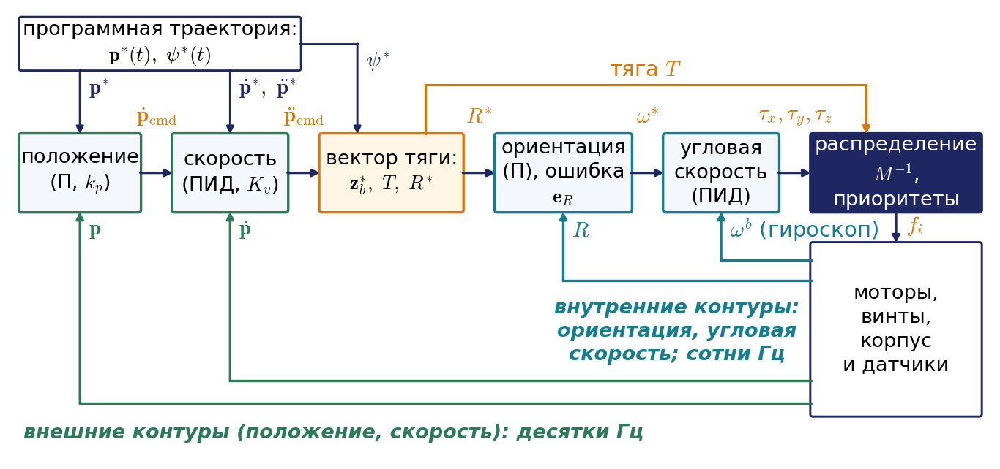

#### Пример 7.8. Линейный и точный пересчёт ускорения в наклон

Пусть внешний контур требует горизонтального ускорения $`5`$ м/с$`^2`$ вдоль оси $`x`$ без изменения высоты, $`\ddot{\mathbf{p}}_{\mathrm{cmd}}=(5;\ 0;\ 0)`$ м/с$`^2`$, при курсе $`\psi=0`$. Точный пересчёт даёт $`\mathbf{a}_T=(5;\ 0;\ 9{,}81)`$, наклон $`\mathrm{arctg}(5/9{,}81)=27{,}0^{\circ}`$ и тягу $`m\lVert\mathbf{a}_T\rVert=5{,}51`$ Н, на 12 % больше веса. Линейные формулы дают $`\theta^{\ast}=5/9{,}81=0{,}510`$ рад, то есть $`29{,}2^{\circ}`$, и тягу $`T=mg=4{,}905`$ Н. При таком наклоне и такой тяге аппарат получит горизонтальное ускорение $`4{,}79`$ м/с$`^2`$ и вертикальное $`-1{,}25`$ м/с$`^2`$: он начнёт проседать, и регулятору высоты придётся догонять. При $`7`$ м/с$`^2`$ расхождение ещё больше: $`35{,}5^{\circ}`$ против $`40{,}9^{\circ}`$ и проседание с ускорением $`2{,}4`$ м/с$`^2`$. Поэтому в реальных автопилотах используют точный пересчёт.

В ноутбуке модель «наклон — ускорение» замкнута простейшим каскадом с коэффициентами $`K_p=2`$ с$`^{-2}`$, $`K_v=2{,}5`$ с$`^{-1}`$, ограничением наклона $`20^{\circ}`$ и инерционным звеном с постоянной времени 0,15 с вместо внутреннего контура; там же собран полный каскад с регуляторами ориентации и угловой скорости, распределением с приоритетами и опытами «сломай и посмотри».

## 7.7. Аппараты самолётного типа

### Воздушная скорость, углы атаки и скольжения

Крыло создаёт силу за счёт движения относительно воздуха, а не относительно земли. Поэтому для самолёта нужно различать три вектора: **путевую скорость** $`\mathbf{V}_g`$ относительно земли, **скорость ветра** $`\mathbf{V}_w`$ и **воздушную скорость** $`\mathbf{V}_a`$ относительно воздушной массы. Они образуют **навигационный треугольник скоростей** (рис. 7.15, в):

```math
\mathbf{V}_g=\mathbf{V}_a+\mathbf{V}_w.
```

Для малого аппарата, летящего со скоростью 15–20 м/с, ветер 5–10 м/с — это не малая поправка, а слагаемое того же порядка.

Ориентацию вектора воздушной скорости относительно корпуса задают двумя углами. **Угол атаки** $`\alpha`$ — угол между продольной осью и проекцией воздушной скорости на плоскость симметрии; от него зависит подъёмная сила. **Угол скольжения** $`\beta`$ показывает, насколько поток набегает сбоку. Формулы для них через проекции воздушной скорости на связанные оси даны в приложении 7.Г; их знаки зависят от соглашения об осях. В нормальном полёте оба угла невелики, и это резко упрощает кинематику: можно считать, что самолёт летит туда, куда смотрит его нос, с поправкой на ветер. Вертикальную скорость определяет **угол наклона траектории** $`\gamma_a`$ — угол между вектором скорости и горизонтом. В безветрие при полёте без крена и скольжения он равен разности угла подъёма носа над горизонтом и угла атаки.

#### Пример 7.9. Угол сноса

Аппарат должен лететь вдоль оси $`x`$ при воздушной скорости $`V_a=20`$ м/с; ветер 6 м/с дует вдоль оси $`y`$. Чтобы путевая скорость была направлена по оси $`x`$, поперечная составляющая воздушной скорости должна компенсировать ветер: $`V_a\sin\psi=-6`$, откуда $`\psi=-17{,}5^{\circ}`$. Нос развёрнут против ветра на $`17{,}5^{\circ}`$, а путевая скорость равна $`V_a\cos\psi=19{,}1`$ м/с. Разность между путевым углом $`\chi`$ (направлением вектора $`\mathbf{V}_g`$) и курсом $`\psi`$ называют углом сноса. Если его не учитывать, аппарат будет сносить с линии пути на 6 метров каждую секунду.

### Координированный разворот

Самолёт не может создать боковую силу так, как колесо создаёт боковую реакцию. Чтобы повернуть, он накреняется: подъёмная сила $`Y`$ наклоняется вместе с крылом, её вертикальная составляющая уравновешивает вес, а горизонтальная искривляет траекторию (рис. 7.15, а). Разворот без скольжения, при котором боковая перегрузка в связанных осях равна нулю, называют **координированным**. Для горизонтального разворота со скоростью $`V`$ по окружности радиуса $`\rho`$ имеем два уравнения:

```math
Y\cos\varphi=mg,\qquad Y\sin\varphi=mV\,\lvert\dot\psi\rvert,
```

где справа во втором уравнении стоит масса, умноженная на центростремительное ускорение $`V^2/\rho=V\lvert\dot\psi\rvert`$. Деля второе уравнение на первое, получаем

```math
\lvert\dot\psi\rvert=\frac gV\mathrm{tg}\,\lvert\varphi\rvert,\qquad \rho=\frac V{\lvert\dot\psi\rvert}=\frac{V^2}{g\mathrm{tg}\,\lvert\varphi\rvert}.
```

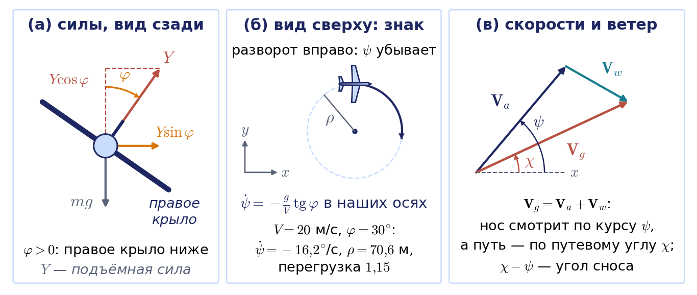

О знаке. Положительный крен опускает правое крыло и ведёт к развороту вправо. В авиационных осях правый разворот — это рост $`\psi`$, и формулу пишут без модулей: $`\dot\psi=\frac gV\mathrm{tg}\,\varphi`$. В наших осях правый разворот — это убывание угла $`\psi`$, поэтому $`\dot\psi=-\frac gV\mathrm{tg}\,\varphi`$; это та же закономерность, что и знак минус в формуле $`\ddot y=-g\varphi`$ для квадрокоптера (врезка в разделе 7.2).

Формула показывает, что скорость разворота самолёта определяется креном, а не рулём направления; руль направления лишь убирает скольжение. При скорости 20 м/с и крене $`30^{\circ}`$ получаем $`\dot\psi=0{,}283`$ рад/с, то есть $`16{,}2^{\circ}`$ в секунду, и радиус $`\rho=70{,}6`$ м. Подъёмная сила при этом должна вырасти в $`1/\cos\varphi=1{,}15`$ раза — эту величину называют перегрузкой. Радиус растёт как квадрат скорости: при 40 м/с и том же крене он равен уже 282 м. Поскольку крен ограничен прочностью и запасом подъёмной силы, у самолёта есть наименьший радиус разворота

```math
\rho_{\min}=\frac{V^2}{g\mathrm{tg}\,\varphi_{\max}}.
```

В автопилоте наибольший крен — настраиваемый параметр, поэтому радиус барражирования нельзя задать меньше $`\rho_{\min}`$ при выбранной скорости.

### Кинематическая модель самолёта

Соберём сказанное в модель, которой пользуются при планировании маршрутов. Считаем, что автопилот удерживает воздушную скорость $`V_a`$ и отрабатывает заданные угол наклона траектории $`\gamma_a`$ и скорость разворота $`\omega_\psi`$:

```math
\dot x=V_a\cos\psi\cos\gamma_a+w_x,\qquad \dot y=V_a\sin\psi\cos\gamma_a+w_y,\qquad \dot z=V_a\sin\gamma_a,\qquad \dot\psi=\omega_\psi,
```

где $`(w_x,w_y)`$ — горизонтальные составляющие ветра, а управление ограничено: $`\lvert\omega_\psi\rvert\le\frac g{V_a}\mathrm{tg}\,\varphi_{\max}`$. В горизонтальном полёте без ветра остаётся

```math
\dot x=V\cos\psi,\qquad \dot y=V\sin\psi,\qquad \dot\psi=\omega_\psi,\qquad \lvert\omega_\psi\rvert\le\frac V{\rho_{\min}}.
```

Это в точности модель одноколёсной тележки (уницикла) из лекции 6 с двумя отличиями: линейная скорость $`V`$ постоянна и не может быть ни нулевой, ни отрицательной, а кривизна траектории ограничена величиной $`1/\rho_{\min}`$. Самолёт — это тележка, которая не умеет останавливаться, ехать назад и разворачиваться на месте. Неголономная связь та же: скорость направлена вдоль продольной оси.

### Пути Дубинса

Для такой модели есть классический результат. Л. Дубинс в 1957 году доказал, что кратчайший путь между двумя позами $`(x,y,\psi)`$ при ограниченной кривизне и движении только вперёд состоит не более чем из трёх участков, каждый из которых — либо дуга окружности наименьшего радиуса, либо отрезок прямой. Обозначая левый разворот буквой L (Left), правый — R (Right), прямую — S (Straight), получаем шесть возможных типов: LSL, RSR, LSR, RSL и два типа из трёх дуг — RLR и LRL. Кратчайший путь находят перебором: для каждого типа длины участков вычисляются по замкнутым формулам, после чего выбирается минимум. Для путей с прямолинейным участком построение сводится к проведению общей касательной к двум окружностям радиуса $`\rho_{\min}`$, касающимся начальной и конечной поз.

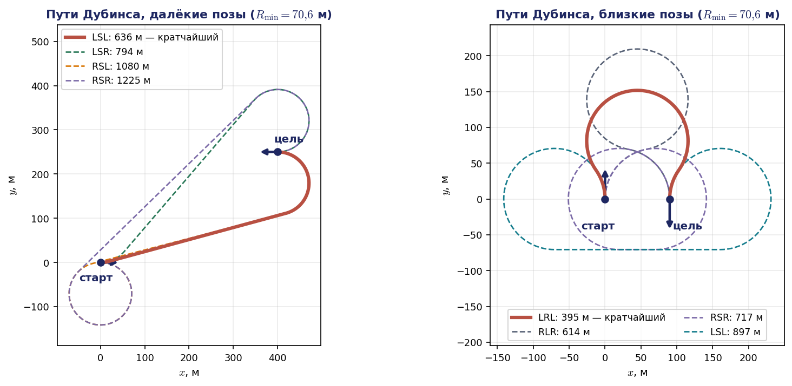

#### Пример 7.10. Два пути Дубинса

Возьмём $`\rho_{\min}=70{,}6`$ м из предыдущего пункта. Первый случай (рис. 7.16, слева): из точки $`(0,0)`$ с курсом $`0^{\circ}`$ нужно прийти в точку $`(400,250)`$ м с курсом $`180^{\circ}`$. Допустимы четыре типа пути; кратчайший — LSL длиной 636 м: небольшой левый доворот на $`15^{\circ}`$, прямая 415 м и левый разворот на $`165^{\circ}`$. Остальные варианты заметно длиннее: LSR — 794 м, RSL — 1080 м, RSR — 1225 м. Расстояние между точками по прямой равно 472 м; разница в 164 м — плата за ограничение кривизны.

Второй случай (рис. 7.16, справа) показывает, что при близких позах выигрывают три дуги. Нужно развернуться и пройти обратным курсом в 90 м сбоку, что меньше диаметра разворота 141 м. Кратчайший путь — LRL длиной 395 м: аппарат сначала отворачивает от цели, затем выполняет длинный правый разворот на $`250^{\circ}`$, а путь RSR длиннее почти вдвое; родственный манёвр мы видели в лекции 6 при параллельной парковке.

Выбор типа пути — дискретный, и при плавном изменении поз он меняется скачком. Это видно, если сближать цель со стартом, сохраняя обратный курс (рис. 7.17). Пока расстояние между позами больше диаметра разворота, кратчайшим остаётся путь RSR с прямым участком, и он укорачивается вместе с расстоянием. Ровно при 141 м прямой участок исчезает, кратчайшим становится LRL, и дальше путь не укорачивается, а растёт: 222 м при расстоянии 141 м, 395 м при 90 м и 506 м при 10 м. Цель, которая лежит почти рядом, оказывается для самолёта одной из самых дальних.


Анимация целиком: [l07_dubins_switching.mp4](../06_Анимации/l07_dubins_switching.mp4), 55 с. В первой части ролика — далёкие позы и полёт по пути LSL, затем близкие позы примера 7.10 (LRL 395 м) и график длины кратчайшего пути от расстояния между позами.

Пути Дубинса реализованы в библиотеках планирования, например в OMPL (пространство состояний `DubinsStateSpace`) и в Robotics Toolbox for Python (класс `DubinsPlanner`, который даёт для этих двух случаев те же 636 и 395 м). При ветре пути Дубинса строят в системе, связанной с воздушной массой, и затем «сносят» вместе с ветром: относительно воздуха аппарат летит по дугам окружностей, а относительно земли — по дугам трохоид.

## 7.8. Сенсоры, оценка ориентации и структура системы управления

### Что нужно измерять

Кинематические уравнения разделов 7.3 и 7.4 — это не только модель для планирования, но и алгоритм, который непрерывно выполняется на борту. Совокупность бортовых датчиков в авиации называют системой первичной информации; для малого аппарата её состав показан на рис. 7.18.

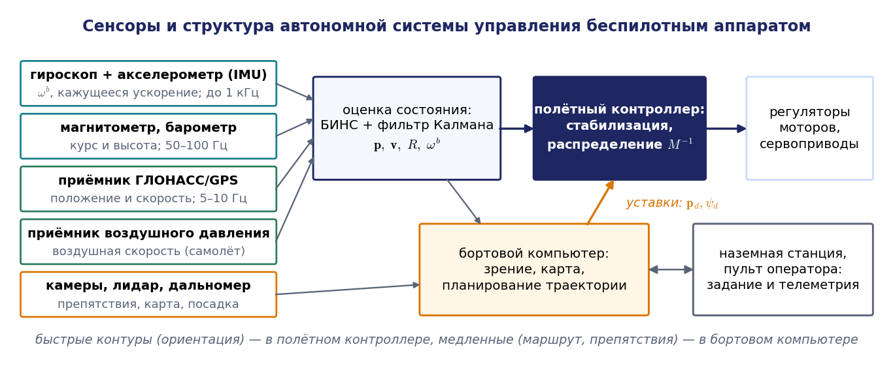

Основа — **инерциальный измерительный блок**, в англоязычной литературе IMU (Inertial Measurement Unit): три гироскопа и три акселерометра, жёстко закреплённые на корпусе. Гироскопы измеряют угловую скорость в связанных осях $`\boldsymbol{\omega}^b`$. Акселерометр измеряет не ускорение, а так называемое кажущееся ускорение, или удельную силу,

```math
\mathbf{a}_{\mathrm m}=R^{\mathrm T}(\ddot{\mathbf{p}}+g\mathbf{z}_0)=R^{\mathrm T}\mathbf{a}_T:
```

на неподвижном аппарате он показывает не нуль, а вектор, направленный вверх и равный по модулю $`g`$. Сравнив это выражение с уравнением Ньютона из раздела 7.6, увидим важный факт: у идеального квадрокоптера $`\mathbf{a}_T=(T/m)\mathbf{z}_b`$, и акселерометр всегда показывает $`(0;\ 0;\ T/m)`$, то есть ничего не знает о наклоне во время манёвра. На окружности примера 7.7 корпус наклонён на $`4{,}6^{\circ}`$, а акселерометр показывает ровно «вверх». Поэтому определять крен и тангаж по акселерометру можно только в среднем, на больших интервалах времени. В реальном полёте добавляется сопротивление винтов, пропорциональное скорости, и акселерометр начинает «видеть» горизонтальную скорость; этот эффект подробно разобран в обзоре Махони, Кумара и Корка.

Система, которая интегрирует показания гироскопов в ориентацию (уравнением для кватерниона), пересчитывает кажущееся ускорение в инерциальные оси, вычитает $`g`$ и дважды интегрирует, называется **бесплатформенной инерциальной навигационной системой**, сокращённо БИНС. Она автономна и работает на частоте до килогерца, но её ошибки растут со временем. Постоянное смещение нуля гироскопа $`b`$ даёт линейно растущую ошибку ориентации $`bt`$; через неверно спроецированную силу тяжести она порождает ошибку ускорения $`gbt`$, квадратично растущую ошибку скорости и кубически растущую ошибку положения $`gbt^3/6`$. Смещение нуля акселерометра даёт квадратичный рост ошибки положения. При $`b=0{,}01`$ рад/с ошибка положения через 10 с составляет уже 16 м. Поэтому инерциальные данные комплексируют с медленными, но не дрейфующими измерениями: магнитометр даёт курс, барометр — высоту, приёмник спутниковой навигации ГЛОНАСС/GPS — положение и путевую скорость с частотой 5–10 Гц. Самолёту дополнительно нужен приёмник воздушного давления: воздушная скорость определяется по разности полного и статического давлений. Для полёта среди препятствий и внутри помещений добавляют камеры и лидары, по которым оценивают собственное движение и строят карту.

### Как оценивают ориентацию

Центральная задача бортовой навигации — оценка ориентации. Модель гироскопа такова: $`\boldsymbol{\omega}_{\mathrm m}=\boldsymbol{\omega}^b+\mathbf{b}+\boldsymbol{\nu}`$, где $`\mathbf{b}`$ — медленно меняющееся смещение нуля, а $`\boldsymbol{\nu}`$ — шум. Чистое интегрирование гироскопа дрейфует, как одометрия тележки в лекции 6. Опорные векторы, напротив, не дрейфуют, но зашумлены и искажаются в манёвре: акселерометр в среднем показывает вертикаль, магнитометр — направление магнитного поля. Идея **комплементарного фильтра** — взять от гироскопа быстрые изменения, а от опорных векторов медленные.

В одномерном варианте для тангажа фильтр записывается одной строкой:

```math
\hat\theta_{k+1}=a\,\bigl(\hat\theta_k+\Delta t\,\omega_{y,k}\bigr)+(1-a)\,\theta_{\mathrm{acc},k},\qquad a\in(0,\,1),
```

где $`\theta_{\mathrm{acc}}`$ — тангаж, вычисленный по проекциям вектора тяжести, измеренного акселерометром. Коэффициент $`a`$ задаёт постоянную времени $`a\Delta t/(1-a)`$, разделяющую «доверие гироскопу» и «доверие акселерометру» (рис. 7.19).

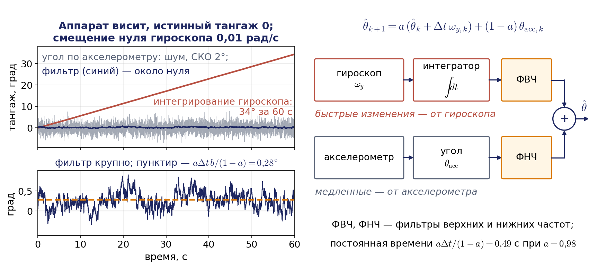

#### Пример 7.11. Смещение нуля гироскопа

Гироскоп имеет смещение нуля $`0{,}01`$ рад/с, аппарат висит неподвижно. Чистое интегрирование за 60 с даёт ошибку тангажа $`0{,}6`$ рад, то есть $`34^{\circ}`$: аппарат «думает», что сильно наклонён, и регулятор наклонит его на столько же в обратную сторону. Комплементарный фильтр с $`\Delta t=0{,}01`$ с и $`a=0{,}98`$ имеет постоянную времени $`0{,}49`$ с. Подставив $`\hat\theta_{k+1}=\hat\theta_k`$ в установившемся режиме при истинном нулевом тангаже, получаем остаточную ошибку $`a\Delta t\,b/(1-a)=0{,}0049`$ рад, то есть $`0{,}28^{\circ}`$, и она не растёт со временем. Чтобы убрать и её, фильтр дополняют интегральной поправкой, которая оценивает само смещение $`b`$.

На матрицах поворота тот же фильтр записывается как уравнение раздела 7.3 с поправкой (Махони, Хамель, Пфлимлин, 2008):

```math
\dot{\hat R}=\hat R\,\Lambda\bigl(\boldsymbol{\omega}_{\mathrm m}-\hat{\mathbf{b}}+k_P\,\boldsymbol{\omega}_{\mathrm{mes}}\bigr),\qquad
\frac{d\hat{\mathbf{b}}}{dt}=-k_I\,\boldsymbol{\omega}_{\mathrm{mes}},\qquad
\boldsymbol{\omega}_{\mathrm{mes}}=\sum_i k_i\,\mathbf{v}_i\times\hat R^{\mathrm T}\mathbf{v}_{0i},
```

где $`\mathbf{v}_i`$ — измеренные в связанных осях опорные векторы (направления тяжести и магнитного поля), $`\mathbf{v}_{0i}`$ — их известные направления в земной системе, а $`k_P`$, $`k_I`$, $`k_i`$ — коэффициенты. Поправка $`\boldsymbol{\omega}_{\mathrm{mes}}`$ — это угловая скорость, поворачивающая оценку так, чтобы предсказанные направления $`\hat R^{\mathrm T}\mathbf{v}_{0i}`$ совпали с измеренными; коэффициент $`k_P`$ измеряется в с$`^{-1}`$ и играет роль величины, обратной постоянной времени одномерного фильтра. Действительно, разностное уравнение одномерного фильтра можно переписать как $`(\hat\theta_{k+1}-\hat\theta_k)/\Delta t=a\,\omega_{y,k}+(1-a)(\theta_{\mathrm{acc},k}-\hat\theta_k)/\Delta t`$. Если поделить правую часть на $`a`$, чтобы гироскоп входил с единичным весом, как в уравнении Махони, при рассогласовании окажется множитель $`(1-a)/(a\Delta t)=1/\tau`$, где $`\tau=a\Delta t/(1-a)`$ — постоянная времени из примера 7.11. Поэтому $`k_P\approx1/\tau`$; при $`a=0{,}98`$ и $`\Delta t=0{,}01`$ с это около 2 с$`^{-1}`$. Углов и их особенностей здесь нет.

Фильтр Калмана, который работает в автопилотах, устроен сложнее, но опирается на ту же модель. Ориентацию в нём хранят кватернионом, а ошибку оценки описывают вектором малого поворота $`\delta\boldsymbol{\varphi}`$ (обозначение лекции 3; это вектор, а не крен $`\varphi`$): истинная ориентация равна $`R=\hat R\exp\bigl(\Lambda(\delta\boldsymbol{\varphi})\bigr)`$. Трёхмерный вектор $`\delta\boldsymbol{\varphi}`$ не имеет ни особенностей, ни лишнего условия нормировки, поэтому его ковариация — обычная матрица $`3\times3`$. Такой подход называют фильтром по вектору ошибки; его подробное изложение — в открытом обзоре Сола. Модель предсказания фильтра — кинематические уравнения разделов 7.3 и 7.4, а в его состояние, кроме ориентации, скорости и положения, входят смещения нулей датчиков.

### Два уровня бортовой системы управления

Аппаратно система управления малого беспилотного аппарата почти всегда двухуровневая. **Полётный контроллер** — микроконтроллер с инерциальным блоком, барометром и магнитометром на одной плате — выполняет оценку ориентации, быстрые контуры стабилизации и распределение управления по моторам. Режимы полёта соответствуют точкам входа в каскад рис. 7.14: в режиме стабилизации угловой скорости оператор задаёт угловые скорости, в режиме стабилизации углов — углы, в режимах удержания высоты и положения работают и внешние контуры. **Контроллер верхнего уровня** — одноплатный компьютер — обрабатывает изображения и данные лидара, строит карту, планирует траекторию и передаёт полётному контроллеру уставки положения, скорости или ориентации. Такое разделение следует из разделения движений по скоростям: вращение быстрое, и его контур должен замыкаться на сотнях герц с гарантированным временем отклика; поступательное движение медленное, и для него допустимы десятки герц и задержки обработки изображений.

## 7.9. Где это в реальной системе

Все конструкции лекции работают в открытых автопилотах почти в том виде, в каком мы их вывели. Ниже — соответствие на примере PX4, одного из самых распространённых открытых автопилотов; сведения сверены с его документацией и исходным кодом, имена параметров и сообщений нужно сверять с используемой версией.

- **Матрица смешивания.** Начиная с версии 1.14 распределение управления в PX4 выполняет модуль `control_allocator`. Геометрия мультиротора задаётся параметрами: число роторов, координаты каждого ротора по продольной и поперечной связанным осям относительно центра масс и коэффициент реактивного момента со знаком (положительный для вращения против часовой стрелки). Это ровно числа $`x_i`$, $`y_i`$ и $`\varepsilon_i\kappa`$ из нашей формулы для $`M`$, только оси FRD. Нумерация стандартной рамы Quadrotor X совпадает с нумерацией раздела 7.5.
- **Насыщение.** Модуль публикует сообщение о состоянии распределителя, в котором есть нераспределённый момент — разность запрошенного и реализованного — и признаки насыщения каждого привода; это ровно ситуация примера 7.6. Регулятор ориентации PX4 имеет весовой коэффициент, понижающий приоритет рыскания по сравнению с креном и тангажем. При насыщении сверху общую тягу уменьшают, чтобы ни один мотор не превысил предела; при насыщении снизу без режима Airmode урезают моменты, а в режиме Airmode, наоборот, приподнимают тягу, чтобы сохранить управляемость по крену и тангажу даже у нуля газа.
- **Каскад.** Цепочка «положение (П-регулятор) → скорость (ПИД-регулятор) → пересчёт ускорения в тягу и ориентацию → ориентация (П-регулятор на кватернионе) → угловая скорость (ПИД-регулятор) → распределение» совпадает с рис. 7.14. При пересчёте ускорения приоритет у вертикальной тяги: горизонтальной заранее резервируется небольшой запас, а сверх него ей достаётся остаток до предела. Регулятор ориентации построен по технической статье Брешианини, Хена и Д'Андреа (ETH Цюрих, 2013). Ручные режимы Acro, Stabilized, Altitude и Position — точки входа в этот каскад на разных уровнях.
- **Навигация.** Оценку состояния в PX4 выполняет фильтр Калмана EKF2, в ArduPilot — EKF3. Модель предсказания — уравнения разделов 7.3–7.4.
- **Связь с ROS 2.** С версии 1.14 PX4 обменивается данными с ROS 2 через промежуточный слой uXRCE-DDS, а сообщения автопилота записаны в осях NED и FRD. Документация прямо требует, чтобы узлы ROS 2 сами выполняли пересчёт осей и кватернионов, и предлагает для этого готовую библиотеку; это пересчёт примера 7.1. Более старый мост MAVROS выполняет такой пересчёт сам. Всё это можно опробовать без аппарата: PX4 запускается в режиме программной симуляции вместе с симулятором Gazebo.
- **Плоскостность.** Регулятор Меллингера — Кумара входит в открытую прошивку исследовательского мини-квадрокоптера Crazyflie, а траектории для групп таких аппаратов в ROS 2 строит пакет Crazyswarm2.

Типичный кейс сборки показывает, зачем знать матрицу $`M`$. Если в конфигурации перепутать знак коэффициента реактивного момента у одного ротора, четвёртая строка $`M`$ станет неверной: регулятор будет считать, что компенсирует рыскание, а на деле усиливать его, и аппарат закрутится сразу после взлёта.

### Что дальше

Во всех современных работах по летающим роботам модель остаётся той же, что в этой лекции: $`\dot{\mathbf{p}}=R\mathbf{v}^b`$, $`\dot R=R\Lambda(\boldsymbol{\omega}^b)`$, «ускорение за вычетом $`g`$ направлено по оси тяги» и мультипликативная ошибка ориентации. Развитие идёт в нескольких направлениях.

| Идея лекции | Как она развита | Пример работы |
|---|---|---|
| $`\dot R=R\Lambda(\boldsymbol{\omega}^b)`$ и ошибка $`\mathbf{e}_R`$ | регуляторы прямо на группе вращений, без углов | Ли, Леок, Макклэмрок, 2010 |
| ранг $`M`$ и отказ мотора | полёт с вращением после потери одного–трёх винтов | Мюллер, Д'Андреа, 2014 |
| матрица $`M`$ с наклонёнными винтами | всенаправленные аппараты, способные создать силу в любом направлении (ранг 6), и воздушная манипуляция | Брешианини, Д'Андреа, 2016 |
| плоскостность, минимальный снэп | траектории, оптимальные по времени; плоскостность с учётом сопротивления винтов | Фён, Ромеро, Скарамуцца, 2021; Фесслер, Франки, Скарамуцца, 2018 |
| счисление ориентации и фильтр | визуально-инерциальная одометрия: камера вместо спутниковой навигации | Цинь, Ли, Шэнь, 2018 (VINS-Mono) |
| каскад «тяга и угловые скорости» | обучение с подкреплением: нейросетевая политика выдаёт тягу и угловые скорости, то есть входы нашего каскада | Кауфманн и др., 2023 |

Последняя строка особенно показательна: гоночный аппарат, обученный с подкреплением и в 2023 году обогнавший чемпионов-людей, выдаёт ровно те величины, которые в нашей схеме подаются на регулятор угловой скорости. Нижние уровни каскада и матрица смешивания остаются прежними.

## 7.10. Связь с демонстрациями

Вычислительные эксперименты к лекции собраны в ноутбуке «Демо_Занятие_07_летающие.ipynb» в папке «03_Примеры_Jupyter». Во всех демонстрациях используются соглашения этой лекции: ось $`z`$ вверх, связанные оси «вперёд — влево — вверх», матрица $`R=R_z(\psi)R_y(\theta)R_x(\varphi)`$, параметры аппарата Hummingbird. Демонстрации пронумерованы в порядке показа на занятии.

| № | Демонстрация | Что видно |
|---|---|---|
| 1 | Матрица поворота по углам 3-2-1, пересчёт скорости и осей ENU/NED | пример 7.2: скорость $`(4{,}29;\ 2{,}08;\ -1{,}79)`$ м/с; пример 7.1: $`(1;\ 2;\ -3)`$ м и курс $`60^{\circ}`$; проверка библиотекой spatialmath |
| 2 | Матрица $`W`$ и её вырождение при тангаже $`90^{\circ}`$ | пример 7.3 и рис. 7.3: норма $`W`$ равна 2,7, 8,1 и 16,2 при тангаже 60, 80 и 85 градусов |
| 3 | Счисление ориентации углами, матрицей, кватернионом и экспонентой | рис. 7.5: пять пиков тангажа, ошибки $`1{,}8^{\circ}`$ и $`0{,}16^{\circ}`$, $`0{,}0002^{\circ}`$ при угловой скорости в середине шага; без коррекции матрица растягивает векторы на 6 %, а квадрат нормы кватерниона растёт на 3 % |
| 4 | Матрица смешивания «X», распределение и насыщение | пример 7.5: тяги $`(1{,}02;\ 1{,}23;\ 1{,}43;\ 1{,}23)`$ Н; пример 7.6 и рис. 7.9: обрезание теряет крен, масштабирование моментов 0,753, приоритеты сохраняют крен при рыскании 0,1105 Н·м |
| 5 | Отказ мотора у квадрокоптера и гексакоптера | ранг 3 и 4; мотор напротив выключен, запас 0 при любой $`f_{\max}`$; раскладка PPNNPN с запасом 0,49–0,61 Н |
| 6 | Интерактивная модель «наклон — ускорение» | ползунки углов: корпус, вектор тяги и горизонтальное ускорение |
| 7 | Дифференциальная плоскостность на окружности | пример 7.7: $`R(t)`$, $`T(t)`$ и угловая скорость через рывок совпадают с численным дифференцированием |
| 8 | Каскадное управление квадрокоптером | облёт квадрата и окружности простым каскадом; полный каскад с регуляторами ориентации и угловой скорости; пример 7.8 и опыты «сломай и посмотри» |
| 9 | Самолёт: координированный разворот и снос ветром | $`\rho=70{,}6`$ м при 20 м/с и $`30^{\circ}`$; пример 7.9: курс $`-17{,}5^{\circ}`$, путевая скорость 19,1 м/с |
| 10 | Пути Дубинса между двумя позами | пример 7.10 и рис. 7.16: LSL 636 м и LRL 395 м, перебор шести типов, сверка с библиотекой |
| 11 | Оценка ориентации | пример 7.11 и рис. 7.19: дрейф гироскопа $`34^{\circ}`$ за минуту, комплементарный фильтр; акселерометр «не видит» наклон на окружности |

**Анимации к лекции.** В папке `06_Анимации` лежат шесть роликов к этой лекции (MP4 для показа на занятии, в конспекте вставлены их фрагменты):

- `l07_gimbal_lock_euler_rates` (рис. 7.4) — корпус вращается равномерно, а производные крена и рыскания вблизи тангажа $`90^{\circ}`$ неограниченно растут; в конце — сравнение с кистевой особенностью PUMA;
- `l07_attitude_integration_race` (рис. 7.6) — гонка способов счисления ориентации на манёвре «кувырок» и дрейф связей без ортогонализации и нормировки;
- `l07_mixer_allocation_polytope` (рис. 7.10) — узоры каналов на тягах винтов, обрезание и приоритеты при насыщении, ядро матрицы смешивания гексакоптера и отказ мотора;
- `l07_tilt_to_accel_step_vs_cart` (рис. 7.12) — квадрокоптер сначала наклоняется, потом разгоняется и тормозит заранее; облёт квадрата простым каскадом;
- `l07_flatness_circle_yaw` (рис. 7.13) — один вектор тяги при разных курсах на окружности примера 7.7, предельный наклон $`60^{\circ}`$ и зачем траектории гладкие до снэпа;
- `l07_dubins_switching` (рис. 7.17) — перебор слов Дубинса и смена кратчайшего типа RSR на LRL при сближении поз.

## Выводы

1. Летающий робот — свободное твёрдое тело с шестью степенями свободы. Его кинематика описывается уравнениями $`\dot{\mathbf{p}}=R\,\mathbf{v}^b`$ и $`\dot R=R\Lambda(\boldsymbol{\omega}^b)`$, которые вместе образуют одно уравнение $`\dot T=T[\boldsymbol{\mathcal V}^b]`$; второе получается из соотношения $`\dot R=\Lambda(\boldsymbol{\omega})R`$ лекции 3 переходом к связанным осям.
2. Углы рыскания, тангажа и крена соответствуют последовательности поворотов 3-2-1, $`R=R_z(\psi)R_y(\theta)R_x(\varphi)`$. Вид формул не зависит от соглашения об осях, но знаки зависят: ROS работает в осях ENU и FLU, автопилоты — в NED и FRD, и при стыковке программ оси, курс и порядок компонент кватерниона нужно пересчитывать явно.
3. Производные углов связаны с угловой скоростью в связанных осях матрицей $`W(\varphi,\theta)`$: $`\dot{\boldsymbol{\Theta}}=W\boldsymbol{\omega}^b=WR^{\mathrm T}\boldsymbol{\omega}`$; это угловой блок аналитического якобиана. При тангаже $`\pm90^{\circ}`$ матрица неограниченно растёт; это координатная особенность, родственная вырожденной конфигурации манипулятора, и устраняется она сменой параметризации.
4. Кватернион ориентации подчиняется линейному уравнению без особенностей, $`\mathbf{e}`$ и $`-\mathbf{e}`$ задают одну ориентацию. На борту ориентацию интегрируют кватернионом или матрицей; экспоненциальное обновление сохраняет условия связи точно, а точность счисления определяется тем, как взята угловая скорость на шаге.
5. Матрица смешивания $`M`$ переводит тяги винтов в тягу и моменты; это силовое отображение, аналог $`J^{\mathrm T}`$. Ограничения тяг задают многогранник достижимых команд; канал рыскания самый слабый, поэтому при насыщении автопилот сохраняет крен и тангаж, затем тягу и урезает рыскание. Отказоустойчивость определяет не ранг $`M`$, а запас команды висения внутри многогранника.
6. Квадрокоптер недоприводен: ускорение за вычетом $`g`$ всегда направлено по оси тяги, поэтому горизонтальное движение создаётся наклоном. Это связь второго порядка, аналогичная неголономной связи тележки; по выходам $`x,y,z,\psi`$ система дифференциально плоская, угловая скорость выражается через рывок, моменты — через снэп, отсюда траектории минимального снэпа.
7. Управление строится каскадом «положение → скорость → вектор тяги и ориентация → угловая скорость → распределение»; точный пересчёт ускорения в наклон и ошибка ориентации на матрицах поворота работают при больших наклонах, где линейные формулы дают проседание.
8. Самолёт разворачивается креном, $`\rho=V^2/(g\mathrm{tg}\,\lvert\varphi\rvert)`$; его кинематическая модель — тележка с постоянной скоростью и ограниченной кривизной, кратчайшие пути которой — пути Дубинса. Ориентацию на борту оценивают, объединяя гироскоп с опорными векторами в комплементарном фильтре или фильтре Калмана, моделью которых служат уравнения этой лекции.

## Контрольные вопросы

1. Сколько степеней свободы у летающего робота и сколько независимых входов управления у квадрокоптера и у самолёта? Что такое недоприводная система?
2. Запишите последовательность поворотов 3-2-1, получите третий столбец матрицы $`R`$ и формулы для углов по матрице. Каким буквам соответствуют тангаж и крен в ГОСТ 20058-80?
3. Покажите, что из соотношения $`\dot R=\Lambda(\boldsymbol{\omega})R`$ и свойства $`\Lambda(R\mathbf{a})=R\Lambda(\mathbf{a})R^{\mathrm T}`$ следует $`\dot R=R\Lambda(\boldsymbol{\omega}^b)`$, и запишите оба кинематических уравнения как одно уравнение для матрицы $`T`$.
4. Выведите матрицу $`W(\varphi,\theta)`$. Почему она не зависит от $`\psi`$? Как выглядит пересчёт, если угловая скорость задана в неподвижной системе, и как это связано с аналитическим якобианом лекции 3?
5. Что происходит с матрицей $`W`$ при тангаже $`90^{\circ}`$? В чём сходство и в чём различие между этой особенностью и вырожденной конфигурацией манипулятора?
6. Запишите кинематическое уравнение для кватерниона и экспоненциальное обновление ориентации на шаге. Почему $`\mathbf{e}`$ и $`-\mathbf{e}`$ задают одну ориентацию и как это учитывают при вычислении ошибки?
7. Составьте матрицу смешивания квадрокоптера в схеме «X» по координатам и направлениям вращения винтов, покажите ортогональность строк и найдите обратную. Почему $`M`$ — аналог $`J^{\mathrm T}`$, а не $`J`$?
8. Квадрокоптер с параметрами лекции висит. Найдите наибольшие моменты крена и рыскания при неизменной тяге. Что даст покомпонентное обрезание тяг при запросе $`\tau_x=0{,}05`$, $`\tau_z=0{,}15`$ Н·м и как должен поступить полётный контроллер?
9. Как изменится ранг матрицы смешивания при отказе одного мотора у квадрокоптера и у гексакоптера? Почему сохранение ранга ещё не гарантирует возможности висеть?
10. Получите линеаризованные уравнения $`\ddot x=g(\theta c_\psi+\varphi s_\psi)`$, $`\ddot y=g(\theta s_\psi-\varphi c_\psi)`$. Сравните связь, наложенную на квадрокоптер, с неголономной связью колёсной тележки.
11. Покажите, что ориентация и тяга квадрокоптера выражаются через $`\ddot{\mathbf{p}}`$ и $`\psi`$. Через какую производную положения выражается угловая скорость, через какую — моменты, и почему траектории планируют многочленами седьмой степени?
12. Выведите формулы угловой скорости и радиуса координированного разворота. Как изменится радиус при увеличении скорости вдвое? Сформулируйте кинематическую модель самолёта и теорему Дубинса.
13. Кейс. После сборки квадрокоптер при взлёте сразу закручивается по рысканию, хотя крен и тангаж держит. Какие ошибки в матрице смешивания (знак коэффициента реактивного момента у ротора, перепутанная нумерация моторов) к этому приводят и как отличить одну от другой по поведению?
14. Кейс. Бортовой компьютер с ROS 2 передаёт автопилоту уставку положения в осях ENU, а автопилот работает в NED. Что сделает аппарат, если пересчёт забыть, и что изменится, если уставка задана ещё и курсом?
15. Кейс. Гироскоп имеет смещение нуля 0,01 рад/с. Какова ошибка ориентации через 60 с без коррекции и какая ошибка положения набежит у БИНС за 10 с? Какой датчик и какой алгоритм её устраняют и почему по акселерометру нельзя определить наклон в манёвре?

## Литература

1. Powers C., Mellinger D., Kumar V. Quadrotor Kinematics and Dynamics // Handbook of Unmanned Aerial Vehicles / ed. by K. P. Valavanis, G. J. Vachtsevanos. — Dordrecht: Springer, 2015. — Chapter 16.
2. Mahony R., Kumar V., Corke P. Multirotor Aerial Vehicles: Modeling, Estimation, and Control of Quadrotor // IEEE Robotics and Automation Magazine. — 2012. — Vol. 19, No. 3.
3. Beard R. W., McLain T. W. Small Unmanned Aircraft: Theory and Practice. — Princeton: Princeton University Press, 2012.
4. Lynch K. M., Park F. C. Modern Robotics: Mechanics, Planning, and Control. — Cambridge: Cambridge University Press, 2017. — Chapter 3.
5. Corke P. Robotics, Vision and Control: Fundamental Algorithms in Python. — 3rd ed. — Cham: Springer, 2023.
6. Siciliano B., Sciavicco L., Villani L., Oriolo G. Robotics: Modelling, Planning and Control. — London: Springer, 2009.
7. Mellinger D., Kumar V. Minimum snap trajectory generation and control for quadrotors // Proceedings of the IEEE International Conference on Robotics and Automation (ICRA). — 2011.
8. Fliess M., Lévine J., Martin P., Rouchon P. Flatness and defect of non-linear systems: introductory theory and examples // International Journal of Control. — 1995. — Vol. 61, No. 6.
9. Lee T., Leok M., McClamroch N. H. Geometric tracking control of a quadrotor UAV on SE(3) // Proceedings of the 49th IEEE Conference on Decision and Control (CDC). — 2010.
10. Brescianini D., Hehn M., D'Andrea R. Nonlinear Quadrocopter Attitude Control: Technical Report. — Zurich: ETH Zurich, Institute for Dynamic Systems and Control, 2013.
11. Mueller M. W., D'Andrea R. Stability and control of a quadrocopter despite the complete loss of one, two, or three propellers // Proceedings of the IEEE International Conference on Robotics and Automation (ICRA). — 2014.
12. Mahony R., Hamel T., Pflimlin J.-M. Nonlinear complementary filters on the special orthogonal group // IEEE Transactions on Automatic Control. — 2008. — Vol. 53, No. 5.
13. Solà J. Quaternion kinematics for the error-state Kalman filter. — arXiv:1711.02508, 2017.
14. Durham W. C. Constrained control allocation // Journal of Guidance, Control, and Dynamics. — 1993. — Vol. 16, No. 4.
15. Richter C., Bry A., Roy N. Polynomial trajectory planning for aggressive quadrotor flight in dense indoor environments // Robotics Research (ISRR 2013). — Cham: Springer, 2016.
16. Dubins L. E. On curves of minimal length with a constraint on average curvature, and with prescribed initial and terminal positions and tangents // American Journal of Mathematics. — 1957. — Vol. 79, No. 3.
17. Shkel A. M., Lumelsky V. Classification of the Dubins set // Robotics and Autonomous Systems. — 2001. — Vol. 34, No. 4.
18. Brescianini D., D'Andrea R. Design, modeling and control of an omni-directional aerial vehicle // Proceedings of the IEEE International Conference on Robotics and Automation (ICRA). — 2016.
19. Foehn P., Romero A., Scaramuzza D. Time-optimal planning for quadrotor waypoint flight // Science Robotics. — 2021. — Vol. 6, No. 56.
20. Faessler M., Franchi A., Scaramuzza D. Differential flatness of quadrotor dynamics subject to rotor drag for accurate tracking of high-speed trajectories // IEEE Robotics and Automation Letters. — 2018. — Vol. 3, No. 2.
21. Qin T., Li P., Shen S. VINS-Mono: A robust and versatile monocular visual-inertial state estimator // IEEE Transactions on Robotics. — 2018. — Vol. 34, No. 4.
22. Kaufmann E., Bauersfeld L., Loquercio A., Müller M., Koltun V., Scaramuzza D. Champion-level drone racing using deep reinforcement learning // Nature. — 2023. — Vol. 620.
23. Гревцов Н. М., Лазурин Г. А., Мурзагалин Р. М. Подготовка и выполнение полёта квадрокоптера в городе // Известия РАН. Теория и системы управления. — 2021. — № 3.
24. ГОСТ 20058-80. Динамика летательных аппаратов в атмосфере. Термины, определения и обозначения.
25. Бранец В. Н., Шмыглевский И. П. Применение кватернионов в задачах ориентации твёрдого тела. — М.: Наука, 1973.
26. Зенкевич С. Л., Ющенко А. С. Основы управления манипуляционными роботами. — М.: Изд-во МГТУ им. Н. Э. Баумана, 2004. — Главы 1 и 3.
27. Foote T., Purvis M. REP 103: Standard Units of Measure and Coordinate Conventions. — Open Robotics, 2010.
28. PX4 Autopilot User Guide: разделы Control Allocation, Controller Diagrams, ROS 2 User Guide. — Dronecode Foundation, 2024–2026. — URL: https://docs.px4.io.

## Приложение 7.А. Таблица соответствия обозначений

Таблица сводит обозначения лекции, учебника Бирда и Маклейна, ГОСТ 20058-80 и соглашений ROS и PX4, чтобы формулы из разных источников можно было сопоставлять с лекцией.

| Величина | Лекция | Бирд, Маклейн | ГОСТ 20058-80 | ROS ENU/FLU · PX4 NED/FRD |
|---|---|---|---|---|
| Земная система | $`x,y`$ горизонтальны, $`z`$ вверх | север, восток, вниз | нормальная $`OX_gY_gZ_g`$, ось $`Y_g`$ вверх | ROS: восток, север, вверх; PX4: север, восток, вниз |
| Связанная система | вперёд, влево, вверх | вперёд, вправо, вниз | $`OXYZ`$: вперёд, вверх, вправо | ROS: вперёд, влево, вверх; PX4: вперёд, вправо, вниз |
| Рыскание | $`\psi`$, вокруг $`z`$, влево положительно | $`\psi`$, вокруг оси «вниз» | $`\psi`$, вокруг $`Y_g`$ | ROS: от востока против часовой стрелки; PX4: от севера по часовой |
| Тангаж | $`\theta`$, нос вниз при $`\theta`$ больше нуля | $`\theta`$, нос вверх | $`\vartheta`$, нос вверх | ROS: нос вниз; PX4: нос вверх |
| Крен | $`\varphi`$, правый борт вниз | $`\varphi`$ | $`\gamma`$ | в обоих правый борт вниз |
| Угол наклона траектории | $`\gamma_a`$ | $`\gamma`$ | $`\theta`$ | — |
| Порядок поворотов | рыскание, тангаж, крен | рыскание, тангаж, крен | рыскание, тангаж, крен | рыскание, тангаж, крен |
| Угловая скорость в связанных осях | $`\omega_x,\omega_y,\omega_z`$ | $`p,q,r`$ | $`\omega_x,\omega_y,\omega_z`$ | компоненты $`x,y,z`$ в своих осях |
| Кватернион | $`\mathbf{e}`$, скаляр первым | $`\mathbf{e}`$, скаляр первым | — | ROS: $`(x,y,z,w)`$; PX4: $`(w,x,y,z)`$ |

У Пауэрс, Меллингера и Кумара земные и связанные оси совпадают с нашими (ось $`\mathbf{a}_3`$ и ось $`\mathbf{b}_3`$ вверх), компоненты угловой скорости обозначены $`p,q,r`$, а порядок поворотов другой — рыскание, крен, тангаж; при малых углах формулы совпадают с нашими.

## Приложение 7.Б. Угловая скорость и моменты через производные плоских выходов

Пусть заданы плоские выходы $`\boldsymbol{\sigma}(t)=(x,y,z,\psi)`$ и их производные. По разделу 7.6 находим $`\mathbf{a}_T=\ddot{\mathbf{p}}+g\mathbf{z}_0`$, тягу $`T=m\lVert\mathbf{a}_T\rVert`$ и матрицу $`R=(\mathbf{x}_b\ \mathbf{y}_b\ \mathbf{z}_b)`$.

Продифференцируем уравнение $`m\mathbf{a}_T=T\mathbf{z}_b`$ по времени:

```math
m\dddot{\mathbf{p}}=\dot T\,\mathbf{z}_b+T\,\dot{\mathbf{z}}_b.
```

Производная орта $`\mathbf{z}_b`$ — третий столбец матрицы $`\dot R=R\Lambda(\boldsymbol{\omega}^b)`$. Так как $`\Lambda(\boldsymbol{\omega}^b)\mathbf{z}_0=\boldsymbol{\omega}^b\times\mathbf{z}_0=(\omega_y,\ -\omega_x,\ 0)^{\mathrm T}`$, получаем $`\dot{\mathbf{z}}_b=\omega_y\mathbf{x}_b-\omega_x\mathbf{y}_b`$. Вектор $`\dot{\mathbf{z}}_b`$ перпендикулярен $`\mathbf{z}_b`$, поэтому скалярное умножение на $`\mathbf{z}_b`$ даёт $`\dot T=m\,\mathbf{z}_b\cdot\dddot{\mathbf{p}}`$. Подставив это обратно, найдём

```math
\dot{\mathbf{z}}_b=\frac mT\bigl(\dddot{\mathbf{p}}-(\mathbf{z}_b\cdot\dddot{\mathbf{p}})\,\mathbf{z}_b\bigr)=\mathbf{h}_\omega,
```

и, умножая на $`\mathbf{x}_b`$ и $`\mathbf{y}_b`$, получаем $`\omega_y=\mathbf{h}_\omega\cdot\mathbf{x}_b`$, $`\omega_x=-\mathbf{h}_\omega\cdot\mathbf{y}_b`$. Третья компонента не связана с осью тяги и определяется курсом. Из прямой матрицы раздела 7.3 имеем $`\omega_z=-s_\varphi\dot\theta+c_\varphi c_\theta\dot\psi`$, где $`\dot\theta`$ находят из второй строки, $`\omega_y=c_\varphi\dot\theta+s_\varphi c_\theta\dot\psi`$, то есть $`\dot\theta=(\omega_y-s_\varphi c_\theta\dot\psi)/c_\varphi`$. Таким образом, $`\boldsymbol{\omega}^b`$ выражен через $`\dddot{\mathbf{p}}`$, $`\dot\psi`$ и уже найденную матрицу $`R`$.

Ещё одно дифференцирование даёт
$`\ddot T=m\,\bigl(\mathbf{z}_b\cdot\mathbf{p}^{(4)}+\dot{\mathbf{z}}_b\cdot\dddot{\mathbf{p}}\bigr)`$
и производную $`\dot{\mathbf{h}}_\omega`$, линейную по снэпу $`\mathbf{p}^{(4)}`$. Из неё тем же проецированием находят $`\dot\omega_x`$ и $`\dot\omega_y`$, а из второй производной курса — $`\dot\omega_z`$. Моменты получаются из уравнения Эйлера: $`\boldsymbol{\tau}=I\dot{\boldsymbol{\omega}}^b+\boldsymbol{\omega}^b\times I\boldsymbol{\omega}^b`$. Итак, входы $`T`$ и $`\boldsymbol{\tau}`$ выражаются через $`\boldsymbol{\sigma}`$ и её производные до четвёртой ($`\mathbf{p}`$) и второй ($`\psi`$) включительно, что и составляет утверждение о плоскостности.

Задача минимального снэпа для одной координаты ставится так. На участке $`j`$ между узлами $`t_{j-1}`$ и $`t_j`$ положение — многочлен $`p_j(t)=\sum_{i=0}^{7}c_{ji}t^i`$. Функционал $`\sum_j\int\bigl(p_j^{(4)}\bigr)^2dt`$ — квадратичная форма $`\mathbf{c}^{\mathrm T}H\mathbf{c}`$ коэффициентов, а условия «значение в узле задано» и «производные до третьей непрерывны в узлах» линейны, $`A\mathbf{c}=\mathbf{b}`$. Минимизация квадратичной формы при линейных ограничениях решается одной линейной системой с множителями Лагранжа. Степень семь выбрана не случайно: уравнение Эйлера — Лагранжа для этого функционала имеет вид $`p^{(8)}=0`$, и его решения — многочлены седьмой степени. Точно так же многочлен пятой степени лекции 4 с заданными на концах положениями, скоростями и ускорениями доставляет минимум интегралу квадрата рывка.

## Приложение 7.В. Отказ мотора у гексакоптера

Возьмём гексакоптер с шестью лучами длины $`L=0{,}175`$ м через $`60^{\circ}`$ и параметрами Hummingbird, масса 0,5 кг, винты пронумерованы по кругу. При чередующихся направлениях вращения (раскладка PNPNPN, где P — против часовой стрелки, N — по часовой) висение по псевдообратной матрице даёт одинаковые тяги $`mg/6=0{,}818`$ Н. Ядро матрицы $`M`$ двумерно, и оба базисных вектора ядра обладают свойством $`k_i=k_{i+3}`$: противоположные винты входят в них с одинаковыми коэффициентами. Любое решение уравнения висения $`M\mathbf{f}=(mg;0;0;0)`$ — это равномерное решение плюс вектор ядра, поэтому у всех таких решений $`f_i=f_{i+3}`$.

Отсюда сразу следует ответ на вопрос об отказе. Если мотор $`i`$ остановился, $`f_i=0`$, то и $`f_{i+3}=0`$: мотор напротив обязан быть выключен при любой мощности моторов. Аппарат висит на двух оставшихся противоположных парах моторов, которые вместе несут вес (например, по четверти веса на мотор), а нулевые тяги двух моторов означают, что команда висения лежит на границе многогранника достижимых команд. Для корректирующих моментов разность $`f_i-f_{i+3}`$ уже не нулевая и определяется командой линейно, поэтому для примерно половины направлений момента требуется отрицательная тяга. Расчёт линейным программированием подтверждает: запас висения, то есть наибольшее $`s`$, при котором $`s\le f_j\le f_{\max}-s`$ для всех работающих моторов, равен нулю при $`f_{\max}=2{,}45`$, 5, 50 и 500 Н.

Раскладка PPNNPN той же геометрии ведёт себя иначе. При отказе любого из моторов 1–4 запас висения равен 0,49–0,61 Н, и аппарат сохраняет управляемость по всем четырём каналам; при отказе мотора 5 или 6 запас нулевой. Вывод общий: ранг матрицы смешивания — условие необходимое, но не достаточное, а отказоустойчивость задаётся раскладкой направлений вращения и проверяется по запасу команды висения внутри многогранника достижимых команд.

## Приложение 7.Г. Формулы для углов атаки и скольжения

Обозначим $`u_r,v_r,w_r`$ проекции воздушной скорости $`\mathbf{V}_a=\mathbf{V}_g-\mathbf{V}_w`$ на авиационные связанные оси «вперёд — вправо — вниз». Тогда, как у Бирда и Маклейна,

```math
V_a=\sqrt{u_r^2+v_r^2+w_r^2},\qquad \alpha=\mathrm{arctg}\,\frac{w_r}{u_r},\qquad \beta=\arcsin\frac{v_r}{V_a}.
```

В осях лекции «вперёд — влево — вверх» вторая и третья проекции меняют знак, поэтому $`\alpha=\mathrm{arctg}(-w_r/u_r)`$ и $`\beta=\arcsin(-v_r/V_a)`$, где теперь $`v_r,w_r`$ — проекции на наши оси $`y_b`$ и $`z_b`$. Проверка знака: если аппарат летит горизонтально, а нос поднят на $`5^{\circ}`$, поток набегает снизу, и угол атаки должен быть положительным. В наших осях при поднятом носе $`\theta=-5^{\circ}`$, проекция горизонтальной скорости на ось $`z_b`$ отрицательна, $`w_r<0`$, и формула даёт $`\alpha=+5^{\circ}`$.

Система координат, в которой ось $`x`$ направлена по вектору $`\mathbf{V}_a`$, называется скоростной; она получается из связанной поворотами на $`\alpha`$ и $`\beta`$, и именно в ней задаются аэродинамические силы — подъёмная сила, сопротивление и боковая сила.
