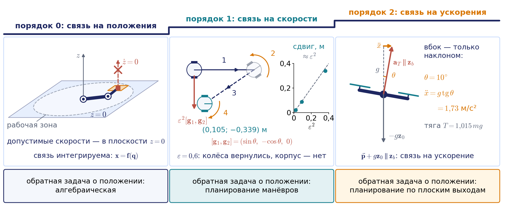
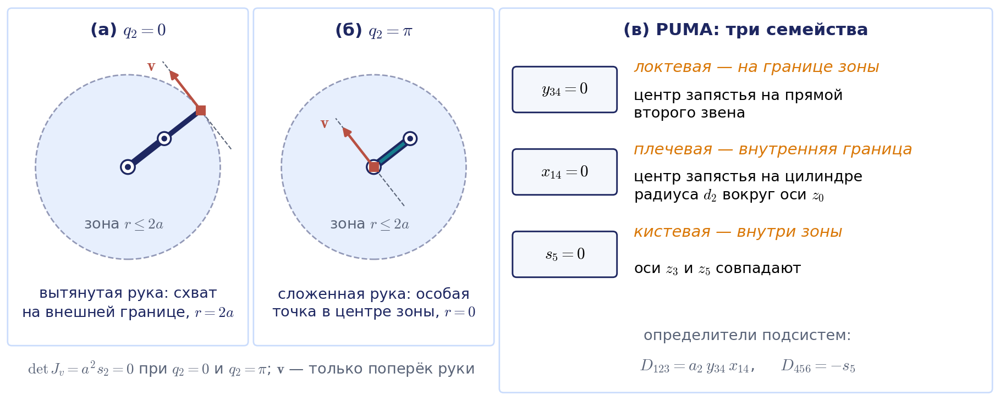
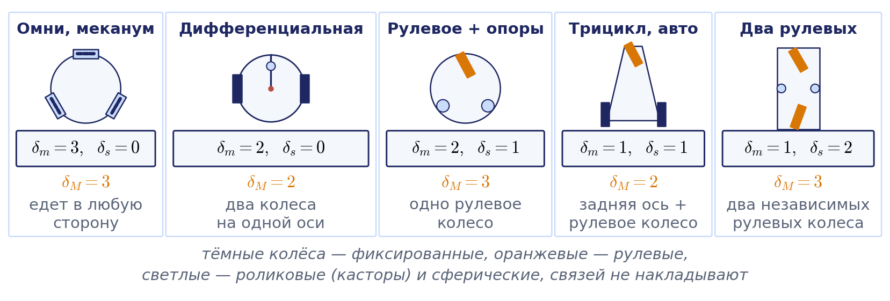
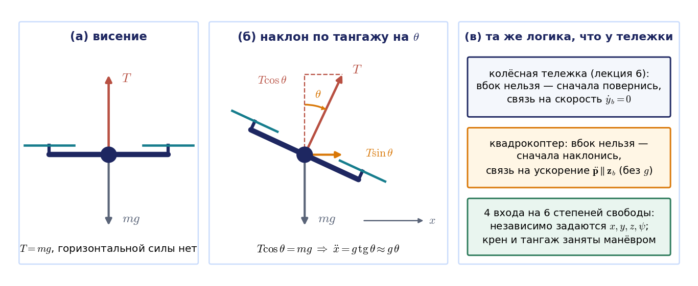
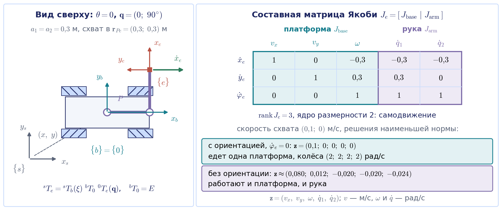

# Лекция 8. Обобщение раздела: единая картина кинематики роботов

## Введение: семь лекций как одна

За семь занятий мы разобрали четыре класса роботов. Последовательному манипулятору посвящены лекции 1–4: язык однородных матриц и параметров Денавита — Хартенберга (лекция 1), задачи о положении и формула произведения экспонент (лекция 2), матрица Якоби, сингулярное разложение и двойственность скоростей и сил (лекция 3), траектории и кинематическое управление (лекция 4). Параллельные механизмы с их уравнением скоростей $A\dot{\mathbf{x}}=B\dot{\mathbf{q}}$ и двумя типами особенностей — предмет лекции 5. Колёсные платформы, неголономные связи и одометрия — лекции 6. Свободное твёрдое тело, кватернион, матрица смешивания и недоприводность квадрокоптера — лекции 7. Внешне у этих роботов мало общего, и формулы в каждой лекции были свои.

Цель заключительной лекции — показать, что за этими формулами стоит одна математическая конструкция, и честно указать, где аналогия кончается. Общая конструкция такова: отображение «координаты приводов — положение выходного звена», его производная и двойственная ей матрица сил. Общий аппарат — линейная алгебра: ранг, обращение, псевдообращение, ядро, сингулярные числа. Но связи у роботов разного порядка. У манипулятора и параллельного механизма связь наложена на положения, у колёсной тележки — на скорости, у квадрокоптера — по существу на ускорения. От порядка связи зависит, существует ли вообще задача о положении в конечном виде, и одна и та же фраза «лёгкая и трудная задачи меняются местами» верна только для первого случая.

Новых методов в лекции почти нет, зато есть то, без чего обобщение было бы неполным: единый язык поз и твистов, которым пишут современные книги и программы, сингулярное разложение как общий измеритель близости к вырождению, двойственность скоростей и сил для всех четырёх классов и сквозной пример — мобильный манипулятор, у которого рука и колёсная платформа работают как одна избыточная система. Во второй половине занятия мы свяжем курс с программным стеком реальных роботов и подготовимся к рубежному контролю.

Занятие распределяется так. Первые 45 минут — единая схема и лестница порядков связи (около 12 минут), позы и твисты (8 минут), потеря ранга, сингулярное разложение и двойственность (12 минут), сводная таблица классов (8 минут) и квиз. Вторые 45 минут — сквозной пример в парах (12–15 минут), задачи курса в программном стеке (5 минут), разбор второго домашнего задания (8–10 минут) и подготовка к рубежному контролю. Карта вопросов билета, образцы ответов, краткие ответы к контрольным вопросам, полная сводка лекций 1–4, насыщение приводов, подробные сводки лекций 5–7 и перечень ноутбуков прошлых занятий вынесены в приложения 8.А–8.Ж для самостоятельного чтения. Все числа лекции воспроизводятся в ноутбуке «Демо_Занятие_08_обобщение.ipynb»; номера его демонстраций указаны в тексте.

### Обозначения этой лекции

Все буквы курса сведены в файл «Обозначения.md» паспорта. Обзорная лекция ставит рядом формулы семи лекций, поэтому несколько совпадений, которые в отдельных лекциях не мешали, здесь оказываются в соседних строках. Сведём их заранее.

| Буква | Значения в этой лекции | Как различать |
|---|---|---|
| $M$ | матрица смешивания квадрокоптера, $\mathbf{u}=M\mathbf{f}$ | моменты в сочленениях обозначаются $\boldsymbol{\tau}$, мобильность — $\mathcal{M}(\mathbf{q})$ |
| $W$ | число степеней подвижности механизма (лекция 5) и матрица скоростей углов: $W(\boldsymbol{\Theta})$ действует на угловую скорость $\boldsymbol{\omega}$ в осях базы (в $J_A=\operatorname{diag}(W(\boldsymbol{\Theta}),E)J$), $W(\varphi,\theta)$ — на $\boldsymbol{\omega}^b$ в связанных осях; для углов 3-2-1 $W(\boldsymbol{\Theta})=W(\varphi,\theta)R^{\mathrm T}$ | матрица всегда пишется с аргументом, число — без аргумента |
| $\theta$ | курс тележки (лекция 6) и тангаж (лекция 7) | по контексту класса робота; у тележки $\theta$ входит в позу $\boldsymbol{\xi}$, у аппарата — в тройку углов $\boldsymbol{\Theta}$ |
| $\boldsymbol{\xi}$ | поза тележки $(x,y,\theta)$ и произвольный вектор в члене самодвижения $(E-J^{+}J)\boldsymbol{\xi}$ | поза стоит в кинематике тележки рядом с $\dot{\boldsymbol{\xi}}_R$; вектор самодвижения встречается только под проектором $E-J^{+}J$ |
| $\varepsilon$, $\varepsilon_i$ | малый параметр манёвра тележки (раздел 8.1) и направление вращения $i$-го винта, $\varepsilon_i=\pm1$ (раздел 8.4) | направление вращения всегда пишется с индексом винта |
| $\kappa$ | число обусловленности $\kappa(J)$ и отношение реактивного момента винта к тяге $\kappa=k_M/k_F$ | число обусловленности всегда пишется с аргументом, аэродинамический коэффициент — без аргумента |
| $A$, $A_i$ | матрица $A=\partial\boldsymbol{\Phi}/\partial\mathbf{x}$ замкнутой цепи и матрица звена Денавита — Хартенберга | у матрицы звена всегда есть индекс |
| $F$, $\mathbf{F}$ | матрица прямой задачи о скорости колёсного шасси (светлая) и силовой винт $(\mathbf{m};\mathbf{f})$ (жирный) | $F$ — не сила; $F_i$ в лекции 5 — коэффициенты уравнения ноги дельта-робота |

## 8.1. Одно отображение и его производная

### Голономные связи: уравнение связей и уравнение скоростей

Обозначим $\mathbf{q}$ координаты приводов, а $\mathbf{x}$ — параметры положения выходного звена: схвата, платформы или корпуса. Если связи наложены на положения, кинематика задаётся системой уравнений связей, и её дифференцирование по времени даёт линейное соотношение между скоростями:

$$
\boldsymbol{\Phi}(\mathbf{x},\mathbf{q})=0\quad\Longrightarrow\quad A\,\dot{\mathbf{x}}=B\,\dot{\mathbf{q}},\qquad A=\frac{\partial\boldsymbol{\Phi}}{\partial\mathbf{x}},\qquad B=-\frac{\partial\boldsymbol{\Phi}}{\partial\mathbf{q}}.
$$

Эту запись мы ввели в разделе 5.11. Она годится для всех **голономных** систем, то есть систем, связи которых выражаются уравнениями относительно координат: для последовательных и параллельных манипуляторов. При $\det A\ne0$ получается матрица Якоби $J=A^{-1}B$, при $\det B\ne0$ — обратная к ней.

У последовательного манипулятора связь разрешена относительно выхода: $\mathbf{x}=\mathbf{s}=\mathbf{f}(\mathbf{q})$, где $\mathbf{s}=(\boldsymbol{\Theta};\mathbf{p})$ — три угла ориентации и три координаты. Положив $\boldsymbol{\Phi}=\mathbf{x}-\mathbf{f}(\mathbf{q})$, получаем $A=E$ и $B=\partial\mathbf{f}/\partial\mathbf{q}=J_A$ — **аналитический** якобиан. В лекции 3 мы работали с **геометрическим** якобианом, $\boldsymbol{\mathcal V}=J(\mathbf{q})\dot{\mathbf{q}}$, где $\boldsymbol{\mathcal V}=(\boldsymbol{\omega};\mathbf{v})$ — скорость схвата как твёрдого тела. Его угловой блок не является производной никакой функции от $\mathbf{q}$: угловая скорость не интегрируется в углы, потому что конечные повороты не коммутируют. Две матрицы связаны пересчётом угловой части (раздел 3.3):

$$
\dot{\mathbf{s}}=J_A(\mathbf{q})\,\dot{\mathbf{q}},\qquad J_A=\begin{pmatrix}W(\boldsymbol{\Theta})&0\\ 0&E\end{pmatrix}J,\qquad \dot{\boldsymbol{\Theta}}=W(\boldsymbol{\Theta})\,\boldsymbol{\omega}.
$$

Здесь $\boldsymbol{\omega}$ — угловая скорость в осях базы, поэтому для углов 3-2-1 лекции 7, где матрица $W(\varphi,\theta)$ действует на скорость $\boldsymbol{\omega}^b$ в связанных осях, $W(\boldsymbol{\Theta})=W(\varphi,\theta)R^{\mathrm T}$. Поступательные блоки у двух якобианов общие, $J_v=\partial\mathbf{p}/\partial\mathbf{q}$. Поэтому основное соотношение лекции 3 — это частный случай общей записи с $A=E$, если понимать под $\dot{\mathbf{x}}$ скорость тела, а не производные углов.

У пятизвенника строки матрицы $A$ — векторы ведомых звеньев, а $B$ диагональна, потому что каждая нога несёт один привод (раздел 5.3). У платформы Гью — Стюарта связь разрешена относительно приводов: записав её как $\Phi_i=l_i(\mathbf{x})-q_i$ с $l_i=\lVert\mathbf{p}+R\mathbf{b}_i-\mathbf{a}_i\rVert$, получаем $B=E$. Если вместо производных углов взять скорость платформы $\boldsymbol{\mathcal V}=(\boldsymbol{\omega};\mathbf{v})$, то $A=J^{-1}$, и явно выписывается обратная матрица Якоби со строками $\bigl((R\mathbf{b}_i\times\mathbf{n}_i)^{\mathrm T},\ \mathbf{n}_i^{\mathrm T}\bigr)$ (раздел 5.10).

Общую конструкцию удобно увидеть сразу на всех четырёх классах роботов (рис. 8.1). Квадрат ограничений приводов — скорости сочленений не больше 1 рад/с, скорости колёс не больше 20 рад/с, тяги винтов от 0 до 2,45 Н — матрица переводит в многоугольник допустимых скоростей или усилий выхода. Линейная алгебра при этом одна и та же, а различается то, что именно отображает матрица и зависит ли она от конфигурации.

Анимация целиком: [l08_one_map_four_robots.mp4](../06_Анимации/l08_one_map_four_robots.mp4), 75 с. С 6 с — двухзвенник, с 20 с — пятизвенник, с 34 с — тележка, с 48 с — квадрокоптер, с 62 с — все четыре панели рядом.

### Колёса и винты: где функции положения нет

У колёсной платформы функции положения $\boldsymbol{\xi}=\mathbf{f}(\boldsymbol{\varphi})$, где $\boldsymbol{\xi}=(x,y,\theta)$ — поза корпуса, а $\boldsymbol{\varphi}$ — углы колёс, не существует. Это легко увидеть на манёвре из раздела 6.10. Дифференциальная тележка проезжает вперёд на $\varepsilon=0{,}6$ м, поворачивается на месте на $0{,}6$ рад, проезжает назад на $0{,}6$ м и поворачивается обратно. Каждое колесо при этом повернулось вперёд и затем ровно на столько же назад, так что все углы колёс вернулись к исходным значениям. А корпус оказался в точке $(0{,}105;\ -0{,}339)$ м, в $0{,}35$ м от старта. Одинаковые показания энкодеров — разные позы: функции положения нет.

Связь у тележки задана сразу на скоростях. Колесо не скользит вбок, $\dot x\sin\theta-\dot y\cos\theta=0$, а скорость корпуса в связанных осях $\dot{\boldsymbol{\xi}}_R=(v_x,v_y,\omega)$ линейно связана со скоростями колёс: $\dot{\boldsymbol{\xi}}_R=F\dot{\boldsymbol{\varphi}}$ у дифференциальной схемы, $\dot{\boldsymbol{\varphi}}=H\dot{\boldsymbol{\xi}}_R$ у всенаправленной платформы. Эти уравнения нельзя проинтегрировать: связь **неголономна**.

У квадрокоптера кинематическая часть — свободное тело без всяких связей,

$$
\begin{pmatrix}\dot{\boldsymbol{\Theta}}\\ \dot{\mathbf{p}}\end{pmatrix}=\begin{pmatrix}W(\varphi,\theta)&0\\ 0&R\end{pmatrix}\begin{pmatrix}\boldsymbol{\omega}^b\\ \mathbf{v}^b\end{pmatrix},
$$

а приводы, тяги винтов $\mathbf{f}$, входят на уровне сил: суммарная тяга и моменты $\mathbf{u}=(T;\boldsymbol{\tau})$ равны $M\mathbf{f}$, и через уравнения Ньютона и Эйлера они определяют ускорения. Матрица смешивания $M$ не связывает скоростей и не получается дифференцированием уравнения связи. Это статическое силовое отображение, аналог транспонированной матрицы Якоби, к которому мы вернёмся в разделе 8.4. Сходство $\mathbf{f}=M^{-1}\mathbf{u}$ с обратной задачей о скорости алгебраическое, а не механическое.

### Четыре задачи и правило «лёгкой задачи»

Для всех классов роботов можно сформулировать четыре задачи: прямую и обратную о положении, прямую и обратную о скорости. Задачи о скорости при фиксированной конфигурации линейны. Задачи о положении нелинейны, и здесь классы различаются сильнее всего (рис. 8.2).

| Класс робота | Прямая задача о положении | Обратная задача о положении | Что решает контроллер на каждом такте |
|---|---|---|---|
| Последовательный манипулятор | проста: $T_N=A_1A_2\cdots A_N$, ответ единствен | трудна: до 8 ветвей у PUMA и UR5e, до 16 у общего 6R | обратную задачу о скорости или о положении в узлах |
| Параллельный механизм | трудна: система уравнений, режимы сборки, до 40 решений у платформы Гью — Стюарта | проста: распадается по ногам | обратную задачу по явным формулам |
| Колёсная платформа | функции положения нет: интегрирование, одометрия | задача планирования манёвров, решений бесконечно много | обратную задачу о скорости $\dot{\boldsymbol{\varphi}}=H\dot{\boldsymbol{\xi}}_R$ и одометрию |
| Летающий аппарат | функции положения от приводов нет: интегрирование уравнений движения | планирование по плоским выходам $x,y,z,\psi$ | каскад регуляторов и распределение тяг $\mathbf{f}=M^{-1}\mathbf{u}$ (задача о силах) |

Для голономных систем закономерность легко запомнить: лёгкой оказывается та задача о положении, в сторону которой разрешено уравнение связи. У разомкнутой цепи положение схвата выражено через $\mathbf{q}$ явно, поэтому легка прямая задача. У параллельного механизма явно выражены длины ног или углы приводов через положение платформы, поэтому легка обратная. К колёсным и летающим роботам правило на уровне положений неприменимо: функции положения у них нет вовсе. У всенаправленной платформы оно действует только на уровне скоростей — лёгкой оказывается обратная задача о скорости $\dot{\boldsymbol{\varphi}}=H\dot{\boldsymbol{\xi}}_R$, а задача о положении сводится к интегрированию и планированию.

На двух голономных роботах правило видно одновременно в пространстве приводов и в пространстве задачи (рис. 8.3). У двухзвенника прямая задача даёт одно решение без итераций, а обратная — две ветви, которые сливаются на границе рабочей зоны, где $\det J_v=0$. У пятизвенника всё наоборот: обратная задача распадается по ногам и даёт $2\times2$ рабочих режима, которые сливаются при $\det B=0$, а прямая задача имеет два режима сборки, сливающихся при $\det A=0$.

Анимация целиком: [l08_easy_hard_swap.mp4](../06_Анимации/l08_easy_hard_swap.mp4), 76 с. С 30 с — пятизвенник (рабочие режимы сливаются при вытянутой ноге 1, около 40 с), с 44 с — прямая задача пятизвенника, с 60 с — таблица четырёх задач для всех четырёх классов роботов. На постере — точка q = (180°; 0°), где у размеров примера 5.1 одновременно det A = 0 и det B = 0 (особенность третьего типа, раздел 5.11); рабочие режимы сливаются отдельно, при вытянутой ноге 1 (кадр 40 с).

Трудную задачу на практике решают через лёгкую: метод Ньютона на каждой итерации вычисляет лёгкую задачу и её матрицу и поправляет приближение (рис. 8.4). У руки так решают обратную задачу через прямую и матрицу Якоби, у пятизвенника — прямую задачу через уравнения ног и матрицу $2A$. Ролик показывает три свойства метода, которые нужно помнить. Начальное приближение выбирает, к какой ветви или к какому режиму сборки придёт метод. Рядом с особой точкой матрица шага почти вырождена, и шаг срывается. На траектории из многих узлов выручает тёплый старт от решения в предыдущем узле: на окружности из 73 узлов он даёт в среднем 2,8 итерации на узел и ни одной смены ветви, а холодный старт от одного и того же приближения — 7,2 итерации, шесть узлов на чужой ветви и два узла без сходимости. Это и есть «цепочка близких целей» второго домашнего задания.

Анимация целиком: [l08_newton_three_times.mp4](../06_Анимации/l08_newton_three_times.mp4), 80 с. С 20 с — прямая задача пятизвенника и три старта, с 40 с — траектория с тёплым и холодным стартом, с 72 с — сводная таблица.

### Лестница порядков связи

Различие, которое мы только что увидели, — самое глубокое место «единой картины». Его удобно изобразить лестницей из трёх ступеней (рис. 8.5).

| Порядок | Связь | Пример робота | Обратная задача о положении | Инструмент |
|---|---|---|---|---|
| 0 | голономная: $\boldsymbol{\Phi}(\mathbf{x},\mathbf{q})=0$ или $\mathbf{x}=\mathbf{f}(\mathbf{q})$ | манипулятор, параллельный механизм | алгебраическая, конечное число ветвей | $J$, $A$, $B$ (лекции 3, 5) |
| 1 | неголономная, на скорости: $\mathbf{a}^{\mathrm T}(\boldsymbol{\xi})\dot{\boldsymbol{\xi}}=0$, модель $\dot{\boldsymbol{\xi}}=\mathbf{g}_1v+\mathbf{g}_2\omega$ без сноса | дифференциальная тележка, автомобиль | планирование манёвров | скобка Ли (раздел 6.10) |
| 2 | на ускорения: $\ddot{\mathbf{p}}+g\mathbf{z}_0$ параллельно $\mathbf{z}_b$, со сносом (сила тяжести) | квадрокоптер | планирование по плоским выходам | дифференциальная плоскостность (раздел 7.6) |

На нулевой ступени связь интегрируема: если бы матрица Якоби руки всюду имела ранг два, схват двигался бы по двумерной поверхности. На первой ступени связь запрещает боковую скорость, но не боковое положение. Манёвр «вперёд — поворот — назад — поворот обратно» с малым параметром $\varepsilon$ даёт боковое смещение порядка $\varepsilon^2$ вдоль скобки Ли $[\mathbf{g}_1,\mathbf{g}_2]=(\sin\theta,\ -\cos\theta,\ 0)^{\mathrm T}$. Расчёт (демонстрация 3) подтверждает квадратичный закон: при $\varepsilon=0{,}6$; $0{,}3$; $0{,}15$ боковой сдвиг равен $0{,}339$; $0{,}089$; $0{,}022$ м, а $\varepsilon^2=0{,}36$; $0{,}09$; $0{,}0225$. На второй ступени запрещено ускорение в плоскости винтов: ускорение за вычетом $g$ всегда направлено по оси тяги. Чтобы разогнаться вбок, аппарат наклоняется: удерживая высоту, при наклоне на $10^\circ$ он получает горизонтальное ускорение $g\operatorname{tg}10^\circ=1{,}73$ м/с², при $30^\circ$ — уже $5{,}66$ м/с², и тяга при этом должна вырасти в $1/\cos30^\circ=1{,}155$ раза.

Ступени 0 и 1 полезно сравнить в пространстве поз (рис. 8.6). Ранг матрицы скоростей у двухзвенника и у тележки одинаков и равен двум: у обоих два входа и три координаты позы. Но у руки плоскости допустимых скоростей касаются одной поверхности, и схват её не покидает, а у тележки эти плоскости закручены вместе с курсом. Поэтому петля «вперёд — поворот — назад — поворот обратно» у тележки не замыкается и сдвигает корпус вбок примерно на $\varepsilon^2[\mathbf{g}_1,\mathbf{g}_2]$; при уменьшении $\varepsilon$ вдвое сдвиг уменьшается вчетверо.

Анимация целиком: [l08_rank2_everywhere.mp4](../06_Анимации/l08_rank2_everywhere.mp4), 89 с. С 6 с — рука (ступень 0), с 34 с — плоскости тележки, с 48 с — петля с ε = 0,6, с 66 с — петли с ε = 0,3 и 0,15, с 81 с — ответ на контрольный вопрос 5. Ступень 2, квадрокоптер, в ролике не показана — она есть на рис. 8.5.

Порядок связи определяет и структуру системы управления. Тележку можно остановить мгновенно, и между командой $(v,\omega)$ и колёсами стоит одно звено, $\dot{\boldsymbol{\varphi}}=H\dot{\boldsymbol{\xi}}_R$. Квадрокоптер мгновенно остановить нельзя: чтобы затормозить, ему нужно наклониться назад и подождать, поэтому система управления — каскад «положение → ориентация → моменты → моторы». Вывод лестницы такой: аппарат линейной алгебры для задач о скорости и о силах общий для всех ступеней, а смысл задачи о положении меняется с порядком связи.

## 8.2. Один язык: позы и твисты

### Позы на плоскости и в пространстве и одно уравнение для всех тел

Мировая литература, начиная с книги К. Линча и Ф. Парка, и программные библиотеки описывают всех роботов одним языком. Поза твёрдого тела — однородная матрица $T$ из блока поворота $R$ и столбца $\mathbf{p}$. Множество таких матриц образует группу движений $SE(3)$: позы можно перемножать и обращать, но нельзя складывать и усреднять (лекция 1). На плоскости то же самое делает группа $SE(2)$ с позой $(x,y,\theta)$, то есть матрица $3\times3$, у которой левый верхний блок $2\times2$ — поворот на угол $\theta$, а правый столбец — $(x,y)$. Этот блок совпадает с левым верхним блоком матрицы поворота $R_z(\theta)$ размера $3\times3$ вокруг вертикали, которая в разделе 8.7 переводит скорость тележки из связанных осей в неподвижные.

Скорость тела — **твист** $\boldsymbol{\mathcal V}=(\boldsymbol{\omega};\mathbf{v})$. Кинематика любого твёрдого тела записывается одним уравнением (раздел 7.3, приложение 3.Г):

$$
\dot T=T\,[\boldsymbol{\mathcal V}^b],\qquad [\boldsymbol{\mathcal V}^b]=\begin{pmatrix}\Lambda(\boldsymbol{\omega}^b)&\mathbf{v}^b\\ 0&0\end{pmatrix},
$$

где $\boldsymbol{\mathcal V}^b$ — твист в связанных осях. Классы роботов различаются только тем, какие твисты им разрешены и чем они создаются.

- Квадрокоптер: твист $\boldsymbol{\mathcal V}^b$ ничем не стеснён, но управляется не прямо, а через четыре силовых входа — тягу и три момента.
- Дифференциальная тележка: плоский случай со связью $v_y=0$, разрешены только твисты вида $(v,0,\omega)$.
- Меканум-платформа: плоский случай без связи, любой твист $\dot{\boldsymbol{\xi}}_R=(v_x,v_y,\omega)$ создаётся колёсами.
- Манипулятор: твист схвата $\boldsymbol{\mathcal V}=J(\mathbf{q})\dot{\mathbf{q}}$ создаётся сочленениями, а множество разрешённых твистов — образ матрицы Якоби.

### Твист манипулятора и соглашения о матрице Якоби

Столбец $\mathbf{j}_k$ матрицы Якоби — это твист схвата при единичной скорости $k$-го сочленения и неподвижных остальных: $(\mathbf{z}_{k-1};\ \mathbf{z}_{k-1}\times\mathbf{p}_{k-1,N})$ для вращательного сочленения и $(\mathbf{0};\ \mathbf{z}_{k-1})$ для телескопического. На языке винтов это **винтовая ось** сочленения, у которой линейная часть приведена к началу системы схвата. Пространственный якобиан $J_s$ Линча и Парка приводит линейную часть к точке тела, совпадающей с началом базы, и пересчёт к нашей матрице выполняет одна формула из раздела 3.3:

$$
J=\begin{pmatrix}E&0\\ -\Lambda(\mathbf{p}_N)&E\end{pmatrix}J_s.
$$

Проверим на двухзвеннике примера 2.4а в нулевой конфигурации. Винтовая ось второго сочленения равна $(0,0,1;\ 0,-a_1,0)$. Перенос точки приведения в схват $\mathbf{p}_N=(a_1+a_2,0,0)$ добавляет к линейной части $\boldsymbol{\omega}\times\mathbf{p}_N=(0,\ a_1+a_2,\ 0)$, и получается столбец $(0,0,1;\ 0,a_2,0)$, тот же, что дают формулы лекции 3.

Порядок блоков и точка приведения — самая частая причина ошибок при переходе от лекции к программе. Соглашения сведены в таблицу (подробно — раздел 3.3 и раздел 3 файла обозначений).

| Источник | Порядок блоков скорости | Замечание |
|---|---|---|
| курс, учебник, Линч и Парк | $(\boldsymbol{\omega};\mathbf{v})$ | у Линча и Парка $J_s$ и $J_b$ отличаются точкой приведения и осями |
| `kinlib`: `jacobian`, `jacobian_vw()` | $(\mathbf{v};\boldsymbol{\omega})$ | оставлено ради обратной совместимости |
| `kinlib`: `jacobian_book()` | $(\boldsymbol{\omega};\mathbf{v})$ | порядок курса |
| Сицилиано и соавт., Корке, Robotics Toolbox (`jacob0`), Pinocchio, MoveIt 2 (`getJacobian`) | $(\mathbf{v};\boldsymbol{\omega})$ | точка и оси различаются; сверять по документации |
| ROS 2: `geometry_msgs/Twist` | поля `linear`, затем `angular` | система координат задаётся соглашением топика или заголовком |
| лекция 6: $\dot{\boldsymbol{\xi}}_R=(v_x,v_y,\omega)$ | линейная часть первой | как в ROS для плоских мобильных роботов |

Практическое правило: перед любым сравнением матриц из разных источников переставить блоки к порядку курса и проверить, к какой точке приведена линейная скорость. Для модели UR5e матрица `jacob0` из Robotics Toolbox после перестановки блоков совпадает с матрицей курса до $2\cdot10^{-16}$ (раздел 3.3).

### Произведение экспонент одной строкой

Тот же язык даёт второй способ решать прямую задачу о положении (раздел 2.1):

$$
T_N(\mathbf{q})=e^{[\boldsymbol{\mathcal S}_1]q_1}\,e^{[\boldsymbol{\mathcal S}_2]q_2}\cdots e^{[\boldsymbol{\mathcal S}_N]q_N}\,T_N(\mathbf{0}).
$$

Это «Денавит — Хартенберг без таблицы»: нужны только винтовые оси сочленений в домашней позе, привязывать к звеньям промежуточные системы не нужно, и почти параллельные оси не создают плохо обусловленных параметров. Для UR5e формула совпадает с расчётом по таблице ДХ с точностью $10^{-15}$. На рубежном контроле её не требуют, но именно на этом языке написаны книга «Modern Robotics» и библиотеки Pinocchio и Drake.

## 8.3. Потеря ранга и сингулярное разложение

### Одно явление, шесть имён

Во всех четырёх классах вырождение матрицы, связывающей скорости или усилия, означает потерю управляемого направления. Различаются причина и последствия.

| Явление | Что вырождается или чего не хватает | Что теряется | Лекция |
|---|---|---|---|
| Особая конфигурация манипулятора | $\det J=0$, $\sigma_{\min}(J)=0$ | направление скорости схвата; рядом скорости сочленений растут как $1/\sigma_{\min}$ | 3, § 3.5–3.7; 4, § 4.9 |
| Особенность первого типа | $\det B=0$ | направление движения платформы; сливаются рабочие режимы | 5, § 5.11 |
| Особенность второго типа | $\det A=0$ | жёсткость: платформа движется при заторможенных приводах, усилия в приводах неограниченно растут | 5, § 5.3, 5.10, 5.11 |
| Неголономная связь колеса | $\operatorname{rank}G(\theta)=2$ меньше трёх координат позы при любом $\theta$; это свойство схемы, а не особая точка | мгновенно — боковая скорость; манёвром (скобка Ли) достижимы все позы | 6, § 6.4, 6.10 |
| Особенность углов 3-2-1 | $W(\varphi,\theta)$ неограниченно растёт, $\det W=1/c_\theta$; вырождается обратная матрица $W^{-1}$ | различимость рыскания и крена; особенность координатная, а не физическая | 1, § 1.2; 3, § 3.3; 7, § 7.3 |
| Отказ мотора | у квадрокоптера $\operatorname{rank}M=3$ вместо 4; у гексакоптера ранг сохраняется, но команда висения ложится на границу многогранника | независимое управление одним из каналов, обычно рысканием | 7, § 7.5 |

Две строки стоят особняком. Неголономная связь — не особая точка, а постоянное свойство шасси: ранг матрицы $G(\theta)=R_z(\theta)F$ полон по столбцам (равен двум) при любом курсе, но меньше числа координат позы, а уравнение скоростей неинтегрируемо, поэтому множество достижимых поз не сужается (рис. 8.6). Особенность углов Эйлера — свойство выбранных координат, а не аппарата: она устраняется переходом к кватерниону или матрице поворота.

Классическая иллюстрация первой строки — плоский двухзвенник с равными звеньями $a$, для которого $\det J_v=a^2s_2$ (рис. 8.7). Определитель обращается в нуль в двух случаях. Вытянутая рука ($q_2=0$) ставит схват на внешнюю границу рабочей зоны, $r=2a$. Сложенная рука ($q_2=\pi$) ставит схват в основание, $r=0$, а это **внутренняя** точка зоны: схват находится на расстоянии $r=2a\lvert\cos(q_2/2)\rvert$ от основания, и зона — сплошной круг. При неравных звеньях сложенная рука давала бы внутреннюю границу $r=\lvert l_1-l_2\rvert$, а при равных она стягивается в точку; именно мимо этой внутренней особой точки мы проводили прямую в разделе 4.9. Общее правило: граница рабочей зоны всегда лежит в образе особых конфигураций, но не всякая особая конфигурация лежит на границе. Кистевые особенности PUMA и UR5e тоже встречаются внутри зоны (раздел 3.6).

### Сингулярные числа — общий измеритель

Определитель говорит только «да или нет» и для матрицы со смешанными единицами зависит от масштаба. Общий измеритель — сингулярное разложение $J=U\Sigma V^{\mathrm T}$ (раздел 3.7). Эллипсоид скоростей — образ единичной сферы скоростей приводов, его полуоси равны $\sigma_i\hat{\mathbf{u}}_i$. Близость к вырождению измеряет наименьшее сингулярное число $\sigma_{\min}$, а столбец $\hat{\mathbf{u}}_{\min}$ показывает, какое направление теряется. Из него строятся меры качества конфигурации: число обусловленности $\kappa(J)=\sigma_{\max}/\sigma_{\min}$ и мера манипулятивности Йошикавы $w=\sqrt{\det(JJ^{\mathrm T})}=\sigma_1\sigma_2\cdots\sigma_m$, близкий родственник мобильности $\mathcal{M}(\mathbf{q})$ учебника.

Для двухзвенника с единичными звеньями при сгибании локтя от $110^\circ$ к вытянутой руке наименьшее сингулярное число падает так: $0{,}694$ при $q_2=110^\circ$, $0{,}231$ при $30^\circ$, $0{,}039$ при $5^\circ$ и $0{,}0078$ при $1^\circ$, а число обусловленности растёт от $1{,}95$ до $9{,}4$, $57$ и $286$. Скорость сочленений, нужная для скорости схвата $v$ вдоль слабого направления, равна $v/\sigma_{\min}$. На прямой $y=y_0$ из раздела 4.9 наименьшее сингулярное число в ближайшей к основанию точке примерно равно $y_0$, и при скорости схвата $0{,}4$ м/с пик $\lvert\dot q_1\rvert$ составляет $2{,}005$; $4{,}003$ и $8{,}001$ рад/с при $y_0=0{,}2$; $0{,}1$ и $0{,}05$ м, то есть почти точно $v/y_0$ (демонстрация 1). Это расчёт без обратной связи, $\dot{\mathbf{q}}=J^{-1}\mathbf{v}$; в разделе 4.9 тот же проход идёт с обратной связью $K=10$ с$^{-1}$, и пик при $y_0=0{,}05$ м там чуть выше — $8{,}1$ рад/с.

Демпфированное псевдообращение в базисе разложения выглядит особенно прозрачно:

$$
\dot{\mathbf{q}}=\sum_i\frac{\sigma_i}{\sigma_i^2+\mu^2}\,\hat{\mathbf{v}}_i\hat{\mathbf{u}}_i^{\mathrm T}\boldsymbol{\mathcal V}^{\ast}.
$$

Вдали от особенности множитель почти равен $1/\sigma_i$, а вблизи неё не превышает $1/(2\mu)$: скорости ограничены ценой ошибки слежения по слабому направлению.

Тот же анализ применим к матрицам других классов (демонстрация 4). У меканум-платформы из примера 6.6 столбцы матрицы $H$ ортогональны, и её сингулярные числа постоянны, $40$, $40$ и $15{,}4$, так что вырождения нет ни в одной позе. У квадрокоптера Hummingbird в схеме «X» наименьшее сингулярное число матрицы смешивания, $0{,}049$, отвечает рысканию. Оно равно $2\kappa$, где $\kappa=k_M/k_F$ — отношение реактивного момента винта к его тяге, и это плечо рыскания в пять раз меньше плеча крена — отсюда «слабый канал рыскания». Отказ мотора вычёркивает столбец, и ранг падает до трёх. Сравнивать сингулярные числа с разными единицами между собой нельзя; полную матрицу $6\times N$ анализируют поблочно или после нормировки линейных строк характерной длиной (раздел 3.8).

### Где живёт потеря ранга в контроллере

Потеря ранга — не только теория: каждый класс роботов обрабатывает её в программе. Модуль MoveIt Servo, решающий в ROS 2 обратную задачу о скорости, вычисляет число обусловленности матрицы Якоби и при движении в сторону особенности снижает скорость, когда $\kappa(J)$ превышает нижний порог, и останавливает движение у верхнего; по умолчанию пороги равны $17$ и $30$. Это инженерная форма закона «скорость сочленений растёт как $1/\sigma_{\min}$»: у двухзвенника с единичными звеньями $\kappa(J)=17$ при $q_2\approx16{,}7^\circ$ и $\kappa(J)=30$ при $q_2\approx9{,}5^\circ$. Поскольку $\kappa(J)$ полной матрицы зависит от единиц, пороги настраивают под конкретного робота. Промышленные контроллеры при прямолинейном движении у кистевой особенности останавливаются с ошибкой либо, в специальном режиме (например, инструкция `SingArea` в языке RAPID контроллеров ABB), допускают отклонение ориентации инструмента (раздел 3.6). Автопилот хранит ориентацию кватернионом, и особенности углов у него просто нет. Неголономной тележке запрещённое направление даёт планировщик, строящий манёвры.

## 8.4. Скорости и силы: две стороны одной матрицы

### Мощность и транспонированная матрица

Каждое отображение скоростей сопровождается двойственным отображением сил. Для последовательного манипулятора это соотношение лекции 3: мощность приводов равна мощности, передаваемой схватом, $\boldsymbol{\tau}^{\mathrm T}\dot{\mathbf{q}}=\mathbf{F}^{\mathrm T}\boldsymbol{\mathcal V}=\mathbf{F}^{\mathrm T}J\dot{\mathbf{q}}$ при любых $\dot{\mathbf{q}}$, откуда

$$
\boldsymbol{\tau}=J^{\mathrm T}(\mathbf{q})\,\mathbf{F},
$$

где $\mathbf{F}=(\mathbf{m};\mathbf{f})$ — силовой винт, который схват прикладывает к среде, а $\boldsymbol{\tau}$ — моменты (у телескопических сочленений — силы) в сочленениях. Ядро $J^{\mathrm T}$ ортогонально образу $J$: силы, перпендикулярные всем достижимым скоростям схвата, не требуют моментов в приводах. Эллипсоид сил имеет те же оси $\hat{\mathbf{u}}_i$, что эллипсоид скоростей, но полуоси $1/\sigma_i$ (рис. 8.8). У двухзвенника с единичными звеньями при $q_2=90^\circ$ полуоси эллипса скоростей равны $1{,}618$ и $0{,}618$, а эллипса сил — $0{,}618$ и $1{,}618$ вдоль тех же направлений (демонстрация 5). У вытянутой руки схват не может двигаться вдоль руки, зато силу вдоль руки держит конструкция без всяких моментов.

### Замкнутая цепь: почему второй тип — потеря жёсткости

Для замкнутой цепи с уравнением скоростей $A\dot{\mathbf{x}}=B\dot{\mathbf{q}}$ двойственность удобно записать через множители связей $\boldsymbol{\lambda}$ — усилия, с которыми связи нагружены:

$$
A^{\mathrm T}\boldsymbol{\lambda}=\mathbf{F},\qquad \boldsymbol{\tau}=B^{\mathrm T}\boldsymbol{\lambda}.
$$

Проверка мощностью: $\boldsymbol{\tau}^{\mathrm T}\dot{\mathbf{q}}=\boldsymbol{\lambda}^{\mathrm T}B\dot{\mathbf{q}}=\boldsymbol{\lambda}^{\mathrm T}A\dot{\mathbf{x}}=\mathbf{F}^{\mathrm T}\dot{\mathbf{x}}$. При $\det A\ne0$ отсюда $\boldsymbol{\tau}=B^{\mathrm T}A^{-\mathrm T}\mathbf{F}=J^{\mathrm T}\mathbf{F}$, как в разделе 5.10. Теперь смысл особенности второго типа виден сразу. При $\det A=0$ уравнение $A^{\mathrm T}\boldsymbol{\lambda}=\mathbf{F}$ разрешимо не для всякой внешней силы: силу, не лежащую в образе $A^{\mathrm T}$, никакие конечные усилия в ногах не уравновешивают, а вблизи такого положения нужные усилия неограниченно растут. Это и есть потеря жёсткости. Для пятизвенника из раздела 5.3 на пути $\mathbf{q}=(60^\circ+\Delta;\ 120^\circ-\Delta)$ горизонтальная сила 10 Н требует от каждого привода момента $0{,}93$ Н·м при $\Delta=15^\circ$, $21$ Н·м при $3^\circ$, $70$ Н·м при $1^\circ$ и $244$ Н·м при $0{,}3^\circ$, тогда как вертикальную силу той же величины механизм держит моментами меньше 1 Н·м (демонстрация 2). При особенности первого типа ($\det B=0$) картина зеркальная: существует сила, которую приводы держат «бесплатно», как у вытянутой руки.

Обе картины рядом с особой конфигурацией руки показаны на рис. 8.9 через эллипсы скоростей и сил. У руки и у пятизвенника при особенности первого типа эллипс скоростей сплющивается в отрезок, а эллипс сил вытягивается: потеряно направление движения, но силу в этом направлении механизм держит сам. При особенности второго типа всё наоборот: эллипс скоростей раздувается, потому что платформа подвижна при заторможенных приводах, а эллипс сил схлопывается, и моменты против горизонтальной силы 10 Н растут до сотен ньютон-метров, как в расчёте выше. У последовательной руки второго типа нет вовсе, потому что у неё $A=E$.

Анимация целиком: [l08_squeeze_vs_explode.mp4](../06_Анимации/l08_squeeze_vs_explode.mp4), 80 с. С 24 с — пятизвенник у особенности первого типа, с 44 с — у особенности второго типа, с 72 с — сводка двух типов.

### Колёса и винты: силовые мосты и внутренние усилия

У всенаправленной платформы мощность моментов колёс $\boldsymbol{\tau}_{\varphi}$ равна мощности силового винта на корпусе $\mathbf{F}_R=(f_x,f_y,m_z)$, записанного в связанных осях в том же порядке, что $\dot{\boldsymbol{\xi}}_R$: $\boldsymbol{\tau}_{\varphi}^{\mathrm T}\dot{\boldsymbol{\varphi}}=\boldsymbol{\tau}_{\varphi}^{\mathrm T}H\dot{\boldsymbol{\xi}}_R=\mathbf{F}_R^{\mathrm T}\dot{\boldsymbol{\xi}}_R$, откуда $\mathbf{F}_R=H^{\mathrm T}\boldsymbol{\tau}_{\varphi}$. У меканум-платформы $H^{\mathrm T}(1,1,-1,-1)^{\mathrm T}=0$: моменты, пропорциональные этому вектору, не создают на корпусе ни силы, ни момента — колёса упираются друг в друга. Это зеркальное отражение условия совместности скоростей $\dot\varphi_1+\dot\varphi_2-\dot\varphi_3-\dot\varphi_4=0$: ядро $H^{\mathrm T}$ ортогонально образу $H$. Такие внутренние усилия бесполезно нагружают приводы и изнашивают ролики, как преднатяг избыточных связей в параллельном механизме.

У квадрокоптера $\mathbf{u}=M\mathbf{f}$ — силовое отображение в чистом виде. Если корпус движется со скоростью $v_z$ вдоль оси тяги и вращается с угловой скоростью $(\omega_x,\omega_y)$, точка крепления $i$-го винта движется вдоль его оси со скоростью $v_i=v_z+\omega_xy_i-\omega_yx_i$. Мощность тяг $\sum_if_iv_i=Tv_z+\tau_x\omega_x+\tau_y\omega_y$, поэтому первые три строки $M$ в точности равны транспонированной матрице $J_r$, переводящей скорость корпуса $(v_z,\omega_x,\omega_y)$ в скорости винтов вдоль осей (проверено на матрице схемы «X» из раздела 7.5, демонстрация 5). Четвёртая строка, $-\kappa\varepsilon_i$, описывает реактивные моменты, то есть аэродинамику, а не геометрию. Значит, $M$ — аналог $J^{\mathrm T}$, «силовой мост». При $n>4$ винтов распределение $\mathbf{f}=M^{+}\mathbf{u}$, $M^{+}=M^{\mathrm T}(MM^{\mathrm T})^{-1}$, даёт тяги с наименьшей суммой квадратов, а двумерное ядро $M$ гексакоптера — перераспределения тяг, не меняющие ни тяги, ни моментов, — аналог самодвижения избыточной руки.

| Класс | Матрица скоростей | Матрица сил |
|---|---|---|
| Последовательный манипулятор | $\boldsymbol{\mathcal V}=J\dot{\mathbf{q}}$ | $\boldsymbol{\tau}=J^{\mathrm T}\mathbf{F}$ |
| Параллельный механизм | $A\dot{\mathbf{x}}=B\dot{\mathbf{q}}$ | $A^{\mathrm T}\boldsymbol{\lambda}=\mathbf{F}$, $\boldsymbol{\tau}=B^{\mathrm T}\boldsymbol{\lambda}$ |
| Колёсная платформа | $\dot{\boldsymbol{\varphi}}=H\dot{\boldsymbol{\xi}}_R$, $\dot{\boldsymbol{\xi}}_R=F\dot{\boldsymbol{\varphi}}$, $G(\theta)=R_z(\theta)F$ | $\mathbf{F}_R=H^{\mathrm T}\boldsymbol{\tau}_{\varphi}$ |
| Летающий аппарат | $(\dot{\boldsymbol{\Theta}};\dot{\mathbf{p}})=\operatorname{diag}(W,R)\,\boldsymbol{\mathcal V}^b$ — параметризация, а не привод | $\mathbf{u}=M\mathbf{f}$; первые три строки $M$ равны $J_r^{\mathrm T}$ |

### Три моста — только у голономных систем

В лекции 4 кинематическое управление манипулятором мы описали как три моста между пространством задания и пространством приводов: обратную задачу о положении, обратную задачу о скорости и транспонированную матрицу Якоби для сил. Обобщая, нужно быть аккуратным. У колёсных и летающих роботов функции положения нет, поэтому нет и моста по положению. У тележки остаются мост скоростей $\dot{\boldsymbol{\varphi}}=H\dot{\boldsymbol{\xi}}_R$ и мост сил $\mathbf{F}_R=H^{\mathrm T}\boldsymbol{\tau}_{\varphi}$. У квадрокоптера остаётся только силовой мост $\mathbf{f}=M^{-1}\mathbf{u}$; кинематического моста от винтов к скорости у него нет, потому что он недоприводен. Положение у них задают планированием и обратной связью, а не обращением формулы. Общим для всех остаётся линейный аппарат задач о скорости и о силе.

## 8.5. Последовательные манипуляторы: сводка лекций 1–4

Опорные результаты лекций 1–4 — описание позы, матрица звена, задачи о положении и о скорости, характеристики, траектории и управление — сведены в полную таблицу приложения 8.Г; на занятии она служит резервным слайдом. Здесь остановимся на трёх местах, где чаще всего ошибаются, и на двух вопросах практики: ветвях обратной задачи и калибровке.

Обратная задача о скорости имеет три случая, и их часто путают. Если $N=6$ и $\det J\ne0$, решение единственно: $\dot{\mathbf{q}}=J^{-1}\boldsymbol{\mathcal V}$. Если $N<6$ и $\operatorname{rank}J=N$ (полный столбцовый ранг), точного решения в общем случае нет, и минимум невязки $\lVert J\dot{\mathbf{q}}-\boldsymbol{\mathcal V}\rVert^2$ даёт левая псевдообратная матрица. Если $N>6$ и $\operatorname{rank}J=6$ (полный строчный ранг), решений бесконечно много, и общее решение складывается из решения наименьшей нормы и самодвижения:

$$
\dot{\mathbf{q}}=(J^{\mathrm T}J)^{-1}J^{\mathrm T}\boldsymbol{\mathcal V}\quad(N<6),\qquad \dot{\mathbf{q}}=J^{\mathrm T}(JJ^{\mathrm T})^{-1}\boldsymbol{\mathcal V}+(E-J^{+}J)\,\boldsymbol{\xi}\quad(N>6).
$$

Для «широкой» матрицы избыточного манипулятора матрица $J^{\mathrm T}J$ вырождена в любой конфигурации, а не только в особой точке, поэтому левая формула к ней неприменима. Тождество $\det(J^{\mathrm T}J)=(\det J)^2$ верно только для квадратной матрицы. Обе формулы — частные случаи псевдообратной матрицы Мура — Пенроуза, которую надёжнее всего вычислять через сингулярное разложение.

С той же оговоркой нужно читать закон CLIK лекции 4. Ошибка положения схвата при $\dot{\mathbf{q}}=J^{+}(\boldsymbol{\mathcal V}^{\ast}+K\mathbf{e})$ убывает экспоненциально, $\dot{\mathbf{e}}=-K\mathbf{e}$, только если $JJ^{+}=E$: для квадратной невырожденной матрицы или для избыточного манипулятора вне особых точек. При $N<6$ матрица $JJ^{+}$ — лишь проектор на образ $J$, и составляющая ошибки вне образа не убывает. Схема управления по вектору скорости с обратной связью по положению показана на рис. 8.10.

### Ветви обратной задачи и флаги конфигурации

Ветви обратной задачи о положении — не учебная абстракция. Контроллер промышленного робота хранит выбранную ветвь вместе с каждой обученной точкой, потому что одной декартовой позы мало (раздел 2.9). Ветвь «плечо — локоть — кисть» манипулятора PUMA или UR5e соответствует признакам конфигурации:

| Контроллер | Где хранится ветвь | Что важно знать |
|---|---|---|
| KUKA | числа Status и Turn рядом с $X,Y,Z,A,B,C$ | Status кодирует ветвь, Turn — выбор между $q_i$ и $q_i\pm2\pi$ |
| ABB | запись confdata (поля cf1, cf4, cf6, cfx) в точке robtarget | инструкции ConfL и ConfJ включают и выключают контроль конфигурации в движении |
| FANUC | строка конфигурации: переворот запястья, положение локтя и плеча, номера оборотов | — |
| Universal Robots | конфигурация `qnear` в вызове `get_inverse_kin` | выбирается решение, ближайшее к заданному |

Контроль конфигурации — ровно защита от типичной ошибки второго домашнего задания, когда решение обратной задачи «перекидывается» на другую ветвь посреди траектории; как это выглядит при старте метода Ньютона в каждом узле от одного и того же приближения, показывает третья сцена ролика на рис. 8.4 (с 40 с). У ABB контроль при линейном движении (ConfL с аргументом \On) включён по умолчанию: если есть риск, что запрограммированная конфигурация не будет достигнута из текущей, выполнение программы останавливается ещё до движения. Перейти между ветвями непрерывно, не проходя особенность, некаспидальный манипулятор не может, поэтому смену ветви программируют движением в осях.

### Модель и робот: калибровка

Модель отличается от робота. Длины звеньев и нули датчиков у каждого экземпляра немного отличаются от паспорта, есть люфты и упругость. Стандарт ISO 9283 различает **повторяемость позы** — разброс достигнутых положений при повторении одной команды — и **точность позы** — отклонение среднего достигнутого положения от заданного. Повторяемость современных роботов очень высока (у UR5e по паспорту $\pm0{,}03$ мм), а точность определяется тем, насколько номинальная модель отличается от реальной. Уточнение модели называют **калибровкой**, и это ещё одно появление отображения и его производной. Соберём геометрические параметры в вектор $\boldsymbol{\beta}$, линеаризуем положение схвата по ним, $\Delta\mathbf{p}\approx J_\beta\,\Delta\boldsymbol{\beta}$, где $J_\beta=\partial\mathbf{p}/\partial\boldsymbol{\beta}$ — «якобиан по параметрам», и решим переопределённую систему по нескольким измеренным позам методом наименьших квадратов, итерируя, как в методе Гаусса — Ньютона.

#### Пример 8.1. Калибровка двухзвенника

Номинальные параметры двухзвенника $a_1=1$ м, $a_2=0{,}7$ м, нули сочленений без поправок; настоящий робот имеет $a_1=1{,}002$ м, $a_2=0{,}698$ м и смещения нулей $0{,}2^\circ$ и $-0{,}3^\circ$. Положение схвата измерено внешним прибором с шумом $0{,}05$ мм в десяти конфигурациях, и по номинальной модели ошибка достигает $5{,}3$ мм. После двух итераций метода наименьших квадратов по вектору $\boldsymbol{\beta}=(a_1,a_2,\Delta q_1,\Delta q_2)$ остаточная ошибка в измеренных позах — $0{,}06$ мм, на уровне шума. Длины восстановлены с точностью до десятков микрометров ($a_1$ — около $0{,}02$ мм, $a_2$ — около $0{,}001$ мм), нули — до тысячных долей градуса, а в контрольной позе, не участвовавшей в расчёте, ошибка упала с $3{,}1$ до $0{,}012$ мм (демонстрация 6). Выбор поз — тоже задача о ранге: если измерять робот только с вытянутой рукой, матрица $J_\beta$ имеет ранг 2 вместо 4, и длины звеньев по отдельности не определяются. При почти параллельных соседних осях параметры ДХ плохо обусловлены, поэтому при калибровке пользуются модификацией Хаяти или произведением экспонент (раздел 1.5).

### Насыщение приводов

Если команда превышает возможности приводов, её масштабируют общим множителем, а не срезают покомпонентно, иначе изменится направление движения. Как это делают у манипулятора, тележки и мультикоптера и почему у мультикоптера нельзя уменьшить весь вектор команд, разобрано в приложении 8.Д.

## 8.6. Параллельные механизмы: сводка лекции 5

Подробная сводка лекции 5 вынесена в приложение 8.Е; здесь — главное. У механизма с замкнутыми контурами платформа соединена с основанием несколькими ногами, а приводы стоят на основании. Прямая и обратная задачи меняются ролями: обратная распадается по ногам — у пятизвенника на два независимых двухзвенника, у дельта-робота на три уравнения $E_i\cos q_i+F_i\sin q_i+G_i=0$, у платформы Гью — Стюарта на шесть формул $l_i=\lVert\mathbf{p}+R\mathbf{b}_i-\mathbf{a}_i\rVert$, — а прямую решают пересечением окружностей или сфер либо методом Ньютона, и решений у неё несколько.

Вырождаться может каждая из двух матриц уравнения скоростей, и последствия различны (рис. 8.11; эллипсы скоростей и сил у обоих типов — на рис. 8.9). При $\det B=0$ платформа теряет направление движения, сливаются рабочие режимы; это аналог особой конфигурации руки. При $\det A=0$ платформа получает неуправляемую подвижность и теряет жёсткость (раздел 8.4), сливаются режимы сборки (рис. 8.3). У пятизвенника общий признак второго типа — точки $B_1$, $P$, $B_2$ на одной прямой, у дельта-робота — векторы трёх штанг компланарны, то есть параллельны одной плоскости. У последовательного манипулятора особенностей второго типа нет: у него $A=E$.

## 8.7. Колёсные платформы: сводка лекции 6

Подробная сводка лекции 6 — в приложении 8.Е. Поза корпуса $\boldsymbol{\xi}=(x,y,\theta)^{\mathrm T}$ и скорость в связанных осях $\dot{\boldsymbol{\xi}}_R=(v_x,v_y,\omega)^{\mathrm T}$ связаны соотношением $\dot{\boldsymbol{\xi}}=R_z(\theta)\dot{\boldsymbol{\xi}}_R$, где $R_z(\theta)$ — матрица поворота $3\times3$ вокруг вертикали. Функции $\boldsymbol{\xi}=\mathbf{f}(\boldsymbol{\varphi})$ нет, и прямая задача о положении решается интегрированием — одометрией. У дифференциальной схемы матрица $G(\theta)=R_z(\theta)F$ размера $3\times2$ — аналог матрицы Якоби полного столбцового ранга. У меканум-платформы из связей колёс сразу получается обратная задача $\dot{\boldsymbol{\varphi}}=H\dot{\boldsymbol{\xi}}_R$ с постоянной матрицей $H$ размера $4\times3$, а прямая решается левой псевдообратной матрицей $F=H^{+}$ и сопровождается условием совместности $\dot\varphi_1+\dot\varphi_2-\dot\varphi_3-\dot\varphi_4=0$. Это зеркальное отражение избыточного манипулятора: там неизвестных больше, чем уравнений, здесь уравнений больше, чем неизвестных.

Возможности шасси описывают степень подвижности, степень управляемости и манёвренность (рис. 8.12); голономно только шасси типа $(3,0)$. Боковое смещение неголономная тележка набирает манёврами, как при параллельной парковке, а дрейф одометрии исправляют слиянием с гироскопом и лидаром.

## 8.8. Летающие роботы: сводка лекции 7

Подробная сводка лекции 7 — в приложении 8.Е. Летающий робот — свободное твёрдое тело с шестью степенями свободы, $\dot T=T[\boldsymbol{\mathcal V}^b]$. Производные углов 3-2-1 связаны с угловой скоростью в связанных осях матрицей $W(\varphi,\theta)$, $\dot{\boldsymbol{\Theta}}=W(\varphi,\theta)\boldsymbol{\omega}^b=W(\varphi,\theta)R^{\mathrm T}\boldsymbol{\omega}$, которая неограниченно растёт при тангаже $\theta\to\pm90^{\circ}$; поэтому на борту интегрируют кватернион или матрицу поворота. Матрица смешивания $\mathbf{u}=M\mathbf{f}$ — силовое отображение, аналог $J^{\mathrm T}$, а распределение тяг $\mathbf{f}=M^{-1}\mathbf{u}$ или $\mathbf{f}=M^{+}\mathbf{u}$ — задача о распределении усилий между приводами. Квадрокоптер недоприводен: ускорение за вычетом $g$ направлено по оси тяги, $\ddot{\mathbf{p}}+g\mathbf{z}_0=(T/m)\mathbf{z}_b$, и горизонтальное движение создаётся наклоном (рис. 8.13). Это связь второго порядка; по выходам $x,y,z,\psi$ система дифференциально плоская, а управление строится каскадом «положение → ориентация → угловая скорость → распределение».

## 8.9. Сравнительная таблица четырёх классов роботов

| Признак | Последовательный манипулятор | Параллельный механизм | Колёсная платформа | Летающий аппарат |
|---|---|---|---|---|
| Приводы | углы и смещения в сочленениях $\mathbf{q}$ | углы рычагов $q_i$, ходы кареток $d_i$, длины ног $l_i$ | углы колёс $\boldsymbol{\varphi}$, угол руля $\delta$ | тяги винтов $\mathbf{f}$; у самолёта — рули и тяга |
| Выход | положение и ориентация схвата $(\boldsymbol{\Theta};\mathbf{p})$, $T_N$ | положение платформы $\mathbf{p}$, у шестиногой — ещё и $R$ | поза корпуса $\boldsymbol{\xi}=(x,y,\theta)$ | положение $\mathbf{p}$ и ориентация $R$ корпуса |
| Порядок связи | голономная | голономная, замкнутые контуры | неголономная, первого порядка | второго порядка, через силы |
| Прямая задача о положении | произведение матриц $A_i$, ответ единствен | пересечение окружностей или сфер, метод Ньютона; режимы сборки | функции нет: одометрия | функции нет: интегрирование уравнений движения |
| Обратная задача о положении | аналитически для схем особой структуры или итерациями; несколько ветвей | явные формулы по ногам; рабочие режимы | планирование манёвров | планирование по выходам $x,y,z,\psi$ |
| Матрицы скоростей и усилий | $J(\mathbf{q})$ зависит от конфигурации; силы $\boldsymbol{\tau}=J^{\mathrm T}\mathbf{F}$ | $A$ и $B$; явно выписывается $J^{-1}$; силы $\boldsymbol{\tau}=B^{\mathrm T}A^{-\mathrm T}\mathbf{F}$ | $H$ и $F$ постоянны в связанных осях для шасси без рулевых колёс; у трицикла $F$ зависит от $\delta$; силы $\mathbf{F}_R=H^{\mathrm T}\boldsymbol{\tau}_{\varphi}$ | скорости: $W(\varphi,\theta)$ зависит от углов; усилия: постоянная $M$ |
| Лёгкая задача о скорости | прямая: $\boldsymbol{\mathcal V}=J\dot{\mathbf{q}}$ | обратная: по ногам | обратная: $\dot{\boldsymbol{\varphi}}=H\dot{\boldsymbol{\xi}}_R$ | пересчёт $\boldsymbol{\omega}^b$ в $\dot{\boldsymbol{\Theta}}$ линеен, но $W$ переменна и вырождена при $\theta=\pm90^\circ$; распределение $\mathbf{f}=M^{-1}\mathbf{u}$ — линейная задача о силах |
| Избыток приводов | $N$ больше шести: самодвижение в ядре $J$ | избыточные связи: жёсткость ценой точности изготовления | четыре колеса на три степени свободы: совместность, внутренние усилия | шесть и более винтов: ядро $M$, отказоустойчивость |
| Потеря ранга | особая конфигурация, $\det J=0$ | тип 1: $\det B=0$; тип 2: $\det A=0$ | $\operatorname{rank}G=2$ при любом курсе — свойство схемы | особенность углов при $\theta=\pm90^{\circ}$; отказ мотора |
| Ограничения приводов | многогранник допустимых скоростей схвата | индекс обусловленности $1/\kappa(J)$ по зоне | ромб на плоскости $(v,\omega)$, октаэдр для меканум | многогранник достижимых команд, слабый канал рыскания |
| Дрейф и его коррекция | дрейфа нет: $\mathbf{q}$ измеряется; ошибку модели убирает калибровка | то же | одометрия дрейфует: слияние с гироскопом и лидаром | счисление ориентации дрейфует: комплементарный фильтр, фильтр Калмана, спутниковая навигация, камера |

Таблицу полезно читать по строкам. Строка «лёгкая задача о скорости» объясняет, почему контроллерам параллельных роботов и всенаправленных платформ не нужно обращать матрицу на каждом такте. Строка «потеря ранга» показывает, что особые положения — не экзотика одного класса механизмов, а общее свойство линейных отображений; строка «порядок связи» напоминает, где общность кончается. Последняя строка даёт общий ответ на вопрос, что объединяет одометрию и счисление ориентации: накопление ошибки интегрирования, которое лечится слиянием с абсолютными измерениями.

## 8.10. Сквозной пример: мобильный манипулятор

Соберём все языки курса на одном роботе. Мобильный манипулятор — рука на колёсной платформе; таков KUKA youBot, пятизвенная рука на четырёхколёсной меканум-платформе, модель которого есть в симуляторе CoppeliaSim. Этот же робот служит итоговым проектом онлайн-курса «Modern Robotics» Линча и Парка. У youBot три степени свободы платформы и пять сочленений руки: восемь переменных на шесть компонент скорости схвата, то есть система избыточна. Мы разберём плоский учебный вариант (рис. 8.14): меканум-платформа из примера 6.6 ($r=0{,}05$ м, $l_x=0{,}235$ м, $l_y=0{,}15$ м) и плоский двухзвенник с $a_1=a_2=0{,}3$ м, первое сочленение которого стоит в точке $P$ платформы. На занятии пример решается в парах по шагам ниже, ответы для самопроверки приведены в тексте.

**Шаг 1. Поза схвата.** На плоскости позы — матрицы группы $SE(2)$, и поза схвата в мировой системе равна произведению трёх поз:

$$
{}^{s}T_{e}={}^{s}T_{b}(\boldsymbol{\xi})\;{}^{b}T_{0}\;{}^{0}T_{e}(\mathbf{q}),
$$

где ${}^{s}T_{b}$ — поза платформы $(x,y,\theta)$, ${}^{b}T_{0}$ — постоянное крепление руки (у нас единичная матрица), ${}^{0}T_{e}$ — прямая задача двухзвенника. Положение схвата $\mathbf{p}_e=(x,y)^{\mathrm T}+R_z(\theta)\,\mathbf{r}_{Pe}(\mathbf{q})$, его угол $\varphi_e=\theta+q_1+q_2$.

**Шаг 2. Составная матрица Якоби.** Задача — положение и ориентация схвата на плоскости, $(\dot x_e,\dot y_e,\dot\varphi_e)$; переменные — скорость платформы $\dot{\boldsymbol{\xi}}_R$ и скорости сочленений $\dot{\mathbf{q}}$. При $\theta=0$ матрица выводится из распределения скоростей так же, как в примере 6.8, и отличается от неё третьей строкой — уравнением для угла схвата:

$$
J_e=\begin{pmatrix}J_{\mathrm{base}}&J_{\mathrm{arm}}\end{pmatrix}=\begin{pmatrix}1&0&-r_{Pe,y}&-a_1s_1-a_2s_{12}&-a_2s_{12}\\ 0&1&r_{Pe,x}&a_1c_1+a_2c_{12}&a_2c_{12}\\ 0&0&1&1&1\end{pmatrix}.
$$

Если управляемыми переменными считать скорости колёс, $J_{\mathrm{base}}$ заменяется на $J_{\mathrm{base}}F$ с $F=H^{+}$. В конфигурации $\mathbf{q}=(0;\ 90^\circ)$ схват находится в точке $\mathbf{r}_{Pe}=(0{,}3;\ 0{,}3)$ м, а сингулярные числа матрицы равны $1{,}883$; $1{,}022$; $0{,}926$ (демонстрация 7).

**Шаг 3. Размерности.** Три уравнения, пять неизвестных: ранг 3, ядро двумерно. Это самодвижение мобильного манипулятора: платформа и рука движутся навстречу друг другу, а схват стоит. У youBot в пространстве ядро тоже двумерно ($8-6$), а в переменных колёс матрица имеет размер $6\times9$.

**Шаг 4. Решение наименьшей нормы.** Пусть схват должен двигаться со скоростью $0{,}1$ м/с вдоль оси $x$, не поворачиваясь. Решение $J_e^{+}(0{,}1;\ 0;\ 0)$ даёт $v_x=0{,}1$ м/с при нулевых остальных скоростях: при равных весах дешевле всего сдвинуть всю систему платформой, и все четыре колеса вращаются со скоростью $2$ рад/с. Если ориентацию схвата не задавать, получается задача примера 6.8, в которой работу делят платформа и рука; веса взвешенной псевдообратной матрицы (раздел 6.11) переносят её на руку или на платформу.

**Шаг 5. Замкнутый контур.** Закон CLIK лекции 4 переносится без изменений: $(\dot{\boldsymbol{\xi}}_R;\dot{\mathbf{q}})=J_e^{+}(\boldsymbol{\mathcal V}^{\ast}+K\mathbf{e})$, колёсам отдаются скорости $\dot{\boldsymbol{\varphi}}=H\dot{\boldsymbol{\xi}}_R$, а поза платформы, нужная для вычисления ошибки, берётся из одометрии. При смещении цели на $(0{,}5;\ 0{,}2)$ м, $K=2$ с$^{-1}$ и такте $\Delta t=0{,}02$ с ошибка убывает с $0{,}54$ м до $0{,}070$ м за 1 с, до $0{,}0091$ м за 2 с и до $1{,}5\cdot10^{-4}$ м за 4 с (демонстрация 8). Убывание экспоненциальное, потому что $J_eJ_e^{+}=E$: в непрерывном времени $\dot{\mathbf{e}}=-K\mathbf{e}$, а при явной схеме ошибка за такт умножается на $1-K\Delta t=0{,}96$, что близко к $e^{-K\Delta t}$; непрерывный закон $e^{-Kt}$ дал бы $0{,}073$; $0{,}0099$ и $1{,}8\cdot10^{-4}$ м.

**Шаг 6. Где теряется ранг.** Вытянем руку, $q_2=0$, и потребуем движения схвата вдоль руки к основанию. Рука сама по себе в этой конфигурации вырождена: ранг её блока $J_v$ равен единице, и решение $J_v^{+}\mathbf{v}$ равно нулю — это застревание из раздела 4.9. Составная матрица при этом сохраняет ранг 3 (сингулярные числа $2{,}005$; $1{,}0$; $0{,}890$, демонстрация 7), и решение наименьшей нормы просто отводит назад платформу. Избыточность лечит особенность руки ценой движения платформы. С неголономной платформой всё иначе. Если поставить руку на дифференциальную тележку, переменными станут $(v,\omega,\dot q_1,\dot q_2)$. Столбцы $\omega$ и $\dot q_1$ совпадают всегда: оба описывают поворот вокруг одной вертикали через точку $P$. Определитель трёх оставшихся столбцов равен $a_1c_1$, то есть ранг падает до двух, когда локоть оказывается на оси колёс ($q_1=\pm90^\circ$). Тогда схват при постоянной ориентации не может двигаться вдоль первого звена руки, то есть вбок от курса тележки. Действительно, при $\omega+\dot q_1+\dot q_2=0$ поворот вокруг точки $P$ и поворот вокруг локтя складываются в скорость $-\dot q_2\,\mathbf{z}\times\mathbf{r}_{P,\mathrm{elbow}}$, где $\mathbf{r}_{P,\mathrm{elbow}}$ — вектор от точки $P$ до локтя, а $\mathbf{z}$ — орт вертикали; эта скорость перпендикулярна первому звену, то есть направлена вдоль курса, а сама тележка тоже движется только вдоль курса (демонстрация 9). Такой особенности нет ни у руки, ни у тележки по отдельности.

## 8.11. Где это в реальной системе: задачи курса в современном стеке

Почти каждая формула курса работает внутри стандартных программных компонентов. Имена пакетов и параметров меняются от версии к версии, поэтому подробности — в методических указаниях к лабораторным работам, а здесь важно соответствие.

| Задача курса | Где решается | Что внутри из курса |
|---|---|---|
| Прямая задача о положении | описание робота URDF (постоянное преобразование `origin` и ось `axis` для каждого сочленения), дерево систем координат tf2, библиотеки KDL и Pinocchio | произведение однородных матриц (Л1, § 1.5; Л2, § 2.1) |
| Обратная задача о положении | IKFast (аналитическое решение, сгенерированное по модели), решатели KDL, TRAC-IK, pick_ik в MoveIt 2 | ветви, критерий Пипера, метод Ньютона с демпфированием (Л2, § 2.4–2.9) |
| Обратная задача о скорости | MoveIt Servo; решатели KDL на основе SVD | $J^{+}$, демпфирование, замедление по $\kappa(J)$ (Л3, § 3.7; Л4, § 4.9) |
| Траектории | параметризация по времени TOTG и сглаживание Ruckig в MoveIt 2; контроллер `joint_trajectory_controller` с многочленами степени 1, 3 или 5; команды PTP, LIN, CIRC | трапеция, многочлены, оптимальная по времени параметризация (Л4, § 4.2–4.6) |
| Колёсные платформы | контроллеры `diff_drive_controller` и `mecanum_drive_controller` пакета ros2_controllers, стек навигации Nav2, слияние одометрии и гироскопа в `robot_localization` | $\dot{\boldsymbol{\varphi}}=H\dot{\boldsymbol{\xi}}_R$, одометрия (Л6) |
| Мультикоптеры | модуль `control_allocator` автопилота PX4 (матрица эффективности), фильтр EKF2 | $M$, $M^{+}$, приоритеты каналов, кинематика свободного тела (Л7) |
| Замкнутые цепи | ограничения-равенства в MuJoCo, пары связанных объектов в CoppeliaSim, модели связей в Pinocchio 3 | уравнения замыкания контуров (Л5, § 5.11–5.12) |

К этой таблице полезно одно наблюдение о современных системах с обучением. Гоночный квадрокоптер, обученный с подкреплением, выдаёт тягу и угловые скорости — ровно те величины, которые в каскаде лекции 7 подаются на регулятор угловой скорости, а ниже работают прежние регулятор и матрица смешивания (раздел 7.9). Похоже устроены и многие обучаемые системы манипуляции: обученная модель выдаёт желаемую позу или скорость схвата, а переводит её в движение сочленений та же дифференциальная обратная задача лекций 3 и 4. Кинематика никуда не исчезает — она уходит на нижний уровень системы.

## 8.12. Как готовиться к рубежному контролю

### Структура билета

Билет рубежного контроля содержит два теоретических вопроса из списка в файле «Вопросы_РК» паспорта курса; допуском служит сданное домашнее задание 1. В списке 23 вопроса: шестнадцать по кинематике манипуляторов (лекции 1–3), пять по кинематическому управлению (лекция 4) и два по другим типам роботов (лекция 5). Материал лекций 6 и 7 в билеты не входит, но дополнительные вопросы «на понимание» могут опираться на аналогии из него — в частности, на вопросы этой лекции. Карта вопросов с указанием разделов конспекта приведена в приложении 8.А.

### План ответа

Хороший ответ на теоретический вопрос строится по одной схеме из пяти шагов.

1. **Определение.** Что за объект или задача, в каких обозначениях. Например: «обратная задача о скорости — по заданной скорости схвата $\boldsymbol{\mathcal V}=(\boldsymbol{\omega};\mathbf{v})$ найти скорости сочленений $\dot{\mathbf{q}}$».
2. **Основная формула.** Одна-две формулы, которые составляют суть ответа, с расшифровкой каждого символа.
3. **Вывод в три шага.** Не весь вывод из конспекта, а его скелет: из чего исходим, какое преобразование делаем, что получаем.
4. **Пример.** Плоский двухзвенник почти всегда годится: для него известны $T_2$, две ветви обратной задачи ($q_2>0$ — локоть вниз, $q_2<0$ — локоть вверх), матрица $J_v$ и $\det J_v=a^2s_2$.
5. **Границы применимости.** Когда формула не работает: вырожденная конфигурация, недостижимая точка, избыточные связи, неидеальные приводы. Сюда же относится напоминание, что модель — не робот: погрешности параметров, люфты и упругость, повторяемость и точность по ISO 9283, калибровка.

Образец письменного ответа на вопрос 9 (численное решение обратной задачи) по этой схеме приведён в приложении 8.Б; ответ занимает одну страницу и пишется за 5–7 минут. Там же разобраны по той же схеме вопросы 4 (системы координат Денавита — Хартенберга), 12 (обратная задача о скорости) и 22 (дельта-робот).

### Как оценить свой ответ

Готовность к билету удобно проверять по четырём уровням, которые повторяют схему ответа. Первый уровень — дано определение и записана основная формула с расшифровкой каждого символа. Второй — к этому добавлен скелет вывода, и видно, откуда формула берётся. Третий — есть пример с числами и проверкой, например на двухзвеннике. Четвёртый, полный ответ — названы границы применимости, включая отличие модели от робота. Эта шкала предназначена для самопроверки; порядок рубежного контроля, его длительность и критерии оценки устанавливает преподаватель.

### Разбор домашнего задания 2

Второе домашнее задание сдаётся на этом занятии, и его стоит разобрать как готовый ответ к вопросам 8, 9, 20 и 21. Эталонная проверка (рисунок `offline_check.png` в папке `code` задания; робот UR5e, точки варианта 1, обход окружности за 6 с) состоит из четырёх графиков. Первый — обобщённые координаты вдоль окружности: они гладкие, и наибольшее изменение координаты между соседними узлами — около $3^\circ$. Перескок ветви выглядит на таком графике как резкое изменение $q_4$ и $q_6$ почти на $180^\circ$ при проходе $q_5$ через нуль; его вызывает старт обратной задачи в каждой точке от одного и того же начального приближения вместо предыдущего решения. Второй — скорости сочленений в долях паспортного предела: наибольшая, у первого сочленения, составляет около половины предела, поэтому растягивать время обхода не нужно. Третий — отклонение пути схвата после сплайна от окружности: тысячные доли миллиметра при допустимой ошибке хорды $0{,}1$ мм. Четвёртый — наименьшие сингулярные числа вдоль окружности. Их считают отдельно для блоков $J_v$ и $J_\omega$ и для безразмерной матрицы $J_n=\operatorname{diag}(E/R_{\max},E)\,J$, у которой линейные строки поделены на паспортную досягаемость $R_{\max}$; наименьшее сингулярное число полной матрицы $J$ без нормировки зависело бы от того, в метрах или миллиметрах записаны длины. В эталоне $\sigma_{\min}(J_v)$ не опускается ниже $0{,}14$ м/рад, $\sigma_{\min}(J_\omega)$ — ниже $0{,}96$, $\sigma_{\min}(J_n)$ — ниже $0{,}07$: траектория проходит вдали от особых конфигураций. При обсуждении полезно ответить на два вопроса. Какой флаг конфигурации выбранного робота (Status у KUKA, confdata у ABB, строка конфигурации у FANUC) отвечает найденной ветви? Как ту же окружность исполнил бы контроллер? Команды круговой интерполяции по трём точкам (`MoveC` у ABB, `CIRC` у KUKA) решают ровно задачу домашнего задания: строят окружность через три точки и ведут по ней инструмент, решая обратную задачу в каждом такте интерполятора.

Два главных графика эталонной проверки — первый и четвёртый — крупно показаны на рис. 8.15: их и стоит прежде всего искать в отчёте.

## 8.13. Типичные ошибки

Ошибки в ответах на рубежном контроле и в домашних заданиях повторяются из года в год, и почти все они — следствие одной причины: формулу помнят, а её смысл и условия применимости — нет. Каждая ошибка ниже записана парой «неверно — верно» и способом её поймать.

- Неверно: $T_N=A_N\cdots A_2A_1$. Верно: движения в подвижных осях перемножаются слева направо, $T_N=A_1A_2\cdots A_N$. Как поймать: подставить конфигурацию, в которой положение схвата очевидно из схемы.
- Неверно: знак $\alpha_i$ «по картинке» и забытый постоянный поворот $\theta_i=\pm90^{\circ}$ у телескопического сочленения. Верно: знак $\alpha_i$ по правилу правого винта вокруг оси $x_i$; классическую и модифицированную формы не смешивать. Как поймать: проверка таблицы по известным позам в скрипте самопроверки первого домашнего задания.
- Неверно: $\operatorname{arctg}(y/x)$ и один знак у арккосинуса. Верно: $\operatorname{atan2}$, оба знака, решение «спиной» с поворотом $q_1$ на $180^{\circ}$. Как поймать: подставить все найденные решения в прямую задачу.
- Неверно: «в kinlib порядок обратный, значит, kinlib ошибается». Верно: в курсе всюду $(\boldsymbol{\omega};\mathbf{v})$; `kinlib.jacobian`, Сицилиано, Корке и Robotics Toolbox, Pinocchio, MoveIt — $(\mathbf{v};\boldsymbol{\omega})$; `jacobian_book()` — порядок курса. Как поймать: переставить блоки перед сравнением.
- Неверно: $J^{+}=(J^{\mathrm T}J)^{-1}J^{\mathrm T}$ в особой точке квадратной матрицы или для «широкой» матрицы избыточного манипулятора. Верно: для избыточного — $J^{\mathrm T}(JJ^{\mathrm T})^{-1}$, в общем случае — через сингулярное разложение. Как поймать: для матрицы $2\times3$ ранг $J^{\mathrm T}J$ равен двум, а определитель — нулю.
- Неверно: «сложенная рука двухзвенника — внутренняя граница рабочей зоны». Верно: при равных звеньях это особая точка в центре зоны; граница лежит в образе особых конфигураций, но не наоборот.
- Неверно: «прямая в пространстве сочленений даёт прямую схвата» и «сплайн — то же, что многочлен высокой степени». Верно: прямую схвата получают обратной задачей в узлах; сплайн — набор кубических кусков, склеенных по второй производной.
- Неверно: во втором домашнем задании решать обратную задачу в каждой точке от одного и того же начального приближения. Верно: цепочка близких целей от предыдущего решения; в промышленности перескок ловит контроль конфигурации (ConfL у ABB). Как поймать: график $q_i(t)$ без скачков.
- Неверно: путать режимы сборки (ветви прямой задачи параллельного механизма) и рабочие режимы (ветви обратной), особенности первого и второго типа (рис. 8.3 и 8.9); забывать пересчёт $q_3=q_2+\theta_3$ у параллелограммного манипулятора.
- Неверно: «неголономный робот не может попасть вбок». Верно: связь запрещает боковую скорость, а боковое смещение набирается манёвром, как при парковке.
- Неверно: «матрица смешивания — якобиан квадрокоптера». Верно: это силовое отображение, аналог $J^{\mathrm T}$.
- Неверно: «особенность углов Эйлера — физическая потеря подвижности аппарата». Верно: это свойство параметризации; аппарат проходит вертикаль спокойно, ломается описание.

## Связь с демонстрациями

Вычислительные эксперименты к лекции собраны в ноутбуке «Демо_Занятие_08_обобщение.ipynb» в папке «03_Примеры_Jupyter». Своего модуля у занятия нет: ноутбук пользуется модулями `trajlib.py`, `parallel.py`, `wheeled.py` и `aerial.py` прошлых занятий, а общая функция `analyze` в его первой ячейке для любой матрицы вычисляет сингулярные числа, $\sigma_{\min}$, $\kappa$, меру $w$, ядро и теряемое направление. Ноутбук сохранён выполненным; каждая демонстрация заканчивается числом или рисунком, которые совпадают с конспектом. Какие демонстрации ноутбуков лекций 1–7 полезно пересмотреть к рубежному контролю, сказано в приложении 8.Ж.

| № | Демонстрация | Что видно |
|---|---|---|
| 1 | Общий измеритель: двухзвенник у особой точки (раздел 8.3) | $\sigma_{\min}$ и $\kappa(J)$ при $q_2=110^\circ\ldots1^\circ$; пороги $17$ и $30$ при $16{,}7^\circ$ и $9{,}5^\circ$; пики $\lvert\dot q_1\rvert$ на прямой $y=y_0$ |
| 2 | Пятизвенник у особенности второго типа (раздел 8.4) | моменты $0{,}93$; $21$; $70$; $244$ Н·м от горизонтальной силы, меньше 1 Н·м от вертикальной; вырождается $A$, а не $B$ |
| 3 | Неголономная тележка (разделы 8.1, 8.3) | $\operatorname{rank}G(\theta)=2$ при любом курсе, численная скобка Ли, боковой сдвиг манёвра порядка $\varepsilon^2$ |
| 4 | Меканум-платформа и мультикоптеры (разделы 8.3, 8.4) | $\sigma(H)$ постоянны, ядро $H^{\mathrm T}$; $\sigma_{\min}(M)=2\kappa$; ранг 3 при отказе мотора; двумерное ядро гексакоптера |
| 5 | Двойственность скоростей и сил (раздел 8.4) | эллипсы скоростей и сил двухзвенника; первые три строки $M$ равны $J_r^{\mathrm T}$ |
| 6 | Калибровка двухзвенника (пример 8.1) | ошибка $5{,}3$ мм падает до уровня шума; ранг $J_\beta$ равен двум у вытянутых поз |
| 7 | Мобильный манипулятор на меканум-платформе (раздел 8.10, шаги 1–4, 6) | $\sigma(J_e)$, ядро, решение наименьшей нормы, вытянутая рука |
| 8 | Замкнутый контур CLIK (раздел 8.10, шаг 5) | ошибка за такт умножается на $1-K\Delta t$; сравнение с $e^{-Kt}$ |
| 9 | Рука на дифференциальной тележке (раздел 8.10, шаг 6) | определитель $a_1c_1$, левый вектор ядра, теряемое направление вдоль первого звена |
| 10 | Интерактив «сломай и посмотри» (разделы 8.3, 8.4) | ползунок $q_2$: эллипсы скоростей и сил, $\kappa(J)$ относительно порогов |

**Анимации к лекции.** В папке `06_Анимации` лежат пять роликов к этой лекции (MP4 для показа на занятии, в конспекте вставлены их фрагменты):

- `l08_one_map_four_robots` (рис. 8.1) — квадрат ограничений приводов и его образ у руки, пятизвенника, тележки и квадрокоптера: одно отображение, один аппарат;
- `l08_easy_hard_swap` (рис. 8.3) — правило «лёгкой задачи» на двухзвеннике и пятизвеннике и слияние ветвей и режимов сборки при $\det J=0$, $\det A=0$, $\det B=0$;
- `l08_newton_three_times` (рис. 8.4) — метод Ньютона решает трудную задачу через лёгкую у руки, у пятизвенника и на траектории, где нужен тёплый старт;
- `l08_rank2_everywhere` (рис. 8.6) — ранг два у руки и у тележки: поверхность против закрученных плоскостей и боковой сдвиг петли порядка $\varepsilon^2$;
- `l08_squeeze_vs_explode` (рис. 8.9) — эллипсы скоростей и сил у особенностей первого и второго типа: потеря направления против потери жёсткости.

## Выводы

1. Кинематика голономного робота — отображение «координаты приводов — положение выходного звена» и его производная: уравнение связей $\boldsymbol{\Phi}(\mathbf{x},\mathbf{q})=0$ даёт $A\dot{\mathbf{x}}=B\dot{\mathbf{q}}$ с $A=E$ у последовательного манипулятора (тогда $B=J_A=\operatorname{diag}(W,E)J$) и $B=E$ у платформы Гью — Стюарта. У колёсной платформы связь задана сразу на скоростях, $\dot{\boldsymbol{\varphi}}=H\dot{\boldsymbol{\xi}}_R$, а у квадрокоптера кинематика — свободное тело, а приводы входят через силы.
2. Связи образуют лестницу порядков: голономная (манипуляторы), неголономная первого порядка (тележка, скобка Ли), второго порядка (квадрокоптер, плоскостность). Правило «лёгкой оказывается задача, в сторону которой разрешено уравнение связи» действует на уровне положений только для голономных систем; у всенаправленной платформы оно действует лишь для скоростей.
3. Все тела описывает один язык: поза $T\in SE(3)$ или $SE(2)$, твист $\boldsymbol{\mathcal V}=(\boldsymbol{\omega};\mathbf{v})$ и уравнение $\dot T=T[\boldsymbol{\mathcal V}^b]$; столбец матрицы Якоби — винтовая ось сочленения, приведённая к схвату. Порядок блоков у курса $(\boldsymbol{\omega};\mathbf{v})$, у большинства библиотек $(\mathbf{v};\boldsymbol{\omega})$.
4. Задачи о скорости и о силе линейны, и к ним применим один аппарат: ранг, обращение, псевдообращение, ядро, сингулярные числа. Избыточность везде описывается ядром матрицы, переопределённость — условием совместности; $\sigma_{\min}$ и $\kappa(J)$ — общий измеритель близости к вырождению, им пользуются и программы управления.
5. Потеря ранга означает потерю управляемого направления: особая конфигурация, особенности первого и второго типа, неголономная связь, особенность углов, отказ мотора. Различать нужно причину (конфигурация, схема, выбор координат) и последствия (рост скоростей, потеря жёсткости, необходимость манёвров); граница рабочей зоны лежит в образе особых конфигураций, но не всякая особая конфигурация лежит на границе.
6. Каждой матрице скоростей отвечает двойственная матрица сил: $\boldsymbol{\tau}=J^{\mathrm T}\mathbf{F}$, $A^{\mathrm T}\boldsymbol{\lambda}=\mathbf{F}$ и $\boldsymbol{\tau}=B^{\mathrm T}\boldsymbol{\lambda}$, $\mathbf{F}_R=H^{\mathrm T}\boldsymbol{\tau}_{\varphi}$; матрица смешивания $M$ — силовой мост, аналог $J^{\mathrm T}$. Три моста «положение, скорость, сила» есть только у голономных систем: у тележки остаются мосты скорости и силы, у квадрокоптера — силовой.
7. Мобильный манипулятор собирает весь курс: поза схвата — произведение поз платформы и руки, составная матрица $J_e=(J_{\mathrm{base}}\ \ J_{\mathrm{arm}})$ избыточна, закон CLIK и одометрия замыкают контур, всенаправленная платформа снимает особенности руки, а неголономная может добавить новые.
8. Ответ на теоретический вопрос строится по схеме: определение, формула, вывод в три шага, пример, границы применимости, включая отличие модели от робота. Большинство ошибок — следствие забытых условий применимости: порядок умножения матриц, потерянные ветви, псевдообращение не той формы, смешение режимов сборки и рабочих режимов, порядок блоков скорости.

## Контрольные вопросы

1. Запишите общее уравнение скоростей $A\dot{\mathbf{x}}=B\dot{\mathbf{q}}$ и укажите, чему равны матрицы $A$ и $B$ для последовательного манипулятора, пятизвенника и платформы Гью — Стюарта. Почему у манипулятора $B$ — аналитический, а не геометрический якобиан?
2. Почему у последовательного манипулятора проста прямая задача о положении, а у параллельного — обратная? Сформулируйте общее правило и объясните, почему оно не применяется к колёсной платформе на уровне положений.
3. У каких классов роботов нет прямой задачи о положении в конечном виде и чем она заменяется? Что общего между одометрией и счислением ориентации по гироскопу и как исправляют их дрейф?
4. Чем различаются последствия вырождения матрицы $J$ у последовательной руки и матрицы $A$ у параллельного механизма? Объясните через уравнение $A^{\mathrm T}\boldsymbol{\lambda}=\mathbf{F}$, почему второе опаснее.
5. Ранг матрицы $G(\theta)$ дифференциальной схемы равен двум при любом $\theta$. Почему робот тем не менее достигает любой позы, а манипулятор с якобианом ранга два всюду двигался бы по поверхности? Как зависит боковой сдвиг манёвра от его малого параметра?
6. В чём сходство и в чём различие между особенностью углов 3-2-1 при тангаже $90^{\circ}$ и кистевой особенностью манипулятора PUMA? Какая из матриц, $W$ или $W^{-1}$, при этом вырождается?
7. Сопоставьте самодвижение избыточного манипулятора, условие совместности скоростей колёс меканум-платформы и ядро матрицы смешивания гексакоптера. Где неизвестных больше, чем уравнений, а где наоборот? Какие внутренние усилия соответствуют условию совместности?
8. Почему матрица смешивания — аналог $J^{\mathrm T}$, а не $J$? Покажите, что первые три её строки получаются из скоростей точек крепления винтов.
9. Метод Ньютона встретился в курсе трижды. Назовите эти три места и укажите, какая задача в каждом из них решается через какую.
10. Постройте план ответа по схеме «определение — формула — вывод — пример — границы» для вопроса о численном методе решения обратной задачи о положении.
11. Перечислите кинематические характеристики манипулятора, которые можно вычислить, имея только матрицы $T_i(\mathbf{q})$ и $J(\mathbf{q})$. Какие из них имеют аналоги у дельта-робота и у меканум-платформы?
12. Кейс. Робот при движении по прямой (LIN, MoveL) к обученной точке останавливается с ошибкой конфигурации, хотя точка достижима. Объясните причину на языке ветвей обратной задачи, назовите флаги конфигурации у двух производителей и предложите два способа исправить программу.
13. Кейс. Модуль, управляющий роботом по скорости, начинает замедлять его, когда число обусловленности матрицы Якоби превышает 17, и останавливает при 30. При каком изгибе локтя это произойдёт у двухзвенника с единичными звеньями? Почему для шестизвенного робота такие пороги нельзя переносить без пересчёта и как связать их с ростом скоростей сочленений как $1/\sigma_{\min}$?
14. Кейс. Рука мобильного манипулятора вытянута, а схват должен двигаться вдоль руки к основанию. Что произойдёт, если рука стоит неподвижно на полу, если она установлена на меканум-платформе и если на дифференциальной тележке? При каком положении локтя у руки на дифференциальной тележке появляется особенность, которой нет ни у руки, ни у тележки?

## Литература

1. Зенкевич С. Л., Ющенко А. С. Основы управления манипуляционными роботами. — М.: Изд-во МГТУ им. Н. Э. Баумана, 2004.
2. Конспект лекций 1–7 настоящего курса; файл «Обозначения.md» паспорта курса.
3. Lynch K. M., Park F. C. Modern Robotics: Mechanics, Planning, and Control. — Cambridge: Cambridge University Press, 2017. — Главы 3–7 (позы, твисты, произведение экспонент, якобиан и статика, замкнутые цепи) и 13 (колёсные роботы, мобильный манипулятор).
4. Corke P. Robotics, Vision and Control: Fundamental Algorithms in Python. — 3rd ed. — Cham: Springer, 2023.
5. Siciliano B., Sciavicco L., Villani L., Oriolo G. Robotics: Modelling, Planning and Control. — London: Springer, 2009.
6. Merlet J.-P. Parallel Robots. — 2nd ed. — Dordrecht: Springer, 2006.
7. Gosselin C., Angeles J. Singularity analysis of closed-loop kinematic chains // IEEE Transactions on Robotics and Automation. — 1990. — Vol. 6, No. 3.
8. Siegwart R., Nourbakhsh I. R., Scaramuzza D. Introduction to Autonomous Mobile Robots. — 2nd ed. — Cambridge, MA: MIT Press, 2011.
9. Thrun S., Burgard W., Fox D. Probabilistic Robotics. — Cambridge, MA: MIT Press, 2005. — Глава 5.
10. Mahony R., Kumar V., Corke P. Multirotor Aerial Vehicles: Modeling, Estimation, and Control of Quadrotor // IEEE Robotics and Automation Magazine. — 2012. — Vol. 19, No. 3.
11. Beard R. W., McLain T. W. Small Unmanned Aircraft: Theory and Practice. — Princeton: Princeton University Press, 2012.
12. Yoshikawa T. Manipulability of robotic mechanisms // The International Journal of Robotics Research. — 1985. — Vol. 4, No. 2.
13. Nakamura Y., Hanafusa H. Inverse kinematic solutions with singularity robustness for robot manipulator control // Journal of Dynamic Systems, Measurement, and Control. — 1986. — Vol. 108, No. 3.
14. Hayati S. A. Robot arm geometric link parameter estimation // Proceedings of the 22nd IEEE Conference on Decision and Control. — 1983.
15. ISO 9283:1998. Manipulating industrial robots — Performance criteria and related test methods.
16. Lee T., Leok M., McClamroch N. H. Geometric tracking control of a quadrotor UAV on SE(3) // Proceedings of the 49th IEEE Conference on Decision and Control (CDC). — 2010.
17. Mellinger D., Kumar V. Minimum snap trajectory generation and control for quadrotors // Proceedings of the IEEE International Conference on Robotics and Automation (ICRA). — 2011.
18. Mueller M. W., D'Andrea R. Stability and control of a quadrocopter despite the complete loss of one, two, or three propellers // Proceedings of the IEEE International Conference on Robotics and Automation (ICRA). — 2014.
19. Mahony R., Hamel T., Pflimlin J.-M. Nonlinear complementary filters on the special orthogonal group // IEEE Transactions on Automatic Control. — 2008. — Vol. 53, No. 5.
20. Tedrake R. Robotic Manipulation: Perception, Planning, and Control. Конспект курса MIT 6.4210, электронная версия: manipulation.csail.mit.edu.
21. Документация MoveIt 2 (moveit.picknik.ai): MoveIt Servo, параметризация траекторий по времени; документация ros2_controllers (control.ros.org); документация автопилота PX4 (docs.px4.io): Control Allocation.
22. ABB. Technical reference manual — RAPID Instructions, Functions and Data types: инструкции ConfL, ConfJ, SingArea; тип данных confdata.

## Приложение 8.А. Карта вопросов рубежного контроля

Номера разделов даны по нынешней редакции конспекта.

| № | Тема вопроса | Лекция и раздел конспекта |
|---|---|---|
| 1 | Классификация манипуляторов по рабочей зоне и кинематической цепи | Л1, § 1.1; Л2, § 2.2 |
| 2 | Задачи управления, структурная схема системы управления | Л1, § 1.1; Л4, § 4.1 |
| 3 | Однородные системы координат | Л1, § 1.2–1.4 |
| 4 | Система координат Денавита — Хартенберга | Л1, § 1.5 |
| 5 | Прямая задача о положении | Л2, § 2.1 |
| 6 | Рабочее пространство: конфигурация и объём | Л2, § 2.2 |
| 7 | Ориентация схвата, коэффициент сервиса | Л2, § 2.3 |
| 8 | Обратная задача о положении, аналитическое решение | Л2, § 2.4–2.6 |
| 9 | Численный метод решения обратной задачи | Л2, § 2.7 |
| 10 | Линейные и угловые скорости, прямая задача о скорости | Л3, § 3.1–3.3 |
| 11 | Дифференциальные преобразования | Л3, § 3.4 |
| 12 | Обратная задача о скорости | Л3, § 3.5–3.7 |
| 13 | Ускорения звеньев | Л3, § 3.2 |
| 14 | Распределение допустимых скоростей | Л3, § 3.8 |
| 15 | Оценка мобильности | Л3, § 3.9 |
| 16 | Оценка приемистости | Л3, § 3.11 |
| 17 | Перевод из точки в точку, разгон — торможение | Л4, § 4.2 |
| 18 | Обход совокупности точек, полиномы | Л4, § 4.3–4.4 |
| 19 | Сплайны третьего порядка | Л4, § 4.4 |
| 20 | Управление по положению, линеаризованный позиционный алгоритм | Л4, § 4.5–4.7 |
| 21 | Управление по вектору скорости и вектору ускорения | Л4, § 4.8–4.9 |
| 22 | Виды дельта-роботов, прямая и обратная задачи | Л5, § 5.5–5.9 |
| 23 | Параллелограммный манипулятор, прямая и обратная задачи | Л5, § 5.4 |

## Приложение 8.Б. Образцы ответов на вопросы билета

### Образец письменного ответа на вопрос 9

Ниже — ответ на вопрос «Численный метод решения обратной задачи кинематики манипулятора по положению» в том объёме, который ожидается на рубежном контроле. В скобках отмечены шаги схемы.

(Определение.) Обратная задача о положении: по заданной позе схвата $T^{\ast}$ найти обобщённые координаты $\mathbf{q}$, при которых $T_N(\mathbf{q})=T^{\ast}$. Численный метод нужен, когда явного решения нет (схема не удовлетворяет критерию Пипера, $N\ne6$) или когда нужно одно решение, близкое к текущей конфигурации.

(Формула.) Метод Ньютона:

$$
\mathbf{q}_{i+1}=\mathbf{q}_i+J^{-1}(\mathbf{q}_i)\,\mathbf{e}(\mathbf{q}_i),\qquad \mathbf{e}=\begin{pmatrix}\delta\boldsymbol{\varphi}\\ \Delta\mathbf{p}\end{pmatrix},\quad \delta\boldsymbol{\varphi}=\log(R^{\ast}R^{\mathrm T})^{\vee},\quad \Delta\mathbf{p}=\mathbf{p}^{\ast}-\mathbf{p},
$$

где $J$ — геометрическая матрица Якоби, $\mathbf{e}$ — невязка позы, угловая часть которой — вектор поворота от текущей ориентации к заданной.

(Вывод в три шага.) Первый: линеаризуем прямую задачу около текущего приближения, малое приращение $\Delta\mathbf{q}$ даёт малое перемещение схвата $J(\mathbf{q}_i)\Delta\mathbf{q}$. Второй: потребуем, чтобы это перемещение устранило невязку, $J(\mathbf{q}_i)\Delta\mathbf{q}=\mathbf{e}(\mathbf{q}_i)$. Третий: решаем линейную систему и повторяем до тех пор, пока $\lVert\mathbf{e}\rVert$ не станет меньше допуска; вблизи корня сходимость квадратичная.

(Пример.) Двухзвенник с единичными звеньями, цель $(1{,}4;\ 0{,}8)$. Из $\mathbf{q}_0=(0{,}3;\ 1{,}2)$ рад невязка убывает так: $0{,}62$; $0{,}13$; $7{,}8\cdot10^{-3}$; $3{,}5\cdot10^{-5}$; $7{,}1\cdot10^{-10}$ — число верных знаков удваивается на каждой итерации. Ответ $\mathbf{q}=(-6{,}5^\circ;\ 72{,}5^\circ)$, ветвь $q_2>0$ («локоть вниз»). Из $\mathbf{q}_0=(1{,}0;\ -1{,}0)$ метод приходит к другой ветви, $(66{,}0^\circ;\ -72{,}5^\circ)$: начальное приближение выбирает ветвь (первая сцена ролика на рис. 8.4).

(Границы.) Метод не работает в вырожденной конфигурации ($\det J=0$) и плохо работает рядом с ней — тогда применяют демпфированный шаг $J^{\mathrm T}(JJ^{\mathrm T}+\mu^2E)^{-1}\mathbf{e}$ или метод Левенберга — Марквардта. Из далёкого приближения метод может расходиться или прийти не к той ветви, поэтому в управлении используют цепочку близких целей от предыдущего решения. При $N\ne6$ вместо $J^{-1}$ берут псевдообратную матрицу нужной формы. Невязку ориентации нельзя брать как разность углов при геометрической матрице Якоби — такая смесь расходится.

### Разборы вопросов 4, 12 и 22

**Вопрос 4, системы координат Денавита — Хартенберга.** Определение: способ привязки систем координат к осям сочленений и общим нормалям, при котором переход между соседними системами задаётся четырьмя числами. Формула: $A_i=\operatorname{Rot}(z,\theta_i)\operatorname{Trans}(z,d_i)\operatorname{Trans}(x,a_i)\operatorname{Rot}(x,\alpha_i)$; $\theta_i$ — поворот вокруг $z_{i-1}$, $d_i$ — сдвиг вдоль неё, $a_i$ — длина общей нормали, $\alpha_i$ — угол между осями $z_{i-1}$ и $z_i$ вокруг $x_i$. Вывод: почему хватает четырёх параметров — ось $x_i$ перпендикулярна оси $z_{i-1}$ и пересекает её, а это два условия из шести. Пример: таблица двухзвенника или PUMA; по таблице PUMA видно, что оси кисти (оси четвёртого, пятого и шестого сочленений $z_3$, $z_4$, $z_5$) пересекаются в одной точке, потому что $a_4=a_5=0$ и $d_5=0$. Границы: неоднозначность при параллельных и пересекающихся осях, плохая обусловленность параметров при почти параллельных осях, отличие от модифицированной формы.

**Вопрос 12, обратная задача о скорости.** Определение — в разделе 8.12. Условие разрешимости — теорема Кронекера — Капелли: система $J\dot{\mathbf{q}}=\boldsymbol{\mathcal V}$ совместна тогда и только тогда, когда добавление столбца $\boldsymbol{\mathcal V}$ не повышает ранг, то есть $\operatorname{rank}J=\operatorname{rank}(J,\ \boldsymbol{\mathcal V})$; геометрически — $\boldsymbol{\mathcal V}$ лежит в линейной оболочке столбцов $J$. Вывод — три случая раздела 8.5: $J^{-1}$ при $N=6$; левая псевдообратная из нормального уравнения $J^{\mathrm T}J\dot{\mathbf{q}}=J^{\mathrm T}\boldsymbol{\mathcal V}$ при $N<6$; правая $J^{\mathrm T}(JJ^{\mathrm T})^{-1}$ и самодвижение $(E-J^{+}J)\boldsymbol{\xi}$ при $N>6$. Пример — двухзвенник с множителем $1/s_2$ в обратной матрице. Границы: $\det(J^{\mathrm T}J)=(\det J)^2$ только для квадратной $J$, поэтому в особой точке простые формулы не работают; общий случай — псевдообратная Мура — Пенроуза через сингулярное разложение, а у особых точек на практике — демпфированная $J^{\mathrm T}(JJ^{\mathrm T}+\mu^2E)^{-1}$.

**Вопрос 22, дельта-робот.** Определение и виды: три ноги с параллелограммами, вращательные (3-RUU) или линейные (3-PUU) приводы. Условие связи ноги — длина штанги постоянна: $\lVert\mathbf{p}-a\mathbf{u}_i-\mathbf{L}_i(q_i)\rVert=l$, где $l$ — длина штанги, $L$ — длина рычага, $a$ — разность радиусов основания и платформы. Вывод обратной задачи: раскрыть скобки, получить $E_i\cos q_i+F_i\sin q_i+G_i=0$, подставить $t=\operatorname{tg}(q_i/2)$ и решить квадратное уравнение; прямая задача — сдвиг центров сфер на постоянные векторы и пересечение трёх сфер. Границы: выбор знака перед корнем (ветвь «колени наружу»), отрицательное подкоренное выражение (точка вне зоны), два решения прямой задачи, особенность второго типа при компланарных векторах штанг.

## Приложение 8.В. Краткие ответы к контрольным вопросам

1. Последовательный манипулятор: $A=E$, $B=J_A=\partial\mathbf{f}/\partial\mathbf{q}$, потому что дифференцируется функция положения $\mathbf{x}=(\boldsymbol{\Theta};\mathbf{p})$; геометрический $J$ связан с ним множителем $\operatorname{diag}(W,E)$. Пятизвенник: строки $A$ — векторы ведомых звеньев, $B$ диагональна. Платформа Гью — Стюарта: $B=E$, $A=J^{-1}$ при скорости $\boldsymbol{\mathcal V}$.
2. Лёгкой оказывается задача, в сторону которой разрешено уравнение связи. У колёсной платформы функции положения нет, и задача о положении — интегрирование и планирование; правило работает только для скоростей (рис. 8.3).
3. У колёсных и летающих роботов; заменяется интегрированием скоростей. Общее — накопление ошибки интегрирования; лечится слиянием с абсолютными измерениями (лидар, спутниковая навигация, опорные векторы акселерометра и магнитометра) в фильтре.
4. $\det J=0$ — теряется направление движения, растут скорости сочленений. $\det A=0$ — появляется неуправляемая подвижность, уравнение $A^{\mathrm T}\boldsymbol{\lambda}=\mathbf{F}$ неразрешимо для части сил, жёсткость падает до нуля внутри рабочей зоны (рис. 8.9).
5. Уравнение скоростей тележки неинтегрируемо: скобка Ли выводит из плоскости допустимых скоростей. У манипулятора уравнение скоростей — производная функции положения, поэтому ранг два означал бы поверхность. Сдвиг пропорционален квадрату малого параметра (рис. 8.6).
6. Сходство — рост «скоростей» (производных углов или скоростей сочленений) как $1/\sin$ малого угла. Различие — у манипулятора особенность физическая, у углов — координатная. Неограниченно растёт $W$, вырождается $W^{-1}$.
7. Избыточный манипулятор и гексакоптер: неизвестных больше, решения в ядре. Меканум-платформа в прямой задаче: уравнений больше, совместность. Внутренние моменты колёс вдоль $(1,1,-1,-1)$ не создают усилия на корпусе.
8. Мощность тяг $\sum f_iv_i$ с $v_i=v_z+\omega_xy_i-\omega_yx_i$ равна $Tv_z+\tau_x\omega_x+\tau_y\omega_y$, значит, первые три строки $M$ — транспонированная матрица скоростей винтов; это отображение сил.
9. Численная обратная задача о положении (через матрицу Якоби, лекция 2), линеаризованный позиционный алгоритм (одна итерация на такт, лекция 4), прямая задача платформы Гью — Стюарта (через явную обратную задачу, лекция 5). Все три случая — трудная задача через лёгкую; на плоских примерах они показаны на рис. 8.4.
10. См. приложение 8.Б.
11. Рабочая зона, коэффициент сервиса, эллипсоид и многогранник скоростей, мобильность, мера $w$, $\kappa(J)$, эллипсоид сил, приемистость. У дельта-робота — рабочая зона и $1/\kappa(J)$ по зоне; у меканум-платформы — октаэдр допустимых команд.
12. Точка обучена в другой ветви; при линейном движении ветвь сменить нельзя, контроллер останавливается. Флаги: Status и Turn у KUKA, confdata у ABB. Исправление: переобучить точку в той же ветви или перейти между ветвями движением в осях.
13. $\kappa(J)=17$ при $q_2\approx16{,}7^\circ$, $30$ при $q_2\approx9{,}5^\circ$. У шестизвенника $\kappa(J)$ полной матрицы зависит от единиц длины, пороги нужно задавать после нормировки. Порог по $\kappa(J)$ — ограничение на $1/\sigma_{\min}$, то есть на рост скоростей сочленений.
14. Неподвижная рука застревает: команда лежит в ядре $J^{\mathrm T}$. На меканум-платформе движение берёт платформа. На дифференциальной тележке схват отъезжает назад вместе с тележкой, если рука направлена вдоль её курса; особенность появляется, когда локоть на оси колёс ($a_1c_1=0$): тогда схват не может двигаться вдоль первого звена, вбок от курса.

## Приложение 8.Г. Полная сводка лекций 1–4

Эта таблица заменяет на занятии две таблицы прежней редакции лекции; здесь она приведена целиком для самостоятельного повторения.

| Задача | Формула | Где искать |
|---|---|---|
| Описание положения звена | однородная матрица $T$ из блоков $R$ и $\mathbf{p}$; $R^{-1}=R^{\mathrm T}$ | Л1, § 1.2–1.4 |
| Матрица звена | $A_i=\operatorname{Rot}(z,\theta_i)\operatorname{Trans}(z,d_i)\operatorname{Trans}(x,a_i)\operatorname{Rot}(x,\alpha_i)$ | Л1, § 1.5 |
| Прямая задача о положении | $T_N=A_1A_2\cdots A_N$, рекурсия $T_i=T_{i-1}A_i$; произведение экспонент | Л2, § 2.1 |
| Рабочее пространство | образ области $S_q$; объём $V$, показатель $V_L=V/L^3$ | Л2, § 2.2 |
| Коэффициент сервиса | $\Omega_r=\psi_r/4\pi$ | Л2, § 2.3 |
| Обратная задача аналитически | критерий Пипера: три соседние оси пересекаются в одной точке (кисть PUMA) или параллельны (оси 2–4 UR5e); обратные преобразования, $\operatorname{atan2}$, развязка по центру кисти; до восьми ветвей у PUMA и UR5e | Л2, § 2.4–2.6 |
| Обратная задача численно | $\mathbf{q}_{i+1}=\mathbf{q}_i+J^{-1}(\mathbf{q}_i)\,\mathbf{e}(\mathbf{q}_i)$; демпфирование, Левенберг — Марквардт | Л2, § 2.7 |
| Вращение тела | $\dot R=\Lambda(\boldsymbol{\omega})R$, $\mathbf{v}_M=\mathbf{v}_0+\boldsymbol{\omega}\times\tilde{\mathbf{r}}$ | Л3, § 3.1 |
| Скорости звеньев | $\boldsymbol{\omega}_i=\boldsymbol{\omega}_{i-1}+\mathbf{z}_{i-1}\dot q_i$ (у телескопического $\boldsymbol{\omega}_i=\boldsymbol{\omega}_{i-1}$), $\mathbf{v}_i=\mathbf{v}_{i-1}+\boldsymbol{\omega}_i\times\mathbf{p}_{i-1,i}$ (у телескопического добавляется $\mathbf{z}_{i-1}\dot q_i$) | Л3, § 3.2 |
| Прямая задача о скорости | $\boldsymbol{\mathcal V}=J\dot{\mathbf{q}}$, столбец $(\mathbf{z}_{k-1};\ \mathbf{z}_{k-1}\times\mathbf{p}_{k-1,N})$, у телескопического $(\mathbf{0};\ \mathbf{z}_{k-1})$ | Л3, § 3.3 |
| Дифференциальные преобразования | $\Delta_T=T^{-1}\Delta_0T$ | Л3, § 3.4 |
| Обратная задача о скорости | $J^{-1}$; $(J^{\mathrm T}J)^{-1}J^{\mathrm T}$ при $\operatorname{rank}J=N$; $J^{\mathrm T}(JJ^{\mathrm T})^{-1}+(E-J^{+}J)\boldsymbol{\xi}$ при $\operatorname{rank}J=6<N$ | Л3, § 3.5–3.7 |
| Допустимые скорости, мобильность | сфера, эллипсоид, многогранник; $\mathcal{M}(\mathbf{q})=\int_{\Gamma_v}d\mathbf{v}$; $w$, $\kappa(J)$ | Л3, § 3.8–3.9 |
| Статика | $\boldsymbol{\tau}=J^{\mathrm T}\mathbf{F}$, эллипсоид сил с полуосями $1/\sigma_i$ | Л3, § 3.10 |
| Приемистость | $\dot{\mathbf{v}}_N=J_v(\mathbf{q})\ddot{\mathbf{q}}$ при разгоне из покоя ($\dot{\mathbf{q}}=0$) | Л3, § 3.11 |
| Перевод из точки в точку | $\mathbf{q}=\mathbf{q}^0+\lambda(t)(\mathbf{q}^1-\mathbf{q}^0)$; трапеция $t_a=\dot q^{\max}/\ddot q^{\max}$, $T=\Delta q/\dot q^{\max}+t_a$ | Л4, § 4.2 |
| Многочлен | пятой степени: $\lambda=10\bar t^3-15\bar t^4+6\bar t^5$; S-кривая с ограничением рывка | Л4, § 4.3 |
| Кубический сплайн | трёхдиагональная система для $q''_k$, метод прогонки | Л4, § 4.4 |
| Контурное управление | $\mathbf{q}_k=\mathbf{f}^{-1}(\mathbf{s}_k)$ в узлах и сплайн; интерполяция ориентации по геодезической | Л4, § 4.5–4.6 |
| Линеаризованный позиционный алгоритм | $\Delta\mathbf{q}_{k+1}=J^{-1}(\mathbf{q}_k)\,\mathbf{e}_k$ — одна итерация Ньютона на такт | Л4, § 4.7 |
| По вектору скорости | $\dot{\mathbf{q}}=J^{+}(\mathbf{q})(\boldsymbol{\mathcal V}^{\ast}+K\mathbf{e})$; $\dot{\mathbf{e}}=-K\mathbf{e}$ при $JJ^{+}=E$ | Л4, § 4.8 |
| По вектору ускорения | $\ddot{\mathbf{q}}=J^{-1}(\dot{\boldsymbol{\mathcal V}}^{\ast}-\dot J\dot{\mathbf{q}})$ | Л4, § 4.8 |
| У особых точек | демпфирование, масштабирование времени, задача квадратичного программирования на такте | Л4, § 4.9 |
| По вектору силы | $\boldsymbol{\tau}=J^{\mathrm T}(\mathbf{q})\mathbf{F}$ | Л4, § 4.10 |

## Приложение 8.Д. Насыщение приводов: масштабировать, а не срезать

Если команда превышает возможности приводов, её нельзя срезать покомпонентно: изменится направление. Но «правильное масштабирование» у разных классов разное.

- Манипулятор: на этапе планирования замедляют движение вдоль пути (оптимальная по времени параметризация, сглаживание с ограничением рывка), на такте — умножают весь вектор $\dot{\mathbf{q}}$ на общий множитель. В разделе 4.9 у прохода рядом с особой точкой срезание увело схват с прямой на 38 мм, общее масштабирование — меньше чем на 1 мм, а замедление программы удлинило проход с 3,5 до 3,79 с без ухода с пути.
- Тележка: общий множитель для пары $(v,\omega)$ сохраняет кривизну траектории. В примере 6.2 команда $v=0{,}8$ м/с, $\omega=2{,}0$ рад/с требует 22 рад/с от правого колеса при пределе 20; масштабирование на $0{,}909$ сохраняет радиус $0{,}40$ м, срезание даёт $0{,}45$ м.
- Мультикоптер: пропорционально уменьшить весь вектор $\mathbf{u}$ вместе с тягой нельзя, потому что знаки тяг $M^{-1}\mathbf{u}$ от множителя не зависят. Масштабируют моментную часть или распределяют с приоритетами: крен и тангаж важнее тяги, тяга важнее рыскания. В примере 7.6 масштабирование моментов оставляет $0{,}753$ запроса, а приоритетное распределение сохраняет крен полностью и урезает рыскание до $0{,}1105$ Н·м.

Вопрос для самопроверки. Контроллер получил команду, превышающую возможности приводов. Почему общее масштабирование лучше покомпонентного срезания? Почему у квадрокоптера нельзя пропорционально уменьшить весь вектор команд и что делают вместо этого?

Краткий ответ. Общий множитель сохраняет направление движения. У квадрокоптера знаки тяг $M^{-1}\mathbf{u}$ не зависят от множителя, поэтому масштабируют моментную часть или распределяют с приоритетами «крен и тангаж → тяга → рыскание».

## Приложение 8.Е. Подробные сводки лекций 5–7

### Параллельные механизмы (лекция 5)

У механизма с замкнутыми контурами платформа соединена с основанием несколькими ногами, приводы стоят на основании. Число степеней подвижности оценивает структурная формула $W=h\,(n-j)+\sum f_i$ ($h=6$ в пространстве и $3$ на плоскости, $n$ — число подвижных звеньев, $j$ — число сочленений), которая не знает размеров и ошибается при избыточных связях; надёжный ответ даёт ранг матрицы уравнений замыкания (раздел 5.11). Главное отличие от последовательной руки — обмен ролями прямой и обратной задач.

- Плоский пятизвенник: прямая задача — пересечение двух окружностей, два режима сборки; обратная — два независимых двухзвенника, четыре рабочих режима (§ 5.3).
- Параллелограммный манипулятор: привод задаёт абсолютный угол предплечья, $q_3=q_2+\theta_3$; прямая задача $r=l_2\cos q_2+l_3\cos q_3+d$, $z=h_0+l_2\sin q_2+l_3\sin q_3-e$; $\det J_{rz}=l_2l_3\sin(q_3-q_2)$ (§ 5.4).
- Дельта-робот: обратная задача для каждой ноги — уравнение $E_i\cos q_i+F_i\sin q_i+G_i=0$, решаемое подстановкой $t=\operatorname{tg}(q_i/2)$; для линейных приводов $d_i=-z-\sqrt{l^2-\rho_i^2}$; прямая задача — пересечение трёх сфер радиуса $l$ (§ 5.5–5.9).
- Платформа Гью — Стюарта: обратная задача — одна строка $l_i=\lVert\mathbf{p}+R\mathbf{b}_i-\mathbf{a}_i\rVert$; прямая — метод Ньютона от предыдущей позы, до сорока решений; статика $\mathbf{F}=J^{-\mathrm T}\boldsymbol{\tau}$ и жёсткость $K=J^{-\mathrm T}K_qJ^{-1}$ (§ 5.10).

У пятизвенника общий признак особенности второго типа — точки $B_1$, $P$, $B_2$ на одной прямой; на рис. 8.11 показан наглядный предельный случай $B_1=B_2$, возможный потому, что $d\le2l_1$. Точность параллельного робота тоже не «бесплатна»: у дельта-робота примера 5.3 наибольшее сингулярное число матрицы Якоби меняется по зоне от $0{,}40$ до $2{,}7$ м/рад, а ошибка радиуса модели дельта-принтера на 1 мм превращает плоскость печати в «чашу»: в центре стола сопло опускается на $0{,}27$ мм ниже заданного уровня (§ 5.9).

### Колёсные платформы (лекция 6)

У дифференциальной схемы с колеёй $b$ скорости колёс $V_r$, $V_l$ дают $v=(V_r+V_l)/2$, $\omega=(V_r-V_l)/b$, а модель в неподвижной системе — $\dot x=v\cos\theta$, $\dot y=v\sin\theta$, $\dot\theta=\omega$. Ограничения скоростей колёс дают ромб допустимых команд $\lvert v\rvert+\frac{b}{2}\lvert\omega\rvert\le r\dot\varphi_{\max}$. У трицикла с приводным рулевым колесом $v=v_s\cos\delta$, $\omega=v_s\sin\delta/d$, поэтому его матрица прямой задачи зависит от угла руля $\delta$; постоянны матрицы только у шасси без рулевых колёс. Для меканум-платформы из связей колёс сразу получается обратная задача

$$
\dot{\boldsymbol{\varphi}}=H\dot{\boldsymbol{\xi}}_R,\qquad H=\frac{1}{r}\begin{pmatrix}1&-1&-(l_x+l_y)\\ 1&1&l_x+l_y\\ 1&1&-(l_x+l_y)\\ 1&-1&l_x+l_y\end{pmatrix},
$$

а невязка условия совместности $\dot\varphi_1+\dot\varphi_2-\dot\varphi_3-\dot\varphi_4=0$ служит детектором проскальзывания: в примере 6.7 она равна $0{,}6$ рад/с при команде «прямо».

Степень подвижности $\delta_m=3-\operatorname{rank}C_1(\beta_s)$, степень управляемости $\delta_s$ и манёвренность $\delta_M=\delta_m+\delta_s$ описывают возможности шасси. Неголономная связь неинтегрируема: скобка Ли полей «ехать» и «поворачиваться» даёт запрещённое боковое направление, поэтому боковое смещение набирается манёврами. Одометрия дрейфует: систематические ошибки калибруют методом UMBmark, случайные дают боковую неопределённость, растущую как $s^{3/2}$, а на практике одометрию объединяют с гироскопом и лидаром в фильтре Калмана.

### Летающие роботы (лекция 7)

Кинематика свободного тела — уравнения $\dot{\mathbf{p}}=R\mathbf{v}^b$ и $\dot R=R\Lambda(\boldsymbol{\omega}^b)$, вместе образующие $\dot T=T[\boldsymbol{\mathcal V}^b]$. Углы рыскания, тангажа и крена отвечают последовательности 3-2-1, $R=R_z(\psi)R_y(\theta)R_x(\varphi)$. Пересчёт $\dot{\boldsymbol{\Theta}}=W(\varphi,\theta)\boldsymbol{\omega}^b$ — тот же пересчёт угловой части, что переводит геометрический якобиан в аналитический (раздел 3.3). При тангаже $\theta\to\pm90^{\circ}$ элементы $W$ неограниченно растут как $1/c_\theta$, $\det W=1/c_\theta$, а обратная матрица вырождается, $\det W^{-1}=c_\theta=0$. Поэтому на борту интегрируют кватернион, $\dot{\mathbf{e}}=\frac12\mathbf{e}\otimes\boldsymbol{\omega}^b$, или матрицу поворота.

Квадрокоптер недоприводен: четыре входа на шесть степеней свободы, и горизонтальное ускорение при малом наклоне $\ddot x\approx g\theta$. Связь второго порядка родственна неголономной связи тележки. Самолёт в горизонтальной плоскости — тележка с постоянной скоростью и ограниченной кривизной: радиус координированного разворота $\rho=V^2/(g\operatorname{tg}\lvert\varphi\rvert)$, кратчайшие пути — пути Дубинса.

Современное развитие тех же формул (раздел 7.9): регуляторы прямо на группе вращений без углов (Ли, Леок, Макклэмрок, 2010), траектории минимального снэпа по плоским выходам (Меллингер, Кумар, 2011), полёт с вращением после потери винта, когда ранг $M$ падает (Мюллер, Д'Андреа, 2014). Дрейф счисления ориентации исправляют слиянием гироскопа с опорными векторами: комплементарным фильтром на группе вращений (Махони, Хамель, Пфлимлин, 2008) или фильтром Калмана EKF2 в автопилоте PX4.

## Приложение 8.Ж. Ноутбуки лекций 1–7

Обзор опирается на ноутбуки лекций 1–7 из папки «03_Примеры_Jupyter» и на модули `kinlib.py`, `trajlib.py`, `parallel.py`, `wheeled.py` и `aerial.py`. Все ноутбуки сохранены выполненными. Файлы называются по образцу «Демо_Занятие_03_скорость.ipynb»: номер занятия и короткое слово темы. Ниже перечислено, что в каком ноутбуке показано и какие демонстрации полезно пересмотреть при подготовке к рубежному контролю (номера — по таблицам демонстраций соответствующих лекций).

| Занятие, ноутбук | Что показывает | Пересмотреть к рубежному контролю |
|---|---|---|
| 1, «преобразования» | матрицы поворота, порядок поворотов, углы ZYZ и 3-2-1 с особыми ориентациями, ось и угол, кватернион, «одна ориентация — шесть записей», однородные матрицы, цепочка «база — фланец — камера — объект», матрица звена ДХ, UR5e по таблице производителя | 3, 4, 9 |
| 2, «положение» | прямая задача по ДХ и по формуле произведения экспонент, рабочая зона и коэффициент сервиса, ветви обратной задачи двухзвенника, PUMA и UR5e, численная обратная задача и цепочка близких целей | 2, 6, 9, 11 |
| 3, «скорость» | матрица Якоби по столбцам, геометрический и аналитический якобианы, особые конфигурации PUMA и UR5e, псевдообратная и демпфирование, избыточный трёхзвенник, меры $w$ и $\kappa(J)$, двойственность скоростей и сил | 4, 6, 7, 10, 12 |
| 4, «траектории» | профили разгона — торможения, многочлены, S-кривая, сплайн, окружность через обратную задачу, оптимальная по времени параметризация, CLIK, проход у особой точки и застревание | 7, 11, 12 |
| 5, «параллельные» | подвижность по рангу, пятизвенник и его особенность второго типа, параллелограммный манипулятор, обе задачи дельта-робота, точность и калибровка, платформа Гью — Стюарта, её статика и особенность Фихтера | 1, 3, 8, 10 |
| 6, «колёсные» | мгновенный центр вращения, ромб допустимых команд, одометрия и её неопределённость, трицикл, омни- и меканум-платформы, манёвренность, скобка Ли и парковка, вынесенная точка, мобильный манипулятор | 2, 8, 10, 12 |
| 7, «летающие» | углы 3-2-1 и оси ENU/NED, вырождение матрицы $W$, счисление ориентации, матрица смешивания и насыщение, отказ мотора, плоскостность, каскадное управление, разворот и пути Дубинса, оценка ориентации | 2, 4, 5 |
