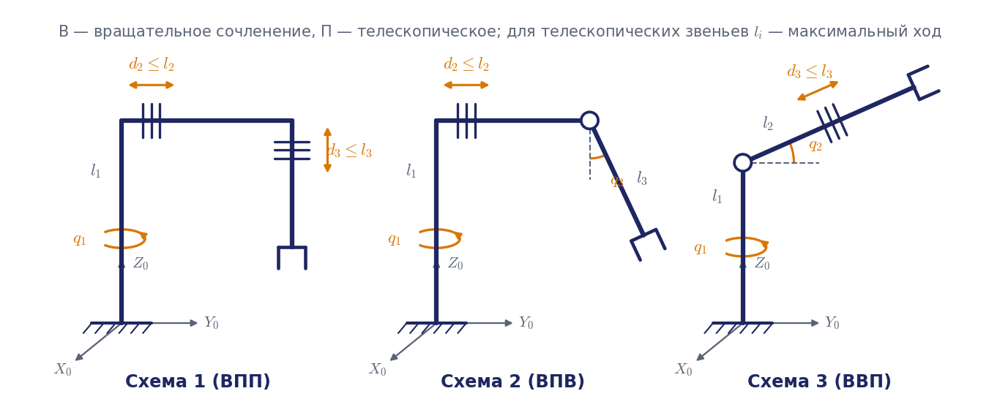

# ДЗ1. Кинематика трёхзвенного манипулятора

## Задание

Для заданной кинематической схемы манипулятора (рис. 1) требуется:

1. **Построить системы координат звеньев** в соответствии с алгоритмом Денавита — Хартенберга и составить таблицу кинематических параметров манипулятора. При построении указать положение начал систем координат всех звеньев $O_i$, направления осей $x_i$ и $z_i$, обозначить на схеме ненулевые кинематические параметры и направления их измерения.
2. **В общем виде решить прямую и обратную задачи о положении.** Получить аналитические выражения, затем подставить значения параметров своего варианта. Если обратная задача не решается аналитически, использовать итерационные методы. Длины звеньев заданы в табл. 1, положение схвата определено его декартовыми координатами из табл. 2. Ориентация схвата не учитывается.
3. **В общем виде решить прямую и обратную задачи о скорости.** При решении прямой задачи составить матрицу Якоби манипулятора и выписать выражения для компонент скорости схвата. Обратную задачу о скорости решить для конфигурации, полученной при решении обратной задачи о положении (для одной из конфигураций, если решение неоднозначно). Линейная скорость схвата указана в табл. 3. Угловую скорость схвата не учитывать.

Дополнительно (обязательно для оценки «отлично»):

4. Найти вырожденные конфигурации манипулятора ($\det J_v = 0$) и объяснить их геометрический смысл.
5. Построить сечение рабочей зоны манипулятора вертикальной плоскостью и отметить на нём заданную точку.



На всех схемах первое сочленение вращательное, ось вращения совпадает с осью $Z_0$ базовой системы координат; $l_1$ — высота колонны. В схеме 1 второе и третье сочленения телескопические (горизонтальное и вертикальное выдвижение). В схеме 2 второе сочленение телескопическое горизонтальное, третье — вращательное с горизонтальной осью, перпендикулярной руке; звено $l_3$ качается в вертикальной плоскости руки. В схеме 3 второе сочленение вращательное с горизонтальной осью (качание плеча $l_2$), третье — телескопическое вдоль руки.

## Варианты

**Табл. 1. Кинематические параметры манипуляторов, м** (для телескопических сочленений указаны максимальные длины звеньев, то есть предельный ход)

| № вар. | 1 | 2 | 3 | 4 | 5 | 6 | 7 | 8 | 9 |
|---|---|---|---|---|---|---|---|---|---|
| $l_1$ | 1,0 | 1,2 | 1,4 | 1,6 | 0,8 | 0,7 | 1,0 | 1,5 | 1,2 |
| $l_2$ | 0,8 | 1,0 | 1,2 | 1,4 | 0,6 | 0,7 | 0,8 | 1,3 | 1,4 |
| $l_3$ | 1,6 | 1,8 | 1,6 | 1,8 | 1,4 | 1,3 | 1,6 | 2,2 | 2,5 |

**Табл. 2. Координаты схвата, м**

| № вар. | 1 | 2 | 3 | 4 | 5 | 6 |
|---|---|---|---|---|---|---|
| $X$ | 0,5 | 0,4 | −0,4 | 0,5 | 0,6 | 0,3 |
| $Y$ | 0,4 | 0,3 | 0,4 | −0,4 | −1,0 | 0,3 |
| $Z$ | 0,3 | 0,1 | −0,6 | 0,3 | 0,5 | 0,3 |

**Табл. 3. Программная линейная скорость схвата, м/с**

| № вар. | 1 | 2 | 3 |
|---|---|---|---|
| $V_x$ | 0 | −0,1 | 0,4 |
| $V_y$ | 0,5 | 0,5 | 0,3 |
| $V_z$ | 0,1 | 0 | 0,1 |

## Как определить свой вариант

Каждому студенту соответствует пара чисел $(g, n)$: $g$ — номер группы (например, 73 для СМ7-73Б), $n$ — порядковый номер студента в списке группы, $n \in \{1, 2, 3, \dots\}$. Тогда:

| Что выбирается | Формула |
|---|---|
| Номер кинематической схемы | `((g + n) % 3) + 1` |
| Номер варианта из табл. 1 | `((g + n) // 4) % 9 + 1` |
| Номер варианта из табл. 2 | `(n % 6) + 1` |
| Номер варианта из табл. 3 | `(n % 3) + 1` |

Здесь `//` — целочисленное деление (`11 // 2 = 5`), `%` — остаток от деления (`11 % 2 = 1`). Те же формулы реализованы в [`variant.py`](variant.py):

```
python variant.py 73 12
```

## Если точка недостижима

Для части сочетаний «схема — табл. 1 — табл. 2» заданная точка лежит вне рабочей зоны с учётом предельного хода телескопических звеньев. В этом случае нужно:

1. **доказать недостижимость** — записать неравенства на обобщённые координаты и показать, какое из них нарушено;
2. указать, какой ход телескопического звена потребовался бы для достижения точки;
3. довести решение пунктов 2 и 3 до конца, **считая ход этого звена неограниченным**, и отметить это допущение в выводах.

Если в схеме 2 точка недостижима ни при каком ходе ($\lvert (l_1 - Z)/l_3 \rvert > 1$), решать задачу для той же точки с координатой $Z$, заменённой на ближайшее достижимое значение, и обосновать выбор.

## Что сдавать

Отчёт в PDF по [шаблону](Шаблон_отчёта.md): схема с системами координат, таблица параметров, вывод формул в общем виде, подстановка чисел, численная проверка скриптом [`dz1_check.py`](dz1_check.py) (снимок вывода в приложении), выводы. Порядок решения и типовые ошибки — в [методике](Методика_решения.md), образец полноты — [пример решения](Пример_решения.md).
