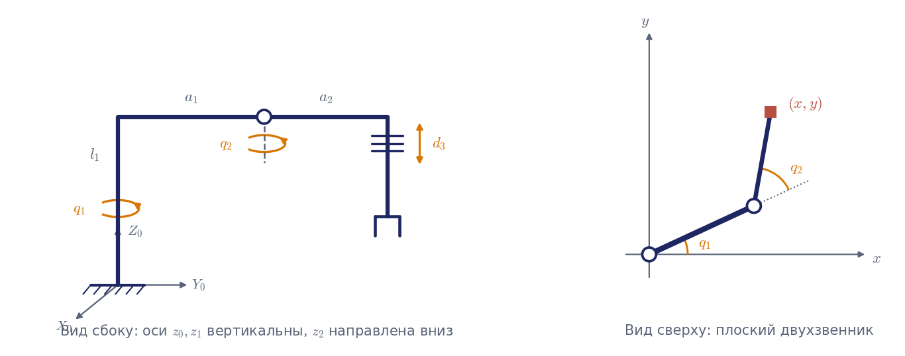

# ДЗ1. Пример решения

Пример показывает требуемую полноту отчёта. Схема примера — манипулятор типа SCARA (ВВП с вертикальными осями) — **не входит в варианты**, поэтому переписать отсюда ответ нельзя, а порядок действий тот же.

**Дано.** Схема на рис. 1: два вращательных сочленения с вертикальными осями и вертикальное телескопическое звено. Параметры: $`l_1 = 0{,}8`$ м, $`a_1 = 0{,}6`$ м, $`a_2 = 0{,}5`$ м, ход $`0 \le d_3 \le 0{,}5`$ м. Положение схвата $`X = 0{,}7`$, $`Y = 0{,}4`$, $`Z = 0{,}5`$ м. Скорость схвата $`\mathbf{v} = (0{,}2;\ -0{,}1;\ 0{,}05)`$ м/с.



## 1. Системы координат и таблица параметров

Оси сочленений: $`z_0`$ — ось первого сочленения (вертикально вверх), $`z_1`$ — ось второго сочленения, она параллельна $`z_0`$. Третье сочленение телескопическое и выдвигается вниз, поэтому ось $`z_2`$ направлена вертикально вниз; ось $`z_3`$ схвата совпадает по направлению с $`z_2`$.

Начала координат. Оси $`z_0`$ и $`z_1`$ параллельны, общих нормалей бесконечно много; выбираем ту, что проходит на высоте $`l_1`$, тогда $`d_1 = l_1`$, а начало $`O_1`$ лежит на оси второго сочленения на высоте руки. Ось $`x_1`$ направлена вдоль первого звена руки, $`a_1`$ — его длина. Аналогично $`O_2`$ — на оси третьего сочленения на высоте руки, $`x_2`$ — вдоль второго звена. Чтобы ось $`z_2`$ смотрела вниз, нужен поворот вокруг $`x_2`$ на $`\alpha_2 = 180^\circ`$. Начало $`O_3`$ — в характерной точке схвата, на расстоянии $`d_3`$ вдоль $`z_2`$.

| Звено | $`d_i`$ | $`a_i`$ | $`\alpha_i`$ | $`\theta_i`$ | Переменная |
|---|---|---|---|---|---|
| 1 | $`l_1`$ | $`a_1`$ | $`0`$ | $`q_1`$ | $`q_1`$ |
| 2 | $`0`$ | $`a_2`$ | $`180^\circ`$ | $`q_2`$ | $`q_2`$ |
| 3 | $`d_3`$ | $`0`$ | $`0`$ | $`0`$ | $`d_3`$ |

## 2. Прямая задача о положении

Матрицы звеньев по формуле (2.8), обозначения $`c_1 = \cos q_1`$, $`s_{12} = \sin(q_1 + q_2)`$:

```math
A_1 = \begin{pmatrix} c_1 & -s_1 & 0 & a_1 c_1 \\ s_1 & c_1 & 0 & a_1 s_1 \\ 0 & 0 & 1 & l_1 \\ 0 & 0 & 0 & 1 \end{pmatrix},\quad
A_2 = \begin{pmatrix} c_2 & s_2 & 0 & a_2 c_2 \\ s_2 & -c_2 & 0 & a_2 s_2 \\ 0 & 0 & -1 & 0 \\ 0 & 0 & 0 & 1 \end{pmatrix},\quad
A_3 = \begin{pmatrix} 1 & 0 & 0 & 0 \\ 0 & 1 & 0 & 0 \\ 0 & 0 & 1 & d_3 \\ 0 & 0 & 0 & 1 \end{pmatrix}.
```

Рекуррентное перемножение:

```math
T_2 = A_1 A_2 = \begin{pmatrix} c_{12} & s_{12} & 0 & a_1 c_1 + a_2 c_{12} \\ s_{12} & -c_{12} & 0 & a_1 s_1 + a_2 s_{12} \\ 0 & 0 & -1 & l_1 \\ 0 & 0 & 0 & 1 \end{pmatrix},\qquad
T_3 = T_2 A_3 = \begin{pmatrix} c_{12} & s_{12} & 0 & a_1 c_1 + a_2 c_{12} \\ s_{12} & -c_{12} & 0 & a_1 s_1 + a_2 s_{12} \\ 0 & 0 & -1 & l_1 - d_3 \\ 0 & 0 & 0 & 1 \end{pmatrix}.
```

Решение прямой задачи:

```math
x = a_1 c_1 + a_2 c_{12},\qquad y = a_1 s_1 + a_2 s_{12},\qquad z = l_1 - d_3.
```

Проверка в «понятной» конфигурации $`q_1 = q_2 = 0`$, $`d_3 = 0`$: рука вытянута вдоль $`X_0`$, схват в точке $`(a_1 + a_2;\ 0;\ l_1) = (1{,}1;\ 0;\ 0{,}8)`$ — совпадает со схемой.

## 3. Обратная задача о положении

Третье уравнение отделяется сразу: $`d_3 = l_1 - Z`$. Первые два — плоский двухзвенник (лекция 2, пример 2.10). Возводим их в квадрат и складываем:

```math
\cos q_2 = \frac{X^2 + Y^2 - a_1^2 - a_2^2}{2 a_1 a_2},\qquad q_2 = \pm\arccos\frac{X^2 + Y^2 - a_1^2 - a_2^2}{2 a_1 a_2},
```

```math
q_1 = \mathrm{atan2}(Y, X) - \mathrm{atan2}(a_2 \sin q_2,\ a_1 + a_2 \cos q_2).
```

Условия разрешимости: $`\lvert a_1 - a_2 \rvert \le \sqrt{X^2 + Y^2} \le a_1 + a_2`$ и $`0 \le l_1 - Z \le d_{3\max}`$.

Подстановка: $`X^2 + Y^2 = 0{,}65`$; $`\cos q_2 = (0{,}65 - 0{,}36 - 0{,}25)/0{,}6 = 0{,}0667`$; $`d_3 = 0{,}3`$ м (в пределах хода); $`\sqrt{0{,}65} = 0{,}806`$ лежит между $`0{,}1`$ и $`1{,}1`$ — точка достижима.

| Решение | $`q_1`$ | $`q_2`$ | $`d_3`$, м | Допустимо |
|---|---|---|---|---|
| 1 | $`-8{,}48^\circ`$ | $`86{,}18^\circ`$ | 0,3 | да |
| 2 | $`67{,}97^\circ`$ | $`-86{,}18^\circ`$ | 0,3 | да |

Проверка решения 1 прямой задачей: $`x = 0{,}6\cos(-8{,}48^\circ) + 0{,}5\cos(77{,}70^\circ) = 0{,}5934 + 0{,}1065 = 0{,}700`$; $`y = 0{,}6\sin(-8{,}48^\circ) + 0{,}5\sin(77{,}70^\circ) = -0{,}0885 + 0{,}4885 = 0{,}400`$; $`z = 0{,}8 - 0{,}3 = 0{,}5`$. Сходится.

## 4. Прямая задача о скорости

Столбцы матрицы Якоби линейных скоростей. Из матриц $`T_0 = E`$, $`T_1`$, $`T_2`$: $`\mathbf{z}_0 = \mathbf{z}_1 = (0, 0, 1)^{\mathrm T}`$, $`\mathbf{z}_2 = (0, 0, -1)^{\mathrm T}`$; $`\mathbf{p}_0 = 0`$, $`\mathbf{p}_1 = (a_1 c_1,\ a_1 s_1,\ l_1)^{\mathrm T}`$.

```math
\mathbf{z}_0 \times (\mathbf{p}_3 - \mathbf{p}_0) = \begin{pmatrix} -a_1 s_1 - a_2 s_{12} \\ a_1 c_1 + a_2 c_{12} \\ 0 \end{pmatrix},\qquad
\mathbf{z}_1 \times (\mathbf{p}_3 - \mathbf{p}_1) = \begin{pmatrix} -a_2 s_{12} \\ a_2 c_{12} \\ 0 \end{pmatrix},\qquad
\mathbf{z}_2 = \begin{pmatrix} 0 \\ 0 \\ -1 \end{pmatrix}.
```

```math
J_v = \begin{pmatrix} -a_1 s_1 - a_2 s_{12} & -a_2 s_{12} & 0 \\ a_1 c_1 + a_2 c_{12} & a_2 c_{12} & 0 \\ 0 & 0 & -1 \end{pmatrix}.
```

Контроль дифференцированием: $`\partial x/\partial q_1 = -a_1 s_1 - a_2 s_{12}`$, $`\partial x/\partial q_2 = -a_2 s_{12}`$, $`\partial z/\partial d_3 = -1`$ и так далее — матрица та же. Компоненты скорости схвата:

```math
v_x = -(a_1 s_1 + a_2 s_{12})\dot q_1 - a_2 s_{12}\dot q_2,\qquad
v_y = (a_1 c_1 + a_2 c_{12})\dot q_1 + a_2 c_{12}\dot q_2,\qquad
v_z = -\dot d_3.
```

## 5. Обратная задача о скорости

Определитель: $`\det J_v = -a_1 a_2 \sin q_2`$. При $`\sin q_2 \ne 0`$ система решается в замкнутом виде:

```math
\dot q_1 = \frac{v_x c_{12} + v_y s_{12}}{a_1 s_2},\qquad
\dot q_2 = -\frac{v_x (a_1 c_1 + a_2 c_{12}) + v_y (a_1 s_1 + a_2 s_{12})}{a_1 a_2 s_2},\qquad
\dot d_3 = -v_z.
```

Для решения 1 ($`q_1 = -8{,}48^\circ`$, $`q_2 = 86{,}18^\circ`$):

```math
J_v = \begin{pmatrix} -0{,}4000 & -0{,}4885 & 0 \\ 0{,}7000 & 0{,}1066 & 0 \\ 0 & 0 & -1 \end{pmatrix},\qquad \det J_v = -0{,}2993,
```

```math
\dot q_1 = -0{,}0920\ \text{rad/s},\qquad \dot q_2 = -0{,}3341\ \text{rad/s},\qquad \dot d_3 = -0{,}05\ \text{m/s}.
```

Проверка: $`-0{,}4\cdot(-0{,}0920) - 0{,}4885\cdot(-0{,}3341) = 0{,}0368 + 0{,}1632 = 0{,}200`$; $`0{,}7\cdot(-0{,}0920) + 0{,}1066\cdot(-0{,}3341) = -0{,}0644 - 0{,}0356 = -0{,}100`$. Сходится. Для решения 2 получается $`\dot q_1 = -0{,}3695`$ рад/с, $`\dot q_2 = 0{,}3341`$ рад/с: та же скорость схвата в другой конфигурации требует вчетверо большей скорости первого привода.

## 6. Вырожденные конфигурации

$`\det J_v = -a_1 a_2 \sin q_2 = 0`$ при $`q_2 = 0`$ и $`q_2 = \pm 180^\circ`$: рука вытянута или сложена. В этих конфигурациях первые два столбца $`J_v`$ пропорциональны, схват может двигаться в горизонтальной плоскости только перпендикулярно руке; скорость вдоль руки нереализуема. Вертикальное движение не вырождается никогда — третий столбец не зависит от конфигурации. На рабочей зоне вырожденные конфигурации соответствуют её внешней ($`r = a_1 + a_2`$) и внутренней ($`r = \lvert a_1 - a_2 \rvert`$) цилиндрическим границам.

## 7. Рабочая зона

Зона — полый цилиндр: $`0{,}1 \le r \le 1{,}1`$ м, $`0{,}3 \le z \le 0{,}8`$ м (при $`d_3 \in [0;\ 0{,}5]`$). Заданная точка $`r = 0{,}806`$, $`z = 0{,}5`$ лежит внутри, далеко от границ, поэтому оба решения далеки от вырожденных конфигураций ($`\lvert \sin q_2 \rvert = 0{,}998`$).

## 8. Численная проверка

Вывод `dz1_check.py` (скрипт в репозитории заполнен именно этим примером): все расхождения порядка $`10^{-16}`$ для прямой задачи и матрицы Якоби по столбцам, $`5\cdot 10^{-7}`$ — для численного дифференцирования; итерационный метод из 30 случайных стартов находит те же два решения.

## Выводы

1. Для манипулятора SCARA прямая задача о положении даёт $`x = a_1 c_1 + a_2 c_{12}`$, $`y = a_1 s_1 + a_2 s_{12}`$, $`z = l_1 - d_3`$; вертикальное движение отделено от горизонтального.
2. Обратная задача имеет два решения («локоть» в разные стороны), оба допустимы для заданной точки.
3. Матрица Якоби получена двумя способами; $`\det J_v = -a_1 a_2 \sin q_2`$, вырождение — при вытянутой и сложенной руке.
4. Одна и та же скорость схвата требует разных скоростей приводов в разных конфигурациях — выбор ветви обратной задачи влияет на требования к приводам.
