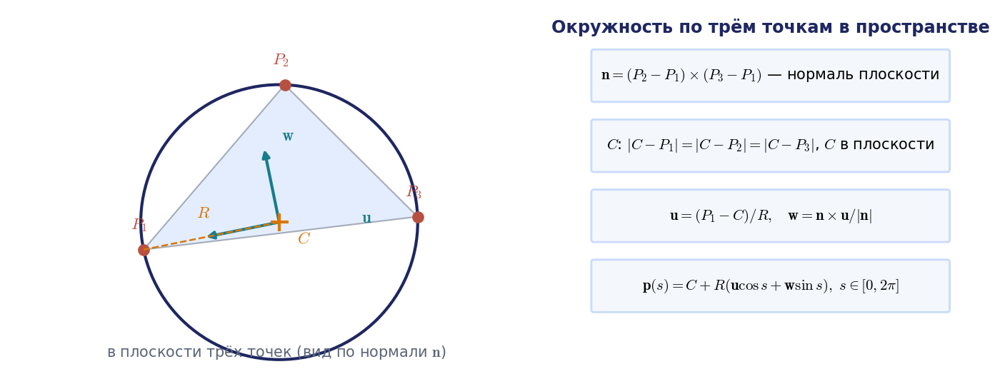

# ДЗ2. Инструкция

Работа делится на две независимые половины: **расчёт** (он не требует симулятора и полностью проверяется скриптом `run_offline.py`) и **сцена** (модель робота в CoppeliaSim). Начинайте с расчёта — если окружность не помещается в рабочую зону, об этом лучше узнать до сборки сцены.

В папке [`code`](code) лежат заготовки:

| Файл | Назначение |
|---|---|
| [`circle3p.py`](code/circle3p.py) | окружность через три точки в пространстве, ориентация инструмента |
| [`run_offline.py`](code/run_offline.py) | закон движения по окружности, обратная задача в узлах, сплайн по времени, проверка пределов скоростей, графики, `trajectory.csv` (столбцы `t`, `q1…qN`, `qd1…qdN`) |
| [`coppelia_run.py`](code/coppelia_run.py) | исполнение `trajectory.csv` в CoppeliaSim через ZeroMQ remote API с уставками по модельному времени, запись `tip_trace.csv` |

Заготовки работают на примере коллаборативного робота UR5e: функция `make_ur5e()` и таблица `UR5E_DH` библиотеки [`kinlib`](../../03_Примеры_Jupyter/kinlib.py) взяты из официальной таблицы Денавита — Хартенберга Universal Robots, пределы — из паспорта (диапазон каждого сочленения ±360°, скорость 180°/с, досягаемость 850 мм). Ваша задача — подставить своего робота, свои точки и довести программу до результата; использовать `kinlib` не обязательно, можно писать кинематику самостоятельно.

## Шаг 1. Окружность через три точки

Нормаль плоскости $\mathbf{n} = (P_2 - P_1) \times (P_3 - P_1)$. Если $\lvert\mathbf{n}\rvert = 0$, точки лежат на одной прямой и окружность не определена — программа обязана это обнаружить. Центр ищется в виде $C = P_1 + \alpha\,\mathbf{a} + \beta\,\mathbf{b}$, где $\mathbf{a} = P_2 - P_1$, $\mathbf{b} = P_3 - P_1$; из условий равенства расстояний до трёх точек

$$
\alpha = \frac{(\mathbf{b}\cdot\mathbf{b})\,(\mathbf{a}\cdot\mathbf{a} - \mathbf{a}\cdot\mathbf{b})}{2\,\bigl[(\mathbf{a}\cdot\mathbf{a})(\mathbf{b}\cdot\mathbf{b}) - (\mathbf{a}\cdot\mathbf{b})^2\bigr]},\qquad
\beta = \frac{(\mathbf{a}\cdot\mathbf{a})\,(\mathbf{b}\cdot\mathbf{b} - \mathbf{a}\cdot\mathbf{b})}{2\,\bigl[(\mathbf{a}\cdot\mathbf{a})(\mathbf{b}\cdot\mathbf{b}) - (\mathbf{a}\cdot\mathbf{b})^2\bigr]}.
$$

Радиус $\rho = \lvert P_1 - C\rvert$ (буква $R$ в курсе занята матрицами поворота), орты в плоскости $\mathbf{u} = (P_1 - C)/\rho$ и $\mathbf{w} = \mathbf{n} \times \mathbf{u} / \lvert\mathbf{n}\rvert$, параметрическое уравнение

$$
\mathbf{p}(\varphi) = C + \rho\,(\mathbf{u}\cos\varphi + \mathbf{w}\sin\varphi),\qquad \varphi \in [0,\ 2\pi].
$$

**Проверка.** Все три точки должны лежать на окружности: расстояние до $C$ равно $\rho$, отклонение от плоскости равно нулю (`python circle3p.py`).

## Шаг 2. Кинематическая модель робота

Размеры берите из габаритного чертежа в паспорте робота, а не измеряйте в CAD «на глаз». Составьте таблицу Денавита — Хартенберга ([лекция 1](../../01_Конспект_лекций/Лекция_01.md)), запишите её в `run_offline.py` (массив `DH`, строка — `d, a, alpha, theta0`), укажите из паспорта пределы сочленений `Q_LIMITS`, пределы скоростей `QD_MAX` и досягаемость `R_MAX`. Если производитель указывает и пределы ускорений сочленений, запишите их в `QDD_MAX`; если нет, оставьте `None`.

**Проверка.** Нулевая конфигурация в паспорте обычно нарисована; положение фланца в ней должно совпасть с `robot.forward(np.zeros(6))`.

## Шаг 3. Проверка рабочей зоны и обратная задача

Принадлежность окружности рабочей зоне проверяется **решением обратной задачи в каждой точке** с контролем пределов сочленений — это и есть определение достижимости ([лекция 2](../../01_Конспект_лекций/Лекция_02.md), § 2.8). Грубая предварительная оценка — сравнить наибольшее удаление точек окружности от основания с досягаемостью робота.

Обратную задачу удобно решать итерационно «цепочкой близких целей»: стартом для очередного узла служит решение в предыдущем. `run_offline.py` вызывает решатель `kinlib` с полным шагом метода Ньютона ($\alpha = 1$; шаг уменьшается вдвое, только если невязка не убывает). При соседних узлах окружности решатель должен сходиться за несколько итераций (обычно от одной до четырёх); в примере — в среднем за 1,9 итерации, не больше двух. Если итераций заметно больше, проверьте шаг решателя и не потеряна ли ветвь. Следите за тремя признаками неблагополучия:

- ошибка положения после итераций больше допуска — точка недостижима;
- скачок обобщённой координаты между соседними узлами в десятки градусов — смена ветви или проход рядом с особой конфигурацией;
- малые сингулярные числа матрицы Якоби — близость к особой конфигурации ([лекция 3](../../01_Конспект_лекций/Лекция_03.md), § 3.5); измените ориентацию инструмента, начальную конфигурацию `Q_START` или точки.

О сингулярных числах нужно сказать отдельно. Строки линейной скорости матрицы Якоби измеряются в метрах на радиан, строки угловой скорости безразмерны, поэтому наименьшее сингулярное число полной матрицы $6\times N$ зависит от выбора единиц длины: если записать длины в миллиметрах, линейный блок вырастет в тысячу раз, и число изменится. Сравнивать такие числа между отчётами нельзя. Скрипт печатает три величины, которые от этого произвола свободны или явно привязаны к единицам: $\sigma_{\min}(J_v)$ в метрах на радиан, $\sigma_{\min}(J_\omega)$ и наименьшее сингулярное число безразмерной матрицы $J_n$, у которой строки линейной скорости поделены на досягаемость $R_{\max}$. Последняя обращается в нуль во всех особых конфигурациях, а блоки по отдельности особенность могут не заметить: у UR5e в кистевой особой конфигурации ($q_5 = 0$, остальные координаты $0{,}3;\ -1{,}2;\ 1{,}4;\ -0{,}5;\ 0{,}7$ рад) $\sigma_{\min}(J_v) = 0{,}275$ м/рад и $\sigma_{\min}(J_\omega) = 0{,}211$, а $\sigma_{\min}(J_n) = 0$.

## Шаг 3а. Закон движения во времени

Обратная задача в узлах даёт только последовательность конфигураций; чтобы робот двигался без рывков, нужен закон движения во времени ([лекция 4](../../01_Конспект_лекций/Лекция_04.md)). `run_offline.py` строит его в четыре действия.

1. **Закон движения по окружности.** Угол на окружности меняется как $\varphi(t) = 2\pi\,\lambda_5(t/T)$, где $\lambda_5(\tau) = 10\tau^3 - 15\tau^4 + 6\tau^5$ — многочлен пятой степени с нулевыми первой и второй производными при $\tau = 0$ и $\tau = 1$. Схват трогается и останавливается плавно, без скачка скорости и ускорения. Время обхода $T$ задаётся параметром `T_CIRCLE`.
2. **Число узлов по ошибке хорды.** Если между узлами схват идёт по хорде, наибольшее отклонение от окружности радиуса $\rho$ при шаге по углу $\Delta\varphi$ равно $\rho\,(1 - \cos(\Delta\varphi/2))$ — это ошибка хорды ε_х. Отсюда допустимый шаг $\Delta\varphi = 2\arccos(1 - \varepsilon/\rho)$, где $\varepsilon$ — допуск на ошибку хорды (параметр `EPS_CHORD`, 0,1 мм). Узлы берутся равномерно по времени, а наибольший шаг по углу приходится на середину обхода, где скорость $d\lambda_5/d\tau$ максимальна и равна $15/8$. Поэтому число узлов равно $\lceil 2\pi\cdot(15/8)/\Delta\varphi\rceil$. В примере $\rho = 0{,}1743$ м, $\Delta\varphi \le 3{,}88^\circ$ и узлов 174.
3. **Сплайн по времени.** Для каждой обобщённой координаты через значения в узлах проводится кубический сплайн с нулевыми скоростями на концах (`trajlib.spline_m`, режим `'clamped'`). Сплайн даёт и $\dot q_i(t)$, и $\ddot q_i(t)$, поэтому в `trajectory.csv` записываются столбцы `t`, `q1…qN`, `qd1…qdN` с шагом `DT_OUT`.
4. **Проверка пределов и растяжение времени.** Скрипт находит наибольшие $\lvert\dot q_i\rvert$ и сравнивает их с паспортными $\dot q_i^{\max}$; если заданы пределы ускорений, то и $\lvert\ddot q_i\rvert$ с $\ddot q_i^{\max}$. Если какой-то предел нарушен, время обхода растягивается в $\kappa = \max\bigl(\max_i \lvert\dot q_i\rvert/\dot q_i^{\max},\ \sqrt{\max_i \lvert\ddot q_i\rvert/\ddot q_i^{\max}}\bigr)$ раз: при замене $t \to \kappa t$ скорости делятся на $\kappa$, а ускорения — на $\kappa^2$. Скрипт печатает и наименьшее допустимое время обхода $T_{\min} = \kappa T$. В примере при $T = 6$ с первое сочленение UR5e использует 50 % паспортной скорости (90,3°/с), так что $T_{\min} \approx 3{,}0$ с.

В конце скрипт проверяет результат: строит путь схвата по сплайну с шагом `DT_OUT` и находит его наибольшее отклонение от окружности (в примере около 0,001 мм при допуске 0,1 мм), а в узлах сравнивает $\dot{\mathbf{q}}$ сплайна с $J^{+}\dot{\mathbf{s}}$, где $\dot{\mathbf{s}}$ — скорость схвата по закону движения.

`run_offline.py` печатает все показатели и строит графики:

## Шаг 4. Сцена в CoppeliaSim

1. Скачайте CAD-модель (STEP) с сайта производителя. Во FreeCAD разделите её на звенья и экспортируйте каждое звено в STL **в общей системе координат** (не перемещая звенья) — тогда в симуляторе они встанут на место без подгонки.
2. В CoppeliaSim: `File → Import → Mesh`, масштаб «мм → м». Для динамики упростите формы (`Edit → Morph selection into convex shapes`) или оставьте звенья статическими и работайте в кинематическом режиме сочленений.
3. Добавьте сочленения (`Add → Joint → Revolute`), поставьте каждое на ось по чертежу, задайте пределы. Постройте иерархию: основание → сочленение 1 → звено 1 → сочленение 2 → …
4. На фланец добавьте `dummy` — характерную точку инструмента (`TIP_PATH` в `coppelia_run.py`).
5. Режим сочленений: для кинематической модели — `Kinematic mode`, для динамической — `Dynamic mode` с управлением по положению.

## Шаг 5. Согласование нулей и знаков

Нуль и положительное направление сочленения в сцене почти никогда не совпадают с таблицей ДХ. Для каждого сочленения по очереди: задайте в сцене $+30^\circ$, посмотрите, куда сдвинулся инструмент, сравните с `robot.forward` при том же угле. Отсюда знак `Q_SIGN[i]` и сдвиг `Q_OFFSET[i]`. Проверка пункта 2 задания (три конфигурации) выполняется после этой настройки; расхождение положения инструмента — не более 1 мм.

## Шаг 6. Исполнение и измерение

`coppelia_run.py` подключается к запущенному CoppeliaSim и включает пошаговый режим: каждый шаг симуляции выполняется по команде программы. На каждом шаге программа читает модельное время $t$, вычисляет уставку $\mathbf{q}^{\ast}(t)$ интерполяцией таблицы `trajectory.csv` и передаёт её сочленениям. Так в симуляторе исполняется именно рассчитанный закон движения, а не ступеньки «точка — пауза — точка», при которых старт и остановка идут со скачком скорости. Подвод из начального положения робота к первой точке окружности выполняется переходом из покоя в покой по многочлену пятой степени с умеренными пределами скорости и ускорения (`APPROACH_QD`, `APPROACH_QDD`). Окружность проходится `N_LAPS` раз (по умолчанию три) с короткой выдержкой перед каждым обходом. Положение характерной точки и фактические обобщённые координаты записываются в `tip_trace.csv` (столбцы `lap`, `t`, `x`, `y`, `z`, `q1…qN`).

Уставка обновляется один раз за шаг симуляции, поэтому шаг сцены желательно уменьшить до 5–10 мс. Нужен пакет `coppeliasim-zmqremoteapi-client` (`pip install coppeliasim-zmqremoteapi-client`) и версия CoppeliaSim с ZeroMQ remote API, где доступны вызовы `client.require('sim')`, `sim.setStepping` и `sim.step`. Если у вас более старая версия с `remoteApi.dll` и модулями `sim.py`, `simConst.py`, перепишите блок связи под неё — логика остаётся той же. Логика скрипта проверена на имитации симулятора по модели `kinlib`; в самом CoppeliaSim проверьте его на своей сцене до того, как записывать видео.

В отчёте постройте заданную окружность и фактическую траекторию на одном графике, приведите наибольшее и среднеквадратичное отклонение от окружности — это оценка точности траектории (в стандарте ISO 9283 — path accuracy) — и разброс между обходами, то есть оценку повторяемости траектории (path repeatability). В динамическом режиме отклонение определяется настройкой регуляторов сочленений и скоростью обхода — исследуйте эту зависимость хотя бы на двух значениях $T$.

## Типовые ошибки

| Симптом | Причина |
|---|---|
| Инструмент описывает окружность в другом месте или в зеркальной плоскости | не согласованы знаки и нули сочленений (шаг 5), либо базовая система координат сцены не совпадает с основанием робота |
| Робот «перекидывается» посреди траектории | обратная задача решается в каждой точке с одного и того же начального приближения, а не с предыдущего решения |
| Итерации не сходятся в части точек | окружность выходит за рабочую зону или пределы сочленений; реже — проход через особую конфигурацию |
| На узел уходит заметно больше 2–4 итераций | уменьшен шаг решателя (метод Ньютона сходится быстро только при полном шаге $\alpha = 1$) или потеряна ветвь |
| Окружность превращается в многоугольник | мало узлов: ошибка хорды равна $\rho\,(1 - \cos(\Delta\varphi/2))$; либо велик шаг симуляции |
| Рывок при старте и остановке | уставки подаются ступеньками или нет закона разгона и торможения ([лекция 4](../../01_Конспект_лекций/Лекция_04.md), § 4.2–4.3) |
| Скорость сочленения превышает паспортную | мало время обхода $T$; растяните его в $\kappa$ раз (шаг 3а) |
| Модель «разваливается» при старте симуляции | в динамическом режиме звенья пересекаются или не заданы массы; начните с кинематического режима |
