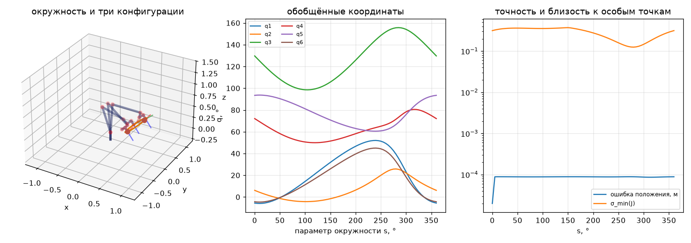

# ДЗ2. Инструкция

Работа делится на две независимые половины: **расчёт** (он не требует симулятора и полностью проверяется скриптом `run_offline.py`) и **сцена** (модель робота в CoppeliaSim). Начинайте с расчёта — если окружность не помещается в рабочую зону, об этом лучше узнать до сборки сцены.

В папке [`code`](code) лежат заготовки:

| Файл | Назначение |
|---|---|
| [`circle3p.py`](code/circle3p.py) | окружность через три точки в пространстве, ориентация инструмента |
| [`run_offline.py`](code/run_offline.py) | проверка рабочей зоны, обратная задача вдоль окружности, графики, `trajectory.csv` |
| [`coppelia_run.py`](code/coppelia_run.py) | воспроизведение `trajectory.csv` в CoppeliaSim через ZeroMQ remote API, запись `tip_trace.csv` |

Заготовки работают на примере шестизвенника из библиотеки [`kinlib`](../../03_Примеры_Jupyter/kinlib.py). Ваша задача — подставить своего робота, свои точки и довести программу до результата; использовать `kinlib` не обязательно, можно писать кинематику самостоятельно.

## Шаг 1. Окружность через три точки

Нормаль плоскости $\mathbf{n} = (P_2 - P_1) \times (P_3 - P_1)$. Если $\lvert\mathbf{n}\rvert = 0$, точки лежат на одной прямой и окружность не определена — программа обязана это обнаружить. Центр ищется в виде $C = P_1 + \alpha\,\mathbf{a} + \beta\,\mathbf{b}$, где $\mathbf{a} = P_2 - P_1$, $\mathbf{b} = P_3 - P_1$; из условий равенства расстояний до трёх точек

$$
\alpha = \frac{(\mathbf{b}\cdot\mathbf{b})\,(\mathbf{a}\cdot\mathbf{a} - \mathbf{a}\cdot\mathbf{b})}{2\,\bigl[(\mathbf{a}\cdot\mathbf{a})(\mathbf{b}\cdot\mathbf{b}) - (\mathbf{a}\cdot\mathbf{b})^2\bigr]},\qquad
\beta = \frac{(\mathbf{a}\cdot\mathbf{a})\,(\mathbf{b}\cdot\mathbf{b} - \mathbf{a}\cdot\mathbf{b})}{2\,\bigl[(\mathbf{a}\cdot\mathbf{a})(\mathbf{b}\cdot\mathbf{b}) - (\mathbf{a}\cdot\mathbf{b})^2\bigr]}.
$$

Радиус $R = \lvert P_1 - C\rvert$, орты в плоскости $\mathbf{u} = (P_1 - C)/R$ и $\mathbf{w} = \mathbf{n} \times \mathbf{u} / \lvert\mathbf{n}\rvert$, параметрическое уравнение

$$
\mathbf{p}(s) = C + R\,(\mathbf{u}\cos s + \mathbf{w}\sin s),\qquad s \in [0,\ 2\pi].
$$

**Проверка.** Все три точки должны лежать на окружности: расстояние до $C$ равно $R$, отклонение от плоскости равно нулю (`python circle3p.py`).

## Шаг 2. Кинематическая модель робота

Размеры берите из габаритного чертежа в паспорте робота, а не измеряйте в CAD «на глаз». Составьте таблицу Денавита — Хартенберга ([лекция 1](../../01_Конспект_лекций/Лекция_01.md)), запишите её в `run_offline.py` (массив `DH`, строка — `d, a, alpha, theta0`), укажите пределы сочленений `Q_LIMITS` из паспорта.

**Проверка.** Нулевая конфигурация в паспорте обычно нарисована; положение фланца в ней должно совпасть с `robot.forward(np.zeros(6))`.

## Шаг 3. Проверка рабочей зоны и обратная задача

Принадлежность окружности рабочей зоне проверяется **решением обратной задачи в каждой точке** с контролем пределов сочленений — это и есть определение достижимости ([лекция 2](../../01_Конспект_лекций/Лекция_02.md), § 2.8). Грубая предварительная оценка — сравнить наибольшее удаление точек окружности от основания с досягаемостью робота.

Обратную задачу удобно решать итерационно «цепочкой близких целей»: стартом для очередной точки служит решение предыдущей. Тогда на точку уходит несколько итераций, а решение остаётся на одной ветви. Следите за тремя признаками неблагополучия:

- ошибка положения после итераций больше допуска — точка недостижима;
- скачок обобщённой координаты между соседними точками в десятки градусов — смена ветви или проход рядом с особой конфигурацией;
- минимальное сингулярное число матрицы Якоби близко к нулю — особая конфигурация ([лекция 3](../../01_Конспект_лекций/Лекция_03.md), § 3.5); измените ориентацию инструмента, начальную конфигурацию `Q_START` или точки.

`run_offline.py` печатает все три показателя и строит графики:

## Шаг 4. Сцена в CoppeliaSim

1. Скачайте CAD-модель (STEP) с сайта производителя. Во FreeCAD разделите её на звенья и экспортируйте каждое звено в STL **в общей системе координат** (не перемещая звенья) — тогда в симуляторе они встанут на место без подгонки.
2. В CoppeliaSim: `File → Import → Mesh`, масштаб «мм → м». Для динамики упростите формы (`Edit → Morph selection into convex shapes`) или оставьте звенья статическими и работайте в кинематическом режиме сочленений.
3. Добавьте сочленения (`Add → Joint → Revolute`), поставьте каждое на ось по чертежу, задайте пределы. Постройте иерархию: основание → сочленение 1 → звено 1 → сочленение 2 → …
4. На фланец добавьте `dummy` — характерную точку инструмента (`TIP_PATH` в `coppelia_run.py`).
5. Режим сочленений: для кинематической модели — `Kinematic mode`, для динамической — `Dynamic mode` с управлением по положению.

## Шаг 5. Согласование нулей и знаков

Нуль и положительное направление сочленения в сцене почти никогда не совпадают с таблицей ДХ. Для каждого сочленения по очереди: задайте в сцене $+30^\circ$, посмотрите, куда сдвинулся инструмент, сравните с `robot.forward` при том же угле. Отсюда знак `Q_SIGN[i]` и сдвиг `Q_OFFSET[i]`. Проверка пункта 2 задания (три конфигурации) выполняется после этой настройки; расхождение положения инструмента — не более 1 мм.

## Шаг 6. Исполнение и измерение

`coppelia_run.py` подключается к запущенному CoppeliaSim, включает пошаговый режим, подводит робота к первой точке, проходит окружность и записывает положение характерной точки в `tip_trace.csv`. Нужен пакет `coppeliasim-zmqremoteapi-client` (`pip install coppeliasim-zmqremoteapi-client`) и CoppeliaSim 4.5 или новее. Если у вас более старая версия с `remoteApi.dll` и модулями `sim.py`, `simConst.py`, перепишите блок связи под неё — логика остаётся той же.

В отчёте постройте заданную окружность и фактическую траекторию на одном графике, приведите наибольшее и среднеквадратичное отклонение. В динамическом режиме отклонение определяется настройкой регуляторов сочленений и скоростью обхода — исследуйте эту зависимость хотя бы на двух скоростях.

## Типовые ошибки

| Симптом | Причина |
|---|---|
| Инструмент описывает окружность в другом месте или в зеркальной плоскости | не согласованы знаки и нули сочленений (шаг 5), либо базовая система координат сцены не совпадает с основанием робота |
| Робот «перекидывается» посреди траектории | обратная задача решается в каждой точке с одного и того же начального приближения, а не с предыдущего решения |
| Итерации не сходятся в части точек | окружность выходит за рабочую зону или пределы сочленений; реже — проход через особую конфигурацию |
| Окружность превращается в многоугольник | мало точек (`NUM`) или велик шаг по времени |
| Модель «разваливается» при старте симуляции | в динамическом режиме звенья пересекаются или не заданы массы; начните с кинематического режима |
