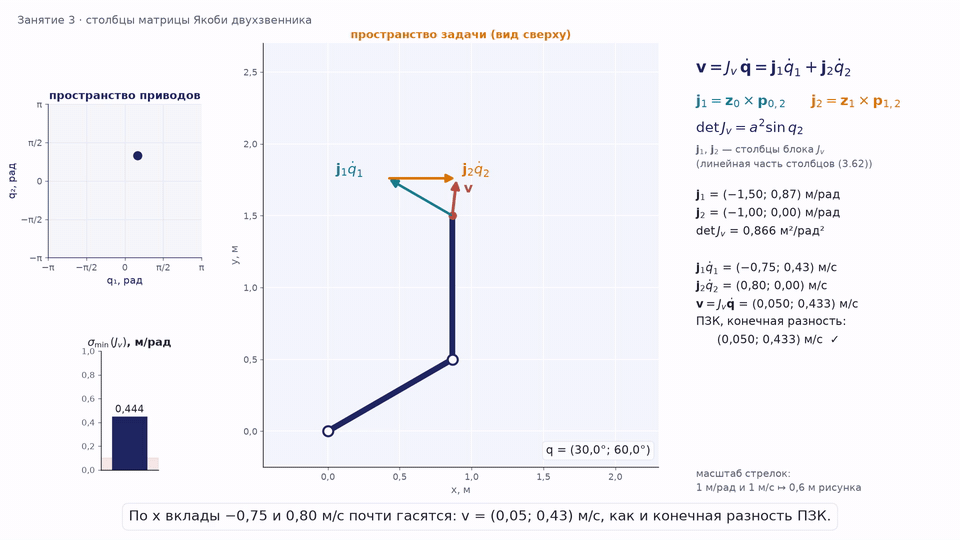
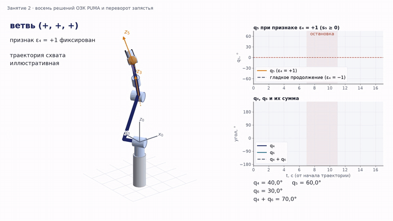
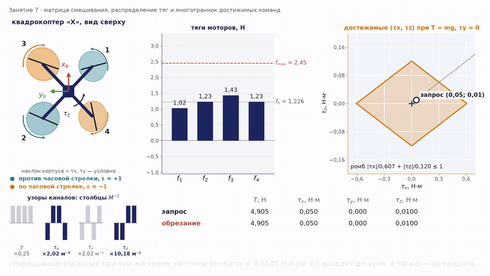

# Курс «Управление роботами». Раздел «Кинематика»

Редакция 2026 года, переработана в октябре 2026 года. Бакалавриат, 4 курс, кафедра СМ7 «Робототехнические системы и мехатроника», МГТУ им. Н. Э. Баумана.

## Что это

Учебный комплект раздела: **конспект лекций, презентации, анимации, примеры на Jupyter и два домашних задания**. Основной учебник — Зенкевич С. Л., Ющенко А. С. «Основы управления манипуляционными роботами» (2004), главы 1–4 (занятия 1–4). Номера формул учебника в конспекте сохранены там, где это помогает читать книгу; где курс пишет иначе или исправляет опечатку книги, в тексте стоит «Примечание о расхождении с книгой». Занятия 5–7 — параллельные механизмы, колёсные и летающие роботы — опираются на источники, указанные в конце соответствующих лекций. Во всех лекциях даны ссылки на современные учебники: К. Линч и Ф. Парк «Modern Robotics» (2017), П. Корке «Robotics, Vision and Control», 3-е издание (2023).

Раздел построен вокруг одного правила: **формула — численная проверка — картинка**. Каждое соотношение лекции можно пересчитать в ноутбуке, а каждое аналитическое решение домашнего задания обязано сойтись с численным расчётом.

Сквозной пример курса — коллаборативный робот **UR5e** с таблицей Денавита — Хартенберга производителя: на нём показаны прямая и обратная задачи, матрица Якоби, особые конфигурации и траектории, он же служит примером во втором домашнем задании. Плоские двух- и трёхзвенники остаются «микроскопом», на котором всё видно в деталях, а манипулятор PUMA — примером учебника. В каждой лекции есть врезка «Где это в реальной системе»: как те же задачи решают промышленные контроллеры, ROS 2, MoveIt 2, ros2_controllers, Nav2 и автопилот PX4.

Все обозначения курса сведены в одну таблицу — [Обозначения.md](00_Паспорт/Обозначения.md); там же собраны соглашения программных библиотек (например, порядок блоков угловой и линейной скорости).

## Читать

**Конспект лекций** — [одним файлом PDF](01_Конспект_лекций/Конспект_лекций.pdf) или по главам (формулы отображаются прямо на GitHub). Громоздкие выводы, которые на занятии не воспроизводятся, вынесены в приложения в конце каждой лекции.

| | Лекция |
|---|---|
| 1 | [Манипулятор как объект управления. Преобразования координат и системы координат Денавита — Хартенберга](01_Конспект_лекций/Лекция_01.md) |
| 2 | [Прямая и обратная задачи кинематики о положении](01_Конспект_лекций/Лекция_02.md) |
| 3 | [Скорости манипулятора и кинематические характеристики](01_Конспект_лекций/Лекция_03.md) |
| 4 | [Планирование траекторий и кинематическое управление](01_Конспект_лекций/Лекция_04.md) |
| 5 | [Замкнутые кинематические цепи: параллельные манипуляторы](01_Конспект_лекций/Лекция_05.md) |
| 6 | [Кинематика колёсных мобильных роботов](01_Конспект_лекций/Лекция_06.md) |
| 7 | [Кинематика летающих роботов](01_Конспект_лекций/Лекция_07.md) |
| 8 | [Обобщение раздела: единая картина кинематики роботов](01_Конспект_лекций/Лекция_08.md) |

**Презентации (PDF):** [занятие 1](02_Презентации/pdf/Занятие_01.pdf) · [занятие 2](02_Презентации/pdf/Занятие_02.pdf) · [занятие 3](02_Презентации/pdf/Занятие_03.pdf) · [занятие 4](02_Презентации/pdf/Занятие_04.pdf) · [занятие 5](02_Презентации/pdf/Занятие_05.pdf) · [занятие 6](02_Презентации/pdf/Занятие_06.pdf) · [занятие 7](02_Презентации/pdf/Занятие_07.pdf) · [занятие 8](02_Презентации/pdf/Занятие_08.pdf). Слайды понятны без лектора: в начале каждого занятия — «Что нужно помнить с прошлых занятий» и глоссарий сокращений и обозначений, перед перерывом — «Что нужно помнить из первой части».

**Паспорт раздела:** [программа](00_Паспорт/Программа_курса.md) · [вопросы рубежного контроля](00_Паспорт/Вопросы_РК.md) · [обозначения](00_Паспорт/Обозначения.md)

## Смотреть

[**Анимации**](06_Анимации) — 48 роликов, по 3–7 к каждому занятию, около часа в сумме. Каждый показывает то, что трудно передать статичной схемой: как вырождается матрица Якоби у особой точки, как ветви обратной задачи переходят друг в друга, как одометрия набирает ошибку, почему квадрокоптер сначала наклоняется и только потом разгоняется. Все числа на экране посчитаны функциями библиотек курса и совпадают с конспектом. Ролики встроены в презентации (видео играет по щелчку), а в конспекте показаны фрагментами; полный список — в [каталоге](06_Анимации/README.md).

| Столбцы матрицы Якоби (занятие 3) | Восемь решений PUMA (занятие 2) | Распределение тяг квадрокоптера (занятие 7) |
|---|---|---|
|  |  |  |

## Считать

[**Примеры на Jupyter**](03_Примеры_Jupyter) — библиотека `kinlib.py`, модули занятий 4–7 и ноутбуки с демонстрациями. Демонстрации пронумерованы в порядке показа на занятии, каждая заканчивается числом или рисунком, которые совпадают с конспектом.

- [занятие 1](03_Примеры_Jupyter/Демо_Занятие_01_преобразования.ipynb): матрица поворота и порядок поворотов, углы Эйлера и углы 3-2-1 с особыми ориентациями, ось, угол и кватернион, однородные матрицы, цепочка «база — фланец — камера — объект», таблицы Денавита — Хартенберга декартова робота и UR5e;
- [занятие 2](03_Примеры_Jupyter/Демо_Занятие_02_положение.ipynb): прямая задача UR5e тремя способами (в том числе произведением экспонент), рабочая зона, коэффициент сервиса, ветви обратной задачи, восемь решений PUMA и UR5e, метод Ньютона с полным шагом и демпфированием, цепочка близких целей;
- [занятие 3](03_Примеры_Jupyter/Демо_Занятие_03_скорость.ipynb): угловая скорость, якобиан UR5e по столбцам и сверка с Robotics Toolbox, геометрический и аналитический якобианы, ошибка ориентации при конечном повороте, особые конфигурации, избыточность, области допустимых скоростей, меры качества, двойственность скоростей и сил;
- [занятие 4](03_Примеры_Jupyter/Демо_Занятие_04_траектории.ipynb): профили разгона — торможения и синхронизация, многочлены и S-кривая, сплайны, прямая и окружность схвата (двухзвенник и UR5e), интерполяция ориентации, оптимальная по времени параметризация, управление по вектору скорости с обратной связью, проход у особой точки;
- [занятие 5](03_Примеры_Jupyter/Демо_Занятие_05_параллельные.ipynb): подвижность, пятизвенник и его особенности, параллелограммный манипулятор, обе задачи дельта-робота, рабочая зона, точность и калибровка, платформа Гью — Стюарта, её статика и особое положение;
- [занятие 6](03_Примеры_Jupyter/Демо_Занятие_06_колёсные.ipynb): мгновенный центр вращения, насыщение колёс, шаг одометрии, систематические ошибки и неопределённость позы, трицикл и автомобиль, омни- и меканум-платформы, манёвренность, параллельная парковка и скобка Ли, ведение вынесенной точки, мобильный манипулятор;
- [занятие 7](03_Примеры_Jupyter/Демо_Занятие_07_летающие.ipynb): углы 3-2-1 и оси ENU/NED, матрица $`W`$ и её особенность, счисление ориентации четырьмя способами, матрица смешивания, насыщение и отказ мотора, плоскостность и каскадное управление, разворот самолёта, пути Дубинса, оценка ориентации;
- [занятие 8](03_Примеры_Jupyter/Демо_Занятие_08_обобщение.ipynb): сингулярные числа как общий измеритель для манипулятора, пятизвенника, тележки, меканум-платформы и мультикоптера, двойственность скоростей и сил, калибровка, сквозной пример «мобильный манипулятор»;
- [исходный ноутбук](03_Примеры_Jupyter/ПЗК_и_ОЗК_на_Python.ipynb): классы кинематики «с нуля».

## Делать

[**Домашние задания**](04_ДЗ) — индивидуальные варианты, методика, самопроверка:

1. [ДЗ1. Кинематика трёхзвенного манипулятора](04_ДЗ/ДЗ1_Кинематика_манипулятора/Задание.md) — системы координат Денавита — Хартенберга, прямая и обратная задачи о положении и о скорости. [Методика](04_ДЗ/ДЗ1_Кинематика_манипулятора/Методика_решения.md) · [пример решения](04_ДЗ/ДЗ1_Кинематика_манипулятора/Пример_решения.md) · [самопроверка](04_ДЗ/ДЗ1_Кинематика_манипулятора/dz1_check.py) (сверяет и формулы, и саму таблицу по известным позам робота)
2. [ДЗ2. Моделирование и управление манипулятором в CoppeliaSim](04_ДЗ/ДЗ2_CoppeliaSim/Задание.md) — собственная модель робота, проверка рабочей зоны, движение по окружности через три точки с законом движения во времени и проверкой скоростей приводов. [Инструкция](04_ДЗ/ДЗ2_CoppeliaSim/Инструкция.md) · [заготовки кода](04_ДЗ/ДЗ2_CoppeliaSim/code) (пример расчёта — на UR5e)

## Как устроен раздел

| Занятие | Вопрос | Аппарат |
|---|---|---|
| 1 | Как описать положение звена одним объектом? | матрицы поворота, углы, ось и угол, кватернион, однородные преобразования, алгоритм Денавита — Хартенберга |
| 2 | Где схват и как туда попасть? | $`T_N = A_1 \cdots A_N`$ и произведение экспонент, рабочее пространство, коэффициент сервиса, критерий Пипера, аналитическая и итерационная обратная задача |
| 3 | С какой скоростью и в каком направлении он может двигаться? | $`\boldsymbol{\mathcal V} = J(\mathbf q)\dot{\mathbf q}`$, особые конфигурации, сингулярное разложение и псевдообратная матрица, допустимые скорости, мобильность, мера Йошикавы, $`\boldsymbol\tau = J^\mathrm T\mathbf F`$ |
| 4 | Как провести схват по заданной траектории? | профили скорости, S-кривая, сплайны, интерполяция ориентации, оптимальная по времени параметризация, управление по положению и по вектору скорости, демпфирование у особых точек |
| 5 | Что меняется, если цепь замкнуть? | формула подвижности, пятизвенник, дельта-робот, платформа Гью — Стюарта, уравнение $`A\dot{\mathbf x} = B\dot{\mathbf q}`$, статика и жёсткость, типы особенностей |
| 6 | Как едет платформа на колёсах? | связи качения и скольжения, мгновенный центр вращения, одометрия и её неопределённость, омни- и меканум-колёса, неголономность, мобильный манипулятор |
| 7 | Как описать полёт? | углы рыскания — тангажа — крена, $`\dot R = R\Lambda(\boldsymbol\omega^b)`$, кватернионы, матрица смешивания, недоприводность, каскад управления, пути Дубинса |
| 8 | Что общего у всех этих роботов? | одно отображение и его производная; потеря ранга и сингулярные числа как общее явление; двойственность скоростей и сил; подготовка к рубежному контролю |

## Что нужно на компьютере

- Python 3.10+ с `numpy`, `scipy`, `matplotlib`; для ноутбуков — `jupyter`, `ipywidgets`; `roboticstoolbox-python` — для сверок с промышленной библиотекой (в ноутбуке занятия 3 он нужен обязательно, в остальных без него ячейки сверки пропускаются);
- [CoppeliaSim Edu](https://www.coppeliarobotics.com/) 4.5+ и `coppeliasim-zmqremoteapi-client` — только для ДЗ2.
